# Asynchronous Gray-Code FIFO Design Specification

> **Purpose:** Normative design contract for architecture, RTL, verification, DFT, and physical integration of this IP.
>
> **Status of this draft:** All design decisions DEC-001 to DEC-047 are closed (Section 20.2). No `(DEC-xxx)` reference marks an open point; the references show where a decision acts. DEC-025 to DEC-036 belong to the **software reset** (FEAT-012, Section 10.7): the requester chose the active-low input `i_rst_n_sw` and accepted the author's proposals for the other eleven points. The few values chosen by the author on the requester's delegation or as a proposal accepted by the requester are recorded in Section 20.2 (for example the plusarg names, the default seed, the example cell and macro models). Section 20.3 lists the open decisions: none.
>
> Requirement terms: **shall** = mandatory and testable; **should** = recommended; **may** = optional.

## Document map

1. [Purpose, scope, and product context](#1-purpose-scope-and-product-context)
2. [Normative references and precedence](#2-normative-references-and-precedence)
3. [Requirements and traceability](#3-requirements-and-traceability)
4. [Features and configurations](#4-features-and-configurations)
5. [Architecture](#5-architecture)
6. [External interfaces and ports](#6-external-interfaces-and-ports)
7. [Clock, reset, and power](#7-clock-reset-and-power)
8. [Parameters and elaboration configurations](#8-parameters-and-elaboration-configurations)
9. [Data representation and arithmetic](#9-data-representation-and-arithmetic)
10. [Detailed functional behavior](#10-detailed-functional-behavior)
11. [Register and programming model (CSR from workbook)](#11-register-and-programming-model)
12. [Error handling and recovery](#12-error-handling-and-recovery)
13. [Performance, power, and area](#13-performance-power-and-area)
14. [RTL implementation contract](#14-rtl-implementation-contract)
15. [Verification specification](#15-verification-specification)
16. [DFT and testability](#16-dft-and-testability)
17. [Physical design and timing integration](#17-physical-design-and-timing-integration)
18. [Security, safety, and reliability](#18-security-safety-and-reliability)
19. [Requirement-to-verification traceability](#19-requirement-to-verification-traceability)
20. [Assumptions, dependencies, and decisions](#20-assumptions-dependencies-and-decisions)
21. [Glossary](#21-glossary)
22. [References used to shape this template](#22-references-used-to-shape-this-template)

## 1. Purpose, scope, and product context

### 1.1 Purpose and scope

The IP transfers a stream of data words from a **write clock domain** to an unrelated **read clock domain**. Words are read in the order they were written. The write and read pointers cross the domains as Gray codes through configurable synchronizers. The IP reports full, empty, threshold, overflow, and underflow conditions to the two domains.

**Included:**

- Structural top `m_vlsit_afifo_top` that instantiates the write module, the read module, and the FIFO array module.
- Write module (write clock domain), read module (read clock domain).
- Synchronizer module that instantiates one technology cell wrapper per bit, with five cell options (bypass, two D flip-flop cells, a 2-FF, a 3-FF or a 4-FF cell), a configurable bit width, and a configurable reset value. It is the only module that instantiates the cell wrapper, and the wrapper is the only module with cells and the metastability model.
- FIFO array module with a pure RTL implementation and a library SRAM (one write port, one read port) replacement branch.
- Flags: full, empty, full with threshold, empty with threshold, overflow, underflow.
- Software reset: a reset input in the write clock domain with a four-phase handshake that resets both pointers in the right order and blocks both interfaces during the reset (Section 10.7).
- Verification-only models: synchronizer metastability model and SRAM macro model.
- Example technology cell models (no library cell is available; Section 14.4).

**Excluded:**

- Reset synchronizers. Each reset input is already synchronized to its own clock (REQ-RESET-001).
- Clock generation, clock gating, and clock-ratio control.
- Software-visible registers and the CSR workbook (N/A, DEC-003 closed).
- ECC or parity of stored data.
- Any data width conversion or multi-word transaction protocol.

### 1.2 Deployment assumptions

| Item | Specification |
|---|---|
| Target SoC / product class | N/A (not specified) |
| Technology / library assumptions | Generic ASIC library for the RTL. The technology synchronizer cells and the SRAM macro are the generic example models of Sections 6.2 and 14.4 until real library cells are supplied |
| Operating modes and workload | Two asynchronous clocks. There is no restriction on the frequency or the frequency ratio (DEC-009) |
| Security / privilege context | None (Section 18) |
| External dependencies | Clock and reset sources of both domains, library synchronizer cell (optional), library SRAM macro (optional) |

### 1.3 Feature summary

| Feature ID | Feature | Required / optional | Configuration condition | Requirements |
|---|---|---|---|---|
| FEAT-001 | Asynchronous FIFO with Gray-coded pointers | Required | Always present | REQ-FUNC-001..007 |
| FEAT-002 | Configurable number of entries and data width | Required | Always present | REQ-PARAM-001..003 |
| FEAT-003 | Full and empty flags | Required | Always present | REQ-FUNC-008, REQ-FUNC-009 |
| FEAT-004 | Full-with-threshold and empty-with-threshold flags | Required | Always present | REQ-FUNC-010 |
| FEAT-005 | Overflow and underflow flags | Required | Always present | REQ-ERR-001, REQ-ERR-002 |
| FEAT-006 | Synchronizer with 2, 3, or 4 stages (cell options 1 to 4; option 0 is a bypass without stages) | Required | `PARA_AFIFO_CELL_TYPE` | REQ-FUNC-013 |
| FEAT-007 | Technology-cell synchronizer: one cell wrapper per bit with the cell option `PARA_AFIFO_CELL_TYPE` (0 bypass, 1 two D-FF cells, 2 one 2-FF cell, 3 one 3-FF cell, 4 one 4-FF cell) | Required | Always present | REQ-FUNC-014 |
| FEAT-008 | Library SRAM branch of the FIFO array | Optional | `PARA_AFIFO_MEM_USE_MACRO` = 1 | REQ-FUNC-016 |
| FEAT-009 | Synchronizer metastability simulation model | Required deliverable (simulation branch of the cell wrapper `m_vlsit_afifo_cell_sync`) | Simulation | REQ-VER-001 |
| FEAT-010 | SRAM macro model `VLSIT_CELL_SRAM_1W1R` (synthesizable RTL stand-in of the library macro) | Required deliverable | `PARA_AFIFO_MEM_USE_MACRO` = 1 | REQ-VER-002 |
| FEAT-011 | Example technology cell models (simulation) | Required deliverable | Always present | REQ-VER-003 |
| FEAT-012 | Software reset with a four-phase handshake between the two domains | Required | Always present | REQ-SRST-001..018 |

## 2. Normative references and precedence

### 2.1 Normative references

| Ref ID | Document and revision | Applicable clauses | Authority / notes |
|---|---|---|---|
| REF-001 | Not applicable (custom FIFO interface, no external protocol) | - | - |
| REF-002 | Requester's feature list for this IP (request of 2026-10-13, recorded in Section 1 and Section 3) | All | Product behavior |
| REF-003 | VLSIT RTL Design Rules v2, `VLSIT_RTL_Design_Rule.md` (same folder as the template `spec_template`) | All applicable rules | Mandatory RTL coding, hierarchy, reset, CDC, and naming baseline |
| REF-004 | IEEE 1800-2017 SystemVerilog | Synthesizable subset | Subject to REF-003 and the selected frontend |
| REF-005 | VLSIT CSR Specification Template workbook | N/A | No CSR in this IP (DEC-003 closed) |

### 2.2 Source-of-truth and conflict handling

1. The requester's feature list (REF-002) defines the product behavior.
2. REF-003 is the mandatory RTL baseline. A requirement that conflicts with REF-003 is not accepted; it is listed as a decision instead of a local exception. The simulation models are outside the RTL rules (DEC-001).
3. This specification defines the IP contract and shall stay consistent with REF-002 and REF-003.
4. No CSR is specified in this document.
5. Conflicts are resolved by an explicit decision in Section 20; do not guess.

### 2.3 Compliance declaration

| Standard | Revision / profile | Role implemented | Options | Deviations |
|---|---|---|---|---|
| VLSIT RTL Design Rules | v2 | RTL deliverables | - | None for the RTL. DFT hooks of RST-04 and HIE-06 are not implemented because DFT is N/A (DEC-003) |

## 3. Requirements and traceability

Naming of modules, ports, signals, and parameters follows REF-003 Section 2 with the project prefixes `m_vlsit_afifo_`, `PARA_AFIFO_`. Verification methods: SIM = simulation, FRM = formal, CDC = CDC/RDC analysis, LNT = lint, INS = inspection, STA = static timing.

| ID | Requirement using shall/should/may | Source | Applies to | Verification method |
|---|---|---|---|---|
| REQ-FUNC-001 | The IP shall implement an asynchronous FIFO with an independent write clock domain and read clock domain. | REF-002 | All | SIM |
| REQ-FUNC-002 | The pointers shall cross between the two domains as Gray codes only. Each Gray pointer register shall change at most one bit per clock cycle of its own domain. | REF-002 | All | FRM, SIM |
| REQ-FUNC-003 | Words shall be read in the order they were written. Every accepted write shall be read exactly once. No word shall be lost, duplicated, or reordered. | REF-002 | All | SIM, FRM |
| REQ-FUNC-004 | A write shall be accepted at a write-clock edge when `i_wr_en` = 1 and the full flag is 0. It shall store `i_wr_data` in the entry addressed by the write pointer and advance the write pointer by one. | REF-002 | All | SIM |
| REQ-FUNC-005 | A read shall be accepted at a read-clock edge when `i_rd_en` = 1 and the empty flag is 0. It shall advance the read pointer by one. The read data interface is show-ahead (REQ-FUNC-017). | REF-002 | All | SIM |
| REQ-FUNC-006 | Each domain shall hold a binary pointer of `LPARA_PTR_W` = log2(depth) + 1 bits and a Gray pointer register derived from the next binary pointer. The Gray pointer register is the launch register of the crossing (no logic between it and the synchronizer). | REF-002, REF-003 CLK-01 | All | INS, CDC |
| REQ-FUNC-007 | The depth shall be a power of 2, because a Gray pointer wraps with a one-bit change only for a power-of-2 range. Minimum depth is 2. There is no upper limit on the depth (DEC-004). | Architecture | All | LNT, SIM |
| REQ-FUNC-008 | The full flag is generated in the write domain. It shall be 1 whenever the write domain has no free entry, judged from the synchronized read pointer. It shall never be 0 while the FIFO is physically full. It may stay 1 late after a read frees an entry (pessimistic). | REF-002 | All | FRM, SIM |
| REQ-FUNC-009 | The empty flag is generated in the read domain. It shall be 1 whenever the read domain has no word to read, judged from the synchronized write pointer. It shall never be 0 while the FIFO is physically empty. It may stay 1 late after a write (pessimistic). | REF-002 | All | FRM, SIM |
| REQ-FUNC-010 | The IP shall provide `o_full_thr` (write domain) and `o_empty_thr` (read domain), each with its own threshold input. `o_full_thr` shall be 1 when the write-domain occupancy estimate is greater than or equal to `i_full_thr`. `o_empty_thr` shall be 1 when the read-domain occupancy estimate is less than or equal to `i_empty_thr`. The occupancy estimate is the binary write pointer minus the binary read pointer, where the pointer of the other domain is the synchronized one (Section 9); it is pessimistic for the full side (it can be larger than the true occupancy) and for the empty side (it can be smaller). Both flags are combinational. The thresholds are static: they are written once before the FIFO is used and do not change while it is in use. Every value of `LPARA_PTR_W` bits is accepted; the comparisons are defined for all of them (for example `i_full_thr` = 0 makes `o_full_thr` always 1, and a value above the depth makes it never 1). | Requester | All | SIM |
| REQ-FUNC-011 | `m_vlsit_afifo_top` shall be a structural wrapper that instantiates only `m_vlsit_afifo_wr`, `m_vlsit_afifo_rd`, and `m_vlsit_afifo_mem`. | Requester (DEC-014), REF-003 HIE-02 | All | INS |
| REQ-FUNC-012 | `m_vlsit_afifo_wr` shall contain the write pointer logic, the full and threshold logic, the overflow logic, the synchronizer of the read Gray pointer, the write-side software reset FSM and the synchronizer of the acknowledge, and the memory write port outputs. `m_vlsit_afifo_rd` shall contain the read pointer logic, the empty and threshold logic, the underflow logic, and the synchronizer of the write Gray pointer, the read-side software reset FSM and the synchronizer of the request, and the memory read address output. | REF-002 | All | INS |
| REQ-FUNC-013 | `m_vlsit_afifo_sync` shall provide a synchronizer with a configurable bit width and a reset value for every bit. The number of stages is set by `PARA_AFIFO_CELL_TYPE`: 2 stages for the options 1 and 2, 3 for the option 3, 4 for the option 4 (S in Section 10.3), and 0 for the option 0 (bypass, DEC-039). | REF-002, Requester (DEC-039) | All | SIM, LNT |
| REQ-FUNC-014 | `m_vlsit_afifo_sync` shall contain no flip-flop, cell, or model of its own: it shall instantiate only the wrapper `m_vlsit_afifo_cell_sync`, one wrapper per synchronized bit, in every configuration and in both branches of the macro `VLSIT_SYNTHESIS` (DEC-039). The wrapper shall select the cell by the parameter `PARA_AFIFO_CELL_TYPE` (DEC-037): 0 = bypass (`o_q` = `i_d`, no cell, no stage); 1 = two D flip-flop cells in series (2 stages); 2 = one 2-FF synchronizer cell (2 stages); 3 = one 3-FF synchronizer cell (3 stages); 4 = one 4-FF synchronizer cell (4 stages). Option 0 has no synchronization: it is not a legal choice for a Gray pointer crossing (Section 14.4). | REF-002, REF-003 HIE-07, Requester (DEC-037, DEC-039) | All | INS, LNT, SIM |
| REQ-FUNC-015 | `m_vlsit_afifo_mem` shall be an independent module instantiated in `m_vlsit_afifo_top`. It shall be modelled as an SRAM with one write port (write clock domain) and one read port (read clock domain), so that it can be replaced by an ASIC library SRAM macro. | Requester (DEC-014) | All | INS |
| REQ-FUNC-016 | `m_vlsit_afifo_mem` shall provide a generate branch that replaces the pure RTL array with a library SRAM that has one write port and one read port, through the wrapper `m_vlsit_afifo_ram_macro`. The default is the pure RTL array. | REF-002, REF-003 HIE-06, HIE-07 | All | INS, SIM |
| REQ-FUNC-017 | `o_rd_data` shall always show the word stored at the current read pointer, including while the FIFO is empty (show-ahead). It is the output of the synchronous storage read port: the read module drives the address of the next read pointer (the current read pointer, plus one if a read is accepted in this cycle) and the storage is read in every read-clock cycle, so after each read-clock edge `o_rd_data` is the word at the new read pointer. While empty or before the entry was ever written, its value is the storage content, which is undefined. There is no `o_rd_valid`; validity is `o_empty` = 0. | Requester (DEC-005, DEC-022) | All | SIM |
| REQ-FUNC-018 | The full, empty, full-with-threshold, and empty-with-threshold flags shall be combinational functions of the local pointer registers and the synchronized pointer of the other domain. | Requester (DEC-016) | All | SIM, FRM |
| REQ-IF-001 | The ports of every module shall be as listed in Section 6. The top ports do not depend on the parameter values. | REF-003 PRT-03 | All | LNT |
| REQ-CLK-001 | The write and read clocks shall be treated as fully asynchronous. The IP shall not assume a phase or frequency relation. There is no restriction on the frequency or on the frequency ratio (DEC-009). | REF-002 | All | CDC, SIM |
| REQ-CLK-002 | Every clock-domain crossing shall use a Gray pointer registered in its own domain, followed directly by `m_vlsit_afifo_sync` in the destination domain, with no logic before the first stage or between stages. | REF-003 CLK-01, P28 | All | CDC, INS |
| REQ-CLK-003 | The read data path from the FIFO array (write-domain storage) to the read domain shall be valid whenever the pointer protocol of Section 10.4 allows a read. | Architecture | All | SIM, CDC |
| REQ-CLK-004 | `m_vlsit_afifo_wr` shall contain only logic of the write clock domain, and `m_vlsit_afifo_rd` shall contain only logic of the read clock domain. The FIFO array is a dual-clock storage owned by neither half; it is instantiated in the top (DEC-014). | Requester | All | INS, CDC |
| REQ-RESET-001 | `i_rst_n_wr` shall be already synchronized to `i_clk_wr` and `i_rst_n_rd` already synchronized to `i_clk_rd`. The IP shall not contain a reset synchronizer. | REF-002 | All | INS |
| REQ-RESET-002 | After reset (hardware reset, or the release of a software reset, REQ-SRST-012) the FIFO shall be empty: both pointers 0, full = 0, empty = 1, overflow = 0, underflow = 0. The flops use an asynchronous-assert, active-low reset. The two resets are independent and need not be asserted at the same time (ASM-005). | Requester, Architecture | All | SIM |
| REQ-PARAM-001 | The number of entries (depth) shall be configurable by `PARA_AFIFO_DEPTH`. | REF-002 | All | SIM, LNT |
| REQ-PARAM-002 | The data bit width shall be configurable by `PARA_AFIFO_DATA_W`. | REF-002 | All | SIM, LNT |
| REQ-PARAM-003 | The legal parameter values are those of Section 8. The RTL shall not contain an elaboration check for illegal values (DEC-002); the behavior with an illegal value is undefined, and the verification configurations shall use legal values only. | Requester (DEC-002) | All | LNT |
| REQ-ERR-001 | When a write is requested while the FIFO is full, the overflow flag shall be raised and the write shall not change the stored data or the write pointer. The flag is a 1-cycle pulse (Section 12). | REF-002 | All | SIM, FRM |
| REQ-ERR-002 | When a read is requested while the FIFO is empty, the underflow flag shall be raised and the read shall not change the read pointer. The flag is a 1-cycle pulse (Section 12); `o_rd_data` keeps showing the word at the current read pointer. | REF-002 | All | SIM, FRM |
| REQ-SRST-001 | The IP shall have the input `i_rst_n_sw`, an active-low level in the write clock domain (DEC-025). A software reset sequence starts when `i_rst_n_sw` = 0 is seen at a write-clock edge while the write reset FSM is in RUN. The input may be held for one write-clock cycle or for any longer time (DEC-026). | Requester | All | SIM, FRM |
| REQ-SRST-002 | The request shall be a register `req_wr` in `m_vlsit_afifo_wr`. It shall cross to the read domain through `m_vlsit_afifo_sync` (width 1, the same stage count as the pointers, CDC-005), with no logic before the first stage. | Requester | All | CDC, INS |
| REQ-SRST-003 | While the synchronized request is 1, or the read reset FSM is not in RUN, a read request shall not be accepted. The block is combinational (zero latency) from these two conditions. | Requester | All | SIM, FRM |
| REQ-SRST-004 | From the cycle in which the read side is blocked until the read side is released, `o_empty` shall be 1. | Requester | All | SIM |
| REQ-SRST-005 | When the read reset FSM has seen the request, it shall reset the read pointer (binary and Gray) to 0, and only then raise the acknowledge `ack_rd` (register in `m_vlsit_afifo_rd`). | Requester | All | SIM, FRM |
| REQ-SRST-006 | The acknowledge shall cross to the write domain through `m_vlsit_afifo_sync` (width 1, same stage count, CDC-006), with no logic before the first stage. | Requester | All | CDC, INS |
| REQ-SRST-007 | When the write reset FSM has seen the synchronized acknowledge, it shall reset the write pointer (binary and Gray) to 0. | Requester | All | SIM, FRM |
| REQ-SRST-008 | From the write-clock cycle in which `i_rst_n_sw` = 0, and until the write reset FSM is back in RUN, a write request shall not be accepted. The block is combinational (zero latency) from `i_rst_n_sw` and the FSM state (DEC-030). | Requester | All | SIM, FRM |
| REQ-SRST-009 | The handshake shall have four phases: request up, acknowledge up, request down, acknowledge down. The request shall fall only after `i_rst_n_sw` = 1 and after the write pointer is reset. The acknowledge shall fall only after the request is seen at 0 in the read domain. | Requester | All | SIM, FRM |
| REQ-SRST-010 | The read reset FSM shall leave its acknowledge state (return to RUN) only when the synchronized request is 0 and the synchronized write Gray pointer is 0. The write reset FSM shall return to RUN only when the synchronized acknowledge is 0 and the synchronized read Gray pointer is 0 (flush check, Section 10.7.3) (DEC-034). | Architecture, simulation evidence of Section 10.7.6 | All | SIM, FRM |
| REQ-SRST-011 | After the software reset, the read side shall be released before the write side: the read FSM returns to RUN before the write FSM returns to RUN. | Requester | All | SIM, FRM |
| REQ-SRST-012 | After the release, the flags shall be generated by the normal FIFO logic from the pointers. Both pointers are 0, so `o_empty` = 1 and `o_full` = 0 until the first write has crossed to the read domain. | Requester | All | SIM |
| REQ-SRST-013 | The sequence shall complete for any width of `i_rst_n_sw` (one cycle or more), for any frequency and ratio of the two clocks, and with the metastability model enabled (random extra latency on every crossing). | Requester, architecture | All | SIM |
| REQ-SRST-014 | The words that are in the FIFO when the software reset starts are discarded. A read accepted before the request reaches the read domain returns a valid pre-reset word. The storage content is not cleared (DEC-035). | Architecture | All | SIM |
| REQ-SRST-015 | A hardware reset of a domain shall have priority over the software reset: it resets the FSM and the pointers of its domain asynchronously (DEC-031). | Architecture | All | SIM |
| REQ-SRST-016 | If `i_rst_n_sw` = 0 is seen again while the write FSM is in REL, writes shall stay blocked and a new sequence shall start when the FSM is back in RUN (DEC-032). | Architecture | All | SIM |
| REQ-SRST-017 | During the software reset: `o_full` shall be 1 while the write side is blocked (DEC-027); a blocked write or read shall not raise `o_overflow` or `o_underflow` (DEC-028); `o_full_thr` and `o_empty_thr` shall take the values of an empty FIFO (DEC-029). | Architecture | All | SIM |
| REQ-SRST-018 | The output `o_sw_rst_busy` shall be the output of a dedicated flip-flop `reg_sw_rst_busy` of `m_vlsit_afifo_wr`, with no combinational logic between the flop and the port. It shall be set at the write-clock edge where the write reset FSM leaves RUN (the first edge at which the FSM takes the request) and cleared at the write-clock edge where it returns to RUN. It shall therefore be 1 in the states REQ, PTR, HOLD, and REL and 0 in RUN, at every write-clock edge, independently of the level of `i_rst_n_sw` and of the state of the read reset FSM. It shall be 0 after the hardware reset `i_rst_n_wr` (asynchronous clear). The write block is `wr_blk` = `o_sw_rst_busy` OR (`i_rst_n_sw` = 0). | Requester | All | SIM, FRM, INS |
| REQ-RTL-001 | The RTL shall comply with REF-003. Technology cells and memory macros shall appear only in the dedicated wrappers `m_vlsit_afifo_cell_sync` and `m_vlsit_afifo_ram_macro`. | REF-003 | All | LNT, INS |
| REQ-RTL-002 | The synthesis, lint, CDC, formal, and equivalence flows shall define the macro `VLSIT_SYNTHESIS`. In the branch selected by this macro, `m_vlsit_afifo_cell_sync` contains only instances of the library cells and follows REF-003. The branch of this module without the macro is simulation-only and is excluded from REF-003 (DEC-001, DEC-021). `m_vlsit_afifo_sync` and `m_vlsit_afifo_ram_macro` have a single branch and follow REF-003 in every flow (DEC-039, DEC-043). A simulation that defines `VLSIT_SYNTHESIS` runs the synthesizable branches. | Requester (DEC-021) | All | LNT, INS |
| REQ-RTL-003 | The instance of every technology library cell and memory macro shall be named `u_dont_touch_<function>` (rule R-028, REF-003 NAM-09): `u_dont_touch_dff_0`, `u_dont_touch_dff_1`, `u_dont_touch_sync2ff`, `u_dont_touch_sync3ff`, `u_dont_touch_sync4ff`, `u_dont_touch_sram`. Instances of design modules keep `u_<function>`. | Requester | All | LNT, INS |
| REQ-VER-001 | `m_vlsit_afifo_cell_sync` shall contain a simulation model of the metastability of the synchronizer in the branch that is compiled when the macro `VLSIT_SYNTHESIS` is not defined (DEC-021, DEC-038). The wrapper is one bit, so every bit of a synchronizer is modelled independently; the model applies to the options 1 to 4 of `PARA_AFIFO_CELL_TYPE` (N = 2, 2, 3, 4 stages, the number S below is N), and the option 0 (bypass) has no stage and no model. No other module models metastability: `m_vlsit_afifo_sync` only instantiates `m_vlsit_afifo_cell_sync` for every bit, and the other modules only instantiate `m_vlsit_afifo_sync` (DEC-039). For every bit, when the input changes value, the model shall apply a random latency, chosen independently for each bit and each change. The latency is counted in destination clock cycles after the first capturing edge: the nominal value of an S-stage synchronizer is S-1 and the model adds 0, 1, or 2 extra cycles, so the latency is S-1, S, or S+1 (1, 2, 3 for S = 2; 2, 3, 4 for S = 3; 3, 4, 5 for S = 4). Counted in edges from the input change, with the first edge after the change as edge 1, the output changes at edge S, S+1, or S+2. If the input changes again during the delay, the new value replaces the pending change and the delay restarts. The model is written in professional SystemVerilog, is not bound by the RTL rules of REF-003, and is never used for synthesis (DEC-001). It is controlled by plusargs: `+AFIFO_MSYNC_SEED=<integer>` sets the random seed and `+AFIFO_MSYNC_EN=<0\|1>` enables the random latency, with 0 selecting the nominal latency. Without a plusarg the model is enabled with seed 1. The model prints its seed at the start of the simulation. | REF-002, Requester | Simulation | SIM |
| REQ-VER-002 | `m_vlsit_afifo_ram_macro` shall instantiate only the macro `VLSIT_CELL_SRAM_1W1R`, in every flow and in both branches of `VLSIT_SYNTHESIS`, with inputs and outputs matching the generic foundry-style interface of Section 6.2; it contains no simulation model of its own (DEC-043). `VLSIT_CELL_SRAM_1W1R` is the synthesizable RTL model of DEC-041 and stands in until a real library macro is mapped in the body of the wrapper. | Requester (DEC-043) | CFG-MACRO | SIM, LNT |
| REQ-VER-003 | Example technology cell models shall be delivered as **synthesizable RTL**, one module per file, in the folder `000_Common/rtl_cells`, as stand-ins for the library cells, so that the synthesis branch of the cell wrapper can be simulated and synthesized with `VLSIT_SYNTHESIS` defined: `VLSIT_CELL_SYNC_DFF_RN`, `VLSIT_CELL_SYNC_DFF_SN` (one flop), `VLSIT_CELL_SYNC_2FF_RN`, `VLSIT_CELL_SYNC_2FF_SN`, `VLSIT_CELL_SYNC_3FF_RN`, `VLSIT_CELL_SYNC_3FF_SN`, `VLSIT_CELL_SYNC_4FF_RN`, `VLSIT_CELL_SYNC_4FF_SN` (a 2-, 3- or 4-flop synchronizer in one cell); the suffix RN means asynchronous active-low reset to 0 and SN asynchronous active-low set to 1. Each model shall follow REF-003 except the names: the module and pin names keep the usual style of a library cell, `CK`, `RN` (RN cells) or `SN` (SN cells), `D`, `Q` (DEC-040, DEC-042). In the branch without the macro, `m_vlsit_afifo_cell_sync` contains one behavioral model per `PARA_AFIFO_CELL_TYPE` option with the same function and the same number of stages as the cells of the synthesis branch, including the metastability model of REQ-VER-001 for the options 1 to 4. The models shall be replaced by the real library cells when available (DEC-011, DEC-037). | Requester | CFG-CELL | SIM, LNT, SYN |
| REQ-PERF-001 | N/A: no throughput or latency target is specified (DEC-016). The architectural latencies are given in Section 10.3. | - | All | SIM |
| REQ-PPA-001 | N/A: no frequency, area, or power target is specified (DEC-015). | - | All | STA |
| REQ-DFT-001 | DFT is not applicable to this IP. It shall have no DFT port and no test hook (DEC-003). | Requester | All | INS |
| REQ-PD-001 | The constraint contract of Section 17 shall be delivered with the IP. The numeric bounds of the crossings are in Section 17.1.3 (DEC-017). | REF-003 SCP-02 | All | STA |

Suggested ID areas used: FUNC, IF, CLK, RESET, PARAM, ERR, SRST, PERF, PPA, RTL, VER, DFT, PD.

## 4. Features and configurations

| Configuration ID | Enabled features | Disabled features | Interfaces / widths | Intended use | Verification target |
|---|---|---|---|---|---|
| CFG-BASE | FEAT-001..007, 009, 012 with the RTL array and the default cell option | FEAT-008 | `PARA_AFIFO_CELL_TYPE` = 2, `PARA_AFIFO_MEM_USE_MACRO` = 0 | Default delivered configuration | Full regression |
| CFG-CELL | CFG-BASE with another cell option | FEAT-008 | `PARA_AFIFO_CELL_TYPE` = 1, 3 or 4 | Other synchronizer cell | Elaboration, netlist-level checks, regression |
| CFG-MACRO | CFG-BASE plus FEAT-008, 010 | None | `PARA_AFIFO_MEM_USE_MACRO` = 1 | Library SRAM storage | Regression with the SRAM model |
| CFG-FULL | CFG-BASE plus FEAT-008, 010 | None | `PARA_AFIFO_MEM_USE_MACRO` = 1 with any cell option | Production | Regression and CDC |

Each optional feature is **absent from the logic when its parameter is 0** (the generate branch is not elaborated). The top-level port list is the same in every configuration. Illegal combinations: any value outside Section 8 (not checked by the IP, DEC-002).

## 5. Architecture

### 5.1 Overview and block responsibilities

The architecture is the standard Gray-pointer asynchronous FIFO. The write domain owns the write pointer. The read domain owns the read pointer. The storage is a separate dual-port module instantiated in the top. The two Gray pointers cross through synchronizers. The read data is taken from the storage in the read domain.

Fixed trade-offs: pessimistic flags (full and empty may be late to deassert, never early); the storage is a separate module instantiated in the top; its write port belongs to the write domain and its read port to the read domain (Section 5.3).

| Block | Responsibility | Inputs / outputs | Clock/reset domain | State or storage |
|---|---|---|---|---|
| `m_vlsit_afifo_top` | Structural wrapper | Top ports, interconnect | Both | None |
| `m_vlsit_afifo_wr` | Write pointer, full, full threshold, overflow, write-side software reset FSM | Write-side ports, synchronized read Gray pointer; outputs the memory write port (enable, address, data) | CLK-WR / RST-WR | Binary and Gray write pointer, flag registers |
| `m_vlsit_afifo_rd` | Read pointer, empty, empty threshold, underflow, read data output, read-side software reset FSM | Read-side ports, synchronized write Gray pointer; outputs the memory read address, input the memory read data | CLK-RD / RST-RD | Binary and Gray read pointer, flag registers |
| `m_vlsit_afifo_sync` | Synchronizer of a vector: one cell wrapper per bit | Input bits, destination clock and reset, synchronized bits | Destination domain | None (instances only) |
| `m_vlsit_afifo_cell_sync` | Wrapper of the technology synchronizer cell of one bit: bypass, two D-FF cells, or a 2-FF, 3-FF or 4-FF cell by `PARA_AFIFO_CELL_TYPE` | `i_clk_dst`, `i_rst_n_dst`, `i_d`, `o_q` (Section 14.4) | Destination domain | Library cell |
| `m_vlsit_afifo_mem` | FIFO storage, depth x data width, 1 write port, 1 read port | Write port (CLK-WR), read port (CLK-RD) | Write port CLK-WR, read port CLK-RD | Array or macro |
| `m_vlsit_afifo_ram_macro` | Wrapper of the library SRAM | Macro pins of Section 6.2 | CLK-WR and CLK-RD | Library macro |

### 5.2 Block diagram

*Figure 5-1. Block diagram of the asynchronous Gray FIFO: write side, read side and storage in the top frame (diagram spec: figures/afifo_diagram_spec.json). The Gray pointers and the software reset handshake cross through synchronizers inside the write and read modules. Source: `figures/afifo_block_diagram.drawio` (draw.io, VLSIT library, drawn by `vlsit_spec_diagram.py`). The frame is the top module, the blocks are its instances, each connector is one interface with its mnemonic, and the two tables under the diagram in the source file describe the blocks and the interfaces.*

### 5.3 Transaction and dataflow

1. **Write:** the write domain accepts `i_wr_data` when `i_wr_en` = 1 and full = 0. The write module drives the memory write port of `m_vlsit_afifo_mem` (enable, address = low `LPARA_ADDR_W` bits of the binary write pointer, data), which stores the word. The binary pointer is incremented, its Gray code is registered, and the Gray pointer crosses to the read domain (CDC-001).
2. **Visibility:** after S read-clock stages (S = stages of the selected cell, Section 10.3) the read domain sees the new write Gray pointer. Empty is updated from it.
3. **Read:** `o_rd_data` always shows the word at the read address (show-ahead). The read domain accepts a read when `i_rd_en` = 1 and empty = 0. It increments the read pointer, so `o_rd_data` then shows the next word, and registers the Gray code. The Gray pointer crosses to the write domain (CDC-002).
4. **Release:** after the synchronizer latency the write domain sees the new read pointer. Full is updated and the entry is available for a new write.
5. **Software reset:** `i_rst_n_sw` starts a handshake between the two domains that blocks both interfaces, resets the read pointer first and the write pointer after the acknowledge, and releases the read side before the write side (Section 10.7).

The read data crosses from the write-domain storage to the read domain without a synchronizer (CDC-003). It is safe because an entry is read only after its write pointer has been seen by the read domain, and it is overwritten only after its read pointer has been seen by the write domain. The storage read port is synchronous and is read every read-clock cycle (DEC-022). The storage output register of the read domain can capture an unsettled word only while the FIFO is empty, and the word is captured again before `o_empty` falls (Section 10.4).

The array module is instantiated in the top (DEC-014). Its write port is driven by the write module with write-domain signals, and its read port by the read module with read-domain signals. The array is a dual-clock storage that belongs to neither half, so REQ-CLK-004 applies to the write and read modules only. The read data returns to the read module.

### 5.4 Invariants

- INV-001: the number of stored words (write pointer minus read pointer, modulo 2 x depth) is between 0 and `PARA_AFIFO_DEPTH`.
- INV-002: full and empty are never both 1 (depth >= 1).
- INV-003: a Gray pointer register changes at most one bit per clock cycle.
- INV-004: the write side never overwrites an entry that is not yet read; the read side never reads an entry that is not yet written (from the point of view of the registered flags).
- INV-005: a rejected write (overflow) and a rejected read (underflow) leave pointers and storage unchanged.
- INV-006: at the instant a side leaves the software reset, its own pointer and its synchronized copy of the other pointer are both 0. The read side leaves the software reset before the write side.

## 6. External interfaces and ports

### 6.1 Interface inventory

| Interface ID | Type and revision | Role | Direction at IP boundary | Clock domain | Required / optional | Configurations |
|---|---|---|---|---|---|---|
| IF-001 | Custom write interface (enable + data) | Producer side | Input data, output flags | CLK-WR | Required | All |
| IF-002 | Custom read interface (enable + data) | Consumer side | Input enable, output data and flags | CLK-RD | Required | All |
| IF-003 | Internal: wr to mem (write port), rd to mem (read address), mem to rd (read data) | Interconnect | Internal | CLK-WR and CLK-RD | Required | All |
| IF-004 | Software reset control (level input, optional busy output) | Software or SoC control register | Input request, output status | CLK-WR | Required | All |

### 6.2 Complete port list

Port names follow REF-003. Widths use `LPARA_*` (Section 8). Every port of every module is listed, with its function and its **signal type** (legend below). The top-level port list never depends on a parameter value (REF-003 PRT-03).

**Signal-type legend** (the column "Type" of every table below)

| Type | Meaning | What the user shall know |
|---|---|---|
| CLK | Clock | Free running, rising edge active. No gating inside the IP |
| RST-L | Reset level, active-low | A level (not a pulse). Asserted asynchronously, de-asserted synchronously to the clock of its domain, already synchronized outside the IP. It shall stay low for at least one clock edge of its domain so that the flops are reset |
| LVL-REQ | Request level, active-high | A level sampled at every rising edge of its clock. It may stay 1 for many cycles. **Each edge at which it is 1 and the acceptance condition holds is one transaction** (one word). It is not edge-detected and has no minimum width: hold it for as many cycles as words are wanted |
| LVL-DATA | Data level | A bus that is sampled only at an edge where the matching LVL-REQ is accepted (write data), or that shows a value continuously (read data). No handshake, no hold requirement after the sampling edge |
| LVL-STS | Status level | A flag computed **combinationally** from registers. It is 1 for as long as the condition holds, not just for one cycle. It changes after a clock edge (or after a synchronizer stage), never between edges except for the effect of the static thresholds |
| REG-STS | Registered status level | The output of a flip-flop, with no combinational logic between the flop and the port. It changes only at a clock edge of its domain and holds its value until the next event |
| PULSE | Registered event pulse | Output of a flop. One pulse **cycle** per event: it is 1 for exactly one clock period after the edge that carried the event, and returns to 0 by itself. It is **not sticky**. If events happen in consecutive cycles, the output stays 1 for as many consecutive cycles (one cycle per event). The consumer shall sample it at every clock edge or count the cycles |
| STATIC | Quasi-static level | A configuration value written once, before the FIFO is used, and not changed while the FIFO is in use. No synchronizer, no clock domain (false path, CDC-004) |
| LVL-CTL | Control level (the active polarity is stated for each port) | A level sampled at every rising edge. The IP reacts to the level, not to an edge. It may be asserted for one cycle or for any longer time. One reset sequence is run for one assertion; the sequence ends only after the level is de-asserted again |
| REG-LVL | Registered level, internal | A flop output that crosses to the other domain through a 1-bit synchronizer. It changes only on a handshake step and stays stable until the other side has answered |
| REG-GRAY | Registered level, internal | The Gray pointer register output. Changes by one bit at most at a clock edge. Crosses to the other domain through the synchronizer of that domain |
| INT | Internal level | Combinational or registered interconnect between two blocks of the IP |

**`m_vlsit_afifo_top`**: write side (CLK-WR)

| Port | Dir | Width | Type | Function | Active / meaning | Reset / idle value | Sampling or update time |
|---|---|---:|---|---|---|---|---|
| `i_clk_wr` | Input | 1 | CLK | Write-domain clock | Rising edge | - | - |
| `i_rst_n_wr` | Input | 1 | RST-L | Reset of all write-domain state (write pointer, full, overflow, read-pointer synchronizer) | Active-low | - | Asserted asynchronously, released synchronously to `i_clk_wr` (outside the IP) |
| `i_wr_en` | Input | 1 | LVL-REQ | Write request. Accepted when `i_wr_en` = 1 and `o_full` = 0 | Active-high | 0 | Sampled at the rising edge of `i_clk_wr`. Held high = one write per cycle |
| `i_wr_data` | Input | `PARA_AFIFO_DATA_W` | LVL-DATA | Word to store | - | - | Captured at the edge where the write is accepted. Ignored otherwise |
| `i_full_thr` | Input | `LPARA_PTR_W` | STATIC | Threshold of `o_full_thr` | Binary occupancy value | - | Used by combinational logic; shall not change while the FIFO is in use (CDC-004) |
| `i_rst_n_sw` | Input | 1 | LVL-CTL | Software reset request, active-low (DEC-025). `i_rst_n_sw` = 0 starts the reset handshake. Writes are blocked from the cycle in which it is 0 (REQ-SRST-008). It may be a one-cycle low pulse or a longer low level (DEC-026). It is a synchronous control input, not an asynchronous reset: it is sampled at `i_clk_wr` and acts through the reset FSMs | Active-low | 1 (not asserted) | Sampled at the rising edge of `i_clk_wr`, synchronous to the write clock. Driven by a control register outside the IP |
| `o_sw_rst_busy` | Output | 1 | REG-STS | Software reset busy (DEC-026): 1 from the cycle after the request is taken until the write FSM is back in RUN. Tells software when writes are possible again | Active-high | 0 | **Driven directly by a flip-flop** (`reg_sw_rst_busy` in `m_vlsit_afifo_wr`), with no combinational logic between the flop and the port. It is set at the clock edge where the write FSM leaves RUN and cleared at the clock edge where it returns to RUN, so it equals "write FSM not in RUN". Detail and waveforms: Section 10.7.7 |
| `o_full` | Output | 1 | LVL-STS | FIFO has no free entry (write view). Writes are rejected while it is 1 | Active-high | 0 | Combinational from the write pointer register and the synchronized read pointer. Falls late after a read (pessimistic). 1 while the write side is blocked by a software reset (DEC-027) (Section 10.7) |
| `o_full_thr` | Output | 1 | LVL-STS | Occupancy estimate is greater than or equal to `i_full_thr` (REQ-FUNC-010) | Active-high | Combinational function of `i_full_thr` and the pointers | Combinational like `o_full` |
| `o_overflow` | Output | 1 | PULSE | A write was requested while full and was dropped | Active-high | 0 | Registered. 1 for one write-clock cycle, in the cycle after the rejected request. Not sticky |

**`m_vlsit_afifo_top`**: read side (CLK-RD)

| Port | Dir | Width | Type | Function | Active / meaning | Reset / idle value | Sampling or update time |
|---|---|---:|---|---|---|---|---|
| `i_clk_rd` | Input | 1 | CLK | Read-domain clock | Rising edge | - | - |
| `i_rst_n_rd` | Input | 1 | RST-L | Reset of all read-domain state (read pointer, empty, underflow, write-pointer synchronizer) | Active-low | - | Asserted asynchronously, released synchronously to `i_clk_rd` (outside the IP) |
| `i_rd_en` | Input | 1 | LVL-REQ | Read request. Accepted when `i_rd_en` = 1 and `o_empty` = 0 | Active-high | 0 | Sampled at the rising edge of `i_clk_rd`. Held high = one read per cycle |
| `i_empty_thr` | Input | `LPARA_PTR_W` | STATIC | Threshold of `o_empty_thr` | Binary occupancy value | - | Used by combinational logic; shall not change while the FIFO is in use (CDC-004) |
| `o_rd_data` | Output | `PARA_AFIFO_DATA_W` | LVL-DATA | Word at the current read pointer (show-ahead, REQ-FUNC-017). The word is consumed by an accepted read; the next word then appears | Valid when `o_empty` = 0 | Storage content at the read pointer (undefined until written) | Storage output register of `i_clk_rd`. After a read edge it shows the next word |
| `o_empty` | Output | 1 | LVL-STS | FIFO has no word to read (read view). Reads are rejected while it is 1 | Active-high | 1 | Combinational from the read pointer register and the synchronized write pointer. Falls late after a write (pessimistic). 1 during the whole software reset (Section 10.7) |
| `o_empty_thr` | Output | 1 | LVL-STS | Occupancy estimate is less than or equal to `i_empty_thr` (REQ-FUNC-010) | Active-high | Combinational function of `i_empty_thr` and the pointers | Combinational like `o_empty` |
| `o_underflow` | Output | 1 | PULSE | A read was requested while empty and was dropped | Active-high | 0 | Registered. 1 for one read-clock cycle, in the cycle after the rejected request. Not sticky |

**`m_vlsit_afifo_wr`** (CLK-WR): carries `i_clk_wr`, `i_rst_n_wr`, `i_wr_en`, `i_wr_data`, `i_full_thr`, `o_full`, `o_full_thr`, `o_overflow`, `i_rst_n_sw`, `o_sw_rst_busy` of the top with the same meaning, plus:

| Port | Dir | Width | Type | Function | Reset / idle value | Update time |
|---|---|---|---|---|---|---|
| `i_rd_gray` | Input | `LPARA_PTR_W` | REG-GRAY | Read Gray pointer from `m_vlsit_afifo_rd` (CLK-RD). Enters the read-pointer synchronizer inside this module (CDC-002) | - | Asynchronous to `i_clk_wr`; no logic before the first stage |
| `o_wr_gray` | Output | `LPARA_PTR_W` | REG-GRAY | Write Gray pointer register, the launch register of CDC-001 | 0 | Updated at the write-clock edge that accepts a write |
| `o_mem_wr_en` | Output | 1 | INT | Memory write enable: 1 when a write is accepted (`i_wr_en` = 1 and `o_full` = 0) | 0 | Combinational in the cycle of the accepted request; the memory stores at the same edge as the pointer |
| `o_mem_wr_addr` | Output | `LPARA_ADDR_W` | INT | Memory write address: low bits of the binary write pointer | 0 | Register output |
| `o_mem_wr_data` | Output | `PARA_AFIFO_DATA_W` | INT | Memory write data: copy of `i_wr_data` | - | Same cycle as `i_wr_data` |
| `o_req_wr` | Output | 1 | REG-LVL | Software reset request register `req_wr`, the launch register of CDC-005 | 0 | Set by the write FSM in the cycle after it takes the request, cleared when it releases the request |
| `i_ack_rd` | Input | 1 | REG-LVL | Software reset acknowledge from `m_vlsit_afifo_rd` (CLK-RD). Enters a 1-bit synchronizer inside this module (CDC-006) | - | Asynchronous to `i_clk_wr`; no logic before the first stage |

**`m_vlsit_afifo_rd`** (CLK-RD): carries `i_clk_rd`, `i_rst_n_rd`, `i_rd_en`, `i_empty_thr`, `o_rd_data`, `o_empty`, `o_empty_thr`, `o_underflow` of the top with the same meaning, plus:

| Port | Dir | Width | Type | Function | Reset / idle value | Update time |
|---|---|---|---|---|---|---|
| `i_wr_gray` | Input | `LPARA_PTR_W` | REG-GRAY | Write Gray pointer from `m_vlsit_afifo_wr` (CLK-WR). Enters the write-pointer synchronizer inside this module (CDC-001) | - | Asynchronous to `i_clk_rd`; no logic before the first stage |
| `o_rd_gray` | Output | `LPARA_PTR_W` | REG-GRAY | Read Gray pointer register, the launch register of CDC-002 | 0 | Updated at the read-clock edge that accepts a read |
| `o_mem_rd_addr` | Output | `LPARA_ADDR_W` | INT | Memory read address: low bits of the **next** read pointer (DEC-022) | 0 | Combinational function of `i_rd_en` and the empty flag; `i_rd_en` therefore has a path to the memory address |
| `i_mem_rd_data` | Input | `PARA_AFIFO_DATA_W` | INT | Memory read data, registered in the memory (read latency 1). Drives `o_rd_data` | - | Valid after the read-clock edge that captured the address. There is no memory read enable: the storage is read in every read-clock cycle |
| `i_req_wr` | Input | 1 | REG-LVL | Software reset request from `m_vlsit_afifo_wr` (CLK-WR). Enters a 1-bit synchronizer inside this module (CDC-005) | - | Asynchronous to `i_clk_rd`; no logic before the first stage |
| `o_ack_rd` | Output | 1 | REG-LVL | Software reset acknowledge register `ack_rd`, the launch register of CDC-006 | 0 | Set in the same edge that resets the read pointer, cleared when the read side is released |

**`m_vlsit_afifo_sync`** (instantiated in `m_vlsit_afifo_wr` and in `m_vlsit_afifo_rd`)

| Port | Dir | Width | Type | Function | Reset value | Update time |
|---|---|---:|---|---|---|---|
| `i_clk_dst` | Input | 1 | CLK | Destination-domain clock | - | - |
| `i_rst_n_dst` | Input | 1 | RST-L | Destination-domain reset (already synchronized outside the IP) | - | Asynchronous assertion at the stage flops |
| `i_data` | Input | `PARA_AFIFO_SYNC_W` | REG-GRAY | Bits to synchronize. They come directly from a source-domain register | - | Asynchronous to `i_clk_dst`. No logic between the source register and the first stage |
| `o_data` | Output | `PARA_AFIFO_SYNC_W` | LVL-STS | Output of the last stage, delayed by S destination edges (S = stages of the selected cell) (S, S+1, or S+2 edges after the change with the metastability model, Section 10.6.4) | `PARA_AFIFO_SYNC_RST_VAL` | Register output |

**`m_vlsit_afifo_cell_sync`**

| Port | Dir | Width | Type | Function | Reset value |
|---|---|---:|---|---|---|
| `i_clk_dst` | Input | 1 | CLK | Clock of the cell stages (unused with option 0) | - |
| `i_rst_n_dst` | Input | 1 | RST-L | Asynchronous reset (to 0) or set (to 1) of all cell stages according to `PARA_AFIFO_CELL_RST_VAL` (unused with option 0) | - |
| `i_d` | Input | 1 | LVL-DATA | Cell input (one bit) | - |
| `o_q` | Output | 1 | LVL-STS | Cell output (one bit): the input itself with option 0, otherwise the output of the last stage | `PARA_AFIFO_CELL_RST_VAL` (option 0: follows `i_d`) |

**`m_vlsit_afifo_mem`** (instantiated in `m_vlsit_afifo_top`)

| Port | Dir | Width | Type | Function | Reset value | Update time |
|---|---|---:|---|---|---|---|
| `i_clk_wr` | Input | 1 | CLK | Write-port clock | - | - |
| `i_wr_en` | Input | 1 | LVL-REQ | Write enable (connected to `o_mem_wr_en`). Stores `i_wr_data` at `i_wr_addr` at the clock edge | 0 | Sampled at `i_clk_wr` |
| `i_wr_addr` | Input | `LPARA_ADDR_W` | LVL-DATA | Write address | - | Sampled at `i_clk_wr` |
| `i_wr_data` | Input | `PARA_AFIFO_DATA_W` | LVL-DATA | Write data | - | Sampled at `i_clk_wr` |
| `i_clk_rd` | Input | 1 | CLK | Read-port clock | - | - |
| `i_rd_addr` | Input | `LPARA_ADDR_W` | LVL-DATA | Read address, sampled in every read-clock cycle | - | Sampled at `i_clk_rd` |
| `o_rd_data` | Output | `PARA_AFIFO_DATA_W` | LVL-DATA | Read data register: the word at the sampled `i_rd_addr` | Undefined (resetless) | Updated at `i_clk_rd` (read latency 1) |

The array has no reset (resetless storage, REF-003 SEQ-04).

**`m_vlsit_afifo_ram_macro`** (RTL wrapper)

| Port | Dir | Width | Type | Function | Active |
|---|---|---:|---|---|---|
| `i_clk_wr` | Input | 1 | CLK | Write clock (macro `CLKW`) | Rising edge |
| `i_wr_en_n` | Input | 1 | LVL-REQ | Write enable (macro `WEB`) | Active-low |
| `i_wr_addr` | Input | `LPARA_ADDR_W` | LVL-DATA | Write address (macro `AW`) | - |
| `i_wr_data` | Input | `PARA_AFIFO_DATA_W` | LVL-DATA | Write data (macro `DW`) | - |
| `i_clk_rd` | Input | 1 | CLK | Read clock (macro `CLKR`) | Rising edge |
| `i_rd_en_n` | Input | 1 | LVL-REQ | Read enable (macro `REB`). Tied to 0 by `m_vlsit_afifo_mem` | Active-low |
| `i_rd_addr` | Input | `LPARA_ADDR_W` | LVL-DATA | Read address (macro `AR`) | - |
| `o_rd_data` | Output | `PARA_AFIFO_DATA_W` | LVL-DATA | Read data (macro `QR`), latency 1 | - |

**Generic SRAM macro and its model `VLSIT_CELL_SRAM_1W1R`** (defined by the author, vendor-neutral, no datasheet needed). Pins: `CLKW`, `WEB`, `AW`, `DW`, `BWEB`, `CLKR`, `REB`, `AR`, `QR`.

- Write: at the rising edge of `CLKW` with `WEB` = 0, each bit of `DW` whose `BWEB` bit is 0 is written to the word at `AW`. The wrapper ties `BWEB` to all zeros (whole-word write).
- Read: at the rising edge of `CLKR` with `REB` = 0, `QR` shows the word at `AR` after the edge (read latency of 1 `CLKR` cycle). `QR` keeps its value while `REB` = 1.
- A read and a write of the same address at the same time: the model `VLSIT_CELL_SRAM_1W1R` (DEC-041) returns the old word and the stored word is not corrupted. A real library macro may return an unknown value; the value is ignored because `o_empty` = 1 (Section 10.5).
- The names are generic foundry-style names, not the pins of a specific vendor macro. The real macro is mapped in the body of the wrapper. `m_vlsit_afifo_ram_macro` instantiates `VLSIT_CELL_SRAM_1W1R` as `u_dont_touch_sram` and nothing else, in every flow (DEC-043). `VLSIT_CELL_SRAM_1W1R` is a synthesizable RTL model in `000_Common/rtl_cells` (DEC-041): the array is inferred as a memory, the write port is in the `CLKW` domain with the bit mask `BWEB`, and `QR` is a register of the `CLKR` domain. Its module, parameter, and pin names keep the style of a library macro and are exempt from the naming rule of REF-003.

### 6.3 Protocol behavior

There is no external protocol. The write and read interfaces are enable-based:

| Case | Legal behavior | Illegal / unsupported case | IP response | Requirement IDs |
|---|---|---|---|---|
| Write with space | `i_wr_en` = 1 and full = 0: word stored | - | Accept | REQ-FUNC-004 |
| Write while full | `i_wr_en` = 1 and full = 1 | Overflow | Reject, raise overflow | REQ-ERR-001 |
| Read with data | `i_rd_en` = 1 and empty = 0: pointer advances | - | Accept | REQ-FUNC-005 |
| Read while empty | `i_rd_en` = 1 and empty = 1 | Underflow | Reject, raise underflow | REQ-ERR-002 |
| Simultaneous write and read | Allowed, different clock domains | - | Independent | REQ-FUNC-001 |
| Software reset | `i_rst_n_sw` = 0 (level, one cycle or more) | - | Four-phase handshake, both interfaces blocked, pointers reset (Section 10.7) | REQ-SRST-001..018 |
| Write or read during the software reset | `i_wr_en` or `i_rd_en` = 1 | Blocked access | Not accepted, no error pulse (DEC-028) | REQ-SRST-003, REQ-SRST-008, REQ-SRST-017 |

Sampling edge: rising edge of the domain clock. The input data stability requirement (hold of `i_wr_data` after the accepting edge) is none: the data is captured at the accepting edge.

### 6.4 Interrupts and events

No interrupt output. Overflow and underflow are flags (Section 12). If an interrupt is required, the integrator derives it from the flags.

## 7. Clock, reset, and power

### 7.1 Clock domains

| Domain | Clock port | Edge | Frequency range | Source | Relationship to other clocks | Gating policy |
|---|---|---|---|---|---|---|
| CLK-WR | `i_clk_wr` | Rising | No restriction | SoC | Asynchronous to CLK-RD | None inside the IP |
| CLK-RD | `i_clk_rd` | Rising | No restriction | SoC | Asynchronous to CLK-WR | None inside the IP |

### 7.2 CDC and RDC

| Crossing ID | From → to | Signals | Structure | Reset handling | Constraints / verification |
|---|---|---|---|---|---|
| CDC-001 | CLK-WR → CLK-RD | Write Gray pointer, `LPARA_PTR_W` bits | Gray register in CLK-WR, then `m_vlsit_afifo_sync` in `m_vlsit_afifo_rd` (2/3/4 stages) | Synchronizer reset by `i_rst_n_rd`, reset value by `PARA_AFIFO_SYNC_RST_VAL` | EXC-001, CDC lint, SVA-002 |
| CDC-002 | CLK-RD → CLK-WR | Read Gray pointer, `LPARA_PTR_W` bits | Gray register in CLK-RD, then `m_vlsit_afifo_sync` in `m_vlsit_afifo_wr` | Synchronizer reset by `i_rst_n_wr` | EXC-002, CDC lint, SVA-002 |
| CDC-003 | CLK-WR (storage) → CLK-RD | Stored data read by the read domain | No synchronizer. Data is stable by the pointer protocol (Section 10.4) | None | EXC-003, SVA-004, CDC review |
| CDC-004 | Configuration source → CLK-WR / CLK-RD | `i_full_thr`, `i_empty_thr`, `LPARA_PTR_W` bits each | None. They are treated as asynchronous inputs without a synchronizer, because they are static: written once before the FIFO is used and not changed while it is in use (DEC-017) | None | EXC-004; CDC waiver with this rationale |
| CDC-005 | CLK-WR → CLK-RD | Software reset request `req_wr`, 1 bit | Register in CLK-WR, then `m_vlsit_afifo_sync` (width 1, 2/3/4 stages) in `m_vlsit_afifo_rd` | Synchronizer reset by `i_rst_n_rd`, reset value 0 | EXC-005, CDC lint |
| CDC-006 | CLK-RD → CLK-WR | Software reset acknowledge `ack_rd`, 1 bit | Register in CLK-RD, then `m_vlsit_afifo_sync` (width 1) in `m_vlsit_afifo_wr` | Synchronizer reset by `i_rst_n_wr`, reset value 0 | EXC-006, CDC lint |

Rules: no combinational logic between the launch Gray register and the first synchronizer stage, nor between stages (REF-003 P28). Logic after the last stage (Gray to binary, compare) is allowed. The bundled-data assumption of CDC-003 is documented here and shall be waived with this rationale in the CDC tool.

RDC: the software reset is a **synchronous** reset of the pointers and flags performed by the FSM of each domain; it adds no asynchronous reset and no reset-domain crossing. The request and the acknowledge are level signals handled as CDC-005 and CDC-006. The two hardware resets are independent inputs and need not be asserted together (DEC-009). If only one domain is reset after the FIFO was used, the pointer state of the two domains becomes inconsistent. The IP neither detects nor repairs this (ASM-005).

### 7.3 Reset domains and sequencing

| Reset ID | Port | Polarity / assertion | Sync or async | Scope | Deassertion | Reset value |
|---|---|---|---|---|---|---|
| RST-WR | `i_rst_n_wr` | Active-low | Asynchronous assertion at the flops; already synchronized to `i_clk_wr` outside the IP | All write-domain state, the read-pointer synchronizer, flags | Controlled by the integrator, synchronous to `i_clk_wr` | Pointers 0, full 0, overflow 0 |
| RST-RD | `i_rst_n_rd` | Active-low | Asynchronous assertion at the flops; already synchronized to `i_clk_rd` outside the IP | All read-domain state, the write-pointer synchronizer, flags | Controlled by the integrator, synchronous to `i_clk_rd` | Pointers 0, empty 1, underflow 0 |
| RST-SW | `i_rst_n_sw` | Active-low level, write clock domain (DEC-025) | Synchronous: acts through the FSMs of both domains, not through the asynchronous reset pins | Write pointer and write flags (write FSM), read pointer and read flags (read FSM). The storage is not cleared (DEC-035) | After the handshake of Section 10.7, read side first | Pointers 0, `o_empty` = 1, `o_full` = 0 |

- Control and validity state (pointers, flags) are reset. The FIFO storage is resetless; its content is not consumed until the write pointer proves it was written (REF-003 SEQ-04). `o_rd_data` while empty is the storage content at the read pointer, which is undefined until written.
- Reset sequencing: the two resets are independent (ASM-005). Stopped-clock behavior and warm/partial reset: the IP has no special handling. Retention reset: not supported.
- Hardware reset priority (DEC-031): `i_rst_n_wr` and `i_rst_n_rd` act asynchronously on the FSMs and pointers of their domain at any time, also during a software reset. If only one domain gets a hardware reset during a software reset, the handshake can wait forever for the other domain; the IP does not repair it (ASM-005 applies).
- DFT is N/A (DEC-003): the IP provides no test-mode control of the resets.

### 7.4 Power intent

N/A: no power-intent requirement was given. The IP contains no isolation, retention, or power-domain logic.

## 8. Parameters and elaboration configurations

Parameters use `parameter logic [31:0] PARA_AFIFO_<NAME>` with the three comment lines required by REF-003 PAR-02. Derived constants use `localparam logic [31:0] LPARA_<NAME>` placed in the parameter port list after the parameters.

The RTL has no elaboration check for illegal values (DEC-002 closed). `$clog2` may be used for the derived widths (DEC-019 closed).

| Parameter | Purpose | Default | Legal values / range | Dependencies / invalid combinations | Effect |
|---|---|---|---|---|---|
| `PARA_AFIFO_DEPTH` | Number of entries | 8 | Power of 2, minimum 2, no upper limit | `LPARA_ADDR_W` and `LPARA_PTR_W` derive from it | Storage size, pointer width |
| `PARA_AFIFO_DATA_W` | Data bit width | 32 | Minimum 1, no upper limit | None | Width of `i_wr_data`, `o_rd_data`, storage |
| `PARA_AFIFO_CELL_TYPE` | Synchronizer cell selection: 0 = bypass, 1 = two D flip-flop cells in series, 2 = one 2-FF cell, 3 = one 3-FF cell, 4 = one 4-FF cell. Present on the top, `wr`, `rd`, `sync`, and `cell_sync`; the same value for both crossings | 2 | 0, 1, 2, 3, 4 | The cell sets S = 0, 2, 2, 3, 4 stages. Option 0 has no synchronization and shall not be used for the pointer crossings (Section 14.4) | Latency of the flags (Section 10.3), MTBF, synchronizer cell |
| `PARA_AFIFO_CELL_RST_VAL` (cell wrapper) | 0 = flop cell with asynchronous reset to 0, 1 = flop cell with asynchronous set to 1 | 0 | 0, 1 | One value per synchronizer bit, taken from `PARA_AFIFO_SYNC_RST_VAL` | Selects the reset or set flavour of the cell |
| `PARA_AFIFO_MEM_USE_MACRO` | 0 = RTL array, 1 = library SRAM wrapper | 0 | 0, 1 | Uses the generic macro model of Section 6.2 until a real macro is mapped in the wrapper | Storage branch |
| `PARA_AFIFO_SYNC_W` (sync module) | Number of synchronized bits | None (set by the parent to `LPARA_PTR_W`) | 1 or more | - | Width of the synchronizer |
| `PARA_AFIFO_SYNC_RST_VAL` (sync module) | Reset value of every synchronizer stage | 0 | Vector of `PARA_AFIFO_SYNC_W` bits, one reset value per bit (DEC-010) | The value shall be a legal Gray pointer value for the pointer crossings (0) | Reset state of the stages |
| `LPARA_ADDR_W` | log2 of the depth | Derived | - | `PARA_AFIFO_DEPTH` | Address width |
| `LPARA_PTR_W` | `LPARA_ADDR_W` + 1 | Derived | - | `PARA_AFIFO_DEPTH` | Pointer width |

| Configuration | Parameter overrides | Features/interfaces | Expected hierarchy | Elaboration/lint/synthesis target |
|---|---|---|---|---|
| CFG-BASE | Defaults: `PARA_AFIFO_CELL_TYPE` = 2, `PARA_AFIFO_MEM_USE_MACRO` = 0 | RTL array, 2-FF cell | top → wr (sync, mem), rd (sync) | Elaborate, lint, synthesize |
| CFG-CELL | `PARA_AFIFO_CELL_TYPE` = 1, 3, 4 | Other synchronizer cell | `m_vlsit_afifo_cell_sync` under each sync (one per bit) | Elaboration with the cell models |
| CFG-MACRO | `PARA_AFIFO_MEM_USE_MACRO` = 1 | Library SRAM | `m_vlsit_afifo_ram_macro` under mem | Elaboration with the macro model |
| CFG-FULL | `PARA_AFIFO_MEM_USE_MACRO` = 1 with any cell option | Library SRAM and cell | Both wrappers | Production |

Illegal configurations are: depth not a power of 2, depth below 2, stage count outside 2..4, and option parameter outside 0..1. The IP does not check them (DEC-002 closed) and its behavior with an illegal value is undefined.

## 9. Data representation and arithmetic

| Quantity | Width | Encoding / range | Extension / truncation | Overflow / invalid behavior |
|---|---:|---|---|---|
| Binary pointer | `LPARA_PTR_W` | Unsigned, 0 .. 2 x depth - 1, wraps | None | Wraps by design |
| Address | `LPARA_ADDR_W` | Low bits of the binary pointer, 0 .. depth - 1 | Truncation of the MSB | None |
| Gray pointer | `LPARA_PTR_W` | `gray = bin XOR (bin >> 1)` | None | Changes one bit per increment |
| Gray to binary (after the synchronizer) | `LPARA_PTR_W` | Bit i of binary = XOR of Gray bits i..`LPARA_PTR_W`-1 | None | An invalid Gray value cannot occur in the model with one-bit changes |
| Occupancy estimate | `LPARA_PTR_W` | Binary pointer difference, modulo 2 x depth | Explicit width cast | Pessimistic: it can differ from the true occupancy only by the pointer updates still inside the synchronizer |
| Data word | `PARA_AFIFO_DATA_W` | Unsigned logic vector, bit 0 = LSB, no interpretation | None | None |
| Flags | 1 | 1 = condition true | None | - |

All hardware data are unsigned 4-state logic vectors (REF-003 TYP-01). No signed arithmetic is used.

## 10. Detailed functional behavior

### 10.1 Modes and state transitions

The FIFO has no mode register. Its state is the pair of pointers.

| Mode/state | Entry condition | Behavior | Exit condition | Outputs / side effects |
|---|---|---|---|---|
| Empty | Reset, or all words read | `o_empty` = 1, reads rejected | A write seen by the read domain | `o_underflow` on a read request |
| Partial | Between empty and full | Reads and writes accepted | Last word read, or last free entry written | - |
| Full | All entries used (write view) | `o_full` = 1, writes rejected | A read seen by the write domain | `o_overflow` on a write request |
| Software reset | `i_rst_n_sw` = 0 with the write FSM in RUN | Both interfaces blocked, `o_empty` = 1, pointers reset by the handshake (Section 10.7) | Both reset FSMs back in RUN (read side first) | `o_sw_rst_busy` (DEC-026) |

### 10.2 Operations

| Operation ID | Inputs / preconditions | Processing semantics | Result / completion | Latency / ordering |
|---|---|---|---|---|
| OP-001 Write | `i_wr_en` = 1, `o_full` = 0 | Store data, increment write pointer, register Gray | Word queued | 1 write-clock cycle to update the pointer; visible to the read domain per Section 10.3 |
| OP-002 Read | `i_rd_en` = 1, `o_empty` = 0 | Increment read pointer, register Gray; `o_rd_data` then shows the next word | The word was already on `o_rd_data` (show-ahead) | No extra read latency: the next word is already read through the next-pointer address |
| OP-003 Overflow | `i_wr_en` = 1, `o_full` = 1 | Reject | 1-cycle `o_overflow` pulse | Pulse in the cycle after the request |
| OP-004 Underflow | `i_rd_en` = 1, `o_empty` = 1 | Reject | 1-cycle `o_underflow` pulse | Pulse in the cycle after the request |
| OP-005 Software reset | `i_rst_n_sw` = 0, write FSM in RUN | Four-phase handshake: block, reset read pointer, acknowledge, reset write pointer, release read side, release write side | FIFO empty, both pointers 0, flags normal | About two request-acknowledge round trips plus the flush; example in Section 10.7.4 |

### 10.3 Cycle-level behavior

Let S = the number of stages of the cell selected by `PARA_AFIFO_CELL_TYPE` (2 for the options 1 and 2, 3 for the option 3, 4 for the option 4). Counting destination clock edges after a source pointer register changes (edge 1 is the first destination edge after the change):

| Cycle / event | Input condition | State/action | Output condition |
|---|---|---|---|
| Source edge t0 | Accepted write (or read) | Binary and Gray pointer registers update | The new Gray value is launched |
| Destination edge 1 | - | Synchronizer stage 1 captures it | - |
| Destination edge S | - | Last synchronizer stage holds it | The flag, a combinational function of the synchronized pointer, changes after this edge |

So a flag in the destination domain reflects a source pointer update after destination edge S (flags are combinational from the synchronized pointer, DEC-016). With the metastability model (REQ-VER-001) the flag changes after destination edge S, S+1, or S+2 (edge 1 is the first edge after the change). The flags are pessimistic in between (REQ-FUNC-008, REQ-FUNC-009).

~~~text
write domain  : accepted write at edge W0 -> wr gray register updates
read domain   : edge R1 (stage 1) .. edge RS (stage S), o_empty falls after RS
read request  : accepted from the cycle after o_empty = 0
~~~

`o_rd_data` is the storage output register; the read module gives the next-pointer address, so after an accepted read at edge R it shows the next word after R.

### 10.4 Arbitration, buffering, and throughput

- No arbitration: one write source, one read sink.
- Depth: `PARA_AFIFO_DEPTH` entries.
- Simultaneous write and read are independent; each domain only sees the other through its synchronizer.
- Pointer protocol that makes CDC-003 safe: (a) the write pointer Gray register is updated at the same edge as the storage write, so any value seen by the read domain after S edges refers to entries already written; (b) an entry is rewritten only after the write domain has seen the read pointer pass it.
- Read margin (DEC-022): the storage output register captures the word in every read-clock edge. After a write, the first read-clock edge may capture an unsettled word. `o_empty` falls no earlier than the second read-clock edge after the write when the synchronizer has the nominal number of stages (S >= 2 edges to cross). At that edge the word is clean, provided the path from the storage to the output register is shorter than one read-clock period (EXC-003). The minimum latency is S >= 2 edges, also for the model (DEC-012).
- Sustained throughput and minimum depth for full-rate operation: N/A, no target is specified (DEC-016). The round-trip pointer latency is about 2 x S destination cycles, so the depth needed for full throughput grows with S and with the clock ratio.

### 10.5 Memories and storage

| Storage ID | Kind | Depth × width | Ports | Read latency | Write mask | Reset/init | ECC/parity | Implementation |
|---|---|---|---|---|---|---|---|---|
| MEM-001 | FIFO array | `PARA_AFIFO_DEPTH` × `PARA_AFIFO_DATA_W` | 1 write (CLK-WR), 1 read (read side) | 1 read-clock cycle (registered output, next-pointer address) | None (whole word) | None (resetless) | None | Inferred array (default) |
| MEM-002 | Library SRAM | Same | 1 write, 1 read | 1 read-clock cycle | None (`BWEB` tied to 0) | None | None | Macro behind `m_vlsit_afifo_ram_macro` |

- Collision: a word that is valid (empty = 0) is never read while it is written, by the pointer protocol (Section 10.4). A read of an address that is being written can still happen while the FIFO is empty because the storage is read every cycle (DEC-022); the macro model `VLSIT_CELL_SRAM_1W1R` then returns the old word of that address (Section 6.2), and the value is not used because `o_empty` = 1. A real macro that returns an unknown value there is also acceptable.
- Initialization: the content is undefined until written. Reads are accepted only after a write (empty = 0). `o_rd_data` may show an undefined value while the entry at the read pointer was never written.
- Invalid addresses: not possible, the address is the low pointer bits.
- The macro wrapper provides no DFT/BIST hook or bypass, because DFT is N/A (DEC-003). It must still present the show-ahead behavior of REQ-FUNC-017; the storage read is synchronous with the next-pointer address (DEC-022).

### 10.6 Waveforms

This section is informative. It shows the behavior required by Sections 5, 6, 10, and 12 in detailed waveforms. The FIFO figures (10.6.2, 10.6.3, 10.6.5) are drawn from a simulation (Icarus Verilog) of the **real RTL** of this IP, `m_vlsit_afifo_top` with the files of `rtl`, `000_Common/rtl_lib`, and `000_Common/rtl_cells`, driven by the waveform testbench `waveforms/proto/tb_fifo_wave.sv` (not a verification testbench). The metastability figures (10.6.4) come from the demo `waveforms/proto/meta_demo.sv`, which has the same model as the simulation branch of `m_vlsit_afifo_cell_sync`. Every figure is an SVG file in `waveforms/`. Reproduction steps are in Section 10.6.6.

#### 10.6.1 How to read the figures

| Item | Value |
|---|---|
| Synchronous interfaces | Every input of the write interface (`i_wr_en`, `i_wr_data`) changes at a rising edge of `i_clk_wr`, and every input of the read interface (`i_rd_en`) at a rising edge of `i_clk_rd`: the testbench assigns them at the edge, so the design samples the new value at the **next** rising edge. The resets are asserted and released at a rising edge of their clock. The outputs change after a rising edge of their own clock (registers, pulses) or follow the registers combinationally (the flags). Each run is checked: the line "Check of the write/read interface inputs" under each event table counts the changes outside a rising edge, and it is 0 |
| Configuration of 10.6.2 and 10.6.3 | `PARA_AFIFO_DEPTH` = 4, `PARA_AFIFO_DATA_W` = 8, S = 2 (`PARA_AFIFO_CELL_TYPE` = 2), simulated with `VLSIT_SYNTHESIS` defined, so the crossings are plain 2-FF cells and take exactly S destination edges (no metastability model) |
| Clocks of 10.6.2 and 10.6.3 | `i_clk_wr` period 10 ns (rising edges at 5 + 10 k ns). `i_clk_rd` period 14 ns (rising edges at 7 + 14 k ns). The edges coincide every 70 ns |
| Configuration of 10.6.5 | `PARA_AFIFO_DEPTH` = 8, `PARA_AFIFO_DATA_W` = 8, S = 2, both clocks with a period of 10 ns, the read clock 3 ns later than the write clock (rising edges at 5 + 10 k ns and 8 + 10 k ns) |
| Thresholds | `i_full_thr` = 3 (6 in 10.6.5) and `i_empty_thr` = 1 (static) |
| Colors | Blue = write domain. Orange = read domain. Green = storage (RTL array or SRAM macro). Violet = model internals. A red bus = unknown value (X) |
| Red-circled numbers | Event numbers. Each number is explained in the event table next to the figure and drawn as a dashed line through all waveforms |
| Signal types | `i_wr_en`, `i_rd_en`: level requests (LVL-REQ). `o_full`, `o_empty`, `o_full_thr`, `o_empty_thr`: levels (LVL-STS). `o_overflow`, `o_underflow`: one-cycle pulses (PULSE). See the legend in Section 6.2 |
| Rows "write accept" and "read accept" | The accept condition of the design: the request is 1, the side is not blocked, and the FIFO is not full (empty). It is a level during the cycle before the edge; the word is taken at the rising edge that ends the cycle |

Stimulus of 10.6.2 and 10.6.3 (the values are driven at an edge and taken at the next one): words 0x11, 0x22, 0x33, 0x44 driven at write edges 95 to 125 and taken at 105 to 135 (the FIFO becomes full); a fifth word (0x55) driven at 135 and taken at 145 (overflow); `i_rd_en` driven at read edge 161, so that five reads are sampled at 175 to 231 (the fifth is an underflow); one word 0x66 driven at write edge 245 and taken at 255 while the FIFO is empty; one read of it driven at read edge 287 and taken at 301.

#### 10.6.2 Write and read with the RTL array (CFG-BASE, `PARA_AFIFO_MEM_USE_MACRO` = 0)

Figure 10.6-1: complete scenario.

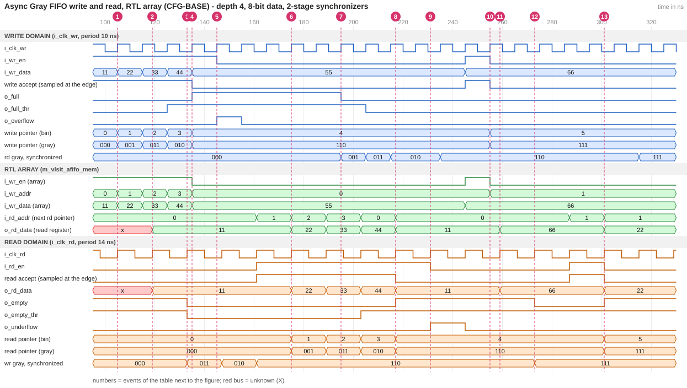

Figure 10.6-2: zoom on the first write, the crossing of the write pointer, and the fall of `o_empty`.

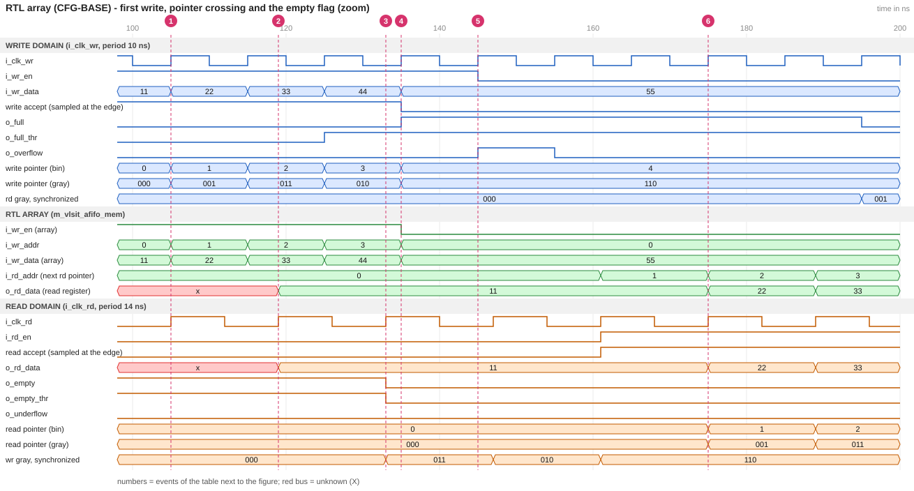

Figure 10.6-3: zoom on a write to an empty FIFO whose read port reads the same entry in every cycle.

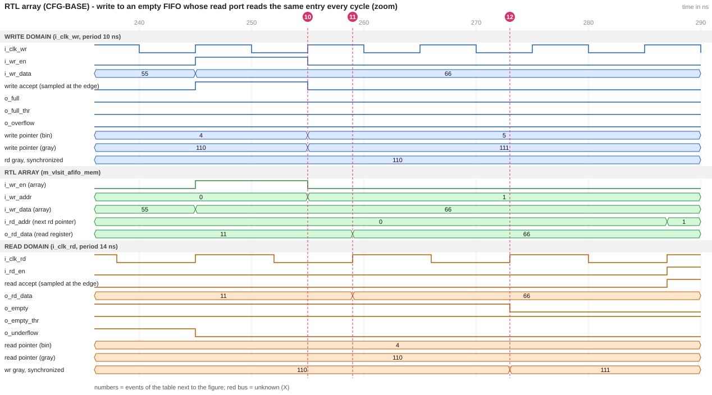

Event table of Figures 10.6-1 to 10.6-3:

| No. | Time (ns) | Event |
|---:|---:|---|
| 1 | 105.0 | Write of 0x11 accepted at write edge 105 (`i_wr_en` = 1 since edge 95, `o_full` = 0). The storage is written and the write Gray pointer register changes 000 -> 001 at the same edge. |
| 2 | 119.0 | `o_rd_data` shows 0x11 (show-ahead). The storage is read in every read cycle with the address of the next read pointer (0), so it already holds the new word before the empty flag falls. |
| 3 | 133.0 | The write Gray pointer has crossed the 2-stage synchronizer (S = 2 read edges after the first capturing edge) and `o_empty` falls (combinational from the synchronized pointer). The data was already on `o_rd_data`. |
| 4 | 135.0 | The 4th word (0x44) is accepted at write edge 135 and fills the FIFO: `o_full` rises. |
| 5 | 145.0 | A 5th write (0x55) is sampled at write edge 145 while `o_full` = 1: it is dropped (pointer and storage unchanged) and `o_overflow` pulses for one write cycle, then `i_wr_en` falls at the same edge. |
| 6 | 175.0 | First read accepted at read edge 175 (`i_rd_en` = 1 since edge 161, `o_empty` = 0). `o_rd_data` moves to the next word 0x22 right after this edge, because the read module gave the address of the next read pointer. |
| 7 | 195.0 | The read Gray pointer has crossed to the write domain (2 write edges) and `o_full` falls. |
| 8 | 217.0 | The 4th read (edge 217) takes the last word: `o_empty` rises. |
| 9 | 231.0 | A 5th read is sampled at read edge 231 while `o_empty` = 1: the read pointer is unchanged and `o_underflow` pulses for one read cycle. `i_rd_en` falls at the same edge. |
| 10 | 255.0 | Write to an empty FIFO: a new word (0x66) is written to address 0 at write edge 255. The read pointer addresses the same entry and the storage is read at every read edge, but no read edge happened since the write, so `o_rd_data` still shows the old word 0x11. |
| 11 | 259.0 | The next read edge (259) captures the new word: `o_rd_data` = 0x66. `o_empty` is still 1. |
| 12 | 273.0 | The new write pointer has crossed to the read domain: `o_empty` falls. |
| 13 | 301.0 | The word 0x66 is read at read edge 301 and `o_empty` rises again. |

Check of the write interface inputs: 0 change(s) of i_wr_en, i_wr_data outside a rising edge of the clock
Check of the read interface inputs: 0 change(s) of i_rd_en outside a rising edge of the clock

What the figures show:

- **Synchronous inputs.** `i_wr_en` and `i_wr_data` change exactly at write-clock rising edges (95, 105, 115, ..., 145, 245, 255); `i_rd_en` changes exactly at read-clock rising edges (161, 231, 287, 301). The accept rows rise in the same cycle, and the word is taken at the next edge of that domain.
- **Write path.** A write is accepted at the write edge where `i_wr_en` = 1 and `o_full` = 0. The array and the write pointer both update at that edge (event 1).
- **Show-ahead read.** The read module gives the address of the next read pointer every cycle, so the storage output register already holds the next word. `o_rd_data` shows 0x11 before `o_empty` falls (events 2 and 3). After an accepted read (event 6), `o_rd_data` moves to the next word without extra latency.
- **Pessimistic flags.** `o_empty` falls S = 2 read edges after the first capturing edge of the write pointer (event 3). `o_full` falls late after the first read (event 7), not at the read edge. Neither flag is ever early.
- **Pulses.** `o_overflow` (event 5) and `o_underflow` (event 9) are registered, one cycle wide, and return to 0 by themselves. The rejected request leaves the pointers and the storage unchanged.
- **Write to an empty FIFO (events 10 to 12).** The word is written at edge 255; the read register still shows the old word of address 0 until the next read edge (259, event 11), which captures 0x66; `o_empty` falls two read edges later (event 12).

#### 10.6.3 Write and read with the SRAM macro (CFG-MACRO, `PARA_AFIFO_MEM_USE_MACRO` = 1)

The macro waveforms show the macro pins of `VLSIT_CELL_SRAM_1W1R` (Section 6.2): `WEB` (active-low), `AW`, `DW`, `REB` (tied low), `AR` (next read pointer), `QR`. The macro has a read latency of 1 `CLKR` cycle.

Figure 10.6-4: complete scenario.

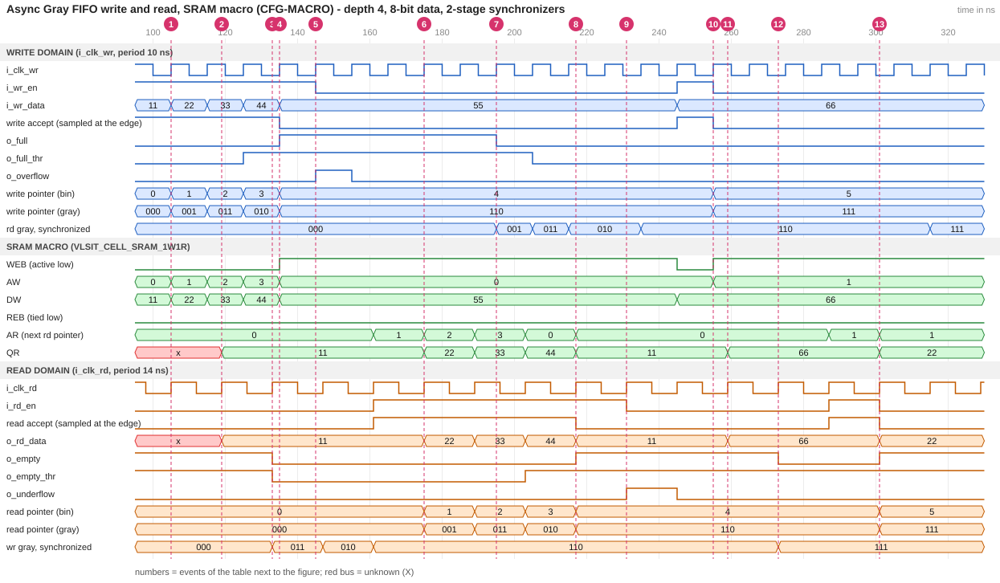

Figure 10.6-5: zoom on the first write and the fall of `o_empty`.

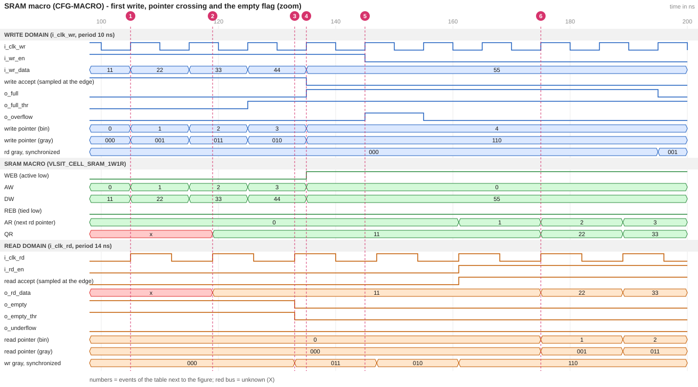

Figure 10.6-6: zoom on the write to an empty FIFO.

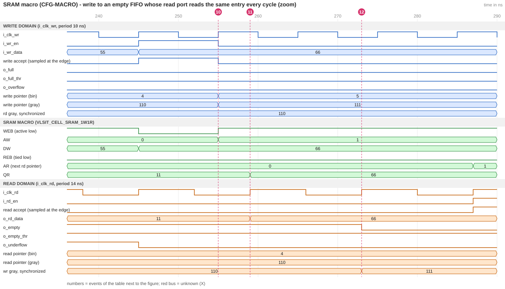

Event table of Figures 10.6-4 to 10.6-6:

| No. | Time (ns) | Event |
|---:|---:|---|
| 1 | 105.0 | Write of 0x11 accepted at write edge 105 (`i_wr_en` = 1 since edge 95, `o_full` = 0). The storage is written and the write Gray pointer register changes 000 -> 001 at the same edge. |
| 2 | 119.0 | `o_rd_data` shows 0x11 (show-ahead). The storage is read in every read cycle with the address of the next read pointer (0), so it already holds the new word before the empty flag falls. |
| 3 | 133.0 | The write Gray pointer has crossed the 2-stage synchronizer (S = 2 read edges after the first capturing edge) and `o_empty` falls (combinational from the synchronized pointer). The data was already on `o_rd_data`. |
| 4 | 135.0 | The 4th word (0x44) is accepted at write edge 135 and fills the FIFO: `o_full` rises. |
| 5 | 145.0 | A 5th write (0x55) is sampled at write edge 145 while `o_full` = 1: it is dropped (pointer and storage unchanged) and `o_overflow` pulses for one write cycle, then `i_wr_en` falls at the same edge. |
| 6 | 175.0 | First read accepted at read edge 175 (`i_rd_en` = 1 since edge 161, `o_empty` = 0). `o_rd_data` moves to the next word 0x22 right after this edge, because the read module gave the address of the next read pointer. |
| 7 | 195.0 | The read Gray pointer has crossed to the write domain (2 write edges) and `o_full` falls. |
| 8 | 217.0 | The 4th read (edge 217) takes the last word: `o_empty` rises. |
| 9 | 231.0 | A 5th read is sampled at read edge 231 while `o_empty` = 1: the read pointer is unchanged and `o_underflow` pulses for one read cycle. `i_rd_en` falls at the same edge. |
| 10 | 255.0 | Write to an empty FIFO: a new word (0x66) is written to address 0 at write edge 255. The read pointer addresses the same entry and the storage is read at every read edge, but no read edge happened since the write, so `o_rd_data` still shows the old word 0x11. |
| 11 | 259.0 | The next read edge (259) captures the new word: `o_rd_data` = 0x66. `o_empty` is still 1. |
| 12 | 273.0 | The new write pointer has crossed to the read domain: `o_empty` falls. |
| 13 | 301.0 | The word 0x66 is read at read edge 301 and `o_empty` rises again. |

Check of the write interface inputs: 0 change(s) of i_wr_en, i_wr_data outside a rising edge of the clock
Check of the read interface inputs: 0 change(s) of i_rd_en outside a rising edge of the clock

The two storage configurations give the same waveforms at every port and at the memory port: the macro model `VLSIT_CELL_SRAM_1W1R` is a registered read port like the array (read latency 1) and returns the old word when a read and a write of the same address happen at the same edge (DEC-041, DEC-043). The testbench shall ignore `o_rd_data` while `o_empty` = 1, and shall check that the value is never X when a read is accepted (SVA-004).

#### 10.6.4 Metastability model of the synchronizer (simulation branch, REQ-VER-001)

The model is the branch of `m_vlsit_afifo_cell_sync` compiled when `VLSIT_SYNTHESIS` is not defined (Section 14.1, DEC-038); `m_vlsit_afifo_sync` and the other modules only instantiate the wrapper. It models the extra delay caused by metastability. Each bit of the synchronized vector is independent. When a bit changes at the input of the last stage, the model chooses, from a seed, an extra delay of 0, 1, or 2 destination cycles. With 0 extra cycles the output equals the plain chain. If the input changes again while a change is pending, the pending value is replaced by the new input value and the delay restarts. The model is controlled by `+AFIFO_MSYNC_EN` (enable) and `+AFIFO_MSYNC_SEED` (seed). The figures use seed 1 and a source-domain period of 10 ns against a destination period of 14 ns. Every input change is launched at a rising edge of the source clock. The Gray pointer bits step through 000, 001, 011, 010, 110, 111, six source cycles apart. Bit 3 is a fast-toggling bit that is added only to show the replacement of a pending change: it toggles once per source cycle (10 ns, shorter than the destination period of 14 ns); it is not part of a pointer.

Figure 10.6-7: S = 2 (`PARA_AFIFO_CELL_TYPE` = 2) (nominal latency 1 cycle after the first capturing edge, observed 1, 2, or 3).

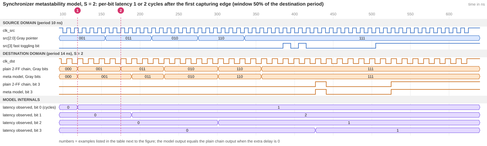

| No. | Time (ns) | What happens |
|---:|---:|---|
| 1 | 119.0 | Bit 0 changes to 1 at the last synchronizer stage. The model chose 1 extra cycle(s): latency 2 cycles after the first capturing edge, so the model output changes 14 ns after the plain chain output. |
| 2 | 231.0 | Bit 0 changes to 0 at the last synchronizer stage. The model chose 2 extra cycle(s): latency 3 cycles after the first capturing edge, so the model output changes 28 ns after the plain chain output. |
| 3 | 301.0 | Bit 2 changes to 1 at the last synchronizer stage. The model chose 0 extra cycle(s): latency 1 cycles after the first capturing edge, so the model output changes 0 ns after the plain chain output. |
| 4 | 441.0 | Bit 3: the pending change to 1 is replaced by the new input value 0; the delay restarts. |

All latency choices of the run with S = 2: t=119.0 ns bit 0 extra 1 (latency 2); t=175.0 ns bit 1 extra 1 (latency 2); t=231.0 ns bit 0 extra 2 (latency 3); t=301.0 ns bit 2 extra 0 (latency 1); t=357.0 ns bit 0 extra 1 (latency 2); t=427.0 ns bit 3 extra 2 (latency 3); t=441.0 ns bit 3 extra 0 (latency 1); t=525.0 ns bit 3 extra 1 (latency 2)

Figure 10.6-8: S = 3 (`PARA_AFIFO_CELL_TYPE` = 3) (nominal latency 2 cycles after the first capturing edge, observed 2, 3, or 4).

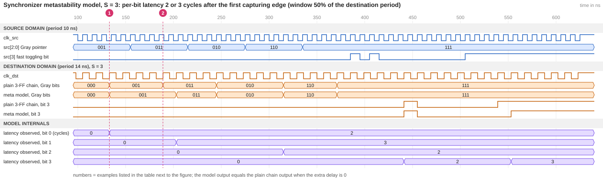

| No. | Time (ns) | What happens |
|---:|---:|---|
| 1 | 133.0 | Bit 0 changes to 1 at the last synchronizer stage. The model chose 2 extra cycle(s): latency 4 cycles after the first capturing edge, so the model output changes 28 ns after the plain chain output. |
| 2 | 189.0 | Bit 1 changes to 1 at the last synchronizer stage. The model chose 1 extra cycle(s): latency 3 cycles after the first capturing edge, so the model output changes 14 ns after the plain chain output. |
| 3 | 245.0 | Bit 0 changes to 0 at the last synchronizer stage. The model chose 0 extra cycle(s): latency 2 cycles after the first capturing edge, so the model output changes 0 ns after the plain chain output. |
| 4 | 455.0 | Bit 3: the pending change to 1 is replaced by the new input value 0; the delay restarts. |

All latency choices of the run with S = 3: t=133.0 ns bit 0 extra 2 (latency 4); t=189.0 ns bit 1 extra 1 (latency 3); t=245.0 ns bit 0 extra 0 (latency 2); t=315.0 ns bit 2 extra 1 (latency 3); t=371.0 ns bit 0 extra 0 (latency 2); t=441.0 ns bit 3 extra 2 (latency 4); t=455.0 ns bit 3 extra 1 (latency 3); t=539.0 ns bit 3 extra 1 (latency 3)

What the figures show:

- The row "plain chain" is the model with the model disabled, the row "meta model" is the model with the delay chosen. They are equal when the chosen extra delay is 0 and the meta model is later by 1 or 2 destination periods otherwise.
- The rows "latency chosen" show the delay selected at each change of each bit. Different bits of the same signal can get different delays. A Gray pointer changes one bit per update, so a late bit makes the destination domain see the previous pointer value for a while instead of the new one.
- A pending change that is replaced (event 4) can make a short pulse disappear on the model output. This is intended: the model is there to check that the FIFO flags stay pessimistic when a bit arrives late (REQ-FUNC-008, REQ-FUNC-009).
- The delay of the flags at the FIFO ports is therefore S, S + 1, or S + 2 destination edges after the first capturing edge (Section 10.3). The FIFO of Section 10.6.2 uses the plain chain, which is the case of 0 extra cycles.

#### 10.6.5 Back-to-back write and read

This scenario shows the FIFO working at the full rate of one word per clock cycle on both sides, without any interruption (no stall, no empty or full cycle). The two clocks have the same period (10 ns), with the read clock 3 ns after the write clock, and the depth is 8. The producer writes 24 words (0x01 to 0x18) in 24 consecutive write cycles. The consumer sets `i_rd_en` = 1 at the first read edge after it has seen `o_empty` = 0, keeps it, and drops it at the edge of the 24th accepted read. All inputs change at rising edges of their clock.

Figure 10.6-9: complete burst with the RTL array.

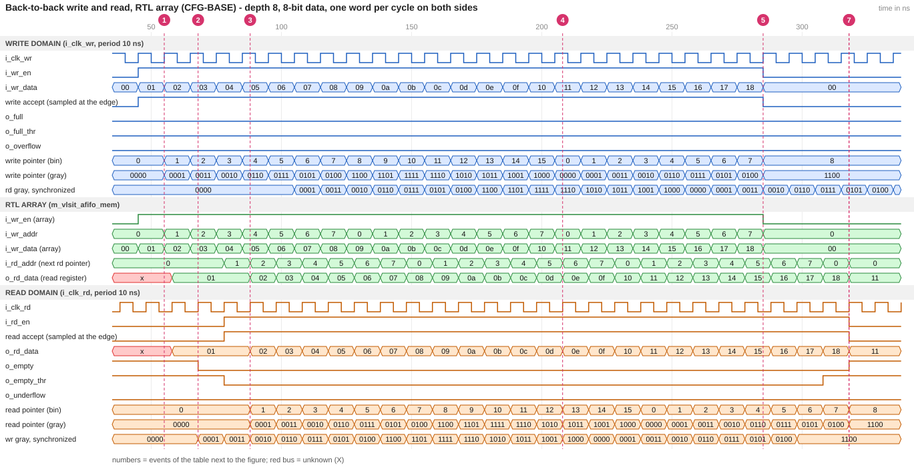

Figure 10.6-10: steady state, zoom, with the RTL array.

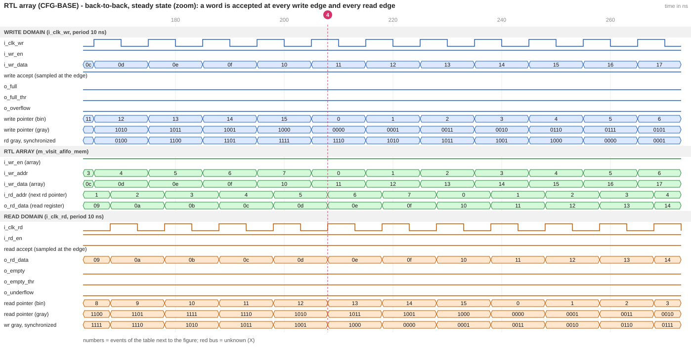

Figure 10.6-11: complete burst with the SRAM macro.

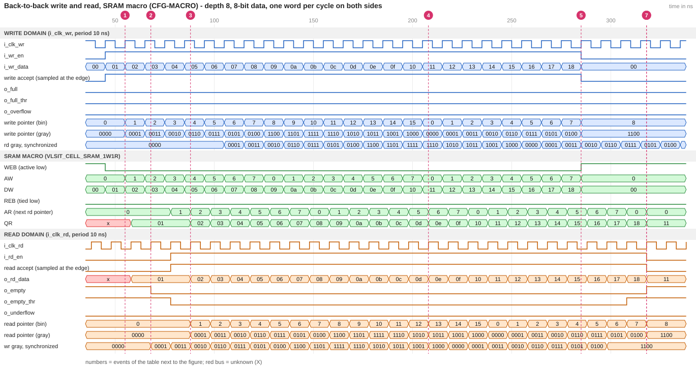

Figure 10.6-12: steady state, zoom, with the SRAM macro.

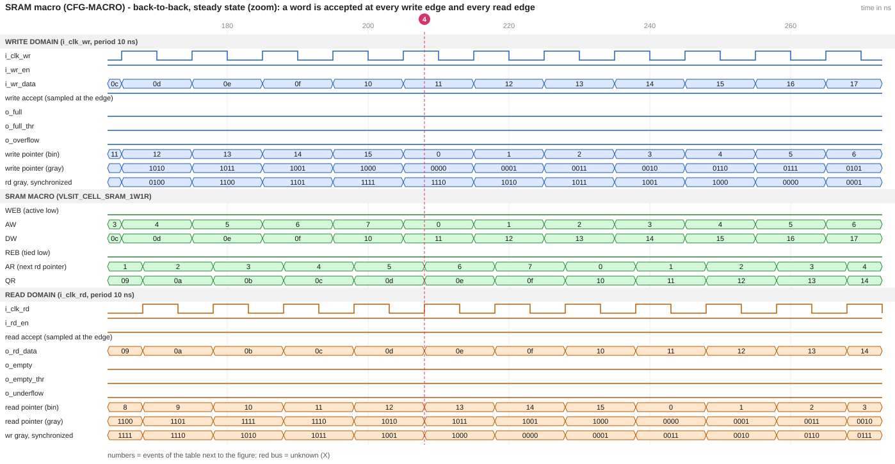

Event table of Figures 10.6-9 to 10.6-12 (both storage configurations give the same times):

| No. | Time (ns) | Event |
|---:|---:|---|
| 1 | 55.0 | First write accepted (`i_wr_en` was driven at the previous edge). |
| 2 | 68.0 | `o_empty` falls: the first word has crossed the synchronizer (S = 2 read edges). |
| 3 | 88.0 | First read accepted. The consumer saw `o_empty` = 0, set `i_rd_en` = 1 at the next read edge, and keeps it: from here every read edge accepts one word. |
| 4 | 208.0 | Steady state, middle of the burst: one word is written and one word is read in every clock cycle, and `o_rd_data` steps through consecutive words. |
| 5 | 285.0 | Last write of the burst accepted (word 24). `i_wr_en` falls at this edge. |
| 6 | 318.0 | Last read accepted (word 24). `i_rd_en` falls at this edge. |
| 7 | 318.0 | `o_empty` rises: the burst is fully read. |

Check of the run: 24 write edges accepted, gaps between them: 0; 24 read edges accepted, gaps between them: 0; `o_empty` = 1 between the first and the last accepted read: no; `o_full` = 1 at any time: no; overflow pulses: 0; underflow pulses: 0.
Check of the write interface inputs: 0 change(s) of i_wr_en, i_wr_data outside a rising edge of the clock
Check of the read interface inputs: 0 change(s) of i_rd_en outside a rising edge of the clock

What the figures show:

- **No interruption on the write side.** `i_wr_en` is 1 from the first to the last word, a word is accepted at every write edge (the check line gives 24 accepted edges and 0 gaps), and `o_full` stays 0 for the whole burst.
- **No interruption on the read side.** From the first accepted read (event 3) to the last (event 6) a word is accepted at every read edge (24 accepted edges, 0 gaps), `o_empty` stays 0 until the last word is read, and `o_rd_data` steps through the consecutive words 0x01, 0x02, 0x03, ... in the order of the writes.
- **Start-up delay only.** The first read is accepted about 33 ns after the first write: the word crosses the synchronizer (S = 2 read edges, event 2) and the consumer needs one more edge to set `i_rd_en`. This delay is paid once; after it the two sides run at the same rate and the number of words in the FIFO stays at 4 (write pointer minus read pointer, counted at the read edges) until the writes stop.
- **Pointers.** Both Gray pointers change by one bit at every edge (INV-003), and the binary pointers wrap from 15 to 0 (pointer width 4 for depth 8) while the storage address wraps from 7 to 0, without any effect on the flow.
- **No error flag.** No overflow and no underflow pulse occurs during the burst.
- **Condition.** The rate is kept because the two clocks have the same frequency. With a slower read clock the FIFO fills and `o_full` stops the producer (10.6.2); with a faster read clock `o_empty` stops the consumer.

#### 10.6.6 Reproduction

Needs `iverilog` and `vvp` (OSS CAD Suite, see the tools README) and Python 3 on the path. The tool `bin` and `lib` directories of the suite shall both be on `PATH`.

~~~bash
cd waveforms/proto
python run_waveforms.py ../regen      # simulates the real RTL (4 runs) and the metastability demo, redraws all figures
~~~

The command writes the same SVG files and `tables.txt` as `waveforms/`. Files in `waveforms/proto`: `tb_fifo_wave.sv` (waveform testbench of the RTL, scenarios 1 and 2, array and macro), `meta_demo.sv` (metastability model and demo), `wavelib.py` (VCD to SVG renderer), `gen_all.py` (figures, event tables, and the synchronism check), `run_waveforms.py` (driver).

The waveforms of the software reset are in Section 10.7.4.

### 10.7 Software reset

The software reset returns the FIFO to the empty state without a hardware reset. The input `i_rst_n_sw` is an active-low level that belongs to the write clock domain. Because the two pointers live in two unrelated clock domains, the reset is a **handshake** between the domains and not a single signal.

#### 10.7.1 Principle

1. **Write side first blocks, then asks.** From the cycle in which `i_rst_n_sw` = 0, writes are blocked. The write reset FSM raises the request `req_wr`, which crosses to the read domain (CDC-005).
2. **Read side blocks, resets, answers.** When the synchronized request is 1, reads are blocked and `o_empty` = 1. The read reset FSM resets the read pointer and raises the acknowledge `ack_rd`, which crosses to the write domain (CDC-006).
3. **Write side resets its pointer after the answer.** The write pointer is reset only after the acknowledge is seen, so the write pointer is never reset before the read side has stopped using the old pointer. The write FSM then holds until `i_rst_n_sw` = 1.
4. **Four-phase release.** The write side drops the request, the read side drops the acknowledge, and each side leaves the reset only when its synchronized copy of the other pointer is 0 (flush check, 10.7.3). The read side leaves first. The write side leaves last, because its release needs the acknowledge to be 0, which is the effect of the read release.
5. **What is lost.** The words in the FIFO are discarded. A read accepted between the assertion of `i_rst_n_sw` and the arrival of the request in the read domain returns a valid pre-reset word; its word is discarded anyway. The storage is not cleared (DEC-035).

#### 10.7.2 Reset FSMs and block conditions

Write reset FSM (CLK-WR) and read reset FSM (CLK-RD):

~~~mermaid
stateDiagram-v2
  direction LR
  [*] --> W_RUN
  W_RUN --> W_REQ: i_rst_n_sw = 0 / req_wr = 1
  W_REQ --> W_PTR: ack_sync = 1
  W_PTR --> W_HOLD: write pointer = 0
  W_HOLD --> W_REL: i_rst_n_sw = 1 / req_wr = 0
  W_REL --> W_RUN: ack_sync = 0 and rd_gray_sync = 0
~~~

~~~mermaid
stateDiagram-v2
  direction LR
  [*] --> R_RUN
  R_RUN --> R_RST: req_sync = 1
  R_RST --> R_ACK: read pointer = 0 / ack_rd = 1
  R_ACK --> R_RUN: req_sync = 0 and wr_gray_sync = 0 / ack_rd = 0
~~~

Block conditions (combinational, zero latency (DEC-030)):

| Signal | Definition |
|---|---|
| `wr_blk` | (write FSM not in RUN) OR (`i_rst_n_sw` = 0), which is `o_sw_rst_busy` OR (`i_rst_n_sw` = 0) |
| `rd_blk` | (read FSM not in RUN) OR `req_sync` |
| Write accepted | `i_wr_en` AND NOT `wr_blk` AND NOT the normal full condition |
| Read accepted | `i_rd_en` AND NOT `rd_blk` AND NOT the normal empty condition |
| `o_empty` | `rd_blk` OR the normal empty condition |
| `o_full` | 1 while `wr_blk` (DEC-027); otherwise the normal full condition |
| `o_full_thr`, `o_empty_thr` | Values of an empty FIFO while `wr_blk` (write side) or `rd_blk` (read side) (DEC-029); otherwise normal |
| `o_overflow`, `o_underflow` | No pulse for an access blocked by the software reset (DEC-028) |
| `o_sw_rst_busy` | Flip-flop `reg_sw_rst_busy`: set when the write FSM leaves RUN, cleared when it returns to RUN; equal to (write FSM not in RUN) at every clock edge (DEC-026, Section 10.7.7) |

The pointers are reset synchronously by the FSMs. The FSM state registers are reset by the hardware resets (`i_rst_n_wr`, `i_rst_n_rd`).

Handshake sequence:

~~~mermaid
sequenceDiagram
  participant SW as Software
  participant W as Write domain (FSM, pointer)
  participant R as Read domain (FSM, pointer)
  SW->>W: i_rst_n_sw = 0
  Note over W: writes blocked at once (wr_blk)
  W->>R: req_wr = 1 (sync, S read edges)
  Note over R: reads blocked, o_empty = 1
  R->>R: state RST: read pointer = 0
  R->>W: ack_rd = 1 (sync, S write edges)
  W->>W: state PTR: write pointer = 0
  Note over W: HOLD until i_rst_n_sw = 1
  SW->>W: i_rst_n_sw = 1
  W->>R: req_wr = 0 (sync)
  R->>R: wait req = 0 and wr gray sync = 0
  Note over R: READ RELEASED FIRST, flags live, empty = 1
  R->>W: ack_rd = 0 (sync)
  W->>W: wait ack = 0 and rd gray sync = 0
  Note over W: WRITE RELEASED LAST, writes unblocked
~~~

#### 10.7.3 Behavior per phase and the flush check

| Phase | Trigger | Write side | Read side | `o_empty` | `o_full` (DEC-027) | req | ack | `o_sw_rst_busy` |
|---|---|---|---|---|---|---|---|---|
| P0 Normal | - | RUN, writes accepted | RUN, reads accepted | Normal | Normal | 0 | 0 | 0 |
| P1 Request | `i_rst_n_sw` = 0 | Writes blocked in the same cycle. Next write edge: REQ, `req_wr` = 1 | Reads still accepted (request not seen) | Normal | 1 | 0 to 1 | 0 | 0, then 1 at the next write edge (with `req_wr`) |
| P2 Request crosses | S read edges | REQ, waits | When the synchronized request = 1: reads blocked in that cycle | 1 | 1 | 1 | 0 | 1 |
| P3 Read reset | Read FSM sees the request | REQ | RST: read pointer = 0, then ACK with `ack_rd` = 1 | 1 | 1 | 1 | 0 to 1 | 1 |
| P4 Ack crosses | S write edges | Sees the acknowledge: PTR, write pointer = 0, then HOLD | ACK, waits | 1 | 1 | 1 | 1 | 1 |
| P5 Hold | `i_rst_n_sw` stays 0 | HOLD, writes blocked | ACK | 1 | 1 | 1 | 1 | 1 |
| P6 Release request | `i_rst_n_sw` = 1 | HOLD to REL, `req_wr` = 0 | ACK | 1 | 1 | 1 to 0 | 1 | 1 |
| P7 Read release | Synchronized request = 0 and synchronized write pointer = 0 | REL, writes still blocked | ACK to RUN, `ack_rd` = 0. Flags live (empty = 1, both pointers 0) | Normal (1) | 1 | 0 | 1 to 0 | 1 (the read release does not change it) |
| P8 Write release | Synchronized acknowledge = 0 and synchronized read pointer = 0 | REL to RUN: writes unblocked, full live | RUN | Normal | Normal (0) | 0 | 0 | 1, then 0 at the release edge |

**Flush check.** After a pointer is reset, the other domain still holds a synchronized copy of the old value for a few cycles. If the read side were released while its copy of the write pointer is still the old non-zero value, `o_empty` would fall and a word that never existed would be read. The same holds for the write side and the full flag. The release therefore needs the synchronized pointer of the other side to be 0. The negative run of Section 10.7.6 (flush check removed) fails in 23 of 36 runs, so the check is necessary.

#### 10.7.4 Waveforms

All waveforms come from the protocol prototype `waveforms/proto/srst_proto.sv` (3-bit pointers, depth 4, `i_wr_en` and `i_rd_en` driven by the testbench, write clock 10 ns, read clock 14 ns, S = 2 stages, plain synchronizers, thresholds `i_full_thr` = 3 and `i_empty_thr` = 1). The prototype models the closed decisions DEC-025 to DEC-036: active-low `i_rst_n_sw`, `o_sw_rst_busy`, `o_full` = 1 while writes are blocked, no error pulse for a blocked access, threshold flags of an empty FIFO while blocked, zero-latency blocks, and hardware reset priority. It is not the RTL of the IP. Blue = write domain, orange = read domain, red-circled numbers = events of the tables. Four scenarios are drawn:

| Scenario | What it shows | Figures |
|---|---|---|
| 1 | Main sequence with three words in the FIFO; the producer and the consumer keep requesting during the reset | 10.7-1 to 10.7-4 |
| 2 | Full FIFO with the producer in overflow, and a reset requested by a **one-cycle** low pulse of `i_rst_n_sw` | 10.7-5 |
| 3 | `i_rst_n_sw` asserted again while the write FSM is in REL: a new sequence follows | 10.7-6 |
| 4 | Hardware reset of both domains in the middle of the sequence: clean restart | 10.7-7 |

**Synchronous interfaces.** In all scenarios every input of the write interface (`i_wr_en`, `i_wr_data`) and the software reset `i_rst_n_sw` change at a rising edge of `i_clk_wr`, every input of the read interface (`i_rd_en`) at a rising edge of `i_clk_rd`, and the hardware resets are asserted and released at a rising edge of their clock (the testbench assigns them at the edge, so the design samples the new value at the next edge). The check of the four runs counts the changes outside a rising edge:

| Scenario | Write domain signals checked (clock `i_clk_wr`) | Changes outside a rising edge | Read domain signals checked (clock `i_clk_rd`) | Changes outside a rising edge |
|---|---|---:|---|---:|
| 1 | `i_wr_en`, `i_wr_data`, `i_rst_n_sw`, `rst_n_wr` | 0 | `i_rd_en`, `rst_n_rd` | 0 |
| 2 | `i_wr_en`, `i_wr_data`, `i_rst_n_sw`, `rst_n_wr` | 0 | `i_rd_en`, `rst_n_rd` | 0 |
| 3 | `i_wr_en`, `i_wr_data`, `i_rst_n_sw`, `rst_n_wr` | 0 | `i_rd_en`, `rst_n_rd` | 0 |
| 4 | `i_wr_en`, `i_wr_data`, `i_rst_n_sw`, `rst_n_wr` | 0 | `i_rd_en`, `rst_n_rd` | 0 |

**Scenario 1: main sequence.** Three words (0x11, 0x22, 0x33) are in the FIFO, so before the reset `o_full_thr` = 1 and `o_empty_thr` = 0. `i_wr_en` = 1 (data 0x77) and `i_rd_en` = 1 are applied from the start of the reset. Figure 10.7-1 is the overview; Figures 10.7-2 to 10.7-4 zoom on the three parts of the sequence.

Figure 10.7-1: overview.

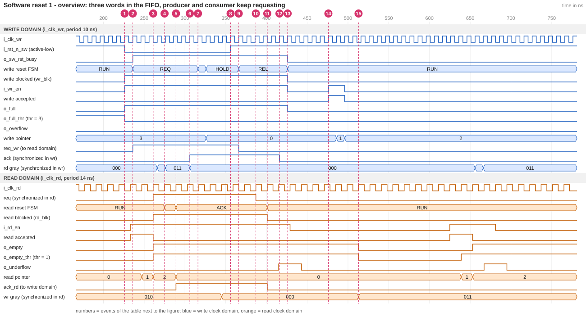

Figure 10.7-2: request, read-side reset, acknowledge, write-side reset (events 1 to 7).

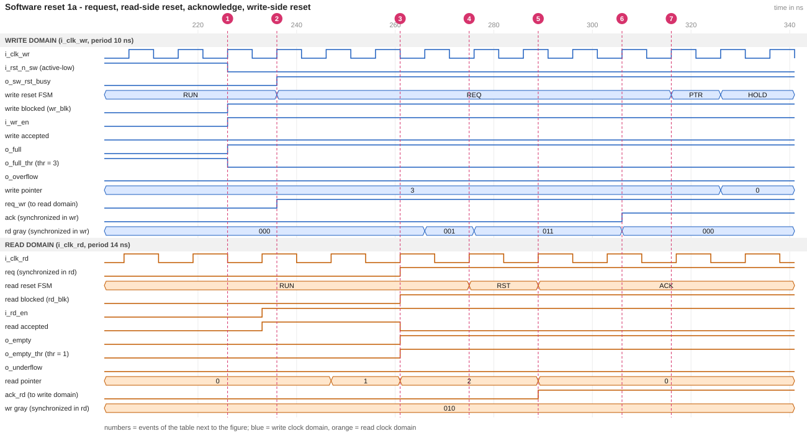

Figure 10.7-3: release order, read side first and write side last (events 8 to 13).

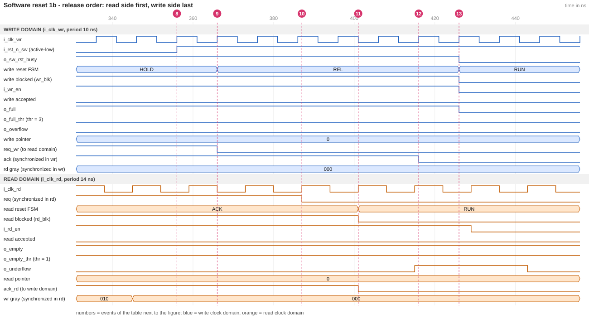

Figure 10.7-4: the flags return to the FIFO logic after the release (events 13 to 15).

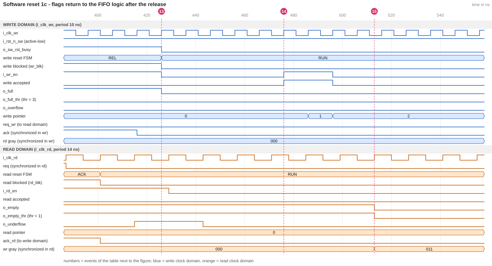

| No. | Time (ns) | Event |
|---:|---:|---|
| 1 | 226.0 | Software asserts `i_rst_n_sw` = 0 (active-low request). In the same cycle (zero latency) writes are blocked: `i_wr_en` = 1 is not accepted, `o_full` = 1, and `o_full_thr` takes the value of an empty FIFO (0). |
| 2 | 236.0 | Write FSM leaves RUN: `req_wr` = 1 and `o_sw_rst_busy` = 1. Writes stay blocked. |
| 3 | 261.0 | The request is visible in the read domain (after the synchronizer): reads are blocked, `o_empty` = 1 and `o_empty_thr` = 1 in the same cycle. Reads accepted before this event were normal reads of pre-reset words. |
| 4 | 275.0 | Read FSM in RST: the read pointer is reset to 0. |
| 5 | 289.0 | `ack_rd` = 1: the read side is reset and acknowledges. |
| 6 | 306.0 | The acknowledge is visible in the write domain. |
| 7 | 316.0 | Write FSM in PTR: the write pointer is reset to 0. The FSM then waits in HOLD for `i_rst_n_sw` = 1. |
| 8 | 356.0 | Software releases `i_rst_n_sw` (back to 1). Writes stay blocked (FSM in HOLD, then REL). |
| 9 | 366.0 | Write FSM: `req_wr` = 0 (release request). |
| 10 | 387.0 | The request = 0 is visible in the read domain. |
| 11 | 401.0 | Read FSM returns to RUN: **read released first**. `ack_rd` = 0, flags live (`o_empty` = 1 because both pointers are 0). |
| 12 | 416.0 | The acknowledge = 0 is visible in the write domain. |
| 13 | 426.0 | Write FSM returns to RUN: **write released last**. Writes unblocked, `o_full` = 0, `o_full_thr` normal, `o_sw_rst_busy` = 0. |
| 14 | 476.0 | The first write after the reset is accepted (0xA5). |
| 15 | 513.0 | The new write pointer has crossed to the read domain: `o_empty` falls. |

What the figures show (scenario 1):

- **Write side, from event 1.** `i_wr_en` stays 1 until event 13 and nothing is accepted: the write pointer does not move and the storage is not written. `o_full` = 1 in the cycle in which `i_rst_n_sw` falls (zero latency), `o_full_thr` takes the value of an empty FIFO (0), and `o_overflow` does not pulse. `o_sw_rst_busy` = 1 from event 2 to event 13.
- **Read side, from event 3.** Between events 1 and 3 the consumer still reads (read pointer 0 to 1 to 2): the request has not reached the read domain, and these reads return valid pre-reset words. From event 3 reads are blocked: `i_rd_en` stays 1 and nothing is accepted, `o_empty` = 1 and `o_empty_thr` = 1.
- **Order.** The read pointer is reset (event 4) before the acknowledge rises (event 5); the write pointer is reset (event 7) only after the acknowledge is seen (event 6).
- **Release.** Event 11 (read released) is 25 ns before event 13 (write released): the order is forced by the handshake, because the write release needs the acknowledge to be 0, which is the effect of the read release.
- **After the read release (event 11)** the consumer still requests a read; the FIFO is empty and the access is no longer blocked, so `o_underflow` pulses once. This is the normal underflow of the FIFO, not an effect of the reset.
- **After event 13** the first write is accepted (event 14), and `o_empty` and `o_empty_thr` fall only after the write pointer has crossed to the read domain (event 15). The read pointer then runs 0, 1, 2 for the two new words.

**Scenario 2: one-cycle pulse on a full FIFO.** The FIFO is full (four words), the producer keeps writing, and `i_rst_n_sw` is low for exactly one write-clock cycle.

Figure 10.7-5: one-cycle pulse on a full FIFO.

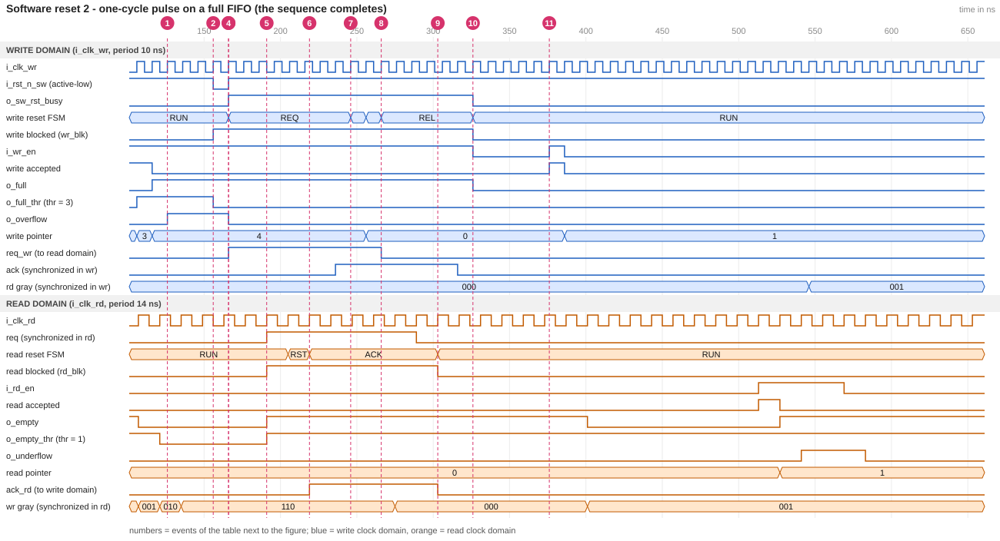

| No. | Time (ns) | Event |
|---:|---:|---|
| 1 | 126.0 | The FIFO is full and the producer keeps writing: `o_overflow` pulses (normal overflow, registered one cycle after the rejected request). |
| 2 | 156.0 | `i_rst_n_sw` = 0 for **one write-clock cycle** only. Writes are blocked at once, `o_full` stays 1, and no overflow pulse follows although `i_wr_en` = 1 (the blocked access is not an error). |
| 3 | 166.0 | Write FSM takes the request at the first write edge: `req_wr` = 1, `o_sw_rst_busy` = 1. |
| 4 | 166.0 | `i_rst_n_sw` is back to 1 after one cycle. The request is already latched, so the sequence continues. |
| 5 | 191.0 | The request is visible in the read domain: reads blocked, `o_empty` = 1. |
| 6 | 219.0 | Read pointer reset, `ack_rd` = 1. |
| 7 | 246.0 | Write pointer reset (PTR). The input is already 1, so the FSM does not wait in HOLD. |
| 8 | 266.0 | Write FSM: `req_wr` = 0. |
| 9 | 303.0 | Read side released first. |
| 10 | 326.0 | Write side released last: `o_full` falls, writes unblocked. |
| 11 | 376.0 | The first write after the reset is accepted. |

What the figure shows: the write FSM latches the request at the first write edge, so a one-cycle pulse is enough (event 3). Before the pulse the producer is in overflow (`o_overflow` pulses, event 1); from the pulse on, the same `i_wr_en` = 1 causes no overflow pulse because the access is blocked. `o_full` stays 1 during the whole reset and falls at the write release (event 10); `o_full_thr` follows the empty-FIFO value while blocked. Because the input is already 1, the write FSM passes HOLD without waiting.

**Scenario 3: assertion again while the write FSM is in REL (DEC-032).** `i_rst_n_sw` is released, and is driven to 0 again while the write FSM is in REL (before the write release). The producer keeps `i_wr_en` = 1.

Figure 10.7-6: `i_rst_n_sw` asserted again in REL.

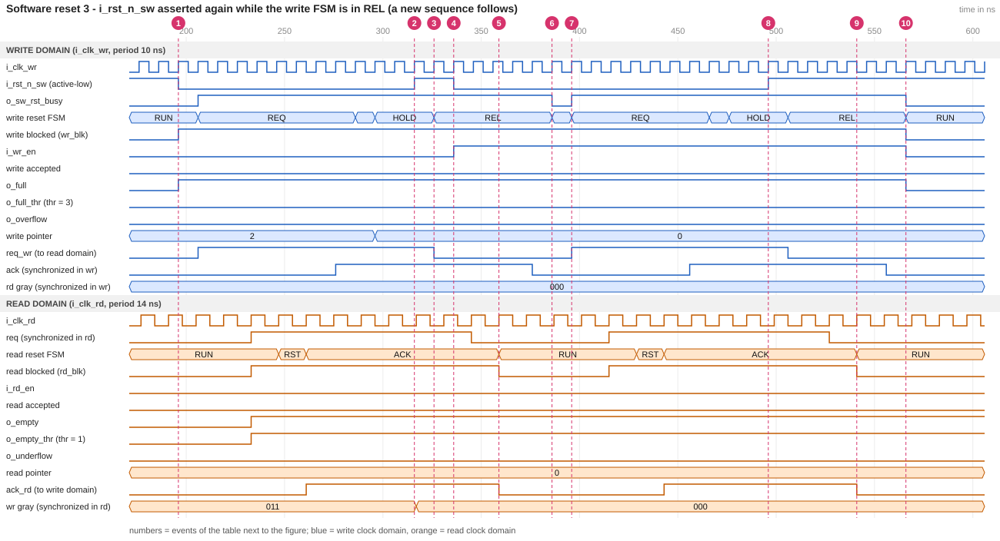

| No. | Time (ns) | Event |
|---:|---:|---|
| 1 | 196.0 | First software reset: `i_rst_n_sw` = 0, writes blocked, handshake starts. |
| 2 | 316.0 | `i_rst_n_sw` back to 1 (after HOLD): the write FSM goes to REL and drops the request. |
| 3 | 326.0 | Write FSM in REL, waiting for the acknowledge to fall. |
| 4 | 336.0 | `i_rst_n_sw` = 0 **again while the write FSM is in REL**. Writes stay blocked (the block includes the input); `i_wr_en` = 1 is not accepted. |
| 5 | 359.0 | First sequence: the read side is released. |
| 6 | 386.0 | First sequence: the write FSM reaches RUN. The input is still 0, so no write is accepted in this cycle either (`wr_blk` includes the input). |
| 7 | 396.0 | Second sequence starts at once: `req_wr` = 1. |
| 8 | 496.0 | `i_rst_n_sw` back to 1 (in HOLD of the second sequence). |
| 9 | 541.0 | Second sequence: the read side is released again after its own reset. |
| 10 | 566.0 | Second sequence: the write side is released last. Writes are unblocked. |

What the figure shows: writes stay blocked all the time, also in the cycle in which the write FSM reaches RUN with the input still 0 (the block includes the input); no write is accepted between the two sequences. The second sequence starts at once (event 7) and completes in the same way (read released first, event 9; write released last, event 10). `o_sw_rst_busy` falls for one write-clock cycle between the two sequences (the FSM is in RUN while the input is still asserted), while `o_full` stays 1 and writes stay blocked.

**Scenario 4: hardware reset during the sequence (DEC-031).** Both hardware resets are asserted in the middle of the sequence, with the write reset released first and the read reset released later. The testbench keeps the traffic idle until both domains are out of reset (ASM-005).

Figure 10.7-7: hardware reset of both domains during the sequence.

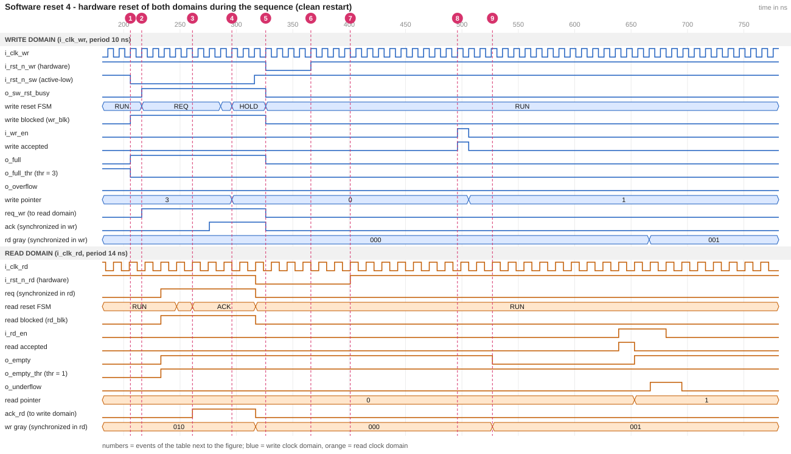

| No. | Time (ns) | Event |
|---:|---:|---|
| 1 | 206.0 | Software reset starts: `i_rst_n_sw` = 0. |
| 2 | 216.0 | `req_wr` = 1. |
| 3 | 261.0 | The read side is reset and `ack_rd` = 1. |
| 4 | 296.0 | The write pointer is reset; the write FSM waits in HOLD. |
| 5 | 326.0 | Hardware reset of both domains asserted (`i_rst_n_wr` = 0, `i_rst_n_rd` = 0) in the middle of the sequence; the testbench also releases `i_rst_n_sw`. Both FSMs, both pointers and both synchronizers go to their reset values at once (hardware reset priority). |
| 6 | 366.0 | `i_rst_n_wr` released. The write FSM is in RUN and the FIFO is empty. |
| 7 | 401.0 | `i_rst_n_rd` released (later than the write side). The read FSM is in RUN and `o_empty` = 1. |
| 8 | 496.0 | The first write after the reset is accepted (0xA5) once both domains are out of reset (ASM-005). |
| 9 | 527.0 | `o_empty` falls after the write pointer has crossed to the read domain. |

What the figure shows: both FSMs, both pointers, and both request and acknowledge synchronizers return to their reset values at the assertion of the hardware resets (event 5), whatever the state of the handshake. After the release the FIFO is empty (`o_empty` = 1, `o_full` = 0, pointers 0, FSMs in RUN) and works normally: a word is written (event 8), crosses (event 9), and is read.

#### 10.7.5 Corner cases

| ID | Case | Behavior | Evidence |
|---|---|---|---|
| CC-01 | `i_rst_n_sw` is a one-cycle low pulse | Captured by the write FSM at the first write edge where it is 0; the sequence completes (DEC-026) | Scenario 2; random widths 1 to 12 cycles |
| CC-02 | `i_rst_n_sw` stays low for a long time | The write FSM waits in HOLD and writes stay blocked; the read side is released while the write side still waits | Scenario 1 (low for 13 write cycles); random |
| CC-03 | `i_rst_n_sw` asserted again while the write FSM is in REL | Writes stay blocked; a new sequence starts when the FSM is back in RUN. `o_sw_rst_busy` falls for one cycle between the two sequences (DEC-032) | Scenario 3; random mode 1 |
| CC-04 | Read between the assertion and the arrival of the request | Accepted as a normal read of pre-reset data; the word is discarded by the reset | Scenario 1, events 1 to 3 |
| CC-05 | Write in the same edge in which `i_rst_n_sw` falls | Rejected: the block is combinational from the input (DEC-030) | Scenarios 1 to 3 |
| CC-06 | Read or write attempted during the reset | Rejected without an error pulse (DEC-028). A read of the empty FIFO right after the read release gives a normal underflow pulse | Scenarios 1, 2 |
| CC-07 | Storage content | Not cleared; `o_rd_data` shows the word at address 0 while the FIFO is empty, as after a hardware reset (DEC-035) | By construction |
| CC-08 | Hardware reset during the software reset | Hardware reset has priority. A reset of both domains gives a clean restart. A reset of one domain only leaves the other domain waiting for the handshake and is not repaired (DEC-031, ASM-005) | Scenario 4; random mode 2 |
| CC-09 | A clock stops during the reset | The handshake waits until the clock runs again (DEC-036) | By construction |
| CC-10 | Random extra latency on every crossing | The four-phase handshake is level based, so a longer delay only lengthens the sequence; the multi-bit pointers are protected by the flush check (DEC-034) | Regression, model on |
| CC-11 | Threshold flags during the reset | Values of an empty FIFO (`o_full_thr` = 0 for `i_full_thr` > 0, `o_empty_thr` = 1) (DEC-029) | Scenario 1 |

#### 10.7.6 Evidence from the prototype and reproduction

Needs `iverilog` and `vvp` with both the `bin` and `lib` directories of the OSS CAD Suite on `PATH`.

~~~bash
cd waveforms/proto
python run_srst_regress.py                 # regression, 4 scripted scenarios, positive and negative matrices
python run_srst_waveforms.py ../regen_srst # redraws the figures and event tables of Sections 10.7.4 and 10.7.7
~~~

| Run | Setting | Result |
|---|---|---|
| Scripted scenarios 1 to 4 | The runs drawn in Section 10.7.4 | All pass (scenario 1: read released at 401 ns, write released at 426 ns) |
| Positive, mode 0 | Seeds 1 to 12, half-periods (write, read) in {(5,7), (3,11), (11,3)} ns, metastability model off and on, 20 random software resets per run, random traffic, scoreboard; the next reset starts after the write release | 72 of 72 pass |
| Positive, mode 1 | Same, with `i_rst_n_sw` asserted again at any time (also in REL) | 72 of 72 pass |
| Positive, mode 2 | Same as mode 1, and a quarter of the resets are aborted by a hardware reset of both domains | 72 of 72 pass |
| Negative | Mode 1, model on, flush check removed (`+NOFLUSH=1`) | 13 of 36 pass, 23 of 36 fail (a side is released with a stale synchronized pointer) |

Checks of the prototype: `o_sw_rst_busy` (a flip-flop) equals "write FSM not in RUN" at every write-clock edge; no write accepted while `wr_blk`; no read accepted while `rd_blk`; `o_full` = 1 and `o_full_thr` = value of an empty FIFO while the write side is blocked; `o_empty` = 1 and `o_empty_thr` = 1 while the read side is blocked; no read of a word that was never written; data of every accepted read equals the written word (scoreboard); at each release the own pointer and the synchronized pointer of the other side are 0; the read release is before the write release and after the request; empty = 1 while both pointers are 0 after the read release; after a hardware reset both FSMs are in RUN, both pointers are 0, `o_empty` = 1, and `o_full` = 0; a deadlock timeout.

Not covered by this evidence (added with the RTL): formal proof of SVA-007 to SVA-016; a hardware reset of one domain only; stopped clocks.

#### 10.7.7 `o_sw_rst_busy` in detail

`o_sw_rst_busy` is the status of the **write side** of the software reset. It is driven directly by the flip-flop `reg_sw_rst_busy` (REQ-SRST-018), so it changes only at a rising edge of `i_clk_wr` and never glitches. It follows the write reset FSM:

| Write FSM state | What happens in the state | `o_sw_rst_busy` | How the state is entered (edge of `i_clk_wr`) |
|---|---|---|---|
| RUN | Normal operation. If `i_rst_n_sw` = 0 is seen, the FSM leaves RUN | 0 | After reset, or at the edge where REL ends (flop cleared at this edge) |
| REQ | `req_wr` = 1, waiting for the synchronized acknowledge | 1 | At the edge where the FSM sees `i_rst_n_sw` = 0 in RUN (flop set at this edge, together with `req_wr`) |
| PTR | Write pointer reset (one cycle) | 1 | At the edge where the synchronized acknowledge is seen |
| HOLD | Waits for `i_rst_n_sw` = 1 | 1 | After PTR |
| REL | `req_wr` = 0, waits for the acknowledge = 0 and the synchronized read pointer = 0 (flush check) | 1 | At the edge where `i_rst_n_sw` = 1 is seen in HOLD |
| RUN (again) | Write side released | 0 | At the edge where the release condition holds (flop cleared at this edge) |

Timing rules (all from the simulations of Section 10.7.4):

| Rule | Statement | Measured (scenario 1) |
|---|---|---|
| R1 | The write block `wr_blk` follows `i_rst_n_sw` in the same cycle (combinational). `o_sw_rst_busy` rises at the first write-clock edge after `i_rst_n_sw` falls, so it is up to one write-clock cycle behind the block. | `i_rst_n_sw` falls at 226 ns, `wr_blk` and `o_full` rise at 226 ns, busy rises at 236 ns |
| R2 | `o_sw_rst_busy` rises at the same edge as `req_wr`. | Both at 236 ns |
| R3 | `o_sw_rst_busy` does not follow `i_rst_n_sw` after it has risen: it stays 1 when the input returns to 1 (HOLD, REL). | The input rises at 356 ns, busy stays 1 until 426 ns |
| R4 | `o_sw_rst_busy` does not follow the read FSM. The read side is released first, and busy falls only when the write side is released. | Read released at 401 ns, busy falls at 426 ns (25 ns later) |
| R5 | `o_sw_rst_busy` falls at the same edge where the write FSM returns to RUN, together with `wr_blk` and `o_full` (when `i_rst_n_sw` = 1). | All three fall at 426 ns |
| R6 | `wr_blk` = `o_sw_rst_busy` OR (`i_rst_n_sw` = 0) at every cycle. | By construction; every prototype run checks that busy equals "write FSM not in RUN" (SVA-015, SVA-016) |
| R7 | A hardware reset of the write domain clears `o_sw_rst_busy` asynchronously, at any state of the sequence. | Scenario 4: falls at 326 ns with `i_rst_n_wr` |
| R8 | If `i_rst_n_sw` = 0 is seen again in REL, busy falls for exactly one write-clock cycle between the two sequences (the FSM is in RUN for one cycle), and writes stay blocked during the gap because `i_rst_n_sw` = 0. | Scenario 3: busy low from 386 ns to 396 ns |

Figure 10.7-8: `o_sw_rst_busy` against the write FSM state, the block, and the read side (scenario 1).

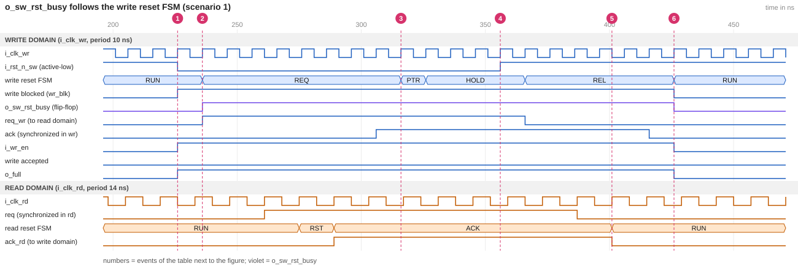

| No. | Time (ns) | Event |
|---:|---:|---|
| 1 | 226.0 | `i_rst_n_sw` falls. `wr_blk` = 1 and `o_full` = 1 at once (combinational). `o_sw_rst_busy` is still 0: it is a flip-flop and changes only at the next write-clock edge. |
| 2 | 236.0 | The first write-clock edge after the fall: the write FSM goes RUN to REQ, and `req_wr` and `o_sw_rst_busy` rise **at this same edge** (busy is one write-clock cycle behind the block). |
| 3 | 316.0 | The acknowledge was seen, the write FSM goes REQ to PTR and resets the write pointer. Busy stays 1 (state not RUN). |
| 4 | 356.0 | `i_rst_n_sw` back to 1. The write FSM is in HOLD and goes to REL at the next edge. Busy stays 1: it follows the FSM state, not the input. |
| 5 | 401.0 | The read FSM returns to RUN (read side released). Busy stays 1: it describes the write side, which is released last. |
| 6 | 426.0 | The write FSM returns to RUN. `o_sw_rst_busy` falls at this edge, together with `wr_blk` and `o_full`: writes are possible again. |

Figure 10.7-9: `o_sw_rst_busy` in the one-cycle gap between two sequences (scenario 3).

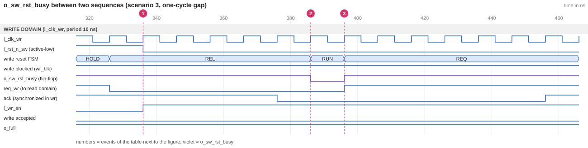

| No. | Time (ns) | Event |
|---:|---:|---|
| 1 | 336.0 | `i_rst_n_sw` = 0 again while the write FSM is in REL (first sequence not finished). Busy is still 1. |
| 2 | 386.0 | The write FSM returns to RUN: `o_sw_rst_busy` falls. `wr_blk` stays 1 because the input is still 0. |
| 3 | 396.0 | One write-clock cycle later the FSM sees the input at 0 in RUN and goes to REQ: `o_sw_rst_busy` rises again. Writes were blocked during the whole gap. |

Measured intervals of `o_sw_rst_busy` and of the write block in the four scenarios:

| Scenario | `i_rst_n_sw` falls (ns) | `wr_blk` rises (ns) | `o_sw_rst_busy` rises (ns) | `o_sw_rst_busy` falls (ns) | `wr_blk` falls (ns) | Busy high (write-clock cycles) |
|---|---:|---:|---:|---:|---:|---:|
| 1 | 226.0 | 226.0 | 236.0 | 426.0 | 426.0 | 19 |
| 2 | 156.0 | 156.0 | 166.0 | 326.0 | 326.0 | 16 |
| 3.1 | 196.0 | 196.0 | 206.0 | 386.0 | 566.0 | 18 |
| 3.2 | 336.0 | 196.0 | 396.0 | 566.0 | 566.0 | 17 |
| 4 | 206.0 | 206.0 | 216.0 | 326.0 | 326.0 | 11 |

Notes on the table: in scenario 3 the write block is continuous from 197 ns to 566 ns while busy has two intervals (rows 3.1 and 3.2) separated by the one-cycle gap; in scenario 4 busy falls when the hardware reset is applied (event 5 of that scenario), not at a write release. The time from the rise of the block to the rise of busy is less than one write-clock period (the input changes shortly after the previous edge in these runs).

What software and the integrator may conclude:

| Observation | Meaning |
|---|---|
| `o_sw_rst_busy` = 1 | A software reset is in progress on the write side. Writes are blocked. The read side may already be released |
| `o_sw_rst_busy` = 0 and `i_rst_n_sw` = 1 | The reset is complete or none is running: both sides are released (the read side was released before the write side) and the FIFO is empty if it was reset |
| `o_sw_rst_busy` = 0 and `i_rst_n_sw` = 0 | The request has been asserted and not yet taken (at most one write-clock cycle), or the one-cycle gap between two sequences (R8). Writes are blocked by the input |
| Rise of `o_sw_rst_busy` | The request was taken by the write FSM and will be answered by the read side |
| Fall of `o_sw_rst_busy` | End of the sequence: writes are accepted again from this cycle |

`o_sw_rst_busy` belongs to the write clock domain. The IP has no synchronizer for it: a consumer in the read domain that needs it shall synchronize it itself, or use `o_empty`, which is 1 during the whole reset of the read side.

## 11. Register and programming model

N/A (DEC-003 closed). This IP has no software-visible register and no CSR workbook (REF-005 is not used). Overflow and underflow are 1-cycle pulses, so there is no sticky status register. The software reset input `i_rst_n_sw` is driven by a control register outside the IP.

### 11.1 CSR specification source

| Item | Specification |
|---|---|
| CSR workbook file | N/A |
| Sheet used for this IP | N/A |
| Workbook revision / date | N/A |

### 11.2 Software sequences

Software reset sequence for the owner of the control register of `i_rst_n_sw`: (1) stop the producer if it should not lose words; (2) drive `i_rst_n_sw` to 0 (one write-clock cycle is enough; it may be held longer); (3) drive `i_rst_n_sw` back to 1 after the reset has started. The FIFO is usable again, on both sides, when `o_sw_rst_busy` = 0 **and** `i_rst_n_sw` = 1 (DEC-026, Section 10.7.7): the read side is always released before the write side, and `o_sw_rst_busy` falls when the write side is released. Do not use `o_sw_rst_busy` = 0 alone while `i_rst_n_sw` is held at 0: for one write-clock cycle after the fall of `i_rst_n_sw`, and in the one-cycle gap between two sequences (Section 10.7.5), the output is 0 while writes are blocked. The words in the FIFO at the reset are lost.

## 12. Error handling and recovery

| Error ID | Detection condition | Observable response/status | Interrupt | Clear/recovery | Reset behavior |
|---|---|---|---|---|---|
| ERR-001 | `i_wr_en` = 1 while full (write domain) | `o_overflow` 1-cycle pulse (registered, in the cycle after the rejected request). The write is dropped: storage and write pointer unchanged | None | Self-clearing after one cycle | Cleared by `i_rst_n_wr` |
| ERR-002 | `i_rd_en` = 1 while empty (read domain) | `o_underflow` 1-cycle pulse (registered, in the cycle after the rejected request). The read pointer is unchanged. `o_rd_data` still shows the word at the read pointer | None | Self-clearing after one cycle | Cleared by `i_rst_n_rd` |
| ERR-003 | Reset asserted in one domain only, after the FIFO was used | FIFO state inconsistent; not detected | None | Reset both domains | Integrator responsibility (ASM-005) |
| ERR-004 | Illegal parameter | Not detected by the IP (DEC-002); behavior undefined | None | Fix the configuration | N/A |
| ERR-005 | `i_wr_en` or `i_rd_en` = 1 while blocked by a software reset | The access is not accepted. No `o_overflow` or `o_underflow` pulse (DEC-028) | None | Ends with the software reset release | Not applicable |
| ERR-006 | `i_rst_n_sw` = 0 while a software reset is already in progress | Ignored until the write FSM is back in RUN; a new sequence then starts if it is still 0 (DEC-032) | None | Automatic | Cleared by the hardware resets |

Precedence: the two error flags belong to different domains and do not interact. A simultaneous write and read on the same cycle cannot produce both errors for the same event. No retry or drain is provided; the producer or consumer shall react to the flags.

## 13. Performance, power, and area

No PPA or performance target is specified (N/A, DEC-015, DEC-016). This table records what would be measured.

| Metric ID | Metric | Target / limit | Conditions | Measurement method | Hard / goal |
|---|---|---|---|---|---|
| PPA-001 | Maximum frequency of CLK-WR and CLK-RD | N/A (not specified) | - | STA with the constraints of Section 17 | - |
| PPA-002 | Area | N/A (not specified) | - | Cell area | - |
| PPA-003 | Dynamic and leakage power | N/A (not specified) | - | Tool-based estimate | - |
| PERF-001 | Flag latency across the crossing | S destination edges (flags combinational from the synchronized pointer), up to S+2 edges with the metastability model | Section 10.3 | Simulation | Hard (derived from the architecture) |
| PERF-002 | Sustained throughput | N/A (not specified) | - | Simulation | - |

Do not claim timing closure from RTL synthesis alone. The SDC and analysis flow for clocks, I/O delays, uncertainty, exceptions, and corners are linked in Section 17.

## 14. RTL implementation contract

### 14.1 Required coding baseline

REF-003 is the mandatory RTL authority. At minimum: one module per `.sv` file, the file name equals the module name, the top is a structural wrapper, ANSI ports with `input wire` and `output logic`, unsigned 4-state `logic`, parameters `parameter logic [31:0] PARA_AFIFO_<NAME>` with the PAR-02 comments, `always_comb` and `always_ff` only, named connections, no tab characters, branch statements on their own line (FIL-04), module ports aligned in columns (FIL-05) and declared in functional groups (FIL-06), comment lines at most 100 characters, and the file header of REF-003 FIL-01.

Project-specific consequences:

- Synchronizer flip-flops and the technology cells exist only in `m_vlsit_afifo_cell_sync`; `m_vlsit_afifo_sync` contains only instances of it (CLK-02, HIE-07, DEC-039). The memory macro exists only in `m_vlsit_afifo_ram_macro`.
- The metastability model is the branch of `m_vlsit_afifo_cell_sync` that is compiled when the macro `VLSIT_SYNTHESIS` is not defined; no other module contains it (DEC-038). It is a simulation model: it is written in professional SystemVerilog and is not bound by the RTL rules of REF-003 (DEC-001, DEC-021). The synthesis, lint, CDC, formal, and equivalence flows shall define `VLSIT_SYNTHESIS` (REQ-RTL-002); REF-003 P12 allows referencing a macro that is defined by the flow. The same macro selects the branches of `m_vlsit_afifo_cell_sync` only: with the macro it instantiates the library cells (the synthesizable stand-in models `VLSIT_CELL_SYNC_*` of `000_Common/rtl_cells` are used until the real library views exist); without it it contains the behavioral simulation model with the metastability model. `m_vlsit_afifo_ram_macro` has no branch and always instantiates `VLSIT_CELL_SRAM_1W1R`.
- The flag, the Gray register, and the pointer registers are one-process-per-state elements with separate next-state logic.
- The software reset FSMs are one-process-per-state elements with separate next-state logic; the state registers follow the FSM naming of REF-003, for example `reg_fsm_srst_current_state`. They live in `m_vlsit_afifo_wr` and `m_vlsit_afifo_rd` because the top has no logic (REQ-FUNC-011). The request and acknowledge synchronizers are instances of `m_vlsit_afifo_sync` with `PARA_AFIFO_SYNC_W` = 1. `o_sw_rst_busy` is the output of its own flip-flop `reg_sw_rst_busy` (REQ-SRST-018), not a decode of the FSM state.
- Names: every name defined in the `m_vlsit_afifo_*` modules uses the abbreviations of REF-003 NAM-08 and stays at 30 characters or less (NAM-07).

### 14.2 RTL hierarchy

| Module | Responsibility | Parent / instance | Clock/reset domains | Interface |
|---|---|---|---|---|
| `m_vlsit_afifo_top` | Structural wrapper | - | Both | Section 6.2 |
| `m_vlsit_afifo_wr` | Write pointer, full, full threshold, overflow, write reset FSM | `m_vlsit_afifo_top` / `u_vlsit_afifo_wr` | CLK-WR | Section 6.2 |
| `m_vlsit_afifo_rd` | Read pointer, empty, empty threshold, underflow, read reset FSM | `m_vlsit_afifo_top` / `u_vlsit_afifo_rd` | CLK-RD | Section 6.2 |
| `m_vlsit_afifo_sync` | Synchronizer, one cell wrapper per bit | wr and rd / `u_sync_*` | Destination | Section 6.2 |
| `m_vlsit_afifo_cell_sync` | Technology cell wrapper (one per synchronized bit) | `m_vlsit_afifo_sync` / `u_vlsit_afifo_cell_sync` (inside `gen_bit_cell`) | Destination | Section 14.4 |
| `m_vlsit_afifo_mem` | FIFO array | `m_vlsit_afifo_top` / `u_vlsit_afifo_mem` | CLK-WR (write port), CLK-RD (read port) | Section 6.2 |
| `m_vlsit_afifo_ram_macro` | SRAM wrapper | `m_vlsit_afifo_mem` / `u_vlsit_afifo_ram_macro` | CLK-WR and CLK-RD | Section 6.2 |

**Source folders (DEC-044, DEC-046).** The FIFO logic is in the folder `rtl` of this IP. The library wrappers and the example cells are shared library RTL: they are in the common folder `common_rtl/000_Common`, and every later library wrapper, cell, or macro model of any IP is written there. Each folder has its own `filelist.f`.

| Folder | Content | Role |
|---|---|---|
| `001_AsyncGrayFIFO/rtl` | `m_vlsit_afifo_top`, `m_vlsit_afifo_wr`, `m_vlsit_afifo_rd`, `m_vlsit_afifo_mem`, `m_vlsit_afifo_sync` | The FIFO logic and its structure |
| `000_Common/rtl_lib` | `m_vlsit_afifo_cell_sync`, `m_vlsit_afifo_ram_macro` | The only modules that name library cells and the SRAM macro; the part to adapt when real library cells are mapped (REQ-RTL-001) |
| `000_Common/rtl_cells` | `VLSIT_CELL_SYNC_*` cells and `VLSIT_CELL_SRAM_1W1R` | Example stand-ins of the library cells and macro (DEC-040, DEC-041, DEC-042); replaced by the library views |

The synthesis and lint filelist is the union of the three, with `VLSIT_SYNTHESIS` defined; the example `lint/filelist_lint.f` shows the order and the relative paths (`../../000_Common/...`).

Instance names follow `u_<function>` with `m_` removed (REF-003 NAM). Where NAM-07 would exceed 30 characters, shorten the function part with NAM-08. The top state owners are `m_vlsit_afifo_wr` and `m_vlsit_afifo_rd`; the top has no logic.

### 14.3 Synthesis assumptions

| Item | Value / source |
|---|---|
| Top / source file list | `m_vlsit_afifo_top`; one file per module, with `VLSIT_SYNTHESIS` defined. The synthesizable example cells and the SRAM macro model `VLSIT_CELL_SRAM_1W1R` of `000_Common/rtl_cells` (stand-ins for the library cells and the macro) are in the filelist until the real ones are supplied |
| Frontend version and options | N/A (not specified) |
| Parameters/configuration | CFG-BASE defaults; the other configurations of Section 8 |
| Libraries/corners | N/A (not specified) |
| Memory flow | RTL array: inference check in the synthesis report. Macro: library compiler (the generic model is used for simulation) |
| Lint rule configuration | REF-003 plus CDC rules; waivers carry rationale and reviewer |

### 14.4 Technology synchronizer cell (example models)

No library cell is available, so the synchronizer uses **example** cells (DEC-011, DEC-037). The granularity is one cell wrapper `m_vlsit_afifo_cell_sync` per synchronized bit; the wrapper holds the whole chain of that bit.

- `m_vlsit_afifo_sync` instantiates `PARA_AFIFO_SYNC_W` wrappers, one per bit (`gen_bit_cell`), with `PARA_AFIFO_CELL_TYPE` and the reset flavour of the bit, in both branches of `VLSIT_SYNTHESIS`, and nothing else (DEC-039). Input bit `i_data[i]` goes to `i_d` and `o_q` is `o_data[i]`.
- `m_vlsit_afifo_cell_sync` has the parameters `PARA_AFIFO_CELL_RST_VAL` (0 = cells with asynchronous reset to 0, suffix RN; 1 = cells with asynchronous set to 1, suffix SN) and `PARA_AFIFO_CELL_TYPE`. Its pins are `i_clk_dst`, `i_rst_n_dst`, `i_d`, `o_q`.
- The example cell models are synthesizable RTL, one module per file in `000_Common/rtl_cells`, and follow the RTL rules except the names (DEC-040, DEC-042). Their pins are the usual library-cell pins `CK`, `RN` (RN cells) or `SN` (SN cells), `D`, and `Q`, which are exempt from the naming rule. When real library cells are available, only the body of `m_vlsit_afifo_cell_sync` (cell names and pin mapping) changes.

| `PARA_AFIFO_CELL_TYPE` | Synthesis branch (with `VLSIT_SYNTHESIS`) | Stages | Simulation branch (without the macro) |
|---|---|---:|---|
| 0 | No cell: `assign o_q = i_d` (bypass) | 0 | `assign o_q = i_d` |
| 1 | Two cells `VLSIT_CELL_SYNC_DFF_RN` (or `_SN`) in series | 2 | A 2-flop chain with the metastability model |
| 2 | One cell `VLSIT_CELL_SYNC_2FF_RN` (or `_SN`) | 2 | A 2-flop chain with the metastability model |
| 3 | One cell `VLSIT_CELL_SYNC_3FF_RN` (or `_SN`) | 3 | A 3-flop chain with the metastability model |
| 4 | One cell `VLSIT_CELL_SYNC_4FF_RN` (or `_SN`) | 4 | A 4-flop chain with the metastability model |

A value above 4 is illegal; the wrapper then gives the option 4 cell and the behavior is undefined (DEC-002). Every flop of a model resets to the reset value bit.

**Legal use.** The number of synchronizer stages S is the stages of the selected cell: options 1 and 2: 2; option 3: 3; option 4: 4. There is no separate stage parameter and no pure RTL flop chain (DEC-039). The latencies of Section 10.3 and the read margin of Section 10.4 hold for the options 1 to 4. Option 0 has no synchronization: the Gray pointers would cross the domains without a synchronizer and the flag would change in the same cycle as the pointer, which breaks the read margin of Section 10.4 (at least 2 destination edges). It is therefore **not a legal option for the pointer crossings of this IP**; it exists for a flow that inserts the synchronizer outside the IP. The IP does not check the value (DEC-002).

Example cell models (synthesizable RTL, one module per file in `000_Common/rtl_cells`). The 2-, 3- and 4-FF cells are the same shift chain with `LPARA_CELL_STAGE` = 2, 3 or 4, and the SN cells set to 1 instead of resetting to 0. Two examples:

~~~systemverilog
module VLSIT_CELL_SYNC_DFF_RN (
  input wire CK,
  input wire RN,
  input wire D,
  output logic Q
);
  logic reg_q;
  always_ff @(posedge CK, negedge RN) begin : p_ff_cell
    if (!RN)
      reg_q <= 1'b0;
    else
      reg_q <= D;
  end
  assign Q = reg_q;
endmodule

module VLSIT_CELL_SYNC_3FF_SN #(
  localparam logic [31:0] LPARA_CELL_STAGE = 3
) (
  input wire CK,
  input wire SN,
  input wire D,
  output logic Q
);
  logic [LPARA_CELL_STAGE-1:0] reg_chain;
  always_ff @(posedge CK, negedge SN) begin : p_ff_cell
    if (!SN)
      reg_chain <= {LPARA_CELL_STAGE{1'b1}};
    else
      reg_chain <= {reg_chain[LPARA_CELL_STAGE-2:0], D};
  end
  assign Q = reg_chain[LPARA_CELL_STAGE-1];
endmodule
~~~

The synthesis branch of the wrapper belongs to the branch compiled with `VLSIT_SYNTHESIS` defined; it instantiates the cells of `000_Common/rtl_cells`, named `u_dont_touch_<function>` (REQ-RTL-003). The simulation branch of the wrapper (branch without the macro) does not use the example cells: it contains the metastability model, one chain of 2, 2, 3 or 4 flops per option with the random extra latency of REQ-VER-001, and the bypass for the option 0. The synthesis branch is verified in simulations that define `VLSIT_SYNTHESIS` for each option (TEST-009). The simulation branch of the wrapper is verified alone for each option (latency 0, 2, 2, 3, 4 and the reset value).

## 15. Verification specification

### 15.1 Scope and strategy

Block simulation with a scoreboard (reference queue), formal checks of the pointer and flag logic, CDC/RDC analysis, lint, and synthesis checks. Simulation uses the metastability model (REQ-VER-001) and the macro model `VLSIT_CELL_SRAM_1W1R` (REQ-VER-002). Seeds are logged for every random run, and every failing seed shall be reproducible. The environment is a self-checking SystemVerilog testbench without UVM (author's choice, DEC-015); the models use only constructs supported by the reference simulator, which is named when the models are implemented. Configurations: CFG-BASE, CFG-CELL, CFG-MACRO, CFG-FULL; depth 2, 4, and a large depth; S = 2, 3, 4; data widths 1 and wide.

### 15.2 Requirement-based test plan

| Test ID | Requirements | Scenario / stimulus | Expected result | Test type | Configuration |
|---|---|---|---|---|---|
| TEST-001 | REQ-RESET-001, REQ-RESET-002 | Reset both domains, release | empty = 1, full = 0, flags clear, pointers 0 | Directed | All |
| TEST-002 | REQ-FUNC-003, REQ-FUNC-004, REQ-FUNC-005, REQ-FUNC-017 | Write N words, read N words; check `o_rd_data` equals the head word before every read | Same data, same order, show-ahead | Directed + random | All |
| TEST-003 | REQ-FUNC-008, REQ-ERR-001 | Fill until full, keep writing | full = 1; overflow raised; no data or pointer change | Directed | All |
| TEST-004 | REQ-FUNC-009, REQ-ERR-002 | Empty the FIFO, keep reading | empty = 1; underflow raised; pointer unchanged | Directed | All |
| TEST-005 | REQ-FUNC-010 | Fill and drain across the threshold | Threshold flags per REQ-FUNC-010 for several `i_full_thr` and `i_empty_thr` values | Directed | All |
| TEST-006 | REQ-FUNC-001, REQ-CLK-001 | Random clock ratios (write faster, read faster, equal, with phase drift) | No data error, no flag error | Random | All |
| TEST-007 | REQ-FUNC-013 | S = 2, 3, 4 | Flag latency = S destination edges | Directed | All |
| TEST-008 | REQ-VER-001 | Enable the metastability model | Output changes at edge S, S+1, S+2 on each bit; no data error; flags never optimistic | Random | All |
| TEST-009 | REQ-FUNC-014, REQ-VER-003 | FIFO with each `PARA_AFIFO_CELL_TYPE` option 1 to 4 in both branches of `VLSIT_SYNTHESIS`, both reset flavours; the wrapper alone for options 0 to 4 in both branches (latency 0, 2, 2, 3, 4 and reset value) | Same behavior as the RTL branch; wrapper latency and reset value as listed | Directed + random | CFG-CELL |
| TEST-010 | REQ-FUNC-016, REQ-VER-002 | Macro configuration with the model `VLSIT_CELL_SRAM_1W1R`, in both branches of `VLSIT_SYNTHESIS` | Same behavior as the RTL array | Directed + random | CFG-MACRO |
| TEST-011 | REQ-FUNC-007, REQ-PARAM-003 | Review of the configuration list used by the testbench | Only legal values are used; no elaboration check expected | Inspection | All |
| TEST-012 | REQ-FUNC-002 | Observe the Gray pointers | One bit changes per cycle | Assertion + formal | All |
| TEST-013 | REQ-FUNC-003 | Write and read in the same cycle and with wrap-around of the pointers | No error | Random | All |
| TEST-014 | REQ-RESET-002 | Reset in the middle of operation (both domains together) | Clean restart | Directed | All |
| TEST-015 | REQ-FUNC-011, REQ-FUNC-012, REQ-FUNC-015 | Hierarchy check | Top instantiates only wr, rd, and mem; mem is not inside wr or rd | Inspection | All |
| TEST-016 | REQ-RTL-001 | Lint | Rules of REF-003, no latch, no comb loop, no tab | Lint | All |
| TEST-017 | REQ-CLK-002 | CDC analysis | Only the approved crossings; no logic before or between sync stages | CDC | All |
| TEST-018 | REQ-PD-001 | STA with the delivered SDC | Constraints applied, exceptions consistent | STA | All |
| TEST-019 | REQ-RTL-002, REQ-VER-001 | Build `m_vlsit_afifo_sync`, `m_vlsit_afifo_cell_sync`, and `m_vlsit_afifo_ram_macro` with and without `VLSIT_SYNTHESIS` | With the macro the synthesizable branch runs and passes the full regression; without it the model runs | Directed | All |
| TEST-020 | REQ-SRST-001..012 | Software reset with the FIFO empty, partially filled, and full | Handshake order, pointers 0, empty = 1, full = 0 after release, read released before write | Directed | All |
| TEST-021 | REQ-SRST-003, REQ-SRST-008, REQ-SRST-013, REQ-SRST-017 | Software reset under random traffic on both sides, `i_rst_n_sw` width 1 to 12 cycles, several clock ratios, scoreboard | No access accepted while blocked; no data error; no deadlock | Constrained random | All |
| TEST-022 | REQ-SRST-013, REQ-VER-001 | The same with the metastability model and several seeds | Sequence completes; flush check never violated | Random | All |
| TEST-023 | REQ-SRST-012, REQ-SRST-014, REQ-RESET-002 | After a software reset, repeat TEST-002 to TEST-004 | Same behavior as after a hardware reset | Directed | All |
| TEST-024 | REQ-SRST-015, REQ-SRST-016 | Re-assert `i_rst_n_sw` in REL; hardware reset of one and of both domains during the sequence | Behavior of (DEC-031) and (DEC-032) | Directed | All |
| TEST-025 | REQ-SRST-002, REQ-SRST-006 | CDC analysis of CDC-005 and CDC-006 | 1-bit synchronized levels, no logic before the first stage | CDC | All |

### 15.3 Assertions and coverage

Assertions are SVA in the verification source set. Disable them during reset.

| Property / coverage ID | Intent | Requirements | Checker / source set | Acceptance criterion |
|---|---|---|---|---|
| SVA-001 | Full and empty are never both 1 | INV-002 | Verification | Never fails |
| SVA-002 | A Gray pointer register changes at most one bit per cycle | REQ-FUNC-002 | Verification | Never fails |
| SVA-003 | A write while full leaves the write pointer and the storage unchanged | REQ-ERR-001 | Verification | Never fails |
| SVA-004 | A read accepted by the read side returns the word that was written to that entry | REQ-FUNC-003, REQ-CLK-003 | Scoreboard | No mismatch |
| SVA-005 | The full flag is never 0 when the FIFO is physically full; the empty flag is never 0 when it is physically empty | REQ-FUNC-008, REQ-FUNC-009 | Reference model in the testbench | Never fails |
| SVA-006 | A read while empty leaves the read pointer unchanged | REQ-ERR-002 | Verification | Never fails |
| SVA-007 | No write is accepted while `wr_blk` = 1 | REQ-SRST-008 | Verification, formal | Never fails |
| SVA-008 | No read is accepted while `rd_blk` = 1 | REQ-SRST-003 | Verification, formal | Never fails |
| SVA-009 | `ack_rd` rises only when the read pointer is 0 and the read FSM is not in RUN | REQ-SRST-005 | Verification, formal | Never fails |
| SVA-010 | Four-phase order: `req_wr` falls only after the acknowledge was seen and `i_rst_n_sw` = 1; `ack_rd` falls only after the synchronized request is 0 | REQ-SRST-009 | Verification | Never fails |
| SVA-011 | When the read FSM returns to RUN, the read pointer and the synchronized write pointer are 0 | REQ-SRST-010 | Verification, formal | Never fails |
| SVA-012 | When the write FSM returns to RUN, the write pointer and the synchronized read pointer are 0 | REQ-SRST-010 | Verification, formal | Never fails |
| SVA-013 | In every software reset, the read FSM returns to RUN before the write FSM | REQ-SRST-011 | Verification | Never fails |
| SVA-014 | Liveness: with `i_rst_n_sw` = 1 and both clocks running, both FSMs return to RUN within a bounded number of cycles | REQ-SRST-013 | Bounded formal, simulation | Never fails |
| SVA-015 | `o_sw_rst_busy` equals (write FSM not in RUN) at every write-clock edge, and is 0 after the hardware reset | REQ-SRST-018 | Verification, formal | Never fails |
| SVA-016 | The write block equals `o_sw_rst_busy` OR (`i_rst_n_sw` = 0) at every cycle; `o_sw_rst_busy` rises only at the edge where the FSM goes RUN to REQ and falls only at the edge where it goes REL to RUN | REQ-SRST-018 | Verification, formal | Never fails |
| COV-001 | Full reached, empty reached, threshold crossed in both directions | REQ-FUNC-008..010 | Verification | All hit |
| COV-002 | Overflow and underflow events | REQ-ERR-001, 002 | Verification | All hit |
| COV-003 | Each metastability latency value (edge S, S+1, S+2) on each crossing | REQ-VER-001 | Verification | All hit |
| COV-004 | S = 2, 3, 4 and both option branches | REQ-FUNC-013, 014, 016 | Verification | All configurations run |
| COV-005 | Clock ratio classes (write faster, read faster, near equal) | REQ-CLK-001 | Verification | All hit |
| COV-006 | Software reset in the empty, partial, and full states; one-cycle and long `i_rst_n_sw`; re-assertion in REL | REQ-SRST-001, REQ-SRST-016 | Verification | All hit |
| COV-007 | Each metastability latency value on the request and on the acknowledge | REQ-SRST-013 | Verification | All hit |

X policy: the resetless storage is not checked for X until its entry has been written. The validity guard is the write pointer: a read is accepted only when empty = 0.

### 15.4 Formal, CDC, and RDC

| Analysis | Scope | Assumptions / constraints | Evaluation method |
|---|---|---|---|
| Formal | One-hot-change of the Gray pointers; flag safety (never optimistic); overflow and underflow leave state unchanged; no entry is overwritten before being read; SVA-007 to SVA-016 of the software reset | Single-clock abstraction of each domain with synchronizer stages modeled as delays; depth 2, 4, 8 | Model checking |
| CDC / RDC | CDC-001..003, CDC-005, CDC-006; the two independent resets | Resets synchronous per domain; CDC-003 waived with the bundled-data rationale of Section 7.2 | CDC tool, lint |

## 16. DFT and testability

N/A (DEC-003 closed). The requester decided that DFT is not applicable to this IP: it has no DFT port (`i_dft_*`), no test-mode control, no MBIST hook, and no scan-specific wrapper. The RTL contains no latch, combinational loop, internal tri-state, or clock gate, so scan insertion by the SoC flow stays possible. REF-003 RST-04 (resets controllable in test mode) and HIE-06 (DFT/BIST hooks and bypass in the memory wrapper) are not implemented in this IP because of this decision. If the SoC flow needs them, the integrator adds them outside the IP, or a new decision reopens DEC-003.

## 17. Physical design and timing integration

### 17.1 Timing constraints and budgets

The IP owns the constraints of the crossings (EXC-001..003, EXC-005, EXC-006). The SoC owns the clock definitions and the I/O delays. The numeric bounds of EXC-001..003 are given below (DEC-017). Clock definitions and I/O delays are SoC-owned and not specified (N/A). The text below describes required content, not executable constraints.

#### 17.1.1 Clock and analysis scenarios

| Clock ID | Port / source object | Primary/generated and master | Period, waveform, phase / ratio | Latency / uncertainty / transition | Clock group / mode | Constraint source |
|---|---|---|---|---|---|---|
| CLK-WR | `i_clk_wr` | Primary | Free (no restriction on frequency or ratio) | N/A (SoC-owned) | Asynchronous to CLK-RD for functional paths, with the exceptions below | SoC SDC |
| CLK-RD | `i_clk_rd` | Primary | Free (no restriction on frequency or ratio) | N/A (SoC-owned) | Asynchronous to CLK-WR | SoC SDC |

Analysis scenarios: setup and hold views for each PVT/RC corner of the product (N/A, not specified). No mode-dependent case analysis is required by the IP.

#### 17.1.2 Interface timing budgets

| Interface / port group | Direction | Reference clock | External min / max delay | Input transition / output load | IP timing budget | Mode / condition | Constraint source |
|---|---|---|---|---|---|---|---|
| `i_wr_en`, `i_wr_data` | Input | CLK-WR | N/A (SoC-owned) | N/A | N/A | All | SoC SDC |
| `i_rst_n_sw` | Input | CLK-WR | N/A (SoC-owned) | N/A | N/A (the IP path includes the combinational path to the write accept and to `o_mem_wr_en`, DEC-030) | All | SoC SDC |
| `o_full`, `o_full_thr`, `o_overflow`, `o_sw_rst_busy` | Output | CLK-WR | N/A (SoC-owned) | N/A | N/A | All | SoC SDC |
| `i_rd_en` | Input | CLK-RD | N/A (SoC-owned) | N/A | N/A (the IP path includes the combinational path to `o_mem_rd_addr`) | All | SoC SDC |
| `o_rd_data`, `o_empty`, `o_empty_thr`, `o_underflow` | Output | CLK-RD | N/A (SoC-owned) | N/A | N/A | All | SoC SDC |
| Resets | Input | Each own clock | N/A (already synchronized) | N/A | N/A | All | SoC SDC |

Max transition, max capacitance, max fanout, and driving-cell assumptions: N/A (not specified).

#### 17.1.3 Timing exception inventory

| Exception ID | Type / SDC command | From | Through | To | Value and setup/hold/min/max meaning | Mode / condition | Technical rationale |
|---|---|---|---|---|---|---|---|
| EXC-001 | `set_max_delay -datapath_only` | Write Gray pointer register bits (CLK-WR) | None | First synchronizer stage D pins in `m_vlsit_afifo_rd` | 0.9 x the period of `i_clk_wr` | All | The crossing is asynchronous; a bound shorter than one source period guarantees that a pointer transition completes before the next one is launched, because consecutive transitions are at least one source period apart. The destination, at any frequency, therefore sees only valid Gray values (DEC-023) |
| EXC-002 | `set_max_delay -datapath_only` | Read Gray pointer register bits (CLK-RD) | None | First synchronizer stage D pins in `m_vlsit_afifo_wr` | 0.9 x the period of `i_clk_rd` | All | Same as EXC-001, opposite direction |
| EXC-003 | `set_max_delay -datapath_only` | Storage elements (CLK-WR flops) or the macro output | Read path of the storage | Storage output register D pins (CLK-RD) | 1 x the period of `i_clk_rd` (the receiving clock) | All | Bundled data of CDC-003, stable by the pointer protocol; the bound is less than or equal to one `i_clk_rd` period so that a re-captured word is clean (Section 10.4) |
| EXC-004 | `set_false_path` | Ports `i_full_thr`, `i_empty_thr` | None | All endpoints | Excluded from timing analysis | All | The inputs are static configuration, written once before use and not changed while the FIFO is in use; no timing relationship with `i_clk_wr` or `i_clk_rd` exists in operation |
| EXC-005 | `set_max_delay -datapath_only` | `req_wr` register (CLK-WR) | None | First stage D pin of the request synchronizer in `m_vlsit_afifo_rd` | 0.9 x the period of `i_clk_wr` (DEC-033) | All | Same rationale as EXC-001 for a 1-bit level |
| EXC-006 | `set_max_delay -datapath_only` | `ack_rd` register (CLK-RD) | None | First stage D pin of the acknowledge synchronizer in `m_vlsit_afifo_wr` | 0.9 x the period of `i_clk_rd` (DEC-033) | All | Same rationale as EXC-002 for a 1-bit level |

Do not use a whole-domain `set_false_path` or an unqualified `set_clock_groups -asynchronous` for the two clocks: it would also hide the crossings above from the bounded-delay checks. If `set_clock_groups` is the project policy, the bounded-delay constraints and the CDC analysis shall cover the crossings separately. Illustrative forms (replace the placeholders, confirm the syntax for the tool and version):

~~~tcl
create_clock -name CLK_WR -period <period_wr> [get_ports i_clk_wr]
create_clock -name CLK_RD -period <period_rd> [get_ports i_clk_rd]
set_max_delay <bound> -datapath_only \
  -from [get_pins <wr_gray_reg>/CLK] -to [get_pins <rd_sync_stage1>/D]
set_max_delay <bound> -datapath_only \
  -from [get_pins <rd_gray_reg>/CLK] -to [get_pins <wr_sync_stage1>/D]
~~~

### 17.2 Physical assumptions

| Topic | Requirement / assumption |
|---|---|
| Hard/memory macros and views | Only in the macro branch; the real macro views are supplied at integration |
| Floorplan, placement region, pin placement | The synchronizer stages of one bit should be placed adjacent to each other. No other placement requirement is specified (N/A) |
| Utilization/congestion target | N/A (not specified) |
| Power intent, clock/reset trees | The IP has two clock trees and two reset nets, one per domain |
| High-fanout controls, physical-only cells | N/A (not specified) |
| ECO/spare cells | N/A (not specified) |
| Extraction and timing-analysis corners | N/A (not specified) |
| Delivery form: RTL/netlist/hardened layout | Soft RTL. The SoC requirements are Section 17.1; the guidance is the table above |

`dont_touch` is applied to the synchronizer instances (REF-003 CLK-02) so the flow does not restructure them.

## 18. Security, safety, and reliability

| Topic | Requirement / rationale | Verification method / expected behavior |
|---|---|---|
| Security boundary and threat assumptions | N/A: not requested | - |
| Access control / privilege | N/A: no registers or privileged access | - |
| Secure clearing / zeroization | N/A: not requested; the storage is not cleared by reset | - |
| Information leakage / side channels | N/A: not requested | - |
| ECC/parity and fault detection | N/A: not requested | - |
| Safety goal / integrity level | N/A: not requested | - |
| Diagnostics, fail-safe state, recovery | Overflow and underflow flags only; recovery by the user logic or by reset | TEST-003, TEST-004 |
| Metastability robustness | S stages configurable (2, 3, 4) and the technology cell option; no MTBF target is specified (N/A) | TEST-007, TEST-008 |

## 19. Requirement-to-verification traceability

| Requirement ID | RTL module/location | Test/property | Verification method / analysis | Configuration |
|---|---|---|---|---|
| REQ-FUNC-001 | wr, rd | TEST-006 | Simulation | All |
| REQ-FUNC-002 | wr, rd | TEST-012, SVA-002 | Assertion, formal | All |
| REQ-FUNC-003 | wr, rd, mem | TEST-002, TEST-013, SVA-004 | Scoreboard | All |
| REQ-FUNC-004 | wr | TEST-002 | Simulation | All |
| REQ-FUNC-005 | rd | TEST-002 | Simulation | All |
| REQ-FUNC-006 | wr, rd | TEST-017 | CDC, inspection | All |
| REQ-FUNC-007 | top, mem | TEST-011 | Lint/elaboration | Illegal |
| REQ-FUNC-008 | wr | TEST-003, SVA-005 | Simulation, formal | All |
| REQ-FUNC-009 | rd | TEST-004, SVA-005 | Simulation, formal | All |
| REQ-FUNC-010 | wr, rd | TEST-005 | Simulation | All |
| REQ-FUNC-011 | top | TEST-015 | Inspection | All |
| REQ-FUNC-012 | wr, rd | TEST-015 | Inspection | All |
| REQ-FUNC-013 | sync | TEST-007 | Simulation | All |
| REQ-FUNC-014 | sync, cell_sync | TEST-009 | Simulation, inspection | All |
| REQ-FUNC-015 | top, mem | TEST-015 | Inspection | All |
| REQ-FUNC-016 | mem, ram_macro | TEST-010 | Simulation | CFG-MACRO |
| REQ-FUNC-017 | mem, rd | TEST-002 | Simulation | All |
| REQ-FUNC-018 | wr, rd | TEST-003, TEST-004, TEST-005, SVA-005 | Simulation, formal | All |
| REQ-IF-001 | All | TEST-016 | Lint | All |
| REQ-CLK-001 | wr, rd | TEST-006 | Simulation | All |
| REQ-CLK-002 | wr, rd, sync | TEST-017 | CDC | All |
| REQ-CLK-003 | mem, rd | TEST-002, SVA-004 | Scoreboard | All |
| REQ-CLK-004 | wr, rd, mem | TEST-015, TEST-017 | Inspection, CDC | All |
| REQ-RESET-001 | wr, rd | TEST-015 | Inspection | All |
| REQ-RESET-002 | wr, rd | TEST-001, TEST-014 | Simulation | All |
| REQ-PARAM-001 | top, mem | TEST-002 | Simulation | All |
| REQ-PARAM-002 | top, mem | TEST-002 | Simulation | All |
| REQ-PARAM-003 | top | TEST-011 | Lint/elaboration | Illegal |
| REQ-ERR-001 | wr | TEST-003, SVA-003 | Simulation, formal | All |
| REQ-ERR-002 | rd | TEST-004, SVA-006 | Simulation, formal | All |
| REQ-SRST-001 | wr | TEST-020, TEST-021 | Simulation | All |
| REQ-SRST-002 | wr, rd, sync | TEST-025 | CDC, inspection | All |
| REQ-SRST-003 | rd | TEST-021, SVA-008 | Simulation, formal | All |
| REQ-SRST-004 | rd | TEST-020 | Simulation | All |
| REQ-SRST-005 | rd | TEST-020, SVA-009 | Simulation, formal | All |
| REQ-SRST-006 | wr, rd, sync | TEST-025 | CDC, inspection | All |
| REQ-SRST-007 | wr | TEST-020 | Simulation | All |
| REQ-SRST-008 | wr | TEST-021, SVA-007 | Simulation, formal | All |
| REQ-SRST-009 | wr, rd | TEST-020, SVA-010 | Simulation, assertion | All |
| REQ-SRST-010 | wr, rd | TEST-022, SVA-011, SVA-012 | Simulation, formal | All |
| REQ-SRST-011 | wr, rd | TEST-020, SVA-013 | Simulation, assertion | All |
| REQ-SRST-012 | wr, rd | TEST-020, TEST-023 | Simulation | All |
| REQ-SRST-013 | wr, rd | TEST-021, TEST-022, SVA-014 | Simulation, bounded formal | All |
| REQ-SRST-014 | wr, rd, mem | TEST-021, TEST-023 | Scoreboard | All |
| REQ-SRST-015 | wr, rd | TEST-024 | Simulation | All |
| REQ-SRST-016 | wr | TEST-024 | Simulation | All |
| REQ-SRST-017 | wr, rd | TEST-021 | Simulation | All |
| REQ-SRST-018 | wr | TEST-020, SVA-015, SVA-016 | Simulation, inspection | All |
| REQ-RTL-001 | All | TEST-016 | Lint, inspection | All |
| REQ-RTL-002 | sync | TEST-019 | Lint, inspection | All |
| REQ-RTL-003 | cell_sync, ram_macro | TEST-016 | Lint (rule check NAM-09), inspection | All |
| REQ-VER-001 | Verification model | TEST-008 | Simulation | All |
| REQ-VER-002 | Verification model | TEST-010 | Simulation | CFG-MACRO |
| REQ-VER-003 | Example cell models | TEST-009 | Simulation | CFG-CELL |
| REQ-PERF-001, REQ-PPA-001 | - | N/A | N/A | All |
| REQ-DFT-001 | - | N/A | Inspection | All |
| REQ-PD-001 | Constraint files | TEST-018 | STA | All |

## 20. Assumptions, dependencies, and decisions

### 20.1 Assumptions and dependencies

| ID | Type | Assumption / dependency / unresolved decision | Technical impact / version / configuration | Resolution / status |
|---|---|---|---|---|
| ASM-001 | Assumption | The two resets are already synchronized to their clocks (REQ-RESET-001). | No reset synchronizer in the IP | Given by the requester |
| ASM-002 | Assumption | The write and read clocks are asynchronous. | CDC structures of Section 7.2 | Given by the requester |
| ASM-003 | Assumption | The pointer protocol of Section 10.4 keeps the read data stable (CDC-003). | CDC waiver and EXC-003 | Architecture |
| DEP-001 | Dependency | Real technology synchronizer cell (library). Not available; the example cell models of Section 14.4 are used instead. | CFG-CELL | Closed by DEC-011 until a real cell is supplied |
| DEP-002 | Dependency | Library SRAM macro with one write port and one read port. Not needed for simulation (the generic model of Section 6.2 is used); mapped in the body of the wrapper at integration. | CFG-MACRO | Closed by DEC-013 |
| DEP-003 | Dependency | Simulator, CDC tool, formal tool, lint tool. | Verification | Reference simulator named when the models are implemented |
| ASM-004 | Assumption | `o_rd_data` while empty shows the storage content at the read pointer; the consumer ignores it when `o_empty` = 1. | Section 10.5 | Given by the requester (DEC-005) |
| ASM-005 | Assumption | No FIFO operation (write or read) starts before both domains have left reset. Consequence, not a requirement: if one domain is reset alone after the FIFO was used, the pointer state of the two domains becomes inconsistent and the IP does not detect it. | Integration and reset sequencing | Confirmed by the requester (first sentence) |
| ASM-006 | Assumption | Both clocks run during the whole software reset. If a clock stops, the handshake waits until it runs again; there is no timeout. | Section 10.7 | Closed by DEC-036 |

### 20.2 Closed decisions

| ID | Decision | Source | Effect |
|---|---|---|---|
| DEC-001 | The metastability model is a simulation model. It is written in professional SystemVerilog, is not bound by the RTL rules, and is never used for synthesis. | Requester | REQ-VER-001, Section 14.1 |
| DEC-002 | (a) No elaboration check in the RTL. The legal parameter values are documented; the behavior with an illegal value is undefined. | Requester | REQ-PARAM-003, ERR-004 |
| DEC-003 | CSR is N/A. DFT is N/A (no port, no hook). | Requester | Sections 6, 11, 16 |
| DEC-004 | Defaults: 2 synchronizer stages, depth 8, data width 32. Depth has no upper limit but is a power of 2 (2^n). Data width has no upper limit (confirmed by the requester); minimum 1. | Requester | Section 8 |
| DEC-005 | Show-ahead read: `o_rd_data` is always the word at the current read pointer, including while empty. No `o_rd_valid`. | Requester | REQ-FUNC-017 |
| DEC-006 | Two separate threshold inputs. `o_full_thr` = occupancy >= `i_full_thr`. `o_empty_thr` = occupancy <= `i_empty_thr`. Both thresholds are static (control register, written once before use). All values are accepted; no legal-range restriction. | Requester | REQ-FUNC-010, Section 6.2 |
| DEC-007 | Overflow and underflow are registered 1-cycle pulses (DEC-020). An underflow read does not change the read pointer, and `o_rd_data` keeps showing the word at the read pointer. | Requester | Section 12 |
| DEC-008 | No fill-level output. | Requester | Section 6 |
| DEC-009 | Each domain has its own asynchronous-assert, active-low reset, synchronized to its clock outside the IP. The two resets need not be asserted at the same time. The clock frequencies and their ratio are unrestricted. | Requester | Section 7, ASM-005 |
| DEC-010 | Each synchronizer bit has its own reset value (vector). | Requester | Section 8 |
| DEC-011 | No library cell exists. The author creates example cell models, two flavours (asynchronous reset to 0, asynchronous set to 1), pins as in Section 14.4. The cell options are extended by DEC-037. | Requester | Section 14.4, REQ-VER-003 |
| DEC-012 | The model randomizes the latency of each bit independently. The latency is counted in cycles after the first capturing edge, nominal S-1, with 0, 1, or 2 extra cycles, i.e. S-1, S, S+1 (S = 2: 1, 2, 3; S = 3: 2, 3, 4; S = 4: 3, 4, 5); in edges from the input change the output changes at edge S, S+1, or S+2. If the input changes again during the delay, the new value replaces the pending change and the delay restarts. The model is controlled by plusargs (seed, enable); the plusarg names are the author's choice. | Requester ("as proposed") | REQ-VER-001, Section 10.4 |
| DEC-013 | The SRAM wrapper and model implement a generic foundry-style one-write-port, one-read-port interface defined by the author (Section 6.2). No vendor datasheet is required. | Requester | `m_vlsit_afifo_ram_macro`, REQ-VER-002 |
| DEC-014 | The FIFO array is a separate module, modelled as an SRAM with one write port and one read port so that it can be replaced by an ASIC SRAM macro, and it is instantiated in the top. The top therefore instantiates the write module, the read module, and the array module (this replaces the earlier wording that the top calls only two modules and that the array is called in the write module). | Requester | REQ-FUNC-011, REQ-FUNC-015, REQ-CLK-004, Section 5 |
| DEC-015 | `document_id` = `VLSIT-AFIFO-SPEC`; verification is a self-checking SystemVerilog testbench without UVM (author's choice as delegated). Technology, libraries, frequency, area, power, MTBF, and synthesis frontend are N/A (not specified). | Requester ("N/A") | Header, Sections 13, 14, 15, 17 |
| DEC-016 | The full, empty, and threshold flags are combinational from the synchronized pointers. Throughput and minimum-depth targets are N/A. | Requester | REQ-FUNC-018, Section 10.3 |
| DEC-019 | `$clog2` may be used in the RTL for the derived widths. | Requester | Section 8 |
| DEC-017 | Timing bounds. EXC-001: `set_max_delay` of 0.9 x the period of the write clock for the write pointer. EXC-002: 0.9 x the period of the read clock for the read pointer. EXC-003: `set_max_delay` of 1 x the period of the receiving (read) clock for the data path between the write and read domains. The static threshold inputs are treated as asynchronous inputs without a synchronizer and excluded from timing by a false path (EXC-004, CDC-004). No `set_min_delay` is required. | Requester | Section 17.1.3 |
| DEC-018 | The timing exception of the read data path is `set_max_delay` of 1 x the period of the receiving (read) clock (EXC-003); decided together with DEC-017. | Requester | Section 17.1.3 |
| DEC-020 | The overflow and underflow pulses are registered and appear in the cycle after the rejected request. | Requester | Sections 6.2, 12 |
| DEC-021 | The macro `VLSIT_SYNTHESIS` (standard spelling) selects the branches of `m_vlsit_afifo_sync`, `m_vlsit_afifo_cell_sync`, and `m_vlsit_afifo_ram_macro`. The branch with the macro is the synthesizable model; the branch without it is the simulation model. A simulation defines the macro to run the synthesizable branch. The synthesis and analysis flows define it. | Requester | REQ-VER-001, REQ-VER-002, REQ-VER-003, REQ-RTL-002, Section 14.1 |
| DEC-024 | The macro name is `VLSIT_SYNTHESIS`. Its scope is `m_vlsit_afifo_sync`, `m_vlsit_afifo_cell_sync`, and `m_vlsit_afifo_ram_macro`. | Requester | REQ-RTL-002 |
| DEC-022 | (a) Both branches use a synchronous storage read. The read module drives the address of the next read pointer, the storage is read every read-clock cycle, and `o_rd_data` is the storage output. The RTL array has a read register clocked by `i_clk_rd`. There is no memory read enable. | Requester | REQ-FUNC-017, Section 6.2, MEM-001, MEM-002 |
| DEC-023 | The `set_max_delay` bound relative to the source clock is correct and preserves the Gray property. Consecutive pointer transitions are at least one source period apart and each path is bounded below one source period, so a transition completes before the next begins and the destination sees only valid Gray values at any frequency. No further skew constraint is needed. (The author's earlier concern about the destination period is withdrawn.) | Requester | EXC-001, EXC-002 |
| DEC-025 | The software reset input is **`i_rst_n_sw`**, an **active-low** level (0 = reset requested), synchronous to the write clock `i_clk_wr`. Idle value 1. It is a control input sampled at the clock, not an asynchronous reset. (The author had proposed active-high `i_sw_rst`; the requester chose active-low and the name `i_sw_reset_n`. The naming rules fix the final spelling: NAM-08 abbreviates "reset" to "rst", and the naming table requires an active-low reset input to be `i_rst_n_<domain>`, so the input is `i_rst_n_sw` ("sw" = software reset source, in the write clock domain) and the busy output is `o_sw_rst_busy`.) | Requester | REQ-SRST-001, Sections 6.2, 7.3, 10.7 |
| DEC-026 | `i_rst_n_sw` may be low for one write-clock cycle or for any longer time (level semantics; the FSM latches the request and waits in HOLD while it is low). The output `o_sw_rst_busy` exists and is driven directly by a flip-flop (no combinational logic on the output path). | Requester ("as proposed") | REQ-SRST-001, REQ-SRST-013, Sections 6.2, 11.2 |
| DEC-027 | `o_full` = 1 while the write side is blocked by the software reset; it returns to the normal full logic at the write release. | Requester ("as proposed") | REQ-SRST-017, Section 10.7.2 |
| DEC-028 | A write or read blocked by the software reset raises no `o_overflow` or `o_underflow` pulse. | Requester ("as proposed") | REQ-SRST-017, ERR-005 |
| DEC-029 | While blocked, `o_full_thr` and `o_empty_thr` take the values of an empty FIFO. | Requester ("as proposed") | REQ-SRST-017 |
| DEC-030 | The write block is combinational (zero latency) from `i_rst_n_sw` and the FSM state. It adds a combinational path from `i_rst_n_sw` to the write accept and the memory write enable. | Requester ("as proposed") | REQ-SRST-008, Section 17.1.2 |
| DEC-031 | The hardware resets have priority over the software reset. A hardware reset of one domain only during the sequence is not repaired (ASM-005 unchanged). | Requester ("as proposed") | REQ-SRST-015, Section 7.3 |
| DEC-032 | `i_rst_n_sw` asserted again while the write FSM is in REL: writes stay blocked and a new sequence starts when the FSM is back in RUN. | Requester ("as proposed") | REQ-SRST-016, ERR-006 |
| DEC-033 | The request and acknowledge crossings use `set_max_delay` of 0.9 x the source clock period, like the pointers (EXC-005, EXC-006). | Requester ("as proposed") | Section 17.1.3 |
| DEC-034 | The flush check is kept: a side is released only when the synchronized pointer of the other side is 0. | Requester ("as proposed") | REQ-SRST-010, Section 10.7.3 |
| DEC-035 | The software reset does not clear the storage; only the pointers and flags are reset. | Requester ("as proposed") | REQ-SRST-014 |
| DEC-036 | Both clocks run during the whole software reset; there is no timeout (ASM-006). | Requester ("as proposed") | ASM-006, CC-09 |
| DEC-037 | The cell wrapper selects its cell by `PARA_AFIFO_CELL_TYPE`: 0 bypass, 1 two D-FF cells in series, 2 one 2-FF cell, 3 one 3-FF cell, 4 one 4-FF cell; the simulation branch has one model per option with the same function. The cell names are the author's choice on the requester's delegation: `VLSIT_CELL_SYNC_DFF_*`, `VLSIT_CELL_SYNC_2FF_*`, `VLSIT_CELL_SYNC_3FF_*`, `VLSIT_CELL_SYNC_4FF_*`. The author also chose, and the requester accepted by decision DEC-039: one wrapper per bit in the synchronizer; default option 2; option 0 is not legal for the pointer crossings; a value above 4 gives the 4-FF cell. | Requester, author's choice | REQ-FUNC-014, REQ-VER-003, Sections 8, 14.4 |
| DEC-038 | The metastability model lives only in the simulation branch of `m_vlsit_afifo_cell_sync` (one bit, options 1 to 4 of `PARA_AFIFO_CELL_TYPE`), with the semantics of DEC-012 and the plusargs of REQ-VER-001. `m_vlsit_afifo_sync` has no model of its own: it only instantiates `m_vlsit_afifo_cell_sync` for every bit (DEC-039), and the other modules only instantiate `m_vlsit_afifo_sync`. The instance names of cells and macros follow `u_dont_touch_<function>` (REQ-RTL-003). | Requester | REQ-VER-001, REQ-RTL-003, Sections 10.6.4, 14.1, 14.4 |
| DEC-039 | `m_vlsit_afifo_sync` only instantiates `m_vlsit_afifo_cell_sync`, one per bit. The pure RTL flip-flop chain is removed, and so are the parameters `PARA_AFIFO_SYNC_USE_CELL` and `PARA_AFIFO_SYNC_STAGE`: the number of stages S is set by the cell option `PARA_AFIFO_CELL_TYPE` (0, 2, 2, 3, 4). `m_vlsit_afifo_wr`, `m_vlsit_afifo_rd`, and `m_vlsit_afifo_top` keep only `PARA_AFIFO_CELL_TYPE` (default 2). The macro `VLSIT_SYNTHESIS` no longer selects anything in `m_vlsit_afifo_sync`. The default configuration therefore uses the example cell models until real library cells exist. | Requester | REQ-FUNC-013, REQ-FUNC-014, Sections 8, 14.1, 14.4 |
| DEC-040 | The example technology cell models are synthesizable RTL under the RTL rules, one module per file in the folder `000_Common/rtl_cells` (`VLSIT_CELL_SYNC_DFF_RN/SN`, `VLSIT_CELL_SYNC_2FF_RN/SN`, `VLSIT_CELL_SYNC_3FF_RN/SN`, `VLSIT_CELL_SYNC_4FF_RN/SN`). Their pins follow the naming rule instead of a library pin style: `i_clk_dst`, `i_rst_n_dst` (RN) or `i_set_n_dst` (SN), `i_d`, `o_q`; the wrapper maps the pins of the real cell when it replaces them. The SRAM model `VLSIT_CELL_SRAM_1W1R` stays simulation-only. | Requester | REQ-VER-003, Section 14.4 |
| DEC-041 | The SRAM macro model `VLSIT_CELL_SRAM_1W1R` is synthesizable RTL (one module, file `000_Common/rtl_cells/VLSIT_CELL_SRAM_1W1R.sv`, parameters `ADDR_W` and `DATA_W`, bit write mask `BWEB`, read data register `QR`, no reset). Its module name, parameter names, and pin names `CLKW`, `WEB`, `AW`, `DW`, `BWEB`, `CLKR`, `REB`, `AR`, `QR` keep the library-macro style and are exempt from the naming rule; all other rules apply. A read of the address written at the same edge returns the old word; the simulation branch of the wrapper still returns X there. | Requester | REQ-VER-002, Section 6.2 |
| DEC-042 | The example cell models of DEC-040 (`VLSIT_CELL_SYNC_*`) keep the usual pin names of a library cell, `CK`, `RN` or `SN`, `D`, `Q`, and are exempt from the naming rule for module and pin names, like the SRAM macro model (DEC-041); all other rules apply. This replaces the pin names `i_clk_dst`, `i_rst_n_dst`, `i_set_n_dst`, `i_d`, `o_q` of DEC-040. | Requester | REQ-VER-003, Section 14.4 |
| DEC-043 | `m_vlsit_afifo_ram_macro` only instantiates `VLSIT_CELL_SRAM_1W1R`. Its simulation branch (behavioral model returning X on a read-write collision) is removed, so the macro model of DEC-041 is used in simulation and in synthesis, and a read of an address written at the same edge returns the old word. The macro `VLSIT_SYNTHESIS` selects branches only in `m_vlsit_afifo_cell_sync`. | Requester | REQ-VER-002, REQ-RTL-002, Sections 6.2, 10.5, 14.1 |
| DEC-044 | The wrapper modules `m_vlsit_afifo_cell_sync` and `m_vlsit_afifo_ram_macro` are in the folder `rtl_lib`, separate from the FIFO logic in `rtl`; the example cells and the macro model stay in `000_Common/rtl_cells`. Each folder has its own `filelist.f`. | Requester | Section 14.2 |
| DEC-045 | The port lists of all RTL modules are aligned in four columns (direction, type, width, name) and declared in functional groups with a comment per group, clock and reset first (REF-003 FIL-05, FIL-06; skill rules R-030, R-031). The earlier grouping by direction (HIE-03) is replaced. The groups of the top are write clock and reset, write interface, software reset, read clock and reset, read interface. | Requester | Section 14.1, Section 6.2 |
| DEC-046 | The folders `rtl_lib` and `rtl_cells` are moved to `common_rtl/000_Common`. Library wrappers, cells, and macro models of this and of every later IP are written in `000_Common`, not in the folder of the IP. This replaces the location in DEC-044; the content and the roles are unchanged. | Requester | Section 14.2 |
| DEC-047 | The cell and macro models follow the skill rule R-032: the module name is `VLSIT_CELL_<FUNCTION>`, and the header states that the model is synthesizable RTL and that a real design uses the cell of the synthesis library. The models of this IP are renamed `EX_SYNC_*` to `VLSIT_CELL_SYNC_*` and `EX_SRAM_1W1R` to `VLSIT_CELL_SRAM_1W1R`; pin and parameter names keep the library style (DEC-041, DEC-042). Where an earlier decision names a model by its old name, the new name applies. The basic cells (gates, multiplexers, flip-flops, latches, clock cells) are delivered in the same folder `000_Common/rtl_cells`. | Requester | REQ-VER-003, Section 14.4 |

### 20.3 Open decisions

None. Every decision of Section 20.2 is closed.

## 21. Glossary

| Term / acronym | Definition |
|---|---|
| AFIFO | Asynchronous FIFO |
| CDC | Clock-domain crossing |
| RDC | Reset-domain crossing |
| Gray code | Binary code in which consecutive values differ by one bit |
| Binary pointer | Counter of `LPARA_PTR_W` bits; the extra MSB distinguishes full from empty |
| Synchronizer | Chain of flip-flops that reduces the probability of metastability |
| Metastability model | Simulation-only model that delays a synchronized change by a random number of cycles |
| Overflow / underflow | A write to a full FIFO / a read from an empty FIFO |
| Threshold flag | Flag raised before the FIFO is completely full or empty (definition in REQ-FUNC-010) |
| SRAM macro | Library memory block, here with one write port and one read port |
| Pessimistic flag | Flag that can be late to deassert but never early |
| Software reset | Reset of both pointers and flags by a handshake between the two clock domains, started by `i_rst_n_sw` (Section 10.7) |
| Flush check | Release condition of the software reset: the synchronized pointer of the other side is 0, so no stale pointer value is used after the release |

## 22. References used to shape this template

The template references of the VLSIT specification template apply. In addition, the following source informed the architecture and is informative (it is not a normative reference):

1. C. E. Cummings, *Simulation and Synthesis Techniques for Asynchronous FIFO Design*, SNUG San Jose 2002: Gray-pointer asynchronous FIFO with full and empty generation in the write and read domains.
