# Synchronous-Clock FIFO Design Specification

> **Purpose:** Normative design contract for architecture, RTL, verification, DFT, and physical integration of this IP.
>
> **Status of this draft:** The decisions DEC-001 to DEC-013 were taken by the designer on 2026-10-23. The decisions DEC-014 to DEC-024 are choices of the author of this draft that the designer has not yet confirmed (Section 20). No RTL exists yet. The waveforms and the latency and depth figures of this document come from a throw-away prototype that follows this specification (`waveforms/proto/`); they are not results of the delivered RTL.
>
> Requirement terms: **shall** = mandatory and testable; **should** = recommended; **may** = optional.

## Document map

1. [Purpose, scope, and product context](#1-purpose-scope-and-product-context)
2. [Normative references and precedence](#2-normative-references-and-precedence)
3. [Requirements and traceability](#3-requirements-and-traceability)
4. [Features and configurations](#4-features-and-configurations)
5. [Architecture](#5-architecture)
6. [External interfaces and ports](#6-external-interfaces-and-ports)
7. [Clock, reset, and power](#7-clock-reset-and-power)
8. [Parameters and elaboration configurations](#8-parameters-and-elaboration-configurations)
9. [Data representation and arithmetic](#9-data-representation-and-arithmetic)
10. [Detailed functional behavior](#10-detailed-functional-behavior)
11. [Register and programming model (CSR from workbook)](#11-register-and-programming-model)
12. [Error handling and recovery](#12-error-handling-and-recovery)
13. [Performance, power, and area](#13-performance-power-and-area)
14. [RTL implementation contract](#14-rtl-implementation-contract)
15. [Verification specification](#15-verification-specification)
16. [DFT and testability](#16-dft-and-testability)
17. [Physical design and timing integration](#17-physical-design-and-timing-integration)
18. [Security, safety, and reliability](#18-security-safety-and-reliability)
19. [Requirement-to-verification traceability](#19-requirement-to-verification-traceability)
20. [Assumptions, dependencies, and decisions](#20-assumptions-dependencies-and-decisions)
21. [Glossary](#21-glossary)
22. [References used to shape this template](#22-references-used-to-shape-this-template)

## 1. Purpose, scope, and product context

### 1.1 Purpose and scope

The IP transfers a stream of data words from a **write clock domain** to a **read clock domain**. Words are read in the order in which they were written. The two clocks may have **different frequencies**, but they are **synchronous to each other**: both derive from one source and keep a fixed phase relationship, for example 150 MHz and 100 MHz taken from one PLL (DEC-005). Because the clocks are synchronous, the pointers cross from one domain to the other without synchronizers, as ordinary timed paths that static timing analysis (STA) closes. The special case of two equal clocks (one clock) is a normal use.

The interface and the options are inherited from the sibling IP `001_AsyncGrayFIFO` (DEC-002), without its clock-domain-crossing logic: write and read requests with full and empty flags, threshold flags, overflow and underflow pulses, a show-ahead read, a hardware reset per domain, and a software reset with a handshake.

**Included:**

- Structural top `m_vlsit_sfifo_top` that instantiates the write module, the read module and the FIFO array module.
- Write module (write clock domain): write pointer, full and full-threshold flags, overflow pulse, memory write port, software reset FSM for the write side.
- Read module (read clock domain): read pointer, empty and empty-threshold flags, underflow pulse, memory read address, software reset FSM for the read side.
- FIFO array module: a pure RTL array, or a library SRAM with one write port and one read port (replacement branch).
- Any depth of 2 or more (not only a power of two), any data width of 1 bit or more.
- One parameter that selects a direct pointer path or one retiming flop in the destination domain (`PARA_SFIFO_PTR_RETIME`).
- Gap-free streaming: with continuous write and continuous read there is only the initial latency and no gap (REQ-PERF-002).
- Software reset with a four-phase handshake between the two domains.

**Excluded:**

- Clock-domain crossing of unrelated (asynchronous) clocks; use `001_AsyncGrayFIFO` for that case.
- Software-visible registers (no CSR), interrupts, DFT structures, security and safety features, clock gating and power domains.
- Data-integrity protection (ECC or parity).
- Verification-only models and testbenches (they belong to the verification source set).

### 1.2 Deployment assumptions

| Item | Specification |
|---|---|
| Target SoC / product class | Generic ASIC and FPGA-independent RTL library block (`common_rtl`) |
| Technology / library assumptions | Standard-cell library; optional SRAM macro with one write port and one read port behind a wrapper |
| Operating modes and workload | Continuous streaming and burst traffic between two clocks of a related frequency ratio |
| Security / privilege context | No privileged function |
| External dependencies | One source for both clocks (fixed phase relation), a reset controller for each domain, the library wrapper and cell models of `000_Common` for the SRAM branch |

### 1.3 Feature summary

| Feature ID | Feature | Required / optional | Configuration condition | Requirements |
|---|---|---|---|---|
| FEAT-001 | FIFO storage for any depth of 2 or more and any data width | Required | Always present | REQ-FUNC-001, REQ-FUNC-002, REQ-FUNC-003, REQ-FUNC-006 |
| FEAT-002 | Two synchronous clocks of different frequencies, no synchronizer | Required | Always present | REQ-CLK-001, REQ-CLK-002 |
| FEAT-003 | Full and empty flags with exact boundaries | Required | Always present | REQ-FUNC-004, REQ-FUNC-005, REQ-PERF-005 |
| FEAT-004 | Full and empty threshold flags with static thresholds | Required | Always present | REQ-FUNC-007 |
| FEAT-005 | Overflow and underflow pulses | Required | Always present | REQ-FUNC-008, REQ-FUNC-009 |
| FEAT-006 | Show-ahead read | Required | Always present | REQ-FUNC-002, REQ-IF-003 |
| FEAT-007 | Pointer retiming option | Optional | `PARA_SFIFO_PTR_RETIME` = 1 | REQ-CLK-003, REQ-PERF-003, REQ-PERF-004 |
| FEAT-008 | Gap-free streaming | Required | Depth at least 4 + 2 x `PARA_SFIFO_PTR_RETIME` | REQ-PERF-001, REQ-PERF-002 |
| FEAT-009 | Software reset with handshake | Required | Always present | REQ-SRST-001 to REQ-SRST-008 |
| FEAT-010 | SRAM macro replacement of the array | Optional | `PARA_SFIFO_MEM_USE_MACRO` = 1 | REQ-RTL-002 |

## 2. Normative references and precedence

### 2.1 Normative references

| Ref ID | Document and revision | Applicable clauses | Authority / notes |
|---|---|---|---|
| REF-001 | `VLSIT_RTL_Generator_AI_Model\common_rtl\001_AsyncGrayFIFO\AsyncGrayFIFO_Design_Specification.md`, draft 0.1 (sibling IP) | Interface (6.2), flags and thresholds (10), software reset (10.7), memory (10.5) | Source of the inherited interface and behavior (DEC-002). It is a model, not a protocol: where this specification differs, this specification wins |
| REF-002 | Decisions of the designer, 2026-10-23 (Section 20) | DEC-001 to DEC-013 | Product behavior: no external product document exists |
| REF-003 | VLSIT RTL Design Rules v2, `VLSIT_RTL_Generator_AI_Model\spec_template\VLSIT_RTL_Design_Rule.md` | All applicable rules | Mandatory RTL coding, hierarchy, reset, CDC and naming baseline |
| REF-004 | IEEE 1800-2017 SystemVerilog | Synthesizable subset | Subject to REF-003 and the selected frontend |
| REF-005 | Prototype and its logs, `waveforms/proto/` and `waveforms/sfifo_*.txt` | Sections 10.3, 10.4 and 15 | Evidence for the waveforms, the latency and the minimum depth; not the delivered RTL |

No external bus protocol is used, so no document of `reference/md_doc` is cited. The CSR workbook is not used (Section 11).

### 2.2 Source-of-truth and conflict handling

1. This specification and the decisions of Section 20 define the behavior of the IP.
2. REF-001 explains the inherited behavior; it never overrides this specification.
3. REF-003 is the mandatory RTL coding, hierarchy, reset, CDC and naming baseline. A conflict is resolved by revising the requirement or choosing a compliant implementation, not by a local RTL exception.
4. The IP has no registers, so there is no CSR workbook.
5. Conflicts are resolved through an explicit decision recorded in Section 20.

**Naming rule:** the default naming rule of vlsit-rtl-generator, section 2 of VLSIT_RTL_Design_Rule.md v2 (clauses NAM-01 to NAM-09 and PRT-01), path `VLSIT_RTL_Generator_AI_Model\spec_template\VLSIT_RTL_Design_Rule.md`, version v2, chosen by the designer on 2026-10-23 (answer 1A, rule R-026, DEC-001).

### 2.3 Compliance declaration

| Standard | Revision / profile | Role implemented | Options | Deviations |
|---|---|---|---|---|
| Custom synchronous-clock FIFO interface (no external standard) | This specification | Write interface and read interface of a FIFO | `PARA_SFIFO_PTR_RETIME`, `PARA_SFIFO_MEM_USE_MACRO` | None |

## 3. Requirements and traceability

| ID | Requirement using shall/should/may | Source | Applies to | Verification method |
|---|---|---|---|---|
| REQ-FUNC-001 | A write shall be accepted at a rising edge of i_clk_wr when i_wr_en is 1, writes are not blocked by the software reset, and o_full is 0. The word on i_wr_data at that edge shall be stored at the next free place. | DEC-002, REF-001 | All configurations | Simulation: TEST-002; assertion SVA-001; waveform WF-001 |
| REQ-FUNC-002 | A read shall be accepted at a rising edge of i_clk_rd when i_rd_en is 1, reads are not blocked by the software reset, and o_empty is 0. The word accepted is the word shown on o_rd_data before that edge. After an accepted read, o_rd_data shall show the next word (show-ahead) without a bubble when another word is stored. | DEC-003 | All configurations | Simulation: TEST-002; assertion SVA-002; waveform WF-002 |
| REQ-FUNC-003 | The words shall be read in the order in which they were written, with no loss and no duplication, for every legal depth, data width, clock ratio, `PARA_SFIFO_PTR_RETIME` and memory option. | DEC-002 | All configurations | Scoreboard simulation: TEST-002, TEST-017 |
| REQ-FUNC-004 | The FIFO shall store up to `PARA_SFIFO_DEPTH` words. o_full shall be 1 whenever `PARA_SFIFO_DEPTH` words are stored; it may be 1 while a place is free only because the freed place is not yet visible in the write domain (conservative flag). A write while o_full is 1 shall store nothing and leave the write pointer unchanged. | DEC-013 | All configurations | Simulation: TEST-003; assertion SVA-001, SVA-005; waveform WF-003 |
| REQ-FUNC-005 | o_empty shall be 1 whenever no stored word is visible to the read side. o_empty may be 1 while a word exists only because the word is not yet visible in the read domain (conservative flag). o_rd_data shall be valid whenever o_empty is 0 and not meaningful while o_empty is 1. A read while o_empty is 1 shall leave the read pointer unchanged. | DEC-013 | All configurations | Simulation: TEST-004; assertion SVA-002, SVA-004; waveform WF-004 |
| REQ-FUNC-006 | The depth shall be any integer of 2 or more. The pointers shall count modulo two times the depth, and the memory address shall be the pointer modulo the depth. | DEC-004, DEC-015 | All configurations | Simulation: TEST-008; waveform WF-012 |
| REQ-FUNC-007 | o_full_thr shall be 1 when the occupancy seen by the write side is greater than or equal to i_full_thr. o_empty_thr shall be 1 when the occupancy seen by the read side is less than or equal to i_empty_thr. Both thresholds are static inputs. | DEC-008 | All configurations | Simulation: TEST-005; waveform WF-005 |
| REQ-FUNC-008 | o_overflow shall be a pulse of one write-clock cycle in the cycle after a write was requested while o_full was 1 and writes were not blocked by the software reset. It is not sticky. | DEC-008 | All configurations | Simulation: TEST-003; assertion SVA-006; waveform WF-003 |
| REQ-FUNC-009 | o_underflow shall be a pulse of one read-clock cycle in the cycle after a read was requested while o_empty was 1 and reads were not blocked by the software reset. It is not sticky. | DEC-008 | All configurations | Simulation: TEST-004; assertion SVA-007; waveform WF-004 |
| REQ-FUNC-010 | A rejected write or read shall not change any pointer, any stored word, or the occupancy. | DEC-002 | All configurations | Simulation: TEST-003, TEST-004; assertion SVA-003 |
| REQ-IF-001 | The IP shall expose exactly the ports of Section 6.2. The port list shall not depend on a parameter value except for widths. | REF-003 PRT-03 | All configurations | Lint and port-list review: TEST-014 |
| REQ-IF-002 | o_overflow, o_underflow, o_sw_rst_busy, o_full, o_full_thr, o_empty and o_empty_thr shall each be driven by a flip-flop, except that o_full, o_full_thr, o_empty and o_empty_thr shall be combined with the software reset block term by one gate (DEC-019). No other logic shall exist between these flip-flops and the ports. | DEC-013, DEC-019 | All configurations | Structural check of the RTL and the netlist: TEST-014 |
| REQ-IF-003 | o_rd_data shall be the output register of the memory (read latency of one read-clock cycle) with no logic after it. It is not reset and not meaningful while o_empty is 1. | DEC-003 | All configurations | Simulation: TEST-002; inspection: TEST-014 |
| REQ-CLK-001 | The IP shall operate with two clocks, i_clk_wr and i_clk_rd, of different or equal frequency, that are synchronous to each other: one source, a fixed phase relationship, any rational frequency ratio. Behavior shall be correct for every such ratio, including the case in which the two rising edges coincide. | DEC-005 | All configurations | Simulation with several ratios: TEST-011, TEST-017 |
| REQ-CLK-002 | The IP shall contain no synchronizer and no clock-domain-crossing cell. Every path between the two domains shall be an ordinary timed path from a flip-flop of one domain to a flip-flop or the flag logic of the other, closed by STA with no false-path or asynchronous clock-group exception. | DEC-005 | All configurations | STA review: TEST-015; structural check: TEST-014 |
| REQ-CLK-003 | With `PARA_SFIFO_PTR_RETIME` = 0 the pointer of the other domain shall enter the flag logic directly. With `PARA_SFIFO_PTR_RETIME` = 1 it shall first be captured by one flip-flop in the destination domain. The parameter shall change only the latency of the flags and the timing of the crossing path, not the function. | DEC-006 | All configurations | Simulation: TEST-006; STA review: TEST-015 |
| REQ-RESET-001 | Both resets i_rst_n_wr and i_rst_n_rd shall be active-low with asynchronous assertion. While asserted, every flip-flop of the domain shall be at its reset value: pointers 0, o_full 0, o_empty 1, o_overflow 0, o_underflow 0, both reset FSMs in RUN, o_sw_rst_busy 0, handshake flops 0. | REF-003 RST-01 | All configurations | Reset test: TEST-001 |
| REQ-RESET-002 | The release of each hardware reset shall be synchronous to the clock of its domain and shall be provided outside the IP. The two resets shall be asserted together. No operation shall start before both resets are released. | DEC-007 | All configurations | Simulation: TEST-001, TEST-011 |
| REQ-SRST-001 | i_rst_n_sw = 0 in the write domain shall request a software reset. A low level of one cycle shall be enough; a longer low level shall be held until the sequence reaches its hold state. | DEC-007, REF-001 | All configurations | Simulation: TEST-009; waveform WF-013, WF-014 |
| REQ-SRST-002 | From the cycle in which i_rst_n_sw is 0, writes shall be blocked with no clock delay (no flop in that path): o_full shall be 1, o_full_thr shall show the value of an empty FIFO, and no write shall be accepted. Writes remain blocked until o_sw_rst_busy is 0. A blocked write shall not raise o_overflow. | DEC-007 | All configurations | Simulation: TEST-009; assertion SVA-009 |
| REQ-SRST-003 | When the request reaches the read side, reads shall be blocked: o_empty shall be 1, o_empty_thr shall be 1, and no read shall be accepted until the read side is released. A blocked read shall not raise o_underflow. | DEC-007 | All configurations | Simulation: TEST-009; assertion SVA-009 |
| REQ-SRST-004 | The read side shall reset its pointer first and acknowledge; the write side shall then reset its pointer; the read side shall be released first and the write side last. The handshake shall be four-phase. | DEC-007, REF-001 | All configurations | Simulation: TEST-009; waveform WF-013 |
| REQ-SRST-005 | At the end of a software reset sequence the FIFO shall be empty, both pointers shall be 0, and every stored word shall be discarded. The memory content shall not be erased. | DEC-007 | All configurations | Simulation: TEST-009 |
| REQ-SRST-006 | o_sw_rst_busy shall be the output of a flip-flop. It shall be 1 from the cycle after the write FSM takes the request until the cycle in which the write FSM is back in RUN. The FIFO is ready for writes when o_sw_rst_busy is 0 and i_rst_n_sw is 1. | DEC-007 | All configurations | Simulation: TEST-009; assertion SVA-010 |
| REQ-SRST-007 | A hardware reset shall have priority over a software reset at any time and shall bring both FSMs to RUN. | DEC-007 | All configurations | Simulation: TEST-010, TEST-011; waveform WF-015 |
| REQ-SRST-008 | A request that arrives while a sequence is running (a low pulse in REL, or a second pulse) shall be served as a new sequence when the write FSM is back in RUN. A low level held in the hold state shall keep the sequence in the hold state. | DEC-007 | All configurations | Simulation: TEST-010 |
| REQ-PARAM-001 | The IP shall accept the parameter values listed in Section 8. The behavior with an illegal value is not specified and the IP does not check it (PAR-04 is not part of the rules). | DEC-009 | All configurations | Elaboration of the legal ranges: TEST-013 |
| REQ-PERF-001 | The IP shall accept one write per write-clock cycle and one read per read-clock cycle. | DEC-012 | All configurations | Simulation: TEST-007; waveform WF-008 |
| REQ-PERF-002 | With i_wr_en and i_rd_en held at 1, there shall be only the initial latency and no gap: after the first word is available, every read-clock cycle in which the writer is not the limit accepts a read, and every write-clock cycle in which the reader is not the limit accepts a write. This is guaranteed when the depth is at least 4 + 2 x `PARA_SFIFO_PTR_RETIME`. The side that runs at the higher clock frequency is held back by the other side only because of the rate difference. | DEC-012 | All configurations with the stated depth | Simulation and depth sweep: TEST-007; waveform WF-008 to WF-011 |
| REQ-PERF-003 | After a write into an empty FIFO, o_empty shall fall after the first rising edge of i_clk_rd that is strictly later than the write edge (`PARA_SFIFO_PTR_RETIME` = 0), or after the second such edge (`PARA_SFIFO_PTR_RETIME` = 1). o_rd_data shall show the new word at that moment. | DEC-013 | All configurations | Simulation: TEST-006; waveform WF-001, WF-006, WF-007 |
| REQ-PERF-004 | After a read from a full FIFO, o_full shall fall after the first rising edge of i_clk_wr that is strictly later than the read edge (`PARA_SFIFO_PTR_RETIME` = 0), or after the second such edge (`PARA_SFIFO_PTR_RETIME` = 1). | DEC-013 | All configurations | Simulation: TEST-006; waveform WF-006, WF-007 |
| REQ-PERF-005 | The boundary flags shall be exact in their own domain with no extra latency: o_full shall be 1 in the cycle after the write that stores the last free place, and o_empty shall be 1 in the cycle after the read that takes the last word. | DEC-013 | All configurations | Simulation: TEST-003, TEST-004 |
| REQ-RTL-001 | The RTL shall comply with REF-003 and shall use the hierarchy of Section 14.2. | REF-003 | All configurations | Lint and rule check: TEST-014 |
| REQ-RTL-002 | The library SRAM shall be instantiated only inside a wrapper module of `000_Common` (the cell `VLSIT_CELL_SRAM_1W1R`), with the instance name `u_dont_touch_` followed by the function name (REF-003 NAM-09), and shall behave like the array branch from the point of view of Section 10. | DEC-004 | CFG-MACRO | Simulation with both branches: TEST-012; rule check: TEST-014 |
| REQ-RTL-003 | The IP shall contain no synchronizer module and no cell wrapper other than the SRAM wrapper. The retiming flop of `PARA_SFIFO_PTR_RETIME` shall be a plain flip-flop of the RTL. | DEC-005, DEC-006 | All configurations | Inspection: TEST-014 |
| REQ-VER-001 | Every waveform of the waveform plan (Section 10.3) shall exist as an image with its WaveJSON source, and the prototype scripts shall reproduce them. | DEC-011 | All configurations | File check and rerun: TEST-016 |
| REQ-VER-002 | The scoreboard regression shall cover the depths 2, 3, 5, 8 and 12, both values of `PARA_SFIFO_PTR_RETIME`, and several clock ratios including equal clocks, and shall report no error. | DEC-005 | All configurations | Regression: TEST-017 |

Suggested ID areas: FUNC, IF, CLK, RESET, SRST, PARAM, PERF, RTL, VER.

## 4. Features and configurations

| Configuration ID | Enabled features | Disabled features | Interfaces / widths | Intended use | Verification target |
|---|---|---|---|---|---|
| CFG-BASE | FEAT-001 to FEAT-006, FEAT-008, FEAT-009 | FEAT-007, FEAT-010 (`PARA_SFIFO_PTR_RETIME` = 0, `PARA_SFIFO_MEM_USE_MACRO` = 0) | DATA_W 32, DEPTH 8 | Default delivery: lowest flag latency, flop array | All tests |
| CFG-RETIME | CFG-BASE plus FEAT-007 | FEAT-010 | `PARA_SFIFO_PTR_RETIME` = 1 | Relaxed timing of the crossing path | TEST-002, 006, 007, 009, 011, 015, 017 |
| CFG-MACRO | CFG-BASE plus FEAT-010 | FEAT-007 | `PARA_SFIFO_MEM_USE_MACRO` = 1 | Deep FIFO in a library SRAM | TEST-002, 012 |
| CFG-ODD | CFG-BASE | FEAT-007, FEAT-010 | DEPTH not a power of two, for example 5 or 12 | Arbitrary depth | TEST-008 |
| CFG-MIN | CFG-BASE | FEAT-007, FEAT-010 | DEPTH 2, DATA_W 1 | Smallest legal instance | TEST-013 |

FEAT-007 and FEAT-010 are selected by a parameter at elaboration and are present or absent (not run-time disabled). The port list is the same in every configuration except for widths. Illegal combinations are listed in Section 8.

## 5. Architecture

### 5.1 Overview and block responsibilities

The IP has a write side in the write clock domain, a read side in the read clock domain, and a memory. Each side owns one pointer (modulo two times the depth) and sees the pointer of the other side either directly or through one retiming flop. The flags are flip-flops computed from the **next** pointer values (look-ahead), so each flag is exact at the edge of its own domain and conservative only by the visibility of the other side (DEC-013).

| Block | Responsibility | Inputs / outputs | Clock/reset domain | State or storage |
|---|---|---|---|---|
| m_vlsit_sfifo_wr | Write pointer, write acceptance, full and full-threshold flags, overflow pulse, memory write port, retiming flops of the read pointer and the acknowledge, software reset FSM of the write side with its request and busy flops | Write interface, read pointer and acknowledge from the read side, write pointer and request to the read side, memory write port | CLK-WR / RST-WR | Write pointer, flag flops, FSM state, request, busy, optional retiming flops |
| m_vlsit_sfifo_rd | Read pointer, read acceptance, empty and empty-threshold flags, underflow pulse, memory read address (address of the next read pointer), retiming flops of the write pointer and the request, software reset FSM of the read side with its acknowledge flop | Read interface, write pointer and request from the write side, read pointer and acknowledge to the write side, memory read port | CLK-RD / RST-RD | Read pointer, flag flops, FSM state, acknowledge, optional retiming flops |
| m_vlsit_sfifo_mem | Storage: a pure RTL array with a registered read port, or the library SRAM wrapper | Memory write port (CLK-WR), memory read port (CLK-RD) | CLK-WR (write port) and CLK-RD (read port) | Array of `PARA_SFIFO_DEPTH` words, read data register |
| m_vlsit_sfifo_top | Structural wrapper: interface, parameters, interconnect and the three instances | All ports of Section 6.2 | CLK-WR, CLK-RD | None |

### 5.2 Block diagram

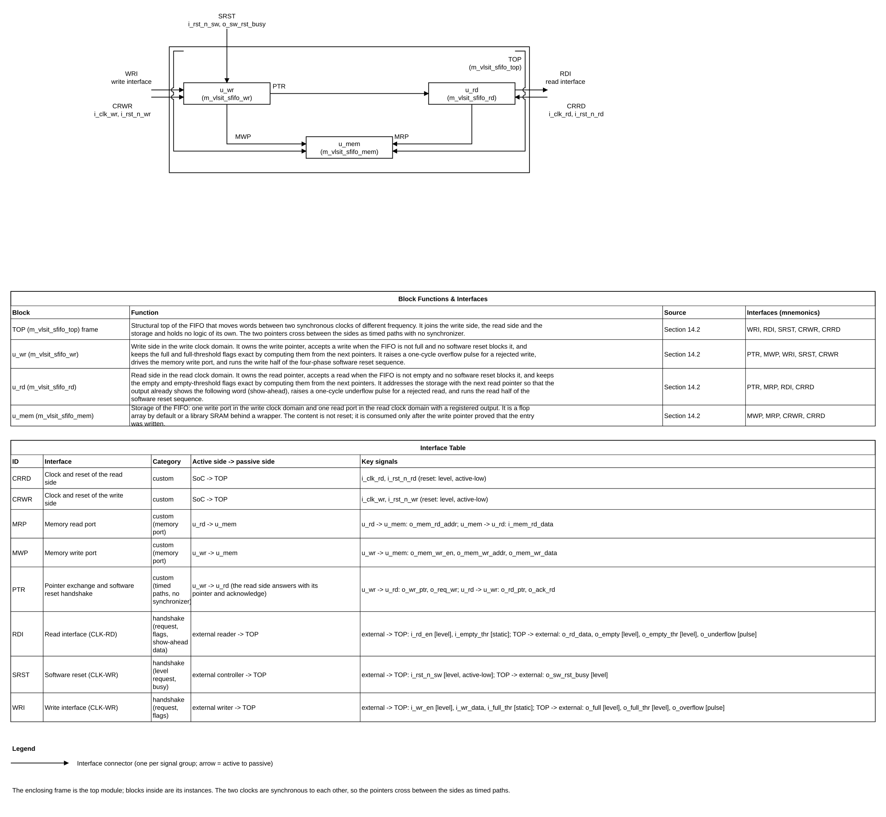

*Figure 5-1. Block diagram of the synchronous-clock FIFO: write side, read side and storage in the top frame (diagram spec: figures/sfifo_diagram_spec.json). The two pointers and the software reset handshake cross between the sides as timed paths without a synchronizer. Source: `figures/sfifo_block_diagram.drawio` (draw.io, VLSIT library, drawn by `vlsit_spec_diagram.py`). The frame is the top module, the blocks are its instances, each connector is one interface with its mnemonic, and the two tables under the diagram in the source file describe the blocks and the interfaces.*

### 5.3 Transaction and dataflow

1. **Write.** The writer drives i_wr_en and i_wr_data. At a rising edge of i_clk_wr with i_wr_en = 1 and o_full = 0 (and no software reset block) the word is stored at the address of the write pointer, the write pointer increments, and the flags are recomputed for the next cycle.
2. **Visibility.** The new write pointer is a flop output of the write domain. The read side uses it at its next rising edge that is strictly later (directly, or one edge later through the retiming flop). The read flag register is loaded at that edge together with the memory output register, so the empty flag and the data change together.
3. **Read.** At a rising edge of i_clk_rd with i_rd_en = 1 and o_empty = 0 the word shown on o_rd_data is taken, the read pointer increments, and the memory output register already loads the following word (the memory read address is the address of the next read pointer).
4. **Release of a place.** The read pointer is visible to the write side at its next strictly later rising edge (directly, or one edge later), where o_full may fall.

### 5.4 Invariants

- The occupancy (write pointer minus read pointer, modulo two times the depth) is between 0 and `PARA_SFIFO_DEPTH`.
- No write is accepted while o_full is 1, and no read is accepted while o_empty is 1.
- o_full is 1 whenever the occupancy is `PARA_SFIFO_DEPTH`; o_empty is 1 whenever the occupancy is 0.
- The write side never sees a read pointer that is ahead of the real one, and the read side never sees a write pointer that is ahead of the real one: the views only lag.
- The memory read address always refers to the next read pointer, so the output register holds the word at the read pointer whenever o_empty is 0.
- Pointers and flags change only at a rising edge of the clock of their own domain.

## 6. External interfaces and ports

### 6.1 Interface inventory

| Interface ID | Type and revision | Role | Direction at IP boundary | Clock domain | Required / optional | Configurations |
|---|---|---|---|---|---|---|
| IF-001 | Custom FIFO write interface (request, data, full and overflow flags, thresholds) | Slave of the writer | Requests in, status out | CLK-WR | Required | All |
| IF-002 | Custom FIFO read interface (request, show-ahead data, empty and underflow flags, thresholds) | Slave of the reader | Requests in, data and status out | CLK-RD | Required | All |
| IF-003 | Software reset (request level and busy output) | Slave of the controller | Request in, busy out | CLK-WR | Required | All |
| IF-004 | Clocks and hardware resets | Receiver | Inputs | CLK-WR, CLK-RD | Required | All |

### 6.2 Complete port list

Port names follow the default naming rule (DEC-001). Widths use `LPARA_*` of Section 8. Every port of every module is listed with its function, clock domain and **signal type**. The legend of the signal types is given after the first table. The top-level port list never depends on a parameter value except for widths (REF-003 PRT-03).

**m_vlsit_sfifo_top**

| Port | Direction | Width | Meaning (function) | Clock domain | Signal type | Reset / idle value | Timing / sampling | Configurations |
|---|---|---:|---|---|---|---|---|---|
| i_clk_wr | Input | 1 | Write-domain clock | CLK-WR | Clock (free running, rising edge) | Not applicable | Rising edge | All |
| i_rst_n_wr | Input | 1 | Hardware reset of all write-domain state | CLK-WR | Reset (active-low level, asynchronous assertion, release synchronous to i_clk_wr outside the IP) | Not applicable | Level | All |
| i_wr_en | Input | 1 | Write request: accepted when i_wr_en = 1 and o_full = 0 | CLK-WR | Level (request, active-high; held high gives one write per cycle) | 0 | Sampled at the rising edge of i_clk_wr | All |
| i_wr_data | Input | PARA_SFIFO_DATA_W | Word to store | CLK-WR | Data (valid at the edge where the write is accepted) | Not applicable | Captured at that edge; ignored otherwise | All |
| i_full_thr | Input | LPARA_OCC_W | Threshold of o_full_thr, an occupancy value | static, no clock | Static (quasi-static: set before use and not changed while the FIFO is in use) | Not applicable | Used by the flag logic; excluded from timing (EXC-001) | All |
| i_rst_n_sw | Input | 1 | Software reset request, active-low | CLK-WR | Level (control, active-low; a one-cycle low pulse is enough) | 1 | Sampled at every rising edge of i_clk_wr; the write block follows it with no clock delay | All |
| o_sw_rst_busy | Output | 1 | Software reset busy: writes are possible again when it is 0 | CLK-WR | Level (flop output, active-high) | 0 | Changes at a rising edge of i_clk_wr | All |
| o_full | Output | 1 | FIFO has no free place in the write view; also 1 while writes are blocked by the software reset | CLK-WR | Level (flag: flop output ORed with the block term) | 0 | Changes at a rising edge of i_clk_wr, except that the block term follows i_rst_n_sw with no clock delay | All |
| o_full_thr | Output | 1 | Occupancy in the write view is at or above i_full_thr; while writes are blocked it shows the value of an empty FIFO | CLK-WR | Level (flag: flop output, selected by the block term) | 0 | As o_full; valid from the first clock edge after reset release | All |
| o_overflow | Output | 1 | A write was requested while the FIFO was full and was dropped | CLK-WR | Pulse (1 write-clock cycle, flop output, not sticky; several events in consecutive cycles give consecutive pulses) | 0 | 1 in the cycle after the rejected request | All |
| i_clk_rd | Input | 1 | Read-domain clock | CLK-RD | Clock (free running, rising edge) | Not applicable | Rising edge | All |
| i_rst_n_rd | Input | 1 | Hardware reset of all read-domain state | CLK-RD | Reset (active-low level, asynchronous assertion, release synchronous to i_clk_rd outside the IP) | Not applicable | Level | All |
| i_rd_en | Input | 1 | Read request: accepted when i_rd_en = 1 and o_empty = 0 | CLK-RD | Level (request, active-high; held high gives one read per cycle) | 0 | Sampled at the rising edge of i_clk_rd | All |
| i_empty_thr | Input | LPARA_OCC_W | Threshold of o_empty_thr, an occupancy value | static, no clock | Static (quasi-static: set before use and not changed while the FIFO is in use) | Not applicable | Used by the flag logic; excluded from timing (EXC-001) | All |
| o_rd_data | Output | PARA_SFIFO_DATA_W | Word at the read pointer (show-ahead); the memory output register | CLK-RD | Data (valid when o_empty = 0) | Not defined until the first word is stored (not reset) | Changes at a rising edge of i_clk_rd | All |
| o_empty | Output | 1 | FIFO has no word visible to the read side; also 1 while reads are blocked by the software reset | CLK-RD | Level (flag: flop output ORed with the block term) | 1 | Changes at a rising edge of i_clk_rd, except that the block term follows the request of the write side with no clock delay | All |
| o_empty_thr | Output | 1 | Occupancy in the read view is at or below i_empty_thr; while reads are blocked it is 1 | CLK-RD | Level (flag: flop output, selected by the block term) | 1 | As o_empty | All |
| o_underflow | Output | 1 | A read was requested while the FIFO was empty and was dropped | CLK-RD | Pulse (1 read-clock cycle, flop output, not sticky) | 0 | 1 in the cycle after the rejected request | All |

**Signal-type legend** (the column "Signal type" of every table)

| Type | Meaning | What the user shall know |
|---|---|---|
| Clock | Free-running clock | Rising edge active; no gating inside the IP |
| Reset | Reset level | A level, not a pulse. It stays low for at least one edge of its clock and is released synchronously outside the IP |
| Level | A signal that holds its value | A request is sampled at every edge: each edge at which it is 1 and the acceptance condition holds is one transaction. A flag stays 1 for as long as its condition holds |
| Pulse | One-cycle event | Output of a flop, 1 for exactly one clock period after the edge that carried the event, returns to 0 by itself, not sticky |
| Data | A bus with a qualifier | Valid only while or when the qualifier named in the brackets is true |
| Static | A configuration value | Not changed while the FIFO is in use; no clock domain |

The ports of the internal modules m_vlsit_sfifo_wr, m_vlsit_sfifo_rd, m_vlsit_sfifo_mem and m_vlsit_sfifo_ram_macro are listed in Section 14.2.1 with the same columns.

Test and interrupt ports: none (see Sections 6.4 and 16).

### 6.3 Protocol behavior

There is no external bus protocol. The FIFO interface follows these rules, the same on every configuration:

- **Request level.** A request (i_wr_en, i_rd_en) is a level sampled at every rising edge of its own clock. It may be 1 for many cycles. Each edge at which the request is 1 and the acceptance condition holds is one transaction. There is no acknowledge handshake: the flag tells whether the request is accepted.
- **Write acceptance.** The write is accepted when i_wr_en = 1, o_full = 0 and writes are not blocked by the software reset. A request is never accepted while o_full = 1. Data does not need to be held after the accepting edge.
- **Read acceptance.** The read is accepted when i_rd_en = 1, o_empty = 0 and reads are not blocked. o_rd_data is the word to be taken and is valid for the whole cycle before the accepting edge.
- **Show-ahead.** After an accepted read, o_rd_data shows the next word in the next cycle, with no bubble, if another word is visible.
- **Flags are views.** o_full and o_full_thr are the write view of the occupancy, o_empty and o_empty_thr the read view. A view may lag the real occupancy in the direction that is safe (full late to fall, empty late to fall), never in the unsafe direction.
- **Rejected requests.** A rejected write or read changes nothing but raises the one-cycle overflow or underflow pulse.

| Case | Legal behavior | Illegal / unsupported case | IP response | Requirement IDs |
|---|---|---|---|---|
| Write into a FIFO that is not full | Word stored, write pointer increments | None | Accepted at the edge | REQ-FUNC-001 |
| Write while o_full = 1 | None | Write into a full FIFO | Dropped, o_overflow pulse in the next cycle | REQ-FUNC-004, REQ-FUNC-008 |
| Read from a FIFO that is not empty | Word taken, next word shown | None | Accepted at the edge | REQ-FUNC-002 |
| Read while o_empty = 1 | None | Read of an empty FIFO | Dropped, o_underflow pulse in the next cycle | REQ-FUNC-005, REQ-FUNC-009 |
| Write or read while the software reset blocks the side | None | Request during the software reset | Dropped, no overflow or underflow pulse | REQ-SRST-002, REQ-SRST-003 |
| Request while a hardware reset is asserted | None | Request during the reset | Not defined (the IP is in reset) | REQ-RESET-002 |
| Threshold input changed while the FIFO is in use | None | i_full_thr or i_empty_thr not static | The flag may take a wrong value for some cycles | REQ-FUNC-007 |

Figure 6-1 to Figure 6-3 give the key waveforms of the interface (the full plan is in Section 10.3).

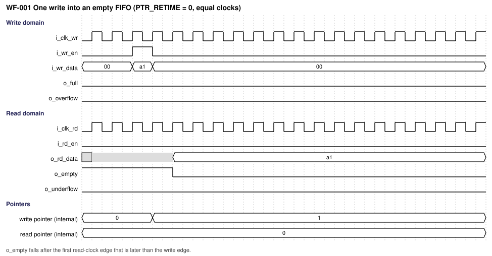

*Figure 6-1. Write into an empty FIFO and the fall of o_empty (WF-001, source `waveforms/sfifo_wf001_write_into_empty.json`).*

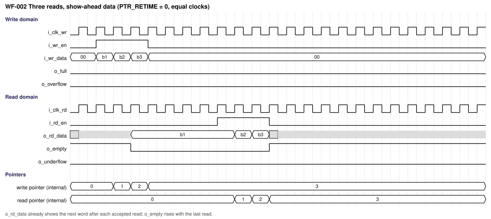

*Figure 6-2. Read with show-ahead data (WF-002, source `waveforms/sfifo_wf002_read_show_ahead.json`).*

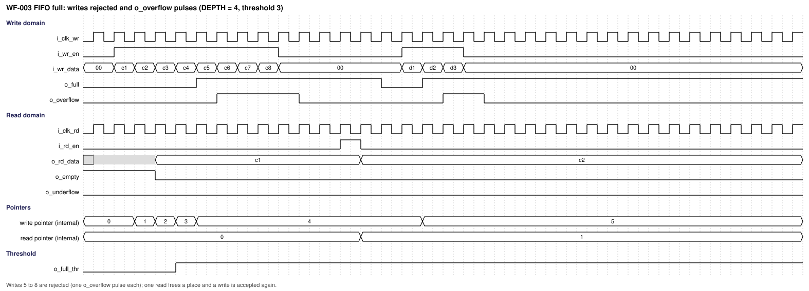

*Figure 6-3. Full FIFO: writes rejected and o_overflow pulses (WF-003, source `waveforms/sfifo_wf003_full_overflow.json`).*

### 6.4 Interrupts and events

| Signal/event | Polarity | Assert condition | Clear/deassert condition | Mask/priority | Crossing | Reset state |
|---|---|---|---|---|---|---|
| Not applicable | Not applicable | **Not required (confirmed by user, 2026-10-23):** the IP has no interrupt output; the pulses o_overflow and o_underflow are the only events and are described in Section 6.2 | Not applicable | Not applicable | Not applicable | Not applicable |

## 7. Clock, reset, and power

### 7.1 Clock domains

| Domain | Clock port | Edge | Frequency range | Source | Relationship to other clocks | Gating policy |
|---|---|---|---|---|---|---|
| CLK-WR | i_clk_wr | Rising | Set by the integrator | One common source (for example one PLL) | Synchronous to CLK-RD: fixed phase relationship, any rational frequency ratio, equal frequency allowed | No clock gating inside the IP |
| CLK-RD | i_clk_rd | Rising | Set by the integrator | The same common source | Synchronous to CLK-WR | No clock gating inside the IP |

### 7.2 CDC and RDC

| Crossing ID | From → to | Signals | Structure | Reset handling | Constraints / verification |
|---|---|---|---|---|---|
| Not applicable | Not applicable | **Not required (confirmed by user, 2026-10-23):** the two clocks are synchronous, so there is no clock-domain crossing and no synchronizer (DEC-005, DEC-010). The paths between the domains are timed paths: the write pointer and the request go from CLK-WR to CLK-RD, the read pointer and the acknowledge go from CLK-RD to CLK-WR; each starts at a flop and ends at a flop or at the flag logic (Section 17.1) | Not applicable | Not applicable | The two clocks shall be declared as related clocks of one source, and no asynchronous clock group or false path shall be set between them (REQ-CLK-002, TEST-015) |

### 7.3 Reset domains and sequencing

| Reset ID | Port | Polarity / assertion | Sync or async | Scope | Deassertion | Reset value |
|---|---|---|---|---|---|---|
| RST-WR | i_rst_n_wr | Active-low | Asynchronous assertion; release synchronous to i_clk_wr, provided outside the IP | All write-domain state: write pointer, full and full-threshold flags, overflow pulse, write reset FSM, request, busy, retiming flops | Synchronous to i_clk_wr | Pointer 0, o_full 0, o_full_thr 0, o_overflow 0, FSM RUN, request 0, busy 0 |
| RST-RD | i_rst_n_rd | Active-low | Asynchronous assertion; release synchronous to i_clk_rd, provided outside the IP | All read-domain state: read pointer, empty and empty-threshold flags, underflow pulse, read reset FSM, acknowledge, retiming flops | Synchronous to i_clk_rd | Pointer 0, o_empty 1, o_empty_thr 1, o_underflow 0, FSM RUN, acknowledge 0 |
| RST-SW | i_rst_n_sw | Active-low request, a level | Not a reset of the flops: a request for the sequence of Section 10.7 | Both pointers and both flag sets, through the handshake | Level 1 after the request | The FIFO is empty at the end of the sequence |

The two hardware resets are asserted together by the reset controller and released synchronously to their own clocks; no operation starts before both are released (REQ-RESET-002). All flip-flops of the IP have an asynchronous reset to 0, except the flag registers whose reset value is 1 (o_empty, o_empty_thr). The memory content is not reset (resetless payload, DEC-016): the read side consumes a word only when o_empty is 0, and o_empty becomes 0 only after the word was written. A hardware reset has priority over a software reset at any time (REQ-SRST-007). The stopped-clock, warm-reset and retention cases are not supported.

### 7.4 Power intent (if applicable)

**Not required (confirmed by user, 2026-10-23):** the IP is in one always-on power domain of the SoC and has no isolation, retention or power sequencing of its own.

## 8. Parameters and elaboration configurations

Parameters use `parameter logic [31:0]` with names `PARA_SFIFO_*` with the three comment lines of REF-003 PAR-02. Derived constants use `localparam logic [31:0]` with names `LPARA_*` in the parameter port list after the parameters. The IP has no elaboration check for illegal values (REQ-PARAM-001); `$clog2` may be used for the derived widths.

| Parameter | Purpose | Default | Legal values / range | Dependencies / invalid combinations | Effect |
|---|---|---|---|---|---|
| PARA_SFIFO_DEPTH | Number of entries | 8 | Any integer of 2 or more, no upper limit (DEC-009) | The derived widths depend on it | Storage size and pointer width |
| PARA_SFIFO_DATA_W | Data bit width | 32 | 1 or more, no upper limit | None | Width of i_wr_data, o_rd_data and the storage |
| PARA_SFIFO_PTR_RETIME | Pointer path: 0 = direct, 1 = one retiming flop in the destination domain (DEC-006) | 0 | 0 or 1 | None | Latency of the flags and timing of the crossing paths; the function is the same |
| PARA_SFIFO_MEM_USE_MACRO | Storage branch: 0 = RTL array, 1 = library SRAM wrapper | 0 | 0 or 1 | The wrapper uses the macro model `VLSIT_CELL_SRAM_1W1R` of `000_Common` until the real macro is mapped | Storage branch |
| LPARA_ADDR_W | Address width: clog2(DEPTH) | Derived | At least 1 | `PARA_SFIFO_DEPTH` | Width of the memory addresses |
| LPARA_PTR_W | Pointer width: clog2(2 x DEPTH) | Derived | At least 2 | `PARA_SFIFO_DEPTH` | Width of the pointers; the pointer counts 0 to 2 x DEPTH - 1 |
| LPARA_OCC_W | Occupancy width: clog2(DEPTH + 1) | Derived | At least 2 | `PARA_SFIFO_DEPTH` | Width of i_full_thr and i_empty_thr; the occupancy is 0 to DEPTH |

| Configuration | Parameter overrides | Features/interfaces | Expected hierarchy | Elaboration/lint/synthesis target |
|---|---|---|---|---|
| CFG-BASE | Defaults | Flop array, direct pointers | top → wr, rd, mem | Elaborate, lint, synthesize |
| CFG-RETIME | `PARA_SFIFO_PTR_RETIME` = 1 | One retiming flop per crossing signal | Same hierarchy | Elaborate, lint, synthesize |
| CFG-MACRO | `PARA_SFIFO_MEM_USE_MACRO` = 1 | Library SRAM wrapper | `m_vlsit_sfifo_ram_macro` under mem | Elaboration with the macro model |
| CFG-ODD | `PARA_SFIFO_DEPTH` = 5 or 12 | Depth not a power of two | Same hierarchy | Elaborate, lint |
| CFG-MIN | `PARA_SFIFO_DEPTH` = 2, `PARA_SFIFO_DATA_W` = 1 | Smallest legal instance | Same hierarchy | Elaborate, lint |

Illegal configurations are a depth below 2, a data width of 0, and an option parameter outside 0..1. The IP does not check them and its behavior with them is not specified. A depth below 4 + 2 x `PARA_SFIFO_PTR_RETIME` is legal but does not guarantee gap-free streaming (Section 10.4). With the SRAM branch and a depth that is not a power of two the macro has 2^clog2(DEPTH) rows and the rows above DEPTH - 1 are not used.

## 9. Data representation and arithmetic

All data are unsigned four-state vectors, bit 0 the least significant. The word is stored and returned unchanged; the IP does not interpret it.

| Quantity | Width | Encoding / range | Extension / truncation | Overflow / invalid behavior |
|---|---:|---|---|---|
| Data word | PARA_SFIFO_DATA_W | Opaque | None | Not applicable |
| Pointer | LPARA_PTR_W | Unsigned, 0 to 2 x DEPTH - 1; after 2 x DEPTH - 1 it returns to 0 | Increment is explicit; no truncation | The pointer never exceeds its range |
| Memory address | LPARA_ADDR_W | Pointer modulo DEPTH: the pointer if it is below DEPTH, otherwise the pointer minus DEPTH | None | Not applicable |
| Occupancy | LPARA_PTR_W + 1 (internal) | Write pointer minus read pointer: the difference if the write pointer is not below the read pointer, otherwise the difference plus 2 x DEPTH | Result is 0 to DEPTH | Cannot exceed DEPTH because the full flag blocks writes |
| Threshold | LPARA_OCC_W | Unsigned occupancy value, 0 to DEPTH | Zero-extended for the comparison | A value above DEPTH makes o_full_thr never 1 and o_empty_thr always 1 |
| Flags and pulses | 1 | 1 = condition true (active-high) | None | Not applicable |

## 10. Detailed functional behavior

### 10.1 Modes and state transitions

The data path has no mode: the flags alone decide acceptance. Two small FSMs run the software reset (Section 10.7).

**Write reset FSM** (m_vlsit_sfifo_wr, `reg_fsm_srst_current_state`, 3 bits; encodings 5 to 7 recover to RUN):

| Mode/state | Entry condition | Behavior | Exit condition | Outputs / side effects |
|---|---|---|---|---|
| ENUM_ST_RUN | Reset, or the end of REL | Normal operation | i_rst_n_sw = 0: REQ | o_sw_rst_busy 0, request 0 |
| ENUM_ST_REQ | Request taken | Writes blocked; request raised; wait for the acknowledge | Acknowledge seen: PTR | o_sw_rst_busy 1, request 1 |
| ENUM_ST_PTR | Acknowledge seen | The write pointer is reset to 0 (one cycle) | Always: HOLD | Request 1 |
| ENUM_ST_HOLD | After PTR | Wait for i_rst_n_sw = 1 | i_rst_n_sw = 1: REL | Request 1 |
| ENUM_ST_REL | i_rst_n_sw is 1 again | Request dropped; wait for the acknowledge to fall and the read pointer seen as 0 (flush check) | Acknowledge 0 and read pointer 0: RUN | Request 0, o_sw_rst_busy 1 |

**Read reset FSM** (m_vlsit_sfifo_rd, `reg_fsm_srst_current_state`, 2 bits; encoding 3 recovers to RUN):

| Mode/state | Entry condition | Behavior | Exit condition | Outputs / side effects |
|---|---|---|---|---|
| ENUM_ST_RUN | Reset, or the end of ACK | Normal operation | Request seen: RST | Acknowledge 0 |
| ENUM_ST_RST | Request seen | Reads blocked; the read pointer is reset to 0 (one cycle) | Always: ACK | Acknowledge rises at the exit edge |
| ENUM_ST_ACK | After RST | Reads blocked; acknowledge held | Request 0 and write pointer seen as 0 (flush check): RUN | Acknowledge 1 |

### 10.2 Operations

| Operation ID | Inputs / preconditions | Processing semantics | Result / completion | Latency / ordering |
|---|---|---|---|---|
| OP-001 | i_wr_en = 1, o_full = 0, no software reset block | Store i_wr_data at the write address, increment the write pointer | Word stored; o_empty falls in the read domain; o_full rises at once if it was the last free place | The read side sees it after the first (PTR_RETIME 0) or second (PTR_RETIME 1) later read edge |
| OP-002 | i_rd_en = 1, o_empty = 0, no software reset block | Take the word of o_rd_data, increment the read pointer, load the next word into the output register | Next word shown; o_empty rises at once if it was the last word | One word per read cycle; o_full falls in the write domain after the first or second later write edge |
| OP-003 | i_wr_en = 1, o_full = 1, no block | Reject the write, change nothing | o_overflow pulse in the next cycle | None |
| OP-004 | i_rd_en = 1, o_empty = 1, no block | Reject the read, change nothing | o_underflow pulse in the next cycle | None |
| OP-005 | Static i_full_thr and i_empty_thr | Compare the occupancy of the own view with the threshold | o_full_thr and o_empty_thr | Updated at every edge of the own clock |
| OP-006 | i_rst_n_sw = 0 | Sequence of Section 10.7: block, reset read pointer, reset write pointer, release | FIFO empty, pointers 0, o_sw_rst_busy 0 | A few cycles of the two clocks; see Section 10.7 |
| OP-007 | i_rst_n_wr = 0 or i_rst_n_rd = 0 | Asynchronous clear of the state of the domain | FIFO empty, reset values of Section 7.3 | Immediate |

### 10.3 Cycle-level behavior

**Waveform plan (rule R-024).** The plan was proposed from sections 6.3 and 10.2 and confirmed by the designer on 2026-10-23 (option "proposed list" with the back-to-back waveforms that the designer asked for: continuous write and continuous read with only the initial latency). It covers every operation of 10.2, the success and the error case of both interfaces, and the special cases (latency with both pointer options, clock ratio, wrap-around of an odd depth, software reset, hardware reset). The waveforms come from the prototype (`waveforms/proto/gen_waves.py`).

| Waveform ID | Function / operation | Scenario (success / error / corner) | Signals shown | Figure | Confirmed by user |
|---|---|---|---|---|---|
| WF-001 | OP-001 write into an empty FIFO | success | Write, pointer, o_empty fall, show-ahead data | waveforms/sfifo_wf001_write_into_empty.svg | 2026-10-23 |
| WF-002 | OP-002 three reads with show-ahead data | success | Read, o_rd_data, pointer, o_empty rise | waveforms/sfifo_wf002_read_show_ahead.svg | 2026-10-23 |
| WF-003 | OP-003 write into a full FIFO | error | o_full, writes rejected, o_overflow pulses, o_full_thr | waveforms/sfifo_wf003_full_overflow.svg | 2026-10-23 |
| WF-004 | OP-004 read of an empty FIFO | error | o_empty, reads rejected, o_underflow pulses | waveforms/sfifo_wf004_empty_underflow.svg | 2026-10-23 |
| WF-005 | OP-005 threshold flags | success | o_full_thr, o_empty_thr against the occupancy | waveforms/sfifo_wf005_thresholds.svg | 2026-10-23 |
| WF-006 | OP-001 and OP-002 flag latency with `PARA_SFIFO_PTR_RETIME` = 0, clocks 12 ns and 8 ns | corner | Fall of o_empty after a write, fall of o_full after a read | waveforms/sfifo_wf006_flag_latency_retime0.svg | 2026-10-23 |
| WF-007 | OP-001 and OP-002 flag latency with `PARA_SFIFO_PTR_RETIME` = 1, clocks 12 ns and 8 ns | corner | The same with one more destination edge | waveforms/sfifo_wf007_flag_latency_retime1.svg | 2026-10-23 |
| WF-008 | OP-001 and OP-002 continuous write and continuous read, equal clocks, `PARA_SFIFO_PTR_RETIME` = 0 | corner (back-to-back) | Initial latency, then one word per cycle, no gap | waveforms/sfifo_wf008_back_to_back_equal_retime0.svg | 2026-10-23 |
| WF-009 | OP-001 and OP-002 continuous write and continuous read, equal clocks, `PARA_SFIFO_PTR_RETIME` = 1 | corner (back-to-back) | The same with the longer initial latency | waveforms/sfifo_wf009_back_to_back_equal_retime1.svg | 2026-10-23 |
| WF-010 | OP-001 and OP-002 continuous traffic, write clock 8 ns faster than read clock 12 ns | corner (back-to-back) | Reader never stalls; the writer is held by o_full | waveforms/sfifo_wf010_back_to_back_write_faster.svg | 2026-10-23 |
| WF-011 | OP-001 and OP-002 continuous traffic, read clock 8 ns faster than write clock 12 ns | corner (back-to-back) | Writer never stalls; the reader waits by o_empty | waveforms/sfifo_wf011_back_to_back_read_faster.svg | 2026-10-23 |
| WF-012 | OP-001 and OP-002 pointer and address wrap with depth 5 | corner | Pointer 0 to 9, address 0 to 4 | waveforms/sfifo_wf012_pointer_wrap_depth5.svg | 2026-10-23 |
| WF-013 | OP-006 software reset sequence | success | i_rst_n_sw, both FSMs, request, acknowledge, busy, pointers | waveforms/sfifo_wf013_software_reset.svg | 2026-10-23 |
| WF-014 | OP-006 one-cycle software reset pulse while the FIFO is full | corner | The whole sequence started by a one-cycle pulse | waveforms/sfifo_wf014_software_reset_pulse_full.svg | 2026-10-23 |
| WF-015 | OP-007 hardware reset in the middle of traffic | corner | Both resets, state cleared at once, o_empty 1 | waveforms/sfifo_wf015_hardware_reset.svg | 2026-10-23 |

Active edge: the rising edge of the clock of the signal's own domain. Inputs are sampled at the edge that ends a cycle; flop outputs change after the edge that starts it. The waveforms use a grid in which one slot is half of the common divisor of the two half periods, so every clock edge is at a slot boundary.

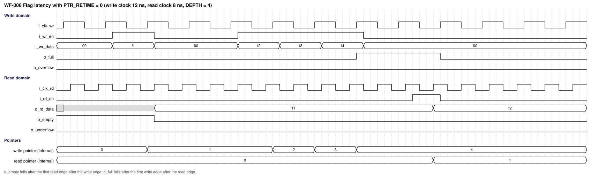

*Figure 10-1. WF-006: flag latency with `PARA_SFIFO_PTR_RETIME` = 0, write clock 12 ns, read clock 8 ns, depth 4 (source `waveforms/sfifo_wf006_flag_latency_retime0.json`).*

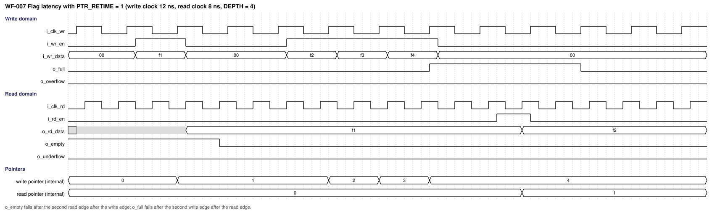

*Figure 10-2. WF-007: the same scenario with `PARA_SFIFO_PTR_RETIME` = 1: o_empty and o_full fall one destination edge later (source `waveforms/sfifo_wf007_flag_latency_retime1.json`).*

*Figure 10-3. WF-008: continuous write and continuous read, equal clocks, depth 8, `PARA_SFIFO_PTR_RETIME` = 0. After the initial latency a word is read in every cycle (source `waveforms/sfifo_wf008_back_to_back_equal_retime0.json`).*

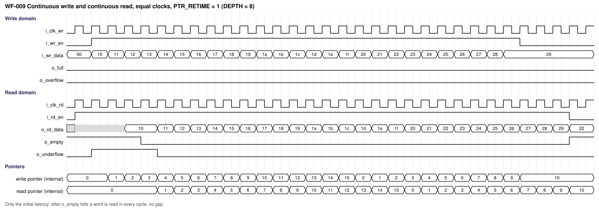

*Figure 10-4. WF-009: the same with `PARA_SFIFO_PTR_RETIME` = 1; the initial latency is one cycle longer, there is still no gap (source `waveforms/sfifo_wf009_back_to_back_equal_retime1.json`).*

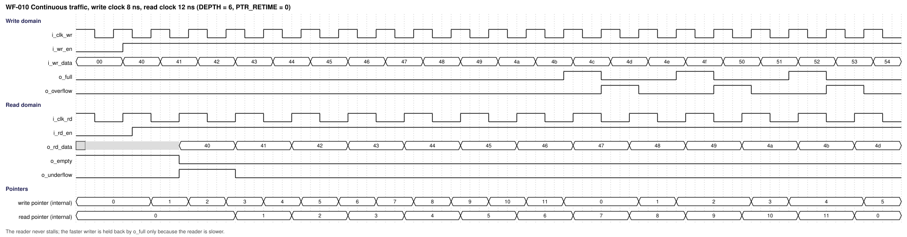

*Figure 10-5. WF-010: write clock 8 ns, read clock 12 ns, depth 6. The reader never stalls; the faster writer is held back by o_full only because the reader is slower (source `waveforms/sfifo_wf010_back_to_back_write_faster.json`).*

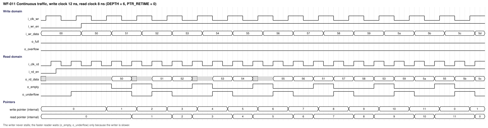

*Figure 10-6. WF-011: write clock 12 ns, read clock 8 ns, depth 6. The writer never stalls; the faster reader waits (o_empty, o_underflow) only because the writer is slower. o_rd_data is meaningful only while o_empty is 0 (source `waveforms/sfifo_wf011_back_to_back_read_faster.json`).*

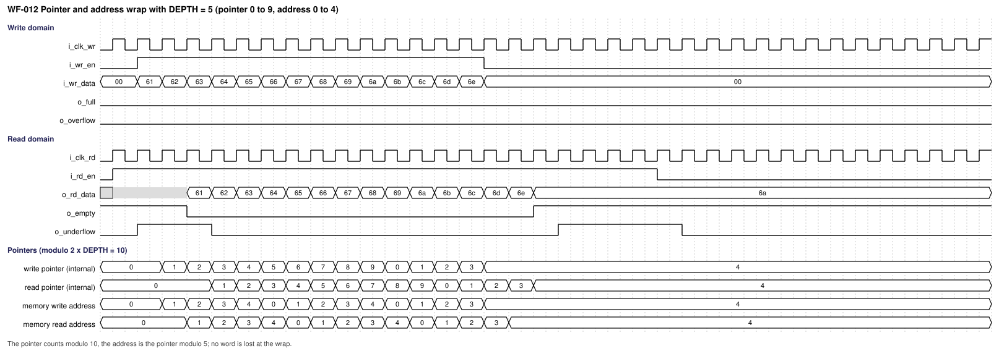

*Figure 10-7. WF-012: depth 5, pointer 0 to 9 and address 0 to 4 (source `waveforms/sfifo_wf012_pointer_wrap_depth5.json`).*

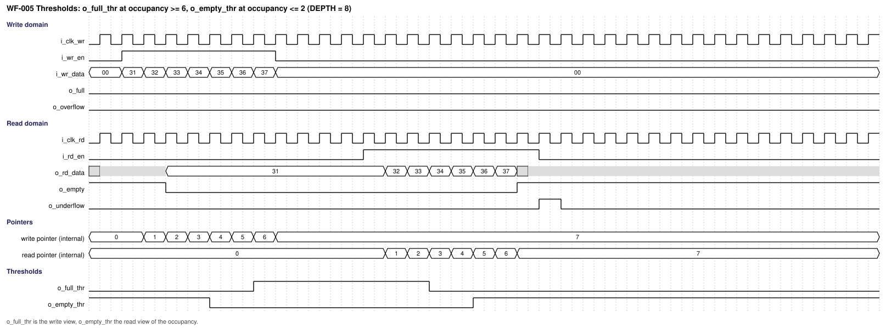

*Figure 10-8. WF-005: o_full_thr rises at occupancy 6 and o_empty_thr falls at occupancy 3 (thresholds 6 and 2, depth 8) (source `waveforms/sfifo_wf005_thresholds.json`).*

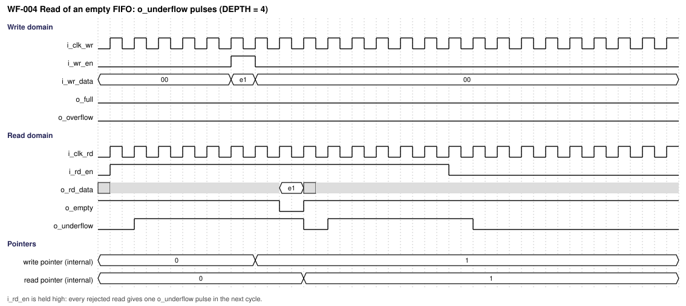

*Figure 10-9. WF-004: read requests on an empty FIFO give one o_underflow pulse each (source `waveforms/sfifo_wf004_empty_underflow.json`).*

The software reset and hardware reset waveforms are in Section 10.7 (Figures 10-10 to 10-12).

| Cycle / event | Input condition | State/action | Output condition |
|---|---|---|---|
| Write edge E_w | i_wr_en = 1, o_full = 0 | Word stored, write pointer increments, flags of the write domain recomputed | o_full may rise in the next cycle (if it was the last place) |
| First read edge strictly after E_w (E_r1) | Any | The read side loads o_empty and the memory output register from the new write pointer (direct), or captures the write pointer in the retiming flop | PTR_RETIME 0: o_empty falls and o_rd_data shows the new word after E_r1. PTR_RETIME 1: after E_r2 |
| Read edge E_r | i_rd_en = 1, o_empty = 0 | Word taken, read pointer increments, next word loaded | o_empty rises in the next cycle if it was the last word |
| First write edge strictly after E_r (E_w1) | Any | The write side recomputes o_full from the new read pointer (direct), or captures the read pointer first | PTR_RETIME 0: o_full falls after E_w1. PTR_RETIME 1: after E_w2 |

When the two edges coincide (equal clocks, or an edge of the common least common multiple), the edge that coincides does **not** count as "strictly later": the pointer written at that edge is seen at the next edge. This is why WF-001 shows o_empty falling one full cycle after the write edge.

### 10.4 Arbitration, buffering, and throughput

There is no arbitration: one write interface and one read interface. Simultaneous write and read are independent (different pointers); a write and a read at the same clock edge are both accepted when the flags allow.

**Throughput.** One word per write-clock cycle and one word per read-clock cycle (REQ-PERF-001).

**Latency** (measured on the prototype, `waveforms/sfifo_wave_tables.txt`; clocks 12 ns and 8 ns, depth 4):

| Event | PTR_RETIME = 0 | PTR_RETIME = 1 |
|---|---|---|
| Write edge to the fall of o_empty | 2 ns: the first read edge strictly after the write edge (WF-006) | 10 ns, one read period (8 ns) more (WF-007) |
| Equal clocks: first read accepted after the write edge | 2 cycles (WF-001) | 3 cycles |
| Read edge to the fall of o_full | First write edge strictly after the read edge | One write edge more |
| Last word read to o_empty = 1 | Next cycle | Next cycle |
| Last free place written to o_full = 1 | Next cycle | Next cycle |

**Gap-free streaming.** With i_wr_en and i_rd_en held at 1 there is only the initial latency. The sweep `waveforms/proto/run_regress.py` (`waveforms/sfifo_min_depth_table.txt`) measured the smallest depth for which the side that is not rate-limited never stalls, for 14 clock ratios (half periods from 1:1 to 2:9 and 9:2 ns):

| PARA_SFIFO_PTR_RETIME | Equal clocks | Ratios such as 3:2, 2:3, 7:5, 5:7 | Ratios such as 1:2, 2:1, 3:7, 7:3, 9:2 | Worst case over the 14 ratios |
|---|---|---|---|---|
| 0 | depth 4 | depth 3 | depth 2 | depth 4 |
| 1 | depth 6 | depth 4 to 5 | depth 3 to 4 | depth 6 |

The rule of REQ-PERF-002, depth at least 4 + 2 x `PARA_SFIFO_PTR_RETIME`, covers the worst case of the tested ratios. It is a measured sufficient condition on the prototype, not a proof for every ratio. With a smaller depth the FIFO is still correct but a gap appears (for example, equal clocks with depth 3 and `PARA_SFIFO_PTR_RETIME` = 0).

### 10.5 Memories and storage

| Storage ID | Kind | Depth × width | Ports | Read latency | Write mask | Reset/init | ECC/parity | Implementation |
|---|---|---|---|---|---|---|---|---|
| MEM-001 | RTL array with a read register | `PARA_SFIFO_DEPTH` × `PARA_SFIFO_DATA_W` | One write port (CLK-WR), one read port (CLK-RD) | 1 read-clock cycle | None (whole word) | None (resetless payload) | None | Inferred flop array |
| MEM-002 | Library SRAM, one write port and one read port | 2^LPARA_ADDR_W rows × `PARA_SFIFO_DATA_W` | One write port (CLK-WR), one read port (CLK-RD) | 1 read-clock cycle | None (bit write enable tied to 0) | None | None | Wrapper `m_vlsit_sfifo_ram_macro` in `000_Common/rtl_lib` instantiating the cell `VLSIT_CELL_SRAM_1W1R` as `u_dont_touch_sram`, in every flow (DEC-004) |

The memory is read in every read-clock cycle at the address of the next read pointer. A read of the address that is written at the same edge returns the old word; the flags make this harmless because the read side takes a word only after the flag fell, and the flag falls together with the output register that holds the new word (Section 5.3). The memory is never invalid at an address that is read with o_empty = 0. Reading the old word during a collision is part of the contract of the memory model of `000_Common`.

### 10.6 Flags, pointers and thresholds

The pointers and the occupancy are those of Section 9. The occupancy is `occ(a, b)` = a - b if a is not below b, otherwise a + 2 x DEPTH - b.

**Write domain** (all flags are flop outputs loaded at the edge, from the next values):

| Name | Definition |
|---|---|
| block | `o_sw_rst_busy` flop OR i_rst_n_sw = 0 |
| rd_ptr_view | i_rd_ptr if `PARA_SFIFO_PTR_RETIME` = 0, otherwise the flop that captured i_rd_ptr at the previous edge |
| write accepted | i_wr_en AND NOT block AND NOT full flop |
| next write pointer | 0 in state PTR; incremented if a write is accepted; otherwise unchanged |
| next occupancy | `occ(next write pointer, rd_ptr_view)` |
| full flop | next occupancy equals DEPTH |
| full-threshold flop | next occupancy is at or above i_full_thr |
| o_full | block OR full flop |
| o_full_thr | if block: (i_full_thr equals 0), otherwise the full-threshold flop |
| o_overflow | flop: i_wr_en AND NOT block AND full flop, one cycle later |

**Read domain** (all flags are flop outputs loaded at the edge, from the next values):

| Name | Definition |
|---|---|
| block | request seen on the read side (directly or through the retiming flop) OR read FSM not in RUN |
| wr_ptr_view | i_wr_ptr if `PARA_SFIFO_PTR_RETIME` = 0, otherwise the flop that captured i_wr_ptr at the previous edge |
| read accepted | i_rd_en AND NOT block AND NOT empty flop |
| next read pointer | 0 in state RST; incremented if a read is accepted; otherwise unchanged |
| next occupancy | `occ(wr_ptr_view, next read pointer)` |
| empty flop | next occupancy equals 0 |
| empty-threshold flop | next occupancy is at or below i_empty_thr |
| o_empty | block OR empty flop |
| o_empty_thr | if block: 1, otherwise the empty-threshold flop |
| o_underflow | flop: i_rd_en AND NOT block AND empty flop, one cycle later |
| memory read address | the next read pointer modulo DEPTH |

The write view of the occupancy never underestimates the real occupancy, and the read view never overestimates it, because each view uses a pointer of the other domain that may lag but never leads. After reset, o_full_thr is 0 until the first clock edge after release; from then on it follows the formula (even if i_full_thr is 0).

### 10.7 Software reset

The sequence resets both pointers safely. It is the handshake of the sibling IP with the synchronizers replaced by the timed crossing of `PARA_SFIFO_PTR_RETIME` (DEC-017).

1. **Request.** The controller drives i_rst_n_sw to 0 in the write domain. From that cycle writes are blocked (no flop in the path) and o_full is 1. The write FSM leaves RUN, o_sw_rst_busy rises in the next cycle, and the request flop is raised.
2. **Read side.** The read FSM sees the request, blocks reads (o_empty = 1), resets the read pointer (state RST, one cycle) and raises the acknowledge.
3. **Write side.** The write FSM sees the acknowledge, resets the write pointer (state PTR, one cycle) and waits in HOLD until i_rst_n_sw is 1.
4. **Release.** In REL the request is dropped. The read side leaves ACK first, when it sees the request at 0 and the write pointer at 0 (flush check). The write side leaves REL when it sees the acknowledge at 0 and the read pointer at 0, then returns to RUN; o_sw_rst_busy falls.

The FIFO is ready for writes when o_sw_rst_busy is 0 and i_rst_n_sw is 1. A one-cycle low pulse starts the complete sequence. A hardware reset at any step clears all FSMs. A new low level during REL is served after the write FSM is back in RUN.

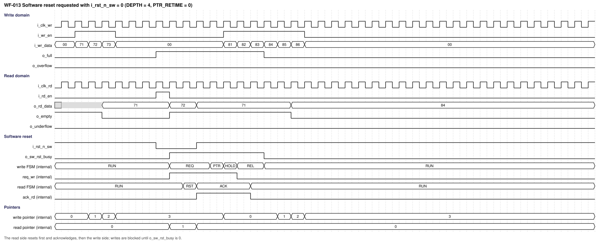

*Figure 10-10. WF-013: software reset with i_rst_n_sw held low for three cycles (source `waveforms/sfifo_wf013_software_reset.json`).*

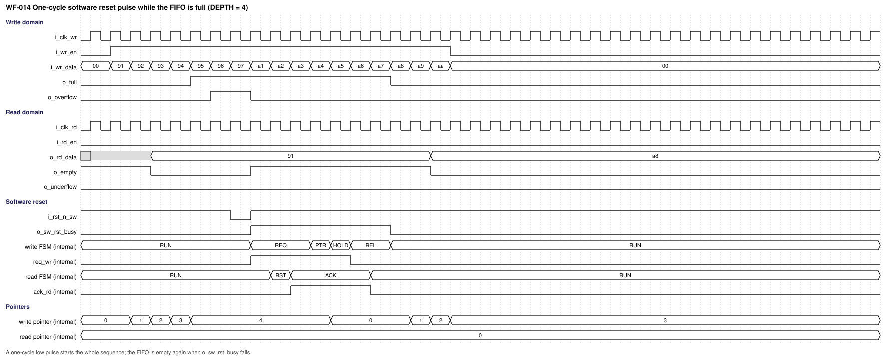

*Figure 10-11. WF-014: a one-cycle pulse on i_rst_n_sw while the FIFO is full starts the whole sequence (source `waveforms/sfifo_wf014_software_reset_pulse_full.json`).*

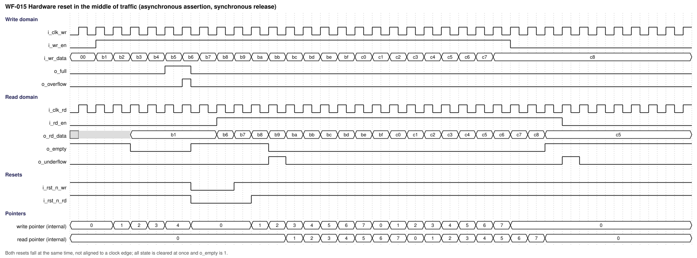

*Figure 10-12. WF-015: a hardware reset in the middle of traffic clears all state at once (source `waveforms/sfifo_wf015_hardware_reset.json`).*

## 11. Register and programming model

**Not required (confirmed by user, 2026-10-23):** the IP has no software-visible registers; it is configured by parameters (Section 8) and the static threshold inputs. The software reset is the input i_rst_n_sw and its busy output, not a register. No CSR workbook is delivered.

## 12. Error handling and recovery

| Error ID | Detection condition | Observable response/status | Interrupt | Clear/recovery | Reset behavior |
|---|---|---|---|---|---|
| ERR-001 | Write requested while o_full = 1 and writes are not blocked | The write is dropped; o_overflow pulses for one cycle | None | The next request is independent | Cleared by reset |
| ERR-002 | Read requested while o_empty = 1 and reads are not blocked | The read is dropped; o_underflow pulses for one cycle | None | The next request is independent | Cleared by reset |
| ERR-003 | Request while the software reset blocks the side | The request is dropped; no pulse | None | Retry after o_sw_rst_busy = 0 | Not applicable |
| ERR-004 | Illegal parameter value or a threshold changed while in use | Not detected; behavior not specified | None | The integrator fixes the configuration | Not applicable |

There is no sticky error and no error interrupt; the pulses are the only status. The pulses of consecutive rejected requests are consecutive. There is no data protection (no ECC or parity), so a corrupted stored word is not detected.

## 13. Performance, power, and area

| Metric ID | Metric | Target / limit | Conditions | Measurement method | Hard / goal |
|---|---|---|---|---|---|
| PERF-001 | Throughput | One word per write cycle and one per read cycle | Any depth of 2 or more | Simulation: TEST-007 | Hard (REQ-PERF-001) |
| PERF-002 | Gap-free streaming | No gap after the initial latency | Depth at least 4 + 2 x `PARA_SFIFO_PTR_RETIME` | Simulation and depth sweep: TEST-007 | Hard (REQ-PERF-002) |
| PERF-003 | Write-to-empty-fall latency | First (PTR_RETIME 0) or second (PTR_RETIME 1) read edge strictly after the write edge | Any ratio | Simulation: TEST-006 | Hard (REQ-PERF-003) |
| PERF-004 | Read-to-full-fall latency | First or second write edge strictly after the read edge | Any ratio | Simulation: TEST-006 | Hard (REQ-PERF-004) |
| PPA-001 | Maximum frequency | Not specified; set by the integrator (OI-001) | Library, corner and voltage chosen by the integrator | STA with the delivered constraints | Goal |
| PPA-002 | Area | Not specified; set by the integrator (OI-001). Flops: 2 pointers, 4 flag flops, 2 pulse flops, FSMs and handshake flops, 2 optional retiming pointers, DEPTH x DATA_W storage | Library chosen by the integrator | Cell area report | Goal |
| PPA-003 | Dynamic and leakage power | Not specified; set by the integrator (OI-001) | Activity and corner chosen by the integrator | Power analysis | Goal |

No timing closure is claimed from RTL alone. The crossing paths are the critical paths of the IP (Section 17.1.2): with `PARA_SFIFO_PTR_RETIME` = 0 a pointer flop of one domain drives an occupancy comparison into a flag flop of the other domain within the shortest interval between a launch edge and a capture edge of the two clocks; `PARA_SFIFO_PTR_RETIME` = 1 removes the logic from that path.

## 14. RTL implementation contract

### 14.1 Required coding baseline

The VLSIT RTL Design Rules v2 in VLSIT_RTL_Design_Rule.md (REF-003) are the mandatory RTL coding authority. The RTL complies with them without local exceptions. Items that matter most for this IP: one module per file with the file name equal to the module name; a structural top; ANSI ports with `input wire` and `output logic`; `reg_`, `w_`, `p_ff_` and `p_com_` names; FSM names `reg_fsm_srst_current_state` and `w_fsm_srst_nxt_state` with `ENUM_ST_*` states and a safe recovery of the unused encodings; parameters `PARA_SFIFO_*` with the three PAR-02 comment lines; at most 30 characters per name; cell and macro instances named `u_dont_touch_` followed by the function name; comment lines of at most 100 characters; port layout and grouping of REF-003 FIL-05 and FIL-06. Every flop of the control state has an asynchronous reset; the memory is the only resetless storage (DEC-016). No SVA, testbench or prototype code belongs to the synthesis file list. The library SRAM and its macro model are in `000_Common`, not in the folder of this IP (REQ-RTL-002).

### 14.2 RTL hierarchy

| Module | Responsibility | Parent / instance | Clock/reset domains | Interface |
|---|---|---|---|---|
| m_vlsit_sfifo_top | Structural top: ports, parameters, interconnect, instances | Top | CLK-WR and CLK-RD | All ports of Section 6.2 |
| m_vlsit_sfifo_wr | Write side and software reset FSM of the write domain | m_vlsit_sfifo_top / u_wr | CLK-WR / RST-WR | Write interface, pointers and handshake, memory write port |
| m_vlsit_sfifo_rd | Read side and software reset FSM of the read domain | m_vlsit_sfifo_top / u_rd | CLK-RD / RST-RD | Read interface, pointers and handshake, memory read port |
| m_vlsit_sfifo_mem | Array or SRAM wrapper | m_vlsit_sfifo_top / u_mem | CLK-WR (write port), CLK-RD (read port) | Memory ports |
| m_vlsit_sfifo_ram_macro | SRAM wrapper (library) in `000_Common/rtl_lib` | m_vlsit_sfifo_mem / u_ram_macro (only when `PARA_SFIFO_MEM_USE_MACRO` = 1) | CLK-WR and CLK-RD | Memory ports with library pin names |

State is owned by wr (write pointer, write flags, write FSM, retiming flops of the read pointer and acknowledge), by rd (read pointer, read flags, read FSM, retiming flops of the write pointer and request) and by mem (storage). There is no register logic and no protocol adapter.

#### 14.2.1 Ports of the internal modules

Same columns and signal types as Section 6.2. The legend of the signal types is in Section 6.2.

**m_vlsit_sfifo_wr** (CLK-WR): carries i_clk_wr, i_rst_n_wr, i_wr_en, i_wr_data, i_full_thr, o_full, o_full_thr, o_overflow, i_rst_n_sw and o_sw_rst_busy of the top with the same meaning, plus:

| Port | Direction | Width | Meaning (function) | Clock domain | Signal type | Reset / idle value | Timing / sampling | Configurations |
|---|---|---:|---|---|---|---|---|---|
| i_rd_ptr | Input | LPARA_PTR_W | Read pointer from m_vlsit_sfifo_rd | CLK-RD launch, used in CLK-WR | Data (valid at every edge; a flop output of the other domain) | Not applicable | Timed path: used directly by the flag logic, or captured by one flop when `PARA_SFIFO_PTR_RETIME` = 1 | All |
| o_wr_ptr | Output | LPARA_PTR_W | Write pointer register, launched toward m_vlsit_sfifo_rd | CLK-WR | Data (flop output; changes at the edge that accepts a write) | 0 | Updated at the write-clock edge that accepts a write | All |
| o_mem_wr_en | Output | 1 | Memory write enable: 1 when a write is accepted | CLK-WR | Level (combinational in the cycle of the accepted request) | 0 | The memory stores at the same edge as the pointer increments | All |
| o_mem_wr_addr | Output | LPARA_ADDR_W | Memory write address: the write pointer modulo the depth | CLK-WR | Data (valid with o_mem_wr_en) | 0 | Derived from the pointer register | All |
| o_mem_wr_data | Output | PARA_SFIFO_DATA_W | Memory write data: a copy of i_wr_data | CLK-WR | Data (valid with o_mem_wr_en) | Not applicable | Same cycle as i_wr_data | All |
| o_req_wr | Output | 1 | Software reset request register, launched toward the read side | CLK-WR | Level (flop output) | 0 | Set with the busy flop, cleared when REL starts | All |
| i_ack_rd | Input | 1 | Software reset acknowledge from the read side | CLK-RD launch, used in CLK-WR | Level (flop output of the other domain) | Not applicable | Timed path; one retiming flop when `PARA_SFIFO_PTR_RETIME` = 1 | All |

**m_vlsit_sfifo_rd** (CLK-RD): carries i_clk_rd, i_rst_n_rd, i_rd_en, i_empty_thr, o_rd_data, o_empty, o_empty_thr and o_underflow of the top with the same meaning, plus:

| Port | Direction | Width | Meaning (function) | Clock domain | Signal type | Reset / idle value | Timing / sampling | Configurations |
|---|---|---:|---|---|---|---|---|---|
| i_wr_ptr | Input | LPARA_PTR_W | Write pointer from m_vlsit_sfifo_wr | CLK-WR launch, used in CLK-RD | Data (valid at every edge; a flop output of the other domain) | Not applicable | Timed path: used directly by the flag logic, or captured by one flop when `PARA_SFIFO_PTR_RETIME` = 1 | All |
| o_rd_ptr | Output | LPARA_PTR_W | Read pointer register, launched toward m_vlsit_sfifo_wr | CLK-RD | Data (flop output; changes at the edge that accepts a read) | 0 | Updated at the read-clock edge that accepts a read | All |
| o_mem_rd_addr | Output | LPARA_ADDR_W | Memory read address: the next read pointer modulo the depth (show-ahead) | CLK-RD | Data (valid every cycle; the memory is read in every cycle) | 0 | Combinational from the pointer and i_rd_en | All |
| i_mem_rd_data | Input | PARA_SFIFO_DATA_W | Memory read data (output register of the memory) | CLK-RD | Data (valid one cycle after the address) | Not applicable | Registered inside the memory | All |
| i_req_wr | Input | 1 | Software reset request from the write side | CLK-WR launch, used in CLK-RD | Level (flop output of the other domain) | Not applicable | Timed path; one retiming flop when `PARA_SFIFO_PTR_RETIME` = 1 | All |
| o_ack_rd | Output | 1 | Software reset acknowledge register, launched toward the write side | CLK-RD | Level (flop output) | 0 | 1 from the edge that leaves RST until the edge that leaves ACK | All |

**m_vlsit_sfifo_mem**:

| Port | Direction | Width | Meaning (function) | Clock domain | Signal type | Reset / idle value | Timing / sampling | Configurations |
|---|---|---:|---|---|---|---|---|---|
| i_clk_wr | Input | 1 | Write-port clock | CLK-WR | Clock (rising edge) | Not applicable | Rising edge | All |
| i_wr_en | Input | 1 | Write enable | CLK-WR | Level (qualifies i_wr_addr and i_wr_data) | 0 | Sampled at the write-port clock | All |
| i_wr_addr | Input | LPARA_ADDR_W | Write address | CLK-WR | Data (valid with i_wr_en) | Not applicable | Sampled at the write-port clock | All |
| i_wr_data | Input | PARA_SFIFO_DATA_W | Write data | CLK-WR | Data (valid with i_wr_en) | Not applicable | Sampled at the write-port clock | All |
| i_clk_rd | Input | 1 | Read-port clock | CLK-RD | Clock (rising edge) | Not applicable | Rising edge | All |
| i_rd_addr | Input | LPARA_ADDR_W | Read address, sampled in every read-clock cycle | CLK-RD | Data (valid every cycle) | Not applicable | Sampled at the read-port clock | All |
| o_rd_data | Output | PARA_SFIFO_DATA_W | Read data: the word of the read address one read-clock cycle later | CLK-RD | Data (registered; valid one cycle after the address) | Not defined (not reset) | A word written at the same edge is not seen: the register keeps the old word, which the flags hide | All |

**m_vlsit_sfifo_ram_macro** (wrapper in `000_Common/rtl_lib`, instantiated by m_vlsit_sfifo_mem when `PARA_SFIFO_MEM_USE_MACRO` = 1; pin names follow the library style of the cell `VLSIT_CELL_SRAM_1W1R` and are exempt from the naming rule as in `001_AsyncGrayFIFO`, DEC-004):

| Port | Direction | Width | Meaning (function) | Clock domain | Signal type | Reset / idle value | Timing / sampling | Configurations |
|---|---|---:|---|---|---|---|---|---|
| i_clk_wr | Input | 1 | Write-port clock | CLK-WR | Clock (rising edge) | Not applicable | Rising edge | CFG-MACRO |
| i_wr_en_n | Input | 1 | Write enable, active-low | CLK-WR | Level (active-low, qualifies write address and data) | 1 | Sampled at the write-port clock | CFG-MACRO |
| i_wr_addr | Input | LPARA_ADDR_W | Write address | CLK-WR | Data (valid with i_wr_en_n = 0) | Not applicable | Sampled at the write-port clock | CFG-MACRO |
| i_wr_data | Input | PARA_SFIFO_DATA_W | Write data | CLK-WR | Data (valid with i_wr_en_n = 0) | Not applicable | Sampled at the write-port clock | CFG-MACRO |
| i_clk_rd | Input | 1 | Read-port clock | CLK-RD | Clock (rising edge) | Not applicable | Rising edge | CFG-MACRO |
| i_rd_en_n | Input | 1 | Read enable, active-low; tied to 0 by the memory module | CLK-RD | Level (active-low) | 0 | Sampled at the read-port clock | CFG-MACRO |
| i_rd_addr | Input | LPARA_ADDR_W | Read address | CLK-RD | Data (valid every cycle) | Not applicable | Sampled at the read-port clock | CFG-MACRO |
| o_rd_data | Output | PARA_SFIFO_DATA_W | Read data, one read-clock cycle after the address | CLK-RD | Data (registered) | Not defined | Registered in the macro | CFG-MACRO |

### 14.3 Synthesis assumptions

| Item | Value / source |
|---|---|
| Top / source file list | m_vlsit_sfifo_top, the four design files of Section 14.2, and the wrapper and cell of `000_Common` for CFG-MACRO |
| Frontend version and options | Recorded per run (REF-003 SCP-02) |
| Parameters/configuration | CFG-BASE, CFG-RETIME, CFG-MACRO, CFG-ODD, CFG-MIN |
| Libraries/corners | Chosen by the integrator (OI-001) |
| Memory flow | Flop array by default; library SRAM through the wrapper for CFG-MACRO |
| Lint rule configuration | The project lint set with `default_nettype none` checking |

## 15. Verification specification

### 15.1 Scope and strategy

Block-level simulation with a scoreboard, directed tests for the boundaries, random traffic over several clock ratios, assertions, lint and the structural and timing reviews of the crossing paths. Each simulation records its seed. The environment drives the two clocks from one generator so that their edges are related as in the product, including cycles in which the two edges coincide, and varies the ratio (equal, 3:2, 2:3, 1:2, 2:1, 3:7, 7:3).

**Evidence from the prototype** (not from the delivered RTL, which does not exist yet): the prototype `waveforms/proto/sfifo_proto.sv` follows this specification. `run_regress.py random` ran 180 scoreboard simulations (depths 2, 3, 5, 8, 12 × both pointer options × six clock ratios × three seeds) with no error (`waveforms/sfifo_random_regression.txt`); `run_regress.py sweep` and the depth table produced the numbers of Section 10.4; `gen_waves.py` produced the waveforms. The prototype tests did not include the software reset, which is shown only by WF-013 to WF-015 and shall be verified on the RTL (TEST-009, TEST-010).

### 15.2 Requirement-based test plan

| Test ID | Requirements | Scenario / stimulus | Expected result | Test type | Configuration |
|---|---|---|---|---|---|
| TEST-001 | REQ-RESET-001, REQ-RESET-002, REQ-SRST-007 | Assert both hardware resets, release synchronously, check every reset value, then reset in the middle of traffic | All reset values; FIFO empty after release; no operation before release | Directed | CFG-BASE |
| TEST-002 | REQ-FUNC-001, REQ-FUNC-002, REQ-FUNC-003, REQ-FUNC-010, REQ-IF-003 | Random write and read requests of random density with a scoreboard | Order, no loss, no duplicate; data valid whenever o_empty = 0 | Constrained random | CFG-BASE, CFG-RETIME, CFG-MACRO |
| TEST-003 | REQ-FUNC-004, REQ-FUNC-008, REQ-FUNC-010, REQ-PERF-005 | Fill the FIFO, keep writing | o_full in the cycle after the last place; rejected writes give overflow pulses; nothing stored | Directed | CFG-BASE, CFG-MIN |
| TEST-004 | REQ-FUNC-005, REQ-FUNC-009, REQ-FUNC-010, REQ-PERF-005 | Read an empty FIFO, then drain a FIFO | o_empty in the cycle after the last read; rejected reads give underflow pulses | Directed | CFG-BASE, CFG-MIN |
| TEST-005 | REQ-FUNC-007 | Sweep both thresholds from 0 to DEPTH and fill and drain | o_full_thr and o_empty_thr at the stated occupancy; static thresholds | Directed and random | CFG-BASE, CFG-ODD |
| TEST-006 | REQ-PERF-003, REQ-PERF-004, REQ-CLK-003 | Write into an empty FIFO and read from a full FIFO at several clock ratios and edge alignments | Fall of o_empty and o_full after the first or second strictly later edge | Directed | CFG-BASE, CFG-RETIME |
| TEST-007 | REQ-PERF-001, REQ-PERF-002, REQ-PERF-005 | Continuous write and continuous read; sweep of depth, ratio and `PARA_SFIFO_PTR_RETIME` | No stall of the side that is not rate-limited when depth is at least 4 + 2 x `PARA_SFIFO_PTR_RETIME`; table of Section 10.4 reproduced | Directed sweep | CFG-BASE, CFG-RETIME |
| TEST-008 | REQ-FUNC-006 | Depths 2, 3, 5, 7, 12, 16, many wraps of the pointer | Correct order and flags at every wrap; addresses within the depth | Directed and random | CFG-ODD, CFG-BASE |
| TEST-009 | REQ-SRST-001 to REQ-SRST-006 | Software reset with a low level of 1, 3 and 10 cycles, with traffic before and after, at several ratios | Sequence of Section 10.7; FIFO empty; busy and block timing; data after the reset is correct | Directed and random | CFG-BASE, CFG-RETIME |
| TEST-010 | REQ-SRST-007, REQ-SRST-008 | Pulse while full; new pulse in REL; hardware reset in every state of the sequence | New sequence after RUN; all FSMs in RUN after a hardware reset | Directed | CFG-BASE, CFG-RETIME |
| TEST-011 | REQ-CLK-001, REQ-RESET-002 | Equal clocks with coincident edges; ratios 3:2, 2:3, 1:2, 2:1, 3:7, 7:3, 9:2; reset release at different phases | Correct behavior for every ratio; no operation lost at coincident edges | Constrained random | CFG-BASE, CFG-RETIME |
| TEST-012 | REQ-RTL-002, REQ-FUNC-003 | The same traffic with the array and with the SRAM wrapper | Identical results and flag timing | Equivalence by simulation | CFG-MACRO |
| TEST-013 | REQ-PARAM-001 | Elaborate the legal extremes: depth 2 and 3 and large, data width 1 and large | Elaboration, lint and simulation pass | Elaboration | CFG-MIN, CFG-ODD |
| TEST-014 | REQ-IF-001, REQ-IF-002, REQ-RTL-001, REQ-RTL-003, REQ-CLK-002 | Lint, rule check, port-list review, structural check that every flag, pulse and busy output is a flop (plus the block gate), and that no synchronizer exists | No violation | Static | All |
| TEST-015 | REQ-CLK-002, REQ-CLK-003 | Static timing of the pointer, request and acknowledge crossings with related clocks for several ratios, both pointer options | All crossing paths close; no asynchronous clock group or false path between the clocks | Static (STA review) | CFG-BASE, CFG-RETIME |
| TEST-016 | REQ-VER-001 | Rerun `gen_waves.py`; check that every figure and source of Section 10.3 exists | Files identical to the delivered ones | Review | All |
| TEST-017 | REQ-VER-002, REQ-FUNC-003 | Scoreboard regression: depths 2, 3, 5, 8, 12 × both pointer options × several ratios × several seeds | No error | Regression | CFG-BASE, CFG-RETIME |

### 15.3 Assertions and coverage

Assertions and coverage live outside the synthesis file list. They are disabled while either hardware reset is asserted. The memory is resetless payload and is guarded by the flags: assertions do not sample o_rd_data while o_empty is 1. An unknown value on an input is a checker error when a request is sampled.

| Property / coverage ID | Intent | Requirements | Checker / source set | Acceptance criterion |
|---|---|---|---|---|
| SVA-001 | No write is accepted while o_full is 1 | REQ-FUNC-001, REQ-FUNC-004 | Verification source set | Never fails |
| SVA-002 | No read is accepted while o_empty is 1 | REQ-FUNC-002, REQ-FUNC-005 | Verification source set | Never fails |
| SVA-003 | A rejected request changes no pointer | REQ-FUNC-010 | Verification source set | Never fails |
| SVA-004 | o_empty is 1 whenever the scoreboard is empty | REQ-FUNC-005 | Verification source set | Never fails |
| SVA-005 | o_full is 1 whenever the scoreboard holds DEPTH words | REQ-FUNC-004 | Verification source set | Never fails |
| SVA-006 | o_overflow is 1 in the cycle after a rejected, unblocked write and only then | REQ-FUNC-008 | Verification source set | Never fails |
| SVA-007 | o_underflow is 1 in the cycle after a rejected, unblocked read and only then | REQ-FUNC-009 | Verification source set | Never fails |
| SVA-008 | The word read equals the word written (scoreboard) | REQ-FUNC-003 | Scoreboard | Never fails |
| SVA-009 | While blocked by the software reset, no request is accepted and no pulse is raised | REQ-SRST-002, REQ-SRST-003 | Verification source set | Never fails |
| SVA-010 | o_sw_rst_busy is 1 exactly while the write FSM is not in RUN (one cycle behind the state) | REQ-SRST-006 | Verification source set | Never fails |
| SVA-011 | The occupancy is between 0 and DEPTH | REQ-FUNC-004, REQ-FUNC-006 | Verification source set | Never fails |
| COV-001 | Full reached, write rejected, full released | REQ-FUNC-004 | Verification source set | All bins hit |
| COV-002 | Empty reached, read rejected, empty released | REQ-FUNC-005 | Verification source set | All bins hit |
| COV-003 | Clock ratios and edge alignments, including coincident edges | REQ-CLK-001 | Verification source set | All ratios of TEST-011 hit |
| COV-004 | Pointer wrap for the write and the read pointer, odd depths | REQ-FUNC-006 | Verification source set | All bins hit |
| COV-005 | Write and read accepted at the same edge (coincident clocks) | REQ-FUNC-001, REQ-FUNC-002 | Verification source set | Hit |
| COV-006 | Every state of both reset FSMs, with a hardware reset in each | REQ-SRST-001 to REQ-SRST-008 | Verification source set | All states hit |

### 15.4 Formal, CDC, and RDC

| Analysis | Scope | Assumptions / constraints | Evaluation method |
|---|---|---|---|
| Formal | **Not required (confirmed by user, 2026-10-23):** verification is by simulation and assertions in this version | Not applicable | Not applicable |
| CDC / RDC | **Not required (confirmed by user, 2026-10-23):** the clocks are synchronous, so there is no crossing to analyze; the timed paths are checked by STA (TEST-015) | Not applicable | Not applicable |

## 16. DFT and testability

| Topic | Requirement / decision |
|---|---|
| Scan architecture and scan eligibility | **Not required (confirmed by user, 2026-10-23):** no detailed DFT specification in this version. The RTL shall contain no latch, no combinational loop, no tri-state, no clock gating and no derived clock, so that scan insertion is possible |
| Scan/test clocks, controls, reset behavior | **Not required (confirmed by user, 2026-10-23):** the IP has no DFT ports; a test reset override belongs to the wrapper or reset controller of the SoC (REF-003 RST-04) |
| Test-mode entry/exit and safe state | **Not required (confirmed by user, 2026-10-23):** handled by the SoC |
| MBIST, memory repair, LBIST | **Not required (confirmed by user, 2026-10-23):** the SRAM branch is tested by the SoC memory flow if used |
| Test access, wrappers, test points | **Not required (confirmed by user, 2026-10-23):** none |
| Clock-gating test enable | **Not required (confirmed by user, 2026-10-23):** no clock gating |
| ATPG constraints and exclusions | **Not required (confirmed by user, 2026-10-23):** none beyond the rules above |
| DFT insertion architecture and generated test artifacts | **Not required (confirmed by user, 2026-10-23):** defined by the SoC DFT flow |

## 17. Physical design and timing integration

### 17.1 Timing constraints and budgets

The SDC delivered with the IP is the executable form of the tables below. The SoC owns the clock sources and the interface delays.

#### 17.1.1 Clock and analysis scenarios

| Clock ID | Port / source object | Primary/generated and master | Period, waveform, phase / ratio | Latency / uncertainty / transition | Clock group / mode | Constraint source |
|---|---|---|---|---|---|---|
| CLK-WR | i_clk_wr | Primary or generated from the common source | Set by the integrator | Set by the integrator | Related to CLK-RD; one analysis, no asynchronous group | `m_vlsit_sfifo_top.sdc` (delivered with the RTL) |
| CLK-RD | i_clk_rd | Primary or generated from the same source | Any rational ratio to CLK-WR, fixed phase | Set by the integrator | Related to CLK-WR | `m_vlsit_sfifo_top.sdc` |

The two clocks shall be defined so that STA knows their common period and phase (for example as generated clocks of one master, or as primary clocks with waveforms of one common least-common-multiple period). STA then times every path from CLK-WR to CLK-RD and back between the nearest launch and capture edges.

#### 17.1.2 Interface timing budgets

| Interface / port group | Direction | Reference clock | External min / max delay | Input transition / output load | IP timing budget | Mode / condition | Constraint source |
|---|---|---|---|---|---|---|---|
| i_wr_en, i_wr_data | Input | CLK-WR | Set by the integrator | Set by the integrator | i_wr_en goes through the acceptance logic to the write pointer, the flags and the memory write enable; i_wr_data to the memory | Functional | `m_vlsit_sfifo_top.sdc` |
| i_rd_en | Input | CLK-RD | Set by the integrator | Set by the integrator | i_rd_en goes through the acceptance logic to the read pointer, the flags and the memory read address (the next-pointer address) | Functional | `m_vlsit_sfifo_top.sdc` |
| i_rst_n_sw | Input | CLK-WR | Set by the integrator | Set by the integrator | Zero-latency block: a combinational path to o_full, o_full_thr and the acceptance logic inside CLK-WR | Functional | `m_vlsit_sfifo_top.sdc` |
| o_full, o_full_thr, o_overflow, o_sw_rst_busy | Output | CLK-WR | Set by the integrator | Set by the integrator | Flop output through at most one gate (the block term) | Functional | `m_vlsit_sfifo_top.sdc` |
| o_empty, o_empty_thr, o_underflow, o_rd_data | Output | CLK-RD | Set by the integrator | Set by the integrator | Flop output through at most one gate; o_rd_data is the memory output register | Functional | `m_vlsit_sfifo_top.sdc` |
| i_full_thr, i_empty_thr | Input | none (static) | Not applicable | Set by the integrator | Excluded from timing (EXC-001) | Functional | `m_vlsit_sfifo_top.sdc` |
| Crossing paths: write pointer and request (CLK-WR to CLK-RD), read pointer and acknowledge (CLK-RD to CLK-WR) | Internal | CLK-WR and CLK-RD | Not applicable | Not applicable | **PTR_RETIME = 0:** flop, occupancy subtraction and comparison, flag flop, within the shortest interval between a launch edge and the next capture edge of the other clock. **PTR_RETIME = 1:** flop to flop only | Functional | `m_vlsit_sfifo_top.sdc` |

The crossing paths are the critical paths of the IP. When the clock ratio makes the interval between a launch edge and a capture edge very small, `PARA_SFIFO_PTR_RETIME` = 1 shall be used or the ratio changed. Required max transition, max capacitance and max fanout follow the project defaults.

#### 17.1.3 Timing exception inventory

| Exception ID | Type / SDC command | From | Through | To | Value and setup/hold/min/max meaning | Mode / condition | Technical rationale |
|---|---|---|---|---|---|---|---|
| EXC-001 | set_false_path | Ports i_full_thr and i_empty_thr | None | The flag flops of the write and the read domain | Removes the static inputs from setup and hold checking | Functional | The thresholds are written once before the FIFO is used and do not change while it is in use (static inputs) |

No false path, multicycle path, maximum delay or clock group is set on the crossing paths: they are ordinary single-cycle paths between related clocks (REQ-CLK-002). A set_clock_groups -asynchronous or a set_false_path between CLK-WR and CLK-RD is forbidden.

### 17.2 Physical assumptions

| Topic | Requirement / assumption |
|---|---|
| Hard/memory macros and views | The SRAM of CFG-MACRO if used; its views are supplied by the SoC memory flow |
| Floorplan, placement region, pin placement | The write and read pointer registers should be placed close to the flag logic of the other domain to shorten the crossing paths |
| Utilization/congestion target | Not applicable (small block) |
| Power intent, clock/reset trees | Two clock trees related to one source; one reset per domain |
| High-fanout controls, physical-only cells | The acceptance signals fan out to the memory and the pointer logic; the integrator may buffer them |
| ECO/spare cells | Decided by the integrator |
| Extraction and timing-analysis corners | Decided by the integrator; hold checks on the crossing paths are part of the sign-off |
| Delivery form: RTL/netlist/hardened layout | Soft RTL |

## 18. Security, safety, and reliability

| Topic | Requirement / rationale | Verification method / expected behavior |
|---|---|---|
| Security boundary and threat assumptions | **Not required (confirmed by user, 2026-10-23):** no security function | Not applicable |
| Access control / privilege | **Not required (confirmed by user, 2026-10-23):** no privilege decision | Not applicable |
| Secure clearing / zeroization | **Not required (confirmed by user, 2026-10-23):** the memory is not erased by the software reset (REQ-SRST-005) | Not applicable |
| Information leakage / side channels | **Not required (confirmed by user, 2026-10-23):** no secret-dependent behavior | Not applicable |
| ECC/parity and fault detection | **Not required (confirmed by user, 2026-10-23):** no data protection in this version | Not applicable |
| Safety goal / integrity level | **Not required (confirmed by user, 2026-10-23):** no safety goal is assigned | Not applicable |
| Diagnostics, fail-safe state, recovery | **Not required (confirmed by user, 2026-10-23):** the overflow and underflow pulses and the software reset are the only diagnostics and recovery | Not applicable |

## 19. Requirement-to-verification traceability

| Requirement ID | RTL module/location | Test/property | Verification method / analysis | Configuration |
|---|---|---|---|---|
| REQ-FUNC-001 | m_vlsit_sfifo_wr | TEST-002, SVA-001, COV-005 | Simulation, assertion | All |
| REQ-FUNC-002 | m_vlsit_sfifo_rd | TEST-002, SVA-002, COV-005 | Simulation, assertion | All |
| REQ-FUNC-003 | m_vlsit_sfifo_wr, m_vlsit_sfifo_rd, m_vlsit_sfifo_mem | TEST-002, TEST-017, SVA-008 | Scoreboard simulation | All |
| REQ-FUNC-004 | m_vlsit_sfifo_wr | TEST-003, SVA-001, SVA-005, SVA-011, COV-001 | Simulation, assertion, coverage | All |
| REQ-FUNC-005 | m_vlsit_sfifo_rd | TEST-004, SVA-002, SVA-004, COV-002 | Simulation, assertion, coverage | All |
| REQ-FUNC-006 | m_vlsit_sfifo_wr, m_vlsit_sfifo_rd | TEST-008, SVA-011, COV-004 | Simulation, coverage | CFG-ODD, CFG-BASE |
| REQ-FUNC-007 | m_vlsit_sfifo_wr, m_vlsit_sfifo_rd | TEST-005 | Simulation | All |
| REQ-FUNC-008 | m_vlsit_sfifo_wr | TEST-003, SVA-006 | Simulation, assertion | All |
| REQ-FUNC-009 | m_vlsit_sfifo_rd | TEST-004, SVA-007 | Simulation, assertion | All |
| REQ-FUNC-010 | m_vlsit_sfifo_wr, m_vlsit_sfifo_rd | TEST-002, TEST-003, TEST-004, SVA-003 | Simulation, assertion | All |
| REQ-IF-001 | m_vlsit_sfifo_top | TEST-014 | Lint, review | All |
| REQ-IF-002 | m_vlsit_sfifo_wr, m_vlsit_sfifo_rd | TEST-014 | Static structural check | All |
| REQ-IF-003 | m_vlsit_sfifo_mem, m_vlsit_sfifo_rd | TEST-002, TEST-014 | Simulation, inspection | All |
| REQ-CLK-001 | All modules | TEST-011, TEST-017, COV-003 | Simulation with several ratios | All |
| REQ-CLK-002 | m_vlsit_sfifo_top | TEST-014, TEST-015 | Structural check, STA review | All |
| REQ-CLK-003 | m_vlsit_sfifo_wr, m_vlsit_sfifo_rd | TEST-006, TEST-015 | Simulation, STA review | CFG-BASE, CFG-RETIME |
| REQ-RESET-001 | m_vlsit_sfifo_wr, m_vlsit_sfifo_rd | TEST-001 | Reset test | All |
| REQ-RESET-002 | m_vlsit_sfifo_top | TEST-001, TEST-011 | Simulation | All |
| REQ-SRST-001 | m_vlsit_sfifo_wr | TEST-009 | Simulation | All |
| REQ-SRST-002 | m_vlsit_sfifo_wr | TEST-009, SVA-009 | Simulation, assertion | All |
| REQ-SRST-003 | m_vlsit_sfifo_rd | TEST-009, SVA-009 | Simulation, assertion | All |
| REQ-SRST-004 | m_vlsit_sfifo_wr, m_vlsit_sfifo_rd | TEST-009, COV-006 | Simulation, coverage | All |
| REQ-SRST-005 | m_vlsit_sfifo_wr, m_vlsit_sfifo_rd | TEST-009 | Simulation | All |
| REQ-SRST-006 | m_vlsit_sfifo_wr | TEST-009, SVA-010 | Simulation, assertion | All |
| REQ-SRST-007 | m_vlsit_sfifo_wr, m_vlsit_sfifo_rd | TEST-001, TEST-010, COV-006 | Simulation | All |
| REQ-SRST-008 | m_vlsit_sfifo_wr | TEST-010, COV-006 | Simulation, coverage | All |
| REQ-PARAM-001 | m_vlsit_sfifo_top | TEST-013 | Elaboration | CFG-MIN, CFG-ODD |
| REQ-PERF-001 | m_vlsit_sfifo_wr, m_vlsit_sfifo_rd | TEST-007 | Simulation | All |
| REQ-PERF-002 | m_vlsit_sfifo_wr, m_vlsit_sfifo_rd | TEST-007 | Simulation, depth sweep | CFG-BASE, CFG-RETIME |
| REQ-PERF-003 | m_vlsit_sfifo_rd | TEST-006 | Simulation | CFG-BASE, CFG-RETIME |
| REQ-PERF-004 | m_vlsit_sfifo_wr | TEST-006 | Simulation | CFG-BASE, CFG-RETIME |
| REQ-PERF-005 | m_vlsit_sfifo_wr, m_vlsit_sfifo_rd | TEST-003, TEST-004, TEST-007 | Simulation | All |
| REQ-RTL-001 | All modules | TEST-014 | Lint, rule check | All |
| REQ-RTL-002 | m_vlsit_sfifo_mem, m_vlsit_sfifo_ram_macro | TEST-012, TEST-014 | Simulation, rule check | CFG-MACRO |
| REQ-RTL-003 | All modules | TEST-014 | Inspection | All |
| REQ-VER-001 | Verification source set | TEST-016 | File check | All |
| REQ-VER-002 | Verification source set | TEST-017 | Regression | CFG-BASE, CFG-RETIME |

## 20. Assumptions, dependencies, and decisions

### 20.1 Open items

| ID | Type | Assumption / dependency / unresolved decision | Technical impact / version / configuration | Resolution / status |
|---|---|---|---|---|
| OI-001 | Open item | Frequency, area and power targets, libraries and corners are not given | Section 13 goals and Section 17 budgets | Needs the integrator |
| OI-002 | Open item | The minimum depth for gap-free streaming was measured on a prototype for 14 clock ratios only | REQ-PERF-002 states 4 + 2 x `PARA_SFIFO_PTR_RETIME` as a sufficient condition | Re-measure on the RTL (TEST-007) and for the ratios of the product |
| OI-003 | Open item | The SRAM wrapper `m_vlsit_sfifo_ram_macro` does not exist yet in `000_Common/rtl_lib` | CFG-MACRO cannot be built until it is written (DEC-004) | Create it with the RTL |

### 20.2 Assumptions, dependencies and decisions

| ID | Type | Assumption / dependency / unresolved decision | Technical impact / version / configuration | Resolution / status |
|---|---|---|---|---|
| ASM-001 | Assumption | The two clocks come from one source and keep a fixed phase relationship; the integrator declares them as related clocks | The IP has no synchronizer; wrong clock declarations would break it | Open; integration check (TEST-015) |
| ASM-002 | Assumption | The two hardware resets are asserted together and released synchronously to their own clocks, outside the IP | Section 7.3 | Open; integration check |
| ASM-003 | Assumption | The thresholds are static while the FIFO is in use | Section 6.2; EXC-001 | Open; integration check |
| ASM-004 | Assumption | The controller holds off writes while o_sw_rst_busy is 1 and i_rst_n_sw is 0 | REQ-SRST-002 | Open; integration check |
| DEC-001 | Decision | The naming rule is the default of the skill `vlsit-rtl-generator` (VLSIT_RTL_Design_Rule.md v2, section 2) | Every name of the specification | Confirmed by the designer, 2026-10-23 (answer 1A) |
| DEC-002 | Decision | The interface and the options are inherited from `001_AsyncGrayFIFO`, without the clock-domain crossing: one clock domain per side, binary pointers, thresholds, overflow and underflow pulses, software reset | Sections 6 and 10 | Confirmed by the designer, 2026-10-23 (answer 2A) |
| DEC-003 | Decision | The read is show-ahead: o_rd_data is always the word at the read pointer, with no valid output | Section 10.5; REQ-FUNC-002 | Confirmed by the designer, 2026-10-23 (answer 3A) |
| DEC-004 | Decision | The storage is a separate module with an RTL array and a library SRAM branch; the depth is any integer of 2 or more; the SRAM wrapper is a new module `m_vlsit_sfifo_ram_macro` in `000_Common/rtl_lib` (the cell `VLSIT_CELL_SRAM_1W1R` is reused) | Section 10.5; OI-003 | Confirmed by the designer, 2026-10-23 (round 1 answer 4A, depth clarification, round 3 answer 2B) |
| DEC-005 | Decision | The write and read clocks have different frequencies but are synchronous to each other, any rational ratio; the IP has no synchronizer and the paths between the domains are timed paths | Sections 1, 7, 17 | Confirmed by the designer, 2026-10-23 (answer 1A of round 2 and the statement of round 1) |
| DEC-006 | Decision | A parameter `PARA_SFIFO_PTR_RETIME` selects the direct pointer path (0) or one retiming flop in the destination domain (1) | REQ-CLK-003; Section 10.4 | Confirmed by the designer, 2026-10-23 (answer 2D of round 2) |
| DEC-007 | Decision | The reset scheme is inherited: hardware resets i_rst_n_wr and i_rst_n_rd, software reset i_rst_n_sw with o_sw_rst_busy and a four-phase handshake; the crossing of the handshake signals is direct | Sections 7.3 and 10.7 | Confirmed by the designer, 2026-10-23 (answer 3A of round 2) |
| DEC-008 | Decision | Static threshold inputs i_full_thr and i_empty_thr with flags o_full_thr and o_empty_thr, and one-cycle pulses o_overflow and o_underflow; no occupancy counter output | Section 6.2 | Confirmed by the designer, 2026-10-23 (answer 4A of round 2) |
| DEC-009 | Decision | `PARA_SFIFO_DATA_W` default 32 and at least 1; `PARA_SFIFO_DEPTH` default 8, at least 2, any integer; no elaboration check | Section 8 | Confirmed by the designer, 2026-10-23 (answer 1A of round 3) |
| DEC-010 | Decision | Sections 7.2 (CDC), 7.4 (power), 11 (registers), 16 (DFT detail) and 18 (security and safety) are not required | Those sections | Confirmed by the designer, 2026-10-23 (answer 4A of round 3) |
| DEC-011 | Decision | The waveform plan is the proposed list of the author with the back-to-back waveforms asked by the designer, 15 waveforms from a prototype simulation | Section 10.3 | Confirmed by the designer, 2026-10-23 (answer 3 of round 3); the split into 15 figures is the author's |
| DEC-012 | Decision | Continuous write and continuous read have only the initial latency and no gap (gap-free streaming) | REQ-PERF-001, REQ-PERF-002 | Required by the designer, 2026-10-23 |
| DEC-013 | Decision | The flags are flip-flops computed from the next pointer values (look-ahead): exact boundaries in the own domain, one destination edge of latency for the other side; the empty flag and the memory output register load at the same edge | Sections 5.1, 10.6 | Confirmed by the designer, 2026-10-23 (answer 1A of round 4) |
| DEC-014 | Decision | Names: top `m_vlsit_sfifo_top`, modules `m_vlsit_sfifo_wr`, `m_vlsit_sfifo_rd`, `m_vlsit_sfifo_mem`, parameters `PARA_SFIFO_*` | All names | Author's choice; to be confirmed by the designer |
| DEC-015 | Decision | The pointers count modulo two times the depth (one wrap bit), so the full and empty cases are told apart for any depth | REQ-FUNC-006; Section 9 | Author's choice; to be confirmed by the designer |
| DEC-016 | Decision | The memory content is resetless payload; every other flop is reset asynchronously | Section 7.3 | Author's choice (REF-003 SEQ-04); to be confirmed by the designer |
| DEC-017 | Decision | The software reset handshake signals (request, acknowledge) and the flush check follow `PARA_SFIFO_PTR_RETIME` like the pointers | Section 10.7 | Author's choice; to be confirmed by the designer |
| DEC-018 | Decision | The thresholds have the width clog2(DEPTH + 1), range 0 to DEPTH | Section 8 | Author's choice; to be confirmed by the designer |
| DEC-019 | Decision | While a software reset blocks a side, the flag outputs (o_full, o_full_thr, o_empty, o_empty_thr) follow the block term with no clock delay; each is a flop output combined with it by one gate. Writes and reads are blocked from the cycle in which the block starts | REQ-IF-002, REQ-SRST-002 | Author's choice, as in `001_AsyncGrayFIFO`; to be confirmed by the designer |
| DEC-020 | Decision | The default of `PARA_SFIFO_PTR_RETIME` is 0 (lowest latency) | Section 8 | Author's choice; to be confirmed by the designer |
| DEC-021 | Decision | A request is accepted only if the flag of its own domain allows it at its own edge; there is no bypass that accepts a write into a full FIFO because a read happens at the same edge | REQ-FUNC-001, REQ-FUNC-002 | Author's choice; to be confirmed by the designer |
| DEC-022 | Decision | A read of the address that is written at the same edge returns the old word; the flags hide it | Section 10.5 | Author's choice, as in `001_AsyncGrayFIFO` (DEC-041 there); to be confirmed by the designer |
| DEC-023 | Decision | The gap-free depth rule 4 + 2 x `PARA_SFIFO_PTR_RETIME` is stated as a measured sufficient condition | REQ-PERF-002; OI-002 | Author's choice from the prototype sweep; to be confirmed by the designer |
| DEC-024 | Decision | After reset the o_full_thr flop is 0 until the first clock edge after release; the first cycle may show 0 even if i_full_thr is 0 | Section 10.6 | Author's choice; to be confirmed by the designer |
| DEP-001 | Dependency | `000_Common`: the cell `VLSIT_CELL_SRAM_1W1R` and the new wrapper `m_vlsit_sfifo_ram_macro` (OI-003) | CFG-MACRO | Integration |
| DEP-002 | Dependency | A clock source that provides two related clocks, and a reset controller for each domain | REQ-CLK-001, REQ-RESET-002 | Integration |
| DEP-003 | Dependency | The prototype scripts of `waveforms/proto/` need iverilog, vvp, Python 3, and the skill script `vlsit_waveform_svg.py` | REQ-VER-001 | Tool setup |

## 21. Glossary

| Term / acronym | Definition |
|---|---|
| Synchronous clocks | Two clocks derived from one source with a fixed phase relationship, possibly of different frequency |
| Timed path | A path between flops of two related clocks that STA closes at the nearest launch and capture edges |
| Occupancy | Number of words stored: write pointer minus read pointer, modulo two times the depth |
| View | The occupancy as seen by one side, using the pointer of the other side that may lag |
| Show-ahead | The read data already shows the word at the read pointer before the read request |
| Look-ahead flag | A flag flop loaded from the next pointer values |
| Gap-free streaming | After the initial latency, one word accepted in every clock cycle of the side that is not limited by the clock ratio |
| PTR_RETIME | The parameter that adds one retiming flop to the pointers and handshake signals that cross to another domain |
| Block term | Software reset block of a side: busy flop or i_rst_n_sw low (write), request seen or FSM not in RUN (read) |
| FSM | Finite-state machine |
| SRAM macro | A library memory with one write port and one read port behind a wrapper |

## 22. References used to shape this template

1. `VLSIT_RTL_Generator_AI_Model\common_rtl\001_AsyncGrayFIFO\AsyncGrayFIFO_Design_Specification.md`: the interface, flags and software reset inherited by this IP.
2. `VLSIT_RTL_Generator_AI_Model\spec_template\VLSIT_RTL_Design_Rule.md` v2: naming, hierarchy and coding rules.
3. `VLSIT_RTL_Generator_AI_Model\spec_template\VLSIT_ASIC_IP_Design_Specification_Template.md`: structure of this document.
4. `research/reference_ip_log.md`: reference-IP research of this design; no qualified public IP was found.
5. `waveforms/proto/`: the prototype and the scripts that produced the waveforms, the latency table, the minimum-depth table and the regression result.
