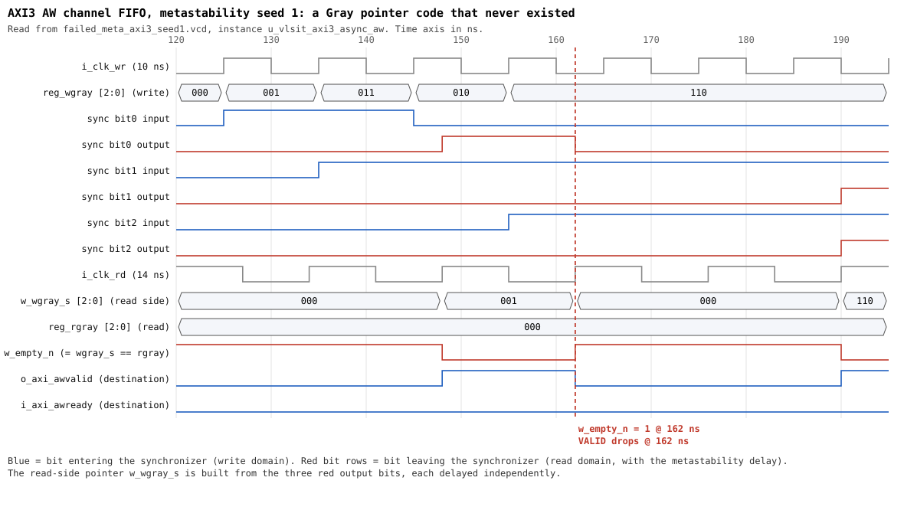

# CDC seed-1 failure: analysis with waveform

## English

### 1. Summary

The CDC runs of AXI3 (`AXI-SVA-02`) and AXI4 USER (`AXI-SVA-09`) with `+AFIFO_MSYNC_SEED=1` fail because the read side of a Gray FIFO sees a pointer code that the write side never produced. The code equals the read pointer, so the FIFO reports empty for a short time and the destination VALID drops while READY is low, which breaks the AXI hold rule.

The cause is the metastability model of `m_vlsit_afifo_cell_sync` (spec REQ-VER-001) together with a writer that increments the pointer every write-clock cycle. It is not a defect of the AXI wrapper logic. It is not specific to AXI3 or AXI4 USER: other seeds fail for AXI4 base too (section 5).

### 2. Waveform



Source: `../waveforms_sim/failed_meta_axi3_seed1.vcd`, FIFO of the AW channel (`u_vlsit_axi3_async_aw`). The picture is generated from the VCD by `gen_cdc_skew_waveform.py` (section 7); every value is read from the file.

### 3. Timeline (values read from the VCD)

Write clock 10 ns, read clock 14 ns (rising edges at 8, 22, ..., 134, 148, 162, 176, 190 ns). The read pointer `reg_rgray` stays `000`; `i_axi_awready` of the destination stays 0 (back-pressure).

| Time (ns) | Event |
|---|---|
| 125 | Write pointer `000` to `001`: bit 0 rises at the synchronizer input |
| 135 | Write pointer `001` to `011`: bit 1 rises |
| 145 | Write pointer `011` to `010`: bit 0 falls |
| 148 | Bit 0 output rises (nominal latency, edge S). Read side sees `001`, so `w_empty_n` = 0 and `o_axi_awvalid` = 1 (correct: one word is stored) |
| 155 | Write pointer `010` to `110`: bit 2 rises |
| 162 | Bit 0 output falls (nominal latency). Bit 1 output has **not** risen yet. Read side sees `000` = `reg_rgray`: `w_empty_n` = 1, `o_axi_awvalid` falls although `i_axi_awready` = 0 |
| 176 | The destination monitor samples VALID = 0 after it was 1 with READY = 0: `ASSERT FAIL` is printed at this read edge |
| 190 | Bit 1 output rises (edge S+2 after 135 ns, the maximum of the model) together with bit 2 output (edge S+1 after 155 ns). Read side sees `110`, FIFO is not empty again, VALID returns |

The real write pointer was `011`, `010` and `110` during 135 to 190 ns, so the FIFO held up to three words the whole time. The code `000` seen at 162 ns is not any value that the write pointer had at any time (the write pointer sequence is `000, 001, 011, 010, 110`).

### 4. Mechanism

1. The model delays every bit independently. For a 2-flop synchronizer the output changes at edge S, S+1 or S+2 after the input change, so one bit can be up to two read cycles (28 ns) later than another.
2. The writer changes a different bit of the Gray pointer every 10 ns, which is less than one read cycle (14 ns). Bit 1 changed at 135 ns and bit 0 at 145 ns.
3. Bit 1 got the largest delay (output at 190 ns, edge S+2), bit 0 got the nominal delay (output at 162 ns). The bits therefore arrive in the reverse order, and at 162 ns the read side combines the new bit 0 (from write pointer `010`) with the old bits 1 and 2 (from write pointer `000`): `000`.
4. `w_empty_n` is `reg_rgray == w_wgray_s`, so `000 == 000` is read as empty. `o_empty` follows, and `VALID` of the destination is the inverse of empty.

The Gray code only protects the FIFO when the bits of one pointer cannot be reordered across two pointer updates. A single-bit change per update is not enough when the skew between bits is longer than the interval between updates.

### 5. Evidence that it is general

30 seeds (1 to 30), each with `+SEED=n +AFIFO_MSYNC_SEED=n +AFIFO_MSYNC_EN=1`, using the existing `*_sim` builds (run before the top modules of `rtl/` were renamed by another session):

| Profile | Failing seeds out of 30 |
|---|---|
| AXI4 base | 5 (10, 11, 20, 21, 30) |
| AXI4 USER | 14 (1, 8, 9, 12 to 17, 22, 23, 26, 27, 30) |
| AXI3 | 5 (1, 6, 7, 12, 13) |

Isolation test (AXI4 base only): a temporary copy of the cell model with the extra latency limited to 0 or 1 cycle (one changed line, outside the repository) gives 0 failures out of 30 seeds, against 5 out of 30 with the specified 0 to 2 cycles. The same test was not run for AXI3 and AXI4 USER because the files of `rtl/` were renamed by another session while this analysis was running and the filelists no longer matched.

Earlier isolation from `simulation_report.md`: AXI4 USER seed 1 passes all 36 checks with `+AFIFO_MSYNC_EN=0`.

### 6. What this does and does not show

- It shows that the failure comes from the simulation model of the synchronizer with independent 0 to 2 cycle extra latency per bit, and that a model limited to 0 to 1 cycles removed the failures in the one profile tested.
- It does not show that the RTL is safe or unsafe in silicon. Real hardware limits the skew of the Gray bus with timing constraints (for example a bus-skew or `set_max_delay` constraint); the model does not represent that limit, and its 2-cycle extra latency is larger than a real 2-flop synchronizer produces.
- The AXI4 USER failure (`AXI-SVA-09`, 176 ns) was not traced signal by signal in this document. Its log shows the same assertion time as AXI3 and `simulation_report.md` describes the same pointer behavior.

### 7. Decision needed and reproduction

Options (not applied; the model is defined in the spec of `001_AsyncGrayFIFO`, REQ-VER-001, and used by 002, 003 and 004):

1. Limit the extra latency of the model to 0 or 1 cycle, or forbid reordering of the bits of one pointer. Update the spec, the cell model and re-run all FIFO-based IP.
2. Keep the model and add a Gray-bus skew constraint to the spec and SDC.
3. Add a guard against invalid Gray codes on the read side (more logic on the CDC path, not recommended).

Reproduce the picture and the numbers (from this folder):

```bash
python gen_cdc_skew_waveform.py ../waveforms_sim/failed_meta_axi3_seed1.vcd u_vlsit_axi3_async_aw cdc_skew_waveform.svg 120000 195000
```

### 8. Resolution (2026-10-27)

The model of `000_Common/rtl_lib/m_vlsit_afifo_cell_sync.sv` was changed (spec `001_AsyncGrayFIFO` DEC-048, REQ-VER-001): the first flop captures the new or the old value with 50% each, only when the input changed less than a window W before the capturing edge (W = `+AFIFO_MSYNC_WIN_PCT` percent of the measured period of the destination clock, default 10). Outside the window the capture is that of a plain flop. The latency is S-1 or S cycles after the first capturing edge. While W is shorter than the source clock period, two bits of one Gray pointer cannot be late at the same edge, so they are not reordered.

An intermediate attempt, a random 0 or 1 cycle of extra latency on every change (50% each, no window), was tested and rejected: it still failed 16/60, 15/60 and 29/60 seeds (AXI4 base, AXI4 USER, AXI3), with the same mechanism (bit 1 late by one cycle, bit 0 on time).

Results (Verilator, 60 seeds per profile, `+AFIFO_MSYNC_WIN_PCT` 10 and 50):

| Model | AXI4 base | AXI4 USER | AXI3 |
|---|---|---|---|
| Specified before (extra 0 to 2, every change) | 13/60 fail | 25/60 fail | 15/60 fail |
| Rejected attempt (extra 0 or 1, every change) | 16/60 fail | 15/60 fail | 29/60 fail |
| Window model, W = 10% | 0/60 fail | 0/60 fail | 0/60 fail |
| Window model, W = 50% | 0/60 fail | 0/60 fail | 0/60 fail |

The window model captured the old value in about half of the captures that fell inside the window (for example 780 captures inside the window and 370 to 410 old-value captures over 60 seeds at W = 10%, 3451 to 3470 and 1691 to 1727 at W = 50%, with the testbench clocks of 10 ns and 14 ns), so the model was exercised. The official flow `make cdc` of this folder passes: 3 synthesis runs and 9 metastability runs (3 profiles, seeds 1 to 3), evidence check `RESULT: PASS`.

Unit test `000_Common/lib_tests/tb_afifo_cell_sync.sv` (run by `run_lib_tests.py`, iverilog and Verilator give the same latency counts): latency exactly S outside the window, S or S+1 about 50% each inside it (208 and 192 of 400 for seed 1), and a 3-bit Gray counter written every 10.26 ns and read at 14 ns is never seen going back (0 backward steps in 4000 samples). Negative controls with the same test: the previous model gives about 550 backward steps, the rejected attempt about 100.

Limits: it is a digital model, not an analog metastability simulation. The window must be shorter than the source clock period (source clock at most 100 / WIN_PCT times faster than the destination clock; 10 times at the default). The hold side and metastability that survives the second flop are not modelled. With clocks whose periods are integer multiples, the phase between source and destination is fixed, so a small window may never be hit; the testbench clocks of this folder (10 ns and 14 ns) do hit it at the default window, and the unit test uses a drifting source clock.

Still open: `simulation_report.md` of this folder (dated 2026-10-25) and REQ-PERF-002 (`at most S+2` periods) in `rtl/generation_notes/AsyncAXI4Bridge_Resolved_Design_Specification.md` describe the previous model; they were not edited here because another session is working in this IP. The models `m_vlsit_apbcdc_cell_sync` and `m_vlsit_rst_sync` still use the 0 to 2 cycle latency (handshake with stable data and a one-bit reset: the reordering of Gray bits does not apply to them).

## Tiếng Việt

### Tóm tắt

Lỗi CDC seed 1 của AXI3 (`AXI-SVA-02`) và AXI4 USER (`AXI-SVA-09`) xảy ra vì phía đọc của Gray FIFO nhìn thấy một mã pointer mà phía ghi chưa từng tạo ra. Mã đó bằng đúng read pointer nên FIFO báo empty trong thời gian ngắn, `VALID` phía đích tụt khi `READY` vẫn 0 và vi phạm quy tắc giữ VALID của AXI.

Nguyên nhân là mô hình metastability của `m_vlsit_afifo_cell_sync` (REQ-VER-001) kết hợp với writer tăng pointer mỗi chu kỳ write clock. Không phải lỗi logic của lớp bọc AXI, và không riêng AXI3 hay AXI4 USER (AXI4 base cũng fail ở các seed khác).

### Diễn biến theo waveform (AXI3, FIFO kênh AW, đọc từ VCD)

- 135 ns: bit 1 của write pointer lên 1. 145 ns: bit 0 xuống 0. Hai bit đổi cách nhau 10 ns, ngắn hơn một chu kỳ read clock (14 ns).
- Mô hình trễ mỗi bit độc lập. Bit 1 nhận trễ lớn nhất (ra lúc 190 ns), bit 0 nhận trễ danh định (ra lúc 162 ns). Hai bit đến ngược thứ tự.
- Lúc 162 ns phía đọc ghép bit 0 mới với bit 1, bit 2 cũ thành `000`. Mã này bằng `reg_rgray` nên `w_empty_n` = 1 và `VALID` tụt, dù FIFO thực sự đang chứa dữ liệu (write pointer là `010`, rồi `110`). Monitor bắt lỗi ở cạnh đọc kế tiếp (176 ns). Lúc 190 ns hai bit còn lại tới, pointer đúng `110`, VALID trở lại.

### Bằng chứng và giới hạn

- 30 seed: AXI4 base fail 5, AXI4 USER fail 14, AXI3 fail 5.
- Thử cô lập với trễ thêm giới hạn 0 hoặc 1 chu kỳ (bản sao tạm của mô hình, ngoài repo): AXI4 base fail 0/30. Chưa chạy được cho AXI3 và AXI4 USER vì file trong `rtl/` bị phiên khác đổi tên trong lúc phân tích.
- Tài liệu này không chứng minh RTL an toàn hay không an toàn trên silicon: phần cứng thật giới hạn skew của Gray bus bằng ràng buộc timing, còn mô hình không biểu diễn giới hạn đó. Lỗi AXI4 USER chưa được truy vết từng tín hiệu ở đây.
- Các hướng xử lý (chưa áp dụng, cần bạn quyết định) nằm ở mục 7 phần tiếng Anh.

### Kết quả xử lý (2026-10-27)

Mô hình `m_vlsit_afifo_cell_sync` đã đổi (spec 001, DEC-048): flop đầu chốt giá trị mới hoặc cũ với xác suất 50%, chỉ khi đầu vào đổi trong cửa sổ W trước cạnh chốt (W là phần trăm chu kỳ clock đích đo được, mặc định 10%). Với W nhỏ hơn chu kỳ clock ghi, hai bit của cùng một pointer không thể cùng bị trễ nên không bị đảo thứ tự. Phương án trung gian (50% mọi lần đổi, không có cửa sổ) đã thử và bị loại vì vẫn lỗi 16/60, 15/60, 29/60 seed.

Với mô hình có cửa sổ (W = 10% và 50%), 60 seed mỗi profile đều 0 lỗi; `make cdc` chính thức pass (3 lần chạy synthesis và 9 lần chạy metastability, evidence check PASS). Unit test `000_Common/lib_tests/tb_afifo_cell_sync.sv` pass, và mô hình cũ cho khoảng 550 bước lùi trên 4000 mẫu (kiểm chứng ngược).

Giới hạn: đây là mô hình số; cần clock ghi nhanh hơn clock đọc không quá 100 / WIN_PCT lần; chưa mô hình phía hold và metastability qua flop thứ hai. Còn mở: `simulation_report.md` và REQ-PERF-002 (S+2) của 003 vẫn mô tả mô hình cũ, chưa sửa vì phiên khác đang làm việc trong IP này.
