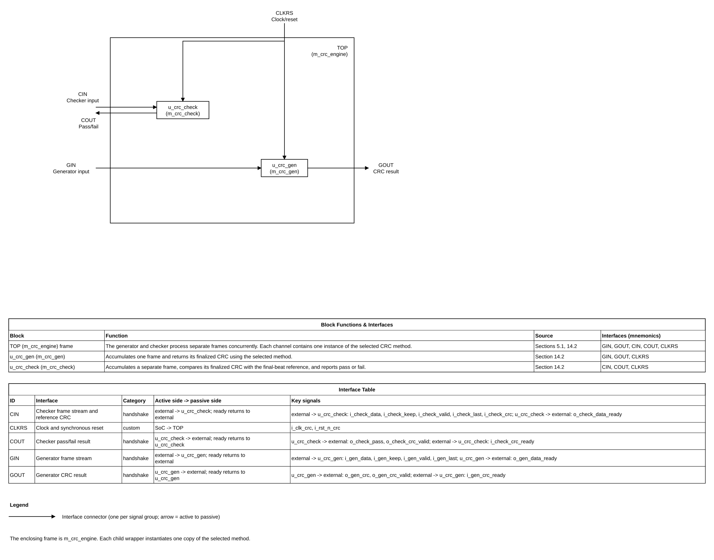

# Configurable CRC Engine Design Specification

> **Purpose:** Normative design contract for architecture, RTL, verification, DFT, and physical integration of this IP.
>
> Replace every angle-bracket placeholder. Mark inapplicable sections **N/A** with a reason. Do not silently omit a required decision. Use **TBD** only with its technical impact and the decision needed recorded in [Assumptions, dependencies, and decisions](#20-assumptions-dependencies-and-decisions).
>
> Requirement terms: **shall** = mandatory and testable; **should** = recommended; **may** = optional. Give every mandatory requirement a stable REQ-<AREA>-<NNN> identifier and a verification method.

## Document map

1. [Purpose, scope, and product context](#1-purpose-scope-and-product-context)
2. [Normative references and precedence](#2-normative-references-and-precedence)
3. [Requirements and traceability](#3-requirements-and-traceability)
4. [Features and configurations](#4-features-and-configurations)
5. [Architecture](#5-architecture)
6. [External interfaces and ports](#6-external-interfaces-and-ports)
7. [Clock, reset, and power](#7-clock-reset-and-power)
8. [Parameters and elaboration configurations](#8-parameters-and-elaboration-configurations)
9. [Data representation and arithmetic](#9-data-representation-and-arithmetic)
10. [Detailed functional behavior](#10-detailed-functional-behavior)
11. [Register and programming model (CSR from workbook)](#11-register-and-programming-model)
12. [Error handling and recovery](#12-error-handling-and-recovery)
13. [Performance, power, and area](#13-performance-power-and-area)
14. [RTL implementation contract](#14-rtl-implementation-contract)
15. [Verification specification](#15-verification-specification)
16. [DFT and testability](#16-dft-and-testability)
17. [Physical design and timing integration](#17-physical-design-and-timing-integration)
18. [Security, safety, and reliability](#18-security-safety-and-reliability)
19. [Requirement-to-verification traceability](#19-requirement-to-verification-traceability)
20. [Assumptions, dependencies, and decisions](#20-assumptions-dependencies-and-decisions)
21. [Glossary](#21-glossary)
22. [References used to shape this template](#22-references-used-to-shape-this-template)

## 1. Purpose, scope, and product context

### 1.1 Purpose and scope

This IP provides CRC generation and CRC checking over streamed frames. The generator and checker are intended to operate independently and concurrently. One structural top-level module serves five elaboration-selected CRC implementations based on the existing RTL collection. The selected method changes implementation latency and resource trade-offs; for the same legal frame and CRC parameters, every method shall produce the same CRC result and check decision.

**Included:** one structural top module; separate, independent generator and checker data streams and result handshakes; elaboration-time selection of serial-bit, serial-word, full-word parallel, chunked, or reflected/XOR parallel processing; configurable CRC width, polynomial, initialization and finalization options; reset and handshake behavior.

**Excluded:** named CRC-profile compliance claims, a bus-protocol wrapper, software-visible registers, and CRC insertion into the outgoing frame. The checker compares a calculated CRC with a supplied reference value; residue-based checking is not specified.

### 1.2 Deployment assumptions

| Item | Specification |
|---|---|
| Target SoC / product class | Reusable ASIC common RTL IP; exact SoC is not specified |
| Technology / library assumptions | Technology-independent synthesizable SystemVerilog; no target library or PPA claim |
| Operating modes and workload | One frame per channel at a time; generator and checker channels are independent and may run concurrently; each frame ends on an accepted `last` beat |
| Security / privilege context | No security or privilege interface |
| External dependencies | One clock/reset source and a producer/consumer that obey the frame-stream handshake |

### 1.3 Feature summary

| Feature ID | Feature | Required / optional | Configuration condition | Requirements |
|---|---|---|---|---|
| FEAT-001 | CRC generation | Required | Independent generator stream | REQ-FUNC-001 |
| FEAT-002 | CRC check against an input reference CRC | Required | Independent checker stream | REQ-FUNC-003 |
| FEAT-003 | Method selected at elaboration | Required | `PARA_CRC_METHOD` selects one of five methods; no run-time method mux | REQ-PARAM-001 |
| FEAT-004 | Generic CRC configuration | Required | Parameters define width, polynomial and other selected CRC options; no named profile is implied | REQ-FUNC-002 |
| FEAT-005 | Equivalent result across methods | Required | Same legal frame and CRC parameters | REQ-FUNC-001 |

## 2. Normative references and precedence

### 2.1 Normative references

Record exact title, revision, document ID, controlled location/URL, and applicable clauses. Do not cite an unspecified “latest” revision.

| Ref ID | Document and revision | Applicable clauses | Authority / notes |
|---|---|---|---|
| REF-001 | `crcCalculator/README.md` | Legacy CRC recurrence, polynomial representation, word augmentation, and existing module behavior | Product reference only; superseded by explicit requirements in this specification |
| REF-002 | `common_rtl/003_CRC/README.md` and existing RTL/test plan | Current module set, architecture differences, and verification context | Local design reference; not copied as normative behavior where the new interface differs |
| REF-003 | VLSIT RTL Design Rules v2, [`spec_template/VLSIT_RTL_Design_Rule.md`](../../spec_template/VLSIT_RTL_Design_Rule.md) | All applicable rules | Mandatory RTL coding, hierarchy, reset, and naming baseline |
| REF-004 | IEEE 1800-2017 SystemVerilog | Synthesizable subset | Subject to REF-003 and selected frontend support |
| REF-005 | [UofT-HPRC/Tbps_CRC](https://github.com/UofT-HPRC/Tbps_CRC) | Repository README: configurable CRC, byte enables, frame marker, stream wrapper and verification approach | Architecture reference only; MIT license is stated by repository; no source code copied; FPGA evidence is repository-reported and not independently reproduced |

### 2.2 Source-of-truth and conflict handling

1. No external bus or named CRC profile is selected. This specification defines the CRC and frame-stream contract.
2. Approved user decisions define product behavior. This specification is the source of truth for the new common top; the existing README and RTL describe legacy implementations only.
3. REF-003 is the mandatory RTL coding, hierarchy, reset, and naming baseline. If a proposed requirement conflicts with it, revise the requirement or choose a compliant implementation; do not create a local RTL exception.
4. REF-004 defines the language baseline subject to REF-003 and the selected synthesis frontend.
5. The IP has no CSR interface; elaboration parameters are the only configuration mechanism.

**Naming rule:** default naming rule from the `vlsit-rtl-generator` skill, VLSIT RTL Design Rules v2, section 2; path `C:\HQuan\102_MyGithub\VLSIT_RTL_Generator_AI_Model\spec_template\VLSIT_RTL_Design_Rule.md`; version v2 (rule R-026; same default selected previously by the user).

### 2.3 Compliance declaration

| Standard | Revision / profile | Role implemented | Options | Deviations |
|---|---|---|---|---|
| No external CRC standard | Not applicable: no standard/profile selected | Custom CRC calculator | Generic polynomial and initialization/finalization parameters | No claim of conformance to CRC-8, CRC-16, CRC-32, Ethernet, or another named profile |

## 3. Requirements and traceability

| ID | Requirement using shall/should/may | Source | Applies to | Verification method |
|---|---|---|---|---|
| REQ-FUNC-001 | The five selected implementation methods shall return the same finalized CRC and checker decision for the same legal frame and identical CRC parameters. | User decision, 2026-10-27 | Generator and checker | Independent bit-serial reference model and cross-method comparison |
| REQ-FUNC-002 | The IP shall calculate a generic CRC using elaboration parameters and shall not claim named-profile compliance unless a complete named profile is separately specified. | User decision, 2026-10-27 | All configurations | Parameter review and independent reference model |
| REQ-FUNC-003 | The checker shall compare the finalized CRC calculated from its input frame with the supplied reference CRC and report pass only on equality. | User decision, 2026-10-27 | Checker channel | Independent reference model and compare tests |
| REQ-IF-001 | The independent generator and checker streams shall accept framed data and produce their respective results after frame completion. | User decision, 2026-10-27 | All configurations | Stream-handshake simulation |
| REQ-IF-002 | Each `last` marker shall terminate a frame only when its associated beat is accepted; input data and sidebands shall remain stable while valid is stalled. | Stream contract | Both streams | Handshake assertions and stall tests |
| REQ-IF-003 | The generator CRC result and checker decision shall remain stable until their respective ready input accepts the result; only that channel shall be blocked while its result is pending. | User decision, 2026-10-27 | Both channels | Output-stall assertions and concurrent-channel test |
| REQ-IF-004 | Method 0 shall accept one payload bit per beat with `i_keep[0]=1`; methods 1–4 shall process bytes from the highest lane down, with all lanes valid on non-final beats and a nonzero contiguous MSB prefix on the final beat. | User decision, 2026-10-27 | All configurations | Directed lane and mask tests |
| REQ-IF-005 | Generator and checker traffic shall progress independently; backpressure or a pending result on one operation shall not stall the other operation. | User decision, 2026-10-27 | All configurations | Concurrent-channel stress test |
| REQ-PARAM-001 | `PARA_CRC_METHOD` shall select exactly one implementation during elaboration; unselected methods shall not be present in the synthesized hierarchy. | User decision, 2026-10-27 | All configurations | Elaboration hierarchy inspection |
| REQ-RESET-001 | Synchronous active-low reset shall clear both channels' frame and result-valid state and abort any in-progress frame at a rising clock edge. | User decision, 2026-10-27 | All configurations | Reset assertion/release test |
| REQ-PARAM-002 | Illegal parameter values or incompatible method/width combinations shall fail elaboration. | VLSIT RTL rule baseline | All configurations | Parameter elaboration matrix |
| REQ-RTL-001 | All design RTL shall follow VLSIT RTL Design Rules v2. | REF-003 | All RTL | Rule checker and lint |

## 4. Features and configurations

| Configuration ID | Enabled features | Disabled features | Interfaces / widths | Intended use | Verification target |
|---|---|---|---|---|---|
| CFG-CRC-0 | Serial method instantiated once for generator and once for checker | Methods 1–4 absent from both channel hierarchies | Independent 1-bit streams (`PARA_DATA_W=1`) | Lowest recurrence logic per channel; one input bit per accepted beat | Bit-serial model equivalence and independent handshakes |
| CFG-CRC-1 | Serial-word architecture instantiated for both channels | Methods 0, 2–4 absent | Independent word streams | Each accepted word is processed serially using the frame's current CRC state | Bit-serial model equivalence and seed behavior |
| CFG-CRC-2 | Full-word parallel method instantiated for both channels | Methods 0–1, 3–4 absent | Independent word streams | One full-word recurrence per processing cycle | Bit-serial model equivalence and back-to-back beat checks |
| CFG-CRC-3 | Chunked method instantiated for both channels | Methods 0–2, 4 absent | Independent word streams | Reduced recurrence depth at the cost of multi-cycle beat processing | Bit-serial model equivalence and chunk-boundary checks |
| CFG-CRC-4 | Full-word parallel method with reflection/XOR support instantiated for both channels | Methods 0–3 absent | Independent word streams | Full-word recurrence with selected reflection/finalization | Bit-serial model equivalence and reflection/XOR vectors |

`PARA_CRC_METHOD` is one elaboration-time selection shared by the generator and checker; it is not a run-time input. Exactly one method is instantiated in each channel, so the selected architecture has two independent CRC datapaths. Both receive the same CRC configuration, but have separate input, state, ready, and result signals. Legal parameter combinations are recorded in Section 8.

## 5. Architecture

### 5.1 Overview and block responsibilities

| Block | Responsibility | Inputs / outputs | Clock/reset domain | State or storage |
|---|---|---|---|---|
| `m_crc_engine` | Structural top that instantiates independent generator and checker channels. | Generator/checker stream ports and common CRC parameters | One CRC clock/reset domain | No CRC algorithm state; structural wrapper only |
| `m_crc_gen` | Generates one finalized CRC per accepted generator frame. | Generator stream and CRC-result handshake | Same CRC domain | Generator CRC state and result-valid state |
| `m_crc_check` | Calculates a frame CRC and compares it with the reference CRC sampled with the accepted final beat. | Independent checker stream, final-beat reference CRC and pass/fail handshake | Same CRC domain | Checker CRC state, captured reference CRC and check-result state |
| `m_crc_serial` | Updates the CRC recurrence one payload bit per processing cycle. | One selected channel's stream, polynomial and initial/finalization parameters | Same CRC domain | CRC state and serial progress state |
| `m_crc_initial_value` | Implements the legacy initial-state processing approach using `PARA_CRC_INIT`. | One selected channel's stream | Same CRC domain | CRC state and multi-cycle processing state |
| `m_crc_parallel` | Processes a full data beat through a full-width recurrence per processing cycle. | One selected channel's stream | Same CRC domain | Frame CRC state and result-valid state |
| `m_crc_parallel_crcw` | Processes each beat from the most-significant chunk to the least-significant chunk. | One selected channel's stream | Same CRC domain | CRC state, held beat and chunk index |
| `m_crc_parallel_full` | Processes a full beat with the configured reflection and final-XOR behavior. | One selected channel's stream | Same CRC domain | Frame CRC state and result-valid state |

### 5.2 Block diagram

*Figure 5-1. Independent generator and checker channels in the structural top. Source: [editable draw.io diagram](figures/vlsit_block_diagram.drawio), generated from [diagram specification](figures/vlsit_block_diagram_spec.json) with the bundled VLSIT symbols. The frame is the top module; each block is an RTL module instance; each connector represents one interface.*

### 5.3 Transaction and dataflow

The generator and checker accept unrelated frames on separate input channels and may process them concurrently. Each frame starts with its first accepted beat and ends on an accepted beat whose `last` marker is asserted. Each selected method instance retains its own CRC state. The generator returns the finalized CRC. On the checker channel, `i_check_crc` is sampled with the accepted final data beat; after CRC finalization, the checker compares that captured value with the calculated CRC and returns a pass/fail result. Backpressure, processing latency, or a pending result on one channel shall not block the other channel.

### 5.4 Invariants

- Exactly one method implementation is elaborated.
- Frames cannot interleave within one channel; generator and checker may advance independently.
- Input readiness and result readiness on one channel have no combinational or state dependency on the other channel.
- The result is a function only of accepted frame data and the elaboration-time CRC configuration.
- Both channels use the same selected method and CRC parameters, but have independent frame state.
- All method implementations shall match the same independent CRC reference result.

## 6. External interfaces and ports

### 6.1 Interface inventory

| Interface ID | Type and revision | Role | Direction at IP boundary | Clock domain | Required / optional | Configurations |
|---|---|---|---|---|---|---|
| IF-001 | Custom generator frame stream; not AXI-Stream compliant | CRC generator | Input data/control and output ready | CLK-CRC | Required | All |
| IF-002 | Custom checker frame stream; not AXI-Stream compliant | CRC checker | Input data/control and output ready | CLK-CRC | Required | All |
| IF-003 | CRC generation result handshake | CRC result producer/consumer | Output CRC and input ready | CLK-CRC | Required | All |
| IF-004 | CRC check result handshake | Check result producer/consumer | Output pass/fail and input ready | CLK-CRC | Required | All |

### 6.2 Complete port list

List clocks, resets, test signals, interrupts, and all sidebands. The generator and checker use separate project-defined streams, not protocol-standard port profiles. The checker CRC sideband is sampled with the accepted final beat. Word methods use an `i_keep` mask for the final partial word. No interrupt or runtime method-selection port is planned.

| Port | Direction | Width | Meaning (function) | Clock domain | Signal type | Reset / idle value | Timing / sampling | Configurations |
|---|---|---:|---|---|---|---|---|---|
| `i_clk_crc` | Input | 1 | Common clock for all selected CRC logic | CLK-CRC | Clock | Not applicable: clock has no reset value | Rising edge | All |
| `i_rst_n_crc` | Input | 1 | Active-low reset for generator and checker state | CLK-CRC | Reset | Synchronous active-low; reset sampled on rising edge | Clears both channels at the next rising edge | All |
| `i_gen_data` | Input | `PARA_DATA_W` | Generator payload bits; width is 1 in method 0 and word-sized in methods 1–4 | CLK-CRC | Data (valid with `i_gen_valid && o_gen_data_ready`) | Not applicable: payload is meaningful only when valid | Sampled on rising edge when handshake succeeds | All |
| `i_gen_keep` | Input | `(PARA_DATA_W+7)/8` | Generator valid-lane mask; one bit in method 0, byte lanes in word methods | CLK-CRC | Data (valid with generator handshake) | Not applicable: mask is meaningful only when valid | Sampled with `i_gen_data` | All |
| `i_gen_valid` | Input | 1 | Marks generator data, keep and last as valid | CLK-CRC | Level | 0 when idle by producer convention | Hold data and sidebands stable while valid and not ready | All |
| `i_gen_last` | Input | 1 | Marks the final generator beat of a frame | CLK-CRC | Data (valid with generator handshake) | Not applicable: marker is meaningful only when valid | Sampled only on input handshake | All |
| `o_gen_data_ready` | Output | 1 | Generator channel can accept a data beat | CLK-CRC | Level | 0 during reset/result pending; otherwise method-dependent | Producer samples on rising edge | All |
| `o_gen_crc` | Output | `PARA_CRC_W` | Finalized CRC for one completed generator frame | CLK-CRC | Data (valid with `o_gen_crc_valid`) | 0 during reset; otherwise holds the last result | Stable while valid and `i_gen_crc_ready=0` | All |
| `o_gen_crc_valid` | Output | 1 | Marks generator CRC result as valid | CLK-CRC | Level | 0 during reset | Held until `i_gen_crc_ready` handshake | All |
| `i_gen_crc_ready` | Input | 1 | Consumer accepts the generated CRC | CLK-CRC | Level | Not applicable: no reset state | Sampled while `o_gen_crc_valid=1` | All |
| `i_check_data` | Input | `PARA_DATA_W` | Checker payload bits; width is 1 in method 0 and word-sized in methods 1–4 | CLK-CRC | Data (valid with `i_check_valid && o_check_data_ready`) | Not applicable: payload is meaningful only when valid | Sampled on rising edge when handshake succeeds | All |
| `i_check_keep` | Input | `(PARA_DATA_W+7)/8` | Checker valid-lane mask; one bit in method 0, byte lanes in word methods | CLK-CRC | Data (valid with checker handshake) | Not applicable: mask is meaningful only when valid | Sampled with `i_check_data` | All |
| `i_check_valid` | Input | 1 | Marks checker data, keep and last as valid | CLK-CRC | Level | 0 when idle by producer convention | Hold data and sidebands stable while valid and not ready | All |
| `i_check_last` | Input | 1 | Marks the final checker beat of a frame | CLK-CRC | Data (valid with checker handshake) | Not applicable: marker is meaningful only when valid | Sampled only on input handshake | All |
| `o_check_data_ready` | Output | 1 | Checker channel can accept a data beat | CLK-CRC | Level | 0 during reset/result pending; otherwise method-dependent | Producer samples on rising edge | All |
| `i_check_crc` | Input | `PARA_CRC_W` | Reference CRC to compare with the calculated frame CRC; sideband on the final beat | CLK-CRC | Data (valid with checker final-beat handshake) | Not applicable: meaningful only on checker final beat | Sampled with accepted `i_check_last=1` beat | All |
| `o_check_pass` | Output | 1 | 1 when calculated CRC equals `i_check_crc`, otherwise 0 | CLK-CRC | Data (valid with `o_check_crc_valid`) | 0 during reset; otherwise holds the last decision | Stable while valid and `i_check_crc_ready=0` | All |
| `o_check_crc_valid` | Output | 1 | Marks checker pass/fail result as valid | CLK-CRC | Level | 0 during reset | Held until `i_check_crc_ready` handshake | All |
| `i_check_crc_ready` | Input | 1 | Consumer accepts the checker decision | CLK-CRC | Level | Not applicable: no reset state | Sampled while `o_check_crc_valid=1` | All |

### 6.3 Protocol behavior

No external bus protocol applies. Each of the generator and checker streams uses an independent ready/valid handshake. A beat is accepted only when that channel's `valid` and `data_ready` are both high at a rising edge. A result is accepted only when that channel's result-valid and result-ready are both high. A frame completes only when an accepted beat has that channel's `last=1`. While a result is pending, only the corresponding channel's input readiness is low; the other channel remains independently operable.

In the checker, `i_check_crc` accompanies the final frame beat and is sampled only when `i_check_valid && o_check_data_ready && i_check_last` are all high at a rising edge. The checker holds that value for its comparison until the result handshake. For method 0, `PARA_DATA_W=1`, `i_keep[0]` shall be 1, and each accepted beat supplies one payload bit. For methods 1–4, `PARA_DATA_W` is byte-multiple and valid bytes are processed from the most-significant lane down. Every non-final word beat shall set all `i_keep` bits. The final word beat shall set a nonzero contiguous MSB prefix; for a 32-bit word, `4'b1100` selects `i_data[31:16]`. Zero and non-contiguous masks are illegal. A frame contains at least one valid bit/byte.

Generator waveforms: [method 0 serial bits](figures/waveforms/WF_002_serial_bit_and_augment.svg), [method 1 serial word](figures/waveforms/WF_003_initial_state_serial_word.svg), [method 2 partial final word](figures/waveforms/WF_004_full_parallel_partial_keep.svg), [method 3 chunks](figures/waveforms/WF_005_chunked_processing.svg), [method 4 reflection/XOR](figures/waveforms/WF_006_reflection_xor.svg), and [result backpressure](figures/waveforms/WF_007_generator_result_stall.svg). Checker waveforms: [matching CRC](figures/waveforms/WF_008_checker_match.svg), [mismatch under backpressure](figures/waveforms/WF_009_checker_mismatch_stall.svg), and [independent channel progress](figures/waveforms/WF_010_independent_channels.svg). [Synchronous reset](figures/waveforms/WF_001_reset_abort.svg) applies to both interfaces. Each SVG has a same-name WaveJSON source and offline HTML viewer in that directory.

| Case | Legal behavior | Illegal / unsupported case | IP response | Requirement IDs |
|---|---|---|---|---|
| Input beat | Sample each channel's payload and sidebands only on its valid/ready handshake | Producer changes payload while valid is stalled | Producer violates the interface contract; response behavior is not specified | REQ-IF-001, REQ-IF-002 |
| Checker reference CRC | Sample `i_check_crc` on the accepted final checker beat | Reference value changes while final beat is stalled | Producer violates the interface contract | REQ-FUNC-003 |
| Byte/bit mask | Method 0 requires `i_keep[0]=1`; word methods require all ones on non-final beats and a nonzero contiguous MSB prefix on the final beat | Zero or non-contiguous mask | Outside the legal interface contract; no runtime error output is defined | REQ-IF-004 |
| Frame end | Accepted beat with channel `last=1` completes exactly one frame | Zero-beat frame or `last` without a handshake | Not represented by the interface | REQ-IF-002 |
| Result handshake | Consumer accepts a result on that channel's result-valid/result-ready handshake | Consumer changes readiness asynchronously to CLK-CRC | Outside interface contract | REQ-IF-003 |
| Cross-channel progress | Each channel can accept and return results independent of the other | One channel's stalls affect the other | Violates independence requirement | REQ-IF-005 |
| CRC options | Fixed by elaboration parameters for one synthesized instance | Runtime method switching | No runtime selector; only selected elaboration branch exists | REQ-PARAM-001 |

### 6.4 Interrupts and events

| Signal/event | Polarity | Assert condition | Clear/deassert condition | Mask/priority | Crossing | Reset state |
|---|---|---|---|---|---|---|
| Interrupts | Not applicable: no interrupt port | None | None | Not applicable | Not applicable | Not applicable |

## 7. Clock, reset, and power

### 7.1 Clock domains

| Domain | Clock port | Edge | Frequency range | Source | Relationship to other clocks | Gating policy |
|---|---|---|---|---|---|---|
| CLK-CRC | `i_clk_crc` | Rising | No IP-specific frequency limit; STA target is owned by SoC integration | SoC clock controller | Single domain; no CDC inside IP | Clock gating not specified |

### 7.2 CDC and RDC

| Crossing ID | From → to | Signals | Structure | Reset handling | Constraints / verification |
|---|---|---|---|---|---|
| CDC-001 | Not applicable: single clock domain | Not applicable | One clock domain only | Not applicable | No internal CDC; asynchronous external inputs are not supported |

### 7.3 Reset domains and sequencing

| Reset ID | Port | Polarity / assertion | Sync or async | Scope | Deassertion | Reset value |
|---|---|---|---|---|---|---|
| RST-CRC | `i_rst_n_crc` | Active-low | Synchronous assertion and deassertion | Generator, checker and their result-valid state | Sampled on the rising edge of `i_clk_crc` | Aborts both active frames, clears both result-valid flags and initializes CRC state for a new frame |

### 7.4 Power intent (if applicable)

No power domains, isolation, retention or power-state interface are defined. Dynamic and leakage power are implementation-specific and unmeasured.

## 8. Parameters and elaboration configurations

Every overridable parameter needs name, purpose, default, legal values/range, dependencies, and impact on ports, behavior, hierarchy, timing, and verification coverage. Identify the delivered default configuration. Parameters shall use `parameter logic [31:0] PARA_NAME`; immediately above each parameter, use exactly these three comments in order: `// Parameter Description: ...`, `// Parameter values: ...` (legal values/range and default), and `// Parameter unit: ...` (bit, byte, us, count, or none as applicable).

| Parameter | Purpose | Default | Legal values / range | Dependencies / invalid combinations | Effect |
|---|---|---|---|---|---|
| `PARA_CRC_METHOD` | Selects the implementation at elaboration | 2 (full-word parallel) | 0–4 | Invalid code is an elaboration error | Determines child hierarchy, recurrence depth, latency and state |
| `PARA_CRC_W` | CRC state and result width | 8 | 2–32 | Polynomial, init and xorout active fields must fit this width | Changes datapath and result width |
| `PARA_DATA_W` | Input data beat width on both streams | 32 | Method 0: exactly 1; methods 1–4: 8–256, multiple of 8 | Method 3 requires `PARA_DATA_W >= PARA_CAL_W` and divisibility by it; method 4 requires `PARA_DATA_W >= PARA_CRC_W`; method 2 has no CRC-width relation | Changes both input/keep port widths and work per beat |
| `PARA_CRC_POLY` | Lower coefficients of the monic generator polynomial | `32'h0000_0007` | Active low `PARA_CRC_W` bits shall be nonzero with bit 0 set; all unused high bits shall be 0 | Degree-`PARA_CRC_W` leading term is implicit; for width 8, `8'h07` is legal and `8'h06` is illegal | Changes combinational feedback network |
| `PARA_CRC_INIT` | CRC state at start of each frame | `32'h0000_0000` | Active low `PARA_CRC_W` bits; unused high bits are 0 | Loaded once per frame | Changes initial state |
| `PARA_CRC_XOR_OUT` | Final XOR mask | `32'h0000_0000` | Active low `PARA_CRC_W` bits; unused high bits are 0 | Applied after output reflection | Changes finalized result |
| `PARA_CRC_REF_IN` | Reverses the bit order within each valid byte before recurrence | 0 | 0 or 1 | Applied consistently in every method | Changes bit order and logic |
| `PARA_CRC_REF_OUT` | Reverses the full CRC result before final XOR | 0 | 0 or 1 | Applied consistently in every method | Changes result bit order |
| `PARA_CAL_W` | Chunk width for method 3 | 8 | 2–32; method 3 requires equality with `PARA_CRC_W` | Method 3 requires `PARA_DATA_W >= PARA_CAL_W` and `PARA_DATA_W % PARA_CAL_W == 0`; ignored by other methods | Sets chunk processing cycles per beat |

| Configuration | Parameter overrides | Features/interfaces | Expected hierarchy | Elaboration/lint/synthesis target |
|---|---|---|---|---|
| CFG-BASE | Defaults above | Independent generator/checker streams; generic CRC; method 2 | `m_crc_engine` → `m_crc_gen` and `m_crc_check`; one `m_crc_parallel` instance under each channel | IEEE 1800-2017 subset; VLSIT RTL rules v2; technology-independent |

## 9. Data representation and arithmetic

| Quantity | Width | Encoding / range | Extension / truncation | Overflow / invalid behavior |
|---|---:|---|---|---|
| CRC width | `PARA_CRC_W` | Unsigned CRC state/result, 2–32 bits | Polynomial/init/xorout use low `PARA_CRC_W` bits | Unused high parameter bits shall be zero |
| Generator polynomial | `PARA_CRC_W+1` mathematical terms | `x^W + Σ(P[i] × x^i)`; leading coefficient is implicit and `PARA_CRC_POLY[i]` represents `x^i` | No signed values; polynomial is a coefficient bit vector | Active low field is nonzero with bit 0 set; unused high parameter bits are zero |
| Input bit order | 1 bit at a time in CRC recurrence | Word methods process valid bytes from most-significant lane to least-significant lane; within each byte, MSB-first when `PARA_CRC_REF_IN=0` and LSB-first when 1. Method 0's producer supplies bits in that same per-byte order. | `i_keep` qualifies one bit lane in method 0 and byte lanes in methods 1–4 | Invalid lanes do not participate |
| CRC update | `PARA_CRC_W` bits | `state_next = {state[W-2:0], data_bit} XOR (state[W-1] ? PARA_CRC_POLY[W-1:0] : 0)` | State and polynomial are unsigned | No arithmetic overflow; XOR is modulo-2 addition |
| Augmentation | `PARA_CRC_W` zero bits | Append zeros once after the final valid payload bit, following the legacy parallel-method behavior | Not appended after intermediate beats | Result finalization occurs after these bits |
| Finalization | `PARA_CRC_W` bits | Apply `PARA_CRC_REF_OUT`, then XOR `PARA_CRC_XOR_OUT` | Result width unchanged | Defined for all legal parameter sets |

## 10. Detailed functional behavior

### 10.1 Modes and state transitions

The following numeric mode mapping is defined by this specification and follows the existing module set. These are implementation choices, not CRC-standard/profile selections. Every method uses the same `PARA_CRC_INIT`, polynomial, input ordering and finalization contract.

| `PARA_CRC_METHOD` | Selected implementation | Per-beat work | Notes |
|---:|---|---|---|
| 0 | `m_crc_serial` | One externally supplied payload bit per accepted beat | `PARA_DATA_W=1`; producer presents bits MSB-first or LSB-first within each byte according to `PARA_CRC_REF_IN` |
| 1 | `m_crc_initial_value` | One payload word accepted, then serial recurrence over its valid bits | Uses the current frame state; `PARA_CRC_INIT` is loaded only at frame start |
| 2 | `m_crc_parallel` | Full `PARA_DATA_W`-bit recurrence per processing cycle | Default method |
| 3 | `m_crc_parallel_crcw` | One `PARA_CAL_W`-bit chunk per processing cycle, most-significant chunk first | Requires method-specific width constraints |
| 4 | `m_crc_parallel_full` | Full `PARA_DATA_W`-bit recurrence per processing cycle | Full-word implementation with the common reflection/finalization options; same mathematical result as other legal methods |

| Mode/state | Entry condition | Behavior | Exit condition | Outputs / side effects |
|---|---|---|---|---|
| Reset/idle | Synchronous reset edge or that channel's prior result acceptance | Initialize that channel's CRC state to `PARA_CRC_INIT` | First accepted beat on that channel | Readiness depends on selected method and that channel's state |
| Frame processing | First accepted beat on one channel | Accumulate only that channel's accepted payload; the other channel advances independently | Accepted beat with that channel's `last=1` | At most one active frame per channel |
| Finalization | Final beat accepted | Append exactly `PARA_CRC_W` zero bits after the frame payload, then apply reflect-out and xorout | Generator result or checker comparison becomes valid after method-specific processing | Channel-local completion |
| Result pending | That channel's result is valid | Hold that channel's result stable while its consumer is not ready; block only that channel's next frame | That channel's result-valid/result-ready handshake | Other channel remains operable |

### 10.2 Operations

| Operation ID | Inputs / preconditions | Processing semantics | Result / completion | Latency / ordering |
|---|---|---|---|---|
| OP-001 | One or more accepted generator beats; exactly one accepted beat carries `i_gen_last=1` | Apply the configured recurrence to every valid payload bit in frame order, append `PARA_CRC_W` zero bits once, then finalize | `o_gen_crc`; completion is `o_gen_crc_valid && i_gen_crc_ready` | Mode-dependent; independent of checker traffic; no IP-specific frequency claim |
| OP-002 | One or more accepted checker beats; exactly one accepted beat carries `i_check_last=1`; reference CRC is present on that beat | Apply the same configured recurrence and finalization as OP-001, then compare the result with the captured `i_check_crc` | `o_check_pass=1` on equality and `0` on mismatch; completion is `o_check_crc_valid && i_check_crc_ready` | Mode-dependent; independent of generator traffic |

### 10.3 Cycle-level behavior

**Waveform plan (rule R-024).** The user confirmed the ten-waveform minimum set below on 2026-10-27. Each linked SVG has a same-name WaveJSON source and an offline HTML viewer in `figures/waveforms/`.

| Waveform ID | Function / operation | Scenario (success / error / corner) | Signals shown | Figure | Confirmed by user |
|---|---|---|---|---|---|
| WF-001 | OP-001, OP-002: synchronous reset of both channels | Corner: reset aborts active frames and clears pending results | `i_clk_crc`, `i_rst_n_crc`, both input-valid/ready pairs, both result-valid signals | [SVG](figures/waveforms/WF_001_reset_abort.svg); [WaveJSON](figures/waveforms/WF_001_reset_abort.json) | Confirmed, 2026-10-27 |
| WF-002 | OP-001: method 0 serial-bit frame and CRC-width zero augmentation | Success: one accepted input bit per cycle, followed by augmentation | `i_gen_data[0]`, `i_gen_keep[0]`, `i_gen_valid`, `o_gen_data_ready`, `i_gen_last`, `o_gen_crc_valid`, `i_gen_crc_ready` | [SVG](figures/waveforms/WF_002_serial_bit_and_augment.svg); [WaveJSON](figures/waveforms/WF_002_serial_bit_and_augment.json) | Confirmed, 2026-10-27 |
| WF-003 | OP-001: method 1 serial processing of an accepted word | Success: word capture, serial payload steps, final augmentation | `i_gen_data`, `i_gen_keep`, `i_gen_valid`, `o_gen_data_ready`, `i_gen_last`, `o_gen_crc_valid` | [SVG](figures/waveforms/WF_003_initial_state_serial_word.svg); [WaveJSON](figures/waveforms/WF_003_initial_state_serial_word.json) | Confirmed, 2026-10-27 |
| WF-004 | OP-001: method 2 full-word processing with final partial `i_keep` | Corner: MSB-prefix mask selects the final payload bytes | `i_gen_data`, `i_gen_keep`, `i_gen_valid`, `o_gen_data_ready`, `i_gen_last`, `o_gen_crc_valid` | [SVG](figures/waveforms/WF_004_full_parallel_partial_keep.svg); [WaveJSON](figures/waveforms/WF_004_full_parallel_partial_keep.json) | Confirmed, 2026-10-27 |
| WF-005 | OP-001: method 3 chunk processing and finalization | Success: chunks process in order, followed by augmentation | `i_gen_data`, `i_gen_keep`, `i_gen_valid`, `o_gen_data_ready`, `i_gen_last`, `o_gen_crc_valid` | [SVG](figures/waveforms/WF_005_chunked_processing.svg); [WaveJSON](figures/waveforms/WF_005_chunked_processing.json) | Confirmed, 2026-10-27 |
| WF-006 | OP-001: method 4 reflection and XOR finalization | Success: `PARA_CRC_REF_IN=1`, `PARA_CRC_REF_OUT=1`, nonzero `PARA_CRC_XOR_OUT` | Input byte order, `i_gen_keep`, final CRC and result-valid | [SVG](figures/waveforms/WF_006_reflection_xor.svg); [WaveJSON](figures/waveforms/WF_006_reflection_xor.json) | Confirmed, 2026-10-27 |
| WF-007 | OP-001: generator result handshake | Corner: hold result while `i_gen_crc_ready=0`, then accept next frame | `o_gen_crc`, `o_gen_crc_valid`, `i_gen_crc_ready`, next-frame input handshake | [SVG](figures/waveforms/WF_007_generator_result_stall.svg); [WaveJSON](figures/waveforms/WF_007_generator_result_stall.json) | Confirmed, 2026-10-27 |
| WF-008 | OP-002: checker match | Success: capture reference CRC with accepted final beat and report pass | `i_check_data`, `i_check_last`, `i_check_crc`, input handshake, `o_check_pass`, result-valid/ready | [SVG](figures/waveforms/WF_008_checker_match.svg); [WaveJSON](figures/waveforms/WF_008_checker_match.json) | Confirmed, 2026-10-27 |
| WF-009 | OP-002: checker mismatch and result backpressure | Error result: report fail, hold decision until accepted | `i_check_crc`, `o_check_pass`, `o_check_crc_valid`, `i_check_crc_ready` | [SVG](figures/waveforms/WF_009_checker_mismatch_stall.svg); [WaveJSON](figures/waveforms/WF_009_checker_mismatch_stall.json) | Confirmed, 2026-10-27 |
| WF-010 | OP-001, OP-002: concurrent independent frames | Corner: generator result stalled while checker accepts and completes another frame | Both input handshakes, both result-valid/ready pairs, both results | [SVG](figures/waveforms/WF_010_independent_channels.svg); [WaveJSON](figures/waveforms/WF_010_independent_channels.json) | Confirmed, 2026-10-27 |

| Cycle / event | Input condition | State/action | Output condition |
|---|---|---|---|
| Reset edge | `i_rst_n_crc=0` at rising edge | Clear both channels' frame and result-valid state | Both result-valid outputs clear after the sampled reset edge |
| Generator beat acceptance | `i_gen_valid && o_gen_data_ready` | Consume `i_gen_data`, `i_gen_keep`, `i_gen_last` | Generator producer may advance after handshake |
| Checker beat acceptance | `i_check_valid && o_check_data_ready` | Consume `i_check_data`, `i_check_keep`, `i_check_last`; on final beat also capture `i_check_crc` | Checker producer may advance after handshake |
| Non-final beat | Accepted channel beat with that channel's `last=0` | Update only that channel's partial CRC; no final augmentation | No result becomes valid for that frame |
| Final beat | Accepted channel beat with that channel's `last=1` | Finish valid payload, append `PARA_CRC_W` zeros, and finalize | Generator CRC or checker decision becomes valid after selected-method processing |
| Generator result stall | `o_gen_crc_valid=1 && i_gen_crc_ready=0` | Hold only generator result state | `o_gen_crc` and `o_gen_crc_valid` remain stable; checker may proceed |
| Checker result stall | `o_check_crc_valid=1 && i_check_crc_ready=0` | Hold only checker result state | `o_check_pass` and `o_check_crc_valid` remain stable; generator may proceed |

### 10.4 Arbitration, buffering, and throughput

There is no arbitration or transaction reordering between channels. Each channel has one active frame and blocks its own next frame until its result is accepted; the other channel is unaffected. Methods 2 and 4 capture a beat, then register its full-word recurrence on the next rising edge; the unpipelined method can accept a beat every two cycles. On a final beat, its recurrence includes the `PARA_CRC_W` augmentation zeros, so the result-valid output asserts one cycle after that beat is accepted. Method 0 accepts one external bit per cycle during payload processing; after the final bit it processes `PARA_CRC_W` augmentation zeros, one per cycle. Method 1 captures each word, then processes its valid bits serially before accepting another beat; after the final payload bit it processes `PARA_CRC_W` augmentation zeros. Thus a final beat with `L` valid bits completes `L + PARA_CRC_W` cycles after its acceptance. Method 3 captures each word and processes `ceil(valid_bits/PARA_CAL_W)` chunks, one per cycle; for the final beat it then processes one augmentation chunk because `PARA_CAL_W=PARA_CRC_W`. Its final result-valid output asserts `ceil(valid_bits/PARA_CAL_W)+1` cycles after the final beat acceptance. Output backpressure holds the result until its handshake and blocks only the corresponding channel. These are cycle counts, not frequency guarantees. The two datapaths are independent and therefore use more area than a shared-stream generator/checker implementation; no gate-area estimate is available.

### 10.5 Memories and storage

| Storage ID | Kind | Depth × width | Ports | Read latency | Write mask | Reset/init | ECC/parity | Implementation |
|---|---|---|---|---|---|---|---|---|
| MEM-001 | Beat holding register for serial/chunk processing | One beat × `PARA_DATA_W` plus mask and last | Single-clock register | Combinational read | No memory write mask | Validity reset; payload reset not required | No ECC: single-beat local register | Standard-cell flops |

## 11. Register and programming model

**Not required (confirmed by user, 2026-10-27):** The user selected elaboration parameters for CRC configuration; no software-visible register interface is in scope.

## 12. Error handling and recovery

| Error ID | Detection condition | Observable response/status | Interrupt | Clear/recovery | Reset behavior |
|---|---|---|---|---|---|
| ERR-001 | Illegal parameter value or parameter combination | Elaboration shall fail; no run-time response port exists | None | Correct parameters and rebuild | Not applicable: failure occurs before runtime |
| ERR-002 | Input violates the agreed valid/ready or byte-mask contract | Outside the legal interface contract; no run-time error response is specified | None | Reset/restart according to integration policy | Shared reset clears both active frames and pending results |

There is no internal timeout, error interrupt, or CSR-access error. A CRC mismatch is not a protocol error: the checker asserts `o_check_crc_valid` with `o_check_pass=0`. No rollback or correction of the input frame is performed.

## 13. Performance, power, and area

| Metric ID | Metric | Target / limit | Conditions | Measurement method | Hard / goal |
|---|---|---|---|---|---|
| PPA-001 | Maximum frequency | No IP-specific target | SoC-selected library, corner and configuration | STA after integration | Not specified |
| PPA-002 | Area | No numeric target | Depends on `PARA_CRC_METHOD`, widths, synthesis and library | Synthesis/implementation reports | Not specified |
| PPA-003 | Dynamic/leakage power | No numeric target | Activity and process/corner not supplied | Power analysis after integration | Not specified |
| PERF-001 | Latency / throughput | Cycle counts are method-dependent as described in Section 10.4; absolute time is determined by the SoC clock | Legal parameter configuration and no downstream stall | Requirement-based simulation; timing by SoC STA | Architecture contract, no frequency guarantee |
| PPA-004 | Generator/checker datapath area | Two independent instances of the selected method are required | Both channels active; same method and parameters | Synthesis report in target library | Structural requirement; no numeric estimate |

Do not claim timing closure from RTL synthesis alone. The SoC integrator shall supply the SDC and analysis flow for clocks, I/O delays, uncertainty, exceptions, and corners.

## 14. RTL implementation contract

### 14.1 Required coding baseline

The VLSIT RTL Design Rules v2 at `../../spec_template/VLSIT_RTL_Design_Rule.md` is the mandatory RTL coding authority. Specifications and RTL deliverables shall comply with it; do not add project-local RTL exceptions.

At minimum: use one synthesizable module per .sv file with matching module/filename; keep each top a structural wrapper containing the interface, parameters, interconnect declarations, and named submodule instances only; use ANSI ports with input wire and output logic; end every active-low non-reset signal name in _n; use unsigned four-state logic vectors; and keep SVA/testbench/UVM code outside synthesis RTL. Use always_comb or continuous assignments for combinational logic, with defaults and explicit case defaults, and always_ff for state with one clock per process and separate next-state logic.

Declare overridable parameters as `parameter logic [31:0] PARA_NAME`, with exactly the three PAR-02 comment lines immediately above each declaration. Declare derived localparams as `localparam logic [31:0] LPARA_NAME` in the parameter port list immediately after parameters. Use dedicated reset-synchronizer and CDC modules; asynchronous reset assertion may be asynchronous but release shall be synchronous per receiving domain. Test reset override/mux logic belongs in a wrapper/reset controller, not a functional leaf. CDC source values are registered with no combinational logic before the first synchronizer stage or between stages.

Use statically bounded, zero-based generate loops and declare genvar in the generate-for header. Use named port and parameter connections. Prefer clock enables; any ICG must use an approved dedicated module with a scan test-enable. Do not use signed/two-state hardware types, packages/imports, interfaces, RTL macros, initial blocks, simulation delays, casex, plain always, latches, multiple drivers, positional/wildcard connections, or unsupported constructs. Each RTL file header shall contain Project, the user's name and user attribution as Author, AI Flow, AI Flow Page, Date, and Description. Match the Author value used in the existing CRC RTL headers. Indent with spaces only, do not use the default_nettype directive (lint/elaboration checking finds undeclared identifiers), comment each logic section, and keep RTL comment lines at or below 100 characters. REF-003 is the detailed authority.
### 14.2 RTL hierarchy

| Module | Responsibility | Parent / instance | Clock/reset domains | Interface |
|---|---|---|---|---|
| `m_crc_engine` | Structural top; connects two independent channels and passes the common parameters | Top-level | CLK-CRC / RST-CRC | Generator and checker streams/results |
| `m_crc_gen` | Generator frame state, CRC result handshake, and selected method instance | `m_crc_engine` / `u_crc_gen` | CLK-CRC / RST-CRC | Generator stream and CRC result |
| `m_crc_check` | Checker frame state, final-beat reference capture, comparison, and selected method instance | `m_crc_engine` / `u_crc_check` | CLK-CRC / RST-CRC | Independent checker stream and pass/fail result |
| `m_crc_serial` | One-bit-per-cycle recurrence for frame payload | One instance under each channel wrapper when method 0 | CLK-CRC / RST-CRC | Internal method interface; `PARA_DATA_W=1` |
| `m_crc_initial_value` | Serial processing architecture adapted to use common `PARA_CRC_INIT` and payload semantics | One instance under each channel wrapper when method 1 | CLK-CRC / RST-CRC | Internal method interface |
| `m_crc_parallel` | Full-word parallel recurrence | One instance under each channel wrapper when method 2 | CLK-CRC / RST-CRC | Internal method interface |
| `m_crc_parallel_crcw` | Chunked recurrence | One instance under each channel wrapper when method 3 | CLK-CRC / RST-CRC | Internal method interface |
| `m_crc_parallel_full` | Full-word parallel recurrence with reflection/finalization options | One instance under each channel wrapper when method 4 | CLK-CRC / RST-CRC | Internal method interface |

Each channel wrapper elaborates exactly one selected method module. The selected method therefore appears twice in the complete hierarchy, once beneath `m_crc_gen` and once beneath `m_crc_check`; the other four method modules are absent from the synthesized hierarchy. The wrappers shall not share CRC state or impose arbitration between streams.

Identify structural top, state owners, and placement of protocol adapters, decode, arithmetic, and register logic. Keep functional logic in child modules.

### 14.3 Synthesis assumptions

| Item | Value / source |
|---|---|
| Top / source file list | `m_crc_engine`; `rtl/filelist.f`; each module in a matching `.sv` file |
| Frontend version and options | Not selected; SoC integration shall record frontend, version and options |
| Parameters/configuration | One `PARA_CRC_METHOD` value and a legal CRC parameter set per elaboration |
| Libraries/corners | Technology-independent RTL; library/corner selected by SoC PPA flow |
| Memory flow | No SRAM or hard memory |
| Lint rule configuration | VLSIT RTL Design Rules v2; no project-specific waivers defined |

## 15. Verification specification

### 15.1 Scope and strategy

Verification is block-level simulation with Verilator of the five CRC modules, using self-checking testbenches in `tests/` (`make test`, `make verify`). The expected values come from the golden description in `crcCalculator/README.md` and an independent bit-level reference, not from the RTL. Each testbench runs directed vectors plus reproducible randomized vectors (default seed 20261025, 32 vectors) and reports named assertion groups with hit and failure counts. `make mutation-test` forces the output of a copy of `m_crc_parallel.sv` to zero and passes only when the testbench detects the defect. The custom request and ready interface has no standard bus protocol, so no protocol checker applies. Elaboration of every method, lint and the VLSIT rule check are run as static checks. Formal analysis, CDC (single clock domain) and post-silicon verification are not part of this revision.

### 15.2 Requirement-based test plan

| Test ID | Requirements | Scenario / stimulus | Expected result | Test type | Configuration |
|---|---|---|---|---|---|
| TEST-001 | REQ-FUNC-001 | Same frame/parameters on each method in generator and checker channels | All methods match an independent bit-level reference; checker passes against matching CRC | Directed and randomized simulation | Each legal mode |
| TEST-002 | REQ-FUNC-002 | Polynomial/init/reflection/xor configurations | Exact expected CRC matches independent software/model reference on both channels | Directed simulation | Parameter matrix |
| TEST-003 | REQ-IF-001 | One-beat and multi-beat frames on either or both channels | One result per accepted frame, no early/duplicate result | Directed simulation | All methods |
| TEST-004 | REQ-IF-001, REQ-IF-003, REQ-IF-005 | Independent input/output stalls and pending result on one channel while the other runs | Channel state/results remain stable; opposite channel continues to accept/process/complete | Directed simulation and assertions | All methods |
| TEST-005 | REQ-PARAM-001 | Elaborate each method and inspect hierarchy | Exactly the selected method branch is present | Elaboration/synthesis inspection | Methods 0–4 |
| TEST-006 | REQ-RTL-001 | Run VLSIT rule checker and lint | No unwaived rule/lint errors | Static checks | All RTL |
| TEST-007 | REQ-RESET-001 | Reset during idle, frame processing and result pending | Active frame/result validity is cleared at the specified edge | Directed simulation | All methods |
| TEST-008 | REQ-PARAM-002 | Legal and illegal width/method/polynomial combinations | Legal sets elaborate; illegal sets fail elaboration | Elaboration checks | Parameter matrix |
| TEST-009 | REQ-IF-004 | Full and partial final beats; legal and illegal keep masks | Valid bits are processed in MSB-lane order; illegal masks are outside the contract | Directed simulation | Methods 0–4 |
| TEST-010 | REQ-FUNC-003 | Checker reference matches and mismatches calculated CRC; CRC arrives with final beat | `o_check_pass` is 1 on equality and 0 on mismatch, with stable valid handshake | Directed and randomized simulation | Methods 0–4 |

### 15.3 Assertions and coverage

| Property / coverage ID | Intent | Requirements | Checker / source set | Acceptance criterion |
|---|---|---|---|---|
| SVA-001 | Each channel's result and valid remain stable while its result is stalled | REQ-IF-003 | Verification-only assertion | Pass for all legal methods |
| SVA-002 | Stalling one channel does not change readiness or state progression of the other | REQ-IF-005 | Verification-only assertion | Pass for all legal methods |
| COV-001 | Cover each method, frame length class, final-beat condition, partial mask and independent channel stall | REQ-FUNC-001, REQ-IF-001, REQ-IF-004, REQ-IF-005 | Verification-only functional coverage | All selected coverage bins hit |

### 15.4 Formal, CDC, and RDC

| Analysis | Scope | Assumptions / constraints | Evaluation method |
|---|---|---|---|
| Formal | Handshake stability and frame/result state invariants | Legal parameter values and legal producer/consumer behavior | Bounded proof or simulation assertions; tool not selected |
| CDC / RDC | No internal crossings; one clock/reset domain | Inputs and outputs synchronous to CLK-CRC | CDC/RDC analysis reports no internal crossings |

## 16. DFT and testability

| Topic | Requirement / decision |
|---|---|
| Scan architecture and scan eligibility | SoC DFT flow owns scan insertion for CRC state flops |
| Scan/test clocks, controls, reset behavior | No IP-specific DFT ports; use SoC test-clock/reset policy |
| Test-mode entry/exit and safe state | No functional test mode is defined |
| MBIST, memory repair, LBIST | Not applicable: there is no memory macro or LBIST logic |
| Test access, wrappers, test points | SoC DFT flow owns wrappers and access |
| Clock-gating test enable | No clock gate is required by this specification |
| ATPG constraints and exclusions | SoC DFT flow owns ATPG constraints |
| DFT insertion architecture and generated test artifacts | SoC integration deliverable; no artifact defined here |

## 17. Physical design and timing integration

### 17.1 Timing constraints and budgets

The IP has one synchronous clock and no asynchronous paths. No IP-specific frequency limit or target library/corner is supplied. The SoC integrator owns the clock period, I/O timing, operating corners, library selection and STA constraints. No SDC is delivered with this functional specification.

#### 17.1.1 Clock and analysis scenarios

| Clock ID | Port / source object | Primary/generated and master | Period, waveform, phase / ratio | Latency / uncertainty / transition | Clock group / mode | Constraint source |
|---|---|---|---|---|---|---|
| CLK-CRC | `i_clk_crc` | Primary clock; source owned by SoC | Period and waveform supplied by SoC | Supplied by SoC STA constraints | One synchronous functional mode | SoC SDC; not included here |

#### 17.1.2 Interface timing budgets

| Interface / port group | Direction | Reference clock | External min / max delay | Input transition / output load | IP timing budget | Mode / condition | Constraint source |
|---|---|---|---|---|---|---|---|
| Frame-stream and CRC-result ports | Input / Output | CLK-CRC | Supplied by SoC | Supplied by SoC | No IP-specific budget; close timing at SoC level | Selected elaboration method | SoC SDC; not included here |

#### 17.1.3 Timing exception inventory

| Exception ID | Type / SDC command | From | Through | To | Value and setup/hold/min/max meaning | Mode / condition | Technical rationale |
|---|---|---|---|---|---|---|---|
| None | No IP-defined timing exception | None | None | None | None | All modes | Single synchronous clock domain; no internal CDC or architecturally multicycle path is defined |

Illustrative SDC forms only; the snippet is not executable.

~~~tcl
create_clock -name CLK_CRC -period <period> [get_ports i_clk_crc]
create_generated_clock -name CLK_DIV -source [get_pins <source_pin>] \
  -divide_by <ratio> [get_pins <generated_clock_pin>]
set_input_delay -clock CLK_CORE -max <max_delay> [get_ports <input_port>]
set_input_delay -clock CLK_CORE -min <min_delay> [get_ports <input_port>]
set_output_delay -clock CLK_CORE -max <max_delay> [get_ports <output_port>]
set_output_delay -clock CLK_CORE -min <min_delay> [get_ports <output_port>]

set_false_path -from [get_pins <launch_pin>] -to [get_pins <capture_pin>]
set_multicycle_path -setup <setup_cycles> \
  -from [get_pins <launch_pin>] -to [get_pins <capture_pin>]
set_multicycle_path -hold <hold_cycles> \
  -from [get_pins <launch_pin>] -to [get_pins <capture_pin>]
set_max_delay <max_delay> -from [get_pins <launch_pin>] \
  -to [get_pins <capture_pin>]
set_min_delay <min_delay> -from [get_pins <launch_pin>] \
  -to [get_pins <capture_pin>]
set_clock_groups -asynchronous \
  -group [get_clocks CLK_A] -group [get_clocks CLK_B]
~~~

### 17.2 Physical assumptions

| Topic | Requirement / assumption |
|---|---|
| Hard/memory macros and views | None |
| Floorplan, placement region, pin placement | SoC integration owns placement and pin assignment |
| Utilization/congestion target | Not specified |
| Power intent, clock/reset trees | SoC integration owns power intent and clock/reset distribution |
| High-fanout controls, physical-only cells | None specified |
| ECO/spare cells | SoC implementation decision |
| Extraction and timing-analysis corners | SoC integration selects corners |
| Delivery form: RTL/netlist/hardened layout | Synthesizable RTL and source filelist |

## 18. Security, safety, and reliability

The following scope is product-specific. No cryptographic or certified functional-safety guarantee is included.

| Topic | Requirement / rationale | Verification method / expected behavior |
|---|---|---|
| Security boundary and threat assumptions | No security boundary is defined; CRC is not a cryptographic primitive | No security claim |
| Access control / privilege | Not applicable: no access-control interface | Not applicable |
| Secure clearing / zeroization | No secret-state handling requirement | Reset behavior is defined in Section 7 |
| Information leakage / side channels | No security evaluation is in scope | Not assessed |
| ECC/parity and fault detection | CRC output detects errors only according to the selected polynomial and system use | Functional CRC tests; no safety diagnostic claim |
| Safety goal / integrity level | No safety certification or integrity level specified | Not applicable |
| Diagnostics, fail-safe state, recovery | No error/status port; reset aborts active work | Reset test |

## 19. Requirement-to-verification traceability

| Requirement ID | RTL module/location | Test/property | Verification method / analysis | Configuration |
|---|---|---|---|---|
| REQ-FUNC-001 | Selected method modules under `m_crc_gen` and `m_crc_check` | TEST-001 | Independent reference model and cross-method comparison | Methods 0–4 |
| REQ-FUNC-002 | CRC recurrence and elaboration parameters | TEST-002 | Parameter review and expected-vector comparison | Legal parameter matrix |
| REQ-FUNC-003 | `m_crc_check` final-beat capture and compare | TEST-010 | Independent reference comparison, match and mismatch vectors | Methods 0–4 |
| REQ-IF-001 | Separate generator and checker stream ports | TEST-003, TEST-004 | Handshake simulation/assertions | All methods |
| REQ-IF-002 | Each channel's input stream ports | TEST-004 | Handshake stability assertions and stall stimulus | All methods |
| REQ-IF-003 | Per-channel result ports and frame controllers | TEST-004 | Output-stability assertion and back-to-back test | All methods |
| REQ-IF-004 | `i_gen_data`, `i_gen_keep`, `i_gen_last`; checker equivalents | TEST-009 | Directed mask, lane-order and serial-bit tests | Methods 0–4 |
| REQ-IF-005 | Independent `m_crc_gen` and `m_crc_check` state | TEST-004 | Concurrent-channel stall/progress stress test | All methods |
| REQ-PARAM-001 | `m_crc_engine` generate hierarchy | TEST-005 | Elaboration/synthesis hierarchy inspection | Methods 0–4 |
| REQ-RESET-001 | Selected method state and output-valid state | TEST-007 | Reset during idle, frame processing and result pending | All methods |
| REQ-PARAM-002 | Top parameter constraints | TEST-008 | Positive and negative parameter elaboration matrix | Legal and illegal configurations |
| REQ-RTL-001 | All design RTL files | TEST-006 | VLSIT rule check and lint | All RTL |

## 20. Assumptions, dependencies, and decisions

| ID | Type | Assumption / dependency / unresolved decision | Technical impact / version / configuration | Resolution / status |
|---|---|---|---|---|
| ASM-001 | Assumption | Default configuration is CRC width 8, data width 32, polynomial 0x07, init 0, no reflection, xorout 0, chunk width 8, method 2 | Default values; they are not a named-profile compliance claim | Confirmed by user, 2026-10-27 |
| ASM-002 | User decision | Word methods use an `i_keep` byte mask; all non-final beats are full, and the final beat uses a nonzero contiguous MSB prefix | Adds `i_gen_keep` and `i_check_keep`; method 0 requires its one-bit mask to be 1 | Confirmed by user, 2026-10-27 |
| ASM-003 | Assumption | All methods load `PARA_CRC_INIT` as the frame initial state; legacy in-band seed packing is not retained | Preserves common payload semantics and method result equivalence | Confirmed by user, 2026-10-27 |
| ASM-004 | Assumption | Reset is synchronous active-low in the single clock domain | Defines reset sampling and active-frame abort behavior | Confirmed by user, 2026-10-27 |
| ASM-005 | Assumption | Method 0 uses `PARA_DATA_W=1` and accepts one external serial bit per beat; methods 1–4 use word-width data | Same port names; data width is elaboration-dependent | Confirmed by user, 2026-10-27 |
| ASM-006 | User decision | CRC reference is a sideband sampled with the accepted final beat of the checker stream | Checker captures `i_check_crc`, compares after finalization, and holds pass/fail until handshake | Confirmed by user, 2026-10-27 |
| ASM-007 | User decision | Generator and checker use separate streams and independent state; one channel's backpressure shall not stall the other | Requires two instances of the selected datapath; increases area versus a shared stream | Confirmed by user, 2026-10-27 |
| ASM-008 | User decision | `PARA_CRC_POLY` shall be nonzero and odd: the active field has bit 0 set | Rejects invalid polynomial values during elaboration; width-8 example `8'h07` valid, `8'h06` invalid | Confirmed by user, 2026-10-27 |
| ASM-009 | User decision | Use the approved minimum set of WF-001 through WF-010 listed in Section 10.3 | Ten waveforms cover both operations, all five methods, reset, result backpressure, match/mismatch and independent progress | Confirmed by user, 2026-10-27 |
| DEP-001 | Dependency | SoC clock, reset, timing constraints, lint frontend and target library/corner | Required for system timing/physical closure; not defined by this IP | SoC integration responsibility |

## 21. Glossary

| Term / acronym | Definition |
|---|---|
| CRC | Cyclic redundancy check; a polynomial-based error-detection value |
| Frame | One or more accepted data beats terminated by an accepted `i_last=1` beat |
| Beat | One transfer of the configured `PARA_DATA_W` input bus |
| Polynomial | Monic generator polynomial whose leading `x^W` coefficient is implicit |
| Initial state | CRC state loaded from `PARA_CRC_INIT` at the start of each frame |
| Reflection | Bit reversal within each byte (`REF_IN`) or across the full CRC result (`REF_OUT`) |

## 22. References used to shape this template

These sources informed the document organization. The CRC repository reference and project documents are listed in [Normative references](#2-normative-references-and-precedence); this template does not replace them.

1. Arm, *Introducing the Arm architecture*: distinguishes architecture specifications, product-specific Technical Reference Manuals (TRMs), and Configuration/Integration Manuals (CIMs), with CIMs aimed at SoC integration. [Source](https://developer.arm.com/-/media/Arm%20Developer%20Community/PDF/Learn%20the%20Architecture/Introducing%20the%20Arm%20architecture.pdf)
2. Arm, *CoreLink SIE-200 System IP for Embedded Technical Reference Manual*, DDI 0571: functional-description example includes function, port list, bus properties, and read/write timing. [Source](https://developer.arm.com/documentation/ddi0571/latest/functional-description/ahb5-to-internal-sram-interface-module)
3. Synopsys, *DesignWare DW_axi IP Directory*: lists Databook, Installation Guide, Release Notes, and User Guide as distinct documents. [Source](https://www.synopsys.com/dw/ipdir.php?c=DW_axi)
4. Synopsys, *Using DW_ahb_dmac in an AXI Subsystem*: references Databook functional-description and integration-considerations chapters; discusses configuration, interface propagation, subsystem connections, clock assumptions, performance/area trade-offs, and integration. [Source](https://www.synopsys.com/dw/dwtb/ahb_dmac/ahb_dmac.html)
5. Synopsys, *What Is Static Timing Analysis?*: overview of static timing analysis and definitions of false-path and multicycle-path concepts. [Source](https://www.synopsys.com/glossary/what-is-static-timing-analysis.html)
