# Asynchronous APB Bridge Design Specification

> **Purpose:** Normative design contract for architecture, RTL, verification, DFT, and physical integration of this IP.
>
> **Status of this draft:** The decisions DEC-001 to DEC-014 were taken by the designer on 2026-10-25. The decisions DEC-015 to DEC-028 are choices of the author of this draft that the designer has not yet confirmed (Section 20); the RTL in `rtl/` was written with them as stated. The figures of Section 10.3, the latency table and the first regression of this document come from a throw-away prototype (`waveforms/proto/`); Section 15.1 records what was then reproduced on the delivered RTL. The SDC file `constraints/m_vlsit_apbcdc_top.sdc` was executed only with stub commands (`constraints/check_sdc.py`); it was not run in a sign-off tool (open item OI-004).
>
> Requirement terms: **shall** = mandatory and testable; **should** = recommended; **may** = optional.

## Document map

1. [Purpose, scope, and product context](#1-purpose-scope-and-product-context)
2. [Normative references and precedence](#2-normative-references-and-precedence)
3. [Requirements and traceability](#3-requirements-and-traceability)
4. [Features and configurations](#4-features-and-configurations)
5. [Architecture](#5-architecture)
6. [External interfaces and ports](#6-external-interfaces-and-ports)
7. [Clock, reset, and power](#7-clock-reset-and-power)
8. [Parameters and elaboration configurations](#8-parameters-and-elaboration-configurations)
9. [Data representation and arithmetic](#9-data-representation-and-arithmetic)
10. [Detailed functional behavior](#10-detailed-functional-behavior)
11. [Register and programming model (CSR from workbook)](#11-register-and-programming-model)
12. [Error handling and recovery](#12-error-handling-and-recovery)
13. [Performance, power, and area](#13-performance-power-and-area)
14. [RTL implementation contract](#14-rtl-implementation-contract)
15. [Verification specification](#15-verification-specification)
16. [DFT and testability](#16-dft-and-testability)
17. [Physical design and timing integration](#17-physical-design-and-timing-integration)
18. [Security, safety, and reliability](#18-security-safety-and-reliability)
19. [Requirement-to-verification traceability](#19-requirement-to-verification-traceability)
20. [Assumptions, dependencies, and decisions](#20-assumptions-dependencies-and-decisions)
21. [Glossary](#21-glossary)
22. [References used to shape this template](#22-references-used-to-shape-this-template)

## 1. Purpose, scope, and product context

### 1.1 Purpose and scope

The IP carries one AMBA APB transfer at a time from an **APB requester in clock domain MST** to an **APB completer in clock domain SLV**. The two clocks are **asynchronous to each other**: any frequency ratio and any phase (DEC-008). The bridge is an APB completer on its requester-side interface and an APB requester on its completer-side interface; the two interfaces are named by the clock domain suffix `mst` and `slv` (DEC-001, rule PRT-02).

APB allows only one transfer in flight, so the bridge is not a FIFO: a **handshake with bundled data** crosses the domains (DEC-002). The requester-side logic captures the request fields once, in the Setup phase, into a hold register and launches a request bit; the completer-side logic sees the request after a synchronizer, loads the fields into its own register, runs one normal APB transfer, holds the response, and returns an acknowledge bit; the requester-side logic sees the acknowledge after a synchronizer and returns the response. Only the one-bit request, acknowledge and wake-up signals pass through synchronizers. The multi-bit request and response bundles are never sampled by a synchronizer: they are held stable for the whole handshake and loaded by the destination only after the control bit has arrived, and the timing of these bundle paths is bounded by `set_max_delay` constraints (Section 17).

The handshake is selectable: a **two-phase (toggle)** handshake or a **four-phase (level)** handshake (parameter `PARA_APBCDC_HS_TYPE`, DEC-005). The interface is APB4 or APB5 (parameter `PARA_APBCDC_APB5`, DEC-003).

**Included:**

- APB4 transfers: `PSEL`, `PENABLE`, `PWRITE`, `PADDR`, `PPROT`, `PSTRB`, `PWDATA`, `PREADY`, `PRDATA`, `PSLVERR`, with wait states and error responses.
- APB5 option: `PWAKEUP`, and the user signals `PAUSER`, `PWUSER`, `PRUSER`, `PBUSER` with configurable widths (width 0 = signal not present).
- Two-phase and four-phase handshake, selectable at elaboration.
- Synchronizer depth selectable at elaboration with the cell option of `001_AsyncGrayFIFO` (`PARA_APBCDC_CELL_TYPE`).
- Complete SDC for the crossing paths and the interfaces (Synopsys dialect, DEC-007).

**Excluded:**

- Parity protection and the check signals of APB5 (DEC-003).
- Several completers: one `PSEL` on the completer side, no address decode (DEC-013).
- Timeout on the completer side: the bridge waits for `PREADY` without limit (DEC-006).
- Software-visible registers, interrupts, DFT structures, security and safety functions, clock gating, power domains.
- Verification-only models and testbenches (verification source set).

### 1.2 Deployment assumptions

| Item | Specification |
|---|---|
| Target SoC / product class | Generic ASIC and FPGA-independent RTL library block (`common_rtl`) |
| Technology / library assumptions | Standard-cell library; synchronizer cells `VLSIT_CELL_SYNC_*` of `000_Common` stand in for the library cells |
| Operating modes and workload | Register access (single APB transfers) between two unrelated clock domains |
| Security / privilege context | `PPROT` is forwarded unchanged; the bridge takes no access-control decision |
| External dependencies | One reset per domain, asserted together and released synchronously to its own clock, made outside the IP; the cell wrapper and cell models of `000_Common` |

### 1.3 Feature summary

| Feature ID | Feature | Required / optional | Configuration condition | Requirements |
|---|---|---|---|---|
| FEAT-001 | APB4 write and read transfer across two asynchronous clocks | Required | Always present | REQ-FUNC-001 to REQ-FUNC-009 |
| FEAT-002 | Wait states and error response transported | Required | Always present | REQ-FUNC-005, REQ-FUNC-006 |
| FEAT-003 | Two-phase handshake | Required | `PARA_APBCDC_HS_TYPE` = 0 | REQ-HS-001, REQ-PERF-001 |
| FEAT-004 | Four-phase handshake | Optional | `PARA_APBCDC_HS_TYPE` = 1 | REQ-HS-001, REQ-HS-004, REQ-PERF-002 |
| FEAT-005 | Selectable synchronizer depth | Required | `PARA_APBCDC_CELL_TYPE` 1 to 4 (0 is for simulation only) | REQ-CLK-003 |
| FEAT-006 | APB5 wake-up signaling | Optional | `PARA_APBCDC_APB5` = 1 | REQ-APB5-001 |
| FEAT-007 | APB5 user signals | Optional | `PARA_APBCDC_APB5` = 1 and a width above 0 | REQ-APB5-002 |
| FEAT-008 | Executable SDC with the crossing constraints | Required | Always delivered | REQ-TIM-001 to REQ-TIM-003 |

## 2. Normative references and precedence

### 2.1 Normative references

| Ref ID | Document and revision | Applicable clauses | Authority / notes |
|---|---|---|---|
| REF-001 | AMBA APB Protocol Specification, Arm IHI 0024 Issue D (ID041221), converted file `reference/md_doc/vlsit_apb_amba_apb_ihi0024d.md` of the skill `vlsit-asic-ip-microspec` | 2.1 (signals), 3.1 write transfers, 3.2 write strobes, 3.3 read transfers, 3.4 error response, 3.5 protection, 3.6 wake-up signaling, 3.7 user signaling, 4.1 operating states, Appendix A signal validity | Authority for every APB statement. APB4 = the signal set of Issue C (`PPROT`, `PSTRB`); APB5 = Issue D additions. The parity chapter (5) is not used (DEC-003). The licence forbids redistribution; the converted file is kept out of version control |
| REF-002 | Decisions of the designer, 2026-10-25 (Section 20) | DEC-001 to DEC-014 | Product behavior: no external product document exists |
| REF-003 | VLSIT RTL Design Rules v2, `VLSIT_RTL_Generator_AI_Model\spec_template\VLSIT_RTL_Design_Rule.md` | All applicable rules, PRT-01 to PRT-04, CLK-01, CLK-02, P28 | Mandatory RTL coding, hierarchy, reset, CDC and naming baseline |
| REF-004 | IEEE 1800-2017 SystemVerilog | Synthesizable subset | Subject to REF-003 and the selected frontend |
| REF-005 | `VLSIT_RTL_Generator_AI_Model\common_rtl\001_AsyncGrayFIFO\AsyncGrayFIFO_Design_Specification.md` (sibling IP) | Synchronizer cell option, simulation metastability model | Source of the cell option and the wrapper structure; where this specification differs, this specification wins |
| REF-006 | Prototype and its logs, `waveforms/proto/`, `waveforms/apbcdc_*.txt` | Sections 10.3, 10.4, 15 | Evidence for the waveforms, the latency bound and the regression; not the delivered RTL |
| REF-007 | AMD Vivado Design Suite User Guide: Using Constraints (UG903), Constraining Asynchronous Signals, and UG1387, Constraints on Individual CDC Paths | `set_max_delay -datapath_only`, `set_bus_skew`, priority of clock groups over maximum delay | Background for Section 17.1.4. These documents describe Vivado, not the Synopsys tools of DEC-007; the Synopsys option `-ignore_clock_latency` is described there by analogy and shall be confirmed in the Synopsys documentation (OI-004) |

### 2.2 Source-of-truth and conflict handling

1. This specification and the decisions of Section 20 define the behavior of the IP.
2. REF-001 is the authority for APB. Where this specification restates an APB rule, REF-001 wins; a conflict is recorded as an open item.
3. REF-003 is the mandatory RTL coding, hierarchy, reset, CDC and naming baseline. A conflict is resolved by revising the requirement or choosing a compliant implementation, not by a local RTL exception. The one recorded deviation is DEC-021.
4. The IP has no registers, so there is no CSR workbook.
5. Conflicts are resolved through an explicit decision recorded in Section 20.

**Naming rule:** the default naming rule of vlsit-rtl-generator, section 2 of VLSIT_RTL_Design_Rule.md v2 (clauses NAM-01 to NAM-09 and PRT-01 to PRT-04), path `VLSIT_RTL_Generator_AI_Model\spec_template\VLSIT_RTL_Design_Rule.md`, version v2, chosen by the designer on 2026-10-25 (answer 1A, rule R-026, DEC-001). Protocol ports follow PRT-01: the form is the direction prefix `i` or `o` at the boundary of the module, then `apb`, then the lowercase APB mnemonic; the two APB interfaces are told apart by the direction prefix and by their clock domain (`i_apb_psel` is the requester-side input, `o_apb_psel` the completer-side output).

### 2.3 Compliance declaration

| Standard | Revision / profile | Role implemented | Options | Deviations |
|---|---|---|---|---|
| AMBA APB | Issue D, APB4 profile (`PARA_APBCDC_APB5` = 0) and APB5 profile (`PARA_APBCDC_APB5` = 1) | Completer on the requester-side interface, requester on the completer-side interface | `PSTRB`, `PPROT`, `PSLVERR` always present; APB5: `PWAKEUP`, `PAUSER`, `PWUSER`, `PRUSER`, `PBUSER` | No parity check signals (DEC-003). `PSLVERR` of a completer that does not drive it is tied low outside the IP |

## 3. Requirements and traceability

| ID | Requirement using shall/should/may | Source | Applies to | Verification method |
|---|---|---|---|---|
| REQ-FUNC-001 | For every APB transfer that the requester starts on the requester-side interface, the bridge shall start exactly one APB transfer on the completer-side interface with the same `PWRITE`, `PADDR`, `PPROT`, `PSTRB`, and, for a write, the same `PWDATA`; in APB5 also the same `PAUSER` and, for a write, the same `PWUSER`. The values are those driven in the Setup phase. | DEC-002, REF-001 3.1, 3.3 | All configurations | Scoreboard simulation: TEST-002, TEST-003, TEST-011; assertion SVA-008; waveform WF-001, WF-002 |
| REQ-FUNC-002 | The bridge shall return on the requester-side interface the response of the completer-side transfer unchanged: `PRDATA` of a read, `PSLVERR`, and in APB5 `PRUSER` of a read and `PBUSER`. The response values are valid in the cycle where `PREADY` is high. | DEC-002, REF-001 3.3, 3.4, Appendix A | All configurations | Scoreboard simulation: TEST-003, TEST-005; assertion SVA-004; waveform WF-002, WF-004 |
| REQ-FUNC-003 | The transfers shall be carried in the order in which they start, one completer-side transfer per requester-side transfer, with no loss, no duplicate, and no new completer-side transfer before the response of the previous one was delivered. | DEC-002 | All configurations | Scoreboard simulation: TEST-002, TEST-011; assertions SVA-009, SVA-010 |
| REQ-FUNC-004 | `PREADY` on the requester-side interface shall be low from the Setup phase until the response is available, and shall then be high for exactly one cycle of `i_clk_mst`, in a cycle in which `PSEL` and `PENABLE` are high. | REF-001 3.1, 4.1 | All configurations | Simulation: TEST-002; assertions SVA-001, SVA-002; waveform WF-001 |
| REQ-FUNC-005 | Wait states of the completer shall extend the requester-side transfer: the requester-side `PREADY` is raised only after the completer-side `PREADY` was seen. The bridge shall wait without limit (no timeout, DEC-006). | DEC-006, REF-001 3.1 | All configurations | Simulation: TEST-004; waveform WF-003 |
| REQ-FUNC-006 | `PSLVERR` on the requester-side interface shall be high only in the `PREADY` cycle, and only when the completer-side `PSLVERR` was high at the end of the completer-side transfer. | REF-001 3.4 | All configurations | Simulation: TEST-005; assertion SVA-003; waveform WF-004, WF-005 |
| REQ-FUNC-007 | The bridge shall accept the Setup phase of a new requester-side transfer in the cycle that follows the `PREADY` cycle (back-to-back transfer, Figure 4-1 of REF-001). | REF-001 4.1 | All configurations | Simulation: TEST-006; waveform WF-006 |
| REQ-FUNC-008 | On the completer-side interface the bridge shall drive `PSEL` high for the whole transfer, `PENABLE` low in the Setup cycle and high from the next cycle until the transfer completes, keep `PADDR`, `PPROT`, `PWRITE`, `PWDATA`, `PSTRB`, `PAUSER`, `PWUSER` unchanged from the Setup phase until `PREADY` is seen high, and drive `PSEL` and `PENABLE` low when no transfer is in progress. | REF-001 3.1, 4.1 | All configurations | Simulation: TEST-002, TEST-013; assertions SVA-005, SVA-006, SVA-007 |
| REQ-FUNC-009 | `PPROT` and `PSTRB` shall be forwarded unchanged. The bridge does not check the rule that `PSTRB` is low in a read; it forwards what the requester drove. | REF-001 3.2, 3.5, DEC-028 | All configurations | Simulation: TEST-007; waveform WF-008 |
| REQ-IF-001 | The IP shall expose exactly the ports of Section 6.2 of the configured revision. | REF-003 PRT-03, DEC-021 | All configurations | Lint and port-list review: TEST-015 |
| REQ-IF-002 | Every output of both APB interfaces shall be the output of a flip-flop with no logic after it, so that it is glitch-free (REF-001 3.6 requires this for `PWAKEUP`). | DEC-019, REF-001 3.6 | All configurations | Structural check of the RTL and the netlist: TEST-015 |
| REQ-IF-003 | Outputs that need not be valid shall hold a stable value (reset value zero). `PRDATA`, `PRUSER`, `PBUSER` are valid with `PREADY`; `PSLVERR` is low when `PREADY` is low. | REF-001 Appendix A, DEC-024 | All configurations | Simulation: TEST-001, TEST-013; assertion SVA-017 |
| REQ-HS-001 | `PARA_APBCDC_HS_TYPE` = 0 selects the two-phase handshake: the request bit toggles once per transfer and the acknowledge bit toggles once per transfer. `PARA_APBCDC_HS_TYPE` = 1 selects the four-phase handshake: request high, acknowledge high, request low, acknowledge low. The function seen on the two APB interfaces shall be the same. | DEC-005 | All configurations | Simulation: TEST-002, TEST-008; assertions SVA-012, SVA-013; waveform WF-001, WF-007 |
| REQ-HS-002 | The request bundle in the requester-side hold register shall not change from the edge that launches the request until the acknowledge was seen, and the response bundle in the completer-side hold register shall not change from the edge that launches the acknowledge until the next request was seen. | DEC-002, DEC-023 | All configurations | Assertion SVA-011; simulation: TEST-002 |
| REQ-HS-003 | The request bit shall be launched at the same clock edge at which the request bundle is loaded, and the acknowledge bit at the same edge at which the response bundle is loaded; between a launch flip-flop and its synchronizer there shall be no logic. | DEC-016, REF-003 CLK-01, P28 | All configurations | Structural check: TEST-015; STA review: TEST-016 |
| REQ-HS-004 | With the four-phase handshake the requester side shall raise `PREADY` only after the acknowledge returned to 0, so that the handshake is closed before the next Setup phase can be accepted. | DEC-020 | CFG-4PH | Simulation: TEST-008; assertion SVA-013; waveform WF-007 |
| REQ-CLK-001 | The IP shall be correct for any frequency ratio and any phase of `i_clk_mst` and `i_clk_slv`, equal frequency included. | DEC-008 | All configurations | Simulation with many ratios: TEST-011 |
| REQ-CLK-002 | Only the five crossings of Section 7.2 shall exist between the domains: request, request bundle, acknowledge, response bundle, and wake-up. Each control bit shall cross through a synchronizer and no bundle bit shall cross through one. | DEC-002, REF-003 CLK-01 | All configurations | Structural check: TEST-015 |
| REQ-CLK-003 | The synchronizer depth shall follow `PARA_APBCDC_CELL_TYPE` (1 and 2: two stages, 3: three stages, 4: four stages). The value 0 (no stage) is for simulation only and shall not be used in a netlist; the SDC rejects it. | DEC-026, REF-005 | All configurations | Elaboration and SDC check: TEST-014, TEST-016 |
| REQ-RESET-001 | Both resets shall be active-low with asynchronous assertion. While one is asserted, every flip-flop of its domain shall be at its reset value: all payload registers 0, request 0, acknowledge 0, both FSMs in IDLE, `PSEL`, `PENABLE`, `PREADY`, `PSLVERR`, `PWAKEUP` 0. | REF-003 RST-01, DEC-009 | All configurations | Reset test: TEST-001; assertion SVA-016 |
| REQ-RESET-002 | The two resets shall be asserted together and each shall be released synchronously to the clock of its domain, outside the IP. A transfer in flight when a reset is asserted is lost. Asserting only one reset is not supported. | DEC-009 | All configurations | Simulation: TEST-012; waveform WF-012 |
| REQ-APB5-001 | In APB5, `o_apb_pwakeup` shall be a flip-flop output that is high whenever the synchronized `i_apb_pwakeup` is high or a transfer is in progress on the completer side, and shall be high no later than `o_apb_psel`. | DEC-010, REF-001 3.6 | CFG-APB5 | Simulation: TEST-009; assertions SVA-014, SVA-015; waveform WF-009 |
| REQ-APB5-002 | In APB5, `PAUSER`, `PWUSER`, `PRUSER`, `PBUSER` shall be transported with the same timing rules as the other request and response fields; a signal whose width parameter is 0 is not present. | DEC-003, REF-001 3.7 | CFG-APB5, CFG-USER | Simulation: TEST-010; waveform WF-009 |
| REQ-APB5-003 | With `PARA_APBCDC_APB5` = 0 the APB5 signals shall have no effect: `o_apb_pwakeup` is 0 and the user outputs are 0. | DEC-003, DEC-021 | CFG-APB4 | Simulation: TEST-009 |
| REQ-PARAM-001 | The IP shall accept the parameter values of Section 8. The behavior with an illegal value is not specified and the IP does not check it. | DEC-004 | All configurations | Elaboration of the legal extremes: TEST-014 |
| REQ-PERF-001 | With the two-phase handshake, the duration from the first cycle of the Setup phase to the end of the `PREADY` cycle on the requester side shall not exceed (N + 3) x T_mst + (N + 3 + w) x T_slv, where N is the number of synchronizer stages, w the number of completer wait states, and T the clock periods. | DEC-005, DEC-016 | All configurations with HS_TYPE 0 | Latency sweep: TEST-018; waveform WF-001, WF-010, WF-011 |
| REQ-PERF-002 | With the four-phase handshake the same duration shall not exceed (2N + 4) x T_mst + (2N + 4 + w) x T_slv. | DEC-005, DEC-020 | All configurations with HS_TYPE 1 | Latency sweep: TEST-018; waveform WF-007 |
| REQ-PERF-003 | The bridge shall carry one transfer at a time and shall accept the next Setup phase in the cycle after the `PREADY` cycle. | DEC-013 | All configurations | Simulation: TEST-006; waveform WF-006 |
| REQ-TIM-001 | The IP shall be delivered with an SDC file in the Synopsys dialect that defines the two clocks, the interface budgets, and the exceptions of the five crossings, with the budgets computed from the clock periods and the synchronizer depth. | DEC-007 | All configurations | SDC execution check: TEST-016 |
| REQ-TIM-002 | Each crossing path shall be constrained by `set_max_delay` with the clock latency ignored; no `set_clock_groups -asynchronous` and no `set_false_path` (other than the hold-only false path of the crossings) shall exist between the two clocks. | DEC-018, DEC-017 | All configurations | SDC review in the sign-off tool: TEST-016 |
| REQ-TIM-003 | After clock-tree synthesis the difference between the clock latencies of the launch and the capture flip-flops of every crossing shall be smaller than the guard band of one destination period used in the budget formulas. | DEC-017 | All configurations | Post-CTS report review: TEST-016 |
| REQ-RTL-001 | The RTL shall comply with REF-003 and shall use the hierarchy of Section 14.2. | REF-003 | All configurations | Lint and rule check: TEST-015 |
| REQ-RTL-002 | The synchronizer cells shall be instantiated only inside the wrapper `m_vlsit_apbcdc_cell_sync` of `000_Common/rtl_lib`, named `u_dont_touch_` followed by the function (REF-003 NAM-09), with a simulation model that adds a random extra latency of 0, 1 or 2 destination cycles to the output. | DEC-022, REF-003 CLK-02 | All configurations | Simulation: TEST-019; rule check: TEST-015 |
| REQ-VER-001 | Every waveform of the plan of Section 10.3 shall exist as an image with its WaveJSON source, and the prototype scripts shall reproduce them. | DEC-012 | All configurations | File check and rerun: TEST-017 |
| REQ-VER-002 | The random regression shall cover both handshake types, two synchronizer depths, APB4 and APB5, and at least ten clock ratios including equal clocks and a ratio of 9 to 1 in both directions, with wait states and errors, and shall report no error. | DEC-008 | All configurations | Regression: TEST-011 |

Suggested ID areas: FUNC, IF, HS, CLK, RESET, APB5, PARAM, PERF, TIM, RTL, VER.

## 4. Features and configurations

| Configuration ID | Enabled features | Disabled features | Interfaces / widths | Intended use | Verification target |
|---|---|---|---|---|---|
| CFG-APB4 | FEAT-001, FEAT-002, FEAT-003, FEAT-005, FEAT-008 | FEAT-004, FEAT-006, FEAT-007 (`PARA_APBCDC_APB5` = 0, `PARA_APBCDC_HS_TYPE` = 0) | ADDR_W 32, DATA_W 32 | Default delivery: lowest latency, APB4 | All tests |
| CFG-4PH | CFG-APB4 plus FEAT-004 | FEAT-003 | `PARA_APBCDC_HS_TYPE` = 1 | Simplest handshake to verify and constrain | TEST-002, 003, 008, 011, 018 |
| CFG-APB5 | CFG-APB4 plus FEAT-006 | FEAT-007 | `PARA_APBCDC_APB5` = 1, user widths 0 | APB5 interfaces with wake-up | TEST-009 |
| CFG-USER | CFG-APB5 plus FEAT-007 | None | `PARA_APBCDC_APB5` = 1, user widths above 0 | APB5 with user attributes | TEST-010 |
| CFG-SYNC3 | CFG-APB4 | None | `PARA_APBCDC_CELL_TYPE` = 3 or 4 | Large frequency ratio or high metastability margin | TEST-011, 018 |
| CFG-MIN | CFG-APB4 | FEAT-004, FEAT-006, FEAT-007 | ADDR_W 1, DATA_W 8 | Smallest legal instance | TEST-014 |

FEAT-004, FEAT-006 and FEAT-007 are selected by a parameter at elaboration and are present or absent (not run-time disabled). Illegal combinations are listed in Section 8.

## 5. Architecture

### 5.1 Overview and block responsibilities

The IP has two blocks, one per clock domain, and one structural top. Each block holds one bundle register and one control flip-flop for the crossing it launches, and one synchronizer for the control bit it receives.

| Block | Responsibility | Inputs / outputs | Clock/reset domain | State or storage |
|---|---|---|---|---|
| m_vlsit_apbcdc_mst | APB completer of the requester: captures the Setup phase into the request hold register, launches the request bit, receives the acknowledge through the synchronizer `u_sync_ack`, loads the response into the response output registers and raises `PREADY` for one cycle; registers `i_apb_pwakeup` for the crossing | Requester-side APB interface, crossing signals with the slv block | CLK-MST / RST-MST | `reg_req_payload`, `reg_req`, `reg_wakeup`, response output registers `reg_resp_payload`, `reg_fsm_hs_current_state` (IDLE, WAIT, CLOSE, RESP) |
| m_vlsit_apbcdc_slv | APB requester of the completer: receives the request bit through `u_sync_req` and the wake-up through `u_sync_wk`, loads the request bundle into `reg_apb_payload`, drives one APB transfer, captures the response into `reg_resp_hold`, launches the acknowledge, and drives `o_apb_pwakeup` | Completer-side APB interface, crossing signals with the mst block | CLK-SLV / RST-SLV | `reg_apb_payload`, `reg_resp_hold`, `reg_ack`, `reg_fsm_hs_current_state` (IDLE, SETUP, ACCESS, REQ0), `reg_apb_psel`, `reg_apb_penable`, `reg_pwakeup` |
| m_vlsit_apbcdc_sync | Synchronizer of a vector of control bits with the cell option `PARA_APBCDC_CELL_TYPE`; instantiates `m_vlsit_apbcdc_cell_sync` per bit | One bit per crossing control signal | Destination domain | Synchronizer stages |
| m_vlsit_apbcdc_top | Structural wrapper: interface, parameters, interconnect and the two instances | All ports of Section 6.2 | CLK-MST, CLK-SLV | None |

### 5.2 Block diagram

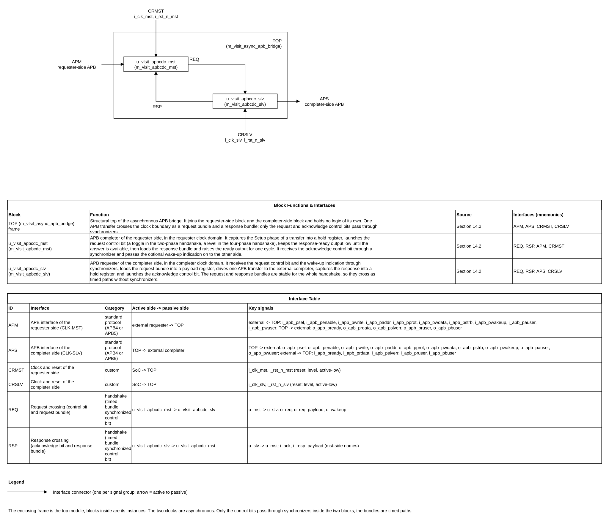

*Figure 5-1. Source: `figures/apbcdc_block_diagram.json`, generated as TikZ (`figures/apbcdc_block_diagram.tex`) by `vlsit_block_diagram.py`. The dashed link carries the request and acknowledge bits, the request bundle and the response bundle as timed paths; only the control bits pass through the synchronizers.*

### 5.3 Transaction and dataflow

1. **Setup capture.** In the cycle where `i_apb_psel` is high and `i_apb_penable` is low (the Setup phase, REF-001 4.1) and the mst FSM is in IDLE, the mst block loads `reg_req_payload` with `PWRITE`, `PADDR`, `PPROT`, `PSTRB`, `PWDATA` and, in APB5, `PAUSER`, `PWUSER`, and launches the request: with the two-phase handshake `reg_req` toggles, with the four-phase handshake it rises. All of this happens at one clock edge (DEC-016).
2. **Request crossing.** `reg_req` crosses through `u_sync_req` (N stages). The slv FSM sees the event, loads `reg_apb_payload` from `reg_req_payload` (the bundle has been stable for at least N destination periods), raises `PSEL` (Setup), and one cycle later `PENABLE` (Access).
3. **Completer transfer.** The slv FSM waits in ACCESS until the completer drives `PREADY`. At that edge it loads `reg_resp_hold` with `PRDATA`, `PSLVERR`, `PRUSER`, `PBUSER`, drops `PSEL` and `PENABLE`, and launches the acknowledge (toggle, or rise).
4. **Response crossing.** The acknowledge crosses through `u_sync_ack`. With the two-phase handshake the mst FSM sees the event, loads the response output registers from `reg_resp_hold`, and raises `PREADY` for one cycle (state RESP). With the four-phase handshake the mst FSM first drops the request, waits for the acknowledge to fall (the slv FSM waits in REQ0 for the request to fall and then drops the acknowledge), and then loads the response and raises `PREADY`.
5. **Next transfer.** The requester drives the next Setup phase in the cycle after the `PREADY` cycle; the mst FSM is back in IDLE and captures it.
6. **Wake-up (APB5).** `i_apb_pwakeup` is registered in the mst block, crosses through `u_sync_wk`, and drives `o_apb_pwakeup` through a flip-flop in the slv block, together with an in-progress term.

### 5.4 Invariants

- At most one transfer is in flight; the FSMs are in IDLE only between transfers.
- The request bundle and the response bundle change only while the handshake is not in the phase in which the other domain may load them (REQ-HS-002).
- The two-phase request and acknowledge bits are equal when no transfer is in flight; the four-phase bits are both 0.
- `PREADY` of the requester side is high only in state RESP, one cycle per transfer.
- A completer-side `PSEL` is high only in states SETUP and ACCESS.
- Every flip-flop that drives an APB output is reset to 0.

## 6. External interfaces and ports

### 6.1 Interface inventory

| Interface ID | Type and revision | Role | Direction at IP boundary | Clock domain | Required / optional | Configurations |
|---|---|---|---|---|---|---|
| IF-001 | AMBA APB4 or APB5, Issue D | Completer (the IP receives the transfers of a requester) | Requests in, responses out | CLK-MST | Required | All |
| IF-002 | AMBA APB4 or APB5, Issue D | Requester (the IP starts the transfers toward a completer) | Requests out, responses in | CLK-SLV | Required | All |
| IF-003 | Clocks and hardware resets | Receiver | Inputs | CLK-MST, CLK-SLV | Required | All |

### 6.2 Complete port list

Port names follow PRT-01 of the default naming rule (DEC-001): the direction prefix is the direction at this boundary, then `apb`, then the APB mnemonic in lowercase. The requester-side interface is the group `i_apb_p...` inputs and `o_apb_pready`, `o_apb_prdata`, `o_apb_pslverr`, `o_apb_pruser`, `o_apb_pbuser` outputs in CLK-MST; the completer-side interface is the group `o_apb_p...` outputs and `i_apb_pready`, `i_apb_prdata`, `i_apb_pslverr`, `i_apb_pruser`, `i_apb_pbuser` inputs in CLK-SLV. Widths use the parameters of Section 8. The RTL top declares the APB5 signals in every configuration (DEC-021); an unused input is ignored and an unused output is 0. The ports of the internal modules are in Section 14.2.1.

| Port | Direction | Width | Meaning (function) | Clock domain | Signal type | Reset / idle value | Timing / sampling | Configurations |
|---|---|---:|---|---|---|---|---|---|
| i_clk_mst | Input | 1 | Clock of the requester-side interface | CLK-MST | Clock (free running, rising edge) | Not applicable | Rising edge | All |
| i_rst_n_mst | Input | 1 | Hardware reset of all state of the mst domain | CLK-MST | Reset (active-low level, asynchronous assertion, release synchronous to i_clk_mst outside the IP) | Not applicable | Level; asserted together with i_rst_n_slv | All |
| i_apb_psel | Input | 1 | APB select of the requester | CLK-MST | Level (high for the whole transfer) | 0 | Sampled at every rising edge of i_clk_mst; the Setup phase is psel high with penable low | All |
| i_apb_penable | Input | 1 | APB enable, Access phase | CLK-MST | Level (high from the cycle after the Setup phase until the transfer completes) | 0 | Sampled at every rising edge of i_clk_mst | All |
| i_apb_pwrite | Input | 1 | 1 = write transfer, 0 = read transfer | CLK-MST | Data (valid with i_apb_psel) | Not applicable | Captured at the end of the Setup cycle | All |
| i_apb_paddr | Input | PARA_APBCDC_ADDR_W | Byte address | CLK-MST | Data (valid with i_apb_psel) | Not applicable | Captured at the end of the Setup cycle | All |
| i_apb_pprot | Input | 3 | Protection type, forwarded unchanged | CLK-MST | Data (valid with i_apb_psel) | Not applicable | Captured at the end of the Setup cycle | All |
| i_apb_pstrb | Input | LPARA_STRB_W | Write strobes, one bit per byte lane | CLK-MST | Data (valid with i_apb_psel; low for a read) | Not applicable | Captured at the end of the Setup cycle | All |
| i_apb_pwdata | Input | PARA_APBCDC_DATA_W | Write data | CLK-MST | Data (valid with i_apb_psel and i_apb_pwrite, active lanes only) | Not applicable | Captured at the end of the Setup cycle | All |
| i_apb_pwakeup | Input | 1 | APB5 wake-up of the requester; asserted before or with i_apb_psel, glitch-free | CLK-MST | Level (flop output of the requester, active-high) | 0 | Sampled at every rising edge of i_clk_mst, registered and synchronized to CLK-SLV | CFG-APB5 |
| i_apb_pauser | Input | PARA_APBCDC_USER_REQ_W | APB5 user request attribute | CLK-MST | Data (valid with i_apb_psel) | Not applicable | Captured at the end of the Setup cycle | CFG-USER |
| i_apb_pwuser | Input | PARA_APBCDC_USER_DATA_W | APB5 user write-data attribute | CLK-MST | Data (valid with i_apb_psel and i_apb_pwrite) | Not applicable | Captured at the end of the Setup cycle | CFG-USER |
| o_apb_pready | Output | 1 | Transfer ready for the requester | CLK-MST | Pulse (1 cycle of i_clk_mst per transfer, flop output) | 0 | Rises when the response is available; high in a cycle where i_apb_psel and i_apb_penable are high | All |
| o_apb_prdata | Output | PARA_APBCDC_DATA_W | Read data | CLK-MST | Data (valid with o_apb_pready of a read) | 0 | Loaded at the edge that raises o_apb_pready; holds its value until the next response | All |
| o_apb_pslverr | Output | 1 | Transfer error | CLK-MST | Level (high only in the o_apb_pready cycle, flop output) | 0 | Loaded with o_apb_pready, cleared at the next edge | All |
| o_apb_pruser | Output | PARA_APBCDC_USER_DATA_W | APB5 user read-data attribute | CLK-MST | Data (valid with o_apb_pready of a read) | 0 | Loaded at the edge that raises o_apb_pready | CFG-USER |
| o_apb_pbuser | Output | PARA_APBCDC_USER_RESP_W | APB5 user response attribute | CLK-MST | Data (valid with o_apb_pready) | 0 | Loaded at the edge that raises o_apb_pready | CFG-USER |
| i_clk_slv | Input | 1 | Clock of the completer-side interface | CLK-SLV | Clock (free running, rising edge) | Not applicable | Rising edge | All |
| i_rst_n_slv | Input | 1 | Hardware reset of all state of the slv domain | CLK-SLV | Reset (active-low level, asynchronous assertion, release synchronous to i_clk_slv outside the IP) | Not applicable | Level; asserted together with i_rst_n_mst | All |
| o_apb_psel | Output | 1 | APB select toward the completer | CLK-SLV | Level (flop output, high from the Setup phase to the end of the transfer) | 0 | Rises at the edge that loads the request, falls at the edge that sees i_apb_pready | All |
| o_apb_penable | Output | 1 | APB enable toward the completer | CLK-SLV | Level (flop output, high from the cycle after o_apb_psel until the transfer completes) | 0 | Rises one cycle after o_apb_psel | All |
| o_apb_pwrite | Output | 1 | Write flag toward the completer | CLK-SLV | Data (valid with o_apb_psel, stable until the transfer completes) | 0 | Loaded with the request | All |
| o_apb_paddr | Output | PARA_APBCDC_ADDR_W | Byte address toward the completer | CLK-SLV | Data (valid with o_apb_psel, stable until the transfer completes) | 0 | Loaded with the request | All |
| o_apb_pprot | Output | 3 | Protection type toward the completer | CLK-SLV | Data (valid with o_apb_psel, stable until the transfer completes) | 0 | Loaded with the request | All |
| o_apb_pstrb | Output | LPARA_STRB_W | Write strobes toward the completer | CLK-SLV | Data (valid with o_apb_psel, stable until the transfer completes) | 0 | Loaded with the request | All |
| o_apb_pwdata | Output | PARA_APBCDC_DATA_W | Write data toward the completer | CLK-SLV | Data (valid with o_apb_psel and o_apb_pwrite, stable until the transfer completes) | 0 | Loaded with the request | All |
| o_apb_pwakeup | Output | 1 | APB5 wake-up toward the completer: synchronized i_apb_pwakeup or transfer in progress | CLK-SLV | Level (flop output, glitch-free, active-high) | 0 | High no later than o_apb_psel; falls one cycle after the transfer | CFG-APB5 |
| o_apb_pauser | Output | PARA_APBCDC_USER_REQ_W | APB5 user request attribute toward the completer | CLK-SLV | Data (valid with o_apb_psel, stable until the transfer completes) | 0 | Loaded with the request | CFG-USER |
| o_apb_pwuser | Output | PARA_APBCDC_USER_DATA_W | APB5 user write-data attribute toward the completer | CLK-SLV | Data (valid with o_apb_psel and o_apb_pwrite, stable until the transfer completes) | 0 | Loaded with the request | CFG-USER |
| i_apb_pready | Input | 1 | Ready of the completer | CLK-SLV | Level (extends the Access phase while low) | Not applicable | Sampled at every rising edge of i_clk_slv while o_apb_penable is high | All |
| i_apb_prdata | Input | PARA_APBCDC_DATA_W | Read data of the completer | CLK-SLV | Data (valid with i_apb_pready of a read) | Not applicable | Captured at the edge where i_apb_pready is seen high | All |
| i_apb_pslverr | Input | 1 | Error of the completer | CLK-SLV | Level (valid with i_apb_pready) | Not applicable | Captured at the edge where i_apb_pready is seen high | All |
| i_apb_pruser | Input | PARA_APBCDC_USER_DATA_W | APB5 user read-data attribute of the completer | CLK-SLV | Data (valid with i_apb_pready of a read) | Not applicable | Captured at the edge where i_apb_pready is seen high | CFG-USER |
| i_apb_pbuser | Input | PARA_APBCDC_USER_RESP_W | APB5 user response attribute of the completer | CLK-SLV | Data (valid with i_apb_pready) | Not applicable | Captured at the edge where i_apb_pready is seen high | CFG-USER |

Test and interrupt ports: none (see Sections 6.4 and 16).

### 6.3 Protocol behavior

The bridge follows AMBA APB Issue D (REF-001) on both interfaces. The statements below restate the rules of REF-001 that the bridge relies on, with their sections.

- **Phases (REF-001 4.1, Figure 4-1).** A transfer starts with the Setup phase (`PSEL` high, `PENABLE` low, one cycle), then the Access phase (`PENABLE` high), which ends in the cycle where `PREADY` is high. After `PREADY` the bus returns to IDLE or goes directly to the Setup phase of the next transfer.
- **Validity (REF-001 Appendix A).** `PADDR`, `PPROT`, `PENABLE`, `PWRITE`, `PAUSER`, `PSTRB` and the active lanes of `PWDATA` (and `PWUSER` of a write) are valid whenever `PSEL` is high, so the bridge captures them in the Setup cycle. `PREADY` is valid when `PSEL` and `PENABLE` are high. `PRDATA` of a read, `PSLVERR`, `PRUSER` of a read and `PBUSER` are valid when `PSEL`, `PENABLE` and `PREADY` are high.
- **Stability (REF-001 3.1, 4.1).** `PADDR`, `PPROT`, `PWRITE`, `PWDATA`, `PSTRB`, `PAUSER`, `PWUSER` do not change between the Setup and the Access phase and while `PREADY` is low. The bridge relies on this only for the Setup cycle of the requester side; it guarantees it on the completer side by loading the fields into `reg_apb_payload` once.
- **Wait states (REF-001 3.1).** The completer extends the Access phase by driving `PREADY` low; the bridge propagates this by raising the requester-side `PREADY` only after the completer-side `PREADY`.
- **Error (REF-001 3.4).** `PSLVERR` is valid only in the last cycle of a transfer. A transfer with an error may or may not have changed the completer; a read with an error can return invalid data and the requester may still use it, so the bridge forwards `PRDATA` and `PSLVERR` together without masking.
- **Strobes (REF-001 3.2).** `PSTRB` must be low in a read. The bridge forwards `PSTRB` as received (DEC-028).
- **Wake-up (REF-001 3.6, APB5 only).** `PWAKEUP` is synchronous to its clock and shall be glitch-free to be sampled asynchronously; it may be asserted before, during or after `PSEL`, shall stay high until `PREADY` when high in the same cycle as `PSEL`, and should be asserted one cycle before `PSEL`. A completer may wait for `PWAKEUP` before `PREADY`.
- **User signals (REF-001 3.7, APB5 only).** `PAUSER` and `PWUSER` are valid with `PSEL` (`PWUSER` also with `PWRITE`) and keep their value through the Setup and Access phases; `PRUSER` and `PBUSER` are valid in the `PREADY` cycle. A signal whose width is 0 is not present. A domain-crossing bridge should provide all user signals.

| Case | Legal behavior | Illegal / unsupported case | IP response | Requirement IDs |
|---|---|---|---|---|
| Write or read without wait states | Setup, Access, `PREADY` of the completer in the first Access cycle | None | One completer-side transfer, response returned | REQ-FUNC-001, REQ-FUNC-002 |
| Completer inserts wait states | `PREADY` low for any number of cycles | None | Requester-side `PREADY` stays low until the response | REQ-FUNC-005 |
| Completer answers with `PSLVERR` | Error in the last cycle | None | `PSLVERR` returned with `PREADY`, data forwarded | REQ-FUNC-006 |
| Next Setup phase right after `PREADY` | Back-to-back transfer | None | Accepted | REQ-FUNC-007 |
| `PENABLE` high without a preceding Setup cycle | None | Requester breaks Figure 4-1 | Ignored; no transfer starts (DEC-027) | REQ-FUNC-001 |
| Requester changes a field during the Access phase | None | Requester breaks REF-001 3.1 | Not detected; the bridge uses the Setup values | REQ-FUNC-001 |
| Completer never drives `PREADY` | None (a completer must eventually answer) | Completer hangs | Bridge waits without limit (DEC-006) | REQ-FUNC-005 |
| One reset asserted alone, or a reset in the middle of a transfer | Both resets asserted together | Single reset | The transfer in flight is lost; single reset is not supported | REQ-RESET-002 |

Figure 6-1 to Figure 6-3 give the key waveforms of the interfaces (the full plan is in Section 10.3).

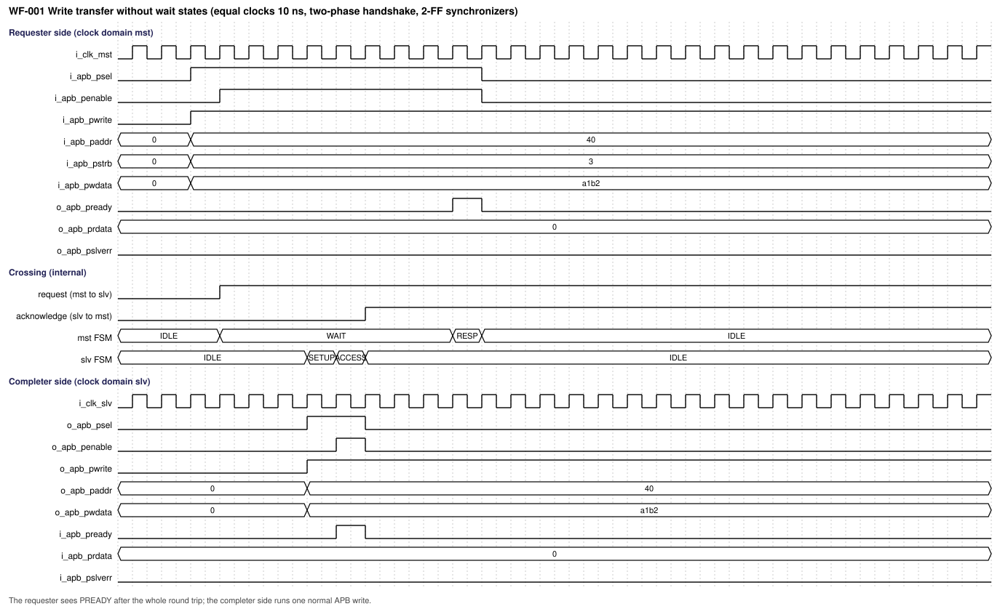

*Figure 6-1. Write transfer without wait states, equal clocks, two-phase handshake (WF-001, source `waveforms/apbcdc_wf001_write_no_wait.json`).*

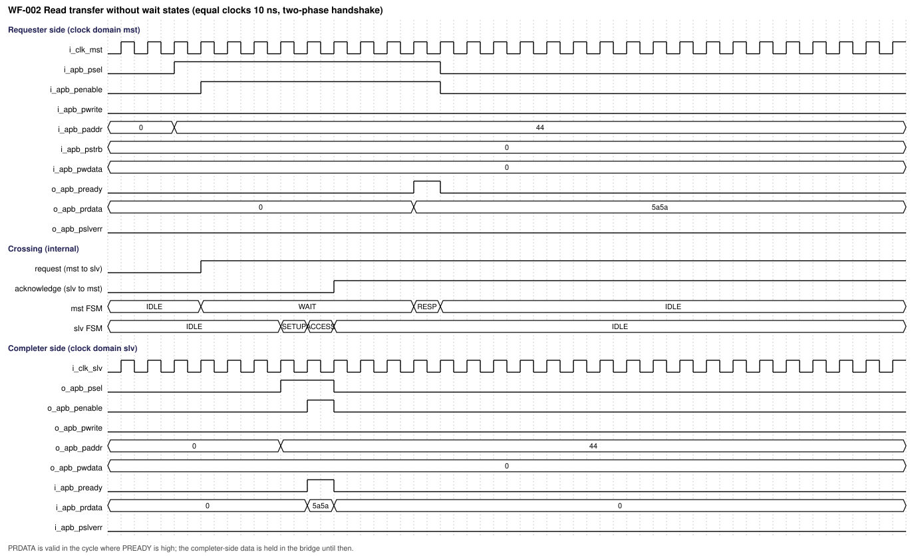

*Figure 6-2. Read transfer without wait states (WF-002, source `waveforms/apbcdc_wf002_read_no_wait.json`).*

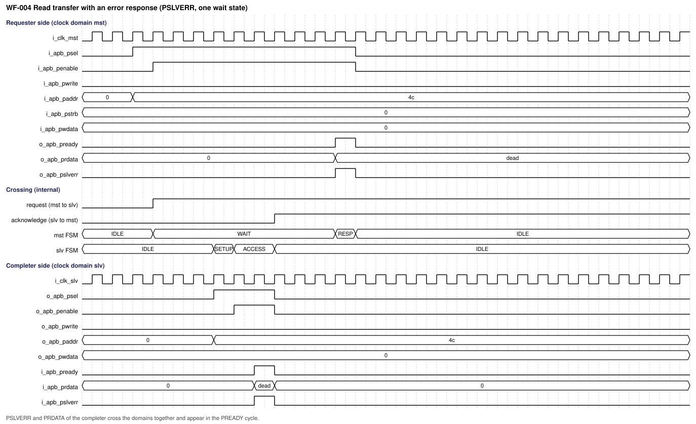

*Figure 6-3. Read transfer with an error response (WF-004, source `waveforms/apbcdc_wf004_read_error.json`).*

### 6.4 Interrupts and events

| Signal/event | Polarity | Assert condition | Clear/deassert condition | Mask/priority | Crossing | Reset state |
|---|---|---|---|---|---|---|
| Not applicable | Not applicable | **Not required (confirmed by user, 2026-10-25):** the IP has no interrupt or event output; errors travel as `PSLVERR` of the transfer | Not applicable | Not applicable | Not applicable | Not applicable |

## 7. Clock, reset, and power

### 7.1 Clock domains

| Domain | Clock port | Edge | Frequency range | Source | Relationship to other clocks | Gating policy |
|---|---|---|---|---|---|---|
| CLK-MST | i_clk_mst | Rising | Set by the integrator | Any source | Asynchronous to CLK-SLV: any frequency ratio, any phase (DEC-008) | No clock gating inside the IP |
| CLK-SLV | i_clk_slv | Rising | Set by the integrator | Any source | Asynchronous to CLK-MST | No clock gating inside the IP; see ASM-005 for the use of `PWAKEUP` with a gated clock |

### 7.2 CDC and RDC

Five crossings exist; no other path joins the two domains (REQ-CLK-002). The structure is a handshake with bundled data: the control bits are synchronized (CLK-01), and each bundle is held stable and loaded by the destination only after the control bit arrived, so no bundle bit passes through a synchronizer.

| Crossing ID | From to | Signals | Structure | Reset handling | Constraints / verification |
|---|---|---|---|---|---|
| CDC-001 | mst to slv | Request bundle `reg_req_payload` (LPARA_REQ_W bits: `PWRITE`, `PADDR`, `PPROT`, `PSTRB`, `PWDATA`, `PAUSER`, `PWUSER`) | Hold register in mst, loaded at the launch edge of the request bit; loaded into `reg_apb_payload` in slv at the edge that sees the request event; no synchronizer | Both registers reset to 0 | `set_max_delay` with the guard band, EXC-001; stability by SVA-011; TEST-002 |
| CDC-002 | mst to slv | Request bit `reg_req` (toggle or level) | N-stage synchronizer `u_sync_req` (cell option `PARA_APBCDC_CELL_TYPE`), no logic between the flop and the first stage | Synchronizer stages reset to 0 by `i_rst_n_slv` | `set_max_delay`, EXC-002; TEST-015 |
| CDC-003 | slv to mst | Acknowledge bit `reg_ack` (toggle or level) | N-stage synchronizer `u_sync_ack`, no logic before the first stage | Reset to 0 by `i_rst_n_mst` | `set_max_delay`, EXC-003; TEST-015 |
| CDC-004 | slv to mst | Response bundle `reg_resp_hold` (LPARA_RESP_W bits: `PRDATA`, `PSLVERR`, `PRUSER`, `PBUSER`) | Hold register in slv, loaded at the launch edge of the acknowledge bit; loaded into `reg_resp_payload` in mst at the edge that sees the acknowledge event; no synchronizer | Both registers reset to 0 | `set_max_delay` with the guard band, EXC-004; TEST-003 |
| CDC-005 | mst to slv | Wake-up `reg_wakeup` (registered copy of `i_apb_pwakeup`, APB5 only) | N-stage synchronizer `u_sync_wk` | Reset to 0 by `i_rst_n_slv` | `set_max_delay`, EXC-005; TEST-009 |

Reset-domain crossing: the two resets are asserted together and released synchronously to their own clock, outside the IP (DEC-009). A release in one domain while the other is still in reset is allowed: the other domain's flip-flops are at their reset values, so a request cannot be launched or seen (the mst FSM leaves IDLE only on a Setup phase, which the requester does not start before its reset is released). The simulation model of the synchronizer (REQ-RTL-002) adds random extra latency to every control bit to expose any dependence on the arrival time.

### 7.3 Reset domains and sequencing

| Reset ID | Port | Polarity / assertion | Sync or async | Scope | Deassertion | Reset value |
|---|---|---|---|---|---|---|
| RST-MST | i_rst_n_mst | Active-low | Asynchronous assertion; release synchronous to i_clk_mst, made outside the IP | All state of the mst block and its synchronizer: hold register, request bit, wake-up register, response output registers, FSM | Synchronous to i_clk_mst | All registers 0, FSM IDLE, `o_apb_pready` and `o_apb_pslverr` 0 |
| RST-SLV | i_rst_n_slv | Active-low | Asynchronous assertion; release synchronous to i_clk_slv, made outside the IP | All state of the slv block and its synchronizers: payload register, response hold register, acknowledge bit, FSM, `o_apb_psel`, `o_apb_penable`, `o_apb_pwakeup` | Synchronous to i_clk_slv | All registers 0, FSM IDLE |

The IP contains no reset synchronizer: the two resets reach the IP already synchronized (rule RST-02 is met outside the IP, DEC-009). The two resets are asserted together. No transfer starts before both are released; the requester model of the verification keeps `i_apb_psel` low until then. The stopped-clock, warm-reset and retention cases are not supported. The software reset of `001_AsyncGrayFIFO` has no counterpart in this IP.

### 7.4 Power intent (if applicable)

**Not required (confirmed by user, 2026-10-25):** the IP is in one always-on power domain of the SoC and has no isolation, retention or power sequencing of its own. The APB5 `PWAKEUP` is transported; its use for clock control is outside the IP (ASM-005).

## 8. Parameters and elaboration configurations

Parameters use `parameter logic [31:0]` with names `PARA_APBCDC_*` and the three comment lines of REF-003 PAR-02. Derived constants use `localparam logic [31:0]` with names `LPARA_*` in the parameter port list after the parameters. The IP has no elaboration check for illegal values (REQ-PARAM-001).

| Parameter | Purpose | Default | Legal values / range | Dependencies / invalid combinations | Effect |
|---|---|---|---|---|---|
| PARA_APBCDC_ADDR_W | Width of the byte address | 32 | 1 to 32 | None | Width of `PADDR` and of the request bundle |
| PARA_APBCDC_DATA_W | Width of the data buses | 32 | 8, 16 or 32 | None | Width of `PWDATA`, `PRDATA`; `PSTRB` has DATA_W / 8 bits |
| PARA_APBCDC_APB5 | Interface revision: 0 = APB4, 1 = APB5 | 0 | 0 or 1 | The user widths apply only when 1 | APB5 adds `PWAKEUP` and the user signals |
| PARA_APBCDC_USER_REQ_W | Width of `PAUSER` | 0 | 0 to 128 | Only with `PARA_APBCDC_APB5` = 1 | 0 = no `PAUSER` |
| PARA_APBCDC_USER_DATA_W | Width of `PWUSER` and `PRUSER` | 0 | 0 to PARA_APBCDC_DATA_W; an integer multiple of 8 is recommended (REF-001 3.7.3) | Only with `PARA_APBCDC_APB5` = 1 | 0 = no `PWUSER`, no `PRUSER` |
| PARA_APBCDC_USER_RESP_W | Width of `PBUSER` | 0 | 0 to 16 | Only with `PARA_APBCDC_APB5` = 1 | 0 = no `PBUSER` |
| PARA_APBCDC_HS_TYPE | Handshake: 0 = two-phase (toggle), 1 = four-phase (level) | 0 | 0 or 1 | None | Latency and number of crossing events; the function on the APB interfaces is the same |
| PARA_APBCDC_CELL_TYPE | Synchronizer cell option: 0 = bypass (simulation only), 1 = two D flip-flop cells, 2 = one 2-FF cell, 3 = one 3-FF cell, 4 = one 4-FF cell | 2 | 0 to 4 | 0 is rejected by the SDC | Number of stages N = 2, 2, 3, 4 for the values 1 to 4 |
| LPARA_STRB_W | Width of `PSTRB` | Derived | 1, 2 or 4 | `PARA_APBCDC_DATA_W` | DATA_W / 8 |
| LPARA_REQ_W | Width of the request bundle | Derived | At least 7 | Parameters above | ADDR_W + 3 + 1 + STRB_W + DATA_W, plus USER_REQ_W and USER_DATA_W in APB5 |
| LPARA_RESP_W | Width of the response bundle | Derived | At least 9 | Parameters above | DATA_W + 1, plus USER_DATA_W and USER_RESP_W in APB5 |

| Configuration | Parameter overrides | Features/interfaces | Expected hierarchy | Elaboration/lint/synthesis target |
|---|---|---|---|---|
| CFG-APB4 | Defaults | APB4, two-phase, 2-FF cell | top, mst, slv, sync | Elaborate, lint, synthesize |
| CFG-4PH | `PARA_APBCDC_HS_TYPE` = 1 | Four-phase handshake | Same hierarchy | Elaborate, lint, synthesize |
| CFG-APB5 | `PARA_APBCDC_APB5` = 1 | `PWAKEUP` | Same hierarchy | Elaborate, lint, synthesize |
| CFG-USER | `PARA_APBCDC_APB5` = 1, user widths 4, 8, 4 | User signals | Same hierarchy | Elaborate, lint, synthesize |
| CFG-SYNC3 | `PARA_APBCDC_CELL_TYPE` = 3 or 4 | Three or four stages | Same hierarchy | Elaborate, lint, synthesize |
| CFG-MIN | `PARA_APBCDC_ADDR_W` = 1, `PARA_APBCDC_DATA_W` = 8 | Smallest instance | Same hierarchy | Elaborate, lint |

Illegal configurations are a data width other than 8, 16 or 32, an address width above 32 or equal to 0, a user width above its limit, a user width above 0 with `PARA_APBCDC_APB5` = 0, and an option parameter outside its range. The IP does not check them and its behavior with them is not specified.

## 9. Data representation and arithmetic

All data are unsigned four-state vectors, bit 0 the least significant. The bridge moves the fields unchanged and does no arithmetic.

| Quantity | Width | Encoding / range | Extension / truncation | Overflow / invalid behavior |
|---|---:|---|---|---|
| Address | PARA_APBCDC_ADDR_W | Byte address | None | Not applicable |
| Data word | PARA_APBCDC_DATA_W | Opaque | None | Not applicable |
| Write strobes | LPARA_STRB_W | One bit per byte lane, bit n for PWDATA bits 8n+7 to 8n | None | Forwarded as received |
| Protection | 3 | As APB (bit 0 privileged, bit 1 non-secure, bit 2 instruction) | None | Forwarded as received |
| Request bundle | LPARA_REQ_W | Field order from the least significant bit: PADDR, PPROT, PWRITE, PSTRB, PWDATA, PAUSER, PWUSER | A field of width 0 contributes no bit | Not applicable |
| Response bundle | LPARA_RESP_W | Field order from the least significant bit: PRDATA, PSLVERR, PRUSER, PBUSER | A field of width 0 contributes no bit | Not applicable |
| Request and acknowledge bits | 1 | Two-phase: the value toggles per transfer, equal when idle. Four-phase: 1 while a phase is requested, 0 when idle | None | Not applicable |

## 10. Detailed functional behavior

### 10.1 Modes and state transitions

The two FSMs follow the three-process style of REF-003 with the names `reg_fsm_hs_current_state` and `w_fsm_hs_nxt_state` and the members `ENUM_ST_*`. All four encodings of each 2-bit FSM are used, so there is no unused encoding; CLOSE (mst) and REQ0 (slv) are reached only with the four-phase handshake.

**Requester-side FSM** (m_vlsit_apbcdc_mst):

| Mode/state | Entry condition | Behavior | Exit condition | Outputs / side effects |
|---|---|---|---|---|
| ENUM_ST_IDLE | Reset, or the end of RESP | Waits for the Setup phase | `i_apb_psel` high and `i_apb_penable` low: WAIT | At the exit edge: `reg_req_payload` loaded, `reg_req` toggled (two-phase) or set (four-phase) |
| ENUM_ST_WAIT | Request launched | Waits for the acknowledge event: two-phase, synchronized acknowledge equal to `reg_req`; four-phase, synchronized acknowledge high | Two-phase: event, load the response output registers, raise `o_apb_pready`: RESP. Four-phase: event, clear `reg_req`: CLOSE | `o_apb_pready` 0 |
| ENUM_ST_CLOSE | Four-phase, acknowledge seen | Waits for the synchronized acknowledge to fall | Acknowledge low: load the response output registers, raise `o_apb_pready`: RESP | `reg_req` 0 |
| ENUM_ST_RESP | Response loaded | `o_apb_pready` is high for this cycle | Always: IDLE | At the exit edge: `o_apb_pready` and `o_apb_pslverr` cleared |

**Completer-side FSM** (m_vlsit_apbcdc_slv):

| Mode/state | Entry condition | Behavior | Exit condition | Outputs / side effects |
|---|---|---|---|---|
| ENUM_ST_IDLE | Reset, or the end of a transfer | Waits for the request event: two-phase, synchronized request different from `reg_ack`; four-phase, synchronized request high | Event: SETUP | At the exit edge: `reg_apb_payload` loaded from the request bundle, `o_apb_psel` high |
| ENUM_ST_SETUP | Request loaded | Setup phase, `o_apb_penable` low | Always: ACCESS | At the exit edge: `o_apb_penable` high |
| ENUM_ST_ACCESS | Setup phase done | Access phase; waits for `i_apb_pready` | `i_apb_pready` high: two-phase IDLE, four-phase REQ0 | At the exit edge: `reg_resp_hold` loaded, `o_apb_psel` and `o_apb_penable` low, `reg_ack` toggled (two-phase) or set (four-phase) |
| ENUM_ST_REQ0 | Four-phase, acknowledge launched | Waits for the synchronized request to fall | Request low: IDLE | At the exit edge: `reg_ack` cleared |

### 10.2 Operations

| Operation ID | Inputs / preconditions | Processing semantics | Result / completion | Latency / ordering |
|---|---|---|---|---|
| OP-001 | Setup phase with `PWRITE` = 1 on the requester side, mst FSM in IDLE | Capture the fields, cross the request, run one APB write on the completer side, return the response | Completer written, `PREADY` for one cycle | Bound of REQ-PERF-001 or REQ-PERF-002 |
| OP-002 | Setup phase with `PWRITE` = 0 | As OP-001 for a read; `PRDATA` and `PRUSER` are returned | Read data returned with `PREADY` | Same bound |
| OP-003 | Completer holds `PREADY` low for w cycles | The completer-side Access phase lasts w + 1 cycles | Requester-side `PREADY` after the response | Bound grows by w completer cycles |
| OP-004 | Completer drives `PSLVERR` with `PREADY` | `PSLVERR` is part of the response bundle | `PSLVERR` high in the `PREADY` cycle of the requester | Same bound |
| OP-005 | Next Setup phase in the cycle after `PREADY` | The mst FSM is back in IDLE and captures it | Second transfer starts at once | One transfer at a time |
| OP-006 | APB5, `i_apb_pwakeup` or a transfer in progress | `o_apb_pwakeup` follows the synchronized wake-up OR the in-progress term | `o_apb_pwakeup` high before or with `o_apb_psel` | Synchronizer latency of N cycles of CLK-SLV |
| OP-007 | APB5 with user widths above 0 | `PAUSER` and `PWUSER` travel in the request bundle, `PRUSER` and `PBUSER` in the response bundle | Same values on the other side | As OP-001 |
| OP-008 | `i_rst_n_mst` or `i_rst_n_slv` low | Asynchronous clear of the state of the domain | All registers at the reset value, transfer in flight lost | Immediate |
| OP-009 | `PARA_APBCDC_HS_TYPE` = 1 | The four-phase handshake of OP-001 and OP-002 | Same result as OP-001 and OP-002, slower | Bound of REQ-PERF-002 |

### 10.3 Cycle-level behavior

**Waveform plan (rule R-024).** The plan was proposed from sections 6.3 and 10.2 and confirmed by the designer on 2026-10-25 (option A, the proposed list). It covers every operation of 10.2, the success and the error case of both interfaces, and the special cases of this IP (wait states, back-to-back, sparse strobes, both handshake types, APB5, extreme clock ratios, reset). The waveforms come from the prototype (`waveforms/proto/gen_waves.py`).

| Waveform ID | Function / operation | Scenario (success / error / corner) | Signals shown | Figure | Confirmed by user |
|---|---|---|---|---|---|
| WF-001 | OP-001 write transfer, two-phase | success | Both APB interfaces, request and acknowledge bits, both FSMs | waveforms/apbcdc_wf001_write_no_wait.svg | 2026-10-25 |
| WF-002 | OP-002 read transfer, two-phase | success | Both interfaces, read data | waveforms/apbcdc_wf002_read_no_wait.svg | 2026-10-25 |
| WF-003 | OP-003 write with three completer wait states | corner | Both interfaces, `PREADY` of the completer | waveforms/apbcdc_wf003_write_wait_states.svg | 2026-10-25 |
| WF-004 | OP-004 read with `PSLVERR` and one wait state | error | `PSLVERR` and `PRDATA` on both sides | waveforms/apbcdc_wf004_read_error.svg | 2026-10-25 |
| WF-005 | OP-004 write with `PSLVERR` | error | `PSLVERR` on both sides | waveforms/apbcdc_wf005_write_error.svg | 2026-10-25 |
| WF-006 | OP-005 three transfers back to back | corner | Setup phase right after `PREADY` | waveforms/apbcdc_wf006_back_to_back.svg | 2026-10-25 |
| WF-007 | OP-009 write with the four-phase handshake | success | Request and acknowledge returning to 0, `PREADY` late | waveforms/apbcdc_wf007_four_phase_write.svg | 2026-10-25 |
| WF-008 | OP-001 sparse writes with `PSTRB` 01 and 10 | corner | `PSTRB` on both sides | waveforms/apbcdc_wf008_sparse_write.svg | 2026-10-25 |
| WF-009 | OP-006 and OP-007 APB5 wake-up and user signals | success | `PWAKEUP`, `PAUSER`, `PWUSER`, `PRUSER`, `PBUSER` | waveforms/apbcdc_wf009_apb5_wakeup_user.svg | 2026-10-25 |
| WF-010 | OP-001 requester clock 3 times faster than the completer clock | corner | Both clocks, both interfaces | waveforms/apbcdc_wf010_requester_clock_fast.svg | 2026-10-25 |
| WF-011 | OP-001 completer clock 3 times faster than the requester clock | corner | Both clocks, both interfaces | waveforms/apbcdc_wf011_completer_clock_fast.svg | 2026-10-25 |
| WF-012 | OP-008 hardware reset in the middle of a transfer | corner | Both resets, all state, repeated transfer | waveforms/apbcdc_wf012_hardware_reset.svg | 2026-10-25 |

Active edge: the rising edge of the clock of the signal's own domain. Inputs are sampled at the edge that ends a cycle; flop outputs change at that edge. The waveforms use a grid in which one slot is the greatest common divisor of the two half periods, so every clock edge is at a slot boundary; the requester model changes its outputs a fraction of a nanosecond after the edge.

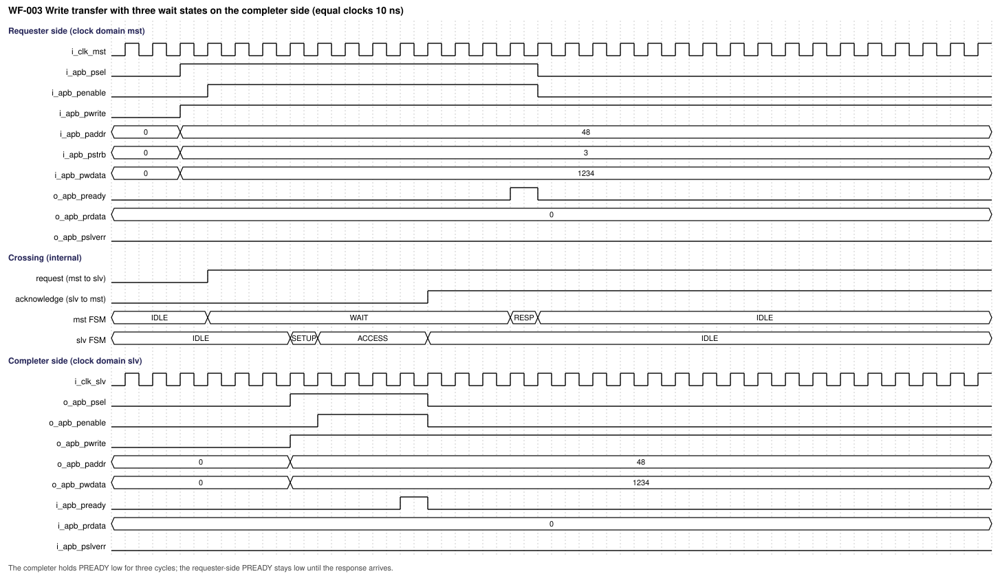

*Figure 10-1. WF-003: three wait states on the completer side (source `waveforms/apbcdc_wf003_write_wait_states.json`).*

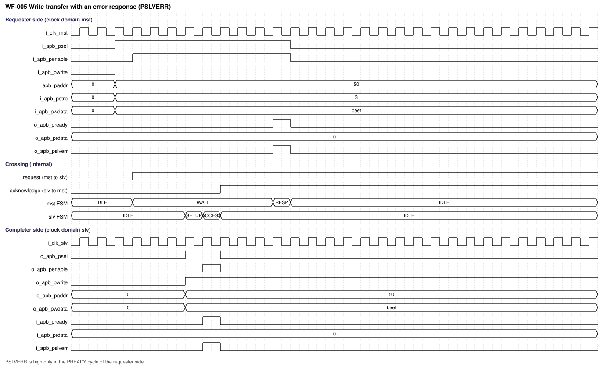

*Figure 10-2. WF-005: write with an error response (source `waveforms/apbcdc_wf005_write_error.json`).*

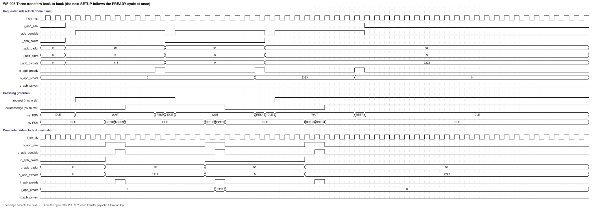

*Figure 10-3. WF-006: three transfers back to back (source `waveforms/apbcdc_wf006_back_to_back.json`).*

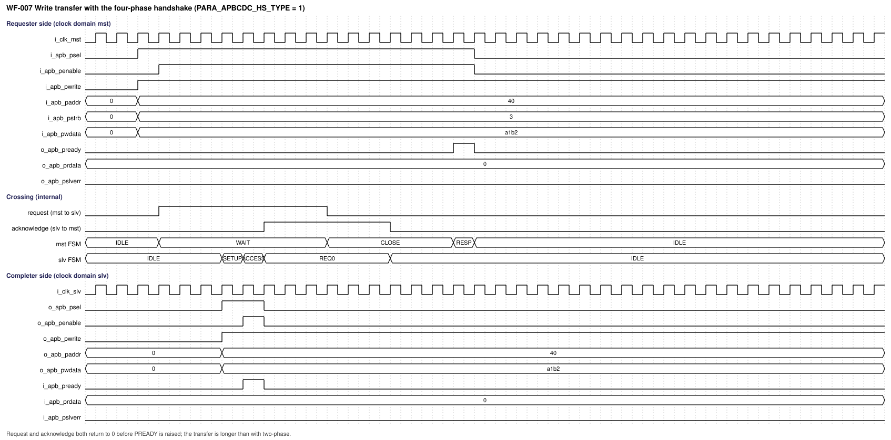

*Figure 10-4. WF-007: four-phase handshake; request and acknowledge both return to 0 before PREADY (source `waveforms/apbcdc_wf007_four_phase_write.json`).*

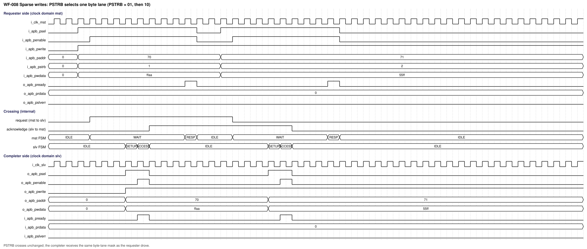

*Figure 10-5. WF-008: sparse writes, `PSTRB` selects one byte lane (source `waveforms/apbcdc_wf008_sparse_write.json`).*

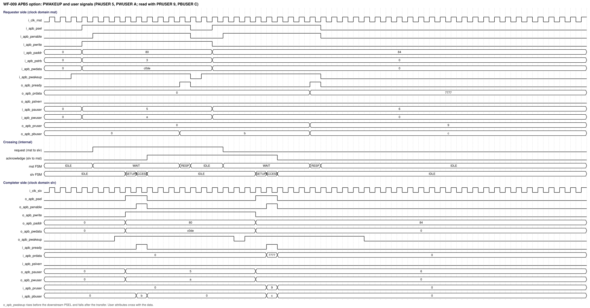

*Figure 10-6. WF-009: APB5 option with `PWAKEUP` and user signals (source `waveforms/apbcdc_wf009_apb5_wakeup_user.json`).*

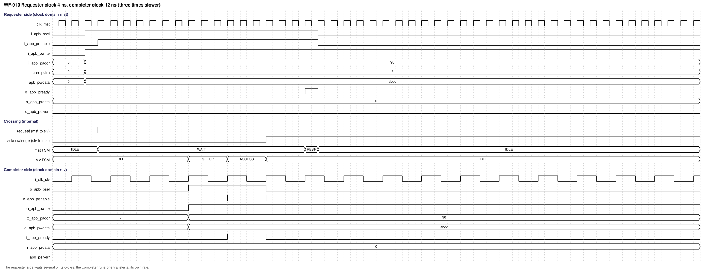

*Figure 10-7. WF-010: requester clock 4 ns, completer clock 12 ns (source `waveforms/apbcdc_wf010_requester_clock_fast.json`).*

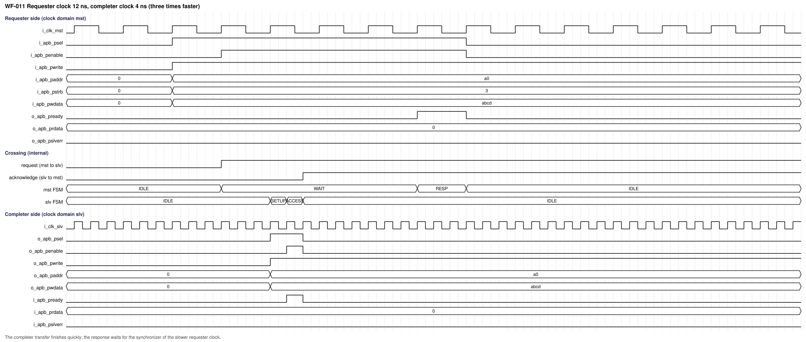

*Figure 10-8. WF-011: requester clock 12 ns, completer clock 4 ns (source `waveforms/apbcdc_wf011_completer_clock_fast.json`).*

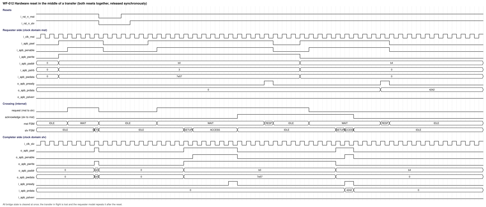

*Figure 10-9. WF-012: hardware reset in the middle of a transfer; the requester model repeats the transfer after the release (source `waveforms/apbcdc_wf012_hardware_reset.json`).*

| Cycle / event | Input condition | State/action | Output condition |
|---|---|---|---|
| Setup edge E0 (end of the Setup cycle) | `i_apb_psel` high, `i_apb_penable` low, mst FSM in IDLE | Request bundle loaded, request bit launched, FSM to WAIT | `o_apb_pready` stays low |
| First N + 1 edges of `i_clk_slv` after E0 | Request bit in the synchronizer | The slv FSM sees the event at edge N + 1 and loads `reg_apb_payload` | `o_apb_psel` high after that edge |
| Next two edges of `i_clk_slv` | None | SETUP, then ACCESS | `o_apb_penable` high from the second |
| Edge of `i_apb_pready` | `i_apb_pready` high in ACCESS | Response held, acknowledge launched | `o_apb_psel`, `o_apb_penable` low |
| N + 1 edges of `i_clk_mst` after the acknowledge launch | Acknowledge in the synchronizer | The mst FSM sees the event, loads the response, raises `o_apb_pready` | `o_apb_pready` high for one cycle, then FSM to IDLE |

### 10.4 Arbitration, buffering, and throughput

There is no arbitration: one requester-side interface and one completer-side interface, one transfer at a time (DEC-013). There is no buffering other than the four registers of the two bundles. A new Setup phase that the requester drives before `PREADY` cannot occur (APB is non-pipelined).

**Latency.** Let N be the number of synchronizer stages, T_mst and T_slv the clock periods, w the number of completer wait states. The duration D is measured from the first cycle of the Setup phase to the end of the `PREADY` cycle on the requester side. From the structure (the request needs up to N + 1 slv edges to be loaded, two slv cycles for Setup and Access plus w wait cycles, the acknowledge needs up to N + 1 mst edges, plus the Setup and `PREADY` cycles) the bounds are:

| Handshake | Upper bound of D | Equal clocks, N stages, w wait states |
|---|---|---|
| Two-phase | (N + 3) x T_mst + (N + 3 + w) x T_slv | 2N + 6 + w cycles |
| Four-phase | (2N + 4) x T_mst + (2N + 4 + w) x T_slv | 4N + 8 + w cycles |

The prototype was measured for both handshakes, N = 2, 3, 4, eight clock ratios (1:1, 1:3, 3:1, 3:7, 7:3, 1:2, 2:1, 4:5), and w = 0 and 2, one starting phase per ratio: 96 cases, no case above the bound (`waveforms/apbcdc_latency_table.txt`, produced by `waveforms/proto/latency_sweep.py`). For equal clocks the measured value equals the formula in every case. The bound is derived by analysis and checked against one starting phase per ratio, not against every phase; TEST-018 repeats the check on the RTL for several phases.

| Case (measured on the prototype, w = 0) | Two-phase | Four-phase |
|---|---|---|
| Equal clocks, N = 2 | 10 cycles (WF-001) | 16 cycles (WF-007) |
| Equal clocks, N = 3 | 12 cycles | 20 cycles |
| Equal clocks, N = 4 | 14 cycles | 24 cycles |
| T_mst 4 ns, T_slv 12 ns, N = 2 | 72 ns, bound 80 ns (WF-010) | Not measured at this ratio in the figures; covered by the sweep |
| T_mst 12 ns, T_slv 4 ns, N = 2 | 72 ns, bound 80 ns (WF-011) | Same |

**Throughput.** One transfer per D; no pipelining. The two-phase handshake is the faster; the four-phase handshake costs about 6 more cycles at N = 2 for equal clocks.

### 10.5 Memories and storage

**Not required (confirmed by user, 2026-10-25):** the IP contains no memory or macro; the only storage is the registers of the two bundles and the control flip-flops (Section 5.1). Nothing is held when no transfer is in progress except the last bundle values, which have no meaning.

## 11. Register and programming model

**Not required (confirmed by user, 2026-10-25):** the IP has no software-visible registers; it is configured by parameters (Section 8). No CSR workbook is delivered.

## 12. Error handling and recovery

| Error ID | Detection condition | Observable response/status | Interrupt | Clear/recovery | Reset behavior |
|---|---|---|---|---|---|
| ERR-001 | Completer drives `PSLVERR` with `PREADY` | Forwarded: `o_apb_pslverr` high in the `o_apb_pready` cycle | None | The next transfer is independent | Not applicable |
| ERR-002 | Completer never drives `PREADY` | The bridge waits without limit; the requester sees `PREADY` low | None | A system watchdog or a reset of both domains (DEC-006) | Cleared by reset |
| ERR-003 | Reset asserted while a transfer is in flight | The transfer is lost; the requester model repeats it after the release | None | Release both resets, restart the transfer | Clears all state |
| ERR-004 | Requester breaks the APB rules (Setup without Access, change of a field during Access, `PENABLE` without Setup) | Not detected; the bridge uses the values of the Setup cycle, and ignores `PENABLE` without a Setup (DEC-027) | None | The integrator fixes the requester | Not applicable |
| ERR-005 | One reset asserted alone, or illegal parameter value | Not detected; behavior not specified | None | The integrator fixes the integration | Not applicable |

There is no sticky error, no error counter and no error output other than `PSLVERR`. There is no data protection (no parity or ECC), so a corrupted bundle bit is not detected.

## 13. Performance, power, and area

| Metric ID | Metric | Target / limit | Conditions | Measurement method | Hard / goal |
|---|---|---|---|---|---|
| PERF-001 | Transfer duration, two-phase | At most (N + 3) x T_mst + (N + 3 + w) x T_slv | Any clock ratio | Latency sweep: TEST-018 | Hard (REQ-PERF-001) |
| PERF-002 | Transfer duration, four-phase | At most (2N + 4) x T_mst + (2N + 4 + w) x T_slv | Any clock ratio | Latency sweep: TEST-018 | Hard (REQ-PERF-002) |
| PERF-003 | Throughput | One transfer in flight; next Setup accepted in the cycle after `PREADY` | Any configuration | Simulation: TEST-006 | Hard (REQ-PERF-003) |
| PPA-001 | Maximum frequency of each clock | Not specified; set by the integrator (OI-001) | Library, corner and voltage chosen by the integrator | STA with the delivered constraints | Goal |
| PPA-002 | Area | Not specified; set by the integrator (OI-001). Flop count by structure, not synthesized: two request registers of LPARA_REQ_W bits and two response registers of LPARA_RESP_W bits, about 6 control flops, 2 FSM flops per block, and the synchronizer stages (N per control bit, two or three control bits). The default APB4 configuration (ADDR_W 32, DATA_W 32) has about 225 flops | Library chosen by the integrator | Cell area report | Goal |
| PPA-003 | Dynamic and leakage power | Not specified; set by the integrator (OI-001). The registers load only at a transfer | Activity and corner chosen by the integrator | Power analysis | Goal |

No timing closure is claimed from RTL alone. The critical paths are the crossing paths of Section 17.1.2 (bundle paths with the budget (N - 1) x T_dst) and the interface paths of the two APB interfaces.

## 14. RTL implementation contract

### 14.1 Required coding baseline

The VLSIT RTL Design Rules v2 in VLSIT_RTL_Design_Rule.md (REF-003) are the mandatory RTL coding authority. The RTL complies with them, with the one deviation DEC-021 (PRT-03). Items that matter most for this IP: one module per file with the file name equal to the module name; a structural top; ANSI ports with `input wire` and `output logic`; `reg_`, `w_`, `p_ff_` and `p_com_` names; FSM names `reg_fsm_hs_current_state` and `w_fsm_hs_nxt_state` with `ENUM_ST_*` states; parameters `PARA_APBCDC_*` with the three PAR-02 comment lines; at most 30 characters per name; abbreviations of NAM-08 (`resp` for response, `req`, `ack`, `addr`, `wr`, `rd`; the word payload is written in full); cell instances named `u_dont_touch_` followed by the function and only inside the wrapper; comment lines of at most 100 characters; port layout and grouping of REF-003 FIL-05 and FIL-06. Every flip-flop has an asynchronous reset to 0. No SVA, testbench or prototype code belongs to the synthesis file list. The register and instance names used by the SDC are part of this contract: `u_vlsit_apbcdc_mst`, `u_vlsit_apbcdc_slv`, `reg_req_payload`, `reg_req`, `reg_wakeup`, `reg_resp_payload`, `reg_apb_payload`, `reg_resp_hold`, `reg_ack`, `u_sync_req`, `u_sync_ack`, `u_sync_wk`.

### 14.2 RTL hierarchy

| Module | Responsibility | Parent / instance | Clock/reset domains | Interface |
|---|---|---|---|---|
| m_vlsit_apbcdc_top | Structural top: ports, parameters, interconnect, instances | Top | CLK-MST and CLK-SLV | All ports of Section 6.2 |
| m_vlsit_apbcdc_mst | Requester-side block | m_vlsit_apbcdc_top / u_vlsit_apbcdc_mst | CLK-MST / RST-MST | Requester-side APB, crossing signals |
| m_vlsit_apbcdc_slv | Completer-side block | m_vlsit_apbcdc_top / u_vlsit_apbcdc_slv | CLK-SLV / RST-SLV | Completer-side APB, crossing signals |
| m_vlsit_apbcdc_sync | Synchronizer of a vector of control bits | mst: u_sync_ack; slv: u_sync_req, u_sync_wk | Destination domain | Clock, reset, data in, data out |
| m_vlsit_apbcdc_cell_sync | Cell wrapper of one synchronizer bit, in `000_Common/rtl_lib`; synthesis branch with `VLSIT_CELL_SYNC_*` cells, simulation branch with the metastability model (plusargs `+APBCDC_MSYNC_SEED`, `+APBCDC_MSYNC_EN`) | m_vlsit_apbcdc_sync / u_vlsit_apbcdc_cell_sync per bit | Destination domain | Clock, reset, one bit in, one bit out |

State is owned by the mst block (request hold register, request bit, wake-up register, response output registers, FSM), by the slv block (payload register, response hold register, acknowledge bit, FSM, APB output registers, wake-up flop) and by the synchronizers. There is no register logic and no protocol adapter other than the two FSMs.

#### 14.2.1 Ports of the internal modules

Same columns and signal types as Section 6.2; module-internal bundle widths are LPARA_REQ_W and LPARA_RESP_W. The APB ports keep the names of Section 6.2 (the mst block has the requester-side group, the slv block the completer-side group).

**m_vlsit_apbcdc_mst** (CLK-MST): carries i_clk_mst, i_rst_n_mst and the requester-side APB ports of the top with the same meaning, plus:

| Port | Direction | Width | Meaning (function) | Clock domain | Signal type | Reset / idle value | Timing / sampling | Configurations |
|---|---|---:|---|---|---|---|---|---|
| o_req | Output | 1 | Request bit toward the slv block | CLK-MST | Level (flop output; toggles per transfer in the two-phase handshake, high during the request phase in the four-phase handshake) | 0 | Launched at the Setup edge | All |
| o_req_payload | Output | LPARA_REQ_W | Request bundle, the hold register | CLK-MST | Data (flop outputs; valid and stable from the launch of o_req until the acknowledge was seen) | 0 | Loaded at the Setup edge | All |
| o_wakeup | Output | 1 | Registered copy of i_apb_pwakeup toward the slv block | CLK-MST | Level (flop output) | 0 | One cycle after i_apb_pwakeup | CFG-APB5 |
| i_ack | Input | 1 | Acknowledge bit from the slv block | CLK-SLV launch, synchronized in CLK-MST | Level (flop output of the other domain) | Not applicable | Timed path to the first synchronizer stage | All |
| i_resp_payload | Input | LPARA_RESP_W | Response bundle from the slv block | CLK-SLV launch, loaded in CLK-MST | Data (valid and stable when the acknowledge event was seen) | Not applicable | Timed path loaded at the edge that sees the acknowledge event | All |

**m_vlsit_apbcdc_slv** (CLK-SLV): carries i_clk_slv, i_rst_n_slv and the completer-side APB ports of the top with the same meaning, plus:

| Port | Direction | Width | Meaning (function) | Clock domain | Signal type | Reset / idle value | Timing / sampling | Configurations |
|---|---|---:|---|---|---|---|---|---|
| i_req | Input | 1 | Request bit from the mst block | CLK-MST launch, synchronized in CLK-SLV | Level (flop output of the other domain) | Not applicable | Timed path to the first synchronizer stage | All |
| i_req_payload | Input | LPARA_REQ_W | Request bundle from the mst block | CLK-MST launch, loaded in CLK-SLV | Data (valid and stable when the request event was seen) | Not applicable | Timed path loaded at the edge that sees the request event | All |
| i_wakeup | Input | 1 | Wake-up bit from the mst block | CLK-MST launch, synchronized in CLK-SLV | Level (flop output of the other domain) | Not applicable | Timed path to the first synchronizer stage | CFG-APB5 |
| o_ack | Output | 1 | Acknowledge bit toward the mst block | CLK-SLV | Level (flop output; toggles per transfer in the two-phase handshake, high during the acknowledge phase in the four-phase handshake) | 0 | Launched at the edge that sees i_apb_pready | All |
| o_resp_payload | Output | LPARA_RESP_W | Response bundle, the hold register | CLK-SLV | Data (flop outputs; valid and stable from the launch of o_ack until the next request event) | 0 | Loaded at the edge that sees i_apb_pready | All |

**m_vlsit_apbcdc_sync** (destination domain):

| Port | Direction | Width | Meaning (function) | Clock domain | Signal type | Reset / idle value | Timing / sampling | Configurations |
|---|---|---:|---|---|---|---|---|---|
| i_clk_dst | Input | 1 | Destination clock | Destination | Clock (rising edge) | Not applicable | Rising edge | All |
| i_rst_n_dst | Input | 1 | Destination reset | Destination | Reset (active-low level, asynchronous assertion) | Not applicable | Level | All |
| i_data | Input | PARA_APBCDC_SYNC_W | Bits to synchronize, directly from a launch flop of the other domain | Other domain | Level (flop outputs) | Not applicable | First stage samples at every edge | All |
| o_data | Output | PARA_APBCDC_SYNC_W | Synchronized bits, N stages later | Destination | Level (flop outputs of the last stage) | 0 | Changes at a destination edge | All |

**m_vlsit_apbcdc_cell_sync** (wrapper, one bit): i_clk_dst, i_rst_n_dst, i_d (Level, from the launch flop), o_q (Level, last stage), parameters `PARA_APBCDC_CELL_TYPE` and the reset flavour `PARA_APBCDC_CELL_RST_VAL` (0, all control bits of this IP). Pin and cell names of the library cells keep the library style and are exempt from the naming rule as in `001_AsyncGrayFIFO`.

### 14.3 Synthesis assumptions

| Item | Value / source |
|---|---|
| Top / source file list | m_vlsit_apbcdc_top, the four design files of Section 14.2, the wrapper `m_vlsit_apbcdc_cell_sync` and the cell models of `000_Common` |
| Frontend version and options | Recorded per run (REF-003 SCP-02) |
| Parameters/configuration | CFG-APB4, CFG-4PH, CFG-APB5, CFG-USER, CFG-SYNC3, CFG-MIN |
| Libraries/corners | Chosen by the integrator (OI-001) |
| Memory flow | Not applicable: no memory |
| Lint rule configuration | The project lint set with `default_nettype none` checking; flow macro `VLSIT_SYNTHESIS` defined for synthesis, lint, CDC and formal |

## 15. Verification specification

### 15.1 Scope and strategy

Block-level simulation with scoreboards, directed tests for each operation, constrained-random traffic over many clock ratios, protocol assertions on both interfaces, structural and timing reviews of the crossings. The environment drives the two clocks from independent generators with random ratio and phase, runs the synchronizer simulation model with random extra latency (REQ-RTL-002), and models the requester and the completer with the rules of REF-001 (wait states, errors, back-to-back, idle gaps). The scoreboard compares both interfaces transfer by transfer (REQ-FUNC-001 to REQ-FUNC-003).

**Evidence from the prototype** (not from the delivered RTL, which does not exist yet): the prototype `waveforms/proto/apbcdc_proto.sv` follows this specification. `waveforms/proto/regress.py` ran 80 simulations (two handshake types, two synchronizer depths, APB4 and APB5, ten clock ratios from 1:1 to 9:1 and 1:9) of 40 random transfers each (3200 transfers) with random wait states (0 to 6), errors, idle gaps and back-to-back traffic, checking every transfer on both interfaces: 0 failures (`waveforms/apbcdc_random_regression.txt`). Injecting a lost `PSLVERR` and an inverted two-phase event condition made the regression fail (2 of 2 injected faults caught). `waveforms/proto/latency_sweep.py` produced the latency table of Section 10.4. The prototype synchronizer has no metastability model, and the prototype tests did not include reset in the middle of random traffic (shown only by WF-012) or the APB protocol assertions; these shall be verified on the RTL.

**Evidence from the delivered RTL** (`rtl/`, written 2026-10-25, rule check PASS, slang lint 0 errors, Verilator lint 0 errors and four warnings for the unused user ports of the default APB4 configuration): `verification/vlsit_run_sim.py quick` ran the testbench `verification/tb_apbcdc.sv` (28 assertions on both APB interfaces and the bridge, with hit counts, plus a two-sided scoreboard) for 16 configurations (both handshakes, APB4 and APB5, clock ratios 1:1, 1:3, 3:1 and 9:1), each in the synthesis branch and in the simulation branch with the metastability model for the seeds 1, 2 and 3: 64 runs, 0 failures, every run prints `assertion failures: 0, assertions never exercised: 0` (`verification/logs/`, `verification/quick_run.txt`). Every third configuration has a requester that changes the fields in the Access phase (checking that the Setup values are used, ERR-004) and every third APB5 configuration has a requester that never drives `PWAKEUP` (checking REQ-APB5-001). `verification/vlsit_gen_sim_waves.py` simulated the 12 waveforms of the plan on the RTL: all 12 are MATCH (the WaveJSON of the RTL, internal rows included, equals the WaveJSON of the figure) and the assertions pass in the metastability branch for each scenario (`verification/waveforms_sim/`, index `waveform_compare.md`, checked by `vlsit_sim_evidence.py check`). A fault injection into a copy of the RTL (8 faults of the control and the handshake) was caught by an assertion in 7 cases; the eighth (the completer side loading its request register in every cycle instead of at the request event) is equivalent in simulation, because the hold register is stable, and is a timing property that only the structural check (TEST-015) and the SDC (TEST-016) can show. The clock ratios beyond the quick set, the latency bound for many starting phases (TEST-018), the structural check, the SDC in a sign-off tool and a reset in the middle of random traffic (shown only by WF-012) are not yet verified on the RTL.

### 15.2 Requirement-based test plan

| Test ID | Requirements | Scenario / stimulus | Expected result | Test type | Configuration |
|---|---|---|---|---|---|
| TEST-001 | REQ-RESET-001, REQ-IF-003 | Assert both resets, check every output, release synchronously, then check idle values | All reset values; no `PREADY`, no `PSEL` | Directed | CFG-APB4 |
| TEST-002 | REQ-FUNC-001, REQ-FUNC-003, REQ-FUNC-004, REQ-FUNC-008, REQ-HS-001, REQ-HS-002 | Random writes and reads at random density with a two-sided scoreboard | Every completer-side transfer equals its requester-side transfer; one per transfer; order kept | Constrained random | CFG-APB4, CFG-4PH |
| TEST-003 | REQ-FUNC-002 | Reads with random data and responses | Read data and response returned unchanged | Constrained random | CFG-APB4 |
| TEST-004 | REQ-FUNC-005 | Completer wait states of 0 to 50 cycles | Requester `PREADY` only after the response; no timeout | Directed and random | CFG-APB4, CFG-4PH |
| TEST-005 | REQ-FUNC-002, REQ-FUNC-006 | Reads and writes with `PSLVERR` | `PSLVERR` high only in the `PREADY` cycle | Directed and random | CFG-APB4 |
| TEST-006 | REQ-FUNC-007, REQ-PERF-003 | Transfers with zero idle cycles between them | Setup accepted in the cycle after `PREADY` | Directed | CFG-APB4, CFG-4PH |
| TEST-007 | REQ-FUNC-009 | Writes with every `PSTRB` value, `PPROT` values | Forwarded unchanged | Directed | CFG-APB4 |
| TEST-008 | REQ-HS-001, REQ-HS-004 | The same traffic with the four-phase handshake | Same results; handshake sequence of SVA-013 | Directed and random | CFG-4PH |
| TEST-009 | REQ-APB5-001, REQ-APB5-003 | `i_apb_pwakeup` early, with and after `i_apb_psel`; APB4 configuration | `o_apb_pwakeup` rules; no APB5 effect in APB4 | Directed | CFG-APB5, CFG-APB4 |
| TEST-010 | REQ-APB5-002 | Random user attributes with widths 1, 4, 16 | Attributes unchanged on both sides | Constrained random | CFG-USER |
| TEST-011 | REQ-CLK-001, REQ-VER-002, REQ-FUNC-003 | Random clock ratio (1:1 to 1:20 and 20:1), random phase, both handshakes, depths 2 to 4 | No error | Regression | All |
| TEST-012 | REQ-RESET-002 | Reset of both domains at a random time in a transfer, release at different phases | State cleared; transfer repeated correctly | Directed and random | CFG-APB4, CFG-4PH |
| TEST-013 | REQ-FUNC-008, REQ-IF-003 | Protocol assertion run on both interfaces over all other tests | No assertion fails | Assertion | All |
| TEST-014 | REQ-PARAM-001, REQ-CLK-003 | Elaborate legal extremes: ADDR_W 1 and 32, DATA_W 8, 16, 32, user widths 0 and maximum, CELL_TYPE 1 to 4 | Elaboration, lint and simulation pass | Elaboration | CFG-MIN, CFG-USER, CFG-SYNC3 |
| TEST-015 | REQ-IF-001, REQ-IF-002, REQ-HS-003, REQ-CLK-002, REQ-RTL-001, REQ-RTL-002 | Lint, rule check, port-list review, structural check that every output is a flop, that only the five crossings exist, that no logic sits before a synchronizer | No violation | Static | All |
| TEST-016 | REQ-TIM-001, REQ-TIM-002, REQ-TIM-003, REQ-CLK-003 | Execute the SDC (`constraints/check_sdc.py`), then load it in the sign-off tool, report the crossings, check the post-CTS latency difference | Budgets as the formulas; exceptions accepted by the tool; no uncovered crossing; latency difference below the guard band | Static (STA review) | All |
| TEST-017 | REQ-VER-001 | Rerun `gen_waves.py`; check that every figure and source of Section 10.3 exists | Files identical to the delivered ones | Review | All |
| TEST-018 | REQ-PERF-001, REQ-PERF-002 | Latency sweep over handshake, N, ratios, wait states and many starting phases | No transfer above the bound | Directed sweep | All |
| TEST-019 | REQ-RTL-002, REQ-CLK-002 | Run the regression with the metastability model on and off, several seeds | Same functional results; no error | Regression | All |

### 15.3 Assertions and coverage

Assertions and coverage live outside the synthesis file list. They are disabled while either reset is asserted, except SVA-016. The rules of REF-001 for both interfaces are checked as follows.

| Property / coverage ID | Intent | Requirements | Checker / source set | Acceptance criterion |
|---|---|---|---|---|
| SVA-001 | `o_apb_pready` high implies `i_apb_psel` and `i_apb_penable` high | REQ-FUNC-004 | Verification source set | Never fails |
| SVA-002 | `o_apb_pready` is high for exactly one cycle per transfer | REQ-FUNC-004 | Verification source set | Never fails |
| SVA-003 | `o_apb_pslverr` high implies `o_apb_pready` high | REQ-FUNC-006 | Verification source set | Never fails |
| SVA-004 | The requester-side response equals the completer-side response of the same transfer | REQ-FUNC-002 | Scoreboard | Never fails |
| SVA-005 | `o_apb_penable` rises one cycle after `o_apb_psel` and `o_apb_penable` high implies `o_apb_psel` high | REQ-FUNC-008 | Verification source set | Never fails |
| SVA-006 | While `o_apb_psel` is high and `i_apb_pready` low, the completer-side fields do not change | REQ-FUNC-008 | Verification source set | Never fails |
| SVA-007 | `o_apb_psel` and `o_apb_penable` are low when no transfer is in progress and in reset | REQ-FUNC-008 | Verification source set | Never fails |
| SVA-008 | The completer-side fields equal the values of the requester-side Setup cycle | REQ-FUNC-001 | Scoreboard | Never fails |
| SVA-009 | The number of completer-side transfers equals the number of requester-side transfers | REQ-FUNC-003 | Scoreboard | Never fails |
| SVA-010 | No second completer-side Setup phase before `o_apb_pready` of the previous transfer | REQ-FUNC-003 | Verification source set | Never fails |
| SVA-011 | The request hold register is stable from the launch of the request until the acknowledge is seen; the response hold register is stable from the launch of the acknowledge until the next request is seen | REQ-HS-002 | Verification source set | Never fails |
| SVA-012 | Two-phase: the request bit changes exactly once and the acknowledge bit exactly once per transfer | REQ-HS-001 | Verification source set | Never fails |
| SVA-013 | Four-phase: request high, acknowledge high, request low, acknowledge low, then `o_apb_pready` | REQ-HS-001, REQ-HS-004 | Verification source set | Never fails |
| SVA-014 | APB5: `o_apb_pwakeup` is high no later than `o_apb_psel` | REQ-APB5-001 | Verification source set | Never fails |
| SVA-015 | APB5: `o_apb_pwakeup` stays high until `i_apb_pready` when it is high with `o_apb_psel` | REQ-APB5-001 | Verification source set | Never fails |
| SVA-016 | In reset every output is at its reset value | REQ-RESET-001 | Verification source set | Never fails |
| SVA-017 | After reset no output is unknown; `o_apb_prdata` is not unknown when `o_apb_pready` of a read is high | REQ-IF-003 | Verification source set | Never fails |
| SVA-018 | The duration of every transfer is within the bound of REQ-PERF-001 or REQ-PERF-002 | REQ-PERF-001, REQ-PERF-002 | Verification source set | Never fails |
| COV-001 | Clock ratios and phases, including 9 to 1 in both directions and equal clocks | REQ-CLK-001 | Verification source set | All ratios of TEST-011 hit |
| COV-002 | Wait states 0, 1, many, with and without error, read and write | REQ-FUNC-005, REQ-FUNC-006 | Verification source set | All bins hit |
| COV-003 | Back-to-back transfers and idle gaps | REQ-FUNC-007 | Verification source set | Hit |
| COV-004 | Both handshake types and the synchronizer depths 2, 3, 4 | REQ-HS-001, REQ-CLK-003 | Verification source set | All hit |
| COV-005 | APB5: wake-up before, with and after `PSEL`; user widths | REQ-APB5-001, REQ-APB5-002 | Verification source set | All hit |
| COV-006 | Reset in every state of both FSMs | REQ-RESET-002 | Verification source set | All states hit |

### 15.4 Formal, CDC, and RDC

| Analysis | Scope | Assumptions / constraints | Evaluation method |
|---|---|---|---|
| Formal | **Not required (confirmed by user, 2026-10-25):** verification is by simulation and assertions in this version | Not applicable | Not applicable |
| CDC / RDC | The five crossings of Section 7.2; a CDC tool or the structural check of TEST-015 shall confirm that only the control bits pass through synchronizers, that no logic sits before a first stage, and that no other path joins the domains | The two clocks are unrelated; both resets are asserted together | Structural check (TEST-015), STA of the crossings (TEST-016), simulation with the metastability model (TEST-019) |

## 16. DFT and testability

| Topic | Requirement / decision |
|---|---|
| Scan architecture and scan eligibility | **Not required (confirmed by user, 2026-10-25):** no detailed DFT specification in this version. The RTL shall contain no latch, no combinational loop, no tri-state, no clock gating and no derived clock, so that scan insertion is possible |
| Scan/test clocks, controls, reset behavior | **Not required (confirmed by user, 2026-10-25):** the IP has no DFT ports; a test reset override belongs to the wrapper or reset controller of the SoC (REF-003 RST-04) |
| Test-mode entry/exit and safe state | **Not required (confirmed by user, 2026-10-25):** handled by the SoC |
| MBIST, memory repair, LBIST | **Not required (confirmed by user, 2026-10-25):** the IP has no memory |
| Test access, wrappers, test points | **Not required (confirmed by user, 2026-10-25):** none |
| Clock-gating test enable | **Not required (confirmed by user, 2026-10-25):** no clock gating |
| ATPG constraints and exclusions | **Not required (confirmed by user, 2026-10-25):** none beyond the rules above |
| DFT insertion architecture and generated test artifacts | **Not required (confirmed by user, 2026-10-25):** defined by the SoC DFT flow |

## 17. Physical design and timing integration

### 17.1 Timing constraints and budgets

The SDC delivered with the IP, `constraints/m_vlsit_apbcdc_top.sdc` (Synopsys dialect, DEC-007), is the executable form of the tables below. The SoC owns the clock sources and the interface delays. The example values are T_mst = 10 ns (100 MHz) and T_slv = 20 ns (50 MHz), N = 2 (DEC-014); they are variables of the file. `constraints/check_sdc.py` executes the file with stub commands and checks the budgets against the formulas; it does not check the semantics in a sign-off tool (OI-004).

#### 17.1.1 Clock and analysis scenarios

| Clock ID | Port / source object | Primary/generated and master | Period, waveform, phase / ratio | Latency / uncertainty / transition | Clock group / mode | Constraint source |
|---|---|---|---|---|---|---|
| CLK-MST | i_clk_mst | Primary (`create_clock -name clk_mst`) | Variable T_mst, example 10 ns, 50 % duty | Ideal latency before CTS; setup uncertainty 0.10 ns, hold 0.05 ns, transition 0.10 ns (examples) | Unrelated to CLK-SLV; no clock group, no false path between the two (DEC-018) | `constraints/m_vlsit_apbcdc_top.sdc` |
| CLK-SLV | i_clk_slv | Primary (`create_clock -name clk_slv`) | Variable T_slv, example 20 ns, 50 % duty | As CLK-MST | Unrelated to CLK-MST | `constraints/m_vlsit_apbcdc_top.sdc` |

Analysis scenarios: functional mode only; the IP has no test mode. Corners are chosen by the integrator.

#### 17.1.2 Interface timing budgets

| Interface / port group | Direction | Reference clock | External min / max delay | Input transition / output load | IP timing budget | Mode / condition | Constraint source |
|---|---|---|---|---|---|---|---|
| Requester-side inputs (`i_apb_psel`, `penable`, `pwrite`, `paddr`, `pprot`, `pstrb`, `pwdata`, `pwakeup`, `pauser`, `pwuser`) | Input | CLK-MST | Max 40 % of T_mst, min 0 (examples) | 0.20 ns (example) | The input goes to the FSM and to the hold register: one clock period minus the external delay | Functional | SDC |
| Requester-side outputs (`o_apb_pready`, `prdata`, `pslverr`, `pruser`, `pbuser`) | Output | CLK-MST | Max 40 % of T_mst, min 0 | Load 0.05 pF (example) | Flop output, no logic | Functional | SDC |
| Completer-side outputs (`o_apb_psel`, `penable`, `pwrite`, `paddr`, `pprot`, `pstrb`, `pwdata`, `pwakeup`, `pauser`, `pwuser`) | Output | CLK-SLV | Max 40 % of T_slv, min 0 | Load 0.05 pF | Flop output, no logic | Functional | SDC |
| Completer-side inputs (`i_apb_pready`, `prdata`, `pslverr`, `pruser`, `pbuser`) | Input | CLK-SLV | Max 40 % of T_slv, min 0 | 0.20 ns | `i_apb_pready` goes through the FSM into the hold register and the acknowledge flop; the data inputs go to the hold register | Functional | SDC |
| Resets `i_rst_n_mst`, `i_rst_n_slv` | Input | Own clock | Max 40 % of the own period, min 0 | 0.20 ns | Recovery and removal checks against the own clock; the release is synchronized outside the IP | Functional | SDC |
| CDC-001 request bundle (hold register in mst to payload register in slv) | Internal | CLK-MST to CLK-SLV | Not applicable | Not applicable | Maximum delay (N - 1) x T_slv, clock latency ignored (20 ns for the examples) | Functional | SDC, EXC-001 |
| CDC-002 request bit (`reg_req` to `u_sync_req`) | Internal | CLK-MST to CLK-SLV | Not applicable | Not applicable | Maximum delay T_slv (20 ns) | Functional | SDC, EXC-002 |
| CDC-003 acknowledge bit (`reg_ack` to `u_sync_ack`) | Internal | CLK-SLV to CLK-MST | Not applicable | Not applicable | Maximum delay T_mst (10 ns) | Functional | SDC, EXC-003 |
| CDC-004 response bundle (hold register in slv to output registers in mst) | Internal | CLK-SLV to CLK-MST | Not applicable | Not applicable | Maximum delay (N - 1) x T_mst (10 ns) | Functional | SDC, EXC-004 |
| CDC-005 wake-up (`reg_wakeup` to `u_sync_wk`) | Internal | CLK-MST to CLK-SLV | Not applicable | Not applicable | Maximum delay T_slv (20 ns), APB5 only | Functional | SDC, EXC-005 |

Required max transition, max capacitance and max fanout follow the project defaults. The placement should keep each launch flop and its first synchronizer stage adjacent.

#### 17.1.3 Timing exception inventory

| Exception ID | Type / SDC command | From | Through | To | Value and setup/hold/min/max meaning | Mode / condition | Technical rationale |
|---|---|---|---|---|---|---|---|
| EXC-001 | `set_max_delay -ignore_clock_latency` and `set_false_path -hold` | `reg_req_payload` of the mst block | None | `reg_apb_payload` of the slv block | Setup: (N - 1) x T_slv, ns; hold: not checked | Functional | Bundled data: the bundle is stable until the acknowledge returns and is loaded only after the request event. The maximum delay guarantees that every bit arrives before the destination flop loads it |
| EXC-002 | The same two commands | `reg_req` | None | `u_sync_req` cells | Setup: T_slv; hold: not checked | Functional | Control bit with no logic before the first stage; the bound keeps launch flop and first stage close |
| EXC-003 | The same two commands | `reg_ack` | None | `u_sync_ack` cells | Setup: T_mst; hold: not checked | Functional | As EXC-002 for the acknowledge |
| EXC-004 | The same two commands | `reg_resp_hold` of the slv block | None | `reg_resp_payload` of the mst block | Setup: (N - 1) x T_mst; hold: not checked | Functional | As EXC-001 for the response bundle |
| EXC-005 | The same two commands | `reg_wakeup` | None | `u_sync_wk` cells | Setup: T_slv; hold: not checked | APB5 only | As EXC-002 for the wake-up |
| EXC-006 | Forbidden: `set_clock_groups -asynchronous`, `set_false_path` or `set_max_delay` without the latency option between `clk_mst` and `clk_slv` | Not applicable | Not applicable | Not applicable | Not applicable | Not applicable | A clock group or a false path overrides the maximum delay of EXC-001 to EXC-005 and removes the check of the bundle paths (REQ-TIM-002) |

#### 17.1.4 Rationale of the crossing constraints (why `-datapath_only`, `-ignore_clock_latency`)

This subsection answers the question of the designer of 2026-10-25 and corrects an earlier statement of the author: `-datapath_only` is the Vivado (XDC) option and `-ignore_clock_latency` is the Synopsys option of the same purpose; the SDC of this IP uses the Synopsys form (DEC-007). The reasoning below is the author's analysis; the tool semantics shall be confirmed in the Synopsys documentation (OI-004).

1. **Why a bound and not a false path.** The bridge relies on an ordering in time: the bundle must be stable at the destination flop before the control bit, which crossed through N synchronizer stages, tells the destination FSM to load it. A false path or an asynchronous clock group removes every check from the bundle path, so place and route may route it arbitrarily long and the ordering is broken without a warning. A bound on the data-path delay keeps the ordering true by construction (UG903, Constraining Asynchronous Signals, makes the same case for buses that are not Gray coded).
2. **Why the default check is meaningless.** For two unrelated clocks the setup relationship is derived from the nearest launch and capture edges, which depend on a phase that is not fixed; the result is an arbitrary budget. `set_max_delay` replaces it by an absolute delay, independent of the edges.
3. **Why the clock latency is ignored.** By default the tool counts the clock network latency and uncertainty in the budget. The two clock trees are independent, so their latency difference has no fixed value and changes after clock-tree synthesis; counting it would add or remove an arbitrary amount. `-ignore_clock_latency` (Synopsys) or `-datapath_only` (Vivado) leaves only the data-path delay: clock-to-Q, logic, wire and setup of the destination, a physical quantity that can be controlled and repeated.
4. **Why (N - 1) x T_dst.** The destination FSM sees the control event after the control bit has passed N stages, that is at the destination edge number N after the first edge that samples it, and loads the bundle at the next edge. In the worst case the first edge samples the bit right after launch, so the bundle has at least N destination periods; the budget (N - 1) x T_dst leaves one destination period as a guard band for what the option removed (clock latency difference, uncertainty) and for the setup time. REQ-TIM-003 requires the post-CTS latency difference to stay below that guard band.
5. **Why no hold check.** A hold check between unrelated clocks compares edges with no fixed relation. The functional hold is guaranteed by the protocol: the bundle does not change until the handshake has completed. `set_false_path -hold` removes the meaningless check; the setup bound stays.
6. **Why no bus-skew constraint.** `set_bus_skew` is for buses that the destination samples at an unknown time (for example Gray pointers). The bundles here are loaded only after the control event, so all bits only need to arrive before the load, which the maximum delay guarantees. The control bits are single bits.
7. **Why no clock group.** UG903 states that a clock group or a false path on the same paths makes the maximum-delay constraints ineffective; the SDC of this IP therefore leaves the clocks unrelated and covers every crossing by an exception, so that any other path between the domains is reported with the default relation and is found as a design error.
8. **Synchronizer depth.** The SDC takes the depth N as a variable and refuses N below 2: the value `PARA_APBCDC_CELL_TYPE` = 0 has no stage, the bundle would have at most one destination period and the budget formula would give 0 or less.

### 17.2 Physical assumptions

| Topic | Requirement / assumption |
|---|---|
| Hard/memory macros and views | None |
| Floorplan, placement region, pin placement | Each launch flop of a crossing control bit and its first synchronizer stage shall be placed adjacent; the two bundle registers of each direction should be placed close to each other |
| Utilization/congestion target | Not applicable (small block) |
| Power intent, clock/reset trees | Two clock trees, unrelated; one reset per domain; the cells named `u_dont_touch_` are not modified by implementation (`set_dont_touch` in the SDC) |
| High-fanout controls, physical-only cells | The FSM enable signals fan out to the bundle registers; the integrator may buffer them |
| ECO/spare cells | Decided by the integrator |
| Extraction and timing-analysis corners | Decided by the integrator; the maximum-delay checks of the crossings are part of the sign-off |
| Delivery form: RTL/netlist/hardened layout | Soft RTL and SDC |

## 18. Security, safety, and reliability

| Topic | Requirement / rationale | Verification method / expected behavior |
|---|---|---|
| Security boundary and threat assumptions | **Not required (confirmed by user, 2026-10-25):** no security function; `PPROT` is forwarded only | Not applicable |
| Access control / privilege | **Not required (confirmed by user, 2026-10-25):** no privilege decision | Not applicable |
| Secure clearing / zeroization | **Not required (confirmed by user, 2026-10-25):** the hold registers keep the last transfer until the next one | Not applicable |
| Information leakage / side channels | **Not required (confirmed by user, 2026-10-25):** no secret-dependent behavior | Not applicable |
| ECC/parity and fault detection | **Not required (confirmed by user, 2026-10-25):** the APB5 parity check signals are not supported (DEC-003) | Not applicable |
| Safety goal / integrity level | **Not required (confirmed by user, 2026-10-25):** no safety goal is assigned | Not applicable |
| Diagnostics, fail-safe state, recovery | **Not required (confirmed by user, 2026-10-25):** reset of both domains is the only recovery (ERR-002, ERR-003) | Not applicable |

## 19. Requirement-to-verification traceability

| Requirement ID | RTL module/location | Test/property | Verification method / analysis | Configuration |
|---|---|---|---|---|
| REQ-FUNC-001 | m_vlsit_apbcdc_mst, m_vlsit_apbcdc_slv | TEST-002, TEST-003, TEST-011, SVA-008 | Scoreboard simulation | All |
| REQ-FUNC-002 | m_vlsit_apbcdc_slv, m_vlsit_apbcdc_mst | TEST-003, TEST-005, SVA-004 | Scoreboard simulation | All |
| REQ-FUNC-003 | m_vlsit_apbcdc_mst, m_vlsit_apbcdc_slv | TEST-002, TEST-011, SVA-009, SVA-010 | Scoreboard, assertion | All |
| REQ-FUNC-004 | m_vlsit_apbcdc_mst | TEST-002, SVA-001, SVA-002 | Simulation, assertion | All |
| REQ-FUNC-005 | m_vlsit_apbcdc_mst, m_vlsit_apbcdc_slv | TEST-004, COV-002 | Simulation, coverage | All |
| REQ-FUNC-006 | m_vlsit_apbcdc_mst | TEST-005, SVA-003, COV-002 | Simulation, assertion | All |
| REQ-FUNC-007 | m_vlsit_apbcdc_mst | TEST-006, COV-003 | Simulation, coverage | All |
| REQ-FUNC-008 | m_vlsit_apbcdc_slv | TEST-002, TEST-013, SVA-005, SVA-006, SVA-007 | Simulation, assertion | All |
| REQ-FUNC-009 | m_vlsit_apbcdc_mst, m_vlsit_apbcdc_slv | TEST-007 | Simulation | All |
| REQ-IF-001 | m_vlsit_apbcdc_top | TEST-015 | Lint, review | All |
| REQ-IF-002 | m_vlsit_apbcdc_mst, m_vlsit_apbcdc_slv | TEST-015 | Static structural check | All |
| REQ-IF-003 | m_vlsit_apbcdc_mst, m_vlsit_apbcdc_slv | TEST-001, TEST-013, SVA-017 | Simulation, assertion | All |
| REQ-HS-001 | m_vlsit_apbcdc_mst, m_vlsit_apbcdc_slv | TEST-002, TEST-008, SVA-012, SVA-013, COV-004 | Simulation, assertion | All |
| REQ-HS-002 | m_vlsit_apbcdc_mst, m_vlsit_apbcdc_slv | TEST-002, SVA-011 | Simulation, assertion | All |
| REQ-HS-003 | m_vlsit_apbcdc_mst, m_vlsit_apbcdc_slv | TEST-015, TEST-016 | Structural check, STA review | All |
| REQ-HS-004 | m_vlsit_apbcdc_mst | TEST-008, SVA-013 | Simulation, assertion | CFG-4PH |
| REQ-CLK-001 | All modules | TEST-011, COV-001 | Simulation with many ratios | All |
| REQ-CLK-002 | m_vlsit_apbcdc_top | TEST-015, TEST-019 | Structural check, simulation | All |
| REQ-CLK-003 | m_vlsit_apbcdc_sync, m_vlsit_apbcdc_cell_sync | TEST-014, TEST-016, COV-004 | Elaboration, SDC check | All |
| REQ-RESET-001 | m_vlsit_apbcdc_mst, m_vlsit_apbcdc_slv | TEST-001, SVA-016 | Reset test, assertion | All |
| REQ-RESET-002 | m_vlsit_apbcdc_top | TEST-012, COV-006 | Simulation, coverage | All |
| REQ-APB5-001 | m_vlsit_apbcdc_slv | TEST-009, SVA-014, SVA-015, COV-005 | Simulation, assertion | CFG-APB5 |
| REQ-APB5-002 | m_vlsit_apbcdc_mst, m_vlsit_apbcdc_slv | TEST-010, COV-005 | Simulation | CFG-USER |
| REQ-APB5-003 | m_vlsit_apbcdc_top | TEST-009 | Simulation | CFG-APB4 |
| REQ-PARAM-001 | m_vlsit_apbcdc_top | TEST-014 | Elaboration | CFG-MIN, CFG-USER |
| REQ-PERF-001 | m_vlsit_apbcdc_mst, m_vlsit_apbcdc_slv | TEST-018, SVA-018 | Latency sweep, assertion | HS_TYPE 0 |
| REQ-PERF-002 | m_vlsit_apbcdc_mst, m_vlsit_apbcdc_slv | TEST-018, SVA-018 | Latency sweep, assertion | HS_TYPE 1 |
| REQ-PERF-003 | m_vlsit_apbcdc_mst | TEST-006, COV-003 | Simulation | All |
| REQ-TIM-001 | SDC file | TEST-016 | SDC execution check | All |
| REQ-TIM-002 | SDC file | TEST-016 | SDC review in the sign-off tool | All |
| REQ-TIM-003 | Clock tree of the integration | TEST-016 | Post-CTS report review | All |
| REQ-RTL-001 | All modules | TEST-015 | Lint, rule check | All |
| REQ-RTL-002 | m_vlsit_apbcdc_cell_sync | TEST-015, TEST-019 | Rule check, simulation | All |
| REQ-VER-001 | Verification source set | TEST-017 | File check | All |
| REQ-VER-002 | Verification source set | TEST-011 | Regression | All |

## 20. Assumptions, dependencies, and decisions

### 20.1 Open items

| ID | Type | Assumption / dependency / unresolved decision | Technical impact / version / configuration | Resolution / status |
|---|---|---|---|---|
| OI-001 | Open item | Frequency, area and power targets, libraries and corners are not given | Section 13 goals and Section 17 budgets | Needs the integrator |
| OI-002 | Open item | Clock gating with `PWAKEUP`: if the completer-side clock is gated and enabled only by a wake-up, the bridge cannot see the request while the clock is stopped; the clock controller of the slv domain shall act on `i_apb_pwakeup` (or on a signal of the requester) before the request arrives | CFG-APB5 with gated `i_clk_slv` | Clarify with the designer (ASM-005) |
| OI-003 | Open item | The wrapper `m_vlsit_apbcdc_cell_sync` (cells and simulation model with metastability) was created on 2026-10-25 in `000_Common/rtl_lib` as a copy of the structure of `m_vlsit_afifo_cell_sync` with the plusargs `+APBCDC_MSYNC_SEED` and `+APBCDC_MSYNC_EN` | RTL and simulation of every configuration | Resolved by the RTL; the wrapper itself is verified only through the bridge simulation (DEP-001) |
| OI-004 | Open item | The SDC was executed only with stub commands. The semantics of `set_max_delay -ignore_clock_latency`, `set_false_path -hold`, the priority of these exceptions, and the absence of `set_clock_groups` were not confirmed in Design Compiler, PrimeTime or Fusion Compiler; the description of the options in Section 17.1.4 is the author's analysis supported by the AMD documents for the Vivado equivalents | REQ-TIM-001, REQ-TIM-002 | Run in the sign-off tool (TEST-016) and correct Section 17 and the SDC if the tool behaves differently |
| OI-005 | Open item | The optional ports of APB5 are declared in every configuration of the RTL top (DEC-021), which deviates from PRT-03 | REQ-IF-001, port list of the top | Confirm with the designer, or deliver two tops |
| OI-006 | Open item | The latency bounds were derived by analysis and checked on the prototype with one starting phase per ratio | REQ-PERF-001, REQ-PERF-002 | Repeat on the RTL for many phases (TEST-018) |

### 20.2 Assumptions, dependencies and decisions

| ID | Type | Assumption / dependency / unresolved decision | Technical impact / version / configuration | Resolution / status |
|---|---|---|---|---|
| ASM-001 | Assumption | The requester follows APB (Issue D): one Setup phase, then Access until `PREADY`; fields stable; `PSTRB` low in a read | Sections 6.3, 12 | Open; integration check |
| ASM-002 | Assumption | Both resets are asserted together and released synchronously to their own clock, outside the IP | Section 7.3 | Open; integration check |
| ASM-003 | Assumption | The completer eventually answers every transfer | REQ-FUNC-005, ERR-002 | Open; system watchdog if needed |
| ASM-004 | Assumption | The two clocks may have any ratio; the post-CTS latency difference of each crossing is below the guard band of one destination period | REQ-TIM-003 | Open; post-CTS check |
| ASM-005 | Assumption | `PWAKEUP` is used by a clock controller that also keeps `i_clk_slv` running while a request is in flight; the bridge cannot detect a request on a stopped clock | OI-002 | Open |
| DEC-001 | Decision | The naming rule is the default of the skill `vlsit-rtl-generator` (VLSIT_RTL_Design_Rule.md v2, section 2); clock domain suffixes `mst` and `slv` (PRT-02) | Every name | Confirmed by the designer, 2026-10-25 (answer 1A) |
| DEC-002 | Decision | Architecture: handshake request/acknowledge with bundled data held stable, not an asynchronous FIFO | Sections 5 and 7 | Confirmed by the designer, 2026-10-25 (answer 3A) |
| DEC-003 | Decision | One parameter selects APB4 or APB5; APB5 adds `PWAKEUP` and the user signals with configurable widths; no parity check signals | Sections 6 and 8 | Confirmed by the designer, 2026-10-25 (answer 4A) |
| DEC-004 | Decision | ADDR_W default 32 (1 to 32), DATA_W default 32 (8, 16 or 32), `PSTRB` and `PPROT` always present, user widths default 0 | Section 8 | Confirmed by the designer, 2026-10-25 (answer 5A) |
| DEC-005 | Decision | The handshake type is a parameter: two-phase (toggle) or four-phase (level) | REQ-HS-001 | Confirmed by the designer, 2026-10-25 (answer 6C) |
| DEC-006 | Decision | No timeout: the bridge waits for `PREADY` without limit; `PSLVERR` of the completer is forwarded | REQ-FUNC-005 | Confirmed by the designer, 2026-10-25 (answer 7A) |
| DEC-007 | Decision | SDC dialect: Synopsys (Design Compiler, PrimeTime, Fusion Compiler) | Section 17 | Confirmed by the designer, 2026-10-25 (answer 8A, after the explanation of Section 17.1.4) |
| DEC-008 | Decision | The two clocks are fully asynchronous, any ratio and phase | REQ-CLK-001 | Confirmed by the designer, 2026-10-25 (answer 9A) |
| DEC-009 | Decision | Two hardware resets, `i_rst_n_mst` and `i_rst_n_slv`, asserted together; asynchronous assertion, release already synchronous to the own clock outside the IP; no reset synchronizer inside | Section 7.3 | Confirmed by the designer, 2026-10-25 (answer 10A) |
| DEC-010 | Decision | `PWAKEUP`: the bridge drives `o_apb_pwakeup` for the duration of the transfer and ORs it with the synchronized `i_apb_pwakeup` | REQ-APB5-001 | Confirmed by the designer, 2026-10-25 (answer 11A) |
| DEC-011 | Decision | Sections CSR (11), detailed DFT (16), power intent (7.4), security and safety (18) and formal verification are not needed | Those sections | Confirmed by the designer, 2026-10-25 (answer 12A) |
| DEC-012 | Decision | Waveform plan: the proposed list of 12 waveforms | Section 10.3 | Confirmed by the designer, 2026-10-25 (answer 13A) |
| DEC-013 | Decision | One completer (one `PSEL`), one transfer at a time, two-phase default, 2-FF default, synchronizer depth by the cell option of `001_AsyncGrayFIFO` | Sections 4 and 8 | Confirmed by the designer, 2026-10-25 (answer 14A) |
| DEC-014 | Decision | SDC examples: T_mst = 10 ns, T_slv = 20 ns; the budgets are formulas of the periods and N | Section 17 | Confirmed by the designer, 2026-10-25 (answer 15A) |
| DEC-015 | Decision | Names: top `m_vlsit_apbcdc_top`, blocks `m_vlsit_apbcdc_mst` and `m_vlsit_apbcdc_slv`, synchronizer `m_vlsit_apbcdc_sync`, wrapper `m_vlsit_apbcdc_cell_sync`, parameters `PARA_APBCDC_*`, register names of Section 14.1 | All names | Author's choice; to be confirmed by the designer |
| DEC-016 | Decision | The request bit is launched at the same edge as the request bundle is loaded (no extra cycle); the budget relies on the synchronizer latency | REQ-HS-003, Section 17.1.4 | Author's choice; to be confirmed by the designer |
| DEC-017 | Decision | The crossing budgets are `set_max_delay -ignore_clock_latency` with the values of Section 17.1.2 and a hold-only false path; the guard band of one destination period | REQ-TIM-002, REQ-TIM-003 | Author's choice; to be confirmed by the designer and in the sign-off tool (OI-004) |
| DEC-018 | Decision | No `set_clock_groups` and no false path between the two clocks in the IP SDC | REQ-TIM-002, EXC-006 | Author's choice; to be confirmed by the designer |
| DEC-019 | Decision | Every APB output is a flip-flop output; `PREADY` is high only in state RESP, so it is high only when the Access phase has been reached | REQ-IF-002, REQ-FUNC-004 | Author's choice; to be confirmed by the designer |
| DEC-020 | Decision | With the four-phase handshake the response is delivered only after the handshake closed (acknowledge low), so that the next Setup phase can always be accepted | REQ-HS-004 | Author's choice; to be confirmed by the designer |
| DEC-021 | Decision | The RTL top declares the APB5 ports in every configuration (widths of at least 1 for absent user signals, unused inputs ignored, unused outputs 0), because SystemVerilog has no optional ports; this deviates from PRT-03 and is recorded in the module header | REQ-IF-001, OI-005 | Author's choice; to be confirmed by the designer |
| DEC-022 | Decision | The wrapper `m_vlsit_apbcdc_cell_sync` contains the synchronization cells in the synthesis branch and a simulation model with random extra latency of 0, 1 or 2 cycles, as in `001_AsyncGrayFIFO` | REQ-RTL-002 | Author's choice; to be confirmed by the designer |
| DEC-023 | Decision | Each bundle uses two registers, a hold register in the launching domain and a load register in the receiving domain, so that all APB outputs are flip-flops of their own domain | REQ-HS-002, area | Author's choice; to be confirmed by the designer |
| DEC-024 | Decision | Fields that need not be valid hold their last value; every register resets to 0; `PSLVERR` is cleared after the `PREADY` cycle | REQ-IF-003 | Author's choice; to be confirmed by the designer |
| DEC-025 | Decision | `i_apb_pwakeup` is registered in the mst block before the synchronizer; `o_apb_pwakeup` is a flip-flop that also covers the in-progress term and falls one cycle after the transfer | REQ-APB5-001 | Author's choice; to be confirmed by the designer |
| DEC-026 | Decision | `PARA_APBCDC_CELL_TYPE` = 0 (no stage) is for simulation only; the SDC rejects a depth below 2 | REQ-CLK-003 | Author's choice; to be confirmed by the designer |
| DEC-027 | Decision | A violation of APB by the requester is not detected; `PENABLE` without a Setup cycle is ignored | Section 12 | Author's choice; to be confirmed by the designer |
| DEC-028 | Decision | `PPROT` and `PSTRB` are forwarded unchanged, including a non-zero `PSTRB` in a read | REQ-FUNC-009 | Author's choice; to be confirmed by the designer |
| DEP-001 | Dependency | `000_Common`: the cell models `VLSIT_CELL_SYNC_*` and the new wrapper `m_vlsit_apbcdc_cell_sync` (OI-003) | REQ-RTL-002 | Integration |
| DEP-002 | Dependency | Two clock sources, two reset controllers with synchronous release | REQ-CLK-001, REQ-RESET-002 | Integration |
| DEP-003 | Dependency | The prototype scripts of `waveforms/proto/` need iverilog, vvp, Python 3 and the skill script `vlsit_waveform_svg.py`; `constraints/check_sdc.py` needs Python 3 with tkinter | REQ-VER-001, REQ-TIM-001 | Tool setup |

## 21. Glossary

| Term / acronym | Definition |
|---|---|
| APB | AMBA Advanced Peripheral Bus; APB4 is Issue C, APB5 adds wake-up, user and parity signals (Issue D) |
| Requester, completer | The APB roles (older text: master, slave) |
| Setup, Access phase | The two phases of an APB transfer (REF-001 4.1) |
| Bundled data | Multi-bit data held stable while a one-bit control signal crosses the domains, and loaded by the destination only after the control signal arrived |
| Two-phase handshake | Request and acknowledge change value once per transfer (toggle) |
| Four-phase handshake | Request and acknowledge return to 0 after each transfer (level) |
| Synchronizer stage | One flip-flop in a chain that samples a signal of another clock domain |
| Guard band | The one destination period that the budget formulas leave for the clock latency difference and the setup time |
| `-ignore_clock_latency`, `-datapath_only` | Options of `set_max_delay` (Synopsys, Vivado) that remove the clock network latency from the check so that only the data-path delay is bounded |
| Crossing | A path between a flip-flop of one domain and a flip-flop of the other (CDC-001 to CDC-005) |
| FSM | Finite-state machine |

## 22. References used to shape this template

1. `reference/md_doc/vlsit_apb_amba_apb_ihi0024d.md` of the skill `vlsit-asic-ip-microspec`: Arm IHI 0024 Issue D, the APB rules of Sections 6.3 and 10.
2. `VLSIT_RTL_Generator_AI_Model\spec_template\VLSIT_RTL_Design_Rule.md` v2: naming, hierarchy, CDC and coding rules.
3. `VLSIT_RTL_Generator_AI_Model\spec_template\VLSIT_ASIC_IP_Design_Specification_Template.md`: structure of this document.
4. `VLSIT_RTL_Generator_AI_Model\common_rtl\001_AsyncGrayFIFO\AsyncGrayFIFO_Design_Specification.md`: synchronizer cell option and simulation model.
5. [AMD UG903, Constraining Asynchronous Signals](https://docs.amd.com/r/2022.1-English/ug903-vivado-using-constraints/Constraining-Asynchronous-Signals) and [UG1387, Constraints on Individual CDC Paths](https://docs.amd.com/r/en-US/ug1387-acap-hardware-ip-platform-dev-methodology/Constraints-on-Individual-CDC-Paths): the Vivado options `-datapath_only` and `set_bus_skew` and the priority of clock groups over maximum-delay constraints.
6. `research/reference_ip_log.md`: reference-IP research of this design; no qualified public IP was found.
7. `waveforms/proto/`, `constraints/`: the prototype, the scripts and the SDC of this design.
