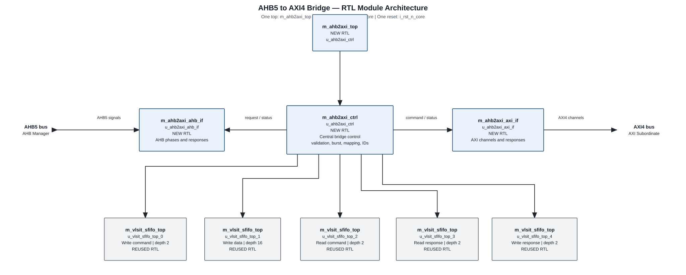

# AHB-to-AXI4 Bridge Design Specification

> **Purpose:** Normative product contract for the Full AHB5 Subordinate to AXI4 Manager bridge.
>
> Requirement terms: **shall** = mandatory and testable; **should** = recommended; **may** = optional.

## Document map

1. [Purpose, scope, and product context](#1-purpose-scope-and-product-context)
2. [Normative references and precedence](#2-normative-references-and-precedence)
3. [Requirements and traceability](#3-requirements-and-traceability)
4. [Features and configurations](#4-features-and-configurations)
5. [Architecture](#5-architecture)
6. [External interfaces and ports](#6-external-interfaces-and-ports)
7. [Clock, reset, and power](#7-clock-reset-and-power)
8. [Parameters and elaboration configurations](#8-parameters-and-elaboration-configurations)
9. [Data representation and arithmetic](#9-data-representation-and-arithmetic)
10. [Detailed functional behavior](#10-detailed-functional-behavior)
11. [Register and programming model](#11-register-and-programming-model)
12. [Error handling and recovery](#12-error-handling-and-recovery)
13. [Performance, power, and area](#13-performance-power-and-area)
14. [RTL implementation contract](#14-rtl-implementation-contract)
15. [Verification specification](#15-verification-specification)
16. [DFT and testability](#16-dft-and-testability)
17. [Physical design and timing integration](#17-physical-design-and-timing-integration)
18. [Security, safety, and reliability](#18-security-safety-and-reliability)
19. [Requirement-to-verification traceability](#19-requirement-to-verification-traceability)
20. [Assumptions, dependencies, and decisions](#20-assumptions-dependencies-and-decisions)
21. [Glossary](#21-glossary)
22. [References used to shape this template](#22-references-used-to-shape-this-template)

## 1. Purpose, scope, and product context

### 1.1 Purpose and scope

The IP converts Full AHB5 Subordinate transfers to AXI4 Manager transactions in one synchronous clock domain. Both protocol interfaces use the same physical clock input, `i_clk_core`, and the bridge has one active-low reset input, `i_rst_n_core`. AHB HCLK and AXI ACLK are protocol names only; both timing references map to this shared clock. Reads are serialized and never speculative. Eligible bufferable Normal Write-back AHB write bursts may be aggregated into AXI4 bursts of up to 16 beats; Device writes are never merged.

**Included:**

- Full AHB5 Subordinate profile based on Arm IHI 0033 Version C, with 32-bit address/data, HPROT[6:0], HNONSEC, HMASTLOCK and HWSTRB. AHB USER sidebands are outside scope and are not exposed.
- AXI4 Manager profile based on Arm IHI 0022 Issue H.c, with 32-bit address/data and 3-bit IDs.
- Five synchronous FIFOs for write command/data, read command, read response and write response buffering. Their write/read clock and reset pins are tied to the shared clock and reset.
- One structural top module, `m_ahb2axi_top`, with a fixed AHB/AXI port list and no USER sideband ports.
- Fixed AHB single transfers and undefined-length INCR are converted to AXI single-beat transactions. Reads always use AXI single-beat transactions.
- Eligible bufferable Normal Write-back fixed write bursts (INCR4/8/16 and WRAP4/8/16) may be aggregated into AXI bursts. Device-E, attribute-mismatched, non-bufferable and incomplete bursts use ordered AXI single-beat writes.

**Excluded:**

- AHB exclusive transfers, AXI exclusive accesses, AHB HMASTER/HEXCL and AXI exclusive response handling.
- AXI5, AXI3, AXI4-Lite, width conversion, endian conversion, address translation, address decode, reordering, QoS/Region, parity, timeout generation, interrupt outputs and software-visible registers.
- AHB/AXI USER sideband ports and their pass-through mapping. Speculative reads, multiple outstanding transactions per direction, AXI write posting beyond the active AHB burst, and any guarantee on external AXI response latency.

### 1.2 Deployment assumptions

| Item | Specification |
|---|---|
| Target SoC / product class | Generic ASIC system bridge. |
| Technology / library assumptions | Standard-cell implementation; synchronous FIFO storage may map to registers or an approved single-clock memory macro. No ASIC area result is available. |
| Operating clock | One shared rising-edge clock, `i_clk_core`; frequency is TBD by SoC integration. |
| Reset | One shared active-low reset, `i_rst_n_core`. The SoC reset source synchronizes deassertion to `i_clk_core` before the reset reaches the IP; the bridge adds no reset synchronizer. |
| Bus widths | AHB and AXI address = 32 bits; AHB and AXI data = 32 bits. |
| Security / privilege context | HNONSEC and HPROT attributes are translated as specified in §6.3; this IP is not an access-control boundary. |
| External dependencies | AHB manager/interconnect, AXI Subordinate, the shared clock/reset source and `002_SyncFIFO`. |

#### 1.3 Feature summary

| Feature ID | Feature | Required / optional | Configuration condition | Requirement IDs |
|---|---|---|---|---|
| FEAT-001 | Full AHB5 Subordinate to AXI4 Manager conversion | Required | `m_ahb2axi_top` | REQ-FUNC-001..006 |
| FEAT-002 | One shared synchronous clock and reset | Required | `m_ahb2axi_top` | REQ-CLK-001, REQ-RESET-001 |
| FEAT-003 | Strict no-speculation serialized reads | Required | `m_ahb2axi_top` | REQ-FUNC-003, REQ-PERF-002 |
| FEAT-004 | Conditional aggregation of bufferable Normal Write-back fixed writes up to 16 beats | Required | Bufferable Normal Write-back; full fixed burst; uniform AXI address attributes | REQ-FUNC-005/008/009, REQ-PERF-001 |
| FEAT-006 | Rotating AXI read/write IDs / Xoay ID AXI | Optional configuration | ID-count parameters 1..8; default 1 | REQ-PARAM-001 |
| FEAT-007 | AHB HWSTRB to AXI WSTRB | Required | The single top module | REQ-IF-001, REQ-FUNC-006 |
| FEAT-008 | Parity, exclusive and CSR functions | Not included | Disabled in this revision | DEC-PAR-001, DEC-EXCL-001, DEC-CSR-001 |

## 2. Normative references and precedence

### 2.1 Normative references

| Ref ID | Document and revision | Applicable clauses | Authority / notes |
|---|---|---|---|
| REF-001 | Arm AMBA AHB Protocol Specification, IHI 0033 Version C; local converted reference: `C:\HQuan\_tmp_vlsit_ahb_axi_bridge\local_skill\reference\md_doc\vlsit_amba_ahb_ihi0033c.md` | §§2.2–2.3, 3.1, 3.6–3.10, 5.1, 7, 8, 11, 12 | AHB protocol authority. The Arm AMBA licence applies; redistribution is not confirmed. Official source: https://support.arm.com/documentation/ihi0033/c/. |
| REF-002 | Arm AMBA AXI and ACE Protocol Specification, IHI 0022 Issue H.c; local converted reference: `C:\HQuan\_tmp_vlsit_ahb_axi_bridge\local_skill\reference\md_doc\vlsit_amba_axi_ihi0022hc.md` | Part A §§A2–A5, A7–A8 | AXI4 protocol authority. AXI4 clauses only; AXI5/ACE are out of scope. Arm AMBA licence applies; redistribution is not confirmed. Official source: https://support.arm.com/documentation/ihi0022/hc/. |
| REF-003 | VLSIT RTL Design Rules v2, `VLSIT_RTL_Generator_AI_Model/spec_template/VLSIT_RTL_Design_Rule.md` | Naming, hierarchy, single-clock, reset and synthesis rules | Mandatory RTL baseline selected by the designer. |
| REF-004 | Existing VLSIT `common_rtl/002_SyncFIFO/SyncFIFO_Design_Specification.md` | Synchronous FIFO interface, depth and reset behavior | Internal architectural dependency; both FIFO clock sides are tied to the shared bridge clock. |
| REF-005 | IEEE 1800-2017 SystemVerilog | Synthesizable subset | Subject to REF-003 and the selected synthesis frontend. |
| REF-006 | Designer decisions DEC-* in §20, dated 2026-10-25 | Product-specific profile and behavior | Authority for product choices that are not prescribed by the protocol standards. |

The local standards were converted from the user-approved official PDFs and passed the skill's page-word-count verification with zero pages over the 5% variance threshold. That check is not a word-for-word legal or semantic review. The licensed PDFs and converted Markdown remain outside this deliverable folder; do not copy or redistribute them.

### 2.2 Source-of-truth and conflict handling

1. REF-001 and REF-002 define protocol legality. This specification defines the selected bridge profile and product behavior.
2. User-approved decisions in §20 may restrict, but shall not contradict, legal protocol behavior.
3. REF-003 is the RTL coding, naming, hierarchy, single-clock and reset baseline. If an implementation choice conflicts with it, revise the implementation or record a reviewed exception before RTL generation.
4. HPROT-to-AXI attribute mapping in §6.3 is a product mapping selected by the designer, not a mapping mandated by Arm.
5. No reference RTL, patent claim or vendor performance figure is copied as a guaranteed property of this IP.

**Naming rule:** VLSIT default naming rule, VLSIT RTL Design Rules v2, section 2 and protocol naming section, path `VLSIT_RTL_Generator_AI_Model/spec_template/VLSIT_RTL_Design_Rule.md`, selected by the user (rule R-026, DEC-NAM-001). Module names use prefix `m_` followed by the function name; protocol ports use `i_ahb_*`, `o_ahb_*`, `i_axi_*`, `o_axi_*`; parameters use prefix `PARA_` followed by uppercase names; active-low reset names use prefix `i_rst_n_` followed by the clock domain; names are at most 30 characters.

### 2.3 Compliance declaration

| Standard | Revision / profile | Role implemented | Options | Deviations / limits |
|---|---|---|---|---|
| AMBA AHB | IHI 0033 Version C, Full AHB5 Subordinate profile | Subordinate | HPROT[6:0], HNONSEC, HMASTLOCK, HWSTRB; no USER ports | USER sidebands are not implemented; exclusive signals omitted; locked accesses return AHB ERROR; HPROT[6]=1 returns AHB ERROR. |
| AMBA AXI | IHI 0022 Issue H.c, AXI4 | Manager | 32-bit address/data, 3-bit IDs; no USER ports | USER sidebands are not implemented; no exclusive accesses, QoS or Region; one outstanding transaction per direction; reads are single-beat. |

## 3. Requirements and traceability

Each requirement is normative and independently verifiable. Verification shall be derived from this specification and REF-001/REF-002; generated RTL is not a specification oracle.

| ID | Requirement | Source | Applies to | Verification method |
|---|---|---|---|---|
| REQ-FUNC-001 | The bridge shall convert every supported AHB transfer accepted by this IP to AXI4 without loss, duplication or data alteration. | REF-001 §§3.1, 3.7; REF-002 §A3.2 | All | Independent AHB/AXI scoreboard; TEST-02..05 |
| REQ-FUNC-002 | AHB address/control shall be sampled only when `HSEL=1`, `HREADY=1`, and `HTRANS` is NONSEQ or SEQ; IDLE/BUSY shall not issue AXI requests. | REF-001 §§3.1, 3.6–3.7 | All | Protocol assertions and directed tests |
| REQ-FUNC-003 | Each accepted AHB read shall issue exactly one AXI single-beat AR transaction; no read request may be issued before its AHB address is accepted. | DEC-RD-001; REF-002 §§A3.2, A3.4 | All | Scoreboard; TEST-02; no-speculation assertion |
| REQ-FUNC-004 | AHB SINGLE and undefined-length INCR transfers, and every read beat, shall map to AXI single-beat transactions. | DEC-BURST-001; REF-001 §3.6; REF-002 §A3.4 | All | Burst mapping test; TEST-02/03 |
| REQ-FUNC-005 | A legal bufferable Normal Write-back fixed write burst of 4, 8 or 16 beats may map to a matching AXI burst only after all data beats are captured and all burst-scoped AXI address attributes are constant. Otherwise, the bridge shall issue ordered AXI single-beat writes. Non-bufferable writes shall use single-beat transactions. | DEC-BURST-001, DEC-BURST-003; REF-001 §§3.6, 3.8–3.9; REF-002 §§A3.4, A8.3 | Write | Attribute-variation and burst scoreboard; TEST-03/04/12 |
| REQ-FUNC-006 | AXI WDATA/WSTRB shall preserve each AHB HWDATA/HWSTRB beat, and WLAST shall identify the final beat of each AXI write transaction. | REF-001 §§2.2, 3.5; REF-002 §§A2.3, A3.4 | All writes | Assertions and byte-lane scoreboard |
| REQ-FUNC-007 | AHB responses shall remain in transfer order. For an aggregated or multi-single Normal Write-back bufferable burst, all B statuses shall be combined and any error reported on its terminal AHB beat; earlier beats may receive OKAY once safely buffered. | DEC-WERR-001; REF-001 §5.1; REF-002 §A3.4.5 | All writes | Error scoreboard; TEST-03/04/11 |
| REQ-FUNC-008 | Device memory transfers shall not be merged or have their size changed. Device-E writes shall use ordered AXI single-beat transactions and shall wait for each final-destination BRESP; no early AHB write response is allowed without a visibility guarantee. | REF-001 §3.9.4 | All Device transfers | Device-E and Device-nE tests; TEST-04/11 |
| REQ-FUNC-009 | An early-terminated AHB fixed write burst shall never produce an incomplete AXI burst. The bridge shall emit any captured but unissued accepted write beats as ordered AXI single-beat transactions without reissuing beats already sent, and hold the terminal AHB response until all corresponding B responses arrive; any non-OKAY status shall be reported on that terminal response. | REF-001 §3.6.2; DEC-BURST-003 | Write | Early-termination scoreboard; TEST-11 |
| REQ-FUNC-010 | No AXI burst shall cross a 4 KiB boundary. If defensive splitting is needed, the bridge shall preserve beat order and aggregate all sub-burst responses onto the final AHB beat. | DEC-BURST-002; REF-002 §A3.4 | Aggregated writes | Boundary and response aggregation checks; TEST-08 |
| REQ-IF-001 | The single top module `m_ahb2axi_top` shall expose exactly the fixed clock, reset, AHB and AXI ports listed in §6.2. AHB/AXI USER sideband and zero-width optional ports shall not be present. | DEC-SIDE-001; REF-003 PRT-03 | Single top | Elaborated port-list review; TEST-06 |
| REQ-CLK-001 | The AHB and AXI interfaces shall use the same rising-edge clock input, `i_clk_core`; no second clock port or clock-domain crossing is permitted. | DEC-CLK-001 | All | Port review and single-clock timing checks; TEST-01 |
| REQ-RESET-001 | The bridge shall expose one active-low reset input, `i_rst_n_core`. The SoC reset source shall synchronize deassertion to `i_clk_core` before the input reaches the IP; the bridge shall use the input directly and shall not contain an internal reset synchronizer. Reset shall clear all bridge/FIFO valid state; no pre-reset response may be returned after release. | DEC-RST-001; REF-001 §7; REF-004 reset contract | All | Reset checks; TEST-01 |
| REQ-ERR-001 | AXI OKAY shall map to AHB OKAY. SLVERR, DECERR and unexpected EXOKAY shall map to the AHB two-cycle ERROR response. | DEC-ERR-001; REF-001 §5.1; REF-002 §A3.4.5 | All | TEST-02..05 |
| REQ-ERR-002 | HMASTLOCK, HPROT[6]=1, reserved/unsupported HPROT combinations, unsupported HSIZE and misaligned transfers shall return two-cycle AHB ERROR; no AXI request shall be issued for the rejected transfer. | DEC-EXCL-001, DEC-HPROT-001, ASM-ERR-001; REF-001 §§3.8–3.9, 5.1 | All | TEST-05 and negative protocol tests |
| REQ-PARAM-001 | Read and write ID-count parameters shall be 1..8; each direction shall rotate IDs through 0..count−1 after each completed AXI transaction. ID rotation shall not imply multiple outstanding requests. | DEC-ID-001; REF-002 §A5.1 | All | Parameter elaboration and ID scoreboard |
| REQ-PERF-001 | For eligible Normal Write-back fixed write bursts, the bridge may accept one AHB beat per `i_clk_core` cycle while buffer capacity is available; terminal completion waits for all required BRESPs. | DEC-PERF-001 | Bufferable fixed writes | Throughput test under bounded response model |
| REQ-PERF-002 | A single read or single-beat AHB write address request shall meet ≤6 `i_clk_core` cycles from accepted AHB address to AR/AW handshake when the synchronous queue has space and the corresponding AXI READY remains high. For fixed-length writes, the AW timing target starts after the full burst or its early termination has been captured. | DEC-PERF-002 | Conditional | Timestamped latency tests |
| REQ-PERF-003 | The bridge shall not guarantee a bound for full transaction completion, AXI response latency, or traffic under external READY/response stalls. | DEC-TIMEOUT-001 | All | Review and unbounded-stall tests |
| REQ-RTL-001 | RTL shall follow REF-003; the single top module shall contain only structural instances, and each module shall be in a same-named file. | REF-003 HIE-02, HIE-04 | RTL deliverable | RTL rule checker and hierarchy inspection |
| REQ-REG-001 | The IP shall have no software-visible CSR interface; all configuration is static at elaboration. | DEC-CSR-001 | All | Port-list and register review |
| REQ-VER-001 | Verification shall use this specification and REF-001/REF-002 as the golden sources, not internal RTL names or implementation structure. | Designer workflow requirement | All | Review of testbench source and traceability |

## 4. Features and configurations

| Configuration ID | Top module | Port profile | ID configuration | Verification target |
|---|---|---|---|---|
| CFG-BASE | `m_ahb2axi_top` | Fixed AHB5/AXI4 ports; no USER sidebands | `PARA_RD_ID_COUNT=1`, `PARA_WR_ID_COUNT=1` by default | Full functional regression |

`m_ahb2axi_top` is the only supported top. It has one fixed port list. No USER-width parameters or optional USER port profile are defined. Parameters outside their legal ranges are elaboration errors.

## 5. Architecture

### 5.1 Overview and block responsibilities

The bridge has one supported top module, `m_ahb2axi_top`, which instantiates `u_ahb2axi_ctrl`. The design adds three functional RTL modules: `m_ahb2axi_ahb_if` handles the AHB protocol boundary, `m_ahb2axi_ctrl` controls transfers between the protocol interfaces, and `m_ahb2axi_axi_if` is a combinational AXI protocol adapter. The controller validates and schedules transfers, maps attributes, assembles eligible write bursts, rotates IDs, and coordinates the synchronous queues. It instantiates one AHB interface module, one AXI interface module, and five reused FIFO instances. All sequential logic and FIFO clock/reset pins use the shared `i_clk_core` and `i_rst_n_core`; the combinational AXI adapter uses the reset only to suppress VALID/READY during reset. The SoC synchronizes reset deassertion before it reaches the IP. The top port list contains no AHB or AXI USER sidebands.

| Module | Responsibility | Clock/reset | State or storage |
|---|---|---|---|
| `m_ahb2axi_ahb_if` | Captures AHB address/control and corresponding data phases; generates AHB wait, completion and error responses; exchanges normalized requests and status with the controller. | `i_clk_core` / `i_rst_n_core` | AHB phase and response state |
| `m_ahb2axi_ctrl` | Central control module between AHB and AXI interfaces. Validates transfers, schedules requests, maps attributes, assembles eligible write bursts, rotates IDs and coordinates all five FIFOs. | `i_clk_core` / `i_rst_n_core` | Bridge control state and five FIFO instances |
| `m_ahb2axi_axi_if` | Combinationally maps controller requests and AXI channels; reset gates VALID/READY. | `i_rst_n_core` only; no state | None |
| `m_vlsit_sfifo_top` × 5 | Reused synchronous queues for write command/data, read command, read response and write response. | Both FIFO clock/reset sides tie to the shared inputs | FIFO storage and pointers |
| `m_ahb2axi_top` | The single structural top module; connects the fixed AHB/AXI ports to `u_ahb2axi_ctrl`. | `i_clk_core` / `i_rst_n_core` | No pure RTL state |

The hierarchy is: the single top module `m_ahb2axi_top` → `u_ahb2axi_ctrl` → `u_ahb2axi_ahb_if`, `u_ahb2axi_axi_if`, and five FIFO instances. FIFO depths are 2, 16, 2, 2 and 2 entries, respectively. Both clock pins of each FIFO connect to `i_clk_core`, both hardware-reset pins connect to `i_rst_n_core`, and its software-reset input is held inactive. The design has no clock-domain crossing or CDC synchronizer.

### 5.2 Block diagram

The diagram shows the single top module, three functional modules, their internal request/response links and each reused synchronous FIFO instance. The control module sits between the AHB and AXI interface modules. Solid-outline blocks marked **NEW RTL** are modules to write for this IP; gray blocks marked **REUSED RTL** are instances of `m_vlsit_sfifo_top` from `common_rtl/002_SyncFIFO`. The hierarchy and layout are editable in [`figures/vlsit_block_diagram.json`](figures/vlsit_block_diagram.json).

### 5.3 Transaction and dataflow

**Read:** accept the AHB address phase on `i_clk_core` → enqueue one read descriptor → issue `ARLEN=0`, `ARBURST=INCR` → accept one R beat (`RLAST=1`) → return HRDATA and HRESP in the AHB data phase. No next AHB read is accepted while the current read is unresolved.

**Write single / undefined INCR / non-bufferable fixed burst:** capture the AHB beat → issue one AXI write (`AWLEN=0`, one W beat, `WLAST=1`) → wait for B response → return AHB completion/error. Fixed non-bufferable bursts are serialized beat by beat.

**Eligible Normal Write-back fixed write burst:** collect all 4/8/16 AHB address/data beats in order. If all AXI address attributes are constant, emit one matching INCR/WRAP AXI burst; otherwise emit ordered AXI single-beat writes. Keep Device-E and non-bufferable writes as singles. Earlier safely buffered Normal Write-back beats may complete OKAY; the terminal AHB beat waits for the required B response(s).

### 5.4 Invariants

- Both AHB and AXI interface signals are sampled or driven relative to the rising edge of the one physical clock `i_clk_core`.
- The design has one clock input and one active-low reset input; no second clock or reset pin is exposed.
- No AXI read address is issued before its corresponding AHB read address is accepted.
- AHB and AXI transaction order is preserved; there is no read speculation or response reordering.
- AXI `VALID` and payload remain stable until `READY` handshake.
- An AXI burst is issued only when the complete AHB fixed write burst has been captured.
- At most one read and one write transaction are outstanding; the chosen control policy does not allow a later AHB transaction to pass a stalled response.
- `WLAST` is high exactly on the final AXI W beat; read `ARLEN` is always zero and expected `RLAST` is one.
- All five FIFO clock and reset inputs are tied to the common bridge clock and reset. There is no CDC path.

## 6. External interfaces and ports

### 6.1 Interface inventory

| Interface ID | Type and revision | Role | Direction at IP boundary | Clock/reset | Required / optional | Configurations |
|---|---|---|---|---|---|---|
| IF-001 | AHB5, IHI 0033 Version C | Subordinate | AHB manager → bridge; bridge → AHB manager | `i_clk_core`, `i_rst_n_core` | Required | CFG-BASE |
| IF-002 | AXI4, IHI 0022 Issue H.c | Manager | Bridge → AXI Subordinate; AXI Subordinate → bridge | `i_clk_core`, `i_rst_n_core` | Required | CFG-BASE |
| IF-003 | Shared reset | Active-low | Reset controller → bridge | One reset; asynchronous assert and SoC-synchronized release before the IP boundary | Required | CFG-BASE |

### 6.2 Complete port list

Signal type uses the VLSIT meanings: Clock, Reset, Level, Pulse, Data (valid with qualifier), or Static. Both AHB and AXI interface signals use the rising edge of `i_clk_core`; `i_rst_n_core` is the only reset input.

#### Shared clock and reset
AHB HCLK and AXI ACLK in their respective standards both map to `i_clk_core`; no separate protocol clock pins are exposed.

#### Consolidated port list

No AHB or AXI USER sideband ports are implemented in this IP.

| Port | Direction | Width | Meaning (function) | Clock domain | Signal type | Reset / idle value | Timing / sampling | Configurations |
|---|---|---:|---|---|---|---|---|---|
| `i_clk_core` | Input | 1 | Shared AHB/AXI clock | CLK-CORE | Clock | Not applicable: clock has no reset value | Rising edge | CFG-BASE |
| `i_rst_n_core` | Input | 1 | Shared active-low bridge reset | CLK-CORE | Reset | 1 after release | Asynchronous assertion; SoC-synchronized deassertion before the IP boundary | CFG-BASE |
| `i_ahb_hsel` | Input | 1 | Selects this Subordinate | CLK-CORE | Level | 0 | Address phase | CFG-BASE |
| `i_ahb_hready` | Input | 1 | Global AHB ready qualifier | CLK-CORE | Level | Ignored during bridge reset; externally unconstrained | Address-phase acceptance qualifier | CFG-BASE |
| `i_ahb_haddr` | Input | 32 | Byte address | CLK-CORE | Data (valid with `HSEL && HREADY && HTRANS[1]`) | Not applicable: no reset/idle value is defined | Address phase | CFG-BASE |
| `i_ahb_htrans` | Input | 2 | IDLE/BUSY/NONSEQ/SEQ transfer type | CLK-CORE | Data (valid with `HSEL && HREADY`) | IDLE | Address phase | CFG-BASE |
| `i_ahb_hwrite` | Input | 1 | 1=write, 0=read | CLK-CORE | Data (valid with address phase) | 0 | Address phase | CFG-BASE |
| `i_ahb_hsize` | Input | 3 | Transfer size encoding | CLK-CORE | Data (valid with address phase) | Not applicable: no reset/idle value is defined | Address phase | CFG-BASE |
| `i_ahb_hburst` | Input | 3 | AHB burst type | CLK-CORE | Data (valid with address phase) | SINGLE | Address phase | CFG-BASE |
| `i_ahb_hprot` | Input | 7 | Protection, memory and shareability attributes | CLK-CORE | Data (valid with address phase) | Not applicable: no reset/idle value is defined | Address phase | CFG-BASE |
| `i_ahb_hnonsec` | Input | 1 | 1=Non-secure / 1=Non-secure | CLK-CORE | Data (valid with address phase) | Not applicable: no reset/idle value is defined | Address phase | CFG-BASE |
| `i_ahb_hmastlock` | Input | 1 | Locked transfer indicator | CLK-CORE | Data (valid with address phase) | 0 | Address phase | CFG-BASE |
| `i_ahb_hwdata` | Input | 32 | Write data | CLK-CORE | Data (valid with accepted write data phase) | Not applicable: no reset/idle value is defined | Data phase | CFG-BASE |
| `i_ahb_hwstrb` | Input | 4 | Byte write strobes / Strobe ghi theo byte | CLK-CORE | Data (valid with `HWDATA`) | Not applicable: no reset/idle value is defined | Data phase | CFG-BASE |
| `o_ahb_hreadyout` | Output | 1 | Completes or extends current AHB transfer | CLK-CORE | Level | 1 during reset | Sampled by AHB interconnect | CFG-BASE |
| `o_ahb_hresp` | Output | 1 | 0=OKAY, 1=ERROR / 0=OKAY, 1=ERROR | CLK-CORE | Level | 0 | Valid with AHB response phase; ERROR follows two-cycle response | CFG-BASE |
| `o_ahb_hrdata` | Output | 32 | Read data | CLK-CORE | Data (valid with completed read response) | 0 | AHB response phase | CFG-BASE |
| `o_axi_awid` | Output | 3 | Write transaction ID | CLK-CORE | Data (valid with AWVALID) | 0 | AW handshake | CFG-BASE |
| `o_axi_awaddr` | Output | 32 | Write start byte address | CLK-CORE | Data (valid with AWVALID) | 0 | AW handshake | CFG-BASE |
| `o_axi_awlen` | Output | 8 | Write burst beats minus one | CLK-CORE | Data (valid with AWVALID) | 0 | AW handshake | CFG-BASE |
| `o_axi_awsize` | Output | 3 | Bytes per beat encoding | CLK-CORE | Data (valid with AWVALID) | 0 | AW handshake | CFG-BASE |
| `o_axi_awburst` | Output | 2 | AXI FIXED/INCR/WRAP encoding | CLK-CORE | Data (valid with AWVALID) | INCR | AW handshake | CFG-BASE |
| `o_axi_awlock` | Output | 1 | Exclusive lock; tied low | CLK-CORE | Static | 0 | Constant | CFG-BASE |
| `o_axi_awcache` | Output | 4 | Write memory attributes translated from HPROT | CLK-CORE | Data (valid with AWVALID) | 0 | AW handshake | CFG-BASE |
| `o_axi_awprot` | Output | 3 | Write protection/security/type | CLK-CORE | Data (valid with AWVALID) | 0 | AW handshake | CFG-BASE |
| `o_axi_awvalid` | Output | 1 | Write address valid | CLK-CORE | Level | 0 | Hold until AWREADY | CFG-BASE |
| `i_axi_awready` | Input | 1 | Write address ready | CLK-CORE | Level | Ignored during bridge reset; externally unconstrained | AW handshake | CFG-BASE |
| `o_axi_wdata` | Output | 32 | Write data | CLK-CORE | Data (valid with WVALID) | 0 | Hold until WREADY | CFG-BASE |
| `o_axi_wstrb` | Output | 4 | Write byte strobes / Strobe byte ghi | CLK-CORE | Data (valid with WVALID) | 0 | Hold until WREADY | CFG-BASE |
| `o_axi_wlast` | Output | 1 | Last write beat | CLK-CORE | Data (valid with WVALID) | 0 | High only on final burst beat | CFG-BASE |
| `o_axi_wvalid` | Output | 1 | Write data valid | CLK-CORE | Level | 0 | Hold until WREADY | CFG-BASE |
| `i_axi_wready` | Input | 1 | Write data ready | CLK-CORE | Level | Ignored during bridge reset; externally unconstrained | W handshake | CFG-BASE |
| `i_axi_bid` | Input | 3 | Write response transaction ID / ID response ghi | CLK-CORE | Data (valid with BVALID) | Not applicable: no reset/idle value is defined | B handshake | CFG-BASE |
| `i_axi_bresp` | Input | 2 | Write response status | CLK-CORE | Data (valid with BVALID) | Not applicable: no reset/idle value is defined | B handshake | CFG-BASE |
| `i_axi_bvalid` | Input | 1 | Write response valid | CLK-CORE | Level | 0 during reset | Hold until BREADY | CFG-BASE |
| `o_axi_bready` | Output | 1 | Write response ready | CLK-CORE | Level | 0 | B handshake | CFG-BASE |
| `o_axi_arid` | Output | 3 | Read transaction ID | CLK-CORE | Data (valid with ARVALID) | 0 | AR handshake | CFG-BASE |
| `o_axi_araddr` | Output | 32 | Read byte address | CLK-CORE | Data (valid with ARVALID) | 0 | AR handshake | CFG-BASE |
| `o_axi_arlen` | Output | 8 | Read burst beats minus one; always zero | CLK-CORE | Data (valid with ARVALID) | 0 | AR handshake | CFG-BASE |
| `o_axi_arsize` | Output | 3 | Bytes per beat encoding | CLK-CORE | Data (valid with ARVALID) | 0 | AR handshake | CFG-BASE |
| `o_axi_arburst` | Output | 2 | Read burst type; INCR | CLK-CORE | Data (valid with ARVALID) | INCR | AR handshake | CFG-BASE |
| `o_axi_arlock` | Output | 1 | Exclusive lock; tied low | CLK-CORE | Static | 0 | Constant | CFG-BASE |
| `o_axi_arcache` | Output | 4 | Read memory attributes translated from HPROT | CLK-CORE | Data (valid with ARVALID) | 0 | AR handshake | CFG-BASE |
| `o_axi_arprot` | Output | 3 | Read protection/security/type | CLK-CORE | Data (valid with ARVALID) | 0 | AR handshake | CFG-BASE |
| `o_axi_arvalid` | Output | 1 | Read address valid | CLK-CORE | Level | 0 | Hold until ARREADY | CFG-BASE |
| `i_axi_arready` | Input | 1 | Read address ready | CLK-CORE | Level | Ignored during bridge reset; externally unconstrained | AR handshake | CFG-BASE |
| `i_axi_rid` | Input | 3 | Read response ID | CLK-CORE | Data (valid with RVALID) | Not applicable: no reset/idle value is defined | R handshake | CFG-BASE |
| `i_axi_rdata` | Input | 32 | Read data | CLK-CORE | Data (valid with RVALID) | Not applicable: no reset/idle value is defined | R handshake | CFG-BASE |
| `i_axi_rresp` | Input | 2 | Read response status | CLK-CORE | Data (valid with RVALID) | Not applicable: no reset/idle value is defined | R handshake | CFG-BASE |
| `i_axi_rlast` | Input | 1 | Final read beat | CLK-CORE | Data (valid with RVALID) | Not applicable: no reset/idle value is defined | Expected high for each single-beat read | CFG-BASE |
| `i_axi_rvalid` | Input | 1 | Read data valid | CLK-CORE | Level | 0 during reset | Hold until RREADY | CFG-BASE |
| `o_axi_rready` | Output | 1 | Read data ready | CLK-CORE | Level | 0 | R handshake | CFG-BASE |

### 6.3 Protocol behavior

#### AHB5 acceptance and supported profile

- A transfer is accepted at a rising `i_clk_core` edge when HSEL, HREADY and HTRANS[1] are all 1. Address/control are taken from the address phase; HWDATA/HWSTRB belong to the corresponding data phase. BUSY and IDLE do not create AXI traffic.
- Supported HSIZE encodings are byte, halfword and word (0, 1, 2). Transfer addresses shall be naturally aligned to HSIZE. HSIZE > 2, misaligned accesses, reserved HBURST values and unsupported/reserved HPROT memory-type encodings return AHB ERROR with no AXI request for the rejected transfer; any earlier accepted write prefix is drained under REQ-FUNC-009.
- AHB SINGLE and undefined INCR are converted to AXI single-beat INCR transactions. Fixed INCR4/8/16 and WRAP4/8/16 reads still issue single-beat AR requests.
- Aggregation is limited to complete legal Normal Write-back fixed write bursts with constant AXI address attributes. Device writes are never merged. If an AHB fixed burst terminates early, drain captured but unissued beats as ordered AXI singles without reissuing beats already sent; never send a short AXI burst in place of the AHB burst.
- AHB managers must not start an incrementing burst that crosses a 1 KiB boundary (REF-001 §3.6). The bridge additionally keeps every AXI burst within a 4 KiB boundary (REF-002 §A3.4). The approved 4 KiB split is defensive behavior for an out-of-profile address sequence; it does not make an AHB 1 KiB-crossing burst protocol-compliant.
- HPROT remains constant throughout an AHB burst (REF-001 §3.8). If a burst-scoped AXI address attribute differs between accepted beats, the bridge uses ordered AXI singles. Fixed-length AHB bursts may end early after an error or interconnect termination; any captured but unissued accepted write prefix is drained as AXI singles without reissuing beats already sent; no incomplete AXI burst is issued (REF-001 §3.6.2).
- The bridge issues no exclusive requests. HMASTLOCK=1 is rejected with AHB ERROR; HEXCL, HMASTER and HEXOKAY are not ports.

#### AXI4 channel contract

- AXI4 VALID and payload shall remain stable until READY handshakes. AXI outputs have no combinational dependency on AXI READY.
- At most one read and one write transaction may be outstanding. Reads are single-beat (`ARLEN=0`, `ARBURST=INCR`, `RLAST=1`). Writes are single-beat or fixed bursts up to 16 beats.
- AXI ID width is 3 bits. Each direction uses its configured count and rotates through IDs `0..count-1` after each completed AXI transaction. Count >1 does not enable concurrent transactions.
- AXI response latency is unbounded by this IP. If R or B response is not returned, the related AHB operation remains pending indefinitely.

#### HPROT mapping

The following is the approved bridge-specific mapping. It is not an Arm-prescribed 1:1 mapping. USER sidebands are not implemented. HPROT[6]=1 (Shareable) and reserved/unsupported memory-type combinations are rejected for that transfer before issuing its AXI request.

| AHB input | AXI output | Mapping |
|---|---|---|
| HPROT[1] | AxPROT[0] | Pass-through privileged attribute |
| HNONSEC | AxPROT[1] | Pass-through; 1 means Non-secure |
| HPROT[0] | AxPROT[2] | Invert; AxPROT[2]=~HPROT[0] |
| HPROT[3] | AxCACHE[1] | Modifiable / Modifiable |
| HPROT[2] | AxCACHE[0] | Bufferable / Bufferable |
| HPROT[4]=0 | AxCACHE[3:2] | `00` (no lookup allocation) / `00` |
| HPROT[4]=1, HPROT[5]=1 | Read AxCACHE[2]; write AxCACHE[3] | Direction-specific Allocate |
| HPROT[4]=1, HPROT[5]=0 | Read AxCACHE[3]; write AxCACHE[2] | Direction-specific Other-Allocate |
| HPROT[6] | Not applicable: rejected with no AXI field mapping | If 1, return AHB ERROR; no AXI request |

Supported HPROT[6:2] patterns for this profile are listed below. HPROT[6]=1 is rejected by the selected product policy; every unlisted pattern is reserved and returns AHB ERROR.

| HPROT[6:2] | AHB5 memory type | Bridge behavior |
|---|---|---|
| `0b0_0000` | Device-nE | One AXI single per transfer; wait for final-destination BRESP |
| `0b0_0001` | Device-E | Never merge; one AXI single per beat; wait for final-destination BRESP |
| `0b0_0010` | Normal Non-cacheable, Non-shareable | Single-beat writes; no burst aggregation |
| `0b0_x110` | Write-through, Non-shareable | Single-beat writes; no burst aggregation |
| `0b0_x111` | Write-back, Non-shareable | Eligible bufferable fixed bursts may aggregate if AXI address attributes are constant |

#### Protocol cases

| Case | Legal behavior | Unsupported | IP response | Requirement |
|---|---|---|---|---|
| AHB read | Single accepted address; return one AXI R beat | Speculative or multi-beat AXI read | AHB waits for R; map RRESP | REQ-FUNC-003 |
| AHB single/INCR write | One AHB beat to one AXI single | Undefined-length AXI aggregation | Wait for BRESP | REQ-FUNC-004 |
| Eligible Normal Write-back fixed write | Full 4/8/16-beat burst; one AXI burst only if address attributes are uniform | Device-E, varying address attributes or incomplete burst | Bufferable early OKAY for prior beats; terminal HRESP reflects final B status | REQ-FUNC-005/007/008/009 |
| Device-E or non-bufferable fixed write | One AXI single per AHB beat | AXI burst merging | Wait for each BRESP; Device-E response comes from final destination | REQ-FUNC-005/008 |
| HMASTLOCK or HPROT shareable | No AXI request for the rejected transfer | Locked/shareable traffic | Two-cycle AHB ERROR; drain any previously accepted write prefix | REQ-ERR-002/009 |
| AXI R/B status | Accept valid response | EXOKAY is unexpected without exclusives | Non-OKAY maps to AHB ERROR | REQ-ERR-001 |

### 6.4 Interrupts and events

**Assumption:** no interrupt or event output is included; supported errors are returned on the AHB response channel. Impact: the IP has no out-of-band error notification.

## 7. Clock, reset, and power

### 7.1 Shared clock

| Domain | Physical port | Edge | Frequency target | Relationship | Gating |
|---|---|---|---|---|---|
| CLK-CORE | `i_clk_core` | Rising | TBD by SoC integration | Shared by AHB, AXI and all FIFO instances | No internal clock gating |

AHB HCLK and AXI ACLK are protocol signal names in their standards. At this IP boundary both use the same physical `i_clk_core` input. The clock period is TBD; no absolute time target is implied by the cycle-based latency requirement.

### 7.2 Clock-domain crossing

There is one clock domain, CLK-CORE. The bridge contains no asynchronous crossing, synchronizer chain, Gray pointer or CDC FIFO. Each `m_vlsit_sfifo_top` write/read clock input is tied to `i_clk_core`; its two reset inputs are tied to `i_rst_n_core`. All paths between bridge logic and FIFO pointers are ordinary single-clock timed paths.

### 7.3 Shared reset and sequencing

| Reset ID | Port | Polarity / assertion | Scope | Deassertion | Reset values |
|---|---|---|---|---|---|
| RST-CORE | `i_rst_n_core` | Active-low, asynchronous assertion | All bridge logic and all five FIFOs | SoC source synchronizes deassertion to `i_clk_core` before the IP boundary; no internal synchronizer | HREADYOUT=1; HRESP=OKAY; AW/W/ARVALID=0; BREADY/RREADY=0; FIFO valid state cleared |

The system provides one reset net to both protocol sides and all FIFOs. The SoC reset source asserts it asynchronously and synchronizes deassertion to `i_clk_core` before it reaches the IP. The RTL uses `i_rst_n_core` directly and contains no reset synchronizer. No transaction is accepted until reset release. Reset discards bridge-buffered commands/data and responses in flight; the system shall reset the connected AXI endpoint/interconnect consistently so a stale response cannot be mistaken for a new transaction.

### 7.4 Power intent (if applicable)

**N/A:** no power gating, retention, isolation, Q-channel or dynamic power-state interface is included. Clock/reset/power intent is owned by the SoC integrator.

## 8. Parameters and elaboration configurations

| Parameter | Purpose | Default | Legal range | Dependency and impact |
|---|---|---:|---|---|
| `PARA_RD_ID_COUNT` | Number of read IDs in rotation | 1 | 1..8 | ID width remains 3; count does not increase outstanding capacity |
| `PARA_WR_ID_COUNT` | Number of write IDs in rotation | 1 | 1..8 | ID width remains 3; count does not increase outstanding capacity |

No USER sideband or USER-width parameters are defined. AXI address/data/ID widths, FIFO depths and protocol features are not user-overridable in this revision. Internal FIFO depths are fixed by §5.1.

**VLSIT parameter comment contract:** immediately above each RTL parameter, use `// Parameter Description: ...`, `// Parameter values: ...`, and `// Parameter unit: ...` in that order.

## 9. Data representation and arithmetic

| Item | Definition |
|---|---|
| Address | 32-bit byte address; AXI address equals the corresponding accepted AHB address. |
| Data | AHB HWDATA and AXI WDATA are 32 bits; AHB HRDATA and AXI RDATA are 32 bits. The bridge does not byte-swap. |
| Transfer size | HSIZE/AxSIZE 0=1 byte, 1=2 bytes, 2=4 bytes. Larger sizes are rejected. |
| Byte lanes | HWSTRB[n] and WSTRB[n] qualify HWDATA/WDATA byte `[8n+7:8n]`; strobe is passed per beat. |
| Endianness | No endian conversion. Endianness interpretation belongs to the connected system. |
| Burst length | AXI LEN is beat count minus one. Single-beat LEN=0; aggregated write burst LEN is 3, 7 or 15 before boundary split. |
| ID | Unsigned 3-bit value; each direction rotates independently through the configured count. |

All payload is transported as bit vectors. No signed arithmetic or numeric scaling is defined.

## 10. Detailed functional behavior

### 10.1 Modes and state transitions

The specification defines externally observable phases, not RTL state encodings. The bridge progresses through reset hold, idle/accept, read pending, write capture, AXI issue/data, response wait, and AHB completion/error. An eligible fixed Normal Write-back write may remain in capture until all expected beats are received; a terminated burst drains its captured prefix as AXI singles. Illegal AHB controls enter the two-cycle AHB ERROR response without AXI issue.

### 10.2 Operations

| Operation ID | Trigger | AXI action | AHB completion |
|---|---|---|---|
| OP-READ-SINGLE | Accepted read, any HBURST | One AR, ARLEN=0; one R beat | HRDATA with HRESP derived from RRESP |
| OP-WR-SINGLE | SINGLE, undefined INCR beat, Device-E beat, or non-bufferable fixed-burst beat | One AWLEN=0, one W beat, WLAST=1 | Wait for BRESP; map the response to that AHB transfer |
| OP-WR-BURST | Complete eligible bufferable Normal Write-back INCR4/8/16 or WRAP4/8/16 burst with uniform address attributes | One AW/W burst up to 16 beats; 4 KiB split if needed | Earlier accepted beats may return OKAY; terminal beat waits for all corresponding BRESPs |
| OP-WR-FALLBACK | Normal Write-back fixed burst with varying AXI address attributes, or captured unissued prefix of an early-terminated fixed write | Ordered AXI singles for remaining captured beats; do not reissue completed beats | Aggregate relevant B errors to the terminal AHB beat |
| OP-ERR-LOCAL | Unsupported lock/attribute/size/alignment/encoding | No AXI request | Two-cycle AHB ERROR |
| OP-RESET | Assert the single shared reset `i_rst_n_core` | Drop in-flight queues and VALID state | HREADYOUT=1 during reset; no stale response after the AXI endpoint/interconnect is reset consistently |

### 10.3 Cycle-level behavior

Cycle detail is shown in the six waveforms below. The user approved this set on 2026-10-25. Every waveform uses the shared rising-edge clock `i_clk_core` and the single reset `i_rst_n_core`; edge positions are illustrative, not an absolute timing guarantee.

| Waveform ID | Function / operation | Scenario | Signals shown | Figure and source | Confirmed by user |
|---|---|---|---|---|---|
| WF-001 | Shared reset and synchronous startup | One shared clock/reset; traffic begins only after reset release | `i_clk_core`, `i_rst_n_core`, HREADYOUT, ARVALID/READY | [SVG](figures/wf001_shared_reset.svg), [JSON](figures/wf001_shared_reset.json) | Yes, 2026-10-25 |
| WF-002 | Serialized single read | ARREADY stalls; RRESP=SLVERR returns AHB ERROR | HTRANS, HREADYOUT, ARVALID/READY, RVALID/READY, RRESP, HRESP | [SVG](figures/wf002_read_error.svg), [JSON](figures/wf002_read_error.json) | Yes, 2026-10-25 |
| WF-003 | Normal Write-back bufferable fixed write burst | INCR4, sparse HWSTRB, final BRESP=SLVERR reported on final AHB beat | HADDR/HTRANS, HWDATA/HWSTRB, AW, W/WLAST, B, HRESP | [SVG](figures/wf003_bufferable_burst.svg), [JSON](figures/wf003_bufferable_burst.json) | Yes, 2026-10-25 |
| WF-004 | Non-bufferable write | Single-beat AXI write waits for BRESP before AHB completion | HPROT, HREADYOUT, AW, W, B, HRESP | [SVG](figures/wf004_nonbufferable_write.svg), [JSON](figures/wf004_nonbufferable_write.json) | Yes, 2026-10-25 |
| WF-005 | Rejected transfer | HPROT[6]=1 and HMASTLOCK=1 each return two-cycle ERROR without AXI request | HPROT, HMASTLOCK, HREADYOUT, HRESP, AXI VALID | [SVG](figures/wf005_rejected_access.svg), [JSON](figures/wf005_rejected_access.json) | Yes, 2026-10-25 |
| WF-006 | Defensive 4 KiB split | Out-of-profile boundary stimulus creates two AXI sub-bursts; statuses aggregate to final AHB response | HADDR, AWADDR/AWLEN, WLAST, BRESP, HRESP | [SVG](figures/wf006_4k_split.svg), [JSON](figures/wf006_4k_split.json) | Yes, 2026-10-25 |

### 10.4 Arbitration, buffering, and throughput

- The AHB and AXI sides share one `i_clk_core`; there is no clock ratio or phase relationship to configure.
- Read requests are serialized. AHB does not accept the next read until the current R data/status returns. This avoids speculative reads and response reordering.
- Eligible Normal Write-back fixed writes can accept one AHB beat per `i_clk_core` cycle while the 16-entry buffer has room. Device-E and non-bufferable writes wait for each single-beat BRESP; Device-E is not acknowledged before the final destination responds.
- Single read and single-beat write AR/AW request handshake target: no more than 6 `i_clk_core` cycles from accepted AHB address, provided the synchronous queue has space and the corresponding AXI READY stays high. For fixed-length write bursts, the target starts after full-burst or early-termination capture.
- For every fixed-length write burst, the AW latency bound begins after the complete AHB burst or its early termination has been captured; the first AHB address is not covered by the six-cycle target. This prevents issuing an AXI burst that cannot be completed if the AHB burst is interrupted.
- Full completion latency and sustained throughput depend on AXI READY and R/B responses. No response-time guarantee exists. Absolute latency in time units and throughput in MB/s remain TBD until the shared clock frequency is supplied.
- Read/write arbitration follows AHB acceptance order. Since a transfer is held until its result when required, no later transaction bypasses an unresolved AHB operation.

### 10.5 Memories and storage

The bridge uses five synchronous FIFO payload stores from `m_vlsit_sfifo_top` as listed in §5.1. Write-data storage holds at least one complete 16-beat burst. Command and response stores hold one active transaction. FIFO payload contents need not be reset; pointer and validity state are cleared by the shared reset. Both clock pins and both hardware-reset pins of each FIFO connect to `i_clk_core` and `i_rst_n_core`, respectively.

## 11. Register and programming model

### 11.1 CSR specification source

**Not required (confirmed by user, 2026-10-25):** the IP has no software-visible registers. Static elaboration parameters configure ID rotation. There is no CSR workbook.

### 11.2 Software sequences

**N/A:** no software programming sequence. The SoC integrator chooses static parameters at build/elaboration time.

## 12. Error handling and recovery

| Error condition | AXI issued? | AHB behavior | Recovery |
|---|---|---|---|
| HMASTLOCK=1 | No request for the rejected transfer | Two-cycle ERROR | Transfer rejected; drain any accepted write prefix before terminal response |
| HPROT[6]=1 or unsupported/reserved HPROT | No request for the rejected transfer | Two-cycle ERROR | No AXI side effect for rejected beat; drain any accepted write prefix |
| HSIZE>2, misalignment, reserved HBURST | No request for the rejected transfer | Two-cycle ERROR | No AXI side effect for rejected beat; drain any accepted write prefix |
| AXI RRESP=SLVERR/DECERR/EXOKAY | Yes | Two-cycle ERROR response for read | Consume R beat; report mapped error |
| AXI BRESP=SLVERR/DECERR/EXOKAY | Yes | Two-cycle ERROR for a single write, or terminal AHB beat of a Normal Write-back burst handled as an AXI burst/singles | Earlier buffered beats remain acknowledged; terminal status reflects all B responses |
| AXI READY low | Request may be pending | AHB waits subject to buffering contract | Hold VALID/payload stable until handshake |
| AXI R/B response never arrives | Yes | AHB waits indefinitely | No internal timeout; system-level watchdog/reset owns recovery |
| Fixed write burst terminates early | Only captured, unissued prefix beats use AXI singles | Terminal AHB response waits for all relevant B responses; errors are aggregated and completed beats are not reissued | Drain prefix in order; do not send an incomplete AXI burst |
| Coordinated reset during transaction | In-flight state is discarded | Reset contract applies | Reset the bridge and connected endpoint/interconnect consistently |
| AXI response ID/RLAST violates AXI4 | Undefined by this IP profile | External AXI protocol checker must report violation | Endpoint violates REF-002; bridge does not promise recovery |

AHB ERROR timing follows REF-001 §5.1: the first ERROR cycle has HREADYOUT low and the second has HREADYOUT high. AXI errors are not returned as AHB split responses.

## 13. Performance, power, and area

| Metric | Target / contract | Evidence status |
|---|---|---|
| Shared clock frequency | TBD by SoC integration | Not synthesized or STA-verified |
| Clock count | One physical clock input, `i_clk_core` | Fixed interface contract |
| Reset count | One active-low reset input, `i_rst_n_core` | Fixed interface contract |
| Data width | 32 bits on both sides | Fixed interface profile |
| Single request issue | ≤6 `i_clk_core` cycles under §10.4 conditions | Cycle-based design target; requires implementation verification |
| Eligible Normal Write-back burst acceptance | Up to one AHB beat per `i_clk_core` cycle while buffer capacity exists | Conditional target; no completion guarantee |
| Read throughput | Serialized; limited by AXI R response latency | Explicit architecture trade-off |
| Area / power | No numeric target supplied | Unknown until library mapping, synthesis and activity-based power analysis |

The theoretical raw line rate is `4 bytes × f_core` per interface before protocol gaps, queue stalls and external backpressure; its numeric value is TBD because `f_core` is not selected. No gate count or ASIC area is claimed.

## 14. RTL implementation contract

### 14.1 Required coding baseline

RTL shall follow VLSIT RTL Design Rules v2: synthesizable SystemVerilog, `logic` signal declarations, no `package`, no plain `always`, no `always_latch`, no `` `define``/`` `undef``, no signed types, `always_comb` and `always_ff` with process prefixes `p_com_` and `p_ff_`, active-low reset names use prefix `i_rst_n_` followed by the clock-domain name, and documented logic sections. All parameters use uppercase `PARA_` names; localparams use uppercase `LPARA_`; enum type names end in `_type_def`. Protocol signal names follow §6.

### 14.2 RTL hierarchy

| Module | File | Responsibility | Instance policy |
|---|---|---|---|
| `m_ahb2axi_top` | `m_ahb2axi_top.sv` | Single structural top; fixed AHB/AXI ports | Instantiates only `u_ahb2axi_ctrl` |
| `m_ahb2axi_ahb_if` | `m_ahb2axi_ahb_if.sv` | AHB protocol phases and AHB responses | One instance in `m_ahb2axi_ctrl`: `u_ahb2axi_ahb_if` |
| `m_ahb2axi_ctrl` | `m_ahb2axi_ctrl.sv` | The central control module between AHB and AXI interfaces; transfer control, burst handling, attribute mapping and ID rotation | Instantiates one AHB interface, one AXI interface and five FIFO instances `u_vlsit_sfifo_top_0` through `_4` |
| `m_ahb2axi_axi_if` | `m_ahb2axi_axi_if.sv` | AXI channel handshakes and response capture | One instance in `m_ahb2axi_ctrl`: `u_ahb2axi_axi_if` |
| `m_vlsit_sfifo_top` | Existing `common_rtl/002_SyncFIFO` RTL | Synchronous command/data/response queues | Reused five times; both clock pins tie to `i_clk_core`, both hardware-reset pins tie to `i_rst_n_core` |

The RTL hierarchy has one top, `m_ahb2axi_top`, and three functional modules: AHB interface, central controller and AXI interface. The top contains only `u_ahb2axi_ctrl`; the controller contains its control RTL plus instances of the two interface modules and five reused FIFOs. Each module is stored in a file with the same basename. Repeated FIFO instance indexes start at zero.

### 14.3 Synthesis assumptions

No synthesis result exists. The synthesis flow shall use the sole top `m_ahb2axi_top`, legal parameter overrides, library, a single `i_clk_core` constraint, reset treatment and memory mapping. The five synchronous FIFO storage arrays may map to registers or approved single-clock memory macros; the exact implementation must meet the FIFO contract. No latches, inferred tri-states, or technology cells outside dedicated wrappers are allowed under REF-003.

## 15. Verification specification

### 15.1 Scope and strategy

Verification is specification-first and implementation-independent. The golden references are this document, REF-001 and REF-002. AHB master and AXI Subordinate BFMs shall be independent; expected transactions are computed from accepted AHB pin activity and the stated mappings, not from RTL hierarchy, internal state or generated names. All test sources and run commands shall be retained in the verification deliverable; the verification flow owner shall place all run commands in one Makefile.

### 15.2 Requirement-based test plan

| Test ID | Stimulus | Expected result | Requirements |
|---|---|---|---|
| TEST-01 | Shared-clock startup; assert the single reset and synchronize its release in the SoC before the IP boundary | No traffic during reset; queues empty; no stale response after release | REQ-CLK-001, REQ-RESET-001 |
| TEST-02 | SINGLE and fixed INCR/WRAP reads, R backpressure, OKAY/SLVERR/DECERR; HTRANS BUSY/IDLE | One AR single per accepted read beat; no speculative AR; proper HRESP | REQ-FUNC-002/003/004, REQ-ERR-001 |
| TEST-03 | Normal Write-back bufferable INCR4/8/16 and WRAP4/8/16 writes with varied HWSTRB | Full burst captured before AW; correct AWLEN/BURST, WDATA/WSTRB/WLAST | REQ-FUNC-005/006/007, REQ-PERF-001 |
| TEST-04 | Non-bufferable, Device-nE and Device-E writes; undefined INCR; B backpressure/errors | Ordered AXI singles; Device-E waits for final-destination BRESP | REQ-FUNC-004/005/008, REQ-ERR-001 |
| TEST-05 | HMASTLOCK, HPROT[6], unsupported HPROT/HSIZE/alignment/HBURST | Two-cycle AHB ERROR, no AXI VALID | REQ-ERR-002 |
| TEST-06 | Fixed top-level interface elaboration | Exactly one top module and the fixed AHB/AXI/clock/reset port list; no USER sideband ports | REQ-IF-001 |
| TEST-07 | AXI READY stalls and delayed/missing R/B responses | VALID/payload stable; no completion bound asserted; no internal timeout | REQ-PERF-002/003 |
| TEST-08 | Defensive out-of-profile write sequence crossing 4 KiB | AXI sub-bursts do not cross 4 KiB; BRESP statuses aggregate on final AHB beat | REQ-FUNC-010 |
| TEST-09 | ID counts 1 and 8 in both directions | IDs rotate in range after each completed AXI transaction | REQ-PARAM-001 |
| TEST-10 | Independent AHB/AXI protocol compliance checks | No violation on legal traffic; injected endpoint violations are reported | REF-001, REF-002 |
| TEST-11 | Early termination of a fixed write burst after buffered beats | No incomplete AXI burst; captured, unissued prefix drains as ordered singles without duplicate issue; terminal response reflects B statuses | REQ-FUNC-007/008/009 |
| TEST-12 | Change a burst-scoped AXI address attribute between accepted beats | Fall back to ordered AXI singles while preserving address attributes and data order | REQ-FUNC-005/006 |

### 15.3 Assertions and coverage

Required interface properties: AXI VALID/payload stability while READY=0; no AXI read before AHB acceptance; single-beat ARLEN=0; WLAST at exactly the final W beat; no AW before the complete aggregated AHB burst; AHB response ordering; two-cycle ERROR; reset clears VALID; ID values remain below count. Functional coverage shall cross direction, transfer size, burst type, supported HPROT memory type, bufferable/non-bufferable, byte strobe mask, response status, READY stall length, uniform/varying burst-scoped address attributes, early burst termination, ID count and reset timing.

### 15.4 Formal and reset/timing checks

Formal checks shall prove ordering, no duplication/loss under legal protocol assumptions, no speculative read, no AXI boundary crossing and response mapping. Static timing analysis shall treat all bridge and FIFO paths as single-clock synchronous paths under `i_clk_core`; there are no CDC paths or asynchronous clock groups. Reset analysis shall verify the one-reset contract, asynchronous assertion, SoC-synchronized deassertion before the IP boundary, and clearing of FIFO valid state.

## 16. DFT and testability

**Assumption:** no IP-specific DFT mode, scan port, MBIST port or test interrupt is included. Standard-cell scan insertion and FIFO memory test are owned by the SoC DFT flow; confirm this interface assumption during DFT integration.

## 17. Physical design and timing integration

### 17.1 Timing constraints and budgets

#### 17.1.1 Clock and analysis scenarios

| Clock | Period target | Relationship | Analysis |
|---|---|---|---|
| `i_clk_core` | TBD by SoC integration | Single shared clock for AHB, AXI and FIFOs | One synchronous clock domain |

The SoC integrator shall supply the clock frequency/period and uncertainty before STA. The six-cycle request issue target is cycle-based and does not establish an absolute time target.

#### 17.1.2 Interface timing budgets

AHB and AXI input/output delays are TBD by the SoC integrator because no package, endpoint or top-level timing budget was supplied. Both interfaces are timed against `i_clk_core`.

#### 17.1.3 Timing exception inventory

No clock-domain crossing exceptions are required. Do not declare asynchronous clock groups or false paths between bridge logic and FIFO pointers. Apply only justified reset, generated-clock or memory-macro constraints supplied by the selected library and SoC flow; no numeric exception is invented here.

### 17.2 Physical assumptions

Standard-cell area, floorplan, utilization, power intent and memory macro selection are not specified. The synchronous FIFO storage must be mapped to standard cells or a compatible single-clock memory macro. No physical estimate is provided.

## 18. Security, safety, and reliability

| Topic | Requirement | Status |
|---|---|---|
| Security attributes | Preserve HNONSEC and translate supported HPROT fields per §6.3; reject Shareable and unsupported HPROT combinations. No address-based access control. | Defined |
| Exclusive/atomic access | Not implemented; HMASTLOCK is rejected and AXI lock outputs are tied low. | Confirmed disabled |
| Parity/ECC | AHB parity is disabled; no ECC is added to data/FIFOs. | Confirmed disabled |
| Clock/reset integrity | One shared clock and reset; no CDC or independent reset domains. | Defined |
| Safety certification | No ISO 26262, IEC 61508 or safety mechanism claim. | Not in scope |
| Error containment | AXI response errors are returned on AHB; no timeout or retry is added. | Defined |

Security, safety and reliability obligations beyond the stated attribute mapping and shared clock/reset contract belong to the system integrator.

## 19. Requirement-to-verification traceability

| Requirement IDs | Verification artifacts | Tests |
|---|---|---|
| REQ-FUNC-001 | AHB/AXI independent scoreboard, protocol assertions | TEST-02..05 |
| REQ-FUNC-002 | AHB acceptance qualifier assertions and IDLE/BUSY negative tests | TEST-02/05 |
| REQ-FUNC-003 | No-speculation property and serialized read scoreboard | TEST-02 |
| REQ-FUNC-004 | Burst conversion checks | TEST-02/03 |
| REQ-FUNC-005 | Eligible burst mapping, uniform-attribute and complete-capture assertions | TEST-03/04/12 |
| REQ-FUNC-006 | WLAST and byte-lane scoreboard | TEST-03/04/08/12 |
| REQ-FUNC-007 | Response order and buffered-error scoreboard | TEST-03/04/11 |
| REQ-FUNC-008 | Device no-merge, no-size-change and response-visibility checks | TEST-04/11 |
| REQ-FUNC-009 | Early burst termination and buffered-prefix drain checks | TEST-11 |
| REQ-FUNC-010 | AXI 4 KiB boundary and sub-response aggregation checks | TEST-08 |
| REQ-IF-001 | Single-top fixed port-list elaboration and review | TEST-06 |
| REQ-CLK-001, REQ-RESET-001 | Single-clock port review, reset assertions and synchronous startup tests | TEST-01 |
| REQ-ERR-001 | AXI response mapping tests | TEST-02/04 |
| REQ-ERR-002 | Local unsupported-transfer rejection tests | TEST-05 |
| REQ-PARAM-001 | Parameter range elaboration and ID counter scoreboard | TEST-09 |
| REQ-PERF-001 | Conditional buffered-write throughput measurement | TEST-03 |
| REQ-PERF-002 | Conditional request-issue latency measurement | TEST-07 |
| REQ-PERF-003 | Unbounded response and READY-stall tests | TEST-07 |
| REQ-RTL-001 | VLSIT RTL rule checker and hierarchy inspection | Lint/inspection |
| REQ-REG-001 | Port-list review | TEST-10 |
| REQ-VER-001 | Verification source review against spec/standards only | Review |

## 20. Assumptions, dependencies, and decisions

### 20.1 Assumptions and open items

| ID | Item | Impact / Needed decision |
|---|---|---|
| OI-001 | Foundry/library, process corner, voltage, temperature and timing derates | Required before STA/PPA closure. |
| OI-002 | Shared clock frequency/period, interface timing budgets and endpoint READY/response distributions | Required to validate absolute latency, timing closure and workload throughput. |
| OI-003 | Exact synchronous FIFO storage mapping (standard cells or single-clock memory macro) | Required to close area, timing and physical implementation. |
| OI-004 | System-level reset policy for the connected AXI endpoint/interconnect | Required to prevent stale responses after bridge reset. |
| OI-005 | Verification simulator, independent AMBA checker availability and coverage tool | Required to select executable verification commands; outside this microspec. |
| OI-006 | SoC DFT policy for scan insertion and FIFO memory test | Confirm during SoC DFT integration. |

The following items remain **TBD** pending SoC integration inputs: OI-001 through OI-006.

No product-behavior choice remains open. The clock frequency is intentionally TBD as a system integration value.

### 20.2 Assumptions

| Assumption ID | Assumption | Impact |
|---|---|---|
| ASM-ERR-001 | Unsupported size, misaligned address and reserved transfer encodings return AHB ERROR without AXI issue. | Illegal AHB inputs have deterministic containment; legal protocol traffic is unaffected. |
| ASM-INT-001 | No interrupt/event output is needed because all defined errors are synchronous AHB responses. | No out-of-band error notification; AXI responses that never arrive leave AHB pending. |
| ASM-DFT-001 | SoC scan insertion and FIFO memory test are external integration responsibilities. | DFT sign-off requires the SoC flow and macro wrapper. |

### 20.3 Decisions

| Decision ID | Decision | Source |
|---|---|---|
| DEC-NAM-001 | Use VLSIT RTL Design Rules v2 default naming. | User selection |
| DEC-AHB-001 | Full AHB5 Subordinate, IHI 0033 Version C; HADDR=32, HPROT=7. | User selection |
| DEC-AXI-001 | AXI4 Manager, IHI 0022 Issue H.c, 32-bit address/data. | User selection |
| DEC-CLK-001 | AHB, AXI and all FIFO instances use one shared rising-edge clock input `i_clk_core`; frequency remains TBD. | User selection |
| DEC-RST-001 | Expose one active-low reset `i_rst_n_core`; asynchronous assertion and SoC-synchronized deassertion before the IP boundary. The RTL contains no reset synchronizer. | User selection |
| DEC-EXCL-001 | Exclusives disabled; keep HMASTLOCK input and reject asserted lock; omit HEXCL/HMASTER/HEXOKAY. | User selection |
| DEC-PAR-001 | Parity disabled. | User selection |
| DEC-SIDE-001 | Exclude all AHB/AXI USER sideband signals and expose one fixed top-level port profile. | User selection |
| DEC-HPROT-001 | HPROT[6]=1 rejected; apply the explicit §6.3 product mapping for other legal attributes. | User selection |
| DEC-RD-001 | Strict no-speculation; every accepted AHB read becomes one AXI single-beat read. | User selection |
| DEC-BURST-001 | Undefined INCR becomes single-beat AXI transactions; eligible fixed bufferable Normal Write-back writes may aggregate up to 16 beats. | User selection |
| DEC-BURST-002 | Split an AXI burst at 4 KiB if needed; aggregate sub-burst responses. | User selection |
| DEC-BURST-003 | Apply AHB5 Device no-merge/size/order rules; aggregate only Normal Write-back bursts with constant AXI address attributes; drain captured, unissued beats on early termination without reissuing completed beats. | REF-001 §§3.6.2, 3.8–3.9; REF-002 §§A3.4, A8.3 |
| DEC-WERR-001 | Eligible Normal Write-back bufferable fixed-write errors are reported at the terminal AHB beat; Device-E and non-bufferable writes wait for BRESP per beat. | User selection, constrained by REF-001 §3.9.4 |
| DEC-ID-001 | Configurable read/write ID counts, 1..8, rotate after each completed AXI transaction; no outstanding-throughput claim. | User selection |
| DEC-PERF-001 | Eligible Normal Write-back burst may buffer one AHB write beat per `i_clk_core` while space exists; no universal completion throughput claim. | User selection |
| DEC-PERF-002 | ≤6 `i_clk_core` request issue cycles with queue space/READY high; fixed-burst AW timing starts after full capture or early termination. | User selection |
| DEC-ERR-001 | AXI non-OKAY, including unexpected EXOKAY, maps to two-cycle AHB ERROR. | User selection |
| DEC-TIMEOUT-001 | No internal timeout; wait indefinitely for missing AXI response. | User selection |
| DEC-CSR-001 | No CSR; static parameters only. | User selection |
| DEC-WF-001 | Approve six waveforms listed in §10.3. | User selection |
| DEC-DIAG-001 | Use a module-hierarchy SVG generated from a JSON source; show exact RTL module and instance names, one block per module instance, and shared clock/reset. | User selection |

### 20.4 Dependencies

- `002_SyncFIFO` RTL/spec and target-library single-clock memory mapping.
- Arm IHI 0033 Version C and IHI 0022 Issue H.c local converted references under `C:\HQuan\_tmp_vlsit_ahb_axi_bridge\local_skill\reference\md_doc`; licence restricts redistribution.
- System reset controller and AXI endpoint must follow the shared reset contract.
- SoC single-clock timing/STA, synthesis, DFT and verification environments.

## 21. Glossary

| Term | Meaning |
|---|---|
| AHB5 | Arm AMBA AHB protocol revision with extended attributes and sidebands. |
| Subordinate | AHB responder role. |
| Manager | AXI requester role. |
| CDC | Clock-domain crossing. |
| HPROT | AHB protection and memory-type attributes. |
| BRESP / RRESP | AXI write/read response status. |
| Bufferable write | AHB write whose HPROT bufferable attribute is set. |
| Device-E | Bufferable Device memory; this bridge does not merge it and waits for final-destination BRESP. |
| Normal Write-back | Modifiable, lookup-enabled Normal memory that may be eligible for fixed-burst aggregation. |
| No speculation | Do not issue a read until its AHB address has been accepted. |

## 22. References used to shape this template

This document follows the VLSIT ASIC IP Design Specification Template and the `vlsit-asic-ip-microspec` writing guide. The product-specific evidence and candidate assessment are in [`research/vlsit_reference_ip_log.md`](research/vlsit_reference_ip_log.md).

