# AXI2APB Bridge Design Specification

> **Purpose / Mục đích:** Normative product contract for a single-clock AXI4 Subordinate to APB4 Manager bridge. English statements are normative; Vietnamese text provides equivalent review context. / Hợp đồng thiết kế cho cầu nối AXI4 Subordinate sang APB4 Manager dùng chung một clock. Nội dung tiếng Anh là quy định chuẩn; phần tiếng Việt diễn giải cùng ý.
>
> **shall** = mandatory and testable; **should** = recommended; **may** = optional. / **shall** = bắt buộc, kiểm chứng được; **should** = khuyến nghị; **may** = tùy chọn.

## Document map

1. [Purpose, scope, and product context](#1-purpose-scope-and-product-context)
2. [Normative references and precedence](#2-normative-references-and-precedence)
3. [Requirements and traceability](#3-requirements-and-traceability)
4. [Features and configurations](#4-features-and-configurations)
5. [Architecture](#5-architecture)
6. [External interfaces and ports](#6-external-interfaces-and-ports)
7. [Clock, reset, and power](#7-clock-reset-and-power)
8. [Parameters and elaboration configurations](#8-parameters-and-elaboration-configurations)
9. [Data representation and arithmetic](#9-data-representation-and-arithmetic)
10. [Detailed functional behavior](#10-detailed-functional-behavior)
11. [Register and programming model](#11-register-and-programming-model)
12. [Error handling and recovery](#12-error-handling-and-recovery)
13. [Performance, power, and area](#13-performance-power-and-area)
14. [RTL implementation contract](#14-rtl-implementation-contract)
15. [Verification specification](#15-verification-specification)
16. [DFT and testability](#16-dft-and-testability)
17. [Physical design and timing integration](#17-physical-design-and-timing-integration)
18. [Security, safety, and reliability](#18-security-safety-and-reliability)
19. [Requirement-to-verification traceability](#19-requirement-to-verification-traceability)
20. [Assumptions, dependencies, and decisions](#20-assumptions-dependencies-and-decisions)
21. [Glossary](#21-glossary)
22. [References used to shape this template](#22-references-used-to-shape-this-template)

## 1. Purpose, scope, and product context

### 1.1 Purpose and scope

Convert transactions from one AXI4 Manager into ordered APB4 transfers through one APB port. The bridge uses one shared clock and has one global transaction active at a time. / Chuyển giao dịch từ một AXI4 Manager thành các transfer APB4 tuần tự qua một cổng. Bridge dùng chung một clock và mỗi lúc chỉ có một giao dịch hoạt động.

**Included:** AXI4 read/write channels; FIXED, INCR and WRAP bursts; 32-bit addresses/data; 1-, 2-, and 4-byte transfers; IDs; PSTRB; PPROT; error propagation and defensive request rejection. / **Bao gồm:** kênh đọc/ghi AXI4; burst FIXED, INCR, WRAP; địa chỉ/dữ liệu 32 bit; transfer 1, 2, 4 byte; ID; PSTRB; PPROT; truyền lỗi và từ chối request phòng vệ.

**Excluded:** internal address decode, multiple APB ports, exclusive accesses, USER/QOS/REGION sidebands, CSR, CDC, timeout, speculation and pipelined transactions. / **Không bao gồm:** giải mã địa chỉ nội bộ, nhiều cổng APB, exclusive access, sideband USER/QOS/REGION, CSR, CDC, timeout, speculation và transaction pipeline.

### 1.2 Deployment assumptions

| Item | Specification |
|---|---|
| Target SoC / product class | Memory-mapped peripheral subsystem; exact SoC TBD. / Hệ thống ngoại vi ánh xạ bộ nhớ; SoC cụ thể TBD. |
| Technology / library assumptions | `common_rtl` has shared RTL wrappers and stand-in cell models, but no target Liberty/DB/LEF; keep bridge logic technology-independent and select physical library/corner in SoC PPA. / `common_rtl` có wrapper RTL và mô hình cell stand-in, không có Liberty/DB/LEF đích; RTL bridge độc lập công nghệ, SoC chọn thư viện vật lý/corner khi làm PPA. |
| Operating modes and workload | Peripheral AXI4 accesses; workload TBD. / Truy cập ngoại vi AXI4; workload TBD. |
| Security / privilege context | AxPROT passes to PPROT; system policy TBD. / AxPROT truyền sang PPROT; policy hệ thống TBD. |
| External dependencies | AXI Manager, APB decoder, default error Completer, APB Completers, shared clock/reset controller. / AXI Manager, decoder APB, Completer lỗi mặc định, APB Completers, bộ điều khiển clock/reset chung. |

### 1.3 Feature summary

| Feature ID | Feature | Required / optional | Configuration condition | Requirements |
|---|---|---|---|---|
| FEAT-001 | AXI4-to-APB4 conversion / Chuyển AXI4 sang APB4 | Required | CFG-BASE | REQ-FUNC-001 |
| FEAT-002 | FIXED/INCR/WRAP bursts / Burst FIXED/INCR/WRAP | Required | CFG-BASE | REQ-IF-002 |
| FEAT-003 | 32-bit data and byte strobes / Dữ liệu 32 bit, strobe byte | Required | CFG-BASE | REQ-IF-004 |
| FEAT-004 | AXI ID echo / Phản hồi AXI ID | Required | CFG-BASE | REQ-IF-005 |
| FEAT-005 | Protection/error mapping / Ánh xạ bảo vệ/lỗi | Required | CFG-BASE | REQ-ERR-002 |

## 2. Normative references and precedence

### 2.1 Normative references

| Ref ID | Document and revision | Applicable clauses | Authority / notes |
|---|---|---|---|
| REF-001 | Arm AMBA AXI and ACE Protocol Specification, IHI 0022H.c | A3.1–A3.4, A4.3–A4.7, A5.1–A5.2, A6, A7.2.3 | AXI4 authority; licensed source retained outside this folder. |
| REF-002 | Arm AMBA APB Protocol Specification, IHI 0024 Issue D | APB4 profile; §§2.1, 3.1–3.5 | APB authority; APB5-only signals excluded. |
| REF-003 | VLSIT RTL Design Rules v2, ../../spec_template/VLSIT_RTL_Design_Rule.md | All applicable rules | Mandatory RTL baseline. |
| REF-004 | IEEE 1800-2017 SystemVerilog | Synthesizable subset | Subject to REF-003 and frontend support. |
| REF-005 | Approved product decisions recorded in this document and vlsit_qa_log.md | Section 20 | Product behavior. |

Arm standards are licensed references and are not copied here. Citations identify source clauses without reproducing text. / Tiêu chuẩn Arm có giấy phép, không sao chép vào đây. Dẫn chiếu điều khoản để nhận diện nguồn, không sao chép nội dung.

### 2.2 Source-of-truth and conflict handling

The selected standards define protocol behavior; this specification defines the bridge profile and product choices. A product choice cannot weaken a protocol requirement. / Tiêu chuẩn đã chọn xác định hành vi giao thức; tài liệu này xác định profile bridge và lựa chọn sản phẩm. Lựa chọn sản phẩm không được làm yếu yêu cầu chuẩn.

**Naming rule:** VLSIT RTL Design Rules v2 at ../../spec_template/VLSIT_RTL_Design_Rule.md, the default rule used by the VLSIT RTL generator. Top module: m_axi2apb_bridge. / **Quy tắc tên:** VLSIT RTL Design Rules v2 tại đường dẫn trên, là rule mặc định của RTL generator. Module top: m_axi2apb_bridge.

### 2.3 Compliance declaration

| Standard | Revision / profile | Role implemented | Options | Deviations |
|---|---|---|---|---|
| AMBA AXI | IHI 0022 Issue H.c, AXI4 | Subordinate | 32-bit address/data; configurable ID width; no AxLOCK, USER, QOS, REGION | Unsupported AxCACHE returns SLVERR. |
| AMBA APB | IHI 0024 Issue D, APB4 profile | Manager / Requester | 32-bit address/data, PSTRB and PPROT | External decoder; no APB5 sidebands. |

## 3. Requirements and traceability

Each mandatory requirement has a unique ID, source and verification method. Section 19 provides the trace. / Mỗi yêu cầu bắt buộc có ID, nguồn và phương pháp kiểm chứng. Mục 19 liên kết các yêu cầu.

| ID | Requirement using shall/should/may | Source | Applies to | Verification method |
|---|---|---|---|---|
| REQ-FUNC-001 | The bridge shall convert each accepted AXI transaction into ordered APB transfers and return its AXI completion. / Chuyển giao dịch AXI thành APB tuần tự và trả completion. | REF-001/002 | CFG-BASE | Independent model simulation |
| REQ-FUNC-002 | The bridge shall keep at most one global read or write transaction active. / Mỗi lúc chỉ một giao dịch đọc hoặc ghi hoạt động. | Decision | CFG-BASE | Assertions |
| REQ-FUNC-003 | When AR and AW are both pending, the bridge shall grant by round-robin, choose AR for the first tie after reset, and flip the next tie preference after each completed transaction. / Khi AR và AW cùng chờ, bridge phân xử round-robin, ưu tiên AR ở lần hòa đầu tiên sau reset và đổi ưu tiên sau mỗi giao dịch hoàn tất. | Decision; WF-011 | CFG-BASE | Directed arbitration test |
| REQ-IF-001 | The bridge shall accept an AXI transfer only when VALID and READY are high at rising ACLK. / Chỉ nhận AXI khi VALID và READY cao tại cạnh lên ACLK. | REF-001 A3.1–A3.2 | CFG-BASE | AXI checker |
| REQ-IF-002 | The bridge shall support FIXED (1–16 beats), INCR (1–256 beats), and WRAP (2/4/8/16 beats). / Hỗ trợ FIXED (1–16 beat), INCR (1–256 beat) và WRAP (2/4/8/16 beat). | REF-001 A3.4 | CFG-BASE | Burst scoreboard |
| REQ-IF-003 | The bridge shall support AxSIZE 0/1/2 (1/2/4 bytes); reject unsupported size/burst and 4-KiB crossing without APB. / Hỗ trợ AxSIZE 0/1/2; từ chối size/burst không hỗ trợ và vượt 4 KiB, không truy cập APB. | REF-001 A3.4; decision | CFG-BASE | Negative tests |
| REQ-IF-004 | The bridge shall align APB PADDR down to four-byte word; copy WSTRB to PSTRB and drive PSTRB=0 on reads. / Căn PADDR xuống word 4 byte; chép WSTRB sang PSTRB, PSTRB=0 khi đọc. | REF-002 §§2.1, 3.2 | CFG-BASE | APB monitor |
| REQ-IF-005 | The bridge shall echo ARID on every R beat and AWID on the corresponding B response. / Phản hồi ARID trên mọi beat R và AWID trên B tương ứng. | REF-001 A5.1–A5.2 | CFG-BASE | ID scoreboard |
| REQ-IF-006 | The bridge shall copy AxPROT to PPROT; omit AxLOCK, USER, QOS and REGION ports. / Chép AxPROT sang PPROT; bỏ các port AxLOCK, USER, QOS, REGION. | REF-001 A4.7; REF-002 §3.5; decision | CFG-BASE | Interface inspection |
| REQ-IF-007 | The bridge shall accept only AxCACHE 0000/0001; otherwise return SLVERR without PSEL. / Chỉ nhận AxCACHE 0000/0001; trường hợp khác trả SLVERR, không bật PSEL. | REF-001 A4.3–A4.4; decision | CFG-BASE | Attribute test |
| REQ-IF-008 | The bridge shall do not implement exclusive access; integration shall not send exclusive traffic. / Không triển khai exclusive; hệ thống không gửi exclusive traffic. | REF-001 A7.2.3; decision | CFG-BASE | Interface review |
| REQ-IF-009 | The bridge shall hold AXI VALID/payload through handshake and APB control/payload stable while PREADY=0. / Giữ ổn định VALID/payload AXI đến handshake và APB khi PREADY=0. | REF-001 A3.2; REF-002 §3.1 | CFG-BASE | Protocol assertions |
| REQ-CLK-001 | The bridge shall use one shared ACLK/PCLK domain; contain no asynchronous clock crossing. / Dùng chung ACLK/PCLK; không có CDC bất đồng bộ. | Decision | CFG-BASE | CDC analysis |
| REQ-RESET-001 | The bridge shall use one active-low reset synchronous to ACLK; the SoC shall supply the reset synchronized to ACLK, and AXI VALID outputs shall be low while reset is sampled active. / Bridge dùng một reset active-low đồng bộ với ACLK; SoC phải cấp reset đã đồng bộ với ACLK và AXI VALID phải thấp khi reset được lấy mẫu ở mức active. | REF-001 A3.1; decision | CFG-BASE | Reset test |
| REQ-PARAM-001 | `PARA_AXI_ID_W` shall range from 1 to 16, default 4, and set both read/write ID widths. / `PARA_AXI_ID_W` từ 1 đến 16, mặc định 4, đặt độ rộng ID đọc/ghi. | Decision | CFG-BASE | Elaboration sweep |
| REQ-ERR-001 | The bridge shall unsupported reads return ARLEN+1 SLVERR beats, RLAST only on final beat, no APB. / Read không hỗ trợ trả ARLEN+1 beat SLVERR, RLAST ở beat cuối, không APB. | Decision | CFG-BASE | Negative read test |
| REQ-ERR-002 | The bridge shall map read PSLVERR to that R beat SLVERR; accumulate write errors into final BRESP after all declared W beats. / Lỗi read trả SLVERR ở beat đó; lỗi write tích lũy vào BRESP cuối sau đủ beat W. | REF-001 A3.4.5; REF-002 §3.4; decision | CFG-BASE | Error injection |
| REQ-ERR-003 | The bridge shall unsupported writes drain AWLEN+1 W beats without APB, then return one SLVERR B. / Write không hỗ trợ nhận đủ AWLEN+1 beat W, không APB, rồi trả B SLVERR. | Decision | CFG-BASE | Negative write test |
| REQ-ERR-004 | The bridge shall external APB fabric provides default unmapped Completer with PREADY=1 and PSLVERR=1. / Fabric APB cung cấp Completer mặc định cho địa chỉ unmapped, PREADY=1, PSLVERR=1. | Decision | Integration | Integration test |
| REQ-ERR-005 | The bridge shall have no APB timeout; hold access while PREADY=0 and wait indefinitely if it never rises. / Không timeout APB; giữ access khi PREADY=0, chờ vô hạn nếu không lên. | Decision | CFG-BASE | Wait-state assertion |
| REQ-ERR-006 | The bridge shall completed APB transfer with PSLVERR=1 causes associated AXI response SLVERR. / APB hoàn tất với PSLVERR=1 làm AXI response báo SLVERR. | REF-002 §3.4 | CFG-BASE | Error injection |
| REQ-CSR-001 | The bridge shall contain no software-visible CSR interface. / Không có CSR phần mềm. | Decision | CFG-BASE | Port inspection |
| REQ-VER-001 | Verification shall derive expected verification results from this specification and cited standards, never generated RTL. / Expected result lấy từ đặc tả và chuẩn, không từ RTL được sinh. | Verification policy | All | Reference-model review |
| REQ-VER-002 | Verification deliverables shall retain generated testbench sources/commands and use one Makefile as the documented command entry point. / Lưu testbench/lệnh chạy; dùng một Makefile làm điểm vào được mô tả. | Verification policy | All | Artifact audit |

## 4. Features and configurations

| Configuration ID | Enabled features | Disabled features | Interfaces / widths | Intended use | Verification target |
|---|---|---|---|---|---|
| CFG-BASE | Full AXI4 Subordinate, APB4 Manager, legal FIXED/INCR/WRAP, ID echo | CDC, timeout, CSR, exclusive, USER/QOS/REGION | AXI 32/32; APB 32/32; ID default 4; shared clock | Peripheral transactions | Protocol/function/error/boundary/backpressure |

Only CFG-BASE is defined. AXI ID width is elaboration-configurable. Decoder and default error Completer are external. / Chỉ định nghĩa CFG-BASE. Độ rộng ID cấu hình khi elaboration. Decoder và Completer lỗi mặc định ở ngoài.

## 5. Architecture

### 5.1 Overview and block responsibilities

The RTL hierarchy has one structural top and three child modules. The top contains only instances and port wiring. The read and write sequencers translate AXI transactions into internal APB requests. `m_axi2apb_apb_ctrl` combines round-robin AR/AW arbitration, transaction ownership, and the shared APB4 controller. AXI response backpressure stalls the owning sequencer. / Hierarchy RTL gồm một top cấu trúc và ba module con. Top chỉ chứa instance và kết nối port. Sequencer đọc/ghi chuyển AXI thành yêu cầu APB nội bộ. `m_axi2apb_apb_ctrl` gộp phân xử AR/AW round-robin, quản lý quyền sở hữu giao dịch và điều khiển APB4 dùng chung. Backpressure response AXI giữ sequencer đang sở hữu giao dịch.

| RTL module | Responsibility | Internal interface | Clock/reset domain | State or storage |
|---|---|---|---|---|
| `m_axi2apb_rd_seq` | Validate AR, generate burst addresses, request APB reads, and return R beats / Kiểm tra AR, sinh địa chỉ burst, yêu cầu APB read và trả beat R | AXI AR/R; `rd_req` / `rd_rsp` | CLK-AXI / RST-AXI | Address, beat count, ID |
| `m_axi2apb_wr_seq` | Accept AW/W, request APB writes, aggregate errors, and return B / Nhận AW/W, yêu cầu APB write, tích lũy lỗi và trả B | AXI AW/W/B; `wr_req` / `wr_rsp` | CLK-AXI / RST-AXI | Address, beat count, ID, error status |
| `m_axi2apb_apb_ctrl` | Arbitrate AR/AW round-robin, retain the transaction owner through final R/B, select read/write requests, and drive APB setup/access / Phân xử AR/AW round-robin, giữ quyền sở hữu đến R/B cuối, chọn yêu cầu đọc/ghi và điều khiển APB setup/access | AXI ARVALID/AWVALID; sequencer ready/done; `gnt_rd`/`gnt_wr`; `rd_req`/`rd_rsp`; `wr_req`/`wr_rsp`; APB4 | CLK-AXI / RST-AXI | Arbitration turn, active owner, APB phase and payload |

### 5.2 Block diagram

The enclosing frame is the top module `m_axi2apb_bridge`; each solid module box inside it is one child RTL module. Dashed side panels show the top-level AXI4/APB4 port bundles and are not RTL modules. The APB decoder, default error Completer, and peripheral Completers are outside this RTL hierarchy. / Khung ngoài là top `m_axi2apb_bridge`; mỗi khối module nét liền bên trong là một RTL module con. Hai bảng nét đứt hai bên mô tả nhóm port AXI4/APB4 và không phải RTL module. Decoder APB, default error Completer và các Completer ngoại vi nằm ngoài hierarchy RTL này.

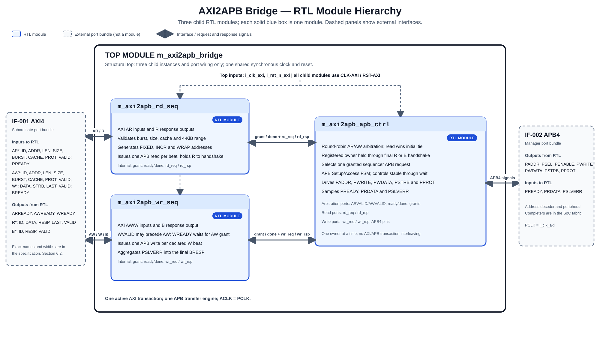

Editable vector source: [figures/vlsit_block_diagram.svg](figures/vlsit_block_diagram.svg). / File vector SVG có thể chỉnh sửa tại đường dẫn trên.

### 5.3 Transaction and dataflow

Read: accept AR, validate, perform one APB read per beat in AXI order, then present RVALID/RDATA/RRESP/RLAST/RID and hold until RREADY. / Read: nhận AR, kiểm tra, thực hiện APB read mỗi beat theo thứ tự AXI, rồi đưa RVALID/RDATA/RRESP/RLAST/RID, giữ đến RREADY.

Write: accept AW then W beats in order. WVALID may precede AW but WREADY remains low until AW. Perform one APB write per beat; after the last APB completion, return B. / Write: nhận AW rồi W theo thứ tự. WVALID có thể đến trước AW nhưng WREADY thấp đến khi nhận AW. Mỗi beat ghi APB; trả B sau APB cuối.

### 5.4 Invariants

- One transaction owns the bridge; reads and writes do not interleave.
- APB transfers are sequential; payload/control remain stable during wait.
- IDs are retained and echoed unchanged.
- Read count is ARLEN+1; legal write count is AWLEN+1.
- AXI response payload remains stable while VALID=1 and READY=0.

## 6. External interfaces and ports

### 6.1 Interface inventory

| Interface ID | Type and revision | Role | Direction at IP boundary | Clock domain | Required / optional | Configurations |
|---|---|---|---|---|---|---|
| IF-001 | AXI4, IHI 0022 H.c | Subordinate | AXI Manager ↔ bridge | CLK-AXI | Required | CFG-BASE |
| IF-002 | APB4, IHI 0024 D | Manager/Requester | Bridge ↔ APB fabric | CLK-AXI; PCLK=ACLK | Required | CFG-BASE |

### 6.2 Complete port list

Inputs are sampled on rising i_clk_axi when the associated handshake/completion condition holds. APB setup uses PSEL=1/PENABLE=0; access uses PSEL=1/PENABLE=1 and completes at PREADY=1. / Input được lấy mẫu tại cạnh lên i_clk_axi khi handshake/điều kiện hoàn tất tương ứng. APB setup dùng PSEL=1/PENABLE=0; access dùng PSEL=1/PENABLE=1 và hoàn tất khi PREADY=1.

| Port | Direction | Width | Meaning (function) | Clock domain | Signal type | Reset / idle value | Timing / sampling | Configurations |
|---|---|---:|---|---|---|---|---|---|
| i_clk_axi | Input | 1 | Shared ACLK/PCLK / Clock AXI/APB chung | CLK-AXI | clock | Not applicable (clock is not resettable) | Rising edge | CFG-BASE |
| i_rst_n_axi | Input | 1 | Shared active-low synchronous reset / Reset active-low đồng bộ dùng chung | Synchronous to CLK-AXI | reset | 0 asserts | Sampled on rising CLK-AXI edge; SoC supplies a clock-synchronous reset | CFG-BASE |
| i_axi_awid | Input | PARA_AXI_ID_W | Write ID / ID ghi | CLK-AXI | data (AWVALID) | Ignored if AWVALID=0 | AW handshake | CFG-BASE |
| i_axi_awaddr | Input | 32 | Write byte address / Địa chỉ byte ghi | CLK-AXI | data (AWVALID) | Ignored if AWVALID=0 | AW handshake | CFG-BASE |
| i_axi_awlen | Input | 8 | Write beats minus one / Số beat ghi trừ một | CLK-AXI | data (AWVALID) | Ignored if AWVALID=0 | AW handshake | CFG-BASE |
| i_axi_awsize | Input | 3 | Write byte-size encoding / Mã kích thước ghi | CLK-AXI | data (AWVALID) | Ignored if AWVALID=0 | AW handshake | CFG-BASE |
| i_axi_awburst | Input | 2 | Write burst type / Loại burst ghi | CLK-AXI | data (AWVALID) | Ignored if AWVALID=0 | AW handshake | CFG-BASE |
| i_axi_awcache | Input | 4 | Write memory attribute / Thuộc tính ghi | CLK-AXI | data (AWVALID) | Ignored if AWVALID=0 | AW handshake | CFG-BASE |
| i_axi_awprot | Input | 3 | Write protection / Bảo vệ ghi | CLK-AXI | data (AWVALID) | Ignored if AWVALID=0 | AW handshake | CFG-BASE |
| i_axi_awvalid | Input | 1 | Write address valid / Địa chỉ ghi hợp lệ | CLK-AXI | level | 0 in reset | Hold payload to AWREADY | CFG-BASE |
| o_axi_awready | Output | 1 | Accept write address / Nhận địa chỉ ghi | CLK-AXI | level | 0 in reset | AW handshake | CFG-BASE |
| i_axi_wdata | Input | 32 | Write beat data / Dữ liệu beat ghi | CLK-AXI | data (WVALID) | Ignored if WVALID=0 | W handshake | CFG-BASE |
| i_axi_wstrb | Input | 4 | Write byte lanes / Lane byte ghi | CLK-AXI | data (WVALID) | Ignored if WVALID=0 | W handshake; copied to PSTRB | CFG-BASE |
| i_axi_wlast | Input | 1 | Final W beat marker / Đánh dấu W cuối | CLK-AXI | data (WVALID) | Ignored if WVALID=0 | AXI-compliant Manager asserts on beat AWLEN+1; malformed WLAST is outside the guaranteed profile | CFG-BASE |
| i_axi_wvalid | Input | 1 | Write data valid / Dữ liệu ghi hợp lệ | CLK-AXI | level | 0 in reset | Hold payload to WREADY | CFG-BASE |
| o_axi_wready | Output | 1 | Accept write data / Nhận dữ liệu ghi | CLK-AXI | level | 0 in reset | W handshake | CFG-BASE |
| o_axi_bid | Output | PARA_AXI_ID_W | Write response ID / ID response ghi | CLK-AXI | data (BVALID) | 0 in reset | Stable to B handshake | CFG-BASE |
| o_axi_bresp | Output | 2 | Write response status / Trạng thái B | CLK-AXI | data (BVALID) | 0 in reset | Stable to B handshake | CFG-BASE |
| o_axi_bvalid | Output | 1 | Write response valid / B hợp lệ | CLK-AXI | level | 0 in reset | Hold to BREADY | CFG-BASE |
| i_axi_bready | Input | 1 | Accept B response / Nhận B | CLK-AXI | level | Ignored in reset | B handshake | CFG-BASE |
| i_axi_arid | Input | PARA_AXI_ID_W | Read ID / ID đọc | CLK-AXI | data (ARVALID) | Ignored if ARVALID=0 | AR handshake | CFG-BASE |
| i_axi_araddr | Input | 32 | Read byte address / Địa chỉ byte đọc | CLK-AXI | data (ARVALID) | Ignored if ARVALID=0 | AR handshake | CFG-BASE |
| i_axi_arlen | Input | 8 | Read beats minus one / Số beat đọc trừ một | CLK-AXI | data (ARVALID) | Ignored if ARVALID=0 | AR handshake | CFG-BASE |
| i_axi_arsize | Input | 3 | Read byte-size encoding / Mã kích thước đọc | CLK-AXI | data (ARVALID) | Ignored if ARVALID=0 | AR handshake | CFG-BASE |
| i_axi_arburst | Input | 2 | Read burst type / Loại burst đọc | CLK-AXI | data (ARVALID) | Ignored if ARVALID=0 | AR handshake | CFG-BASE |
| i_axi_arcache | Input | 4 | Read memory attribute / Thuộc tính đọc | CLK-AXI | data (ARVALID) | Ignored if ARVALID=0 | AR handshake | CFG-BASE |
| i_axi_arprot | Input | 3 | Read protection / Bảo vệ đọc | CLK-AXI | data (ARVALID) | Ignored if ARVALID=0 | AR handshake | CFG-BASE |
| i_axi_arvalid | Input | 1 | Read address valid / Địa chỉ đọc hợp lệ | CLK-AXI | level | 0 in reset | Hold payload to ARREADY | CFG-BASE |
| o_axi_arready | Output | 1 | Accept read address / Nhận địa chỉ đọc | CLK-AXI | level | 0 in reset | AR handshake | CFG-BASE |
| o_axi_rid | Output | PARA_AXI_ID_W | Read response ID / ID response đọc | CLK-AXI | data (RVALID) | 0 in reset | Stable to R handshake | CFG-BASE |
| o_axi_rdata | Output | 32 | Read beat data / Dữ liệu beat đọc | CLK-AXI | data (RVALID) | 0 in reset | Stable to R handshake | CFG-BASE |
| o_axi_rresp | Output | 2 | Read response status / Trạng thái R | CLK-AXI | data (RVALID) | 0 in reset | Stable to R handshake | CFG-BASE |
| o_axi_rlast | Output | 1 | Final read beat marker / Đánh dấu beat cuối | CLK-AXI | data (RVALID) | 0 in reset | High only on final beat | CFG-BASE |
| o_axi_rvalid | Output | 1 | Read data valid / Dữ liệu đọc hợp lệ | CLK-AXI | level | 0 in reset | Hold to RREADY | CFG-BASE |
| i_axi_rready | Input | 1 | Accept read beat / Nhận beat đọc | CLK-AXI | level | Ignored in reset | R handshake | CFG-BASE |
| o_apb_paddr | Output | 32 | Word-aligned byte address / Địa chỉ byte căn word | CLK-AXI | data (PSEL) | 0 idle | Stable through transfer | CFG-BASE |
| o_apb_pwrite | Output | 1 | APB direction / Hướng đọc/ghi APB | CLK-AXI | data (PSEL) | 0 idle | Stable through transfer | CFG-BASE |
| o_apb_pwdata | Output | 32 | APB write data / Dữ liệu ghi APB | CLK-AXI | data (PSEL and PWRITE) | 0 idle | Stable during wait | CFG-BASE |
| o_apb_pstrb | Output | 4 | APB byte strobes / Strobe byte APB | CLK-AXI | data (PSEL and PWRITE) | 0 idle; zero on read | Stable through access | CFG-BASE |
| o_apb_pprot | Output | 3 | Copy of AxPROT / Bản sao AxPROT | CLK-AXI | data (PSEL) | 0 idle | Stable through transfer | CFG-BASE |
| o_apb_psel | Output | 1 | Select APB decoder / Chọn decoder APB | CLK-AXI | level | 0 idle | Setup starts high | CFG-BASE |
| o_apb_penable | Output | 1 | APB access phase / Pha access APB | CLK-AXI | level | 0 idle | Hold until PREADY | CFG-BASE |
| i_apb_pready | Input | 1 | APB transfer ready / APB sẵn sàng | CLK-AXI | level | Ignored when PSEL=0 | Sample in access | CFG-BASE |
| i_apb_prdata | Input | 32 | APB read data / Dữ liệu đọc APB | CLK-AXI | data (read completion) | Ignored otherwise | Sample at completion | CFG-BASE |
| i_apb_pslverr | Input | 1 | APB error / Lỗi APB | CLK-AXI | data (completed transfer) | Ignored otherwise | Sample with PREADY | CFG-BASE |

### 6.3 Protocol behavior

| Case | Legal behavior | Illegal / unsupported case | IP response | Requirement IDs |
|---|---|---|---|---|
| AXI read | FIXED/INCR/WRAP, size 0–2, cache 0000/0001 | Unsupported request or 4-KiB crossing | No APB; ARLEN+1 R beats with SLVERR | REQ-IF-002/003/007, REQ-ERR-001 |
| AXI write | AW followed by declared W beats; W may arrive early | Unsupported AW request; AXI protocol violations are outside the guaranteed profile | No APB for unsupported AW; drain W, then SLVERR B | REQ-IF-002/003/007, REQ-ERR-003 |
| APB transfer | One transfer per AXI beat | PREADY never rises | Hold access; no timeout | REQ-IF-004, REQ-ERR-005 |
| APB error | PSLVERR sampled on completed transfer | Read data on error is invalid per APB | Read beat SLVERR; write error accumulates | REQ-ERR-002/006 |
| Unmapped address | External default error Completer responds | Missing default responder is integration violation | PREADY=1/PSLVERR=1, then AXI SLVERR | REQ-ERR-004 |

AXI4 prohibits a burst from crossing a 4-KiB address boundary. This bridge defensively rejects such a request before issuing APB traffic. / AXI4 cấm burst vượt biên địa chỉ 4 KiB. Bridge chủ động từ chối yêu cầu này trước khi phát giao dịch APB.

**Waveform index (approved 2026-10-25):** [WF-001 reset](figures/wf-001.svg); successful reads [WF-002 single](figures/wf-002.svg), [WF-003 INCR](figures/wf-003.svg), [WF-004 FIXED/WRAP](figures/wf-004.svg); successful writes [WF-005 burst](figures/wf-005.svg), [WF-006 byte lane](figures/wf-006.svg); waits and backpressure [WF-007 APB wait](figures/wf-007.svg), [WF-008 AXI response stall](figures/wf-008.svg); errors [WF-009 read PSLVERR](figures/wf-009.svg), [WF-010 write PSLVERR](figures/wf-010.svg), [WF-012 unsupported request](figures/wf-012.svg), [WF-013 4-KiB crossing](figures/wf-013.svg), [WF-014 unmapped address](figures/wf-014.svg); arbitration [WF-011 AR/AW contention](figures/wf-011.svg). WaveJSON sources are paired with each SVG in `figures/`. / **Danh sách waveform (đã duyệt ngày 2026-10-25):** gồm reset, đọc/ghi thành công, byte lane, wait state, backpressure, lỗi đọc/ghi, yêu cầu không hỗ trợ, vượt biên 4 KiB, địa chỉ không ánh xạ và phân xử AR/AW. File WaveJSON đi kèm từng SVG trong `figures/`.

### 6.4 Interrupts and events

No interrupt port is in the approved baseline. Diagnostics/interrupt need remains open; see ASM-006. / Baseline không có interrupt. Nhu cầu chẩn đoán/interrupt còn mở; xem ASM-006.

## 7. Clock, reset, and power

### 7.1 Clock domains

| Domain | Clock port | Edge | Frequency range | Source | Relationship to other clocks | Gating policy |
|---|---|---|---|---|---|---|
| CLK-AXI | i_clk_axi; APB PCLK tied to it | Rising | No IP-specific limit; STA target is set by the SoC | SoC clock controller | Single synchronous domain | No internal gating |

### 7.2 CDC and RDC

No CDC or synchronizer is present because ACLK/PCLK share one input. The SoC must provide `i_rst_n_axi` synchronous to CLK-AXI. / Không có CDC hoặc synchronizer vì ACLK/PCLK dùng chung input. SoC phải cấp `i_rst_n_axi` đồng bộ với CLK-AXI.

| Crossing ID | From → to | Signals | Structure | Reset handling | Constraints / verification |
|---|---|---|---|---|---|
| CDC-001 | Not applicable (no async clock crossing) | No async clock crossing | None | Shared reset | CDC/RDC report |

### 7.3 Reset domains and sequencing

| Reset ID | Port | Polarity / assertion | Sync or async | Scope | Deassertion | Reset value |
|---|---|---|---|---|---|---|
| RST-AXI | i_rst_n_axi | Active-low, synchronous assertion | Synchronous | AXI/APB control and state | SoC supplies reset synchronous to i_clk_axi | AXI VALID=0; PSEL/PENABLE=0 after the active reset edge |

Reset is sampled on the rising edge of `i_clk_axi`; keep it active for at least one rising edge. The SoC owns reset synchronization and must coordinate the AXI Manager and APB fabric. Reset cancels in-flight local state; completion/rollback of an interrupted transfer is not guaranteed. / Reset được lấy mẫu ở cạnh lên `i_clk_axi`; giữ reset active ít nhất một cạnh lên. SoC quản lý đồng bộ reset và phải phối hợp reset AXI Manager với APB fabric. Reset hủy state đang chạy; không đảm bảo hoàn tất/rollback transfer bị ngắt.

### 7.4 Power intent (if applicable)

No IP-specific isolation, retention or power sequence is defined; SoC UPF/CPF owns it. / Không quy định isolation, retention hay trình tự nguồn riêng; SoC UPF/CPF quản lý.

## 8. Parameters and elaboration configurations

Declare PARA_AXI_ID_W as parameter logic [31:0], default 4. Its three required comments immediately precede the declaration: Parameter Description, Parameter values, Parameter unit. / Khai báo PARA_AXI_ID_W dạng parameter logic [31:0], mặc định 4. Ba comment Parameter Description, Parameter values, Parameter unit đứng ngay trên khai báo.

| Parameter | Purpose | Default | Legal values / range | Dependencies / invalid combinations | Effect |
|---|---|---:|---|---|---|
| PARA_AXI_ID_W | AXI read/write ID width / Độ rộng ID AXI | 4 | 1–16 inclusive | Shared width; invalid value is elaboration error | Changes ID port widths |

Required comment labels are Parameter Description, Parameter values and Parameter unit. Address/data/APB widths are fixed at 32 bits. / Nhãn comment bắt buộc là Parameter Description, Parameter values và Parameter unit. Độ rộng địa chỉ/dữ liệu/APB cố định 32 bit.

| Configuration | Parameter overrides | Features/interfaces | Expected hierarchy | Elaboration/lint/synthesis target |
|---|---|---|---|---|
| CFG-BASE | PARA_AXI_ID_W=4 | Section 4 | `m_axi2apb_bridge` with `m_axi2apb_rd_seq`, `m_axi2apb_wr_seq`, and `m_axi2apb_apb_ctrl` | Check ID widths 1, 4, 16 |

## 9. Data representation and arithmetic

| Quantity | Width | Encoding / range | Extension / truncation | Overflow / invalid behavior |
|---|---:|---|---|---|
| Address | 32 | Unsigned byte address | APB PADDR clears bits [1:0] | Reject 4-KiB crossing |
| AXI/APB data | 32 | Four byte lanes | No lane rotation | Unsupported size → SLVERR |
| ID | PARA_AXI_ID_W | Opaque unsigned | Echo unchanged | No remap |
| AxSIZE | 3 | 0=1 byte, 1=2 bytes, 2=4 bytes | Unsigned | Other values rejected |
| AxLEN | 8 | Beats minus one | 1–256 beats | Declared burst length controls expected beat count |
| AxBURST | 2 | FIXED/INCR/WRAP legal values | Per REF-001 A3.4 | Reserved value rejected |
| AxCACHE | 4 | Accept 0000 Device Non-bufferable or 0001 Device Bufferable | Validation only | Other encodings rejected |
| AxPROT/PPROT | 3 | Same semantics | Direct copy | No translation |

For subword writes, copy WSTRB to PSTRB unchanged; the Manager must assert only lanes legal for the address and size. APB PADDR is word-aligned. Return PRDATA in bus lanes; the Manager selects requested bytes using AXI address/size. / Write nhỏ hơn word chép nguyên WSTRB sang PSTRB; Manager chỉ bật lane hợp lệ. PADDR căn word. Trả PRDATA theo lane bus; Manager chọn byte theo địa chỉ/size AXI.

## 10. Detailed functional behavior

### 10.1 Modes and state transitions

| Mode/state | Entry condition | Behavior | Exit condition | Outputs / side effects |
|---|---|---|---|---|
| IDLE | Reset released | Arbitrate AR/AW | Address handshake | Select transaction |
| READ | AR accepted | Validate; APB read per beat; return R | Final R handshake | ARLEN+1 R beats |
| WRITE | AW accepted | Accept W; APB write per beat | B handshake | One B |
| REJECT_READ | Unsupported AR | No APB; return error beats with zero data | Final R handshake | SLVERR and final RLAST |
| REJECT_WRITE | Unsupported AW | Drain W count; no APB | B handshake | SLVERR |

Reset in any state returns to IDLE and discards local state. / Reset ở mọi state đưa về IDLE và xóa state cục bộ.

### 10.2 Operations

| Operation ID | Inputs / preconditions | Processing semantics | Result / completion | Latency / ordering |
|---|---|---|---|---|
| OP-001 Read | Legal accepted AR | APB read per beat; FIXED holds address; INCR and WRAP follow AXI address rules | ARLEN+1 R beats; RID echo; final RLAST | Serialized; wait/backpressure extends latency |
| OP-002 Write | Legal AW plus AWLEN+1 W beats | APB write per beat; WSTRB→PSTRB; accumulate PSLVERR | One B after final APB completion | Serialized; wait/backpressure extends latency |
| OP-003 Unsupported read | Accepted AR outside profile | No APB; return declared error beats | ARLEN+1 R beats; SLVERR; zero data | Honor RREADY |
| OP-004 Unsupported write | Accepted AW outside profile | No APB; drain declared W count | One SLVERR B | B after final W |
| OP-005 Reset | Reset in any state | Clear local state and deselect APB | Idle | In-flight work canceled |

Read PSLVERR marks its beat. Write PSLVERR accumulates; later beats still execute and final BRESP is SLVERR. No side effect rollback is promised. / Read PSLVERR đánh dấu beat đó. Write PSLVERR tích lũy; beat sau vẫn chạy, BRESP cuối là SLVERR. Không rollback side effect.

### 10.3 Cycle-level behavior

**Approved waveform set (R-024, 2026-10-25):** the user approved all 14 scenarios; each row links to its SVG and WaveJSON source. / **Bộ waveform đã duyệt (R-024, 2026-10-25):** người dùng đã duyệt đủ 14 tình huống; mỗi dòng liên kết tới SVG và file nguồn WaveJSON.

| Waveform ID | Function / operation | Scenario (success / error / corner) | Signals shown | Figure | Confirmed by user |
|---|---|---|---|---|---|
| WF-001 | OP-005 Reset | Success: synchronous active-low reset assertion/release and idle outputs | i_clk_axi, i_rst_n_axi, AXI VALID, APB PSEL/PENABLE | 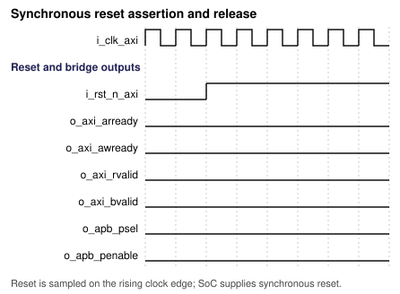; [WaveJSON](figures/wf-001.json) | 2026-10-25 |
| WF-002 | OP-001 Read | Success: single-beat AXI read and APB completion | AR, APB PADDR/PSEL/PENABLE/PREADY/PRDATA, R | 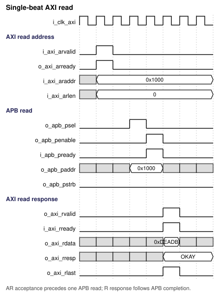; [WaveJSON](figures/wf-002.json) | 2026-10-25 |
| WF-003 | OP-001 Read | Success: four-beat INCR read with final RLAST | AR, APB address sequence, RVALID/RREADY/RLAST | 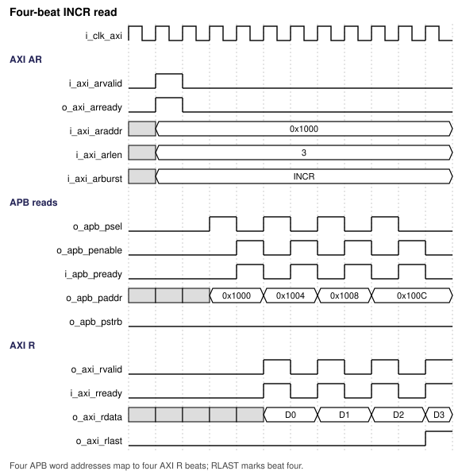; [WaveJSON](figures/wf-003.json) | 2026-10-25 |
| WF-004 | OP-001 Read | Corner: FIXED and WRAP address sequences | ARBURST/ARADDR/ARLEN, APB PADDR | 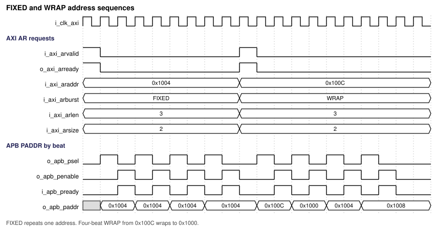; [WaveJSON](figures/wf-004.json) | 2026-10-25 |
| WF-005 | OP-002 Write | Success: INCR write burst, WSTRB/PPROT and B response | AW, W, APB PADDR/PWDATA/PSTRB/PPROT, B | 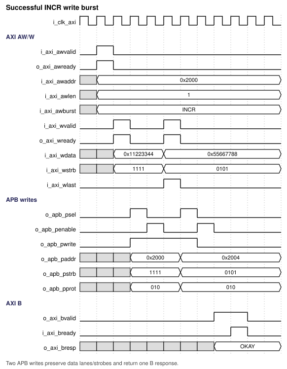; [WaveJSON](figures/wf-005.json) | 2026-10-25 |
| WF-006 | OP-002 Write | Corner: byte write at 0x1001, APB PADDR=0x1000 and lane 1 | AWADDR, AWSIZE, WSTRB, APB PADDR/PSTRB | 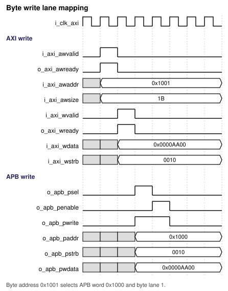; [WaveJSON](figures/wf-006.json) | 2026-10-25 |
| WF-007 | OP-001 Read; OP-002 Write | Corner: APB PREADY wait with stable APB control/data | PSEL, PENABLE, PADDR, PWRITE, PREADY | 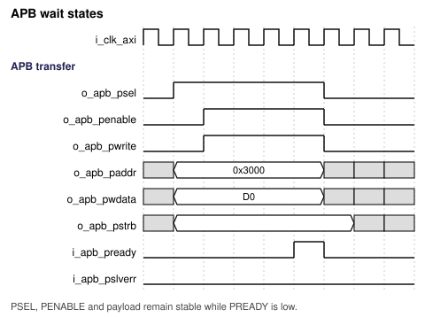; [WaveJSON](figures/wf-007.json) | 2026-10-25 |
| WF-008 | OP-001 Read; OP-002 Write | Corner: RREADY and BREADY backpressure | RVALID/RREADY/R payload, BVALID/BREADY/B payload | 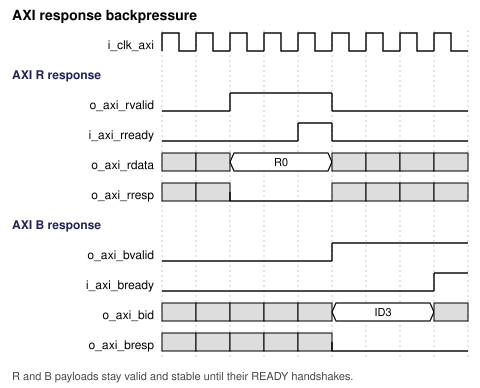; [WaveJSON](figures/wf-008.json) | 2026-10-25 |
| WF-009 | OP-001 Read | Error: middle APB read beat returns PSLVERR; later beats continue | APB PSLVERR, RRESP, RLAST | 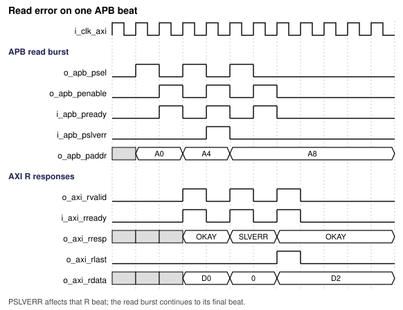; [WaveJSON](figures/wf-009.json) | 2026-10-25 |
| WF-010 | OP-002 Write | Error: middle APB write returns PSLVERR; final BRESP is SLVERR | APB PSLVERR, WLAST, BRESP/BVALID | 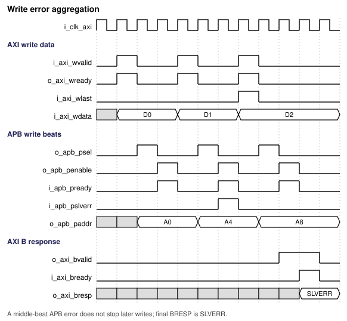; [WaveJSON](figures/wf-010.json) | 2026-10-25 |
| WF-011 | REQ-FUNC-003 | Corner: simultaneous AR/AW round-robin grant; WVALID before AW acceptance | AR/AW VALID/READY, WVALID/WREADY | 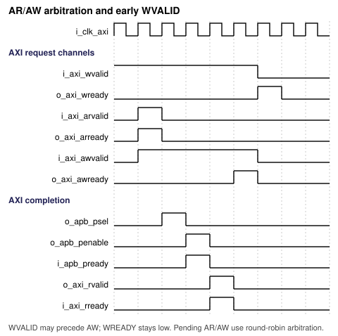; [WaveJSON](figures/wf-011.json) | 2026-10-25 |
| WF-012 | OP-003 Unsupported read; OP-004 Unsupported write | Error: unsupported size/cache/burst; no APB, read beats or write drain | AXI address/data/response, APB PSEL | 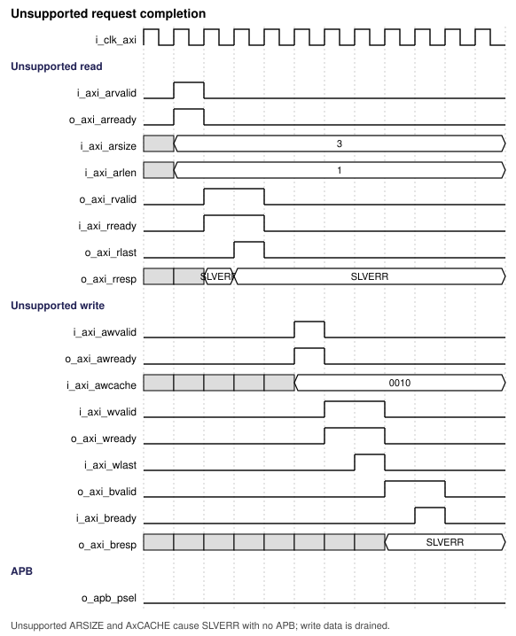; [WaveJSON](figures/wf-012.json) | 2026-10-25 |
| WF-013 | OP-003 Unsupported read; OP-004 Unsupported write | Boundary: request crossing 4 KiB is rejected without APB | AXI address/length, APB PSEL, AXI responses | 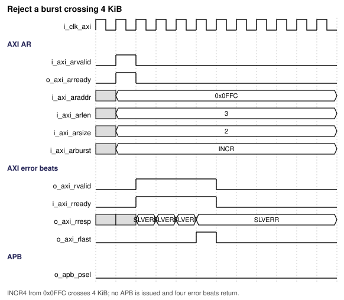; [WaveJSON](figures/wf-013.json) | 2026-10-25 |
| WF-014 | REQ-ERR-004 | Error: unmapped APB address uses default error Completer | APB PSEL/PREADY/PSLVERR, AXI RRESP/BRESP | 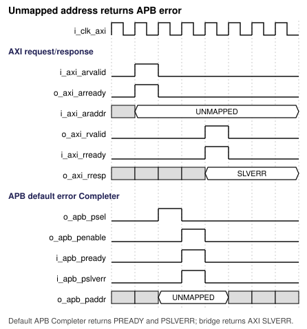; [WaveJSON](figures/wf-014.json) | 2026-10-25 |

**Not required (confirmed by user, 2026-10-25):** APB timeout waveform; the bridge has no internal timeout.

Sample on rising CLK-AXI. APB setup is PSEL=1/PENABLE=0; access is PSEL=1/PENABLE=1; completion requires PREADY=1. / Lấy mẫu tại cạnh lên CLK-AXI. Setup APB là PSEL=1/PENABLE=0; access là PSEL=1/PENABLE=1; hoàn tất cần PREADY=1.

### 10.4 Arbitration, buffering, and throughput

AR/AW arbitration is round-robin when both are pending. The selected transaction owns the bridge through final R handshake or B handshake. No one-beat-per-cycle throughput guarantee is made; APB waits and AXI backpressure determine completion. / AR/AW phân xử round-robin khi cùng chờ. Giao dịch giữ bridge đến handshake R cuối hoặc B. Không cam kết một beat mỗi chu kỳ; APB wait và AXI backpressure quyết định thời gian.

### 10.5 Memories and storage

No SRAM, ROM or external FIFO is required. State flops and one active W beat are expected; no macro is assumed. / Không cần SRAM, ROM hay FIFO ngoài. Dự kiến state flop và một beat W hiện hành; không giả định macro.

## 11. Register and programming model

**Not required (confirmed by user, 2026-10-25):** No software-visible CSR; configuration is static at elaboration. / **Không cần (người dùng xác nhận 2026-10-25):** Không có CSR phần mềm; cấu hình cố định khi elaboration.

### 11.1 CSR specification source

No CSR workbook is required. / Không cần workbook CSR.

### 11.2 Software sequences

No software sequence applies. SoC integration configures the address map and default APB error Completer. / Không áp dụng chuỗi phần mềm. SoC cấu hình address map và Completer lỗi mặc định.

## 12. Error handling and recovery

| Error ID | Detection condition | Observable response/status | Interrupt | Clear/recovery | Reset behavior |
|---|---|---|---|---|---|
| ERR-001 | Unsupported read | ARLEN+1 SLVERR beats, zero data, final RLAST; no APB | None | Drain R | Reset cancels |
| ERR-002 | Unsupported write | Drain W count; SLVERR B; no APB | None | Complete B | Reset cancels |
| ERR-003 | APB read PSLVERR | RRESP=SLVERR; RDATA=0 | None | Continue remaining beats | Reset cancels |
| ERR-004 | APB write PSLVERR | Accumulate; continue; final BRESP=SLVERR | None | Complete B | Reset cancels |
| ERR-005 | PREADY remains low | Hold APB access indefinitely; no timeout | None | Completer responds or system reset | Reset deselects |
| ERR-006 | Unmapped address | Default Completer PREADY=1/PSLVERR=1; AXI SLVERR | None | Correct map or handle error | Reset cancels |

Other AXI violations are not guaranteed to complete. An APB failure shall never be reported as AXI OKAY. / Vi phạm AXI khác không được đảm bảo hoàn tất. Lỗi APB không được báo thành AXI OKAY.

## 13. Performance, power, and area

Frequency, throughput, completion latency, area and power targets are unspecified. APB waits and AXI backpressure affect completion. See ASM-002/003 for impacts. / Chưa có mục tiêu tần số, throughput, latency, area, power. APB wait và AXI backpressure ảnh hưởng hoàn tất. Xem ASM-002/003.

| Metric ID | Metric | Target / limit | Conditions | Measurement method | Hard / goal |
|---|---|---|---|---|---|
| PPA-001 | Maximum frequency | TBD | Corner/library/clock TBD | STA | TBD |
| PPA-002 | Area | TBD | Library/config TBD | Synthesis cell area | TBD |
| PPA-003 | Power | TBD | Activity/voltage/corner TBD | Power analysis | TBD |
| PERF-001 | Latency/throughput | TBD | Waits/backpressure vary | Cycle simulation | TBD |

## 14. RTL implementation contract

### 14.1 Required coding baseline

VLSIT RTL Design Rules v2 is mandatory. Use one synthesizable module per .sv file with matching filename; structural top; ANSI ports with input wire, output logic and inout wire only for pad wrappers; rule-compliant names; unsigned four-state logic; explicit widths; always_comb/always_ff only; named connections; and logic-section comments. Prohibit package, plain always, always_latch, two-state/signed types, define/undef, latches, multiple drivers and unsynthesizable test code. / Bắt buộc VLSIT RTL Design Rules v2. Mỗi file .sv có một module trùng tên file; top cấu trúc; port ANSI dùng input wire, output logic và chỉ dùng inout wire cho wrapper pad; tên theo rule; logic 4-state unsigned; độ rộng tường minh; chỉ always_comb/always_ff; named connection và comment từng phần. Cấm package, always thường, always_latch, kiểu 2-state/signed, define/undef, latch, nhiều driver và mã test không tổng hợp.

### 14.2 RTL hierarchy

| Module | Responsibility | Parent / instance | Clock/reset domains | Interface |
|---|---|---|---|---|
| m_axi2apb_bridge | Structural top and protocol boundary / Top cấu trúc, biên giao thức | SoC integration; instance follows NAM-07 | CLK-AXI/RST-AXI | IF-001/002 |
| m_axi2apb_rd_seq | Validate and sequence AXI reads; issue one APB request per beat and return R responses / Kiểm tra, điều khiển AXI read; phát một yêu cầu APB mỗi beat và trả R | `m_axi2apb_bridge` / `u_axi2apb_rd_seq` | CLK-AXI/RST-AXI | AXI AR/R; `rd_req` / `rd_rsp` |
| m_axi2apb_wr_seq | Sequence AW/W beats; issue APB writes and aggregate write errors / Điều khiển beat AW/W; phát APB write và tích lũy lỗi ghi | `m_axi2apb_bridge` / `u_axi2apb_wr_seq` | CLK-AXI/RST-AXI | AXI AW/W/B; `wr_req` / `wr_rsp` |
| m_axi2apb_apb_ctrl | Round-robin AR/AW arbitration and ownership plus shared APB4 transfer control / Phân xử và quản lý quyền sở hữu AR/AW round-robin cùng điều khiển APB4 dùng chung | `m_axi2apb_bridge` / `u_axi2apb_apb_ctrl` | CLK-AXI/RST-AXI | AXI request valid; sequencer ready/done; grants; `rd_req`/`rd_rsp`; `wr_req`/`wr_rsp`; IF-002 |

### 14.3 Synthesis assumptions

| Item | Value / source |
|---|---|
| Top / source file list | `m_axi2apb_bridge`; one matching source file per module listed in 14.2 |
| Frontend version and options | Tool-independent IEEE 1800-2017 synthesizable subset; apply VLSIT RTL Design Rules v2; select exact frontend/options during SoC integration |
| Parameters/configuration | CFG-BASE; PARA_AXI_ID_W=4 |
| Libraries/corners | No target Liberty/DB/LEF is present under `common_rtl`; no shared RTL cell wrapper is needed for this single-clock bridge; select the physical library/corner in SoC PPA |
| Memory flow | No macro assumed |
| Lint rule configuration | VLSIT RTL Design Rules v2; run the VLSIT RTL checker and available Verilator/slang lint flow; no project-specific waivers |

## 15. Verification specification

### 15.1 Scope and strategy

Use this specification and REF-001/002 as golden behavior. Build testbench/reference model independently of generated RTL; RTL must not define expected results. Retain testbench sources and logs; document run commands in one Makefile. / Dùng đặc tả và REF-001/002 làm golden behavior. Testbench/reference model độc lập với RTL; RTL không định nghĩa expected result. Lưu testbench/log; mô tả lệnh chạy trong một Makefile.

### 15.2 Requirement-based test plan

| Test ID | Requirements | Scenario / stimulus | Expected result | Test type | Configuration |
|---|---|---|---|---|---|
| TEST-001 | REQ-FUNC-001, REQ-IF-002/004/005 | FIXED/INCR/WRAP, legal sizes | Independent model matches addresses/data/responses | Directed/random | CFG-BASE |
| TEST-002 | REQ-FUNC-002/003 | AR/AW contention | Single owner; round-robin grants | Directed | CFG-BASE |
| TEST-003 | REQ-IF-009, REQ-ERR-005 | APB wait; RREADY/BREADY stalls | Stable payload through stalls | Assertions | CFG-BASE |
| TEST-004 | REQ-ERR-002/004/006 | APB errors and unmapped address | Correct SLVERR | Error injection | CFG-BASE |
| TEST-005 | REQ-IF-003/007, REQ-ERR-001/003 | Invalid profile requests | No APB; correct error completion | Negative directed | CFG-BASE |
| TEST-006 | REQ-RESET-001 | Reset during idle/wait/response | Valid low, APB deselected, state cleared | Reset test | CFG-BASE |
| TEST-007 | REQ-PARAM-001 | ID widths 1, 4, 16 | Correct elaboration and ID echo | Parameter sweep | CFG-BASE |

### 15.3 Assertions and coverage

Check AXI payload stability, APB setup/access sequencing and wait stability, exclusive ownership, beat counts, RLAST/WLAST, ID echo, no APB on rejected requests, and reset values. Cover burst/length/size/lane, APB waits, response stalls and error locations. / Kiểm tra ổn định payload AXI, trình tự APB, wait, quyền sở hữu, số beat, RLAST/WLAST, ID, không APB khi bị từ chối, reset. Cover burst/length/size/lane, wait, stall response, vị trí lỗi.

| Property / coverage ID | Intent | Requirements | Checker / source set | Acceptance criterion |
|---|---|---|---|---|
| SVA-001 | AXI/APB handshake stability | REQ-IF-001/009 | Independent protocol assertions | No failures |
| SVA-002 | Single transaction ownership | REQ-FUNC-002/003 | Protocol monitor | No overlap |
| COV-001 | Burst, lane, wait and error combinations | REQ-IF-002/004, REQ-ERR-002 | Coverage model | Threshold TBD |
| COV-002 | Every rejected request class | REQ-ERR-001/003 | Coverage model | All classes hit |

### 15.4 Formal, CDC, and RDC

| Analysis | Scope | Assumptions / constraints | Evaluation method |
|---|---|---|---|
| Formal | Arbitration, beat counts, response stability, reject path | AXI assumptions; liveness assumes APB eventually ready | Property proof |
| CDC / RDC | Shared clock and reset release | No async data crossing | CDC/RDC reports |

## 16. DFT and testability

Scan, ATPG, test clocks and test-mode controls are owned by SoC DFT; bridge-specific details are TBD. No memory macro/MBIST port is in the baseline. See ASM-008. / Scan, ATPG, clock test và test mode do SoC DFT quản lý; chi tiết riêng của bridge TBD. Baseline không có macro/port MBIST. Xem ASM-008.

| Topic | Requirement / decision |
|---|---|
| Scan architecture and scan eligibility | TBD by SoC DFT |
| Scan/test clocks, controls, reset | TBD by SoC DFT |
| Test mode and safe state | TBD by SoC DFT |
| MBIST, repair, LBIST | No memory macro; LBIST TBD |
| Test access/wrappers/test points | TBD by SoC DFT |
| Clock-gating test enable | No internal gating |
| ATPG constraints/exclusions | TBD by SoC DFT |
| DFT insertion and artifacts | TBD by SoC DFT |

## 17. Physical design and timing integration

### 17.1 Timing constraints and budgets

The SoC integrator must provide clock period, uncertainty, transition, latency, interface delays, loads, PVT/RC corners and timing modes before closure. No executable SDC is defined yet. / SoC integrator cung cấp chu kỳ, uncertainty, transition, latency, delay giao diện, tải, corner PVT/RC và mode trước khi đóng timing. Chưa có SDC chạy được.

#### 17.1.1 Clock and analysis scenarios

| Clock ID | Port / source object | Primary/generated and master | Period, waveform, phase / ratio | Latency / uncertainty / transition | Clock group / mode | Constraint source |
|---|---|---|---|---|---|---|
| CLK-AXI | i_clk_axi | Primary from SoC | TBD | TBD | Functional | SoC SDC |

#### 17.1.2 Interface timing budgets

| Interface / port group | Direction | Reference clock | External min / max delay | Input transition / output load | IP timing budget | Mode / condition | Constraint source |
|---|---|---|---|---|---|---|---|
| AXI4/APB4 | Input/output | CLK-AXI | TBD | TBD | TBD | Functional | SoC SDC |

Integrator also supplies max transition/capacitance/fanout and driving-cell assumptions. / Integrator cung cấp max transition/capacitance/fanout và driving cell.

#### 17.1.3 Timing exception inventory

No exceptions are approved. A later exception requires exact endpoints, mode, rationale and CDC/RDC evidence; broad exceptions are not allowed. / Chưa duyệt exception. Exception bổ sung cần endpoint, mode, lý do, bằng chứng CDC/RDC; không dùng exception rộng.

| Exception ID | Type / SDC command | From | Through | To | Value and setup/hold/min/max meaning | Mode / condition | Technical rationale |
|---|---|---|---|---|---|---|---|
| EXC-001 | None approved | Not applicable (none approved) | Not applicable (none approved) | Not applicable (none approved) | Not applicable (none approved) | All | No async data crossing |

### 17.2 Physical assumptions

| Topic | Requirement / assumption |
|---|---|
| Hard/memory macros | None assumed |
| Floorplan/pin placement | SoC owned |
| Utilization/congestion | TBD |
| Power intent, clock/reset trees | SoC owned |
| High-fanout/physical-only cells | TBD |
| ECO/spare cells | TBD |
| Extraction/timing corners | TBD |
| Delivery | Soft RTL |

## 18. Security, safety, and reliability

| Topic | Requirement / rationale | Verification method / expected behavior |
|---|---|---|
| Security boundary/threat | AxPROT maps to PPROT; system policy TBD. / AxPROT ánh xạ PPROT; policy TBD. | Integration review |
| Access control/privilege | No local check; APB Completers enforce PPROT. / Không kiểm tra cục bộ; Completer áp dụng PPROT. | Mapping tests |
| Secure clearing | No sensitive storage identified; policy TBD. / Chưa xác định dữ liệu nhạy cảm; policy TBD. | Security review |
| Information leakage | No mitigation specified; timing follows bus waits. / Chưa quy định giảm rò rỉ; timing theo wait. | Threat review |
| ECC/parity | No such pins in selected profile. / Profile không có pin này. | Interface review |
| Safety goal | Not assigned; TBD. / Chưa xác định; TBD. | Safety review |
| Diagnostics/recovery | Propagate errors; no interrupt/status. / Truyền lỗi; không interrupt/status. | Error injection |

## 19. Requirement-to-verification traceability

| Requirement ID | RTL module/location | Test/property | Verification method / analysis | Configuration |
|---|---|---|---|---|
| REQ-FUNC-001 | Transaction path | TEST-001 | Independent model simulation | CFG-BASE |
| REQ-FUNC-002 | Transaction owner | TEST-002/SVA-002 | Directed/assertion | CFG-BASE |
| REQ-FUNC-003 | Arbiter | TEST-002 | Round-robin test | CFG-BASE |
| REQ-IF-001 | AXI boundary | SVA-001 | AXI checker | CFG-BASE |
| REQ-IF-002 | Address generator | TEST-001 | Burst scoreboard | CFG-BASE |
| REQ-IF-003 | Request validator | TEST-005 | Negative test | CFG-BASE |
| REQ-IF-004 | APB sequencer | TEST-001 | APB monitor | CFG-BASE |
| REQ-IF-005 | ID state | TEST-007 | ID scoreboard | CFG-BASE |
| REQ-IF-006 | Interface mapping | Port review | Static review | CFG-BASE |
| REQ-IF-007 | Request validator | TEST-005 | Attribute rejection | CFG-BASE |
| REQ-IF-008 | AXI profile | Port review | Interface review | CFG-BASE |
| REQ-IF-009 | Handshake logic | TEST-003/SVA-001 | Protocol assertions | CFG-BASE |
| REQ-CLK-001 | Clock architecture | CDC-001 | CDC report | CFG-BASE |
| REQ-RESET-001 | Reset logic | TEST-006 | Reset simulation | CFG-BASE |
| REQ-PARAM-001 | Parameter declaration | TEST-007 | Elaboration sweep | CFG-BASE |
| REQ-ERR-001 | Read reject path | TEST-005 | Malformed read test | CFG-BASE |
| REQ-ERR-002 | Response path | TEST-004 | Error injection | CFG-BASE |
| REQ-ERR-003 | Write reject path | TEST-005 | Malformed write test | CFG-BASE |
| REQ-ERR-004 | External APB fabric | TEST-004 | Integration test | CFG-BASE |
| REQ-ERR-005 | APB sequencer | TEST-003 | Wait-state assertion | CFG-BASE |
| REQ-ERR-006 | APB sampler | TEST-004 | Error injection | CFG-BASE |
| REQ-CSR-001 | Top-level ports | Port review | Interface inspection | CFG-BASE |
| REQ-VER-001 | Testbench/reference model | Review | Golden-source audit | All |
| REQ-VER-002 | Verification collateral | Audit | Source/log/Makefile review | All |

## 20. Assumptions, dependencies, and decisions

| ID | Type | Assumption / dependency / unresolved decision | Technical impact / version / configuration | Resolution / status |
|---|---|---|---|---|
| DEC-001 | Decision | VLSIT RTL Design Rules v2 default. | Naming and RTL baseline. | User approved. |
| DEC-002 | Decision | AXI4 H.c Subordinate to APB4 D Manager; one external APB port/decoder. | Interface profile. | User approved. |
| DEC-003 | Decision | Shared clock, 32-bit widths, single global transaction, round-robin, with no IP-specific frequency limit. | No CDC; SoC STA defines the operating target. | User approved. |
| DEC-004 | Decision | FIXED/INCR/WRAP; legal lengths; 1/2/4-byte; PSTRB/PPROT. | Conversion profile. | User approved. |
| DEC-005 | Decision | Omit AxLOCK/exclusive traffic and USER/QOS/REGION. | Integration excludes exclusive traffic. | User approved after protocol correction. |
| DEC-006 | Decision | AxCACHE 0000/0001 only. | Others SLVERR/no APB. | User approved. |
| DEC-007 | Decision | No timeout or CSR; require default APB error Completer. | APB can wait indefinitely. | User approved. |
| DEC-008 | Decision | Unsupported reads error for declared beats; writes drain declared W count. | Defensive completion. | User approved. |
| DEC-009 | Decision | Aggregate write errors and continue all beats. | No rollback of peripheral side effects. | User approved. |
| DEC-010 | Decision | ID width 1–16, default 4; echo IDs. | Parameterized ID ports. | User approved. |
| DEC-011 | Decision | Use a hand-laid SVG vector diagram with module boxes and port bundles. | Replaces the overlapping draw.io diagram; the SVG is the editable source. | Updated per user request on 2026-10-25. |
| DEC-012 | Decision | Fix the RTL hierarchy as one structural top plus read sequencer, write sequencer, and one controller module that combines AR/AW arbitration with APB control. | Each module has a matching source file and a named top-level instance. | User directed merging `m_axi2apb_arb` into `m_axi2apb_apb_ctrl` on 2026-10-25. |
| DEC-013 | Decision | No target physical library is present in `common_rtl`; keep bridge logic technology-independent and defer the Liberty/corner choice to SoC PPA. Do not instantiate shared wrappers or cell stand-ins because this bridge has no internal synchronizer or memory macro. | `VLSIT_CELL_*` files are RTL stand-in models, not a production standard-cell library. | User directed no internal synchronizer; inventory found no `.lib`, `.db`, or `.lef`. |
| DEC-014 | Decision | Generate only portable synthesizable IEEE 1800-2017 RTL under VLSIT RTL Design Rules v2; defer the exact frontend and options to SoC integration. | Avoids tool-specific RTL without a project frontend selection. | User selected the portable baseline on 2026-10-25. |
| DEC-015 | Decision | Use VLSIT v2 rule checks and the available Verilator/slang lint flow without project-specific waivers. | Any lint finding must be fixed or reported under the skill rules. | User approved on 2026-10-25. |
| DEC-016 | Decision | Use a single active-low reset synchronous to CLK-AXI; do not instantiate an internal clock/reset synchronizer. | The SoC supplies a reset already synchronous to CLK-AXI and coordinates reset with the AXI Manager/APB fabric. | User directed one synchronous clock domain and no internal synchronizer on 2026-10-25. |
| DEC-017 | Decision | Assume the AXI Manager follows AXI4 WLAST/AWLEN and WSTRB rules; do not define RTL recovery for malformed write traffic. | Malformed writes are outside the guaranteed profile; APB side effects and recovery are unspecified. | User selected the legal-manager assumption on 2026-10-25. |
| ASM-001 | Assumption | Reset cancels local state without replay/rollback. | Requires coordinated system reset. | Integration confirmation needed. |
| ASM-002 | TBD | Clock frequency, throughput, latency. | No measurable performance target or executable SDC. | System owner input needed. |
| ASM-003 | TBD | PPA corner/library, area and power goals. | No quantitative PPA signoff. | Implementation targets needed. |
| ASM-004 | Resolved | AXI protocol violations such as WLAST mismatch or illegal WSTRB lanes are outside the guaranteed profile; the Manager must comply with AXI4. | No RTL recovery is defined. | User selected the legal-manager assumption on 2026-10-25. |
| ASM-005 | TBD | APB address map/decoder. | Requires match or default PREADY=1/PSLVERR=1. | SoC integration. |
| ASM-006 | TBD | Diagnostics or interrupt need. | Current ports have no status/interrupt. | Product owner. |
| ASM-007 | TBD | Threat model, privilege, safety class. | Current IP forwards PPROT and bus errors only. | System/security review. |
| ASM-008 | TBD | Scan, ATPG, test-mode contract. | DFT signoff open. | SoC DFT owner. |
| ASM-009 | TBD | Tool versions/options for lint/synthesis/STA/CDC. | Reproducibility criteria open. | Project flow owner. |
| ASM-010 | Resolved | User approved all 14 planned waveforms on 2026-10-25; SVG and WaveJSON sources are present under `figures/`. | Waveform plan and sources are linked in Section 10.3. | Complete. |
| ASM-011 | Resolved | Drive RDATA as zero when RRESP=SLVERR. | Read data is invalid on error; this deterministic value does not change the error contract. | User confirmed on 2026-10-25. |

## 21. Glossary

| Term / acronym | Definition |
|---|---|
| AXI Manager | AXI requester that initiates transactions. / Bên phát giao dịch AXI. |
| AXI Subordinate | AXI responder that accepts requests and returns responses. / Bên nhận request và trả response AXI. |
| APB Manager | APB requester driving PADDR/PSEL/PENABLE. / Bên phát yêu cầu APB. |
| APB Completer | Peripheral returning PREADY/PRDATA/PSLVERR. / Ngoại vi trả PREADY/PRDATA/PSLVERR. |
| ACLK/PCLK | AXI/APB clocks tied to one input here. / Clock AXI/APB dùng chung một input. |
| VALID/READY | Rising-edge handshake when both are high. / Handshake cạnh lên khi cả hai cao. |
| PSTRB | APB4 write byte-lane strobe. / Strobe lane byte ghi APB4. |
| PPROT | APB protection attributes. / Thuộc tính bảo vệ APB. |
| SLVERR | AXI subordinate-side error response. / Response lỗi phía Subordinate AXI. |
| CDC | Clock-domain crossing. / Chuyển miền clock. |

## 22. References used to shape this template

This specification follows the VLSIT ASIC IP Design Specification Template and microspec writing guide. Protocol claims use REF-001/002. Reference-IP assessment is in [research/vlsit_reference_ip_log.md](research/vlsit_reference_ip_log.md). / Đặc tả theo VLSIT template và hướng dẫn microspec. Nội dung giao thức dựa REF-001/002. Đánh giá IP tham chiếu ở research log.

