# AXI2TLUL Bridge Design Specification

> **Purpose:** Normative design contract for architecture, RTL, verification, DFT, and physical integration of this IP.
>
> **Status of this draft:** The decisions DEC-001 to DEC-021 were taken by the requester; ASM-002, ASM-004, and ASM-006 to ASM-017 are choices of the author that need the requester's confirmation (Section 20; ASM-001, ASM-003, and ASM-005 were closed as DEC-015 to DEC-017). The timing and area targets are open (TBD-001). The RTL is in the folder `rtl` and its verification in the folder `verification`.
>
> Requirement terms: **shall** = mandatory and testable; **should** = recommended; **may** = optional. Every mandatory requirement has a stable REQ-<AREA>-<NNN> identifier and a verification method.

## Document map

1. [Purpose, scope, and product context](#1-purpose-scope-and-product-context)
2. [Normative references and precedence](#2-normative-references-and-precedence)
3. [Requirements and traceability](#3-requirements-and-traceability)
4. [Features and configurations](#4-features-and-configurations)
5. [Architecture](#5-architecture)
6. [External interfaces and ports](#6-external-interfaces-and-ports)
7. [Clock, reset, and power](#7-clock-reset-and-power)
8. [Parameters and elaboration configurations](#8-parameters-and-elaboration-configurations)
9. [Data representation and arithmetic](#9-data-representation-and-arithmetic)
10. [Detailed functional behavior](#10-detailed-functional-behavior)
11. [Register and programming model (CSR from workbook)](#11-register-and-programming-model)
12. [Error handling and recovery](#12-error-handling-and-recovery)
13. [Performance, power, and area](#13-performance-power-and-area)
14. [RTL implementation contract](#14-rtl-implementation-contract)
15. [Verification specification](#15-verification-specification)
16. [DFT and testability](#16-dft-and-testability)
17. [Physical design and timing integration](#17-physical-design-and-timing-integration)
18. [Security, safety, and reliability](#18-security-safety-and-reliability)
19. [Requirement-to-verification traceability](#19-requirement-to-verification-traceability)
20. [Assumptions, dependencies, and decisions](#20-assumptions-dependencies-and-decisions)
21. [Glossary](#21-glossary)
22. [References used to shape this template](#22-references-used-to-shape-this-template)

## 1. Purpose, scope, and product context

### 1.1 Purpose and scope

The AXI2TLUL Bridge connects one AMBA AXI4 Manager (for example a CPU core or a DMA engine) to the TileLink Uncached Lightweight (TL-UL) bus of OpenTitan (REF-001, REF-002). On the AXI side the bridge is an AXI4 Subordinate; on the TL-UL side it is one TL-UL host. TL-UL has no bursts, so the bridge splits every AXI burst into a sequence of single-beat TL-UL requests, tags each request, and merges the TL-UL responses back into AXI read data and write responses in the order that AXI requires. The goal is high throughput and low latency: every output of the bridge comes directly from a flip-flop, and the bridge accepts and produces one beat per clock cycle when its inputs are valid and its receivers are ready.

**Included:** AXI4 read and write channels (AR, R, AW, W, B) with INCR, WRAP, and FIXED bursts of 1 to 256 beats (the limits of AXI4), narrow and unaligned transfers; one TL-UL host port (channels A and D); one clock for both sides; data width `PARA_DATA_W` equal on both sides (32, 64, 128, and wider); several outstanding beats with tagging, a slot table, and per-ID ordering of the AXI responses (AXI IDs of different bursts may complete out of order, equal IDs stay in order); arbitration between reads and writes on TL-UL channel A; error mapping of TL-UL errors and of illegal AXI bursts to SLVERR; the instruction-fetch attribute (`instr_type`) from `AxPROT[2]`; three one-cycle status pulses; a storage module that can be replaced by an SRAM macro.

**Excluded:** address decoding and routing to several TL-UL devices (the TL-UL fabric does it); AXI3, AXI4-Lite, AXI5, and USER signals; exclusive-access monitoring (exclusive requests complete as normal accesses with OKAY); AXI `AxCACHE`, `AxQOS`, and `AxREGION` (ignored); data-width conversion; clock-domain crossing; command and data integrity generation or checking (done by external OpenTitan blocks, Section 18); a timeout of the TL-UL device; software-visible registers.

### 1.2 Deployment assumptions

| Item | Specification |
|---|---|
| Target SoC / product class | OpenTitan-style SoC in which an AXI4 Manager must reach TL-UL devices (peripherals, SRAM, registers). The SoC itself is not fixed. |
| Technology / library assumptions | No target library is selected. The bridge is technology-independent RTL. The stand-in cell and macro models of `common_rtl/000_Common/rtl_cells` (`VLSIT_CELL_*`) are used only if the storage macro option is selected. |
| Operating modes and workload | One clock for the AXI and TL-UL sides. Mixed read and write traffic with bursts; the sustained rate is one beat per cycle per direction, limited to one TL-UL request per cycle in total. |
| Security / privilege context | `AxPROT[2]` (instruction access) is passed to the TL-UL `instr_type` attribute. No other privilege information is passed. |
| External dependencies | An AXI4 Manager; a TL-UL fabric or device that follows REF-002; the SoC clock and reset controller; optionally the OpenTitan blocks `tlul_cmd_intg_gen` and `tlul_rsp_intg_chk` when the target devices check integrity (DEP-003). |

### 1.3 Feature summary

| Feature ID | Feature | Required / optional | Configuration condition | Requirements |
|---|---|---|---|---|
| FEAT-001 | AXI4 read and write bursts converted to single-beat TL-UL requests | Required | Always present | REQ-FUNC-001, REQ-FUNC-002 |
| FEAT-002 | INCR, WRAP, FIXED bursts, narrow and unaligned transfers | Required | Always present | REQ-FUNC-003, REQ-FUNC-004, REQ-FUNC-005 |
| FEAT-003 | Configurable data, address, ID, tag, and user widths | Required | Always present | REQ-PARAM-001, REQ-PARAM-002 |
| FEAT-004 | Several outstanding beats, tag in `a_source`, reorder buffer, per-ID ordering of the AXI responses with ID contexts | Required | `PARA_NUM_RD`, `PARA_NUM_WR`, `PARA_NUM_ID_RD`, `PARA_NUM_ID_WR` | REQ-FUNC-007, REQ-FUNC-009, REQ-FUNC-010, REQ-FUNC-018, REQ-FUNC-019 |
| FEAT-005 | All outputs from flip-flops, full-throughput pipeline | Required | Always present | REQ-IF-002, REQ-IF-003, REQ-PERF-001, REQ-PERF-002, REQ-PERF-003 |
| FEAT-006 | Read and write arbitration on channel A | Required | `PARA_ARB_MODE` | REQ-FUNC-013, REQ-FUNC-014 |
| FEAT-007 | Error mapping to SLVERR and status pulses | Required | Always present | REQ-ERR-001, REQ-ERR-002, REQ-ERR-003, REQ-ERR-004, REQ-ERR-005, REQ-ERR-006 |
| FEAT-008 | Replaceable storage module (array or SRAM macro) | Required | `PARA_STORE_MACRO` | REQ-RTL-002, REQ-RTL-004 |
| FEAT-009 | Exclusive access completes with OKAY; `AxPROT[2]` to `instr_type` | Required | Always present | REQ-FUNC-008, REQ-FUNC-011, REQ-INT-001 |

## 2. Normative references and precedence

### 2.1 Normative references

| Ref ID | Document and revision | Applicable clauses | Authority / notes |
|---|---|---|---|
| REF-001 | Arm AMBA AXI Protocol Specification (AXI3, AXI4, AXI4-Lite, AXI5), Arm IHI 0022 Issue H.c, converted file `vlsit_axi_amba_axi_ihi0022h_c.md` | A3.1 clock and reset; A3.2 handshake; A3.3 channel relationships; A3.4 burst length, size, type, address, response; A5 identifiers; A6.5 ordering; A7.2 exclusive access responses | Protocol authority for the AXI4 side. Profile used: AXI4, no USER signals, no QoS or region functions. |
| REF-002 | OpenTitan TL-UL bus specification (lowRISC/opentitan commit `ee5f4a1abf7dcbfca031bdad5e5aa4aafaefdb33`, `hw/ip/tlul/README.md`, 2024-05-26), converted file `vlsit_tilelink_ul_opentitan_tlul.md`; protocol checker description `vlsit_tilelink_ul_protocol_checker.md` | Signals, usage of address, source and user bits, opcode, size and mask, explicit error cases, timing diagrams, bus primitives | Protocol authority for the TL-UL side. |
| REF-003 | VLSIT RTL Design Rules v2, `VLSIT_RTL_Design_Rule.md` (skill `vlsit-rtl-generator`, `spec_template`) | All applicable rules | Mandatory RTL coding, hierarchy, reset, CDC, and naming baseline. |
| REF-004 | IEEE 1800-2017 SystemVerilog | Synthesizable subset | Subject to REF-003 and the selected frontend. |
| REF-005 | VLSIT CSR Specification Template workbook | Not used | This IP has no software-visible registers (Section 11). |
| REF-006 | OpenTitan source files `tlul_pkg.sv`, `prim_mubi_pkg.sv`, `tlul_cmd_intg_gen.sv`, `tlul_cmd_intg_chk.sv`, `tlul_rsp_intg_chk.sv` (lowRISC/opentitan, branch master on 2026-10-26, Apache-2.0, stored with checksums in `research/opentitan_ref/`, log in `research/ip_research_log.md`) | `tl_a_user_t`, `tl_d_user_t`, `TL_A_USER_DEFAULT`, `BlankedAData`, mubi4 encoding, integrity generator and checkers | Source of the `a_user` layout and the mubi4 values, which the converted TL-UL document does not give (its section "Bus Integrity Scheme" is "To be filled in"). The commit hash of the download was not recorded. |

### 2.2 Source-of-truth and conflict handling

1. The AXI4 profile of REF-001 defines the behavior of the AXI side. REF-002 defines the behavior of the TL-UL side, completed by REF-006 where REF-002 is silent.
2. Approved decisions (DEC-xxx, Section 20) define product-specific behavior. Choices of the author are recorded as ASM-xxx and need confirmation.
3. This specification defines the IP contract and shall stay consistent with REF-001, REF-002, and REF-003.
4. REF-003 is the mandatory RTL coding, hierarchy, reset, CDC, and naming baseline. A conflict is resolved by revising the requirement, not by a local RTL exception.
5. There are no software-visible registers, so REF-005 is not used.
6. A protocol statement that is not supported by REF-001, REF-002, or REF-006 is listed as an open item in Section 20.

**Naming rule:** the default naming rule of the skill `vlsit-rtl-generator` (`VLSIT_RTL_Design_Rule.md` v2, section 2), chosen by the requester on 2026-10-26, copy at `.claude/skills/vlsit-asic-ip-microspec/reference/templates/VLSIT_RTL_Design_Rule.md`, version v2 (rule R-026). The TL-UL signal names appear in the text in their protocol form (`a_valid`, `a_source`, and so on); the ports use the abbreviations of the naming rule (for example `o_tl_a_src` is the TL-UL `a_source`, `o_tl_a_addr` is `a_address`). Section 6.2 lists the mapping.

### 2.3 Compliance declaration

| Standard | Revision / profile | Role implemented | Options | Deviations |
|---|---|---|---|---|
| AMBA AXI4 | REF-001, AXI4 profile without USER signals | Subordinate (manager side of the system connects to it) | Burst lengths 1 to 256 (INCR), 1 to 16 (WRAP, FIXED); `AxLOCK`, `AxCACHE`, `AxQOS`, `AxREGION` accepted and ignored | Exclusive access is not supported: an exclusive request completes with OKAY, which REF-001 A7.2.5 defines as the response of a subordinate that does not support exclusive access. No other deviation. |
| TileLink-UL (OpenTitan) | REF-002 | Host (requester) | `a_user` with `instr_type` and default integrity bits; `a_size` up to the bus width; no bursts | Command and data integrity are not generated (DEC-009); the user bits follow REF-006. |

## 3. Requirements and traceability

Identifiers are permanent. "Applies to" lists the configurations of Section 4. Verification methods: SIM = simulation with scoreboard, CHK = protocol checker or assertion, FORMAL = formal proof, LINT = lint or elaboration check, INSP = inspection, STA = static timing analysis.

| ID | Requirement using shall/should/may | Source | Applies to | Verification method |
|---|---|---|---|---|
| REQ-FUNC-001 | When an AXI read burst of N = ARLEN + 1 beats with legal attributes is accepted, the bridge shall issue N TL-UL Get requests, one per beat in beat order, and return N R beats in the same order with RLAST = 1 on the Nth beat only. | REF-001 A3.4; DEC-003 | All configurations | SIM, CHK |
| REQ-FUNC-002 | When an AXI write burst of N = AWLEN + 1 beats with legal attributes is accepted, the bridge shall issue N TL-UL Put requests (PutFullData or PutPartialData), one per W beat in beat order, and return exactly one B response after the TL-UL response of the Nth beat. | REF-001 A3.4; REF-001 A3.3; DEC-003 | All configurations | SIM, CHK |
| REQ-FUNC-003 | The bridge shall compute the address of every beat with the FIXED, INCR, and WRAP equations of REF-001 A3.4.1 (Address_N, Aligned_Address, Wrap_Boundary) from AxADDR, AxSIZE, AxLEN, and AxBURST. | REF-001 A3.4 | All configurations | SIM, CHK |
| REQ-FUNC-004 | The bridge shall drive o_tl_a_size with AxSIZE, o_tl_a_addr with Address_N aligned down to 2^AxSIZE, and o_tl_a_mask with the byte lanes of the transfer defined in Section 9 (lanes from the byte of Address_N for the first beat and for every FIXED beat, otherwise from the start of the aligned transfer, up to the end of the aligned transfer). | REF-002 usage of opcode, size and mask; REF-001 A3.4.1 | All configurations | SIM, CHK |
| REQ-FUNC-005 | For a write beat the bridge shall drive o_tl_a_mask = WSTRB AND the lane mask, and o_tl_a_opcode = PutFullData (3'h0) when that mask covers every byte of the aligned transfer region, otherwise PutPartialData (3'h1); a non-contiguous or all-zero mask shall be forwarded unchanged. | REF-002 usage of opcode, size and mask; DEC-013 | All configurations | SIM, CHK |
| REQ-FUNC-006 | The bridge shall pass WDATA to o_tl_a_data and i_tl_d_data to RDATA without changing the byte lane; for a read request it shall drive o_tl_a_data with all ones (BlankedAData) and in every request it shall drive o_tl_a_param with 3'b000. | REF-002 signals; REF-006 BlankedAData | All configurations | SIM, CHK |
| REQ-FUNC-007 | The bridge shall give each TL-UL request a tag in o_tl_a_src: slot index in bits [LPARA_SLOT_W-1:0], 1 in bit LPARA_SLOT_W for a write slot (0 for a read slot), and 0 in all higher bits; the tag shall be unique among all outstanding requests of both directions. | REF-002 usage of source and sink ID bits; DEC-006 | All configurations | SIM, CHK, FORMAL |
| REQ-FUNC-008 | The bridge shall drive o_tl_a_user with instr_type = 4'h6 (mubi4 True) when AxPROT[2] = 1 and 4'h9 (mubi4 False) when AxPROT[2] = 0 in bits [17:14], with cmd_intg and data_intg (bits [13:7] and [6:0]) at 7'h7F, and with all bits from 18 upward at 0. | REF-006 tl_a_user_t, TL_A_USER_DEFAULT, prim_mubi_pkg; DEC-008, DEC-009 | All configurations | SIM, CHK |
| REQ-FUNC-009 | The bridge shall return R beats and B responses with equal AXI ID in the order in which their requests left the bridge, shall return the AxID of the burst as RID and BID, and may return the responses of different IDs in any order, so that the AXI ordering per ID holds even when the TL-UL responses arrive in another order. | REF-001 A5.2, A6.5; REF-002 usage of source ID bits; DEC-015 | All configurations | SIM, CHK |
| REQ-FUNC-010 | When a TL-UL response arrives for a slot that is not the oldest slot of its ID context or not in the burst that the R path serves, the bridge shall keep it (data in the storage, flags in the slot) without loss and return it when its turn comes. | REF-002 usage of source ID bits; DEC-006 | All configurations | SIM, CHK |
| REQ-FUNC-011 | The bridge shall treat a request with AxLOCK = 1 as a normal access and shall complete it with OKAY (never EXOKAY) when no error occurs. | REF-001 A7.2.5; DEC-008 | All configurations | SIM |
| REQ-FUNC-012 | The bridge shall ignore AxCACHE, AxQOS, and AxREGION. | DEC-008 | All configurations | SIM, INSP |
| REQ-FUNC-013 | With PARA_ARB_MODE = 0 the arbiter shall grant the read request in the first tie after reset and shall alternate the direction in each following tie; a single requester shall always be granted; no requester shall wait more than one grant of the other direction. | DEC-007 | All configurations | SIM, CHK |
| REQ-FUNC-014 | With PARA_ARB_MODE = 1 the arbiter shall grant the read request in every tie; with PARA_ARB_MODE = 2 the write request. | DEC-007; ASM-014 | All configurations | SIM |
| REQ-FUNC-015 | The bridge shall accept W beats before the AW beat (up to the depth of the W slice) and an AW beat before its W beats, and shall not make AWREADY depend on WVALID or WREADY on AWVALID. | REF-001 A3.3 | All configurations | SIM, CHK |
| REQ-FUNC-016 | The bridge shall present BVALID only after the AW beat and the last W beat were accepted and after the TL-UL response of the last beat was received and every earlier slot of the write table was retired. | REF-001 A3.3 write dependencies | All configurations | SIM, CHK, FORMAL |
| REQ-FUNC-017 | A stalled R channel (RREADY = 0) or B channel (BREADY = 0) shall not stop the acceptance of TL-UL channel-D beats and shall not stop the other direction, except through exhaustion of its own slots. | DEC-006 | All configurations | SIM, CHK |
| REQ-FUNC-018 | The bridge shall track the AXI IDs that have beats in flight in at most PARA_NUM_ID_RD (read) and PARA_NUM_ID_WR (write) ID contexts; a burst whose ID has no context and finds no free context shall wait at its request engine without presenting a request; a context shall be freed when its last outstanding slot retires; no two active contexts shall hold the same ID. | DEC-015 | All configurations | SIM, CHK, FORMAL |
| REQ-FUNC-019 | On the R channel the bridge shall not interleave bursts: after the first beat of a burst, all following R beats up to RLAST shall belong to that burst; an idle R path shall choose a context whose oldest slot is done, preferring contexts whose data is in the storage (round-robin among them). | REF-001 A5.2; DEC-016 | All configurations | SIM, CHK |
| REQ-FUNC-020 | The first beat of a read burst shall be presented only when the read slot table has at least min(burst beats, PARA_NUM_RD) free slots, and an ID context shall stay allocated (pinned) while the request engine issues a burst of its ID, so that no burst waits for slots that are held by beats that the R path cannot return while it serves another burst. | DEC-016; ASM-017 | All configurations | SIM, CHK, FORMAL |
| REQ-IF-001 | The AXI port set shall be the AXI4 profile without USER signals (Section 6.2); the bridge shall follow the VALID/READY rules of REF-001 A3.2: VALID of R and B shall not wait for READY and shall stay asserted with stable payload until READY. | REF-001 A3.2 | All configurations | CHK |
| REQ-IF-002 | Every output port shall be driven directly by a flip-flop or by a constant; no combinational path shall exist from any input port to any output port. | DEC-005; REF-001 A3.1.1 | All configurations | LINT, INSP, STA |
| REQ-IF-003 | Each AXI request channel (AR, AW, W) shall accept one beat in every cycle while it is not stalled by a full slice or the engine, and the two-entry slice shall prevent a bubble when the next stage stalls for one cycle. | DEC-005 | All configurations | SIM, CHK |
| REQ-IF-004 | While o_tl_a_valid = 1 and i_tl_a_ready = 0, all o_tl_a_* outputs shall keep their values, and o_tl_a_valid shall not fall. | REF-002 signals and timing diagrams | All configurations | CHK |
| REQ-IF-005 | The bridge shall load the A register, the R register, and the B register in the same cycle in which they are taken (handshake), so that a continuous stream has no bubble. | DEC-005 | All configurations | SIM |
| REQ-IF-006 | From the second cycle after release of i_rst_n_main, o_tl_d_ready shall be 1 and shall never fall while the reset is released. | ASM-002 | All configurations | CHK |
| REQ-IF-007 | The bridge shall ignore i_tl_d_param, i_tl_d_sink, i_tl_d_user, and i_tl_d_size. | ASM-011 | All configurations | SIM, INSP |
| REQ-IF-008 | o_axi_awready shall not depend on i_axi_wvalid and o_axi_wready shall not depend on i_axi_awvalid. | REF-001 A3.3 | All configurations | CHK, INSP |
| REQ-RESET-001 | When i_rst_n_main is low the bridge shall clear all state and drive o_axi_rvalid, o_axi_bvalid, o_tl_a_valid, all ready outputs, all payload outputs, and all status pulses to 0. | REF-001 A3.1.2 | All configurations | SIM, CHK |
| REQ-RESET-002 | A reset in the middle of traffic shall abort all in-flight work without a response and shall leave no slot allocated. | REF-001 A3.1.2 | All configurations | SIM |
| REQ-RESET-003 | A TL-UL response that arrives when no matching slot is allocated (for example after a reset) shall be discarded and shall pulse o_evt_orphan_resp. | REF-002 explicit error cases | All configurations | SIM |
| REQ-PARAM-001 | The bridge shall support the parameter values of Section 8 (PARA_DATA_W 32 to 1024, PARA_ADDR_W 12 to 64, PARA_AXI_ID_W 1 to 32, PARA_TL_AUSER_W 18 to 64) and shall elaborate and lint without errors and warnings for each configuration of Section 8. | DEC-003, DEC-011 | All configurations | LINT, SIM |
| REQ-PARAM-002 | PARA_TL_SRC_W shall be at least LPARA_SLOT_W + 1; the tag layout of REQ-FUNC-007 shall hold for every legal value. | DEC-006 | All configurations | LINT, SIM |
| REQ-PARAM-003 | PARA_NUM_RD and PARA_NUM_WR (powers of two from 2 to 128) shall be the maximum number of outstanding read beats and write beats, and PARA_NUM_ID_RD and PARA_NUM_ID_WR (1 up to the number of slots) the maximum number of IDs in flight. | DEC-006, DEC-011 | All configurations | SIM, CHK |
| REQ-ERR-001 | When i_tl_d_err = 1 on the response of a read slot, the bridge shall return RRESP = SLVERR for that beat only, with RDATA = i_tl_d_data and unchanged RLAST and the other beats. | REF-001 A3.4.4; DEC-010 | All configurations | SIM |
| REQ-ERR-002 | When i_tl_d_err = 1 on any beat of a write burst, the bridge shall send every remaining beat and shall return one BRESP = SLVERR for the burst. | REF-001 A3.4.4; DEC-010 | All configurations | SIM |
| REQ-ERR-003 | For a burst with a reserved AxBURST, AxSIZE above the bus width, a WRAP length not in {2, 4, 8, 16} or an unaligned WRAP start, a FIXED length above 16, or an INCR burst that crosses a 4 KB boundary, the bridge shall send no TL-UL request, shall return SLVERR (read: AxLEN + 1 beats with RDATA 0 and RLAST on the last; write: all W beats consumed and one B), and shall pulse o_evt_axi_err_rd (read) or o_evt_axi_err_wr (write) once. | REF-001 A3.4; DEC-010 | All configurations | SIM, CHK |
| REQ-ERR-004 | When the opcode of a channel-D beat does not match the direction of its slot, the bridge shall complete the slot with SLVERR and pulse o_evt_bad_resp. | DEC-017 | All configurations | SIM |
| REQ-ERR-005 | When the tag of a channel-D beat is not an allocated slot, the bridge shall discard the beat and pulse o_evt_orphan_resp. | REF-002 explicit error cases; ASM-004 | All configurations | SIM |
| REQ-ERR-006 | When WLAST does not match the AWLEN of the active burst, the bridge shall end the burst after AWLEN + 1 beats and pulse o_evt_axi_err_wr. | REF-001 A3.2; ASM-012 | All configurations | SIM |
| REQ-PERF-001 | With an idle bridge, a free slot, and i_tl_a_ready = 1, the first TL-UL request of a read burst shall appear (o_tl_a_valid = 1) in the cycle after the AR handshake cycle, and that of a write burst in the cycle after the cycle in which AW and the first W beat were both accepted. | DEC-005 | All configurations | SIM |
| REQ-PERF-002 | With the R (B) register free, the first R beat of a head slot shall appear in the cycle after the channel-D handshake cycle (bypass), and the B response in the cycle after the channel-D handshake cycle of the last beat; a stored read beat shall appear 2 cycles after it became head and, with prefetch, back-to-back for the following stored beats. | DEC-005 | All configurations | SIM |
| REQ-PERF-003 | With valid inputs, ready receivers, a device that answers one beat per cycle, and enough slots, each direction shall sustain one beat per cycle with no bubble inside a burst and none between consecutive bursts. | DEC-005 | All configurations | SIM |
| REQ-PERF-004 | The number of outstanding beats shall reach PARA_NUM_RD (read) and PARA_NUM_WR (write) and shall not exceed them; the engine shall wait when no slot is free. | DEC-006 | All configurations | SIM, CHK, FORMAL |
| REQ-PERF-005 | The first request of a burst shall follow the last request of the previous burst of the same direction in the next cycle when the next AR (AW) beat was already accepted and, for a read burst, the read slot table has the free slots that its first beat reserves (REQ-FUNC-020). | DEC-005 | All configurations | SIM |
| REQ-RTL-001 | The RTL shall have the hierarchy of Section 14.2 with a structural top containing instances only. | REF-003 HIE | All configurations | INSP, LINT |
| REQ-RTL-002 | The read data storage shall be a separate module with one write port, one read port, a read latency of one cycle, and the parameter PARA_STORE_MACRO selecting an inferred array (0) or the SRAM macro wrapper (1) with identical behavior. | DEC-006 | All configurations | SIM, LINT |
| REQ-RTL-003 | The RTL shall pass the rule check of the skill vlsit-rtl-generator (REF-003) and lint with 0 errors and 0 warnings. | REF-003 | All configurations | LINT |
| REQ-RTL-004 | A library cell or macro shall be instantiated only in the library wrapper m_vlsit_sfifo_ram_macro that the storage module reuses, with the instance name u_dont_touch_sram. | REF-003 NAM-09; skill rule R-028; DEC-019 | All configurations | LINT, INSP |
| REQ-INT-001 | The bridge shall not generate or check TL-UL command and data integrity; the integrity fields of o_tl_a_user follow REQ-FUNC-008 and the integration with tlul_cmd_intg_gen / tlul_rsp_intg_chk shall be as described in Section 18. | REF-006; DEC-009 | All configurations | INSP, SIM |
| REQ-VER-001 | The verification environment shall contain an AXI4 protocol checker, a TL-UL protocol checker, a TL-UL device model with random delay, reordering, and errors, and a scoreboard that checks every TL-UL request and every AXI response. | REF-001, REF-002 | All configurations | INSP |
| REQ-DFT-001 | The RTL shall contain no latch, clock gate, or internally generated clock or reset, so that all flip-flops are scan-eligible. | REF-003 | All configurations | LINT |

## 4. Features and configurations

| Configuration ID | Enabled features | Disabled features | Interfaces / widths | Intended use | Verification target |
|---|---|---|---|---|---|
| CFG-BASE | All features; defaults of Section 8 | None | DW 32, AW 32, AXI ID 8, `a_source` 8, 16 read and 16 write slots, array storage | Default OpenTitan 32-bit system | All tests of Section 15.2 |
| CFG-WIDE | All features | None | DW 256, AW 40, AXI ID 4, 32 read and 16 write slots | Wide-bus manager, narrow and unaligned transfers on a wide bus | TEST-003, TEST-007, TEST-014 |
| CFG-MACRO | Read-data storage in an SRAM macro (`PARA_STORE_MACRO` = 1) | Array storage | DW 64, 64 read slots, 16 write slots | Large reorder buffer | TEST-008, TEST-018 |
| CFG-MIN | All features | None | DW 32, AXI ID 1, 2 read and 2 write slots, `a_source` 2, `a_user` 18 | Smallest legal instance, stress of slot exhaustion | TEST-007, TEST-014 |

There are no optional features that are absent, tied off, or runtime-disabled: every feature is present in every configuration. The tied-off signals are the AXI sidebands `AxCACHE`, `AxQOS`, `AxREGION`, `AxLOCK` (accepted and ignored), the TL-UL inputs `d_param`, `d_sink`, `d_user`, and `d_size` (ignored), and the TL-UL output `a_param` (constant 0). Illegal parameter combinations are listed in Section 8.

## 5. Architecture

### 5.1 Overview and block responsibilities

The bridge has two independent request paths (read and write) that meet at one arbiter and one TL-UL channel-A output register, and two independent return paths (read and write) that start at one TL-UL channel-D input decoder. Each direction owns a slot table. A slot is reserved for every TL-UL request that is in flight, so every response has storage waiting for it and `d_ready` can stay at 1 (ASM-002). A slot also records the AXI ID and the position in the burst. Each direction also owns a small table of ID contexts (`PARA_NUM_ID_RD`, `PARA_NUM_ID_WR`, default 4): a context belongs to one AXI ID while that ID has beats in flight and keeps the slots of that ID in request order. Slots of one ID retire in request order; slots of different IDs retire independently, so a slow ID does not block a fast one, and the AXI order of REQ-FUNC-009 holds even when the TL-UL fabric returns responses in another order (DEC-015). A burst of an ID that has no context waits at its request engine when all contexts are busy.

| Block | Responsibility | Inputs / outputs | Clock/reset domain | State or storage |
|---|---|---|---|---|
| Input slices (`u_ar_skid`, `u_aw_skid`, `u_w_skid`) | Two-entry registered-ready slice per AXI request channel; the ready outputs are flip-flops and the slice absorbs one beat when the next stage stalls; empty slice lets a beat pass in the same cycle (cut-through) | AXI AR, AW, W in; request payload out | CLK-MAIN / RST-MAIN | 2 entries per channel |
| Read request engine (`u_rd_req`) | Checks the AR burst (illegal cases of ERR-003), generates beat addresses, `a_size`, `a_mask`, and `instr_type`; builds one Get request per cycle; for an illegal burst injects error slots without a TL-UL request | AR slice in; read request to arbiter; slot allocation to `u_rd_rob`; event pulse | CLK-MAIN / RST-MAIN | Burst state (address, remaining beats, size, type, ID) |
| Write request engine (`u_wr_req`) | Checks the AW burst, pairs it with W beats, generates beat addresses, mask, opcode, data; discards the W beats of an illegal burst; one Put request per cycle | AW and W slices in; write request to arbiter; slot allocation to `u_wr_rob`; event pulse | CLK-MAIN / RST-MAIN | Burst state, beat counter |
| Arbiter and A register (`u_arb`) | Selects the read or the write request per `PARA_ARB_MODE`, loads the channel-A output register, allocates the slot when the request is loaded, holds the register until `a_ready` | Read and write requests in; TL-UL channel A out | CLK-MAIN / RST-MAIN | A output register, arbitration pointer |
| Response decoder (`u_rsp_dec`) | Accepts every channel-D beat (`d_ready` = 1), decodes the direction and the slot from `d_source`, checks that the slot is outstanding and that the opcode matches, raises the orphan and bad-response pulses | TL-UL channel D in; read or write completion out | CLK-MAIN / RST-MAIN | `d_ready` register, event registers |
| Read reorder buffer (`u_rd_rob`) | Slot table of read beats (valid, done, error, ID, last) and the table of ID contexts (ID, count, oldest and newest slot, links between slots); allocates slots and contexts, selects the burst to return; takes the data of the head slot directly from channel D when possible (bypass) and otherwise from the storage; drives the R output register | Allocation and completions in; AXI R out; storage read and write | CLK-MAIN / RST-MAIN | Flags and metadata per slot (flip-flops), R output register |
| Write tracker (`u_wr_rob`) | Slot table of write beats (valid, done, error, ID, last), table of ID contexts, sticky burst error per context; drives the B output register | Allocation and completions in; AXI B out | CLK-MAIN / RST-MAIN | Flags and metadata per slot, B output register |
| Read data storage (`u_rd_store`) | One-write-port, one-read-port storage of `PARA_NUM_RD` words of `PARA_DATA_W` bits with a read latency of one cycle; array or SRAM macro by `PARA_STORE_MACRO` | Write port from `u_rd_rob`; read port to `u_rd_rob` | CLK-MAIN | `PARA_NUM_RD` × `PARA_DATA_W` bits |
| Top (`m_vlsit_axi2tlul_top`) | Structural wrapper: ports, parameters, interconnect, instances | All ports | CLK-MAIN / RST-MAIN | None |

### 5.2 Block diagram

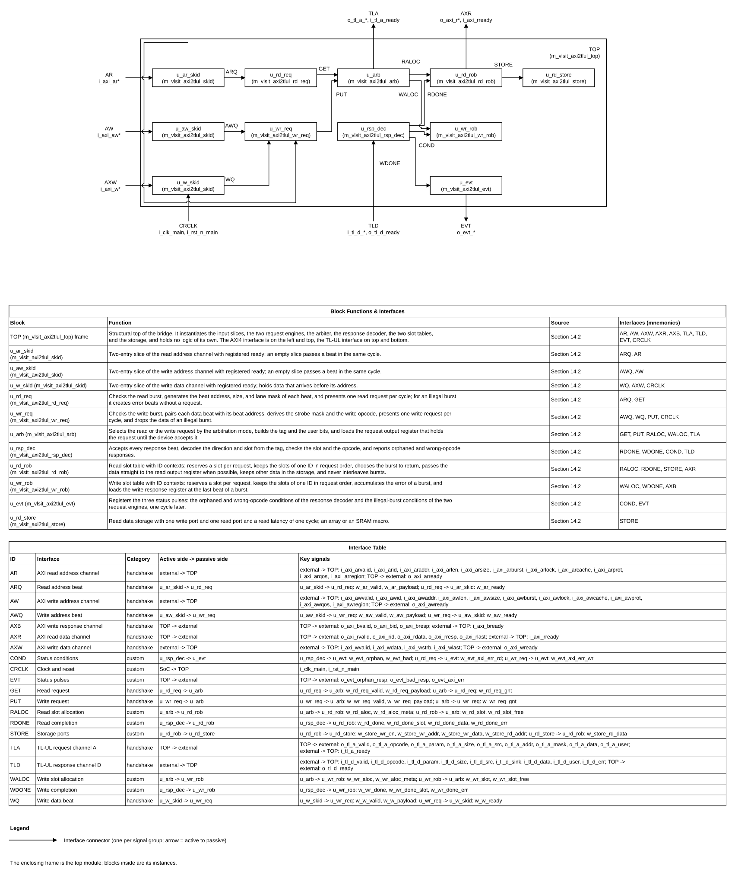

*Figure 5-1. Block diagram of the AXI2TLUL Bridge (draw.io source: figures/vlsit_block_diagram.drawio). Source: `figures/vlsit_block_diagram.drawio` (draw.io, VLSIT library, drawn by `vlsit_spec_diagram.py`). The frame is the top module, the blocks are its instances, each connector is one interface with its mnemonic, and the two tables under the diagram in the source file describe the blocks and the interfaces.*

### 5.3 Transaction and dataflow

**Read.** (1) The Manager presents an AR beat; the slice accepts it when `o_axi_arready` is 1. (2) `u_rd_req` checks the burst. A legal burst is split into N beats; for beat k it computes the address, size, and mask, and presents a Get request. (3) `u_arb` grants the request, `u_rd_rob` allocates the next slot (tag), and the A register carries the request in the next cycle. (4) The TL-UL device returns `AccessAckData` or an error with the tag in `d_source`. (5) `u_rsp_dec` forwards the data to `u_rd_rob`. If the slot is the head and the R register can accept, the data goes straight to the R register; otherwise it is written to the storage and the slot is marked done. (6) The R path serves one burst at a time: it takes a context whose oldest slot is done, returns that burst's beats consecutively, `o_axi_rlast` is 1 on the last beat of the burst, and releases each slot as its beat is loaded into the R register (DEC-016).

**Write.** (1) The Manager presents AW and W beats in any relative order (within the slice depth); each slice accepts when its ready is 1. (2) `u_wr_req` holds the active AW burst and pairs each W beat with the next beat address. (3) A Put request (PutFullData or PutPartialData) is granted by `u_arb`; `u_wr_rob` allocates a slot. (4) The device returns `AccessAck` or an error. (5) `u_wr_rob` marks the slot done (and records an error). (6) Slots of one ID retire in request order; error status accumulates over the burst; at the slot with the last flag the B register gets one response (OKAY or SLVERR) with the burst ID. B responses of different IDs may leave in any order.

**Illegal burst.** The engine does not send a TL-UL request. A read burst gets N error slots (data 0, SLVERR, correct last flag) that retire like normal slots; a write burst discards its W beats and gets one error slot after the last beat. `o_evt_axi_err_rd` (illegal AR) and `o_evt_axi_err_wr` (illegal AW or WLAST mismatch) pulse once per illegal burst; each output has one source, so two events in the same cycle give one pulse on each output and none is lost (DEC-021).

### 5.4 Invariants

1. Every allocated slot belongs to exactly one outstanding TL-UL request or to one error injection and to exactly one ID context; the number of allocated slots never exceeds `PARA_NUM_RD` (read) or `PARA_NUM_WR` (write), and the number of active contexts never exceeds `PARA_NUM_ID_RD` (read) or `PARA_NUM_ID_WR` (write).
2. The tag `o_tl_a_src` of a request is unique among all outstanding requests of both directions.
3. Slots of one ID context retire strictly in allocation order, so the AXI responses with equal ID leave in the order of their requests; no two active contexts hold the same ID; on the R channel the beats of a burst are consecutive (no interleaving of bursts).
4. A TL-UL request is never issued without a free slot; therefore `o_tl_d_ready` can be 1 at all times after reset (ASM-002).
5. While `o_tl_a_valid` = 1 and `i_tl_a_ready` = 0, all `o_tl_a_*` signals keep their value. While `o_axi_rvalid` = 1 and `i_axi_rready` = 0 (and likewise for B), the payload keeps its value.
6. No combinational path exists from any input port to any output port (REQ-IF-002).
7. B is never presented before the last W beat of the burst has been accepted and the TL-UL response of the last beat has been received.

## 6. External interfaces and ports

### 6.1 Interface inventory

| Interface ID | Type and revision | Role | Direction at IP boundary | Clock domain | Required / optional | Configurations |
|---|---|---|---|---|---|---|
| IF-001 | AMBA AXI4 (REF-001), five channels AW, W, B, AR, R, no USER signals | Subordinate | Requests in (AW, W, AR), responses out (B, R) | CLK-MAIN | Required | All |
| IF-002 | TL-UL of OpenTitan (REF-002, REF-006), channels A and D | Host | Requests out (A), responses in (D) | CLK-MAIN | Required | All |
| IF-003 | Status pulses (custom) | Source | Output | CLK-MAIN | Required | All |
| IF-004 | Clock and reset | Sink | Input | CLK-MAIN | Required | All |

### 6.2 Complete port list

Naming follows the default naming rule (Section 2.2). TL-UL names appear in the "Meaning" column in protocol form. Unless stated otherwise the clock domain is CLK-MAIN. The AXI profile has no USER signals, no AXI3 `WID`, and no `AxLOCK` wider than one bit. Widths use the parameters of Section 8: `ID_W` = `PARA_AXI_ID_W`, `AW` = `PARA_ADDR_W`, `DW` = `PARA_DATA_W`, `SB` = `LPARA_STRB_W`, `SZ` = `LPARA_SIZE_W`, `SRC` = `PARA_TL_SRC_W`, `AU` = `PARA_TL_AUSER_W`, `DU` = `PARA_TL_DUSER_W`, `SK` = `PARA_TL_SINK_W`.

| Port | Direction | Width | Meaning (function) | Clock domain | Signal type | Reset / idle value | Timing / sampling | Configurations |
|---|---|---|---|---|---|---|---|---|
| i_clk_main | Input | 1 | Clock of the AXI side and the TL-UL side (ACLK, clk_i) | CLK-MAIN | clock | Not applicable | Rising edge | All |
| i_rst_n_main | Input | 1 | Active-low reset of the whole IP (ARESETn, rst_ni) | CLK-MAIN | reset | Not applicable | Asserted asynchronously, released synchronously | All |
| i_axi_awvalid | Input | 1 | Write address valid (AWVALID) | CLK-MAIN | level | Manager drives 0 in reset | Sampled at the rising edge; handshake with o_axi_awready | All |
| o_axi_awready | Output | 1 | Write address ready (AWREADY); flip-flop output | CLK-MAIN | level | 0 | Registered; 1 from the second cycle after reset when the AW slice has room | All |
| i_axi_awid | Input | ID_W | Write ID (AWID) | CLK-MAIN | data (valid with i_axi_awvalid) | Ignored when AWVALID = 0 | Sampled with the AW handshake | All |
| i_axi_awaddr | Input | AW | Write start address (AWADDR) | CLK-MAIN | data (valid with i_axi_awvalid) | Ignored when AWVALID = 0 | Sampled with the AW handshake | All |
| i_axi_awlen | Input | 8 | Burst length minus one (AWLEN) | CLK-MAIN | data (valid with i_axi_awvalid) | Ignored when AWVALID = 0 | Sampled with the AW handshake | All |
| i_axi_awsize | Input | 3 | Bytes per beat, log2 (AWSIZE) | CLK-MAIN | data (valid with i_axi_awvalid) | Ignored when AWVALID = 0 | Sampled with the AW handshake | All |
| i_axi_awburst | Input | 2 | Burst type (AWBURST) | CLK-MAIN | data (valid with i_axi_awvalid) | Ignored when AWVALID = 0 | Sampled with the AW handshake | All |
| i_axi_awlock | Input | 1 | Exclusive access request (AWLOCK); ignored, the access is normal | CLK-MAIN | data (valid with i_axi_awvalid) | Ignored | Sampled with the AW handshake | All |
| i_axi_awcache | Input | 4 | Memory attributes (AWCACHE); ignored | CLK-MAIN | data (valid with i_axi_awvalid) | Ignored | Not used | All |
| i_axi_awprot | Input | 3 | Protection (AWPROT); bit 2 selects the instruction attribute | CLK-MAIN | data (valid with i_axi_awvalid) | Ignored when AWVALID = 0 | Sampled with the AW handshake | All |
| i_axi_awqos | Input | 4 | Quality of service (AWQOS); ignored | CLK-MAIN | data (valid with i_axi_awvalid) | Ignored | Not used | All |
| i_axi_awregion | Input | 4 | Region identifier (AWREGION); ignored | CLK-MAIN | data (valid with i_axi_awvalid) | Ignored | Not used | All |
| i_axi_wvalid | Input | 1 | Write data valid (WVALID) | CLK-MAIN | level | Manager drives 0 in reset | Sampled at the rising edge; handshake with o_axi_wready | All |
| o_axi_wready | Output | 1 | Write data ready (WREADY); flip-flop output | CLK-MAIN | level | 0 | Registered; 1 from the second cycle after reset when the W slice has room | All |
| i_axi_wdata | Input | DW | Write data (WDATA) | CLK-MAIN | data (valid with i_axi_wvalid) | Ignored when WVALID = 0 | Sampled with the W handshake | All |
| i_axi_wstrb | Input | SB | Write strobes, one bit per byte lane (WSTRB) | CLK-MAIN | data (valid with i_axi_wvalid) | Ignored when WVALID = 0 | Sampled with the W handshake | All |
| i_axi_wlast | Input | 1 | Last beat of a write burst (WLAST) | CLK-MAIN | data (valid with i_axi_wvalid) | Ignored when WVALID = 0 | Sampled with the W handshake | All |
| o_axi_bvalid | Output | 1 | Write response valid (BVALID); flip-flop output | CLK-MAIN | level | 0 | Held until i_axi_bready = 1 | All |
| i_axi_bready | Input | 1 | Write response ready (BREADY) | CLK-MAIN | level | Any | Sampled at the rising edge; handshake with o_axi_bvalid | All |
| o_axi_bid | Output | ID_W | Write response ID (BID), the AWID of the burst | CLK-MAIN | data (valid with o_axi_bvalid) | 0 | Stable while BVALID = 1 and BREADY = 0 | All |
| o_axi_bresp | Output | 2 | Write response (BRESP): 2'b00 OKAY or 2'b10 SLVERR | CLK-MAIN | data (valid with o_axi_bvalid) | 0 | Stable while BVALID = 1 and BREADY = 0 | All |
| i_axi_arvalid | Input | 1 | Read address valid (ARVALID) | CLK-MAIN | level | Manager drives 0 in reset | Sampled at the rising edge; handshake with o_axi_arready | All |
| o_axi_arready | Output | 1 | Read address ready (ARREADY); flip-flop output | CLK-MAIN | level | 0 | Registered; 1 from the second cycle after reset when the AR slice has room | All |
| i_axi_arid | Input | ID_W | Read ID (ARID) | CLK-MAIN | data (valid with i_axi_arvalid) | Ignored when ARVALID = 0 | Sampled with the AR handshake | All |
| i_axi_araddr | Input | AW | Read start address (ARADDR) | CLK-MAIN | data (valid with i_axi_arvalid) | Ignored when ARVALID = 0 | Sampled with the AR handshake | All |
| i_axi_arlen | Input | 8 | Burst length minus one (ARLEN) | CLK-MAIN | data (valid with i_axi_arvalid) | Ignored when ARVALID = 0 | Sampled with the AR handshake | All |
| i_axi_arsize | Input | 3 | Bytes per beat, log2 (ARSIZE) | CLK-MAIN | data (valid with i_axi_arvalid) | Ignored when ARVALID = 0 | Sampled with the AR handshake | All |
| i_axi_arburst | Input | 2 | Burst type (ARBURST) | CLK-MAIN | data (valid with i_axi_arvalid) | Ignored when ARVALID = 0 | Sampled with the AR handshake | All |
| i_axi_arlock | Input | 1 | Exclusive access request (ARLOCK); ignored, the access is normal | CLK-MAIN | data (valid with i_axi_arvalid) | Ignored | Sampled with the AR handshake | All |
| i_axi_arcache | Input | 4 | Memory attributes (ARCACHE); ignored | CLK-MAIN | data (valid with i_axi_arvalid) | Ignored | Not used | All |
| i_axi_arprot | Input | 3 | Protection (ARPROT); bit 2 selects the instruction attribute | CLK-MAIN | data (valid with i_axi_arvalid) | Ignored when ARVALID = 0 | Sampled with the AR handshake | All |
| i_axi_arqos | Input | 4 | Quality of service (ARQOS); ignored | CLK-MAIN | data (valid with i_axi_arvalid) | Ignored | Not used | All |
| i_axi_arregion | Input | 4 | Region identifier (ARREGION); ignored | CLK-MAIN | data (valid with i_axi_arvalid) | Ignored | Not used | All |
| o_axi_rvalid | Output | 1 | Read data valid (RVALID); flip-flop output | CLK-MAIN | level | 0 | Held until i_axi_rready = 1 | All |
| i_axi_rready | Input | 1 | Read data ready (RREADY) | CLK-MAIN | level | Any | Sampled at the rising edge; handshake with o_axi_rvalid | All |
| o_axi_rid | Output | ID_W | Read ID (RID), the ARID of the burst | CLK-MAIN | data (valid with o_axi_rvalid) | 0 | Stable while RVALID = 1 and RREADY = 0 | All |
| o_axi_rdata | Output | DW | Read data (RDATA) | CLK-MAIN | data (valid with o_axi_rvalid) | 0 | Stable while RVALID = 1 and RREADY = 0 | All |
| o_axi_rresp | Output | 2 | Read response (RRESP): 2'b00 OKAY or 2'b10 SLVERR | CLK-MAIN | data (valid with o_axi_rvalid) | 0 | Stable while RVALID = 1 and RREADY = 0 | All |
| o_axi_rlast | Output | 1 | Last beat of a read burst (RLAST) | CLK-MAIN | data (valid with o_axi_rvalid) | 0 | Stable while RVALID = 1 and RREADY = 0 | All |
| o_tl_a_valid | Output | 1 | TL-UL a_valid: request valid; flip-flop output | CLK-MAIN | level | 0 | Held with stable payload until i_tl_a_ready = 1 | All |
| i_tl_a_ready | Input | 1 | TL-UL a_ready: request accepted by the device | CLK-MAIN | level | Any | Sampled at the rising edge; handshake with o_tl_a_valid | All |
| o_tl_a_opcode | Output | 3 | TL-UL a_opcode: Get 3'h4, PutFullData 3'h0, PutPartialData 3'h1 | CLK-MAIN | data (valid with o_tl_a_valid) | 0 | Stable while a_valid = 1 and a_ready = 0 | All |
| o_tl_a_param | Output | 3 | TL-UL a_param: unused, constant 3'b000 | CLK-MAIN | static | 0 | Constant | All |
| o_tl_a_size | Output | SZ | TL-UL a_size: log2 of the bytes of the request (AxSIZE) | CLK-MAIN | data (valid with o_tl_a_valid) | 0 | Stable while a_valid = 1 and a_ready = 0 | All |
| o_tl_a_src | Output | SRC | TL-UL a_source: tag (direction bit and slot index) | CLK-MAIN | data (valid with o_tl_a_valid) | 0 | Stable while a_valid = 1 and a_ready = 0 | All |
| o_tl_a_addr | Output | AW | TL-UL a_address: beat address aligned to the size | CLK-MAIN | data (valid with o_tl_a_valid) | 0 | Stable while a_valid = 1 and a_ready = 0 | All |
| o_tl_a_mask | Output | SB | TL-UL a_mask: byte lanes of the request | CLK-MAIN | data (valid with o_tl_a_valid) | 0 | Stable while a_valid = 1 and a_ready = 0 | All |
| o_tl_a_data | Output | DW | TL-UL a_data: write data, all ones for a read | CLK-MAIN | data (valid with o_tl_a_valid) | 0 | Stable while a_valid = 1 and a_ready = 0 | All |
| o_tl_a_user | Output | AU | TL-UL a_user: instr_type, integrity default bits, reserved 0 | CLK-MAIN | data (valid with o_tl_a_valid) | 0 | Stable while a_valid = 1 and a_ready = 0 | All |
| i_tl_d_valid | Input | 1 | TL-UL d_valid: response valid | CLK-MAIN | level | Device drives 0 in reset | Sampled at the rising edge; always accepted | All |
| o_tl_d_ready | Output | 1 | TL-UL d_ready: response accepted; 1 after reset, flip-flop output | CLK-MAIN | level | 0 | Registered; 1 from the second cycle after reset release (REQ-IF-006) | All |
| i_tl_d_opcode | Input | 3 | TL-UL d_opcode: AccessAck 3'h0 or AccessAckData 3'h1 | CLK-MAIN | data (valid with i_tl_d_valid) | Ignored when d_valid = 0 | Sampled with the D handshake | All |
| i_tl_d_param | Input | 3 | TL-UL d_param: unused, ignored | CLK-MAIN | data (valid with i_tl_d_valid) | Ignored | Not used | All |
| i_tl_d_size | Input | SZ | TL-UL d_size: size of the response, ignored | CLK-MAIN | data (valid with i_tl_d_valid) | Ignored | Not used | All |
| i_tl_d_src | Input | SRC | TL-UL d_source: tag of the request that is answered | CLK-MAIN | data (valid with i_tl_d_valid) | Ignored when d_valid = 0 | Sampled with the D handshake | All |
| i_tl_d_sink | Input | SK | TL-UL d_sink: unused, ignored | CLK-MAIN | data (valid with i_tl_d_valid) | Ignored | Not used | All |
| i_tl_d_data | Input | DW | TL-UL d_data: read data | CLK-MAIN | data (valid with i_tl_d_valid) | Ignored when d_valid = 0 | Sampled with the D handshake | All |
| i_tl_d_user | Input | DU | TL-UL d_user: response integrity bits, ignored | CLK-MAIN | data (valid with i_tl_d_valid) | Ignored | Not used | All |
| i_tl_d_err | Input | 1 | TL-UL d_error: the request failed | CLK-MAIN | data (valid with i_tl_d_valid) | Ignored when d_valid = 0 | Sampled with the D handshake | All |
| o_evt_orphan_resp | Output | 1 | Pulse: a channel-D beat had no outstanding slot | CLK-MAIN | pulse (1 cycle) | 0 | Flip-flop output, 1 cycle after the beat | All |
| o_evt_bad_resp | Output | 1 | Pulse: a channel-D beat had an opcode that does not match its slot | CLK-MAIN | pulse (1 cycle) | 0 | Flip-flop output, 1 cycle after the beat | All |
| o_evt_axi_err_rd | Output | 1 | Pulse: an illegal AR burst was detected | CLK-MAIN | pulse (1 cycle) | 0 | Flip-flop output, 1 cycle after the detection | All |
| o_evt_axi_err_wr | Output | 1 | Pulse: an illegal AW burst or a WLAST mismatch was detected | CLK-MAIN | pulse (1 cycle) | 0 | Flip-flop output, 1 cycle after the detection | All |

### 6.3 Protocol behavior

**AXI4 side (REF-001).** Inputs are sampled at the rising edge of `i_clk_main`. A beat transfers at an edge where VALID and READY are both 1. `o_axi_awready`, `o_axi_wready`, `o_axi_arready` come from flip-flops and do not depend on the VALID of any channel in the same cycle (A3.2, A3.3: a subordinate may wait for VALID, and the bridge never makes a ready depend on another channel's valid, so no deadlock arises). `o_axi_bvalid` and `o_axi_rvalid` stay at 1 with stable payload until `i_axi_bready` / `i_axi_rready` is 1. Write response ordering follows REF-001 A3.3: B is presented only after the last W beat and the address were accepted and after the TL-UL response of the last beat.

| Case | Legal behavior | Illegal / unsupported case | IP response | Requirement IDs |
|---|---|---|---|---|
| Burst type INCR, length 1 to 256 | Beat k at `Aligned_Address + k × 2^AxSIZE` (first beat at `AxADDR`) | Burst crosses a 4 KB boundary (`Aligned_Address[11:0] + (AxLEN+1) × 2^AxSIZE` > 4096) | SLVERR for the whole burst, no TL-UL request, `o_evt_axi_err_rd` (AR) or `o_evt_axi_err_wr` (AW) | REQ-FUNC-003, REQ-ERR-003 |
| Burst type WRAP | Length 2, 4, 8, 16; start aligned to the transfer size; address wraps at the container boundary (A3.4.1) | Length not in {2, 4, 8, 16}, or start address not aligned to `2^AxSIZE` | SLVERR for the whole burst, no TL-UL request | REQ-FUNC-003, REQ-ERR-003 |
| Burst type FIXED | Same address on every beat; same byte lanes; length 1 to 16 | Length greater than 16 | SLVERR for the whole burst | REQ-FUNC-003, REQ-ERR-003 |
| Burst type 2'b11 | None | Reserved encoding | SLVERR for the whole burst | REQ-ERR-003 |
| Transfer size | `2^AxSIZE` ≤ `SB` bytes (narrow transfers allowed) | `2^AxSIZE` > `SB` | SLVERR for the whole burst | REQ-FUNC-004, REQ-ERR-003 |
| Unaligned INCR start | First beat transfers the bytes from `AxADDR` to the end of its aligned transfer | None | TL-UL request with aligned `a_address` and a partial `a_mask` | REQ-FUNC-004 |
| Write strobes | Any `WSTRB` pattern, including non-contiguous and all-zero | None | `WSTRB` AND lane mask goes to `a_mask`; opcode PutPartialData unless the mask is full (REQ-FUNC-005); the device may answer `d_error` | REQ-FUNC-005 |
| Exclusive access (`AxLOCK` = 1) | Treated as a normal access | None | Completes with OKAY (exclusive failed in AXI terms), never EXOKAY | REQ-FUNC-011 |
| `AxCACHE`, `AxQOS`, `AxREGION` | Any value | None | Ignored | REQ-FUNC-012 |
| `AxPROT[2]` | 0 = data, 1 = instruction | None | Becomes `instr_type` (False / True) | REQ-FUNC-008 |
| `AxID` | Any value, any reuse | None, except that a new ID waits while all ID contexts are busy | Stored with the slot, returned as `RID` / `BID`; order kept per ID (REQ-FUNC-009) | REQ-FUNC-009, REQ-FUNC-018 |
| W data before AW | Accepted by the W slice up to its depth, then `o_axi_wready` drops | None | Held until the AW burst is active | REQ-FUNC-015 |
| `WLAST` not matching `AWLEN` | None (master error) | Last beat without `WLAST`, or `WLAST` before the last beat | The burst ends after `AWLEN`+1 beats; `o_evt_axi_err_wr` pulses | REQ-ERR-006 |
| Early termination, narrow `AxSIZE` above bus | Not allowed by REF-001 | Master error | As the illegal cases above | REQ-ERR-003 |

**TL-UL side (REF-002, REF-006).** The bridge drives channel A: one request per cycle at most; `o_tl_a_valid` stays 1 with stable `o_tl_a_*` until `i_tl_a_ready` is 1. It accepts channel D with `o_tl_d_ready` = 1 from the first cycle after reset release.

| Field of channel A | Value |
|---|---|
| `a_valid` | 1 for one request, held until `a_ready` |
| `a_opcode` | read: Get (3'h4); write: PutFullData (3'h0) when the mask covers all lanes of the aligned transfer region, otherwise PutPartialData (3'h1) |
| `a_param` | 3'b000 |
| `a_size` | `AxSIZE` truncated to `LPARA_SIZE_W` bits |
| `a_source` | tag: slot index in bits [`LPARA_SLOT_W`-1:0], direction in bit `LPARA_SLOT_W` (1 = write), zeros above (Section 9) |
| `a_address` | beat address `Address_N` with the low `AxSIZE` bits cleared |
| `a_mask` | read: byte lanes of the transfer; write: byte lanes AND `WSTRB` |
| `a_data` | write: `WDATA` unchanged; read: all ones (`BlankedAData`, REF-006) |
| `a_user` | `instr_type` from `AxPROT[2]` (mubi4 True 4'h6, False 4'h9), `cmd_intg` and `data_intg` all ones (`TL_A_USER_DEFAULT`), reserved bits 0 (REF-006) |

| Case | Legal behavior | Illegal / unsupported case | IP response | Requirement IDs |
|---|---|---|---|---|
| Response `AccessAckData` (d_opcode 3'h1) for a read slot | Data goes to `RDATA` of that beat | Opcode `AccessAck` for a read slot, or `AccessAckData` for a write slot | The slot completes with error (SLVERR), `o_evt_bad_resp` pulses (ASM-003) | REQ-ERR-004 |
| `d_error` = 1 | Response with error | None | Read: that beat SLVERR; write: the burst SLVERR (sticky) | REQ-ERR-001, REQ-ERR-002 |
| `d_source` of no outstanding slot | None | Orphaned response | Discarded, `o_evt_orphan_resp` pulses (REF-002 explicit error cases) | REQ-ERR-005 |
| Responses in another order than the requests | Allowed by REF-002 | None | Stored; returned in request order per AXI ID, and independent between IDs | REQ-FUNC-009, REQ-FUNC-010 |
| `d_param`, `d_sink`, `d_user`, `d_size` | Any value | None | Ignored (ASM-011) | REQ-IF-007 |
| Integrity of the command | Bits at TL_A_USER_DEFAULT | Device that checks integrity | Requires external `tlul_cmd_intg_gen` (DEP-003, DEP-004) | REQ-INT-001 |

### 6.4 Interrupts and events

There is no interrupt. Three status pulses go to the SoC (for example to an error counter or an alert block). They are not masked and not prioritized; simultaneous events produce simultaneous pulses.

| Signal/event | Polarity | Assert condition | Clear/deassert condition | Mask/priority | Crossing | Reset state |
|---|---|---|---|---|---|---|
| `o_evt_orphan_resp` | Active high pulse, 1 cycle | A channel-D beat whose tag is not an outstanding slot | Next cycle | None | None (CLK-MAIN) | 0 |
| `o_evt_bad_resp` | Active high pulse, 1 cycle | A channel-D beat with an opcode that does not match the direction of its slot | Next cycle | None | None (CLK-MAIN) | 0 |
| `o_evt_axi_err_rd` | Active high pulse, 1 cycle | An illegal AXI burst is detected at AR decode | Next cycle | None | None (CLK-MAIN) | 0 |
| `o_evt_axi_err_wr` | Active high pulse, 1 cycle | An illegal AXI burst is detected at AW decode, or `WLAST` does not match `AWLEN` | Next cycle | None | None (CLK-MAIN) | 0 |

## 7. Clock, reset, and power

### 7.1 Clock domains

| Domain | Clock port | Edge | Frequency range | Source | Relationship to other clocks | Gating policy |
|---|---|---|---|---|---|---|
| CLK-MAIN | `i_clk_main` | Rising | TBD-001 | SoC clock controller | Single clock for the AXI side and the TL-UL side; the Manager and the device shall use the same clock | No clock gating inside the IP |

### 7.2 CDC and RDC

**N/A (DEC-004):** the AXI side and the TL-UL side use one clock, so there is no clock-domain crossing. A different clock for the TL-UL side needs an external TL-UL asynchronous FIFO (`tlul_fifo_async` of REF-002) or an AXI clock-crossing block.

The reset has one domain, so there is no reset-domain crossing inside the IP.

### 7.3 Reset domains and sequencing

| Reset ID | Port | Polarity / assertion | Sync or async | Scope | Deassertion | Reset value |
|---|---|---|---|---|---|---|
| RST-MAIN | `i_rst_n_main` | Active-low | Asynchronous assertion; deassertion shall be synchronous to `i_clk_main` (REF-001 A3.1.2), provided by the SoC reset controller | Whole IP | Synchronous release by the reset controller | All state is cleared: no outstanding slot, no burst active, all valid outputs 0, all ready outputs 0, payload outputs 0, pulse outputs 0 |

Reset behavior: (1) During reset the bridge drives `o_axi_rvalid`, `o_axi_bvalid`, and `o_tl_a_valid` low (REF-001 A3.1.2); the ready outputs are also 0. (2) The first cycle after release is the first cycle with `o_axi_arready`, `o_axi_awready`, `o_axi_wready`, and `o_tl_d_ready` still 0 because they are flip-flops that are set by the first edge after release; they are 1 from the second cycle after release. (3) A reset aborts all in-flight work without a response. The AXI Manager and the TL-UL device shall be reset together with the bridge. (4) A TL-UL response that arrives after a reset for a request of the previous epoch has no outstanding slot and is handled as an orphaned response (REQ-ERR-005). (5) There is no software reset, partial reset, or retention reset. Interrupt and status: the pulses are 0 in reset.

### 7.4 Power intent (if applicable)

**N/A (ASM-016):** the IP is assumed to have one power domain with no isolation, retention, or low-power state; power intent is owned by the SoC.

## 8. Parameters and elaboration configurations

All parameters are declared as `parameter logic [31:0]` with a name that starts with `PARA_`, with the three comment lines of the rule file immediately above each one. Derived local parameters (`localparam logic [31:0]`, names starting with `LPARA_`) follow the overridable parameters in the parameter port list. The port list is static for a given parameter set; parameter values change port widths only.

| Parameter | Purpose | Default | Legal values / range | Dependencies / invalid combinations | Effect |
|---|---|---|---|---|---|
| `PARA_DATA_W` | Data width of AXI `WDATA` / `RDATA` and TL-UL `a_data` / `d_data` (one value for both sides, DEC-003) | 32 | 32, 64, 128, 256, 512, 1024 | Power of two, multiple of 8; sets `LPARA_STRB_W`, `LPARA_SIZE_W` | Port widths, storage width, lane mask width |
| `PARA_ADDR_W` | Address width of `AxADDR` and `a_address` | 32 | 12 to 64 | At least 12 (the 4 KB boundary check uses bits [11:0]) | Port widths, address logic |
| `PARA_AXI_ID_W` | Width of `AxID`, `RID`, `BID` | 8 | 1 to 32 | None | Port widths, slot metadata |
| `PARA_TL_SRC_W` | Width of `a_source` / `d_source` | 8 | 2 to 32 | At least `LPARA_SLOT_W` + 1 | Tag width |
| `PARA_TL_AUSER_W` | Width of `a_user` | 18 | 18 to 64 | At least 18 (instr_type 4 + cmd_intg 7 + data_intg 7); bits above 17 are reserved and driven 0 | Port width |
| `PARA_TL_DUSER_W` | Width of the ignored `d_user` input | 14 | 1 to 64 | None | Port width |
| `PARA_TL_SINK_W` | Width of the ignored `d_sink` input | 1 | 1 to 8 | None | Port width |
| `PARA_NUM_RD` | Read slots = outstanding read beats | 16 | 2, 4, 8, 16, 32, 64, 128 | Power of two; at most 2^(`PARA_TL_SRC_W` − 1) | Read slot table, storage depth |
| `PARA_NUM_WR` | Write slots = outstanding write beats | 16 | 2, 4, 8, 16, 32, 64, 128 | Power of two; at most 2^(`PARA_TL_SRC_W` − 1) | Write slot table |
| `PARA_NUM_ID_RD` | ID contexts of the read direction = AXI IDs that can have read beats in flight at the same time | 4 | 1 to `PARA_NUM_RD` | At most `PARA_NUM_RD`; 1 serializes all IDs into one queue | Context table size |
| `PARA_NUM_ID_WR` | ID contexts of the write direction | 4 | 1 to `PARA_NUM_WR` | At most `PARA_NUM_WR` | Context table size |
| `PARA_ARB_MODE` | Arbitration between read and write requests | 0 | 0 = round-robin, 1 = read priority, 2 = write priority | None | Arbiter behavior |
| `PARA_STORE_MACRO` | Implementation of the read data storage | 0 | 0 = inferred array, 1 = SRAM macro wrapper | Macro model `VLSIT_CELL_SRAM_1W1R` of `common_rtl/000_Common` or the real macro | Storage module only; no change of ports or behavior |

| Derived parameter | Definition | Use |
|---|---|---|
| `LPARA_STRB_W` | `PARA_DATA_W` / 8 | Strobe and mask width |
| `LPARA_SIZE_W` | clog2(clog2(`LPARA_STRB_W`) + 1) | Width of `a_size` |
| `LPARA_BYTE_W` | clog2(`LPARA_STRB_W`) | Width of the byte offset |
| `LPARA_RD_IDX_W`, `LPARA_WR_IDX_W` | clog2(`PARA_NUM_RD`), clog2(`PARA_NUM_WR`) | Slot index widths |
| `LPARA_SLOT_W` | the larger of the two index widths | Position of the direction bit in the tag |

In words: `LPARA_STRB_W` = `PARA_DATA_W` / 8; `LPARA_SIZE_W` = clog2(clog2(`LPARA_STRB_W`) + 1) (2 bits for 32 bits, REF-002 "Signals"); `LPARA_BYTE_W` = clog2(`LPARA_STRB_W`); `LPARA_RD_IDX_W` = clog2(`PARA_NUM_RD`); `LPARA_WR_IDX_W` = clog2(`PARA_NUM_WR`); `LPARA_SLOT_W` = the larger of the two index widths.

| Configuration | Parameter overrides | Features/interfaces | Expected hierarchy | Elaboration/lint/synthesis target |
|---|---|---|---|---|
| CFG-BASE | Defaults | All | Section 14.2 | Elaborate, lint (0 errors, 0 warnings), synthesize |
| CFG-WIDE | `PARA_DATA_W` 256, `PARA_ADDR_W` 40, `PARA_AXI_ID_W` 4, `PARA_NUM_RD` 32 | All | Section 14.2 | Elaborate, lint |
| CFG-MACRO | `PARA_DATA_W` 64, `PARA_NUM_RD` 64, `PARA_STORE_MACRO` 1 | All | Storage module instantiates the macro wrapper | Elaborate, lint, synthesize with the macro model |
| CFG-MIN | `PARA_AXI_ID_W` 1, `PARA_TL_SRC_W` 2, `PARA_NUM_RD` 2, `PARA_NUM_WR` 2, `PARA_NUM_ID_RD` 1, `PARA_NUM_ID_WR` 1 | All | Section 14.2 | Elaborate, lint |

A value outside the legal range, or a combination that breaks a dependency, gives undefined behavior. The parameter sweep of TEST-014 and the lint run with each configuration of this section shall be used to find such errors; no run-time check exists in the RTL.

## 9. Data representation and arithmetic

Bit 0 is the least significant bit. Byte lane `i` of a data bus carries bits [8i+7:8i]; the byte lane of an address is `Address mod LPARA_STRB_W`. The bridge does not shift data: AXI and TL-UL use the same lane for the same address because both buses have the same width.

The slot index in `a_source` is implementation-defined (DEC-020): the bridge gives a request the lowest free slot of its direction, so a tag can be reused as soon as the response of its previous owner has retired. A tag is unique only among the outstanding requests (REQ-FUNC-007). The waveforms show the tags that this allocation produces.

| Quantity | Width | Encoding / range | Extension / truncation | Overflow / invalid behavior |
|---|---:|---|---|---|
| `AxLEN` | 8 | Beats = `AxLEN` + 1 (1 to 256) | None | WRAP not in {2, 4, 8, 16} beats, FIXED above 16 beats: illegal burst |
| `AxSIZE` | 3 | Bytes per beat `B` = 2^`AxSIZE` | Low `LPARA_SIZE_W` bits go to `a_size` | `B` > `LPARA_STRB_W`: illegal burst |
| `AxBURST` | 2 | 2'b00 FIXED, 2'b01 INCR, 2'b10 WRAP, 2'b11 reserved | None | 2'b11: illegal burst |
| Beat address `Address_N` | `PARA_ADDR_W` | `Address_1` = `AxADDR`; INCR: `Aligned_Address + (N−1)·B`; FIXED: `AxADDR`; WRAP: wraps at `Wrap_Boundary` (REF-001 A3.4.1 equations) | None | The address never leaves the 4 KB page of a legal burst |
| `a_address` | `PARA_ADDR_W` | `Address_N` with the low `AxSIZE` bits cleared | Bits [`AxSIZE`−1:0] cleared | None |
| Lane mask `lanes` | `LPARA_STRB_W` | With `off` = `Address_N` mod `LPARA_STRB_W` and `lo` = `off` for the first beat and for every beat of a FIXED burst, `lo` = `off` aligned down to `B` for all other beats, `hi` = (`off` aligned down to `B`) + `B` − 1: bit i is 1 when `lo` ≤ i ≤ `hi` | None | None |
| `a_mask` read | `LPARA_STRB_W` | `lanes` | None | None |
| `a_mask` write | `LPARA_STRB_W` | `WSTRB` AND `lanes` | None | Non-contiguous or zero mask is forwarded; the device decides (DEC-013) |
| Full region | `LPARA_STRB_W` | Bits [(`off` aligned down to `B`) + `B` − 1 : `off` aligned down to `B`] set | None | PutFullData when `a_mask` equals the full region, else PutPartialData |
| `a_source` / `d_source` | `PARA_TL_SRC_W` | Bit `LPARA_SLOT_W` = 1 for a write slot, bits [`LPARA_SLOT_W`−1:0] = slot index (read index zero-extended from `LPARA_RD_IDX_W`, write index from `LPARA_WR_IDX_W`), bits above = 0 | Zero extension | A response tag whose upper bits are not 0, or whose index is not outstanding, is an orphaned response |
| `a_user` | `PARA_TL_AUSER_W` | Packed, most significant first: reserved, `instr_type`, `cmd_intg`, `data_intg` (`tl_a_user_t` of REF-006); the four fields follow | None | None |
| `a_user[6:0]` | 7 | `data_intg` = 7'h7F | None | None |
| `a_user[13:7]` | 7 | `cmd_intg` = 7'h7F | None | None |
| `a_user[17:14]` | 4 | `instr_type` mubi4: 4'h6 (True) when `AxPROT[2]` = 1, 4'h9 (False) when 0 | None | None |
| `a_user[PARA_TL_AUSER_W−1:18]` | `PARA_TL_AUSER_W` − 18 | Reserved, 0 | None | None |
| `a_opcode` | 3 | Get 3'h4, PutFullData 3'h0, PutPartialData 3'h1 | None | Other values are never driven |
| `d_opcode` | 3 | AccessAck 3'h0 (write), AccessAckData 3'h1 (read) | None | Other values, or the wrong one for the slot: bad response |
| `RRESP`, `BRESP` | 2 | 2'b00 OKAY, 2'b10 SLVERR | None | EXOKAY (2'b01) and DECERR (2'b11) are never produced |
| `RDATA` of a beat with TL-UL error | `PARA_DATA_W` | `d_data` of the device unchanged | None | OpenTitan devices return all ones (`DataWhenError`, REF-006) |
| `RDATA` of a beat of an illegal burst | `PARA_DATA_W` | 0 | None | None |

## 10. Detailed functional behavior

### 10.1 Modes and state transitions

The IP has no operating modes. The state is held in the engines, the slot tables, and the output registers.

| Mode/state | Entry condition | Behavior | Exit condition | Outputs / side effects |
|---|---|---|---|---|
| Read engine IDLE | Reset, or the last beat of a burst was issued | Waits for an AR beat (from the slice, or directly from the port when the slice is empty) | An AR beat is available | None |
| Read engine BURST | A legal AR beat was taken | Issues one Get request per cycle when the arbiter grants and a read slot is free; updates address and remaining count | The last beat was granted | Get request, slot allocation |
| Read engine ERROR | An illegal AR beat was taken | Allocates one error slot per cycle (as long as read slots are free) for `AxLEN`+1 beats | The last error slot was allocated | `o_evt_axi_err_rd` pulse at entry |
| Write engine IDLE | Reset, or the last beat of a burst was issued | Waits for an AW beat | An AW beat is available | None |
| Write engine BURST | A legal AW beat was taken | Pairs each W beat with the next beat address; issues one Put request per cycle when granted and a write slot is free | The last beat was granted | Put request, slot allocation |
| Write engine DISCARD | An illegal AW beat was taken | Accepts and drops W beats until `AxLEN`+1 beats were counted, then allocates one error slot | The error slot was allocated | `o_evt_axi_err_wr` pulse at entry |
| A register EMPTY / FULL | EMPTY: reset or `a_ready` took the request; FULL: a request was loaded | EMPTY accepts a new request; FULL holds it with stable payload; it accepts a new request in the same cycle in which `i_tl_a_ready` = 1 | Handshake | `o_tl_a_valid` = FULL |
| Slot FREE / ALLOCATED / DONE | Allocation at grant (or error injection); DONE at the response (or at injection) | ALLOCATED waits for the response; DONE waits for retirement; slots of one ID retire in allocation order | Retirement frees the slot | R or B register is loaded at retirement |
| ID context FREE / ACTIVE | ACTIVE: the first beat of a burst with an ID that has no context takes a free context; FREE: the last slot of the context retired | ACTIVE keeps the ID and the order of its slots; a burst whose ID has no context waits while no context is free | Last outstanding slot of the ID retired | None |
| R path IDLE / BURST | BURST: a context whose oldest slot is done was chosen; IDLE: reset, or the beat with the last flag was loaded into the R register | BURST returns only beats of that context's current burst, waiting for a beat that is not yet done; IDLE chooses the next context | Beat with the last flag loaded | `o_axi_rvalid` |
| R register, B register | Loaded at retirement | Valid until the handshake with `i_axi_rready` / `i_axi_bready`; accepts a new beat in the cycle of the handshake | Handshake | `o_axi_rvalid`, `o_axi_bvalid` |

### 10.2 Operations

| Operation ID | Inputs / preconditions | Processing semantics | Result / completion | Latency / ordering |
|---|---|---|---|---|
| OP-001 Read burst | AR beat with legal attributes; free read slot per beat | Splits into `AxLEN`+1 Get requests; each beat has its slot and tag; the response data returns through the bypass or the storage | `AxLEN`+1 R beats in beat order, consecutive on the R channel, `RLAST` on the last, `RRESP` OKAY or SLVERR per beat | Request latency 1 cycle, response latency 1 cycle (PERF-001, PERF-002); in order per ID, bursts of different IDs may complete in any order |
| OP-002 Write burst | AW beat with legal attributes and `AxLEN`+1 W beats | Pairs W beats with beat addresses; one Put request per beat; the opcode follows the mask | One B response after the response of the last beat; SLVERR if any beat had `d_error` or a wrong opcode | Request latency 1 cycle; B 1 cycle after the last response; in order per ID |
| OP-003 Illegal burst rejection | AR or AW beat with an illegal attribute (Section 6.3) | No TL-UL request; read: error slots; write: W beats dropped, one error slot | Read: `AxLEN`+1 R beats with SLVERR, data 0, `RLAST` last; write: one B with SLVERR; `o_evt_axi_err_rd` (read) or `o_evt_axi_err_wr` (write) pulse | Retires in order with the other slots of the same ID |
| OP-004 Response collection | A beat on channel D (`i_tl_d_valid` = 1) | `d_ready` is always 1; the tag selects the direction and the slot; checks outstanding state and opcode; the data goes to the R register (bypass) or to the storage | Slot DONE (with error flag if needed) | One beat per cycle; any order |
| OP-005 Reset | `i_rst_n_main` low | All state cleared (Section 7.3) | Idle outputs | Asynchronous assertion, synchronous release |
| OP-006 Arbitration | Read request and/or write request ready | Grants one request per cycle according to `PARA_ARB_MODE` (Section 10.4) | The granted request is loaded into the A register | One grant per cycle |

### 10.3 Cycle-level behavior

**Conventions.** Cycle `cN` is the clock period that ends at the Nth rising edge shown in the waveform. A value is "sampled" at the rising edge that ends its cycle. A handshake takes place in the cycle in which VALID and READY are both 1. A signal that "appears in the next cycle" is the output of a flip-flop loaded at the edge that ends the current cycle.

**Waveform plan (rule R-024).** The requester confirmed on 2026-10-26 the list below (option A: all proposed waveforms; WF-019 was added after the per-ID ordering decision DEC-015). It covers every operation of 10.2, the success and the error case of the AXI and the TL-UL interface, and the special cases (reset, backpressure, back-to-back bursts, reordering, arbitration). Every figure is drawn from the cycle behavior of this section; its WaveJSON source is beside it in `figures/`.

| Waveform ID | Function / operation | Scenario (success / error / corner) | Signals shown | Figure | Confirmed by user |
|---|---|---|---|---|---|
| WF-001 | OP-005 Reset | Corner: reset in the middle of traffic, release, ready outputs rise in the second cycle | i_rst_n_main, AXI VALID and READY, o_tl_a_valid, o_tl_d_ready | 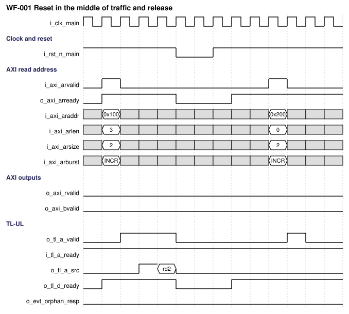; [WaveJSON](figures/wf-001.json) | 2026-10-26 |
| WF-002 | OP-001 Read burst | Success: single read beat, latency 1 + 1 cycles | AR, TL-UL A, TL-UL D, R | 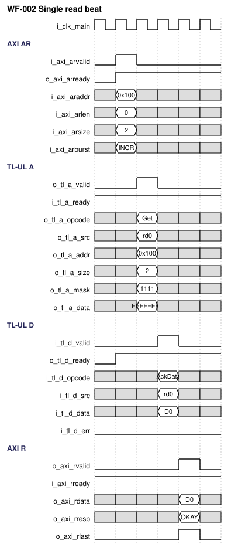; [WaveJSON](figures/wf-002.json) | 2026-10-26 |
| WF-003 | OP-001 Read burst | Success: four-beat INCR read at full rate | AR, TL-UL A, TL-UL D, R, RLAST | 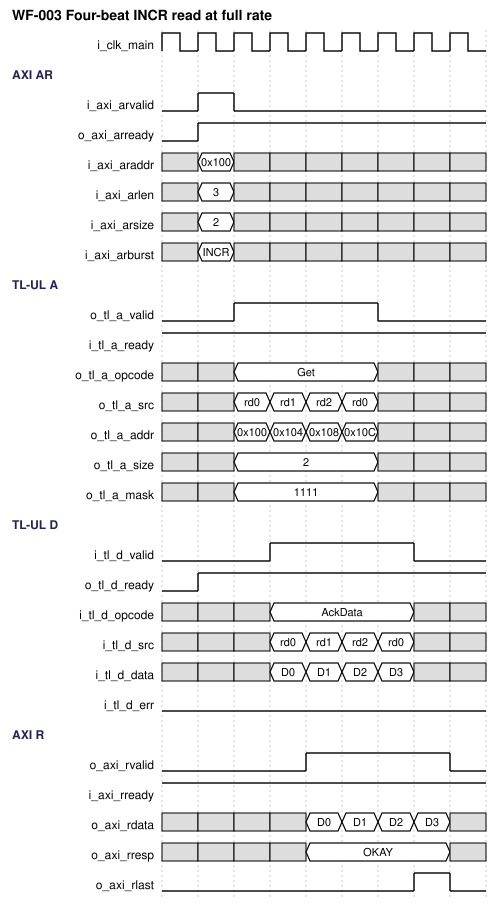; [WaveJSON](figures/wf-003.json) | 2026-10-26 |
| WF-004 | OP-001 Read burst | Corner: WRAP burst from the middle of the container, then FIXED burst, no bubble between bursts | araddr, o_tl_a_addr, tag | 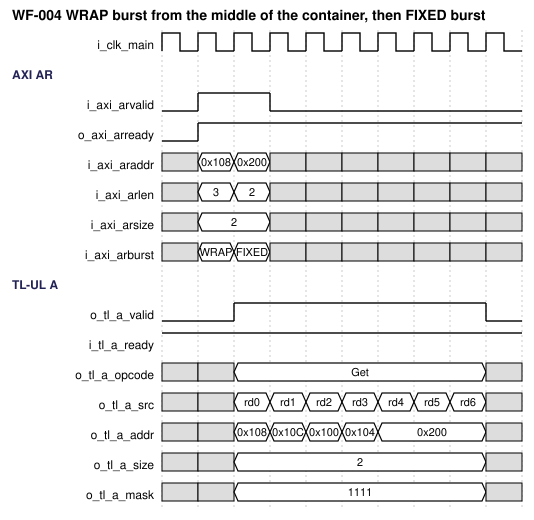; [WaveJSON](figures/wf-004.json) | 2026-10-26 |
| WF-005 | OP-001 Read burst | Corner: unaligned and narrow transfers (size, aligned address, lane mask) | o_tl_a_size, o_tl_a_addr, o_tl_a_mask | 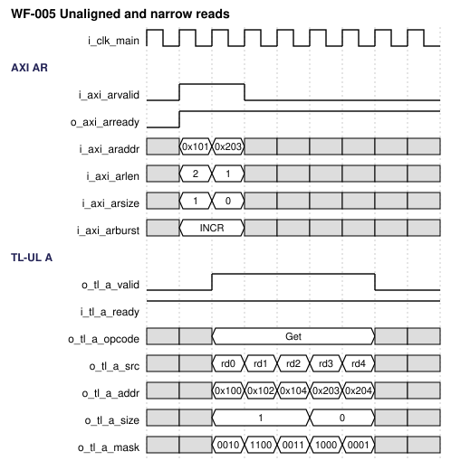; [WaveJSON](figures/wf-005.json) | 2026-10-26 |
| WF-006 | OP-001 Read burst | Corner: backpressure on i_tl_a_ready and i_axi_rready | TL-UL A, ready, R | 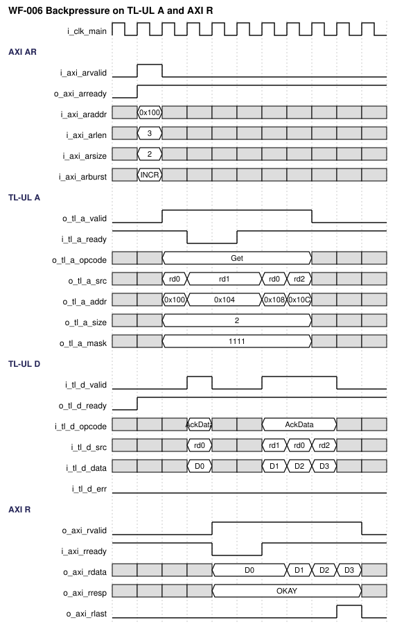; [WaveJSON](figures/wf-006.json) | 2026-10-26 |
| WF-007 | OP-002 Write burst | Success: single write beat, AW and W in the same cycle | AW, W, TL-UL A, TL-UL D, B | 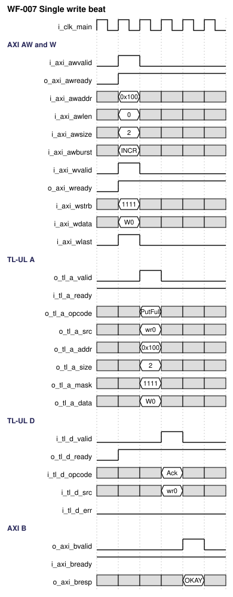; [WaveJSON](figures/wf-007.json) | 2026-10-26 |
| WF-008 | OP-002 Write burst | Success: four-beat INCR write at full rate | AW, W, TL-UL A, TL-UL D, B | 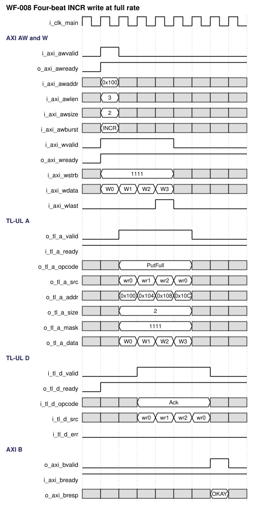; [WaveJSON](figures/wf-008.json) | 2026-10-26 |
| WF-009 | OP-002 Write burst | Corner: W before AW, then AW before W | AWVALID, WVALID, TL-UL A | 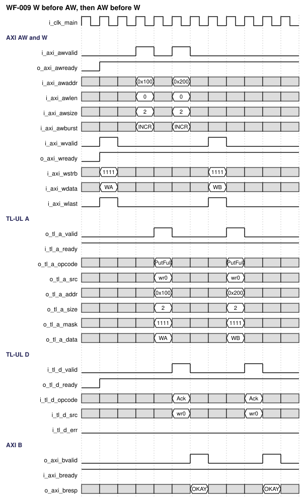; [WaveJSON](figures/wf-009.json) | 2026-10-26 |
| WF-010 | OP-002 Write burst | Corner: WSTRB patterns select PutFullData and PutPartialData, non-contiguous strobes | wstrb, o_tl_a_opcode, o_tl_a_mask | 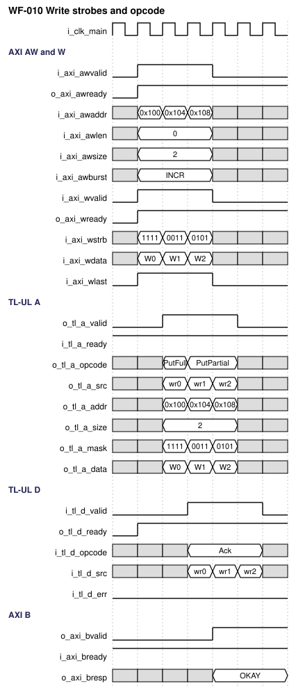; [WaveJSON](figures/wf-010.json) | 2026-10-26 |
| WF-011 | OP-004 Response collection | Error: i_tl_d_err on the third beat of a read burst gives SLVERR for that beat | TL-UL D, R, rresp | 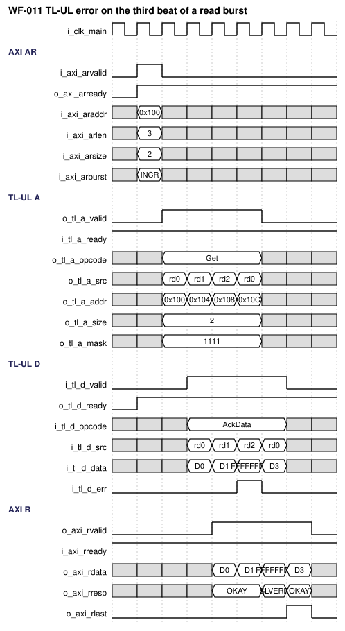; [WaveJSON](figures/wf-011.json) | 2026-10-26 |
| WF-012 | OP-004 Response collection | Error: i_tl_d_err on the second beat of a write burst gives SLVERR on B | TL-UL D, B, bresp | 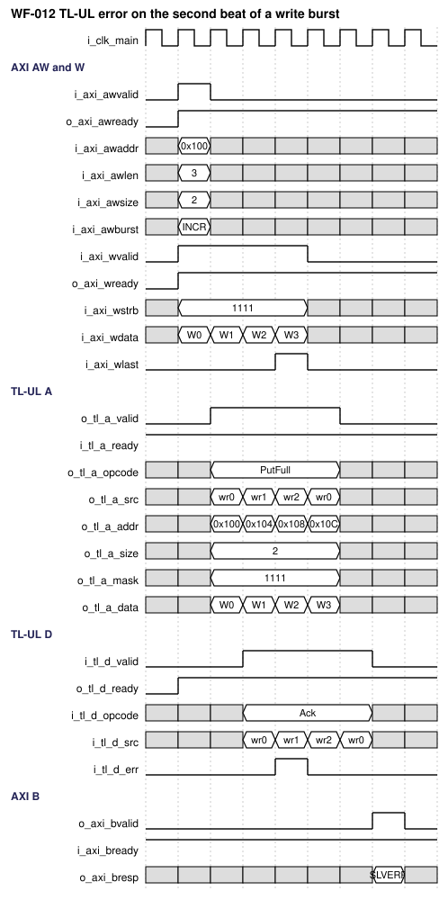; [WaveJSON](figures/wf-012.json) | 2026-10-26 |
| WF-013 | OP-003 Illegal burst rejection | Error: read burst across a 4 KB boundary, no TL-UL request, SLVERR beats | AR, o_tl_a_valid, o_evt_axi_err_rd, R | 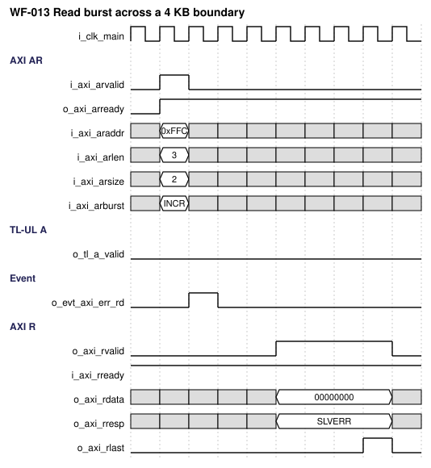; [WaveJSON](figures/wf-013.json) | 2026-10-26 |
| WF-014 | OP-003 Illegal burst rejection | Error: write burst with WRAP length 3, W beats dropped, SLVERR on B | AW, W, o_evt_axi_err_wr, B | 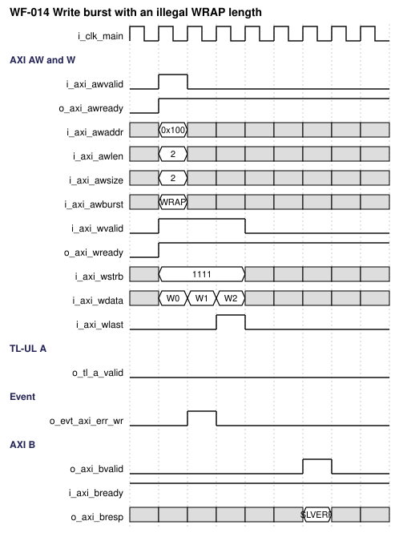; [WaveJSON](figures/wf-014.json) | 2026-10-26 |
| WF-015 | OP-004 Response collection | Corner: two IDs, TL-UL responses in reverse order, the later ID overtakes | arid, TL-UL A, TL-UL D, rid, R | 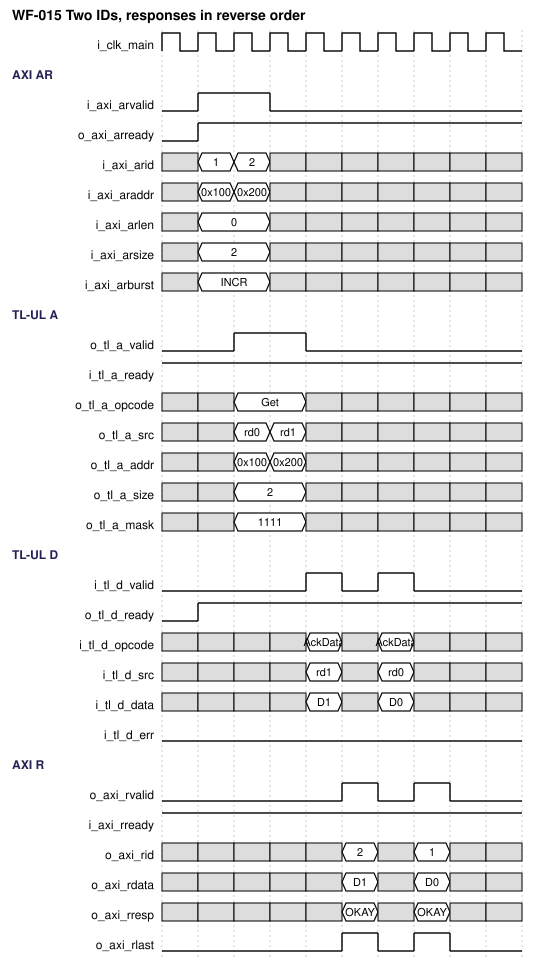; [WaveJSON](figures/wf-015.json) | 2026-10-26 |
| WF-016 | OP-006 Arbitration | Corner: read and write streams share channel A, round-robin | AR, AW, W, TL-UL A | 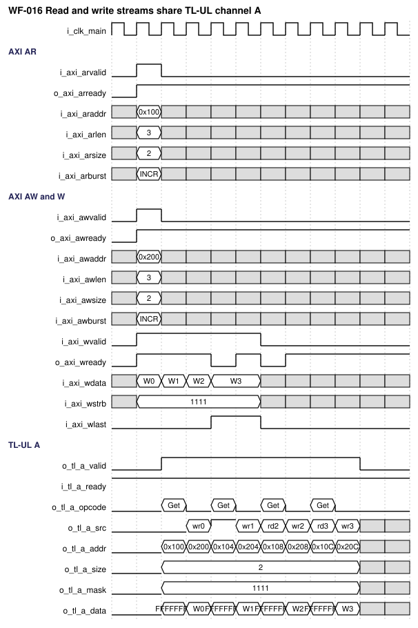; [WaveJSON](figures/wf-016.json) | 2026-10-26 |
| WF-017 | OP-001 Read burst | Corner: exclusive read gives OKAY, ARPROT[2] sets instr_type | arlock, arprot, o_tl_a_user, R | 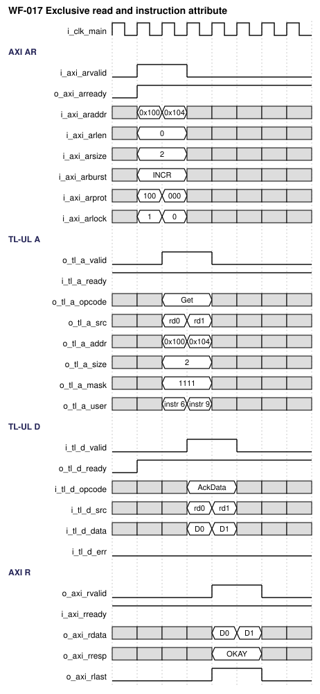; [WaveJSON](figures/wf-017.json) | 2026-10-26 |
| WF-019 | OP-004 Response collection | Corner: one ID, TL-UL responses in reverse order, storage, R in request order | arid, TL-UL A, TL-UL D, rid, R | 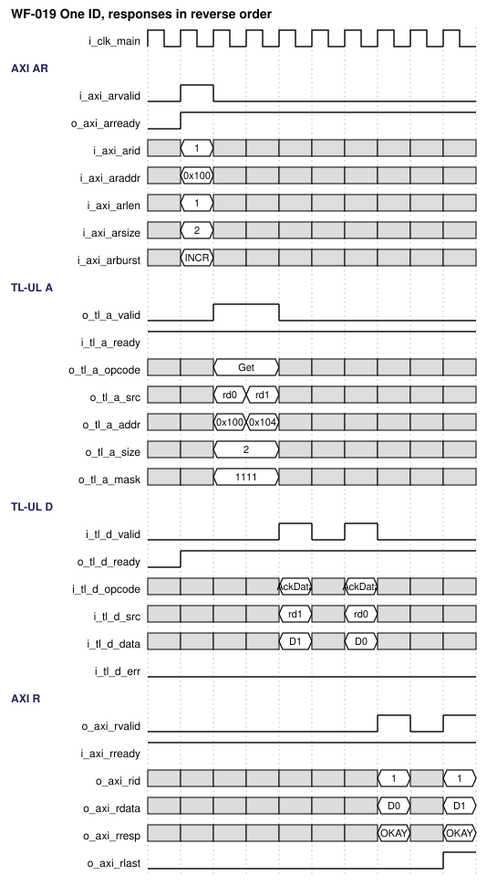; [WaveJSON](figures/wf-019.json) | 2026-10-26 |
| WF-018 | OP-004 Response collection | Error: wrong response opcode and orphaned response, two status pulses | TL-UL D, o_evt_bad_resp, o_evt_orphan_resp, R | 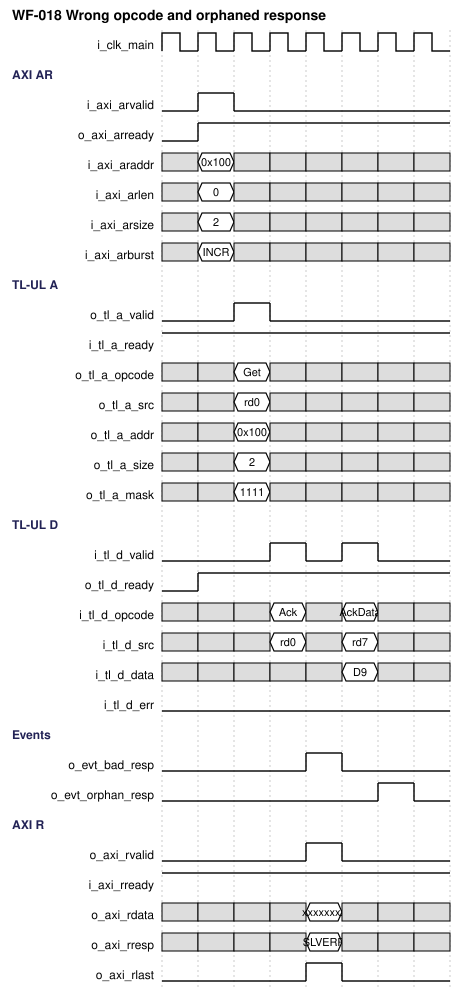; [WaveJSON](figures/wf-018.json) | 2026-10-26 |

The cycle tables below are the reference for the waveforms. They assume that the TL-UL device has `i_tl_a_ready` = 1 and answers with `i_tl_d_valid` in the cycle after it accepted the request, that the AXI Manager has `i_axi_rready` = 1, and that the bridge is idle.

*Single read beat (OP-001, WF-002):*

| Cycle / event | Input condition | State/action | Output condition |
|---|---|---|---|
| c1 | `i_axi_arvalid` = 1, `o_axi_arready` = 1 | AR taken (cut-through), read slot 0 allocated, A register loaded at the end of c1 | `o_axi_arready` stays 1 |
| c2 | `i_tl_a_ready` = 1 | Request accepted at the end of c2 | `o_tl_a_valid` = 1, Get, `o_tl_a_src` = slot 0 |
| c3 | `i_tl_d_valid` = 1 (AccessAckData, tag slot 0, data) | Slot 0 is head and the R register is free: data goes to the R register at the end of c3 (bypass) | `o_tl_d_ready` = 1 |
| c4 | `i_axi_rready` = 1 | Handshake at the end of c4, slot 0 released | `o_axi_rvalid` = 1, `o_axi_rlast` = 1, `o_axi_rresp` = 00 |

*Four-beat INCR read, full rate (WF-003):* AR in c1; Get requests with tags 0, 1, 2, 0 in c2 to c5 (the slot of tag 0 is free again for the fourth request, DEC-020) (addresses A, A+4, A+8, A+12); channel-D beats in c3 to c6; R beats in c4 to c7 with `RLAST` in c7. One beat per cycle at every stage.

*Single write beat (OP-002, WF-007):* AW and W valid in c1 (both ready); Put request in c2; AccessAck in c3; `o_axi_bvalid` in c4.

*Four-beat INCR write, full rate (WF-008):* AW and W0 in c1, W1 to W3 in c2 to c4 (`WLAST` in c4); Put requests (write tags 0, 1, 2, 0, DEC-020) in c2 to c5; AccessAck in c3 to c6; `o_axi_bvalid` in c7.

*Illegal bursts (OP-003, WF-013, WF-014):* the engine takes the AR (AW) beat in c1; `o_evt_axi_err_rd` (read) or `o_evt_axi_err_wr` (write) pulses in c2; no `o_tl_a_valid`. A read gets its error beats in c5 to c8 (4 beats, `RLAST` in c8), 4 cycles after the AR handshake cycle: the engine allocates one error slot per cycle from c2, and the slots leave through the prefetch stage like stored beats. For a write burst whose W beats are in the slice with the AW beat (c1 to c3), the engine drops one W beat per cycle from c2, allocates the error slot with the last W beat in c4, and `o_axi_bvalid` appears in c6; when the W beats arrive after the engine took the AW beat, the last W beat is dropped in its handshake cycle and `o_axi_bvalid` appears 2 cycles after that cycle.

*Different IDs, responses in reverse order (WF-015):* two single-beat reads with ARID 1 (tag 0, request in c2) and ARID 2 (tag 1, request in c3); the device answers tag 1 in c4 and tag 0 in c6. The context of ID 2 has its oldest slot done and the R path is idle, so the data goes straight to the R register in c4 and the R beat of ID 2 appears in c5. The R beat of ID 1 appears in c7 (bypass of the data that arrived in c6). The responses leave in a different order than the requests, which AXI allows for different IDs.

*Same ID, responses in reverse order (WF-019):* one read burst of 2 beats with one ARID: tags 0 and 1 are issued in c2 and c3; the device answers tag 1 in c4 and tag 0 in c6. The data of tag 1 goes to the storage in c4 (not the oldest slot of its context). The data of tag 0 goes to the R register in c6 (bypass); R beat 0 appears in c7. The oldest slot of the context is then the one of tag 1 and it is done; its data is read from the storage in c7 and R beat 1 appears in c9, 2 cycles after the slot became the oldest (PERF-002).

### 10.4 Arbitration, buffering, and throughput

**Arbitration.** Only requests that can be loaded into the A register in this cycle compete: a read request needs a free read slot, a write request needs a free write slot and a W beat. With `PARA_ARB_MODE` = 0 (round-robin) the grant alternates: after reset the first tie goes to the read request, and after each grant the other direction has priority in the next tie. A single requester always wins. With `PARA_ARB_MODE` = 1 the read request wins every tie, with 2 the write request wins every tie (a continuous stream of the preferred direction can starve the other one; the integrator should use these modes only with that knowledge).

**Buffering.** The three input slices hold two beats each. The A register, the R register, and the B register each hold one beat. The slot tables hold `PARA_NUM_RD` and `PARA_NUM_WR` beats. When the A register is FULL and `i_tl_a_ready` is 0, the engines stall and the slices fill; `o_axi_arready` / `o_axi_awready` / `o_axi_wready` fall when a slice has no room (one cycle in advance, because they are registered). The channel-D path never stalls (`o_tl_d_ready` = 1) because a slot is reserved for every request.

**Throughput.** In each direction the bridge accepts, issues, and returns one beat per cycle. The A channel carries at most one request per cycle for both directions together. A slot is occupied for at least three cycles (request, response, retirement), so one beat per cycle needs `PARA_NUM_RD` (or `PARA_NUM_WR`) of at least 3 plus the number of extra cycles that the device needs to answer and the Manager needs to accept (REQ-PERF-004).

**Ordering.** Slots of one AXI ID retire in allocation order, so R beats and B responses with equal ID leave in the order of their requests (REF-001 A5.2, A6.5). Slots of different IDs retire independently: a burst of ID 2 may be returned before an earlier burst of ID 1 (DEC-015). R beats of different bursts are never interleaved: once the first beat of a burst is on R, only that burst is served until `RLAST` (DEC-016). There is no ordering between reads and writes except the order in which the arbiter placed the requests on channel A; a dependency between a read and a write is the Manager's responsibility (REF-001 A6). Limits: a burst of a new ID waits when all ID contexts are busy (REQ-FUNC-018), and a burst that has started on R waits for its own slow beat without serving other IDs.

**Context allocation.** At the first beat of a burst the engine looks for a context that holds the same ID; if none, it takes a free context; if none is free, the engine waits and presents no request. The context is freed when its last outstanding slot retires. A burst of an ID that already has a context joins it, so beats of equal IDs stay in one queue. The context is pinned while the request engine still issues a burst of its ID: it stays allocated, with an empty queue if needed, until the last beat of the burst was allocated, so the sticky error of a write burst and the position of a read burst are kept and the context cannot be taken by another ID in the middle of a burst.

**Slot reservation.** The first beat of a read burst is presented only when the read slot table has at least as many free slots as the burst has beats (at most the table size); a burst longer than the table waits until the table is empty. The reservation guarantees that the beats of a burst that the R path serves can always be issued, which makes a deadlock between the burst lock of the R path and the slots held by other IDs impossible (REQ-FUNC-020). The cost is that a burst waits at its engine while older beats hold too many slots.

**Retirement.** At most one slot retires per cycle in each direction. *Read:* when the R path is IDLE it chooses a context whose oldest slot is done, giving priority to contexts whose data is in the storage (round-robin among them) and otherwise taking the context of the beat that arrives from channel D; that context's burst is then returned beat by beat until the beat with the last flag. A beat is loaded into the R register directly from channel D (bypass) when its slot is the oldest of the chosen context and the R register can accept in that cycle, and from the storage otherwise. A read of the storage for the next beat may be issued in the cycle in which the previous beat is loaded (prefetch), so that stored beats return back-to-back after a start-up of one cycle. *Write:* each context retires its oldest slot when it is done; one slot per cycle over all contexts (round-robin); the slot with the last flag loads the B register in the same edge if the B register is free or is being taken, otherwise only the retirement of that slot waits.

### 10.5 Memories and storage

| Storage ID | Kind | Depth × width | Ports | Read latency | Write mask | Reset/init | ECC/parity | Implementation |
|---|---|---|---|---|---|---|---|---|
| MEM-001 | Read data storage (`u_rd_store`) | `PARA_NUM_RD` × `PARA_DATA_W` | 1 write, 1 read | 1 cycle (registered read data) | None (whole word) | None; a word is read only after it was written (validity by the DONE flag) | None | Inferred array when `PARA_STORE_MACRO` = 0; wrapper of an SRAM macro when 1 |
| MEM-002 | Read slot table and ID context table | `PARA_NUM_RD` × (`PARA_AXI_ID_W` + 3 + link to the next slot of the context) and `PARA_NUM_ID_RD` × (`PARA_AXI_ID_W` + count + oldest and newest slot) | Flip-flops | Combinational | None | Reset to free | None | Flip-flops |
| MEM-003 | Write slot table and ID context table | `PARA_NUM_WR` × (`PARA_AXI_ID_W` + 3 + link) and `PARA_NUM_ID_WR` × (`PARA_AXI_ID_W` + count + oldest and newest slot) | Flip-flops | Combinational | None | Reset to free | None | Flip-flops |

A read and a write of the same word cannot happen in the same cycle: a word is written when its response arrives and read only after the slot is DONE, in a later cycle. The storage module has no collision behavior to specify. With `PARA_STORE_MACRO` = 1 the storage module instantiates the library wrapper `m_vlsit_sfifo_ram_macro` (`common_rtl/000_Common/rtl_lib`, reused by decision DEC-019), which instantiates only the cell `VLSIT_CELL_SRAM_1W1R` (the stand-in macro model) with the whole word written (`BWEB` = 0); the read enable is high only in the cycles in which a stored beat is fetched, so the read data stays unchanged between fetches. A real macro is mapped in that wrapper. The rest of the IP does not change when the storage is replaced.

## 11. Register and programming model

**Not required (confirmed by user, 2026-10-26):** the IP has no software-visible registers; the status outputs are three pulses (Section 6.4) and the configuration is by parameters.

## 12. Error handling and recovery

| Error ID | Detection condition | Observable response/status | Interrupt | Clear/recovery | Reset behavior |
|---|---|---|---|---|---|
| ERR-001 | `d_error` = 1 on the response of a read slot | `RRESP` = SLVERR for that beat only, `RDATA` = `d_data` of the device; other beats and `RLAST` unchanged | None (no event pulse: a bus error is reported through AXI) | None needed | Slot cleared |
| ERR-002 | `d_error` = 1 on the response of any beat of a write burst | One `BRESP` = SLVERR for the burst (sticky over the beats); all beats are still sent | None | None needed | Cleared |
| ERR-003 | Illegal AR or AW attribute: reserved burst, size above bus, WRAP length or alignment, FIXED above 16 beats, INCR across 4 KB | No TL-UL request. Read: `AxLEN`+1 R beats, SLVERR, data 0, `RLAST` on the last. Write: W beats dropped, one B with SLVERR. `o_evt_axi_err_rd` (read) or `o_evt_axi_err_wr` (write) | Pulse | None needed | Cleared |
| ERR-004 | `d_opcode` not equal to AccessAckData (read slot) or AccessAck (write slot) | The slot completes with SLVERR, `o_evt_bad_resp` | Pulse | None needed | Cleared |
| ERR-005 | Channel-D beat whose tag has an upper bit set, a slot index out of range, or a slot that is not ALLOCATED | The beat is discarded, `o_evt_orphan_resp` | Pulse | None needed | Cleared |
| ERR-006 | `WLAST` = 0 on the `AxLEN`+1th W beat, or `WLAST` = 1 earlier | The burst length of AW is kept; `o_evt_axi_err_wr` | Pulse | None needed | Cleared |

Resource exhaustion (no free slot) is not an error: the engines wait. Simultaneous causes in one beat (for example `d_error` and a wrong opcode) give one SLVERR; the pulses of all detected causes are raised. The bridge has no timeout: a device that never answers keeps its slots allocated and blocks the retirement of that direction until reset (DEC-010). The AXI response codes DECERR and EXOKAY are never produced.

## 13. Performance, power, and area

The latency and throughput figures are hard requirements and hold for every configuration with at least three slots per direction. The frequency, area, and power numbers are not provided yet (TBD-001); they are recorded as goals to be set before the RTL is signed off.

| Metric ID | Metric | Target / limit | Conditions | Measurement method | Hard / goal |
|---|---|---|---|---|---|
| PERF-001 | Request latency: cycles from the AR (or AW with its first W beat) handshake cycle to the first cycle with `o_tl_a_valid` = 1 | 1 cycle (a_valid in the cycle after the handshake); 2 cycles when the input slice was not empty | Idle bridge, `i_tl_a_ready` = 1, free slot, arbiter not busy with the other direction | Simulation cycle count (WF-002, WF-007) | Hard |
| PERF-002 | Response latency: cycles from the channel-D handshake cycle of a head slot to the first cycle with `o_axi_rvalid` = 1 (read) or, for the last beat, `o_axi_bvalid` = 1 (write) | 1 cycle (bypass); 2 cycles for a stored read beat | `i_axi_rready` / `i_axi_bready` low or high, R and B register free | Simulation cycle count | Hard |
| PERF-003 | Sustained throughput per direction | 1 beat per cycle (0 bubbles between beats of a burst and between consecutive bursts) | Inputs valid, receivers ready, device answers one beat per cycle, enough slots | Simulation throughput run (TEST-015) | Hard |
| PERF-004 | Outstanding capacity | `PARA_NUM_RD` read beats and `PARA_NUM_WR` write beats, over at most `PARA_NUM_ID_RD` and `PARA_NUM_ID_WR` different IDs; full rate needs `PARA_NUM_RD` ≥ 3 + extra device and Manager delay in cycles and a stream of at most `PARA_NUM_ID_RD` IDs | Round trip = device delay + 3 | Analysis and TEST-015 | Hard |
| PPA-001 | Maximum frequency | TBD-001 | Corner, voltage, and configuration to be set | STA with the named constraints of Section 17 | Goal |
| PPA-002 | Area | TBD-001 | Library to be set | Cell area | Goal |
| PPA-003 | Dynamic and leakage power | TBD-001 | Activity and corner to be set | Power analysis | Goal |

Timing closure is not claimed from RTL synthesis; the constraints of Section 17 and the SDC delivered with the RTL are the basis for the analysis.

## 14. RTL implementation contract

### 14.1 Required coding baseline

The VLSIT RTL Design Rules v2 (REF-003) are the mandatory RTL coding authority; the RTL of this IP shall comply with them without project-local exceptions (REQ-RTL-003). The rules that shape this IP most: one synthesizable module per file; a structural top; ANSI port lists with `input wire` and `output logic`; the port naming of Section 2.2; `parameter logic [31:0]` parameters named `PARA_...` with the three comment lines; registers named with the prefix `reg_`, nets with the prefix `w_`; `always_ff` with one clock per process; no latch, no `initial`, no delay, no macro in the design files; cell and macro instances named with the prefix `u_dont_touch_` and only in wrapper modules (R-028 of the skill). The slices, engines, and tables are plain RTL; the only library cell instance is the SRAM macro cell in the wrapper of Section 10.5.

### 14.2 RTL hierarchy

Files of the IP are in `common_rtl/007_AXI2TLUL_Bridge/rtl`; the macro wrapper is shared library RTL in `common_rtl/000_Common/rtl_lib`; the cell model is in `common_rtl/000_Common/rtl_cells`.

| Module | Responsibility | Parent / instance | Clock/reset domains | Interface |
|---|---|---|---|---|
| `m_vlsit_axi2tlul_top` | Structural top: ports, parameters, interconnect, instances only | (top) | CLK-MAIN / RST-MAIN | Section 6.2 |
| `m_vlsit_axi2tlul_skid` | Two-entry registered-ready slice with cut-through when empty | top / `u_ar_skid`, `u_aw_skid`, `u_w_skid` | CLK-MAIN / RST-MAIN | Valid/ready in and out, payload of `PARA_PAYLOAD_W` bits |
| `m_vlsit_axi2tlul_rd_req` | AR burst check, address and mask generation, Get request, error injection | top / `u_rd_req` | CLK-MAIN / RST-MAIN | AR slice, read request, allocation, event |
| `m_vlsit_axi2tlul_wr_req` | AW burst check, W pairing, address, mask, opcode, Put request, discard | top / `u_wr_req` | CLK-MAIN / RST-MAIN | AW and W slices, write request, allocation, event |
| `m_vlsit_axi2tlul_arb` | Arbitration, A output register, tag assembly | top / `u_arb` | CLK-MAIN / RST-MAIN | Two requests in, TL-UL channel A out, grants |
| `m_vlsit_axi2tlul_rsp_dec` | Channel D acceptance, tag decode, opcode and outstanding checks, events | top / `u_rsp_dec` | CLK-MAIN / RST-MAIN | TL-UL channel D in, read and write completions out |
| `m_vlsit_axi2tlul_rd_rob` | Read slot table, ID context table, burst selection, bypass, retirement, R output register | top / `u_rd_rob` | CLK-MAIN / RST-MAIN | Allocation, completion, storage ports, AXI R |
| `m_vlsit_axi2tlul_wr_rob` | Write slot table, ID context table, sticky error, B output register | top / `u_wr_rob` | CLK-MAIN / RST-MAIN | Allocation, completion, AXI B |
| `m_vlsit_axi2tlul_store` | Read data storage, array or macro by `PARA_STORE_MACRO` | top / `u_rd_store` | CLK-MAIN | 1 write port, 1 read port, read latency 1 |
| `m_vlsit_sfifo_ram_macro` (library, `000_Common/rtl_lib`) | Reused wrapper of the SRAM macro cell | store / `u_vlsit_sfifo_ram_macro` (macro option only) | CLK-MAIN | Memory ports; the only module with a cell instance (`u_dont_touch_sram`) |
| `m_vlsit_axi2tlul_evt` | Registers the three status pulses | top / `u_evt` | CLK-MAIN / RST-MAIN | Conditions in, `o_evt_*` out |

The functional logic is in the children; the top contains instances only. The three register-level state owners are `u_rd_rob`, `u_wr_rob` (slot tables, output registers) and `u_arb` (A register).

### 14.3 Synthesis assumptions

| Item | Value / source |
|---|---|
| Top / source file list | `m_vlsit_axi2tlul_top`; `rtl/filelist.f` of the IP plus, for `PARA_STORE_MACRO` = 1, `000_Common/rtl_lib/m_vlsit_sfifo_ram_macro.sv` and `000_Common/rtl_cells/VLSIT_CELL_SRAM_1W1R.sv` (the lint file list of the IP names them) |
| Frontend version and options | Verilator and slang for lint, Yosys for elaboration; the version of the frontend in use is recorded in the lint log of the delivery |
| Parameters/configuration | CFG-BASE for the reference run; every configuration of Section 8 for elaboration |
| Libraries/corners | TBD-001 |
| Memory flow | Array inferred by the frontend, or the macro of the memory compiler through the wrapper |
| Lint rule configuration | Lint rules of the skill `vlsit-rtl-generator` (script `vlsit_lint_rtl.py`); 0 errors and 0 warnings required |

## 15. Verification specification

### 15.1 Scope and strategy

Levels: block simulation of the whole bridge against an AXI4 Manager model and a TL-UL device model with programmable delay, reordering, and errors; protocol checkers (AXI4 checker, and the TL-UL rules of REF-002 and `vlsit_tilelink_ul_protocol_checker.md`); a scoreboard that predicts the TL-UL requests from the AXI stimulus and the AXI responses from the device responses; formal proofs of the invariants on the minimum configuration; lint and elaboration of every configuration. CDC and RDC are not applicable (one clock, DEC-004). The testbench, checkers, and assertions are outside the design file set. Runs are reproducible: every random test prints its seed and a failing seed re-runs the same stimulus. Configurations: CFG-BASE for the regression, CFG-WIDE, CFG-MACRO, and CFG-MIN for the tests named in Section 4.

### 15.2 Requirement-based test plan

| Test ID | Requirements | Scenario / stimulus | Expected result | Test type | Configuration |
|---|---|---|---|---|---|
| TEST-001 | REQ-FUNC-001, REQ-FUNC-004, REQ-FUNC-006, REQ-FUNC-008, REQ-PERF-001, REQ-PERF-002 | Single-beat reads of every legal size at several addresses, including data and instruction PROT | TL-UL Get with size, aligned address, mask, tag, user as specified; R beat with RLAST, latency 1 + 1 cycles | Directed | CFG-BASE |
| TEST-002 | REQ-FUNC-001, REQ-FUNC-003, REQ-PERF-005 | INCR read bursts of 1, 2, 16, 17, and 256 beats, ending exactly at a 4 KB boundary, back to back | Beats in address order, no bubble between bursts, RLAST on the last beat | Directed, random | CFG-BASE |
| TEST-003 | REQ-FUNC-003, REQ-FUNC-004 | WRAP (2, 4, 8, 16), FIXED, narrow, and unaligned bursts for every size up to the bus width | Addresses and masks equal the model of REF-001 A3.4.1; lanes unchanged | Directed, random | CFG-BASE, CFG-WIDE |
| TEST-004 | REQ-FUNC-002, REQ-FUNC-006, REQ-FUNC-016, REQ-PERF-001 | Write bursts of 1, 4, 16, and 256 beats; B response checks | One Put request per W beat in order; B after the last response; latency as specified | Directed, random | CFG-BASE |
| TEST-005 | REQ-FUNC-015, REQ-FUNC-016, REQ-IF-008 | W beats before AW, AW before W, W and AW in the same cycle, long gaps between W beats | No deadlock; requests only when AW and W are both present; ready signals independent | Directed, random | CFG-BASE |
| TEST-006 | REQ-FUNC-005 | Every WSTRB pattern for sizes 0 to the bus width, including 0 and non-contiguous | a_mask = WSTRB AND lanes; PutFullData only for a full region | Directed, exhaustive for 32-bit | CFG-BASE, CFG-WIDE |
| TEST-007 | REQ-FUNC-017, REQ-IF-001, REQ-IF-003, REQ-IF-004, REQ-PARAM-003, REQ-PERF-004 | Random READY on all channels (including RREADY = 0, BREADY = 0, i_tl_a_ready = 0 for long periods) with slot exhaustion | No loss, no duplication, payload stable, outstanding limit respected, no deadlock | Random | CFG-BASE, CFG-WIDE, CFG-MIN |
| TEST-008 | REQ-FUNC-007, REQ-FUNC-009, REQ-FUNC-010, REQ-PERF-002 | TL-UL device model with random delay and reordering of the responses of different tags, with equal and with different AXI IDs | Equal IDs: R and B in request order; different IDs: any order but each beat correct; RID and BID correct; stored beats returned back-to-back | Random | CFG-BASE, CFG-MACRO |
| TEST-009 | REQ-ERR-001, REQ-ERR-002 | d_error on a single beat, on the first, middle, and last beat of read and write bursts | Read: SLVERR on that beat only; write: one SLVERR B; no beat lost | Directed | CFG-BASE |
| TEST-010 | REQ-ERR-003 | Every illegal burst condition on AR and on AW (reserved burst, size above bus, WRAP length and alignment, FIXED above 16, INCR across 4 KB) | No TL-UL request; SLVERR on every beat (read) or one B (write); W beats consumed; one pulse on o_evt_axi_err_rd (AR) or o_evt_axi_err_wr (AW) | Directed | CFG-BASE, CFG-WIDE |
| TEST-011 | REQ-FUNC-013, REQ-FUNC-014 | Simultaneous read and write streams under each PARA_ARB_MODE | Grant pattern as specified; no starvation in mode 0 | Directed, random | CFG-BASE |
| TEST-012 | REQ-FUNC-008, REQ-FUNC-011, REQ-FUNC-012, REQ-INT-001 | AxLOCK = 1, all AxPROT values, random AxCACHE, AxQOS, AxREGION | Normal access with OKAY; instr_type follows AxPROT[2]; integrity bits at default; other sidebands without effect | Directed | CFG-BASE |
| TEST-013 | REQ-RESET-001, REQ-RESET-002, REQ-RESET-003, REQ-IF-006 | Reset values; reset in the middle of read and write traffic; late device responses after reset | Idle outputs; no slot left; late responses discarded with o_evt_orphan_resp; ready timing | Directed | CFG-BASE |
| TEST-014 | REQ-PARAM-001, REQ-PARAM-002, REQ-PARAM-003, REQ-FUNC-007 | Sweep of PARA_DATA_W, PARA_ADDR_W, PARA_AXI_ID_W, PARA_TL_SRC_W, PARA_TL_AUSER_W, PARA_NUM_RD, PARA_NUM_WR over the legal ranges | Elaborates; lint clean; tag layout and widths as specified | Elaboration, directed | All |
| TEST-015 | REQ-PERF-001, REQ-PERF-002, REQ-PERF-003, REQ-PERF-004, REQ-PERF-005, REQ-IF-003, REQ-IF-005 | Cycle counting of latency and throughput with an ideal device (answer in the next cycle) and with a device of k extra cycles | 1 + 1 cycle latency; 1 beat per cycle sustained when slots are sufficient; throughput equals slots/(3 + k) otherwise | Directed | CFG-BASE |
| TEST-016 | REQ-ERR-004, REQ-ERR-005, REQ-IF-007, REQ-RESET-003 | Responses with a wrong opcode, an unused tag, a tag with upper bits set, and random d_param, d_sink, d_user, d_size | Wrong opcode: SLVERR and o_evt_bad_resp; orphan: discarded with o_evt_orphan_resp; ignored fields have no effect | Directed | CFG-BASE |
| TEST-017 | REQ-ERR-006 | WLAST early and WLAST missing | Burst length from AWLEN; o_evt_axi_err_wr pulses | Directed | CFG-BASE |
| TEST-018 | REQ-FUNC-010, REQ-RTL-002, REQ-RTL-004 | Same stimulus on the array storage and on the macro storage | Identical outputs cycle by cycle | Directed, random | CFG-BASE, CFG-MACRO |
| TEST-019 | REQ-FUNC-001, REQ-FUNC-002, REQ-FUNC-009, REQ-VER-001 | Constrained-random mix of read and write bursts of all types and sizes with random delays, errors, and reordering, many seeds | Scoreboard and protocol checkers report no error | Random regression | CFG-BASE, CFG-WIDE, CFG-MACRO |
| TEST-020 | REQ-IF-002, REQ-RTL-001, REQ-RTL-003, REQ-RTL-004 | Rule check, lint, structural check of paths from inputs to outputs, hierarchy inspection | 0 rule errors, 0 lint errors and warnings, no input-to-output combinational path | Static | All |
| TEST-021 | REQ-DFT-001 | Search for latches, clock gates, and generated clocks or resets in the RTL | None found | Static | All |
| TEST-022 | REQ-FUNC-018, REQ-FUNC-019, REQ-FUNC-020, REQ-FUNC-010 | More distinct IDs than contexts (PARA_NUM_ID_RD, PARA_NUM_ID_WR from 1 to the maximum), bursts of different IDs with reversed responses, reuse of an ID after its context was freed, no interleaving check on R | A new ID waits when no context is free; equal-ID order kept; different IDs may overtake; R beats of one burst consecutive; no deadlock | Directed, random | CFG-BASE, CFG-MIN |

Reset, release, minimum and maximum parameters, backpressure, simultaneous events, ordering, errors, and invalid inputs are covered by the tests above; low-power transitions do not exist (Section 7.4).

### 15.3 Assertions and coverage

Assertions and coverage are verification code, kept outside the synthesis RTL. They are active after reset release and disabled while `i_rst_n_main` = 0. Payload signals are checked for X only while their VALID is 1; the bridge resets all outputs, so no payload is resetless.

| Property / coverage ID | Intent | Requirements | Checker / source set | Acceptance criterion |
|---|---|---|---|---|
| SVA-001 / COV-001 | VALID of AW, W, AR, R, B stays 1 with stable payload until READY (inputs assumed, outputs asserted); cover each channel stalled for 1, 2, and more than 8 cycles | REQ-IF-001, REQ-FUNC-015 | Verification | No violation; every stall length covered |
| SVA-002 / COV-002 | While o_tl_a_valid = 1 and i_tl_a_ready = 0, all o_tl_a_* hold and o_tl_a_valid stays 1 | REQ-IF-004 | Verification | No violation; covered at the maximum stall |
| SVA-003 / COV-003 | o_tl_d_ready = 1 from the second cycle after reset; a channel-D beat is always accepted; RREADY = 0 does not stop channel D | REQ-IF-006, REQ-FUNC-017 | Verification | No violation |
| SVA-004 / COV-004 | Allocated read (write) slots never exceed PARA_NUM_RD (PARA_NUM_WR); head, tail, and count are consistent; cover full tables | REQ-PARAM-003, REQ-PERF-004 | Verification and formal | No violation; full table covered |
| SVA-005 / COV-005 | Tag unique among outstanding requests; every channel-D tag answered at most once | REQ-FUNC-007 | Verification and formal | No violation |
| SVA-006 / COV-006 | Number of R beats of a burst equals ARLEN + 1 and RLAST is on the last only; cover burst type x size x length | REQ-FUNC-001 | Verification | No violation; cross covered |
| SVA-007 / COV-007 | No BVALID before the last W beat and the last response; exactly one B per accepted AW | REQ-FUNC-002, REQ-FUNC-016 | Verification and formal | No violation |
| SVA-008 / COV-008 | Order of R beats and of B responses with equal ID equals the order of the requests; cover overtaking between different IDs and reorder depth 1, 2, and more | REQ-FUNC-009 | Verification and formal | No violation; reorder depth covered |
| SVA-009 / COV-009 | o_evt_* are 1-cycle pulses (never 1 in two consecutive cycles from one cause); each pulse covered | REQ-ERR-003, REQ-ERR-004, REQ-ERR-005, REQ-ERR-006 | Verification | No violation; all three pulses covered |
| SVA-010 / COV-010 | PutFullData implies a_mask equals the full region; Get has a lane mask; Put mask is a subset of WSTRB | REQ-FUNC-005 | Verification | No violation; both opcodes covered |
| SVA-011 / COV-011 | o_tl_a_addr is aligned to 2^a_size; a_size does not exceed the bus width; a burst never crosses 4 KB or wraps outside its container | REQ-FUNC-003, REQ-FUNC-004 | Verification | No violation |
| SVA-012 / COV-012 | All outputs are 0 while i_rst_n_main = 0; no X on a payload while its VALID is 1 | REQ-RESET-001 | Verification | No violation |
| SVA-013 / COV-013 | No two active ID contexts hold the same ID; active contexts never exceed PARA_NUM_ID_RD (PARA_NUM_ID_WR); R beats of a burst are consecutive up to RLAST; cover all contexts busy with a waiting burst | REQ-FUNC-018, REQ-FUNC-019, REQ-FUNC-020 | Verification and formal | No violation; waiting burst covered |

### 15.4 Formal, CDC, and RDC

| Analysis | Scope | Assumptions / constraints | Evaluation method |
|---|---|---|---|
| Formal | Safety properties SVA-001, SVA-002, SVA-004, SVA-005, SVA-007, SVA-008 on CFG-MIN (2 slots per direction, 1-bit ID, 32-bit data); bounded liveness: every accepted request gets a response when the environment is fair | AXI Manager and TL-UL device are constrained to obey their protocols; the device answers every request within a bound | Bounded model checking and unbounded proof where possible; result recorded in the verification report |
| CDC / RDC | Not applicable | One clock, one reset (DEC-004) | Not run |

## 16. DFT and testability

| Topic | Requirement / decision |
|---|---|
| Scan architecture and scan eligibility | All flip-flops are scan-eligible. There is no latch, no clock gating, and no clock or reset generated inside the IP, so full scan insertion is possible without exceptions (REQ-DFT-001). |
| Scan/test clocks, controls, reset behavior | The IP has no test port. Scan clock, scan enable, and the asynchronous reset override are applied by the SoC DFT flow; asynchronous-reset flops follow the SoC rule for reset control in test mode. |
| Test-mode entry/exit and safe state | Not applicable inside the IP; test mode has priority over the functional reset in the SoC wrapper (REF-003). |
| MBIST, memory repair, LBIST | For `PARA_STORE_MACRO` = 1 the macro is wrapped with the MBIST of the memory compiler by the SoC. For the array option the storage is flip-flops and scan covers it. LBIST: not planned. |
| Test access, wrappers, test points | None required. |
| Clock-gating test enable | Not applicable: no clock gating. |
| ATPG constraints and exclusions | None. |
| DFT insertion architecture and generated test artifacts | Owned by the SoC DFT flow. |

## 17. Physical design and timing integration

### 17.1 Timing constraints and budgets

The IP is single-clock and fully synchronous. Concrete clock frequency, corners, and I/O delays are not provided (TBD-001); the structure of the constraint file that the IP delivers is fixed here, with the period as a variable. Constraints are owned by the IP except the I/O delays and the clock definition on the SoC side.

#### 17.1.1 Clock and analysis scenarios

| Clock ID | Port / source object | Primary/generated and master | Period, waveform, phase / ratio | Latency / uncertainty / transition | Clock group / mode | Constraint source |
|---|---|---|---|---|---|---|
| CLK-MAIN | `i_clk_main` | Primary | Period `T_MAIN` (TBD-001), 50 % duty | Set by the SoC | Single group, single mode | `sdc/axi2tlul_bridge.sdc` (to be delivered with the RTL) |

#### 17.1.2 Interface timing budgets

All outputs are flip-flop outputs, so the budget of an output path inside the IP is the clock-to-output delay. The input paths are the critical ones: the AR/AW/W inputs go through the address, lane-mask, and arbitration logic into the A register (cut-through), and `i_tl_a_ready` and `i_axi_rready` go into the register enables and the pointer updates; the channel-D inputs go through the tag decode into the R register and the slot flags. The budgets below are goals as fractions of `T_MAIN`; they are confirmed with TBD-001.

| Interface / port group | Direction | Reference clock | External min / max delay | Input transition / output load | IP timing budget | Mode / condition | Constraint source |
|---|---|---|---|---|---|---|---|
| AXI AR, AW, W inputs | Input | CLK-MAIN | Set by the SoC; the external max delay shall leave at least 55 % of `T_MAIN` | Driver and load by the SoC | Up to 45 % of `T_MAIN` from port to register | Functional | `set_input_delay` in the SDC |
| AXI `i_axi_bready`, `i_axi_rready` | Input | CLK-MAIN | As above | As above | Up to 35 % of `T_MAIN` | Functional | `set_input_delay` |
| TL-UL `i_tl_a_ready` | Input | CLK-MAIN | As above | As above | Up to 35 % of `T_MAIN` (fans out to the engine states) | Functional | `set_input_delay` |
| TL-UL channel D inputs | Input | CLK-MAIN | As above | As above | Up to 45 % of `T_MAIN` | Functional | `set_input_delay` |
| All outputs | Output | CLK-MAIN | Set by the SoC | Load by the SoC | Clock-to-output only (registered) | Functional | `set_output_delay` |

Maximum transition, capacitance, fanout, and driving-cell assumptions are those of the SoC library (TBD-001). The registers that fan out widely are `i_tl_a_ready`-dependent enables and the slot pointers; the implementation may duplicate them.

#### 17.1.3 Timing exception inventory

There is no timing exception: no false path, multicycle path, minimum or maximum delay, clock group, case analysis, or disabled arc. Every path is single-cycle and synchronous. The reset input is asynchronous at assertion and is constrained by the SoC reset-controller timing (recovery and removal checks on all flops).

| Exception ID | Type / SDC command | From | Through | To | Value and setup/hold/min/max meaning | Mode / condition | Technical rationale |
|---|---|---|---|---|---|---|---|
| EXC-001 | None | Not applicable | Not applicable | Not applicable | Not applicable | Not applicable | The design is a single-clock synchronous design; an exception would hide a real path. |

Illustrative SDC (replace the variables; confirm the syntax for the selected tool):

~~~tcl
create_clock -name CLK_MAIN -period $T_MAIN [get_ports i_clk_main]
set_input_delay  -clock CLK_MAIN -max [expr {$T_MAIN * 0.55}] [get_ports {i_axi_* i_tl_*}]
set_input_delay  -clock CLK_MAIN -min 0.0 [get_ports {i_axi_* i_tl_*}]
set_output_delay -clock CLK_MAIN -max [expr {$T_MAIN * 0.40}] [get_ports {o_axi_* o_tl_* o_evt_*}]
set_output_delay -clock CLK_MAIN -min 0.0 [get_ports {o_axi_* o_tl_* o_evt_*}]
~~~

### 17.2 Physical assumptions

| Topic | Requirement / assumption |
|---|---|
| Hard/memory macros and views | None for `PARA_STORE_MACRO` = 0. For 1 the macro views come from the memory compiler through the wrapper. |
| Floorplan, placement region, pin placement | Place the AXI pins on one side and the TL-UL pins on the opposite side if possible; the three input slices and the A register are the cells nearest to the pins. |
| Utilization/congestion target | TBD-001. |
| Power intent, clock/reset trees | One clock tree and one reset tree; no gating. |
| High-fanout controls, physical-only cells | Slot pointers and the A-register enable have high fanout; duplicate when needed. |
| ECO/spare cells | By the SoC flow. |
| Extraction and timing-analysis corners | TBD-001. |
| Delivery form: RTL/netlist/hardened layout | Soft RTL. The requirements above are guidance for the SoC; the I/O budgets are SoC requirements. |

## 18. Security, safety, and reliability

| Topic | Requirement / rationale | Verification method / expected behavior |
|---|---|---|
| Security boundary and threat assumptions | The bridge is not a security boundary. It passes `AxPROT[2]` as `instr_type`. It does not check or enforce access rights. | Inspection; TEST-012 |
| Access control / privilege | N/A: the bridge has no access-control function; the SoC policy is applied by TL-UL devices from `instr_type` and by the AXI interconnect. | Inspection |
| Secure clearing / zeroization | None required: the storage is not cleared on completion; a stored word is overwritten by the next response and is not visible to the Manager before it is written (validity by the DONE flag). | Inspection |
| Information leakage / side channels | An illegal burst returns data 0, not stale data. A read beat of a TL-UL error returns the data of the device. | TEST-009, TEST-010 |
| ECC/parity and fault detection | The bridge does not generate or check TL-UL command and data integrity (DEC-009). `a_user.cmd_intg` and `data_intg` carry the OpenTitan default value (all ones). A system that checks integrity shall connect `tlul_cmd_intg_gen` after the bridge and `tlul_rsp_intg_chk` on the response (REF-006, DEP-003). No parity or ECC on the internal storage. | Inspection; TEST-012 |
| Safety goal / integrity level | N/A: no safety goal or integrity level is claimed for this IP. | Inspection |
| Diagnostics, fail-safe state, recovery | Three pulses (Section 6.4). No timeout; a missing response stalls the direction until reset (DEC-010). | TEST-016 |

## 19. Requirement-to-verification traceability

| Requirement ID | RTL module/location | Test/property | Verification method / analysis | Configuration |
|---|---|---|---|---|
| REQ-FUNC-001 | m_vlsit_axi2tlul_rd_req, m_vlsit_axi2tlul_rd_rob | TEST-001, TEST-002, TEST-019, SVA-006 | SIM, CHK | CFG-BASE |
| REQ-FUNC-002 | m_vlsit_axi2tlul_wr_req, m_vlsit_axi2tlul_wr_rob | TEST-004, TEST-019, SVA-007 | SIM, CHK | CFG-BASE |
| REQ-FUNC-003 | m_vlsit_axi2tlul_rd_req, m_vlsit_axi2tlul_wr_req | TEST-002, TEST-003, SVA-011 | SIM, CHK | CFG-BASE, CFG-WIDE |
| REQ-FUNC-004 | m_vlsit_axi2tlul_rd_req, m_vlsit_axi2tlul_wr_req | TEST-001, TEST-003, SVA-011 | SIM, CHK | CFG-BASE, CFG-WIDE |
| REQ-FUNC-005 | m_vlsit_axi2tlul_wr_req | TEST-006, SVA-010 | SIM, CHK | CFG-BASE, CFG-WIDE |
| REQ-FUNC-006 | m_vlsit_axi2tlul_wr_req, m_vlsit_axi2tlul_rd_rob, m_vlsit_axi2tlul_arb | TEST-001, TEST-004 | SIM, CHK | CFG-BASE |
| REQ-FUNC-007 | m_vlsit_axi2tlul_arb, m_vlsit_axi2tlul_rsp_dec | TEST-008, TEST-014, SVA-005 | SIM, CHK, FORMAL | CFG-BASE, CFG-MIN |
| REQ-FUNC-008 | m_vlsit_axi2tlul_arb | TEST-001, TEST-012 | SIM, CHK | CFG-BASE |
| REQ-FUNC-009 | m_vlsit_axi2tlul_rd_rob, m_vlsit_axi2tlul_wr_rob | TEST-008, TEST-019, SVA-008 | SIM, CHK | CFG-BASE |
| REQ-FUNC-010 | m_vlsit_axi2tlul_rd_rob, m_vlsit_axi2tlul_wr_rob, m_vlsit_axi2tlul_store | TEST-008, TEST-018, TEST-022 | SIM, CHK | CFG-BASE, CFG-MACRO |
| REQ-FUNC-011 | m_vlsit_axi2tlul_rd_rob, m_vlsit_axi2tlul_wr_rob | TEST-012 | SIM | CFG-BASE |
| REQ-FUNC-012 | m_vlsit_axi2tlul_top | TEST-012 | SIM, INSP | CFG-BASE |
| REQ-FUNC-013 | m_vlsit_axi2tlul_arb | TEST-011 | SIM, CHK | CFG-BASE |
| REQ-FUNC-014 | m_vlsit_axi2tlul_arb | TEST-011 | SIM | CFG-BASE |
| REQ-FUNC-015 | m_vlsit_axi2tlul_wr_req, m_vlsit_axi2tlul_skid | TEST-005, SVA-001 | SIM, CHK | CFG-BASE |
| REQ-FUNC-016 | m_vlsit_axi2tlul_wr_rob | TEST-004, TEST-005, SVA-007 | SIM, CHK, FORMAL | CFG-BASE |
| REQ-FUNC-017 | m_vlsit_axi2tlul_rsp_dec, m_vlsit_axi2tlul_rd_rob, m_vlsit_axi2tlul_wr_rob | TEST-007, SVA-003 | SIM, CHK | CFG-BASE, CFG-MIN |
| REQ-FUNC-018 | m_vlsit_axi2tlul_rd_rob, m_vlsit_axi2tlul_wr_rob | TEST-022, TEST-007, SVA-013 | SIM, CHK, FORMAL | CFG-BASE, CFG-MIN |
| REQ-FUNC-019 | m_vlsit_axi2tlul_rd_rob | TEST-022, TEST-019, SVA-006 | SIM, CHK | CFG-BASE |
| REQ-FUNC-020 | m_vlsit_axi2tlul_rd_req, m_vlsit_axi2tlul_rd_rob | TEST-022, TEST-007, SVA-013 | SIM, CHK, FORMAL | CFG-BASE, CFG-MIN |
| REQ-IF-001 | m_vlsit_axi2tlul_top, m_vlsit_axi2tlul_rd_rob, m_vlsit_axi2tlul_wr_rob | TEST-007, SVA-001 | CHK | CFG-BASE |
| REQ-IF-002 | All modules | TEST-020 | LINT, INSP, STA | All |
| REQ-IF-003 | m_vlsit_axi2tlul_skid | TEST-007, TEST-015 | SIM, CHK | CFG-BASE |
| REQ-IF-004 | m_vlsit_axi2tlul_arb | TEST-007, SVA-002 | CHK | CFG-BASE |
| REQ-IF-005 | m_vlsit_axi2tlul_arb, m_vlsit_axi2tlul_rd_rob, m_vlsit_axi2tlul_wr_rob | TEST-015 | SIM | CFG-BASE |
| REQ-IF-006 | m_vlsit_axi2tlul_rsp_dec | TEST-013, SVA-003 | CHK | CFG-BASE |
| REQ-IF-007 | m_vlsit_axi2tlul_rsp_dec | TEST-016 | SIM, INSP | CFG-BASE |
| REQ-IF-008 | m_vlsit_axi2tlul_skid | TEST-005 | CHK, INSP | CFG-BASE |
| REQ-RESET-001 | All modules | TEST-013, SVA-012 | SIM, CHK | CFG-BASE |
| REQ-RESET-002 | m_vlsit_axi2tlul_rd_rob, m_vlsit_axi2tlul_wr_rob | TEST-013 | SIM | CFG-BASE |
| REQ-RESET-003 | m_vlsit_axi2tlul_rsp_dec | TEST-013, TEST-016 | SIM | CFG-BASE |
| REQ-PARAM-001 | m_vlsit_axi2tlul_top | TEST-014 | LINT, SIM | All |
| REQ-PARAM-002 | m_vlsit_axi2tlul_arb, m_vlsit_axi2tlul_rsp_dec | TEST-014 | LINT, SIM | CFG-BASE, CFG-MIN |
| REQ-PARAM-003 | m_vlsit_axi2tlul_rd_rob, m_vlsit_axi2tlul_wr_rob | TEST-007, TEST-014, SVA-004 | SIM, CHK | CFG-BASE, CFG-MIN, CFG-MACRO |
| REQ-ERR-001 | m_vlsit_axi2tlul_rd_rob | TEST-009 | SIM | CFG-BASE |
| REQ-ERR-002 | m_vlsit_axi2tlul_wr_rob | TEST-009 | SIM | CFG-BASE |
| REQ-ERR-003 | m_vlsit_axi2tlul_rd_req, m_vlsit_axi2tlul_wr_req | TEST-010 | SIM, CHK | CFG-BASE, CFG-WIDE |
| REQ-ERR-004 | m_vlsit_axi2tlul_rsp_dec | TEST-016 | SIM | CFG-BASE |
| REQ-ERR-005 | m_vlsit_axi2tlul_rsp_dec | TEST-016, TEST-013 | SIM | CFG-BASE |
| REQ-ERR-006 | m_vlsit_axi2tlul_wr_req | TEST-017 | SIM | CFG-BASE |
| REQ-PERF-001 | m_vlsit_axi2tlul_rd_req, m_vlsit_axi2tlul_wr_req, m_vlsit_axi2tlul_arb | TEST-001, TEST-004, TEST-015 | SIM | CFG-BASE |
| REQ-PERF-002 | m_vlsit_axi2tlul_rd_rob, m_vlsit_axi2tlul_wr_rob | TEST-001, TEST-008, TEST-015 | SIM | CFG-BASE |
| REQ-PERF-003 | All request and return modules | TEST-015 | SIM | CFG-BASE |
| REQ-PERF-004 | m_vlsit_axi2tlul_rd_rob, m_vlsit_axi2tlul_wr_rob | TEST-007, TEST-015, SVA-004 | SIM, CHK, FORMAL | CFG-MIN, CFG-BASE |
| REQ-PERF-005 | m_vlsit_axi2tlul_rd_req, m_vlsit_axi2tlul_wr_req | TEST-015, TEST-002 | SIM | CFG-BASE |
| REQ-RTL-001 | m_vlsit_axi2tlul_top | TEST-020 | INSP, LINT | All |
| REQ-RTL-002 | m_vlsit_axi2tlul_store, m_vlsit_axi2tlul_ram_macro | TEST-018 | SIM, LINT | CFG-BASE, CFG-MACRO |
| REQ-RTL-003 | All modules | TEST-020 | LINT | All |
| REQ-RTL-004 | m_vlsit_sfifo_ram_macro (library) | TEST-020, TEST-018 | LINT, INSP | CFG-MACRO |
| REQ-INT-001 | m_vlsit_axi2tlul_arb | TEST-012 | INSP, SIM | CFG-BASE |
| REQ-VER-001 | Verification environment | TEST-019 | INSP | CFG-BASE |
| REQ-DFT-001 | All modules | TEST-021 | LINT | All |

## 20. Assumptions, dependencies, and decisions

Decisions (DEC) were taken by the requester in the question rounds of 2026-10-26. Assumptions (ASM) are choices of the author on points the requester did not decide; each needs confirmation. Dependencies (DEP) and open items (TBD) complete the list.

| ID | Type | Assumption / dependency / unresolved decision | Technical impact / version / configuration | Resolution / status |
|---|---|---|---|---|
| DEC-001 | Decision | Naming rule: the default rule of the skill vlsit-rtl-generator (VLSIT_RTL_Design_Rule.md v2, section 2), chosen by the requester | All names; TL-UL names are abbreviated (a_source to o_tl_a_src, a_address to o_tl_a_addr, d_error to i_tl_d_err) | Closed 2026-10-26 |
| DEC-002 | Decision | Folder of this IP is common_rtl/007_AXI2TLUL_Bridge | File locations | Closed 2026-10-26 |
| DEC-003 | Decision | Scope: AXI4 full (INCR, WRAP, FIXED, narrow) Subordinate to one TL-UL host; data width is one parameter PARA_DATA_W (32, 64, 128 or wider) equal on both sides, no width converter | Ports, lane handling | Closed 2026-10-26 |
| DEC-004 | Decision | One clock for the AXI side and the TL-UL side; no CDC | Section 7 | Closed 2026-10-26 |
| DEC-005 | Decision | Every output comes from a flip-flop and the pipeline is continuous: with valid inputs and ready receivers each stage moves one beat per cycle | Slices, output registers, latency of Section 13 | Closed 2026-10-26 |
| DEC-006 | Decision | Several outstanding beats, configurable; a_source carries a tag; large storage is a separate module that can be replaced by an SRAM macro | Slot tables, store module, PARA_NUM_RD, PARA_NUM_WR, PARA_STORE_MACRO | Closed 2026-10-26 |
| DEC-007 | Decision | All three burst types and narrow transfers; round-robin read/write arbitration on channel A, priority modes by parameter | Engines, arbiter | Closed 2026-10-26 |
| DEC-008 | Decision | Exclusive access completes with OKAY; AxPROT[2] goes to instr_type; AxCACHE, AxQOS, AxREGION ignored | Section 6.3 | Closed 2026-10-26 |
| DEC-009 | Decision | No integrity generation or check in the bridge; integrity fields at TL_A_USER_DEFAULT (all ones); external tlul_cmd_intg_gen and tlul_rsp_intg_chk when the device checks integrity | o_tl_a_user, integration notes (Section 18) | Closed 2026-10-26; replaces the earlier choice of zeros |
| DEC-010 | Decision | d_error maps to SLVERR (the beat for reads, the burst for writes); illegal AXI bursts map to SLVERR; no timeout | Section 12 | Closed 2026-10-26 |
| DEC-011 | Decision | Defaults: PARA_DATA_W 32, PARA_ADDR_W 32, PARA_AXI_ID_W 8, PARA_TL_SRC_W 8, 16 read and 16 write outstanding beats | Section 8 | Closed 2026-10-26 |
| DEC-012 | Decision | Status pulses of one cycle: o_evt_orphan_resp, o_evt_bad_resp, and the AXI error pulse (split into o_evt_axi_err_rd and o_evt_axi_err_wr by DEC-021); no CSR | Section 6.4 | Closed 2026-10-26 |
| DEC-013 | Decision | A non-contiguous or all-zero WSTRB is forwarded unchanged to a_mask (PutPartialData); the device reports an error with d_error if it does not support it | Section 6.3, REQ-FUNC-005 | Closed 2026-10-26 |
| DEC-014 | Decision | Download of OpenTitan tlul_pkg.sv, prim_mubi_pkg.sv, tlul_cmd_intg_gen.sv, tlul_cmd_intg_chk.sv, and tlul_rsp_intg_chk.sv approved and done | REF-006 | Closed 2026-10-26 |
| DEC-015 | Decision | The AXI responses are ordered per AXI ID: slots of equal ID retire in request order; bursts of different IDs may overtake each other. The bridge tracks at most PARA_NUM_ID_RD (read) and PARA_NUM_ID_WR (write) active IDs in ID contexts (default 4); a burst of a new ID waits when no context is free. The write direction uses the same mechanism for B | Sections 5, 8, 10.4, 10.5; REQ-FUNC-009, REQ-FUNC-018 | Closed 2026-10-26; replaces ASM-001 |
| DEC-016 | Decision | No interleaving of R beats of different bursts: a burst is returned consecutively once its first beat is on R | Section 10.4; REQ-FUNC-019 | Closed 2026-10-26 |
| DEC-017 | Decision | A response with the wrong opcode completes the slot with SLVERR and pulses o_evt_bad_resp (not discarded) | ERR-004; REQ-ERR-004 | Closed 2026-10-26; confirms ASM-003 |
| DEC-018 | Decision | a_address is aligned down to the transfer size and a_mask carries the real byte lanes for an unaligned first beat. TBD-001 (frequency, library) stays open and the timing budgets stay fractions of the clock period | Section 9; Section 17; confirms ASM-005 | Closed 2026-10-26; TBD-001 remains open by decision |
| DEC-019 | Decision | The storage macro option reuses the library wrapper m_vlsit_sfifo_ram_macro (common_rtl/000_Common/rtl_lib) instead of a new wrapper, by the reuse rule of the RTL generator (R-037); its parameter names carry the word SFIFO but the function (SRAM with one write port, one read port, read latency 1) is the same | Section 10.5, Section 14.2, REQ-RTL-004 | Closed 2026-10-27 |
| DEC-020 | Decision | The tag (a_source slot index) that the bridge allocates to a request is implementation-defined: the lowest free slot of its direction, so a tag can be reused as soon as its response has retired. The tag is unique among the outstanding requests only (REQ-FUNC-007); the figures show the tags that the delivered RTL allocates | Section 9; WF-003, WF-006, WF-008, WF-009, WF-011, WF-012 | Closed 2026-10-27 |
| DEC-021 | Decision | The AXI error pulse is split into two outputs, o_evt_axi_err_rd (illegal AR) and o_evt_axi_err_wr (illegal AW or WLAST mismatch). Each output has one source, so one pulse per event is kept even when a read event and a write event occur in the same cycle; this amends DEC-012 | Section 6.4, REQ-ERR-003, REQ-ERR-006 | Closed 2026-10-27 |
| ASM-001 | Assumption | Slots of one direction retire in allocation order (global order) | Replaced by the per-ID ordering of DEC-015 | Closed: superseded by DEC-015 |
| ASM-002 | Assumption | o_tl_d_ready is 1 at all times after reset, because a slot is reserved for every request. A device or fabric that needs d_ready to fall for flow control is not supported | Channel D never stalls | Needs confirmation |
| ASM-003 | Assumption | A response with the wrong opcode completes the slot with SLVERR and pulses o_evt_bad_resp. REF-002 says a host discards such a response; discarding would leave the slot allocated for ever and hang the AXI Manager, so the bridge completes it | ERR-004 | Closed: confirmed by the requester as DEC-017 (2026-10-26) |
| ASM-004 | Assumption | An orphaned response (no allocated slot) is discarded and pulses o_evt_orphan_resp | ERR-005 | Needs confirmation |
| ASM-005 | Assumption | a_address is the beat address aligned down to the transfer size and a_mask carries the byte lanes (so an unaligned first beat has a partial mask). REF-002 requires consistent address, size, and mask; alternatives (sending the unaligned address) can give d_error in OpenTitan devices | Section 9 | Closed: confirmed by the requester as DEC-018 (2026-10-26) |
| ASM-006 | Assumption | PutFullData only when a_mask covers the whole aligned transfer region; otherwise PutPartialData | REQ-FUNC-005 | Needs confirmation |
| ASM-007 | Assumption | RDATA is 0 for a beat of an illegal burst and is d_data for a TL-UL error beat | Section 9 | Needs confirmation |
| ASM-008 | Assumption | The write engine processes one AW burst at a time; the next AW waits in its slice; W beats of the next burst wait in the W slice | Section 5.1 | Needs confirmation |
| ASM-009 | Assumption | Channel-D inputs and the AXI request inputs are not registered before the logic (input-to-register paths); only outputs are registered, as requested. Extra input registers would add 1 cycle each | Section 17.1.2 | Needs confirmation |
| ASM-010 | Assumption | Default PARA_TL_AUSER_W is 18 (the minimum of the struct tl_a_user_t of REF-006: 4 + 7 + 7 bits); the real top_pkg::TL_AUW of a project (not read) is set by the integrator | Port width | Needs confirmation |
| ASM-011 | Assumption | d_param, d_sink, d_user, and d_size are ignored; d_size is not compared with a_size | REQ-IF-007 | Needs confirmation |
| ASM-012 | Assumption | The burst length of a write is taken from AWLEN; a WLAST mismatch only raises o_evt_axi_err_wr | ERR-006 | Needs confirmation |
| ASM-013 | Assumption | All ready outputs reset to 0 and become 1 from the second cycle after release (one cycle later than the minimum) | Section 7.3 | Needs confirmation |
| ASM-014 | Assumption | PARA_ARB_MODE has the three values 0 (round-robin), 1 (read priority), 2 (write priority) | Section 10.4 | Needs confirmation |
| ASM-015 | Assumption | Payload registers reset to 0 (not resetless), which costs some area but avoids X on the outputs | Section 15.3 | Needs confirmation |
| ASM-016 | Assumption | The IP has one power domain and no low-power state | Section 7.4 | Needs confirmation |
| ASM-017 | Assumption | Found while writing the RTL: to keep the no-interleave rule of DEC-016 free of deadlock, the first beat of a read burst waits for min(beats, PARA_NUM_RD) free read slots, and an ID context is pinned while its burst is issued. Effect: a burst longer than half of the slot table may not overlap with the previous one; PERF-005 holds for bursts up to half of the table | Sections 10.4, 13; REQ-FUNC-020, REQ-PERF-005 | Needs confirmation |
| DEP-001 | Dependency | AXI4 Manager that obeys REF-001 (including the 4 KB rule); violations are reported as SLVERR and o_evt_axi_err_rd or o_evt_axi_err_wr | Section 6.3 | External |
| DEP-002 | Dependency | TL-UL fabric or device that answers every request exactly once with the same d_source; OpenTitan sockets return responses in order, which makes reordering rare (REF-002 bus primitives) | Section 10.4 | External |
| DEP-003 | Dependency | tlul_cmd_intg_gen (after the bridge) and tlul_rsp_intg_chk (on the response) of OpenTitan when the target devices check integrity | Section 18 | External |
| DEP-004 | Dependency | Reaction of OpenTitan devices to a request with an invalid integrity code was not verified (only the generator and checker modules were read, not the device files) | REQ-INT-001 | Open, to verify at integration |
| DEP-005 | Dependency | Stand-in macro model VLSIT_CELL_SRAM_1W1R (common_rtl/000_Common/rtl_cells) until a real macro is mapped | MEM-001 | Available |
| DEP-006 | Dependency | SoC reset controller that releases i_rst_n_main synchronously, and a reset that also resets the Manager and the device | Section 7.3 | External |
| TBD-001 | Unresolved decision | Frequency, area, power targets, library, corner, and the I/O delay budgets are not provided. Impact: PPA-001 to PPA-003 and the SDC of Section 17 cannot be fixed; the fractions of Section 17.1.2 are goals only. Decision needed: target clock frequency and technology | Sections 13 and 17 | Open (the requester chose to keep it open on 2026-10-26) |

## 21. Glossary

| Term / acronym | Definition |
|---|---|
| AXI4 | AMBA AXI protocol, fourth generation; five channels AW, W, B, AR, R; bursts up to 256 beats (INCR). |
| TL-UL | TileLink Uncached Lightweight; the bus of OpenTitan; two channels A (request) and D (response); no bursts. |
| Beat | One data transfer: one W or R beat in AXI, one request or response in TL-UL. |
| Slot | One entry of the read or write slot table; reserved for one outstanding TL-UL request; its index is the tag. |
| Tag | The value of `a_source` / `d_source` that identifies a slot (and the direction). |
| Bypass | Direct path from channel D to the R register for the head slot, without the storage. |
| Slice (skid) | Two-entry buffer with registered ready that sustains one beat per cycle. |
| Cut-through | Passing a beat from a port to the next register in the same cycle when the slice is empty. |
| `instr_type` | OpenTitan attribute in `a_user` that marks an instruction fetch (mubi4). |
| mubi4 | OpenTitan 4-bit multi-bit boolean: True 4'h6, False 4'h9. |
| Orphaned response | A channel-D beat for which no request is outstanding. |
| Narrow transfer | A beat whose size is smaller than the data bus width. |

## 22. References used to shape this template

These sources informed the document organization. The exact protocol manuals are REF-001 and REF-002 of Section 2.1.

1. Arm, *Introducing the Arm architecture*: distinguishes architecture specifications, product-specific Technical Reference Manuals (TRMs), and Configuration/Integration Manuals (CIMs), with CIMs aimed at SoC integration.  
   [Arm architecture PDF](https://developer.arm.com/-/media/Arm%20Developer%20Community/PDF/Learn%20the%20Architecture/Introducing%20the%20Arm%20architecture.pdf)
2. Arm, *CoreLink SIE-200 System IP for Embedded Technical Reference Manual*, DDI 0571: functional-description example includes function, port list, bus properties, and read/write timing.  
   [Arm DDI 0571](https://developer.arm.com/documentation/ddi0571/latest/functional-description/ahb5-to-internal-sram-interface-module)
3. Synopsys, *DesignWare DW_axi IP Directory*: lists Databook, Installation Guide, Release Notes, and User Guide as distinct documents.  
   [Synopsys DW_axi](https://www.synopsys.com/dw/ipdir.php?c=DW_axi)
4. Synopsys, *Using DW_ahb_dmac in an AXI Subsystem*: references Databook functional-description and integration-considerations chapters; discusses configuration, interface propagation, subsystem connections, clock assumptions, performance/area trade-offs, and integration.  
   [Synopsys DW_ahb_dmac](https://www.synopsys.com/dw/dwtb/ahb_dmac/ahb_dmac.html)
5. Synopsys, *What Is Static Timing Analysis?*: overview of static timing analysis and definitions of false-path and multicycle-path concepts.  
   [Synopsys STA glossary](https://www.synopsys.com/glossary/what-is-static-timing-analysis.html)
