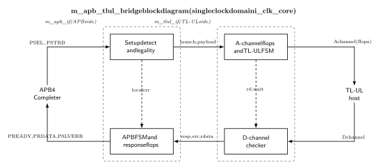
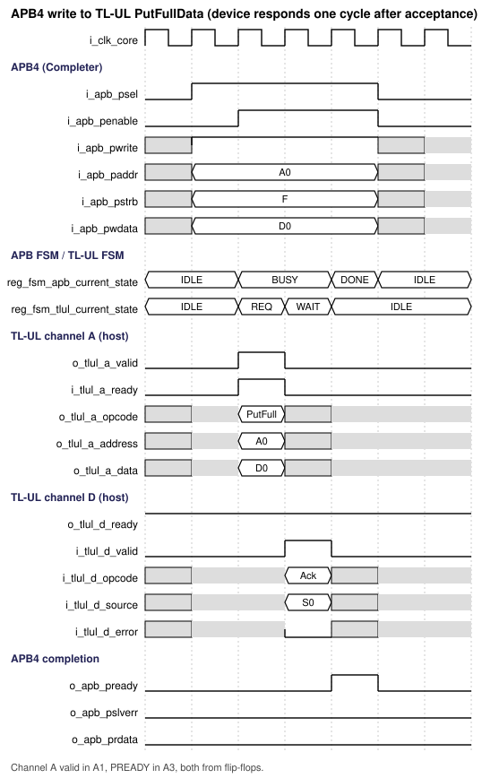
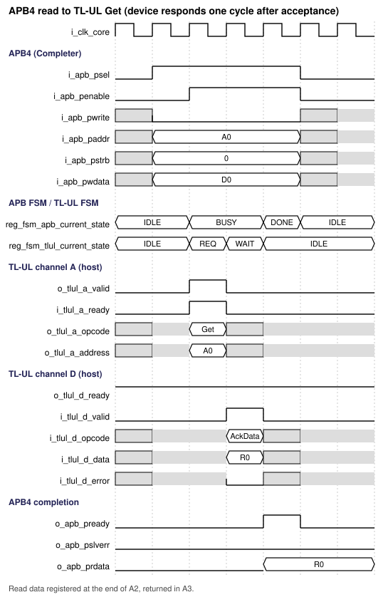
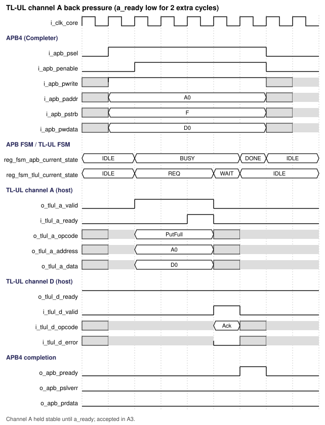
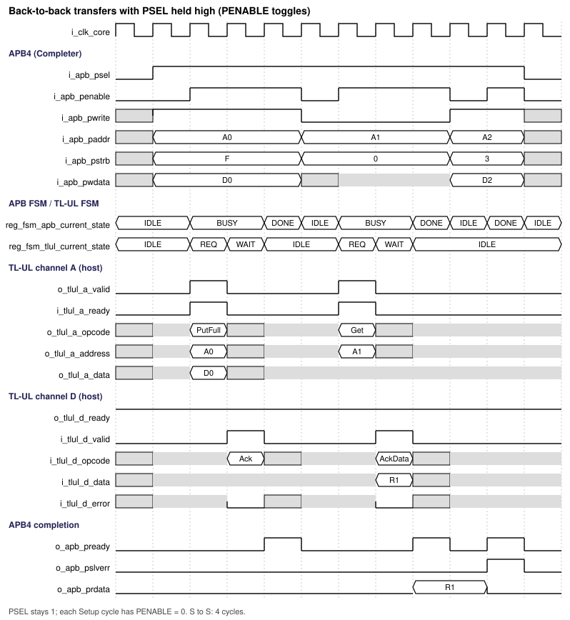
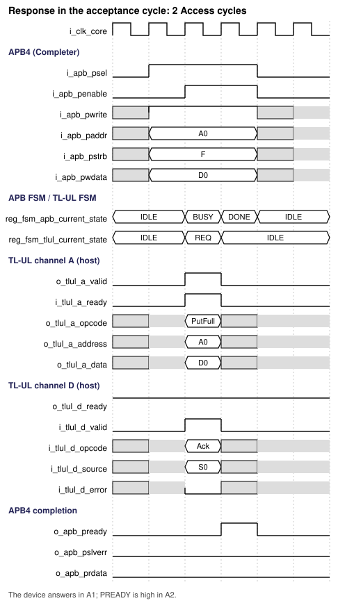
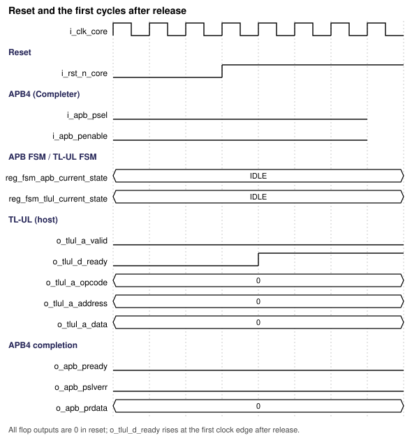
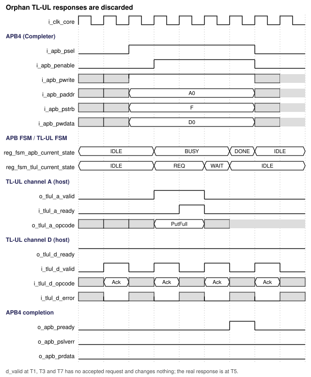
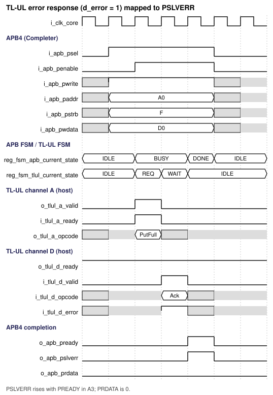
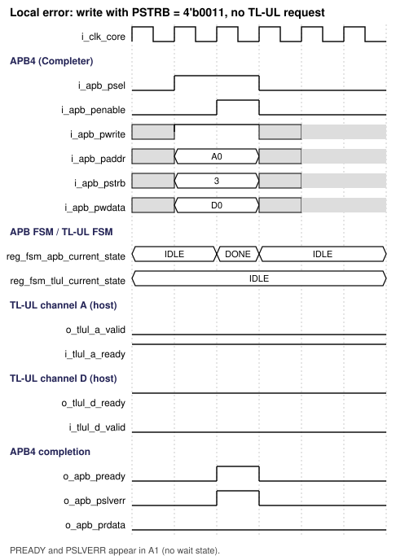

# APB4 to TL-UL Bridge Design Specification

> **Purpose:** Normative design contract for architecture, RTL, verification, DFT, and physical integration of this IP.
>
> Requirement terms: **shall** = mandatory and testable; **should** = recommended; **may** = optional. Every mandatory requirement has a stable REQ-<AREA>-<NNN> identifier and a verification method. Decisions agreed with the designer on 2026-10-18 are recorded in section 20.
>
> **Important limitation, read first:** the bridge accepts **only full-strobe writes (PSTRB = 4'b1111) and word-aligned addresses (PADDR[1:0] = 2'b00)**. A write with any other PSTRB value, and any access with a misaligned address, completes with PSLVERR = 1 and **no** TL-UL request is issued (DEC-001, REQ-ERR-001, REQ-ERR-002). Software that needs byte or half-word writes must use a different bridge.

## Document map

1. [Purpose, scope, and product context](#1-purpose-scope-and-product-context)
2. [Normative references and precedence](#2-normative-references-and-precedence)
3. [Requirements and traceability](#3-requirements-and-traceability)
4. [Features and configurations](#4-features-and-configurations)
5. [Architecture](#5-architecture)
6. [External interfaces and ports](#6-external-interfaces-and-ports)
7. [Clock, reset, and power](#7-clock-reset-and-power)
8. [Parameters and elaboration configurations](#8-parameters-and-elaboration-configurations)
9. [Data representation and arithmetic](#9-data-representation-and-arithmetic)
10. [Detailed functional behavior](#10-detailed-functional-behavior)
11. [Register and programming model](#11-register-and-programming-model)
12. [Error handling and recovery](#12-error-handling-and-recovery)
13. [Performance, power, and area](#13-performance-power-and-area)
14. [RTL implementation contract](#14-rtl-implementation-contract)
15. [Verification specification](#15-verification-specification)
16. [DFT and testability](#16-dft-and-testability)
17. [Physical design and timing integration](#17-physical-design-and-timing-integration)
18. [Security, safety, and reliability](#18-security-safety-and-reliability)
19. [Requirement-to-verification traceability](#19-requirement-to-verification-traceability)
20. [Assumptions, dependencies, and decisions](#20-assumptions-dependencies-and-decisions)
21. [Glossary](#21-glossary)
22. [References used to shape this template](#22-references-used-to-shape-this-template)

## 1. Purpose, scope, and product context

### 1.1 Purpose and scope

The bridge lets one APB4 Requester (for example a peripheral subsystem or a debug port) access a TL-UL fabric or device of the OpenTitan type. It is an APB4 Completer on one side and a TL-UL host (manager) on the other. Each APB transfer becomes one TL-UL request, and the TL-UL response becomes the APB completion.

The design goals are low latency and clean timing: the TL-UL request is launched from flip-flops in the first APB access cycle (see "early launch" in section 5.3), every output that changes toward either bus comes directly from a flip-flop, there is one clock domain, and the APB-facing logic and the TL-UL-facing logic are in separate modules.

**Included:** APB4 Completer port; TL-UL host port (32-bit data, OpenTitan profile); one outstanding request; full-strobe writes (PutFullData) and word reads (Get); back-to-back transfers with PSEL held high; error mapping to PSLVERR; one clock domain and one reset.

**Excluded:** partial writes (any PSTRB other than 4'b1111); byte or half-word accesses; TL-UL bursts and multiple outstanding requests; the TL-UL-to-APB direction; TL-UL bus integrity generation or checking; a response timeout (the SoC watchdog handles a device that never responds, DEC-003); address decoding or protection; clock-domain crossing; software-visible registers.

### 1.2 Deployment assumptions

| Item | Specification |
|---|---|
| Target SoC / product class | Microcontroller-class SoC with an OpenTitan-style TL-UL interconnect and an APB4 peripheral subsystem |
| Technology / library assumptions | Synchronous digital standard-cell flow; no technology-specific cells (no memories, ICGs or synchronizers) |
| Operating modes and workload | Low-rate control accesses with low latency; no streaming traffic |
| Security / privilege context | No privilege decision in the bridge; protection is enforced by the TL-UL fabric (section 18) |
| External dependencies | A protocol-compliant APB Requester; a TL-UL device or crossbar that returns exactly one response per request; a reset controller (DEP-001, DEP-002) |

### 1.3 Feature summary

| Feature ID | Feature | Required / optional | Configuration condition | Requirements |
|---|---|---|---|---|
| FEAT-001 | APB4 full-strobe write to TL-UL PutFullData | Required | Always present | REQ-FUNC-002 |
| FEAT-002 | APB4 read to TL-UL Get | Required | Always present | REQ-FUNC-003 |
| FEAT-003 | Early launch of the TL-UL request from flip-flops | Required | Always present | REQ-FUNC-001, REQ-PERF-001 |
| FEAT-004 | Local error response for unsupported strobe or misaligned address | Required | Always present | REQ-ERR-001, REQ-ERR-002 |
| FEAT-005 | TL-UL response checking and error mapping | Required | Always present | REQ-ERR-003 to REQ-ERR-005 |
| FEAT-006 | Back-to-back APB transfers with PSEL held high | Required | Always present | REQ-FUNC-008, REQ-PERF-004 |

## 2. Normative references and precedence

### 2.1 Normative references

| Ref ID | Document and revision | Applicable clauses | Authority / notes |
|---|---|---|---|
| REF-001 | Arm AMBA APB Protocol Specification, IHI 0024 Issue D (ID041221), APB4 signal set (`../../../VLSIT_CODEX_CLAUDE_SKILLS/.claude/skills/vlsit-asic-ip-microspec/reference/md_doc/vlsit_apb_amba_apb_ihi0024d.md`; licensed, local copy only, not redistributed) | Chapter 2 signals; 3.1 write transfers; 3.2 write strobes; 3.3 read transfers; 3.4 error response; 4.1 operating states; Appendix A signal validity | Protocol authority for APB4. Issue D covers APB2 to APB5; only the Issue C (APB4) signals PPROT and PSTRB are used |
| REF-002 | OpenTitan TL-UL bus specification, lowRISC/opentitan commit ee5f4a1 (`../../../VLSIT_CODEX_CLAUDE_SKILLS/.claude/skills/vlsit-asic-ip-microspec/reference/md_doc/vlsit_tilelink_ul_opentitan_tlul.md`) | Signals; usage of source, opcode, size and mask; explicit error cases; timing diagrams | Protocol authority for the TL-UL profile |
| REF-003 | VLSIT RTL Design Rules v2, VLSIT_RTL_Design_Rule.md | All applicable rules | Mandatory RTL coding, hierarchy, reset, CDC and naming baseline |
| REF-004 | IEEE 1800-2017 SystemVerilog | Synthesizable subset | Subject to REF-003 and the selected frontend |
| REF-005 | OpenTitan TL-UL protocol checker, lowRISC/opentitan commit f6298b3 (`../../../VLSIT_CODEX_CLAUDE_SKILLS/.claude/skills/vlsit-asic-ip-microspec/reference/md_doc/vlsit_tilelink_ul_protocol_checker.md`) | Channel A and channel D checks | Source of the protocol assertions of section 15 |
| REF-006 | SiFive TileLink Specification 1.7.1 | Sections 4.6, 5.4, 6.2 | Base protocol of REF-002; not downloaded, see OI-003 |

### 2.2 Source-of-truth and conflict handling

1. The selected external protocol revision defines protocol behavior for the declared interface profile.
2. Approved product requirements and decisions (section 20) define product-specific behavior.
3. This specification defines the IP contract and shall stay consistent with REF-001, REF-002 and REF-003.
4. REF-003 is the mandatory RTL coding baseline. A conflict is resolved by revising the requirement, not by a local RTL exception.
5. The IP has no registers, so no CSR workbook exists (section 11).
6. The protocol revisions, roles and signal subsets are recorded in section 2.3 and section 6. No signal outside the selected profile is included.
7. Conflicts are resolved by an explicit product decision recorded in section 20.
8. Naming rule (rule R-026): the default naming rule of the skill `vlsit-rtl-generator`, `VLSIT_RTL_Design_Rule.md` v2, sections 2 and 9 (REF-003). The clock and reset domain is named `core` (DEC-012).

### 2.3 Compliance declaration

| Standard | Revision / profile | Role implemented | Options | Deviations |
|---|---|---|---|---|
| AMBA APB | APB4 (REF-001 Issue D; PPROT, PSTRB, PSLVERR; no PWAKEUP, no user or parity signals) | Completer (subordinate) | Wait states through PREADY | PPROT is accepted and ignored (DEC-007). PSTRB other than 4'b1111 on a write is rejected with PSLVERR (DEC-001). Misaligned PADDR is rejected with PSLVERR (REF-001 chapter 2 leaves it UNPREDICTABLE) |
| TileLink Uncached Lightweight (OpenTitan profile) | REF-002, 32-bit data, a_size = 2 only, no bursts | Host (manager) | a_user driven to zero, no integrity (DEC-004) | d_param, d_size, d_sink and d_user are present as ports but unused (DEC-006) |

## 3. Requirements and traceability

| ID | Requirement using shall/should/may | Source | Applies to | Verification method |
|---|---|---|---|---|
| REQ-FUNC-001 | When the APB side is idle and i_apb_psel = 1 and i_apb_penable = 0 (Setup phase), the bridge shall capture the request at the rising edge that ends that cycle and, when the request is legal, shall present it on the TL-UL channel A from flip-flops in the next cycle (the first Access cycle). | REF-001 4.1, Appendix A; DEC-002 | All | Simulation: TEST-002, TEST-006; assertion SVA-008 |
| REQ-FUNC-002 | The bridge shall convert an APB write with PSTRB = 4'b1111 and PADDR[1:0] = 2'b00 into one TL-UL PutFullData (a_opcode = 3'b000) with a_size = 2, a_mask = 4'b1111, a_address = PADDR and a_data = PWDATA. | REF-002 usage of opcode, size and mask | All | Simulation: TEST-002; assertion SVA-004 |
| REQ-FUNC-003 | The bridge shall convert an APB read with PADDR[1:0] = 2'b00 into one TL-UL Get (a_opcode = 3'b100) with a_size = 2, a_mask = 4'b1111 and a_address = PADDR. PSTRB is ignored on reads. | REF-002; REF-001 3.2 | All | Simulation: TEST-006; assertion SVA-004 |
| REQ-FUNC-004 | The bridge shall have at most one TL-UL request outstanding and shall start no new request before the APB completion of the previous transfer. | DEC-002; REF-005 pendingReqPerSrc | All | Assertion SVA-003; simulation TEST-013 |
| REQ-FUNC-005 | The bridge shall keep o_tlul_a_valid high and channel A stable from the cycle after capture until i_tlul_a_ready is sampled high. | REF-002 timing diagrams; REF-005 | All | Assertion SVA-002; simulation TEST-009 |
| REQ-FUNC-006 | The bridge shall return the TL-UL d_data on o_apb_prdata for a read that completes without error and shall drive o_apb_prdata to 0 for a write completion and for every error completion. | REF-001 3.3, 3.4; DEC-009 | All | Simulation: TEST-002, TEST-006, TEST-007 |
| REQ-FUNC-007 | The bridge shall discard a TL-UL response that arrives when no request has been accepted (orphan response) without any effect on the APB side. | REF-002 explicit error cases (orphaned responses discarded on the host side) | All | Simulation: TEST-010; assertion SVA-009 |
| REQ-FUNC-008 | The bridge shall detect the Setup phase of a transfer from the levels i_apb_psel = 1 and i_apb_penable = 0 (not from an edge of i_apb_psel), and shall accept a new transfer whose Setup phase is in the cycle immediately after the PREADY cycle of the previous transfer, both when i_apb_psel stays 1 and only i_apb_penable changes level, and when i_apb_psel returns to 0 for one or more cycles in between. Every combination of read, write and error transfers shall be supported back to back. | REF-001 3.1, 4.1 and Figure 4-1 (the bus moves directly from ACCESS to SETUP when another transfer follows) | All | Simulation: TEST-019; assertion SVA-010 |
| REQ-IF-001 | The bridge shall expose exactly the APB4 Completer signals listed in section 6.2 and no other APB signal. | REF-001 chapter 2; REF-003 PRT-01, PRT-03 | All | Lint and port-list review: TEST-016 |
| REQ-IF-002 | The bridge shall expose exactly the TL-UL host signals listed in section 6.2 (the full OpenTitan signal set; d_param, d_size, d_sink and d_user are unused, DEC-006) and no other. | REF-002 signals; DEC-006 | All | Lint and port-list review: TEST-016 |
| REQ-IF-003 | Every output port that changes value during operation shall be driven directly by the Q pin of a flip-flop, with no combinational logic between the flip-flop and the port. Outputs that never change after reset are constant tie-offs (DEC-005). | Product requirement; DEC-005 | All | Structural check of the RTL and the synthesized netlist: TEST-017 |
| REQ-IF-004 | The bridge shall assert o_apb_pready for exactly one cycle per transfer, and only in an Access cycle (i_apb_psel = 1 and i_apb_penable = 1). o_apb_pslverr shall be 1 only while o_apb_pready is 1. | REF-001 3.1, 3.4 | All | Assertion SVA-001; APB protocol checker |
| REQ-IF-005 | The bridge shall drive o_tlul_a_param = 3'b000, o_tlul_a_size = 2'b10, o_tlul_a_mask = 4'b1111, o_tlul_a_source = PARA_SRC_ID and o_tlul_a_user = '0 (all bits zero) on every request. | REF-002; DEC-004 | All | Assertion SVA-005 |
| REQ-IF-006 | The bridge shall drive o_tlul_d_ready low in reset and high from the first clock edge after reset release, and shall keep it high. | DEC-010 | All | Simulation: TEST-001; assertion SVA-006 |
| REQ-IF-007 | The APB-facing logic and the TL-UL-facing logic shall be in two separate modules that are connected only through the internal interface of section 5.1. | Product requirement | All | Design review and hierarchy check: TEST-017 |
| REQ-ERR-001 | When a write has PSTRB other than 4'b1111, the bridge shall issue no TL-UL request and shall complete the transfer with PREADY = 1 and PSLVERR = 1 in the first Access cycle. | DEC-001; REF-001 3.4 | All | Simulation: TEST-004 |
| REQ-ERR-002 | When PADDR[1:0] is not 2'b00 (read or write), the bridge shall issue no TL-UL request and shall complete the transfer with PREADY = 1 and PSLVERR = 1 in the first Access cycle. | REF-001 chapter 2 (unaligned address UNPREDICTABLE); DEC-001 | All | Simulation: TEST-005 |
| REQ-ERR-003 | When the TL-UL response has d_error = 1, the bridge shall complete the APB transfer with PSLVERR = 1. | REF-002 explicit error cases | All | Simulation: TEST-007 |
| REQ-ERR-004 | When the TL-UL response has a d_opcode other than AccessAckData (3'b001) for a read, or other than AccessAck (3'b000) for a write, the bridge shall complete the APB transfer with PSLVERR = 1. | REF-005 respOpcode; DEC-008 | All | Simulation: TEST-008 |
| REQ-ERR-005 | When the TL-UL response has d_source different from PARA_SRC_ID, the bridge shall complete the APB transfer with PSLVERR = 1. | REF-005 respMustHaveReq; DEC-008 | All | Simulation: TEST-008 |
| REQ-CLK-001 | The bridge shall operate in one clock domain, i_clk_core, for both interfaces and shall contain no clock-domain crossing. | Section 7 | All | CDC analysis: TEST-016 |
| REQ-RESET-001 | The bridge shall use the active-low reset i_rst_n_core with asynchronous assertion and shall drive o_tlul_a_valid, o_tlul_d_ready, o_apb_pready, o_apb_prdata, o_apb_pslverr, o_tlul_a_opcode, o_tlul_a_address and o_tlul_a_data to 0 while the reset is asserted. | REF-003 RST-01; DEC-010, DEC-013 | All | Reset test: TEST-001 |
| REQ-RESET-002 | The bridge shall abandon any transfer in progress when the reset is asserted and shall send no APB completion for it after reset release. | Section 7.3 | All | Simulation: TEST-012 |
| REQ-PARAM-001 | The bridge shall accept only the parameter values listed in section 8; an illegal value shall be reported at elaboration of the verification source set. | Section 8 | All | Elaboration check: TEST-014 |
| REQ-PERF-001 | When the TL-UL device accepts the request in the first cycle and returns the response in the following cycle, the APB Access phase shall last 3 cycles (2 wait states). | Section 10.3; DEC-002 | All | Simulation: TEST-002, TEST-006 |
| REQ-PERF-002 | When the device returns the response in the cycle in which it accepts the request, the APB Access phase shall last 2 cycles (1 wait state). | Section 10.3; REF-005 (response in the acceptance cycle allowed) | All | Simulation: TEST-011 |
| REQ-PERF-003 | A local error completion (REQ-ERR-001, REQ-ERR-002) shall last 1 Access cycle (no wait state), and a new Setup phase shall be accepted in the cycle after PREADY. | Section 10.3, 10.4 | All | Simulation: TEST-004, TEST-005, TEST-013 |
| REQ-PERF-004 | With i_apb_psel held high, back-to-back transfers shall run at the same minimum Setup-to-Setup interval as with a gap: 4 cycles with a prompt device, 3 cycles with a same-cycle response and 2 cycles after a local error, with no idle cycle added by the bridge. | Section 10.4; REQ-FUNC-008 | All | Simulation: TEST-019 |
| REQ-RTL-001 | The RTL shall comply with REF-003 and shall use the hierarchy of section 14.2. | REF-003 | All | Lint and review: TEST-016 |
| REQ-VER-001 | An APB protocol checker and the TL-UL protocol checker of REF-005 shall be bound to the ports in every simulation. | REF-001, REF-005 | All | Simulation log review: TEST-015 |
| REQ-DFT-001 | The RTL shall be scan-insertable: no latch, no combinational loop, no internal tri-state, no clock gating and no gated or derived clock. | REF-003 section 11 | All | Lint and scan rule check: TEST-018 |

Suggested ID areas: FUNC, IF, ERR, CLK, RESET, PARAM, PERF, RTL, VER, DFT.

## 4. Features and configurations

| Configuration ID | Enabled features | Disabled features | Interfaces / widths | Intended use | Verification target |
|---|---|---|---|---|---|
| CFG-BASE | FEAT-001 to FEAT-005 | None | APB4 32-bit data, TL-UL 32-bit data, PARA_ADDR_W = 32, PARA_SRC_W = 8 | Default delivery | All tests |
| CFG-NARROW | FEAT-001 to FEAT-005 | None | PARA_ADDR_W = 16, PARA_SRC_W = 1, PARA_SRC_ID = 1 | Small address space and non-zero source ID | TEST-014, TEST-002, TEST-008 |

The data width is fixed at 32 bits; there is no data-width parameter (DEC-011). Values of PARA_ADDR_W outside 16 to 32 are illegal (section 8).

## 5. Architecture

### 5.1 Overview and block responsibilities

The bridge has two modules below a structural top. The APB-facing module `m_apb_if` owns everything that depends on APB signals. The TL-UL-facing module `m_tlul_if` owns everything that depends on TL-UL signals. They exchange one request bundle and one response bundle through internal wires, so neither module reads a port of the other bus.

| Block | Responsibility | Inputs / outputs | Clock/reset domain | State or storage |
|---|---|---|---|---|
| Setup detect and legality check (in `m_apb_if`) | Detects Setup phase, checks PSTRB and PADDR[1:0], raises launch or local error | APB request to w_req_launch, w_req_wr, w_req_addr, w_req_wdata, local error | CLK-CORE / RST-CORE | None (combinational) |
| APB FSM and response flops (in `m_apb_if`) | Sequences IDLE, BUSY, DONE; drives o_apb_pready, o_apb_prdata, o_apb_pslverr | w_resp_valid, w_resp_err, w_resp_rdata to APB completion | CLK-CORE / RST-CORE | reg_fsm_apb_current_state, reg_pready, reg_pslverr, reg_prdata |
| A-channel flops and TL-UL FSM (in `m_tlul_if`) | Loads the request at the Setup edge, holds it until accepted, tracks the outstanding request | w_req_* to TL-UL channel A | CLK-CORE / RST-CORE | reg_fsm_tlul_current_state, reg_a_valid, reg_a_rd, reg_a_addr, reg_a_data, reg_d_ready |
| D-channel checker (in `m_tlul_if`) | Detects a valid response, checks d_error, d_opcode, d_source, forms read data | TL-UL channel D to w_resp_* | CLK-CORE / RST-CORE | None (combinational) |

Internal interface between the two modules (all wires, no register crosses the boundary):

| Wire | Direction | Width | Meaning |
|---|---|---|---|
| w_req_launch | m_apb_if to m_tlul_if | 1 | Setup phase of a legal request: load channel A at the coming edge |
| w_req_wr | m_apb_if to m_tlul_if | 1 | 1 = write (PutFullData), 0 = read (Get) |
| w_req_addr | m_apb_if to m_tlul_if | PARA_ADDR_W-2 | PADDR[PARA_ADDR_W-1:2] |
| w_req_wdata | m_apb_if to m_tlul_if | 32 | PWDATA |
| w_resp_valid | m_tlul_if to m_apb_if | 1 | A valid response for the outstanding request is accepted this cycle |
| w_resp_err | m_tlul_if to m_apb_if | 1 | The response has an error (d_error, wrong opcode or wrong source) |
| w_resp_rdata | m_tlul_if to m_apb_if | 32 | Read data, already forced to 0 for writes and for errors |

### 5.2 Block diagram



*Figure 5-1. Source: `figures/block_diagram.json`, generated as TikZ (`figures/block_diagram.tex`) by `scripts/vlsit_block_diagram.py`.*

### 5.3 Transaction and dataflow

**Early launch.** The APB manager already drives PADDR, PWRITE, PWDATA and PSTRB in the Setup phase, and keeps them unchanged until the transfer completes (REF-001 3.1, 4.1, Appendix A). The bridge therefore captures the request at the end of the Setup cycle straight into the TL-UL channel A flip-flops. Channel A is valid in the first Access cycle, so the request reaches the TL-UL device one cycle after the Setup cycle, with no intermediate buffer stage.

1. **Setup (S):** i_apb_psel = 1, i_apb_penable = 0. The APB side is idle. At the end of S, a legal request is loaded into the A-channel flops and reg_a_valid is set; an illegal request instead loads the response flops with PSLVERR = 1 and PREADY = 1.
2. **Access 1 (A1):** o_tlul_a_valid = 1 with the converted request, o_tlul_d_ready = 1. When i_tlul_a_ready = 1 the request is accepted at the end of A1.
3. **Access 2 (A2):** the device returns the response (i_tlul_d_valid = 1). At the end of A2 the response is checked and loaded into reg_prdata, reg_pslverr and reg_pready.
4. **Access 3 (A3):** o_apb_pready = 1 with o_apb_prdata and o_apb_pslverr, all from flops. The transfer ends at the end of A3.
5. **Next transfer:** the next Setup phase may follow in the cycle after A3.

If the device answers in the cycle in which it accepts the request (A1), the response is loaded at the end of A1 and PREADY is 1 in A2. If the device holds a_ready low, o_tlul_a_valid and channel A stay unchanged and the Access phase is extended; the same happens when the response is late.

**Back-to-back transfers.** An APB Requester that has another transfer for the same Completer keeps i_apb_psel at 1 after the last Access cycle and only drives i_apb_penable back to 0; the bus then moves directly from ACCESS to SETUP (REF-001 3.1, 4.1). The bridge supports this without any idle cycle. The reason is that the Setup phase is recognized by the levels i_apb_psel = 1 and i_apb_penable = 0 while the APB FSM is idle, not by a rising edge of i_apb_psel. The PREADY cycle of a transfer is also the cycle in which the APB FSM is in ENUM_ST_DONE, and the APB FSM is in ENUM_ST_IDLE again in the next cycle, which is the Setup cycle of the next transfer. The A-channel flops, the response flops and both FSMs are therefore free in time for the next capture, and the next transfer starts exactly like the first one. The same holds when the Requester releases i_apb_psel for one or more cycles in between. Figure 6-4 shows a write, a read and an illegal write one after the other with i_apb_psel held high.

### 5.4 Invariants

- At most one TL-UL request is outstanding, and its a_source is PARA_SRC_ID.
- o_tlul_a_valid is high only in the TL-UL FSM state ENUM_ST_REQ, and channel A does not change while o_tlul_a_valid is high and i_tlul_a_ready is low.
- o_apb_pready is high only in the APB FSM state ENUM_ST_DONE, for one cycle.
- No TL-UL request is issued for an illegal APB request.
- The TL-UL FSM is idle whenever the APB FSM is idle.

## 6. External interfaces and ports

### 6.1 Interface inventory

| Interface ID | Type and revision | Role | Direction at IP boundary | Clock domain | Required / optional | Configurations |
|---|---|---|---|---|---|---|
| IF-001 | AMBA APB4 (REF-001 Issue D, APB4 subset) | Completer (subordinate) | Requests in, completion out | CLK-CORE | Required | All |
| IF-002 | TL-UL, OpenTitan profile (REF-002) | Host (manager) | Requests out, responses in | CLK-CORE | Required | All |
| IF-003 | Clock and reset | Receiver | Inputs | CLK-CORE | Required | All |

### 6.2 Complete port list

Port names follow REF-003 PRT-01: `i_` or `o_`, then the protocol tag, then the signal mnemonic, with the tag `apb` for APB and the tag `tlul` for TL-UL (REF-003 has no TL-UL entry). The clock and reset are named `i_clk_core` and `i_rst_n_core` because one clock serves both buses (DEC-012). The TL-UL signal set is the OpenTitan `tl_h2d_t` and `tl_d2h_t` set, flattened. The inputs d_param, d_size, d_sink and d_user are present for integration but no logic reads them (DEC-006). Output ports marked "flop" come directly from a flip-flop; ports marked "constant" are tie-offs (DEC-005).

| Port | Direction | Width | Meaning (function) | Clock domain | Signal type | Reset / idle value | Timing / sampling | Configurations |
|---|---|---|---|---|---|---|---|---|
| i_clk_core | Input | 1 | Clock for both interfaces | CLK-CORE | Clock | Not applicable (clock) | Rising edge | All |
| i_rst_n_core | Input | 1 | Active-low reset | RST-CORE | Reset (asynchronous assertion, level) | Not applicable (reset) | Asynchronous assertion, synchronous release by the SoC | All |
| i_apb_psel | Input | 1 | APB select | CLK-CORE | Level (high for the whole transfer) | Not used in reset | Sampled every cycle on the APB-idle state | All |
| i_apb_penable | Input | 1 | APB enable (Access phase) | CLK-CORE | Level (high during the Access phase) | Not used in reset | Sampled with PSEL | All |
| i_apb_pwrite | Input | 1 | 1 = write | CLK-CORE | Data (valid with i_apb_psel) | Not used in reset | Captured at the Setup edge | All |
| i_apb_paddr | Input | PARA_ADDR_W | Byte address | CLK-CORE | Data (valid with i_apb_psel) | Not used in reset | Captured at the Setup edge; bits [1:0] must be 0 | All |
| i_apb_pprot | Input | 3 | Protection type | CLK-CORE | Data (ignored) | Not used | Ignored (DEC-007) | All |
| i_apb_pstrb | Input | 4 | Write strobes | CLK-CORE | Data (valid with i_apb_psel) | Not used in reset | Checked at the Setup edge; must be 4'b1111 for a write | All |
| i_apb_pwdata | Input | 32 | Write data | CLK-CORE | Data (valid with i_apb_psel) | Not used in reset | Captured at the Setup edge | All |
| o_apb_pready | Output (flop) | 1 | Transfer ready | CLK-CORE | Pulse (1 cycle per transfer) | 0 | High for one cycle per transfer | All |
| o_apb_prdata | Output (flop) | 32 | Read data | CLK-CORE | Data (valid with o_apb_pready) | 0 | Valid with o_apb_pready; holds its last value otherwise (DEC-009) | All |
| o_apb_pslverr | Output (flop) | 1 | Transfer error | CLK-CORE | Level (high only with o_apb_pready) | 0 | High only with o_apb_pready | All |
| o_tlul_a_valid | Output (flop) | 1 | Request valid | CLK-CORE | Level (set at the Setup edge, held until i_tlul_a_ready) | 0 | Set at the Setup edge, held until i_tlul_a_ready | All |
| i_tlul_a_ready | Input | 1 | Request accepted | CLK-CORE | Level (handshake with o_tlul_a_valid) | Not used in reset | Sampled while o_tlul_a_valid is high | All |
| o_tlul_a_opcode | Output | 3 | Request opcode: bit 2 from a flop (1 = Get); bits [1:0] constant 0 (PutFullData 3'b000, Get 3'b100) | CLK-CORE | Data (valid with o_tlul_a_valid) | 0 | Stable while valid | All |
| o_tlul_a_param | Output (constant) | 3 | Reserved, always 3'b000 | CLK-CORE | Static (constant 3'b000) | 3'b000 | Constant | All |
| o_tlul_a_size | Output (constant) | 2 | Request size, always 2'b10 (4 bytes) | CLK-CORE | Static (constant 2'b10) | 2'b10 | Constant | All |
| o_tlul_a_source | Output (constant) | PARA_SRC_W | Request identifier, always PARA_SRC_ID | CLK-CORE | Static (constant PARA_SRC_ID) | PARA_SRC_ID | Constant | All |
| o_tlul_a_address | Output | PARA_ADDR_W | Request address: bits [PARA_ADDR_W-1:2] from flops, bits [1:0] constant 0 | CLK-CORE | Data (valid with o_tlul_a_valid) | 0 | Stable while valid | All |
| o_tlul_a_mask | Output (constant) | 4 | Byte lanes, always 4'b1111 | CLK-CORE | Static (constant 4'b1111) | 4'b1111 | Constant | All |
| o_tlul_a_data | Output (flop) | 32 | Write data (copy of PWDATA; unused by the device on Get) | CLK-CORE | Data (valid with o_tlul_a_valid) | 0 | Stable while valid | All |
| o_tlul_a_user | Output (constant) | PARA_A_USER_W | A-channel user bits, always '0 (DEC-004) | CLK-CORE | Static (constant 0) | '0 | Constant | All |
| i_tlul_d_valid | Input | 1 | Response valid | CLK-CORE | Level (handshake with o_tlul_d_ready) | Not used in reset | Sampled while o_tlul_d_ready is high | All |
| o_tlul_d_ready | Output (flop) | 1 | Response accepted | CLK-CORE | Level (0 in reset, then constant 1) | 0 in reset, then 1 (DEC-010) | Constant 1 after the first clock edge following reset release | All |
| i_tlul_d_opcode | Input | 3 | Response opcode (3'b000 AccessAck, 3'b001 AccessAckData) | CLK-CORE | Data (valid with i_tlul_d_valid) | Not used in reset | Checked with a valid response | All |
| i_tlul_d_source | Input | PARA_SRC_W | Response identifier, expected PARA_SRC_ID | CLK-CORE | Data (valid with i_tlul_d_valid) | Not used in reset | Checked with a valid response | All |
| i_tlul_d_data | Input | 32 | Read data | CLK-CORE | Data (valid with i_tlul_d_valid) | Not used in reset | Captured with a valid read response | All |
| i_tlul_d_error | Input | 1 | Response error | CLK-CORE | Data (valid with i_tlul_d_valid) | Not used in reset | Captured with a valid response | All |
| i_tlul_d_param | Input | 3 | Response parameter (reserved) | CLK-CORE | Data (ignored) | Not used in reset | Unused, no logic reads it (DEC-006) | All |
| i_tlul_d_size | Input | 2 | Response size | CLK-CORE | Data (ignored) | Not used in reset | Unused, not checked (DEC-006) | All |
| i_tlul_d_sink | Input | PARA_D_SINK_W | Response sink identifier | CLK-CORE | Data (ignored) | Not used in reset | Unused (DEC-006) | All |
| i_tlul_d_user | Input | PARA_D_USER_W | Response user bits | CLK-CORE | Data (ignored) | Not used in reset | Unused (DEC-006) | All |

Signal types: a level is held until it is acknowledged or changed; the only pulse is o_apb_pready, one cycle per transfer, which the APB requester samples in that cycle; data signals are qualified by the signal named in their type; static signals never change after reset. All signals are in the clock domain CLK-CORE except i_rst_n_core, whose release is synchronized by the SoC. Test and interrupt ports: none. See section 16 for DFT. The inputs i_tlul_d_param, i_tlul_d_size, i_tlul_d_sink and i_tlul_d_user and the APB input i_apb_pprot are unused; they need a lint waiver (section 14.3).

### 6.3 Protocol behavior

**APB4 (IF-001, REF-001).** The Completer is single-transfer. The Setup phase lasts one cycle (PSEL = 1, PENABLE = 0); the Access phase starts in the next cycle and lasts until PREADY is high (REF-001 4.1). The signals PADDR, PWRITE, PWDATA and PSTRB stay unchanged from Setup until PREADY (REF-001 3.1, 4.1), which lets the bridge capture them once, at the Setup edge. PSLVERR is only valid in the last cycle of the transfer (REF-001 3.4), and the bridge asserts it only together with PREADY. PSTRB is LOW on reads (REF-001 3.2) and is ignored by the bridge on reads. Back-to-back transfers with i_apb_psel held high are supported (REQ-FUNC-008, section 5.3).

**TL-UL (IF-002, REF-002).** The bridge issues one request at a time. The request is stable until accepted. The bridge accepts a response at any time; a response that does not belong to an accepted request is discarded (REQ-FUNC-007), as the OpenTitan hosts do (REF-002, explicit error cases). A response in the same cycle as the request acceptance is allowed by REF-005 and is supported.

| Case | Legal behavior | Illegal / unsupported case | IP response | Requirement IDs |
|---|---|---|---|---|
| Write, PSTRB = 4'b1111, aligned address | PutFullData, size 2, mask 4'b1111 | None | Normal completion | REQ-FUNC-002 |
| Write, any other PSTRB (including 4'b0000) | None | Not supported (DEC-001) | PREADY = 1 with PSLVERR = 1 in the first Access cycle; no TL-UL request | REQ-ERR-001 |
| Read, aligned address (any PSTRB value is ignored) | Get, size 2, mask 4'b1111 | None | Data on PRDATA | REQ-FUNC-003 |
| Read or write, PADDR[1:0] not 2'b00 | None | Not supported | PREADY = 1 with PSLVERR = 1 in the first Access cycle; no TL-UL request | REQ-ERR-002 |
| Next Setup phase right after PREADY, i_apb_psel held at 1 | Transfer accepted exactly like the first one | None | Same results; Setup-to-Setup interval as in 10.4 | REQ-FUNC-008, REQ-PERF-004 |
| TL-UL response with d_error = 1 | None | Error response | PSLVERR = 1, PRDATA = 0 | REQ-ERR-003 |
| TL-UL response with a wrong d_opcode or d_source | None | Protocol error of the device | PSLVERR = 1, PRDATA = 0 | REQ-ERR-004, REQ-ERR-005 |
| TL-UL response with no accepted request | None | Orphan response | Discarded, no APB effect | REQ-FUNC-007 |



*Figure 6-1. Successful write, device responds one cycle after acceptance (source: `figures/apb_write_ok.json`). 3 Access cycles.*



*Figure 6-2. Successful read (source: `figures/apb_read_ok.json`).*



*Figure 6-3. The device holds a_ready low for two extra cycles; channel A stays stable and the Access phase is extended (source: `figures/tlul_backpressure.json`).*



*Figure 6-4. Back-to-back transfers with i_apb_psel held high and only i_apb_penable changing: a full-strobe write (3 Access cycles), a read (3 Access cycles) and a write with PSTRB = 4'b0011 that gets a local error (1 Access cycle). The Setup cycles are 4 cycles apart (source: `figures/apb_back_to_back.json`).*

### 6.4 Interrupts and events

| Signal/event | Polarity | Assert condition | Clear/deassert condition | Mask/priority | Crossing | Reset state |
|---|---|---|---|---|---|---|
| Not applicable | Not applicable | The IP has no interrupt or event output; errors are reported only through PSLVERR | Not applicable | Not applicable | Not applicable | Not applicable |

## 7. Clock, reset, and power

### 7.1 Clock domains

| Domain | Clock port | Edge | Frequency range | Source | Relationship to other clocks | Gating policy |
|---|---|---|---|---|---|---|
| CLK-CORE | i_clk_core | Rising | Set by the SoC integrator (OI-004) | SoC clock controller | Single domain; the APB and TL-UL buses share it | No clock gating inside the IP |

### 7.2 CDC and RDC

| Crossing ID | From → to | Signals | Structure | Reset handling | Constraints / verification |
|---|---|---|---|---|---|
| Not applicable | Not applicable | **Not required (confirmed by user, 2026-10-18):** one clock domain and one reset domain, so no crossing | Not applicable | Not applicable | A CDC tool run reports zero crossings (TEST-016) |

### 7.3 Reset domains and sequencing

| Reset ID | Port | Polarity / assertion | Sync or async | Scope | Deassertion | Reset value |
|---|---|---|---|---|---|---|
| RST-CORE | i_rst_n_core | Active-low | Asynchronous assertion; synchronous release provided by the SoC reset controller (REF-003 RST-02, DEP-002) | All flip-flops | Synchronous to i_clk_core | Both FSMs in ENUM_ST_IDLE; reg_a_valid, reg_d_ready, reg_pready, reg_pslverr, reg_prdata, reg_a_rd, reg_a_addr, reg_a_data = 0 |

Every flip-flop has the asynchronous reset (DEC-013): both FSM state registers, reg_a_valid, reg_d_ready, reg_pready, reg_pslverr and reg_prdata, and also the payload registers reg_a_rd, reg_a_addr and reg_a_data. All are reset to 0, so every flop-driven output is defined after reset: o_tlul_a_opcode = 3'b000, o_tlul_a_address = 0 and o_tlul_a_data = 0 while o_tlul_a_valid = 0. reg_d_ready is cleared by reset and its D input is 1, so o_tlul_d_ready becomes 1 at the first clock edge after reset release (DEC-010). A transfer in progress when the reset asserts is abandoned; the SoC resets the APB Requester and the TL-UL device together with the bridge (DEP-002).

### 7.4 Power intent (if applicable)

**Not required (confirmed by user, 2026-10-18):** the IP is in the always-on domain of the SoC and has no isolation, retention or power sequencing of its own.

## 8. Parameters and elaboration configurations

Parameter declarations follow REF-003 PAR-01 and PAR-02. Example:

```systemverilog
// Parameter Description: Width of the byte address on both buses.
// Parameter values: 16 to 32, default 32.
// Parameter unit: bits
parameter logic [31:0] PARA_ADDR_W = 32'd32,
```

| Parameter | Purpose | Default | Legal values / range | Dependencies / invalid combinations | Effect |
|---|---|---|---|---|---|
| PARA_ADDR_W | Address width of both buses | 32 | 16 to 32 | None | Width of i_apb_paddr and o_tlul_a_address |
| PARA_SRC_W | Width of the TL-UL source identifier | 8 | 1 to 8 | PARA_SRC_ID shall fit in PARA_SRC_W bits | Width of o_tlul_a_source and i_tlul_d_source |
| PARA_SRC_ID | Constant source identifier of every request | 0 | 0 to 2^PARA_SRC_W - 1 | Shall fit in PARA_SRC_W bits | Value of o_tlul_a_source and of the expected i_tlul_d_source |
| PARA_A_USER_W | Width of the a_user bits, which are always driven to zero (width only, ASM-005) | 1 | 1 to 32 | The layout of a_user depends on the integration project (TBD-001); the default is the lowest width because the bits are constant zero | Width of o_tlul_a_user |
| PARA_D_SINK_W | Width of the unused d_sink input (width only) | 1 | 1 to 4 | None | Width of i_tlul_d_sink; no behavior |
| PARA_D_USER_W | Width of the unused d_user input (width only) | 1 | 1 to 32 | None | Width of i_tlul_d_user; no behavior |

| Configuration | Parameter overrides | Features/interfaces | Expected hierarchy | Elaboration/lint/synthesis target |
|---|---|---|---|---|
| CFG-BASE | Defaults | FEAT-001 to FEAT-005 | m_apb_tlul_bridge with two children | Elaborates and lints clean; synthesizes without memories |
| CFG-NARROW | PARA_ADDR_W = 16, PARA_SRC_W = 1, PARA_SRC_ID = 1 | Same | Same | Same targets |

The module m_tlul_if also holds three constants that are not parameters and cannot be overridden: LPARA_A_SIZE = 2 (request size code, 4 bytes), LPARA_A_MASK = 4'b1111 (all byte lanes) and LPARA_D_ACK_DATA = 1 (d_opcode of AccessAckData). They only give names to the constant fields of section 6.2.

An illegal parameter value shall be reported at elaboration of the verification source set and shall not be silently clamped. The port list depends on a parameter only through widths.

## 9. Data representation and arithmetic

All hardware data are unsigned 4-state logic vectors. Bit 0 is the least significant bit. The data bus is 32 bits wide; byte lane i carries bits [8i+7:8i], and PSTRB[i] and a_mask[i] refer to the same lane.

| Quantity | Width | Encoding / range | Extension / truncation | Overflow / invalid behavior |
|---|---:|---|---|---|
| APB address | PARA_ADDR_W | Byte address; bits [1:0] shall be 0 | Bits [PARA_ADDR_W-1:2] are copied to a_address[PARA_ADDR_W-1:2]; a_address[1:0] = 2'b00 | Non-zero bits [1:0] give PSLVERR (REQ-ERR-002) |
| a_opcode | 3 | 3'b000 PutFullData, 3'b100 Get | Bit 2 = read, bits [1:0] = 0 | Other values are never generated |
| a_size | 2 | 2'b10 (4 bytes) | None | Other values are never generated |
| a_mask | 4 | 4'b1111 | None | Other values are never generated (DEC-001) |
| d_opcode | 3 | 3'b000 AccessAck, 3'b001 AccessAckData | None | Any value other than the expected one gives PSLVERR |
| Read data | 32 | Unsigned word | Forced to 0 for writes and for every error completion | Not applicable |

## 10. Detailed functional behavior

### 10.1 Modes and state transitions

There are two small FSMs, one in each module. Names follow REF-003 ENM-04 and ENM-05. Unused encodings recover to ENUM_ST_IDLE (REF-003 ENM-03).

**APB FSM** (`m_apb_if`, `reg_fsm_apb_current_state`, 2 bits):

| Mode/state | Entry condition | Behavior | Exit condition | Outputs / side effects |
|---|---|---|---|---|
| ENUM_ST_IDLE | Reset release, or end of ENUM_ST_DONE | Waits for the Setup phase (i_apb_psel = 1, i_apb_penable = 0) | Legal request: ENUM_ST_BUSY. Illegal request: ENUM_ST_DONE | Legal: w_req_launch = 1. Illegal: reg_pready, reg_pslverr set, reg_prdata cleared at the Setup edge |
| ENUM_ST_BUSY | Legal request launched | Waits for w_resp_valid | w_resp_valid = 1: ENUM_ST_DONE | At that edge reg_pready, reg_pslverr and reg_prdata load the response |
| ENUM_ST_DONE | Response loaded, or local error | o_apb_pready = 1 for one cycle | Next cycle: ENUM_ST_IDLE | reg_pready and reg_pslverr cleared at the edge that leaves the state |

**TL-UL FSM** (`m_tlul_if`, `reg_fsm_tlul_current_state`, 2 bits):

| Mode/state | Entry condition | Behavior | Exit condition | Outputs / side effects |
|---|---|---|---|---|
| ENUM_ST_IDLE | Reset release, or response taken | No request outstanding | w_req_launch = 1: ENUM_ST_REQ | At that edge reg_a_valid, reg_a_rd, reg_a_addr, reg_a_data load |
| ENUM_ST_REQ | Request launched | o_tlul_a_valid = 1; channel A stable | i_tlul_a_ready = 1 with a valid response in the same cycle: ENUM_ST_IDLE; i_tlul_a_ready = 1 without response: ENUM_ST_WAIT | reg_a_valid cleared when the request is accepted |
| ENUM_ST_WAIT | Request accepted | Waits for the response | Valid response: ENUM_ST_IDLE | w_resp_valid = 1 in the exit cycle |

A response counts only in ENUM_ST_WAIT, or in ENUM_ST_REQ together with i_tlul_a_ready = 1. A d_valid in any other state is an orphan and is discarded (REQ-FUNC-007).

### 10.2 Operations

Combinational equations (all inputs go to flip-flop D pins or to the next-state logic only; no output port is driven combinationally, REQ-IF-003):

| Name | Definition |
|---|---|
| w_setup | state APB = ENUM_ST_IDLE and i_apb_psel = 1 and i_apb_penable = 0 |
| w_legal | i_apb_paddr[1:0] = 2'b00 and (i_apb_pwrite = 0 or i_apb_pstrb = 4'b1111) |
| w_req_launch | w_setup and w_legal |
| w_local_err | w_setup and not w_legal |
| w_resp_valid (named w_resp_hit inside m_tlul_if) | i_tlul_d_valid and reg_d_ready and ((TL-UL state = ENUM_ST_REQ and i_tlul_a_ready) or TL-UL state = ENUM_ST_WAIT) |
| w_resp_err | i_tlul_d_error or (i_tlul_d_opcode differs from (reg_a_rd ? 3'b001 : 3'b000)) or (i_tlul_d_source differs from PARA_SRC_ID) |
| w_resp_rdata | (reg_a_rd and not w_resp_err) ? i_tlul_d_data : 32'h0 |

| Operation ID | Inputs / preconditions | Processing semantics | Result / completion | Latency / ordering |
|---|---|---|---|---|
| OP-001 | APB write, PSTRB = 4'b1111, PADDR[1:0] = 2'b00 | PutFullData, size 2, mask 4'b1111, address = PADDR, data = PWDATA | AccessAck to PREADY, PRDATA = 0, PSLVERR = 0 | 3 Access cycles with a prompt device |
| OP-002 | APB read, PADDR[1:0] = 2'b00 | Get, size 2, mask 4'b1111, address = PADDR | AccessAckData: PRDATA = d_data, PSLVERR = 0 | 3 Access cycles with a prompt device |
| OP-003 | APB write with PSTRB other than 4'b1111, or any access with PADDR[1:0] not 2'b00 | No TL-UL request | PREADY = 1 with PSLVERR = 1, PRDATA = 0 | 1 Access cycle |
| OP-004 | TL-UL response with d_error = 1, a wrong d_opcode or a wrong d_source | Response consumed | PREADY = 1 with PSLVERR = 1, PRDATA = 0 | As OP-001 or OP-002 |

### 10.3 Cycle-level behavior

**Waveform plan (rule R-024).** The list below was proposed from sections 6.3 and 10.2 and confirmed by the designer on 2026-10-21 (option "proposed list"). It covers every operation of 10.2, the success and the error case of both interfaces, and the special cases.

| Waveform ID | Function / operation | Scenario (success / error / corner) | Signals shown | Figure | Confirmed by user |
|---|---|---|---|---|---|
| WF-001 | OP-001 full-strobe write | success | APB write, channels A and D, both FSMs, PREADY | figures/apb_write_ok.svg (Figure 6-1) | 2026-10-21 |
| WF-002 | OP-002 read | success | APB read, Get, read data on PRDATA | figures/apb_read_ok.svg (Figure 6-2) | 2026-10-21 |
| WF-003 | OP-003 illegal request, local error | error | PSTRB, PREADY and PSLVERR in the first Access cycle, no channel A request | figures/apb_local_err.svg (Figure 12-2) | 2026-10-21 |
| WF-004 | OP-004 TL-UL error response | error | d_error, PSLVERR, PRDATA = 0 | figures/apb_write_resp_err.svg (Figure 12-1) | 2026-10-21 |
| WF-005 | OP-001 and OP-002 with channel A back pressure | corner | a_ready low, channel A stable, extended Access phase | figures/tlul_backpressure.svg (Figure 6-3) | 2026-10-21 |
| WF-006 | OP-001, OP-002 and OP-003 back to back with PSEL held high | corner | Setup detection by level, Setup-to-Setup interval | figures/apb_back_to_back.svg (Figure 6-4) | 2026-10-21 |
| WF-007 | OP-001 with the response in the acceptance cycle | corner | d_valid with a_ready, 2 Access cycles | figures/apb_write_same_cycle.svg (Figure 10-1) | 2026-10-21 |
| WF-008 | Reset and the first cycles after release | corner | rst_n, d_ready 0 then 1, outputs 0 | figures/reset_sequence.svg (Figure 10-2) | 2026-10-21 |
| WF-009 | Orphan response discarded | corner | d_valid with no accepted request, no APB effect | figures/tlul_orphan_response.svg (Figure 10-3) | 2026-10-21 |

Active edge: rising edge of i_clk_core. Inputs are sampled at the edge that ends a cycle; flip-flop outputs change after that edge. The table follows Figure 6-1 (write, device accepts in A1 and responds in A2).

| Cycle / event | Input condition | State/action | Output condition |
|---|---|---|---|
| S (Setup) | i_apb_psel = 1, i_apb_penable = 0, legal request | At the end of S: channel A flops load, reg_a_valid set, APB FSM to ENUM_ST_BUSY, TL-UL FSM to ENUM_ST_REQ | All outputs idle (o_apb_pready = 0, o_tlul_a_valid = 0) |
| A1 (Access 1) | i_apb_penable = 1, i_tlul_a_ready = 1 | Request accepted at the end of A1; TL-UL FSM to ENUM_ST_WAIT | o_tlul_a_valid = 1 with the request; o_apb_pready = 0 |
| A2 (Access 2) | i_tlul_d_valid = 1, i_tlul_d_error = 0 | Response checked and loaded at the end of A2; both FSMs move on (TL-UL to ENUM_ST_IDLE, APB to ENUM_ST_DONE) | o_tlul_a_valid = 0; o_apb_pready = 0 |
| A3 (Access 3) | Not applicable | APB FSM in ENUM_ST_DONE | o_apb_pready = 1, o_apb_pslverr = 0, o_apb_prdata valid |
| Next cycle | i_apb_psel = 0, or the next Setup phase | APB FSM to ENUM_ST_IDLE | reg_pready and reg_pslverr cleared |

Variants: a response in A1 (the cycle of acceptance) gives o_apb_pready = 1 in A2, a 2-cycle Access phase (REQ-PERF-002). A local error loads reg_pready at the end of S, so o_apb_pready = 1 in A1, a 1-cycle Access phase (REQ-PERF-003, Figure 12-2). A device that holds a_ready low or answers late extends the Access phase by the same number of cycles. For back-to-back transfers the Setup cycle of the next transfer is the cycle after the PREADY cycle, with i_apb_psel still 1 and i_apb_penable = 0; the APB FSM is in ENUM_ST_IDLE in that cycle and captures the request at its end (Figure 6-4).



*Figure 10-1. The device answers in the cycle in which it accepts the request: 2 Access cycles (source: `figures/apb_write_same_cycle.json`).*



*Figure 10-2. Reset and release: all flop outputs are 0 in reset; o_tlul_d_ready becomes 1 at the first clock edge after release (source: `figures/reset_sequence.json`).*



*Figure 10-3. d_valid at T1 (idle), T3 (before acceptance) and T7 (after the response) is discarded; the real response is at T5 (source: `figures/tlul_orphan_response.json`).*

### 10.4 Arbitration, buffering, and throughput

There is no arbitration and no buffer: one request is outstanding. The earliest next Setup phase is the cycle after PREADY, because the APB FSM is back in ENUM_ST_IDLE by then. The minimum interval between the starts of two transfers is therefore 4 cycles with a prompt device (S plus 3 Access cycles), 3 cycles with a same-cycle response, and 2 cycles for a local error. The same intervals apply when i_apb_psel stays high between transfers (REQ-FUNC-008, REQ-PERF-004): the bridge adds no idle cycle, because it needs only the PREADY cycle to return to idle.

### 10.5 Memories and storage

| Storage ID | Kind | Depth × width | Ports | Read latency | Write mask | Reset/init | ECC/parity | Implementation |
|---|---|---|---|---|---|---|---|---|
| Not applicable | Not applicable | **Not required (confirmed by user, 2026-10-18):** the IP has no memory; the captured request and the response are plain flip-flops | Not applicable | Not applicable | Not applicable | Not applicable | Not applicable | Not applicable |

## 11. Register and programming model

**Not required (confirmed by user, 2026-10-18):** the bridge has no software-visible registers. It is configured only by parameters (section 8), and its only status is PSLVERR on each transfer. No CSR workbook is delivered.

## 12. Error handling and recovery

| Error ID | Detection condition | Observable response/status | Interrupt | Clear/recovery | Reset behavior |
|---|---|---|---|---|---|
| ERR-001 | Write with PSTRB other than 4'b1111 | PREADY = 1 and PSLVERR = 1 in the first Access cycle; PRDATA = 0; no TL-UL request | None | The next transfer is independent | Not applicable (no stored error) |
| ERR-002 | PADDR[1:0] not 2'b00 | Same as ERR-001 | None | Same | Same |
| ERR-003 | i_tlul_d_error = 1 on the accepted response | PSLVERR = 1, PRDATA = 0, with PREADY | None | Same | Same |
| ERR-004 | d_opcode not equal to the expected opcode | Same as ERR-003 | None | Same | Same |
| ERR-005 | d_source not equal to PARA_SRC_ID | Same as ERR-003 | None | Same | Same |
| ERR-006 | No response ever arrives | The APB Requester waits (no PREADY) | None | Handled by the SoC watchdog (DEC-003); reset of the bridge, the Requester and the device recovers | Reset abandons the transfer |

All detected errors give the same result, PSLVERR = 1 with PRDATA = 0, so no priority between them is needed. A write that gets PSLVERR from the device may or may not have updated the device (REF-001 3.4). The bridge keeps no sticky error flag in the RTL: errors are visible only on PSLVERR. For simulation, the verification source set holds a sticky counter of the error kinds (DEC-009), so the RTL carries no dead logic.



*Figure 12-1. Write whose response has d_error = 1 (source: `figures/apb_write_resp_err.json`).*



*Figure 12-2. Write with PSTRB = 4'b0011: no TL-UL request, PSLVERR in the first Access cycle (source: `figures/apb_local_err.json`).*

## 13. Performance, power, and area

| Metric ID | Metric | Target / limit | Conditions | Measurement method | Hard / goal |
|---|---|---|---|---|---|
| PERF-001 | Access-phase length, normal transfer | 3 cycles (2 wait states) | Device accepts in A1 and responds in A2 | Simulation TEST-002, TEST-006 | Hard (REQ-PERF-001) |
| PERF-002 | Access-phase length, same-cycle response | 2 cycles (1 wait state) | Device responds in the acceptance cycle | Simulation TEST-011 | Hard (REQ-PERF-002) |
| PERF-003 | Access-phase length, local error | 1 cycle (0 wait states) | Illegal strobe or address | Simulation TEST-004, TEST-005 | Hard (REQ-PERF-003) |
| PERF-004 | Minimum transfer interval | 4 cycles normal, 3 same-cycle response, 2 local error; the same when i_apb_psel is held high | As above | Simulation TEST-013, TEST-019 | Hard |
| PPA-001 | Maximum frequency | TBD-002 | Library, corner and voltage chosen by the integrator | STA with the delivered SDC | Goal |
| PPA-002 | Area | TBD-002 (about 105 flip-flops at PARA_ADDR_W = 32: 30 address, 32 write data, 32 read data, 11 control) | Library chosen by the integrator | Cell area report | Goal |
| PPA-003 | Dynamic and leakage power | TBD-002 | Activity and corner chosen by the integrator | Power analysis | Goal |

No timing closure is claimed from RTL alone. The early-launch choice puts the legality check (PSTRB, PADDR[1:0]) and the Setup detection in front of the enable of about 66 channel-A flip-flops; this is the critical path to watch (section 17.1.2).

## 14. RTL implementation contract

### 14.1 Required coding baseline

The VLSIT RTL Design Rules v2 in VLSIT_RTL_Design_Rule.md (REF-003) are the mandatory RTL coding authority. The RTL complies with it without local exceptions. Items that matter most for this IP: one module per file with the file name equal to the module name; a structural top (HIE-02); ANSI ports with `input wire` and `output logic`; `reg_`, `w_`, `p_ff_`, `p_com_` names; FSM names `reg_fsm_apb_current_state`, `w_fsm_apb_nxt_state`, `reg_fsm_tlul_current_state`, `w_fsm_tlul_nxt_state` with `ENUM_ST_*` members (ENM-04, ENM-05); parameters `PARA_*` with the three PAR-02 comment lines; at most 30 characters per name (NAM-07); comment lines of at most 100 characters; every flip-flop, including the payload registers, has the asynchronous reset of section 7.3 (SEQ-04, DEC-013).

### 14.2 RTL hierarchy

| Module | Responsibility | Parent / instance | Clock/reset domains | Interface |
|---|---|---|---|---|
| m_apb_tlul_bridge | Structural top: ports, parameters, interconnect wires and the two instances only | Top | CLK-CORE / RST-CORE | All ports of section 6.2 |
| m_apb_if | All APB-facing logic: Setup detect, legality check, APB FSM, response flops (reg_pready, reg_pslverr, reg_prdata) | m_apb_tlul_bridge / u_apb_if | CLK-CORE / RST-CORE | APB4 Completer ports and the internal wires of section 5.1 |
| m_tlul_if | All TL-UL-facing logic: channel A flops, TL-UL FSM, reg_d_ready, D-channel check | m_apb_tlul_bridge / u_tlul_if | CLK-CORE / RST-CORE | TL-UL host ports and the internal wires of section 5.1 |

State is owned by `m_apb_if` and `m_tlul_if`. `m_apb_if` has no TL-UL port and `m_tlul_if` has no APB port (REQ-IF-007).

### 14.3 Synthesis assumptions

| Item | Value / source |
|---|---|
| Top / source file list | m_apb_tlul_bridge; the three files of section 14.2 |
| Frontend version and options | Recorded per run (REF-003 SCP-02) |
| Parameters/configuration | CFG-BASE and CFG-NARROW |
| Libraries/corners | Chosen by the integrator (TBD-002) |
| Memory flow | Not applicable: no memories |
| Lint rule configuration | The project lint set with `default_nettype none` checking; waiver for the unused inputs i_apb_pprot, i_tlul_d_param, i_tlul_d_size, i_tlul_d_sink, i_tlul_d_user |

## 15. Verification specification

### 15.1 Scope and strategy

Block-level simulation with directed tests and constrained-random traffic (decision of 2026-10-18). The environment has an APB Requester model that drives legal and illegal requests and varies the idle time between transfers, and a TL-UL device model that delays a_ready and d_valid, answers in the acceptance cycle, injects d_error, wrong opcode and wrong source, and sends orphan responses. The APB protocol checker and the TL-UL protocol checker of REF-005 are bound at the ports. A scoreboard compares each TL-UL request and each APB completion with the APB transfer that caused it. Each run records its seed. Formal proof is not part of this plan (decision of 2026-10-18). The acceptance criterion is that every requirement in section 3 is covered by at least one passing test and that all coverage bins of 15.3 are hit.

### 15.2 Requirement-based test plan

| Test ID | Requirements | Scenario / stimulus | Expected result | Test type | Configuration |
|---|---|---|---|---|---|
| TEST-001 | REQ-RESET-001, REQ-IF-006 | Assert and release reset; observe outputs | All listed outputs 0 in reset (including o_tlul_a_opcode, o_tlul_a_address, o_tlul_a_data); o_tlul_d_ready becomes 1 at the first edge after release | Directed | CFG-BASE |
| TEST-002 | REQ-FUNC-001, REQ-FUNC-002, REQ-FUNC-006, REQ-PERF-001 | Aligned write with PSTRB = 4'b1111 to a prompt device | PutFullData, size 2, mask 4'b1111, address and data correct; 3 Access cycles; PRDATA = 0 | Directed | CFG-BASE |
| TEST-003 | REQ-FUNC-002, REQ-FUNC-003 | Random aligned reads and writes with random data | Scoreboard matches every request and completion | Constrained random | CFG-BASE, CFG-NARROW |
| TEST-004 | REQ-ERR-001, REQ-PERF-003 | Write with each of the 15 PSTRB values other than 4'b1111 | No TL-UL request; PREADY and PSLVERR in the first Access cycle; PRDATA = 0 | Directed | CFG-BASE |
| TEST-005 | REQ-ERR-002, REQ-PERF-003 | Reads and writes with PADDR[1:0] = 2'b01, 2'b10, 2'b11 | Same as TEST-004 | Directed | CFG-BASE |
| TEST-006 | REQ-FUNC-001, REQ-FUNC-003, REQ-FUNC-006, REQ-PERF-001 | Read with random data, PSTRB = 4'b0000 and also non-zero (ignored) | Get; PRDATA equals d_data; 3 Access cycles | Directed and random | CFG-BASE |
| TEST-007 | REQ-ERR-003, REQ-FUNC-006 | Response with d_error = 1 on a read and on a write | PSLVERR = 1; PRDATA = 0 | Directed | CFG-BASE |
| TEST-008 | REQ-ERR-004, REQ-ERR-005 | Wrong d_opcode, and wrong d_source (CFG-NARROW uses PARA_SRC_ID = 1) | PSLVERR = 1; PRDATA = 0 | Directed | CFG-BASE, CFG-NARROW |
| TEST-009 | REQ-FUNC-005 | Random delays on a_ready (0 to 8 cycles) | Channel A stable while valid and not ready; request accepted once | Constrained random | CFG-BASE |
| TEST-010 | REQ-FUNC-007 | d_valid pulses while idle, before acceptance, and after the response | Orphans discarded; no APB effect; next transfer correct | Directed and random | CFG-BASE |
| TEST-011 | REQ-PERF-002 | Response in the acceptance cycle | 2 Access cycles | Directed | CFG-BASE |
| TEST-012 | REQ-RESET-002 | Reset during A1, A2 and A3 | Both FSMs idle after release; no completion for the abandoned transfer | Directed | CFG-BASE |
| TEST-013 | REQ-FUNC-004, REQ-PERF-003 | Back-to-back transfers of all kinds with random idle gaps | One outstanding request; intervals as in 10.4 | Constrained random | CFG-BASE |
| TEST-014 | REQ-PARAM-001 | Parameter sweep, including illegal values | Legal values elaborate; illegal values are reported | Elaboration | CFG-BASE, CFG-NARROW |
| TEST-015 | REQ-VER-001 | Check that both protocol checkers are bound | No checker error in any run | Review | CFG-BASE, CFG-NARROW |
| TEST-016 | REQ-RTL-001, REQ-CLK-001 | Lint and CDC run | No finding; zero crossings | Static | CFG-BASE, CFG-NARROW |
| TEST-017 | REQ-IF-003, REQ-IF-007 | Structural check that every non-constant output is driven by a flip-flop Q pin, and that the module boundaries are as in 14.2 | No violation | Static | CFG-BASE |
| TEST-018 | REQ-DFT-001 | Scan rule check | No latch, loop, tri-state or gated clock | Static | CFG-BASE |
| TEST-019 | REQ-FUNC-008, REQ-PERF-004 | Back-to-back transfers with i_apb_psel held at 1 and only i_apb_penable changing, in every ordered pair of write, read, illegal-strobe write and misaligned access, with a prompt device, a same-cycle response and a device error; then the same with one and with several idle cycles between transfers | Every transfer completes correctly in order; Setup-to-Setup intervals as in 10.4; no TL-UL request for the illegal ones; scoreboard match | Directed and constrained random | CFG-BASE, CFG-NARROW |

### 15.3 Assertions and coverage

| Property / coverage ID | Intent | Requirements | Checker / source set | Acceptance criterion |
|---|---|---|---|---|
| SVA-001 | o_apb_pready only with i_apb_psel and i_apb_penable, for one cycle; o_apb_pslverr only with o_apb_pready | REQ-IF-004 | Verification source set | Never fails |
| SVA-002 | Channel A stable while o_tlul_a_valid is high and i_tlul_a_ready is low | REQ-FUNC-005 | Verification source set | Never fails |
| SVA-003 | At most one TL-UL request outstanding | REQ-FUNC-004 | Verification source set | Never fails |
| SVA-004 | Opcode, size, mask and address legality (REF-005 legalAOpcode, sizeMatchesMask, addrSizeAligned, contigMask) | REQ-FUNC-002, REQ-FUNC-003 | tlul_assert bound at the TL-UL port | Never fails |
| SVA-005 | a_param, a_size, a_mask, a_source and a_user constant | REQ-IF-005 | Verification source set | Never fails |
| SVA-006 | o_tlul_d_ready is 0 in reset and 1 from the first edge after release | REQ-IF-006 | Verification source set | Never fails |
| SVA-007 | No TL-UL request for an illegal APB request | REQ-ERR-001, REQ-ERR-002 | Verification source set | Never fails |
| SVA-008 | o_tlul_a_valid rises in the cycle after a legal Setup phase | REQ-FUNC-001 | Verification source set | Never fails |
| SVA-009 | An orphan response never changes o_apb_pready, o_apb_prdata or o_apb_pslverr | REQ-FUNC-007 | Verification source set | Never fails |
| SVA-010 | A cycle with i_apb_psel = 1 and i_apb_penable = 0 while the APB FSM is idle is followed in the next cycle by o_tlul_a_valid = 1 (legal request) or by o_apb_pready = 1 (illegal request), also when the cycle directly follows a PREADY cycle | REQ-FUNC-008 | Verification source set | Never fails |
| COV-001 | All 16 PSTRB values on writes, reads with PSTRB = 0 and non-zero | REQ-FUNC-002, REQ-ERR-001 | Verification source set | All bins hit |
| COV-002 | Error kinds: d_error, wrong opcode, wrong source, illegal strobe, misaligned address, on read and write | REQ-ERR-001 to REQ-ERR-005 | Verification source set | All bins hit |
| COV-003 | a_ready wait cycles (0 to 8) and d_valid delay (0 to 6, and same-cycle) | REQ-PERF-001, REQ-PERF-002 | Verification source set | All bins hit |
| COV-004 | Orphan response before acceptance, while idle, and after the response | REQ-FUNC-007 | Verification source set | All bins hit |
| COV-005 | Back-to-back pairs with i_apb_psel held high: write to write, write to read, read to write, read to read, and each of them to and from an illegal request; also the same pairs with 1 and with 2 or more idle cycles between | REQ-FUNC-008, REQ-PERF-004 | Verification source set | All bins hit |

Assertions and coverage live outside the synthesis file list. The checkers sample channel A only while o_tlul_a_valid is 1, as REF-005 requires. The sticky error-kind counters mentioned in section 12 are part of this source set.

### 15.4 Formal, CDC, and RDC

| Analysis | Scope | Assumptions / constraints | Evaluation method |
|---|---|---|---|
| Formal | **Not required (confirmed by user, 2026-10-18):** verification is by simulation and assertions only | Not applicable | Not applicable |
| CDC / RDC | Whole IP | Single clock, single reset | Tool run reports zero crossings (TEST-016) |

## 16. DFT and testability

| Topic | Requirement / decision |
|---|---|
| Scan architecture and scan eligibility | All flip-flops are scan-eligible: no latch, no combinational loop, no tri-state, no clock gating, no derived clock (REQ-DFT-001) |
| Scan/test clocks, controls, reset behavior | The SoC controls the scan clock and any reset override in its wrapper or reset controller (REF-003 RST-04); the IP has no DFT ports |
| Test-mode entry/exit and safe state | Handled by the SoC; the IP is in the idle state after reset |
| MBIST, memory repair, LBIST | **Not required (confirmed by user, 2026-10-18):** no memory in the IP |
| Test access, wrappers, test points | **Not required (confirmed by user, 2026-10-18):** only the general scan rule above applies |
| Clock-gating test enable | **Not required (confirmed by user, 2026-10-18):** no clock gating |
| ATPG constraints and exclusions | **Not required (confirmed by user, 2026-10-18):** none beyond the general scan rule |
| DFT insertion architecture and generated test artifacts | **Not required (confirmed by user, 2026-10-18):** defined by the SoC DFT flow |

## 17. Physical design and timing integration

### 17.1 Timing constraints and budgets

The SDC delivered with the IP is the executable form of the tables below. The SoC owns the clock source and the interface delays.

#### 17.1.1 Clock and analysis scenarios

| Clock ID | Port / source object | Primary/generated and master | Period, waveform, phase / ratio | Latency / uncertainty / transition | Clock group / mode | Constraint source |
|---|---|---|---|---|---|---|
| CLK-CORE | i_clk_core | Primary | Set by the integrator (OI-004) | Set by the integrator | One group; functional mode | `m_apb_tlul_bridge.sdc` (delivered with the RTL) |

#### 17.1.2 Interface timing budgets

| Interface / port group | Direction | Reference clock | External min / max delay | Input transition / output load | IP timing budget | Mode / condition | Constraint source |
|---|---|---|---|---|---|---|---|
| APB4 inputs (psel, penable, pwrite, paddr, pstrb, pwdata) | Input | CLK-CORE | Set by the integrator | Set by the integrator | Critical: the Setup detect and the legality check drive the load enable of the channel-A flops in the same cycle, so the budget is one cycle minus setup minus the fan-out of about 66 flip-flops | Functional | `m_apb_tlul_bridge.sdc` |
| TL-UL inputs (a_ready, d_valid, d_opcode, d_source, d_error, d_data) | Input | CLK-CORE | Set by the integrator | Set by the integrator | The response check (compare of d_opcode and d_source, OR with d_error) feeds the response flops and the FSM next-state logic in the same cycle | Functional | `m_apb_tlul_bridge.sdc` |
| APB4 and TL-UL outputs | Output | CLK-CORE | Set by the integrator | Set by the integrator | Every changing output is a flip-flop Q pin: one cycle minus clock-to-output (REQ-IF-003) | Functional | `m_apb_tlul_bridge.sdc` |

#### 17.1.3 Timing exception inventory

| Exception ID | Type / SDC command | From | Through | To | Value and setup/hold/min/max meaning | Mode / condition | Technical rationale |
|---|---|---|---|---|---|---|---|
| Not applicable | No false path, multicycle path, min/max delay or clock group is needed | Not applicable | Not applicable | Not applicable | Not applicable | Not applicable | Single synchronous domain, all paths single-cycle |

### 17.2 Physical assumptions

| Topic | Requirement / assumption |
|---|---|
| Hard/memory macros and views | None |
| Floorplan, placement region, pin placement | No requirement; the integrator should place the APB pins and the TL-UL pins on the side of their buses |
| Utilization/congestion target | Not applicable (small block) |
| Power intent, clock/reset trees | Single clock and reset net from the SoC trees |
| High-fanout controls, physical-only cells | The channel-A load enable fans out to about 66 flip-flops; the integrator may buffer or duplicate it |
| ECO/spare cells | Decided by the integrator |
| Extraction and timing-analysis corners | Decided by the integrator |
| Delivery form: RTL/netlist/hardened layout | Soft RTL |

## 18. Security, safety, and reliability

| Topic | Requirement / rationale | Verification method / expected behavior |
|---|---|---|
| Security boundary and threat assumptions | **Not required (confirmed by user, 2026-10-18):** the bridge makes no security decision; the TL-UL fabric enforces access control | Not applicable |
| Access control / privilege | **Not required (confirmed by user, 2026-10-18):** PPROT is ignored (DEC-007) | Not applicable |
| Secure clearing / zeroization | **Not required (confirmed by user, 2026-10-18):** the payload flops hold no secret beyond one transfer | Not applicable |
| Information leakage / side channels | **Not required (confirmed by user, 2026-10-18):** no secret-dependent timing | Not applicable |
| ECC/parity and fault detection | **Not required (confirmed by user, 2026-10-18):** TL-UL bus integrity is out of scope (DEC-004, OI-001) | Not applicable |
| Safety goal / integrity level | **Not required (confirmed by user, 2026-10-18):** no safety goal is assigned to this IP | Not applicable |
| Diagnostics, fail-safe state, recovery | **Not required (confirmed by user, 2026-10-18):** no timeout or recovery mechanism in the IP (DEC-003) | Not applicable |

## 19. Requirement-to-verification traceability

| Requirement ID | RTL module/location | Test/property | Verification method / analysis | Configuration |
|---|---|---|---|---|
| REQ-FUNC-001 | m_apb_if, m_tlul_if | TEST-002, TEST-006, SVA-008 | Simulation, assertion | All |
| REQ-FUNC-002 | m_apb_if, m_tlul_if | TEST-002, TEST-003, SVA-004, COV-001 | Simulation, assertion, coverage | All |
| REQ-FUNC-003 | m_apb_if, m_tlul_if | TEST-003, TEST-006, SVA-004 | Simulation, assertion | All |
| REQ-FUNC-004 | m_apb_if, m_tlul_if | TEST-013, SVA-003 | Simulation, assertion | All |
| REQ-FUNC-005 | m_tlul_if | TEST-009, SVA-002 | Simulation, assertion | All |
| REQ-FUNC-006 | m_apb_if, m_tlul_if | TEST-002, TEST-006, TEST-007 | Simulation | All |
| REQ-FUNC-007 | m_tlul_if | TEST-010, SVA-009, COV-004 | Simulation, assertion, coverage | All |
| REQ-FUNC-008 | m_apb_if | TEST-019, SVA-010, COV-005 | Simulation, assertion, coverage | All |
| REQ-IF-001 | m_apb_tlul_bridge | TEST-016 | Lint, review | All |
| REQ-IF-002 | m_apb_tlul_bridge | TEST-016 | Lint, review | All |
| REQ-IF-003 | m_apb_if, m_tlul_if | TEST-017 | Static structural check | All |
| REQ-IF-004 | m_apb_if | SVA-001 | Assertion, APB protocol checker | All |
| REQ-IF-005 | m_tlul_if | SVA-005 | Assertion | All |
| REQ-IF-006 | m_tlul_if | TEST-001, SVA-006 | Simulation, assertion | All |
| REQ-IF-007 | m_apb_tlul_bridge | TEST-017 | Hierarchy review | All |
| REQ-ERR-001 | m_apb_if | TEST-004, SVA-007, COV-001, COV-002 | Simulation, assertion, coverage | All |
| REQ-ERR-002 | m_apb_if | TEST-005, SVA-007, COV-002 | Simulation, assertion, coverage | All |
| REQ-ERR-003 | m_tlul_if | TEST-007, COV-002 | Simulation, coverage | All |
| REQ-ERR-004 | m_tlul_if | TEST-008, COV-002 | Simulation, coverage | All |
| REQ-ERR-005 | m_tlul_if | TEST-008, COV-002 | Simulation, coverage | All |
| REQ-CLK-001 | m_apb_tlul_bridge | TEST-016 | CDC analysis | All |
| REQ-RESET-001 | m_apb_if, m_tlul_if | TEST-001 | Reset test | All |
| REQ-RESET-002 | m_apb_if, m_tlul_if | TEST-012 | Simulation | All |
| REQ-PARAM-001 | m_apb_tlul_bridge | TEST-014 | Elaboration check | All |
| REQ-PERF-001 | m_apb_if, m_tlul_if | TEST-002, TEST-006, COV-003 | Simulation | All |
| REQ-PERF-002 | m_apb_if, m_tlul_if | TEST-011, COV-003 | Simulation | All |
| REQ-PERF-003 | m_apb_if | TEST-004, TEST-005, TEST-013 | Simulation | All |
| REQ-PERF-004 | m_apb_if | TEST-019, COV-005 | Simulation, coverage | All |
| REQ-RTL-001 | All modules | TEST-016 | Lint, review | All |
| REQ-VER-001 | Verification source set | TEST-015 | Log review | All |
| REQ-DFT-001 | All modules | TEST-018 | Static rule check | All |

## 20. Assumptions, dependencies, and decisions

| ID | Type | Assumption / dependency / unresolved decision | Technical impact / version / configuration | Resolution / status |
|---|---|---|---|---|
| ASM-001 | Assumption | The APB Requester follows REF-001: a transfer starts with a Setup phase (PSEL = 1, PENABLE = 0) and keeps address and control stable until PREADY | The capture at the Setup edge relies on it. A transfer that starts with PENABLE = 1 (for example after a reset applied to the bridge only) is never answered | Open; APB checker (TEST-015). Back-to-back transfers with PSEL held high are valid and supported (DEC-014) |
| ASM-002 | Assumption | The TL-UL device returns exactly one response per request and no response before acceptance, and obeys REF-005 | A device that never answers blocks the bridge (DEC-003) | Open; integration check |
| ASM-003 | Assumption | Data width 32 bits (DW = 32, DBW = 4, SZW = 2) and the OpenTitan default of 8-bit source ID | Section 6.2 | Announced to the designer, not contested |
| ASM-004 | Assumption | The module is named `m_apb_tlul_bridge`; TL-UL ports use the tag `tlul` | Section 6.2 | Announced to the designer, not contested |
| ASM-005 | Assumption | A width parameter PARA_A_USER_W is needed to declare o_tlul_a_user; it was not in the parameter list the designer approved (answer 4A). The parameter PARA_A_USER was removed on 2026-10-18 and o_tlul_a_user is driven to '0 | One extra parameter, no behavior | Confirmed by the designer, 2026-10-18; default width 1 (lowest) because the bits carry a fixed value |
| DEC-001 | Decision | Only full-strobe writes (PSTRB = 4'b1111) and word-aligned addresses are accepted; every other write PSTRB (including 4'b0000) and every misaligned address returns PSLVERR with no TL-UL request | Partial writes are not available through this bridge. TL-UL PutPartialData is never issued | Confirmed by the designer, 2026-10-18 |
| DEC-002 | Decision | Single outstanding request; early launch: the request is captured at the Setup edge so that channel A is valid in the first Access cycle | 3 Access cycles with a prompt device; a_valid comes from a flop | Confirmed by the designer, 2026-10-18 |
| DEC-003 | Decision | No timeout and no drain mechanism; the SoC watchdog handles a device that never answers | The APB Requester waits indefinitely (ERR-006) | Confirmed by the designer, 2026-10-18 |
| DEC-004 | Decision | a_user is driven to zero (no parameter); no TL-UL bus integrity is generated or checked | See OI-001 | Confirmed by the designer, 2026-10-18 |
| DEC-005 | Decision | "Every output comes from a flip-flop" is applied to all outputs that can change. Outputs that never change after reset (a_param, a_size, a_mask, a_source, a_user, a_opcode[1:0], a_address[1:0]) are constant tie-offs, not flip-flops | They have no logic and no glitch; adding flops with a constant D input would be removed by synthesis | Confirmed by the designer, 2026-10-18 (tie-off, no flip-flop needed) |
| DEC-006 | Decision | The ports d_param, d_size, d_sink and d_user are present but unused; d_size and d_param are not checked. The width-only parameters PARA_D_SINK_W and PARA_D_USER_W default to 1 (lowest) | The full OpenTitan port set eases integration; unused inputs need a lint waiver | Port presence confirmed by the designer, 2026-10-18; the two width parameters were added by the author, confirm |
| DEC-007 | Decision | PPROT is accepted and ignored | No privilege or instruction-fetch information reaches TL-UL (a_user is zero) | Announced, not contested |
| DEC-008 | Decision | The response is checked for d_error, d_opcode and d_source; any failure gives PSLVERR = 1 and PRDATA = 0 | Answers 3B and 1A of 2026-10-18 | Confirmed by the designer, 2026-10-18 |
| DEC-009 | Decision | Error kinds are not stored in the RTL; the sticky error observation is a verification-only counter in the verification source set. PRDATA is 0 on every error and write completion and holds its last value otherwise | Answer 1A asked for a simulation-only sticky flag; placing it in the RTL would leave dead logic | Confirmed by the designer, 2026-10-18 (no sticky flag in the RTL) |
| DEC-010 | Decision | reg_d_ready is a flop reset to 0 with D = 1: o_tlul_d_ready is 0 in reset and 1 from the first edge after release | Satisfies answers 1A (0 after reset) and 2A (constant 1); a request cannot be outstanding in the first cycle | Confirmed by the designer, 2026-10-18 |
| DEC-011 | Decision | The data width is fixed at 32 bits; no data-width parameter | APB4 and TL-UL profile of this project | Confirmed by the designer (answer 4A) |
| DEC-012 | Decision | Clock `i_clk_core` and reset `i_rst_n_core` (REF-003 PRT-02 suggests `apb`; one clock serves both buses so a neutral domain name is used) | Naming only | Announced, not contested |
| DEC-013 | Decision | All flip-flops, including the payload registers reg_a_rd, reg_a_addr and reg_a_data, are reset to 0 | Every flop-driven output is defined after reset; costs about 66 resettable flops instead of plain flops | Confirmed by the designer, 2026-10-18 |
| DEC-014 | Decision | The Setup phase is recognized by the levels i_apb_psel = 1 and i_apb_penable = 0, never by an edge of i_apb_psel, so back-to-back transfers with i_apb_psel held high are supported with no added idle cycle | Section 5.3; REQ-FUNC-008 | Requested and confirmed by the designer, 2026-10-18 |
| DEP-001 | Dependency | A TL-UL fabric or device that follows REF-002 and REF-005 | Interface behavior | Integration |
| DEP-002 | Dependency | A reset controller that releases the reset synchronously to i_clk_core and resets the APB Requester and the TL-UL device together with the bridge. REF-002 notes that TileLink 1.7.1 asks hosts to hold valid low for 100 cycles in reset; the bridge drives valid low while reset is asserted, the length is set by the SoC | REQ-RESET-001, REQ-RESET-002 | Integration |
| TBD-001 | Open decision | Layout and width of a_user: REF-002 describes instr_type, cmd_intg and data_intg in text but shows a struct with parity fields | PARA_A_USER_W (default 1); the bridge drives zero either way | Needs the integration project's tl_a_user_t |
| TBD-002 | Open decision | Frequency, area and power targets depend on library and corner | Section 13 goals | Needs the integrator |
| OI-001 | Open item | Bus integrity: REF-002 lists the integrity scheme as "To be filled in", yet OpenTitan devices that check command integrity may return d_error for a request whose a_user carries no valid integrity | The bridge may be unusable against such a device (every access gets PSLVERR) | Check the target device configuration before integration |
| OI-002 | Open item | Whether an APB master can ever issue a first Access cycle without a preceding Setup phase in the target SoC (ASM-001) | A hang would result | Integration check |
| OI-003 | Open item | The base TileLink specification (REF-006) is not in `../../../VLSIT_CODEX_CLAUDE_SKILLS/.claude/skills/vlsit-asic-ip-microspec/reference/md_doc` | REF-005 section references are not cross-checked | User to supply the PDF |
| OI-004 | Open item | Clock frequency range | Sections 7.1 and 17.1.1 | Needs the integrator |

## 21. Glossary

| Term / acronym | Definition |
|---|---|
| APB | Arm AMBA Advanced Peripheral Bus |
| Requester / Completer | APB terms of REF-001 for master and subordinate |
| TL-UL | TileLink Uncached Lightweight, the bus of the OpenTitan project |
| Host / manager | The TL-UL agent that issues requests (this bridge) |
| PSTRB / a_mask | Byte-lane write strobes of APB4 and of TL-UL |
| PutFullData, Get | TL-UL request opcodes 3'b000 and 3'b100 |
| AccessAck, AccessAckData | TL-UL response opcodes 3'b000 and 3'b001 |
| Setup / Access phase | The first cycle and the following cycles of an APB transfer |
| Early launch | Capture of the request at the Setup edge so that TL-UL channel A is valid in the first Access cycle |
| Orphan response | A TL-UL response for which no request has been accepted |
| FSM | Finite-state machine |

## 22. References used to shape this template

1. Arm AMBA APB Protocol Specification, IHI 0024 Issue D, `../../../VLSIT_CODEX_CLAUDE_SKILLS/.claude/skills/vlsit-asic-ip-microspec/reference/md_doc/vlsit_apb_amba_apb_ihi0024d.md` (licensed, local use only): signals, transfers, error response, operating states, signal validity.
2. OpenTitan TL-UL bus specification, `../../../VLSIT_CODEX_CLAUDE_SKILLS/.claude/skills/vlsit-asic-ip-microspec/reference/md_doc/vlsit_tilelink_ul_opentitan_tlul.md` (Apache-2.0, lowRISC): signals, opcodes, errors, timing diagrams.
3. OpenTitan TL-UL protocol checker, `../../../VLSIT_CODEX_CLAUDE_SKILLS/.claude/skills/vlsit-asic-ip-microspec/reference/md_doc/vlsit_tilelink_ul_protocol_checker.md` (Apache-2.0, lowRISC): checks used in section 15.3.
4. VLSIT ASIC IP Design Specification Template and VLSIT RTL Design Rules v2: structure and coding baseline.
5. Reference-IP research of this design: `research/reference_ip_log.md` (no qualified reference IP was found).
