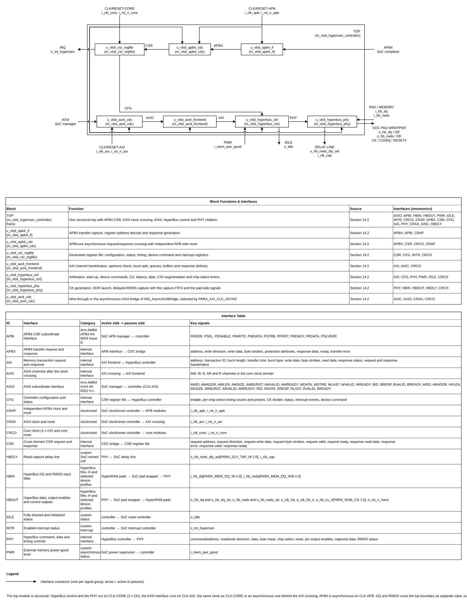
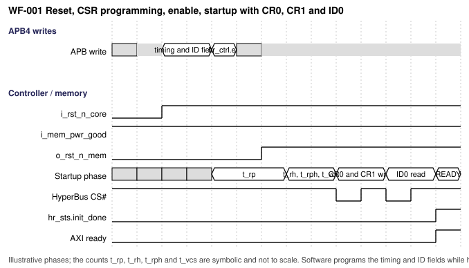
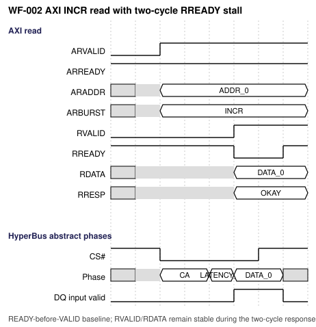
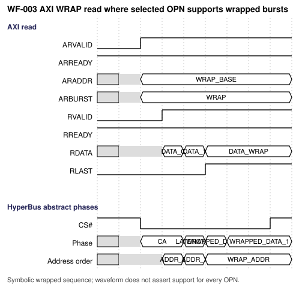
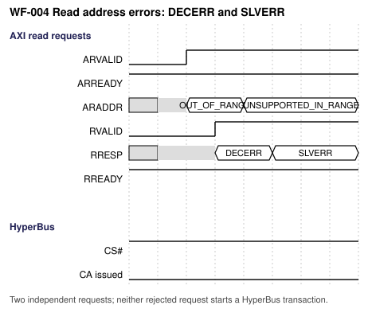
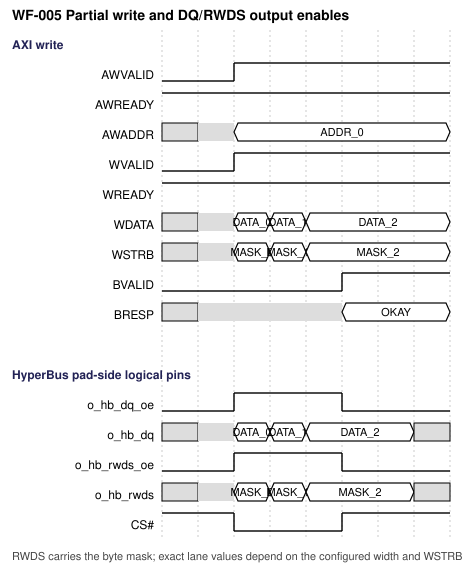
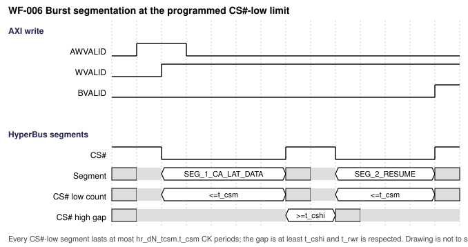
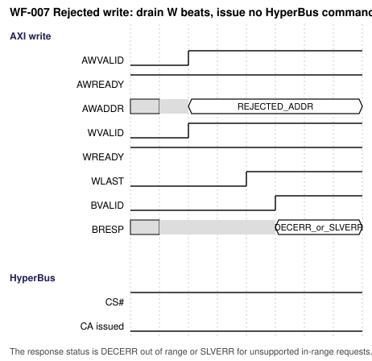
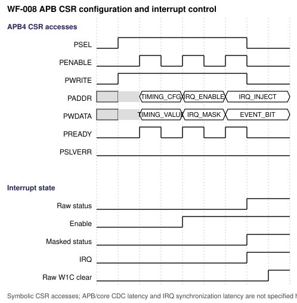
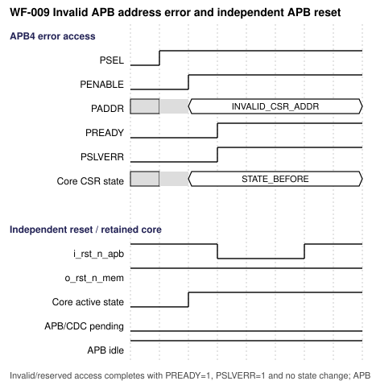

# HyperRAM Controller Design Specification

> **Purpose:** Normative design contract for architecture, RTL, verification, DFT, and physical integration of this IP.
>
> Requirement terms: **shall** = mandatory and testable; **should** = recommended; **may** = optional. Open items are recorded as TBD with an identifier in [Assumptions, dependencies, and decisions](#20-assumptions-dependencies-and-decisions).

## Document map

1. [Purpose, scope, and product context](#1-purpose-scope-and-product-context)
2. [Normative references and precedence](#2-normative-references-and-precedence)
3. [Requirements and traceability](#3-requirements-and-traceability)
4. [Features and configurations](#4-features-and-configurations)
5. [Architecture](#5-architecture)
6. [External interfaces and ports](#6-external-interfaces-and-ports)
7. [Clock, reset, and power](#7-clock-reset-and-power)
8. [Parameters and elaboration configurations](#8-parameters-and-elaboration-configurations)
9. [Data representation and arithmetic](#9-data-representation-and-arithmetic)
10. [Detailed functional behavior](#10-detailed-functional-behavior)
11. [Register and programming model (CSR from workbook)](#11-register-and-programming-model)
12. [Error handling and recovery](#12-error-handling-and-recovery)
13. [Performance, power, and area](#13-performance-power-and-area)
14. [RTL implementation contract](#14-rtl-implementation-contract)
15. [Verification specification](#15-verification-specification)
16. [DFT and testability](#16-dft-and-testability)
17. [Physical design and timing integration](#17-physical-design-and-timing-integration)
18. [Security, safety, and reliability](#18-security-safety-and-reliability)
19. [Requirement-to-verification traceability](#19-requirement-to-verification-traceability)
20. [Assumptions, dependencies, and decisions](#20-assumptions-dependencies-and-decisions)
21. [Glossary](#21-glossary)
22. [References used to shape this template](#22-references-used-to-shape-this-template)

## 1. Purpose, scope, and product context

### 1.1 Purpose and scope

This specification defines an AXI4 subordinate HyperRAM controller with an APB4 CSR interface. It supports the HyperRAM devices of several vendors with one design: the device type is selected at run time by a device preset in the CSRs, and every timing parameter that a datasheet gives in time is a software-programmable count of HyperBus CK periods whose reset value is safe for all target devices. The memory side is x8 HyperBus or x16 Extended-I/O (elaboration parameter), with one or two chip selects. The controller is built for high bandwidth and low latency: it continues linear transactions without a new command phase, starts the next transaction as soon as the device timing allows, keeps up to four reads and four writes outstanding, and returns critical-word-first wrapped reads as wrapped HyperBus bursts.

One clock, `CLK-CORE` at twice the CK frequency (400 MHz for a 200 MHz CK), drives the AXI4 side, the control logic and the PHY; the PHY derives CK from it and creates the phases without a PLL. A delay line outside the IP positions the capture of read data. APB4 uses a separate asynchronous clock `CLK-APB`. AXI data width is 32 or 64 bits.

**Included:** AXI4 subordinate interface; x8 HyperBus target devices from Infineon, Winbond and ISSI; x16 Extended-I/O target devices from Infineon and Winbond; run-time device presets; CSR timing and latency programming; fixed and variable latency; one or two chip selects; a software command port for device registers; synthesizable RTL, verification and integration collateral. Vendor-wide compatibility is not implied by this scope.

**Excluded:** ISSI x16 qualification in this revision; Octal xSPI; HyperFlash; hybrid sleep and deep power-down management (software may use the device command port); AXI FIXED bursts, exclusive access and USER, QOS and REGION signals; automatic temperature compensation of the CS#-low limit.

### 1.2 Deployment assumptions

| Item | Specification |
|---|---|
| Target SoC / product class | TBD-008; the SoC bus integration and the target product are not supplied. |
| Technology / library assumptions | The SoC provides a 400 MHz clock for `CLK-CORE` and a delay line cell for the RWDS capture path (confirmed by the designer, 2026-10-28, DEC-030). The ASIC library, IO cells and delay-line steps are not selected (TBD-006). |
| Operating modes and workload | AXI transactions to one or two HyperRAM devices. The typical request is 32 or 64 bytes (cache-line fill or write-back, DEC-032); other workload data is not supplied. |
| AXI clock | The AXI manager runs on `CLK-CORE`. A SoC fabric with another clock places an asynchronous AXI bridge (for example 003_AsyncAXI4Bridge) in front of this IP (ASM-008). |
| Security / privilege context | TBD-009; AXI protection attribute handling is not specified. |
| External dependencies | The five approved target OPNs (Section 20); final device and grade selection, AXI manager, clock and reset source, and board-level HyperBus timing and IO constraints are not supplied. |

### 1.3 Feature summary

| Feature ID | Feature | Required / optional | Configuration condition | Requirements |
|---|---|---|---|---|
| FEAT-001 | AXI4 subordinate with selectable 32-bit or 64-bit data width; INCR and WRAP; narrow and unaligned transfers | Required | Width selected at elaboration | REQ-IF-001 through REQ-IF-003 |
| FEAT-002 | HyperBus x8 memory profile | Required | Named Infineon, Winbond and ISSI x8 device targets | REQ-MEM-001 |
| FEAT-003 | HyperBus Extended-I/O x16 memory profile | Required | Named Infineon and Winbond x16 device targets | REQ-MEM-002 |
| FEAT-004 | APB4 CSR subordinate for configuration, status and interrupts | Required | Independent `CLK-APB`, asynchronous to `CLK-CORE` | REQ-CSR-001 through REQ-CSR-005 |
| FEAT-005 | Run-time device preset and CSR timing, latency and capture parameters in CK periods with safe reset values | Required | Per chip select | REQ-CSR-002, REQ-CSR-006, REQ-CSR-007, REQ-MEM-005 |
| FEAT-006 | Fixed and variable initial latency | Required | `dN_cfg.fixed_lat` | REQ-MEM-006, REQ-MEM-011 |
| FEAT-007 | One or two chip selects | Optional | `PARA_NUM_CS` | REQ-MEM-012 |
| FEAT-008 | Software command port for the device registers, with ID check after startup | Required | Always present | REQ-MEM-013 through REQ-MEM-015 |
| FEAT-009 | Posted write option, read and write arbitration, continuation of linear transactions | Required | `ctrl` fields | REQ-FUNC-002 through REQ-FUNC-004 |
| FEAT-010 | Single-clock PHY with programmable CK divider, CK phase and delay-line capture | Required | `clk` and `dN_rcap` fields | REQ-MEM-008 through REQ-MEM-010, REQ-CLK-001, REQ-CLK-002 |
## 2. Normative references and precedence

### 2.1 Normative references

| Ref ID | Document and revision | Applicable clauses | Authority / notes |
|---|---|---|---|
| REF-001 | Infineon/Cypress, *HYPERBUS Specification: Low Signal Count, High Performance DDR Bus*, 001-99253 Rev. H (2019) | x8 HyperBus profile; local conversion: `reference/md_doc/hyperbus_001-99253_rev_h.md`; check figures/tables against the source PDF | Latest public direct HyperBus specification found on 2026-10-27. Protocol authority for x8 only; it does not define x16 Extended-I/O. |
| REF-002 | User-approved project requirements captured in this specification and its decision log | Sections 1, 3–10, and 12–20 | Authority for the requested IP function and accepted project choices; unresolved items remain explicit in Section 20. |
| REF-003 | VLSIT RTL Design Rules v2, VLSIT_RTL_Design_Rule.md (same folder as this template) | All applicable rules | Mandatory RTL coding, hierarchy, reset, CDC, and naming baseline |
| REF-004 | IEEE 1800-2017 SystemVerilog | Synthesizable subset | Subject to REF-003 and selected frontend support |
| REF-005 | Project workbook `HyperRAM_Controller_CSR_Specification.xlsx`, based on `spec_template/VLSIT_CSR_Specification_Template.xlsx` | APB4 CSR configuration and register definition | Sole authority for the register map, fields, access types, and reset values (Section 11); the 34-register map of 2026-10-28 is in `ASYNC_CSR` and awaits designer approval |
| REF-006 | Infineon, S80KS2562 HyperRAM datasheet, 002-31337 Rev. C (2021-09-27) | Device-specific x8 timings, reset, register behavior, and supported modes | OPN `S80KS2562GABHB020` approved for initial 200-MHz qualification. Converted Markdown is local and excluded from version control. |
| REF-007 | Infineon, S80KS2564 HyperRAM Extended-I/O datasheet, 002-31341 Rev. C (2022-04-18) | Device-specific x16 timings, reset, register behavior, and supported modes | OPN `S80KS2564GACHI040` approved for initial 200-MHz qualification. Converted Markdown is local and excluded from version control. |
| REF-008 | Winbond W958D8NBYA HyperRAM x8 datasheet A01-003 (2022-06-30); W958D6NBKX HyperRAM 3.0 x16 datasheet A01-001 (2023-03-09) | Device-specific behavior for the selected x8 and x16 devices; local conversions under `reference/md_doc/` | OPNs `W958D8NBYA5I` and `W958D6NBKX5I` approved for initial 200-MHz qualification. Converted; the power-up and reset tables lost their numeric columns in the conversion (TBD-003); excluded from version control. |
| REF-009 | ISSI IS66WVH32M8DALL/BLL HyperRAM x8 datasheet, source pages marked Rev. A7 (2024-11-21) | Device-specific x8 behavior; local conversion under `reference/md_doc/issi_is66wvh32m8dall_bll_rev_a7.md` | OPN `IS66WVH32M8DALL-200B1LI` approved for initial 200-MHz qualification. User approved source Rev. A7 after the URL returned A7 instead of the initially described A5. Converted and page-verified; excluded from version control. |
| REF-010 | Arm, *AMBA APB Protocol Specification*, IHI 0024 Issue D; APB4 profile (Issue C signal set) | APB4 subordinate CSR interface; local converted reference: `reference/md_doc/amba_apb_ihi0024d_apb4_profile.md`; excludes APB5-only additions | APB4 protocol facts are grounded in the APB4 signal set described in the local Issue D conversion. |
| REF-011 | Arm, *AMBA AXI and ACE Protocol Specification*, IHI 0022 Issue H.c, Part A (AXI4); local conversion: `reference/md_doc/vlsit_amba_axi_ihi0022hc.md` | AXI4 subordinate channels and transaction behavior | Reuses the locally converted Issue H.c reference already approved by the user for the AXI bridge work; source licence does not confirm redistribution. |

### 2.2 Source-of-truth and conflict handling

1. The selected external protocol revision defines protocol behavior for the declared interface profile.
2. Approved product requirements and decisions define product-specific behavior.
3. This specification defines the IP contract and shall remain consistent with the selected protocol and the VLSIT RTL Design Rules v2.
4. REF-003 is the mandatory RTL coding, hierarchy, reset, CDC, and naming baseline. If a proposed requirement conflicts with it, revise the specification requirement or choose a compliant implementation; do not create a local RTL exception.
5. REF-005 is the only place where CSRs are specified. This document does not declare registers, fields, offsets, access types, or reset values; it refers to them by name.
6. The protocol revisions, roles and signal subsets are recorded in Section 2.3 and Section 6. No signal outside the selected profile is included.
7. Conflicts are resolved by an explicit product decision recorded in Section 20.
8. REF-001 applies to x8 HyperBus only. The x16 Extended-I/O behavior is defined from the approved x16 device sources; no protocol-wide x16 standard is claimed without an approved normative source.

**Naming rule (rule R-026):** the default naming rule of the skill `vlsit-rtl-generator`, VLSIT RTL Design Rules v2, sections 2 and 9 (`VLSIT_RTL_Design_Rule.md`, REF-003).

### 2.3 Compliance declaration

| Standard | Revision / profile | Role implemented | Options | Deviations |
|---|---|---|---|---|
| AMBA AXI4 | Arm IHI 0022 Issue H.c, Part A; REF-011 | Subordinate | 32-bit byte address; 32/64-bit data; 4-bit IDs; INCR and WRAP; narrow and unaligned transfers; four outstanding reads and writes; WSTRB; no LOCK, CACHE, PROT, QOS, REGION or USER signals | FIXED bursts return SLVERR; an address range beyond the aperture returns DECERR; exclusive access is not supported (omitted AxLOCK has its default value). |
| AMBA APB4 | APB4 signal set; REF-010 | Completer | 32-bit data, 16-bit address, 4-bit write strobe; no APB5 additions | An unmapped word-aligned address returns PSLVERR through the decode of `m_vlsit_apb4_if` (DEC-033); the generated CSR behavior is in Section 11.4. |
| HyperBus | 001-99253 Rev. H | x8 memory host | `S80KS2562GABHB020`, `W958D8NBYA5I`, `IS66WVH32M8DALL-200B1LI` at up to 200 MHz CK; fixed or variable latency; linear, wrapped and hybrid burst per CR0 | Timing values come from CSR presets; the Winbond power-up and reset values are TBD-003. |
| HyperBus Extended-I/O | Infineon and Winbond device-defined profiles | x16 memory host | `S80KS2564GACHI040`, `W958D6NBKX5I` at up to 200 MHz CK | CA length and per-OPN `tCSS`, `tCSHI` are TBD-004 and TBD-005. |
## 3. Requirements and traceability

Requirement terms: **shall** = mandatory and testable; **should** = recommended; **may** = optional. Every requirement has a permanent identifier and a verification method.

| ID | Requirement using shall/should/may | Source | Applies to | Verification method |
|---|---|---|---|---|
| REQ-FUNC-001 | The controller shall service accepted AXI4 read and write transactions by accessing the external HyperRAM through the single elaborated memory-width profile and shall return the corresponding AXI completion, data and status. | User-approved IP function | All | Transaction-level scoreboard across both memory profiles and both AXI widths |
| REQ-FUNC-002 | The write response mode shall be selected by `ctrl.wr_posted`. When it is 0 (default), the B response shall be returned only after the last write data of the request has been transferred to the RAM and the transaction has ended with CS# HIGH. When it is 1, the B response may be returned when the last W beat has been accepted into the write buffer, and `o_idle` shall stay LOW until the buffer is empty and the RAM transaction has ended. | DEC-026 (question 5A) | All | Scoreboard check of B timing against the RAM transaction end in both modes; idle check with posted writes pending |
| REQ-FUNC-003 | The controller shall arbitrate between pending reads and writes according to `ctrl.arb_mode` (0 round robin, 1 read priority, 2 write priority). A read whose byte range overlaps the byte range of an accepted, not yet completed write shall wait until that write has reached the RAM (read-after-write hazard); a read that overlaps no pending write may be issued before an older write. Responses of one direction shall return in request order for equal IDs. | DEC-026 (question 5A) | All | Constrained-random read/write mix against a byte-accurate memory model: no stale read, no starvation in each arbitration mode |
| REQ-FUNC-004 | When `ctrl.merge_en` = 1 and the next accepted request of the same direction and chip select starts at the next linear address of the previous request, the controller shall continue the open HyperBus transaction without a new CA and a new initial latency as long as the next beat fits within the CS#-low limit; otherwise it shall end the transaction and start a new one. | Performance goal, DEC-026 | All | Back-to-back sequential bursts: count of CA phases equals the count of transactions; data and order unchanged; limit boundary case |
| REQ-IF-001 | The IP shall implement an AXI4 subordinate interface conforming to Arm IHI 0022 Issue H.c, Part A, with `PARA_AXI_DATA_W` set to 32 or 64 bits. Optional AXI signals that this IP omits (AxLOCK, AxCACHE, AxPROT, AxQOS, AxREGION and all USER signals) shall be treated as having their default values of REF-011. | User-approved AXI4 interface; REF-011 | All | AXI protocol checker and elaboration checks |
| REQ-IF-002 | The AXI4 profile shall use 32-bit byte addresses, 4-bit transaction IDs, INCR and WRAP bursts (FIXED bursts are not supported), per-byte `WSTRB` including partial writes, narrow transfers and unaligned start addresses, and no more than four accepted outstanding reads and four accepted outstanding writes. `PARA_MEM_SIZE_BYTES` defines the aperture of each chip select, defaults to 33,554,432 bytes and shall not exceed the device capacity. A request whose complete addressed byte range exceeds the total aperture shall complete with DECERR. A request with `AxBURST` = FIXED shall complete with SLVERR. Neither case shall cause a HyperBus transaction. The SoC interconnect maps the base address; the controller uses the window-relative address. | DEC-016, DEC-019, DEC-027 (question 7A); REF-011 A3.4, A5.1, A6 | All | AXI protocol checker; aperture-boundary decode, DECERR and SLVERR, no HyperBus issue on rejected requests, ID association, partial strobes, narrow and unaligned transfers, outstanding limits |
| REQ-IF-003 | The controller shall map an AXI INCR burst to a linear HyperBus burst and split it at the end of the device page boundary and at the CS#-low limit. It shall map an AXI WRAP burst to a wrapped HyperBus burst when the wrap length in bytes equals the wrapped group selected by `dN_cfg.blen`; otherwise it shall execute the WRAP burst as two linear HyperBus bursts (from the start address to the end of the wrap region, then from the region start to the byte before the start address). Data, byte lanes and AXI order shall be unchanged by splitting. | DEC-027; REF-001 burst types; REF-011 A3.4.1 | All | Address and data sequence check for INCR across page and limit boundaries and for WRAP of 2, 4, 8 and 16 beats at every `blen` |
| REQ-CSR-001 | The IP shall provide an APB4 subordinate interface for software-visible controller configuration and status registers, using 32-bit data, 16-bit address and four byte strobes, as defined by the VLSIT CSR workbook. APB4 signals shall exclude APB5-only user, wake-up and parity signals. | User-approved APB4 CSR requirement; REF-005, REF-010 | All | APB4 protocol checker; CSR workbook and elaboration checks |
| REQ-CSR-002 | Every wait and limit that the HyperBus protocol or the selected device defines in time shall be a software-programmable count of HyperBus CK periods in a CSR field of its chip select: `t_rp`, `t_rh`, `t_rph`, `t_vcs`, `t_cshi`, `t_rwr`, `t_css`, `t_csm` and `init_lat`. Counts shall be ticked once per CK period. The CK period shall be programmable through `clk.ck_div`. No timing value shall be fixed in RTL. Software shall rescale every count when it changes `clk.ck_div`. | DEC-023 (question 1) | All | Program minimum and maximum values and measure the waits at the pins for several `ck_div` values |
| REQ-CSR-003 | The CSR block shall provide sticky raw interrupt status, per-event enables, masked status equal to `RAW & ENABLE` and software injection of raw events. Raw events shall clear by writing one to the matching raw-status bit. The interrupt output shall assert when masked status is nonzero. The events are: initialization complete, configuration error, AXI DECERR, AXI SLVERR, power-good loss, ID mismatch, CR0 latency mismatch and device command done. | User-approved interrupt-register semantics; DEC-029 | All | Check raw, enable, masked status, injection, W1C and the interrupt output |
| REQ-CSR-004 | The controller shall remain disabled, hold `o_rst_n_mem` LOW and not accept AXI memory requests until software has programmed all valid timing counts and set `ctrl.en`. Reset shall clear `ctrl.en`. Setting `ctrl.en` with an illegal field shall not start the sequence and shall set `irq_raw.cfg_err`. Setting `ctrl.en` shall start the programmed RESET#-low wait followed by the programmed startup wait. | User-approved requirement to program timing before enable; DEC-018 | All | Reset, timing programming, enable with legal and illegal fields, RESET# sequencing and startup gating |
| REQ-CSR-005 | An APB access to an address that is not a register of the workbook shall complete with `PREADY` = 1 and `PSLVERR` = 1 and shall not change CSR or controller state. `m_vlsit_apb4_if` shall decode the register address ranges of the workbook and complete such an access itself, because the generated CSR module answers an unmapped word-aligned address with OKAY (Section 11.4, DEC-033). | User-approved APB error policy; DEC-033 | All | Access every unmapped word-aligned address range: PSLVERR = 1 and no state change; access mapped addresses: no error |
| REQ-CSR-006 | Writing `dN_cfg.preset_go` = 1 while `ctrl.en` = 0 shall load the timing, latency and ID fields of chip select N with the values of the preset in `dN_cfg.preset`; software may overwrite every field afterwards. Preset 0 shall load the safe values of REQ-CSR-007. Writing `preset_go` = 1 while `ctrl.en` = 1 shall be ignored and shall set `irq_raw.cfg_err`. | DEC-024 (question 4A) | All | Load every preset, compare the fields with the preset table of Section 10.6; load while enabled |
| REQ-CSR-007 | After reset every timing field shall hold the default value of the workbook, which meets the minimum of every target OPN at `ck_div` = 2 (CK = 200 MHz for a 400 MHz `CLK-CORE`): `t_rp` 80, `t_rh` 80, `t_rph` 160, `t_vcs` 40000, `t_cshi` 2, `t_rwr` 7, `t_css` 2, `t_csm` 160, `init_lat` 7 and fixed latency. Software shall need only to set `ctrl.en` for a 200 MHz CK with a target OPN. | DEC-023, DEC-024; Section 10.6 | All | Read reset values; run the startup sequence with no software programming except `ctrl.en` against all device models |
| REQ-MEM-001 | With `PARA_MEM_DQ_W` = 8, the HyperBus host shall target S80KS2562GABHB020, W958D8NBYA5I and IS66WVH32M8DALL-200B1LI at no more than 200 MHz CK. | Approved project target matrix; REF-001, REF-006, REF-008, REF-009 | CFG-X8-* | Device-model simulation and hardware qualification |
| REQ-MEM-002 | With `PARA_MEM_DQ_W` = 16, the Extended-I/O host shall target S80KS2564GACHI040 and W958D6NBKX5I at no more than 200 MHz CK. | Approved project target matrix; REF-007, REF-008 | CFG-X16-* | Device-model simulation and hardware qualification |
| REQ-MEM-003 | Every interval from CS# falling to its next rising edge, including CA, latency, data and clock stalls, shall not exceed `dN_tcsm.t_csm` CK periods of the addressed chip select N. The controller shall segment longer transfers before the limit and preserve AXI order and data. The limit has no default dependence on the memory width. Software shall set it to the tCSM of the device at its operating temperature (1 us or 4 us). | DEC-008 updated by DEC-023; REF-006 Table 13, REF-008, REF-009 | All | Boundary checks across the CS#-low interval at `t_csm` = 1, 160 and 800, clock-stall cases, AXI segmentation and order |
| REQ-MEM-004 | Between consecutive HyperBus transactions to the same device, CS# shall remain HIGH for at least `dN_tmin.t_cshi` CK periods. The controller shall also start CS# LOW only at a time when the CA1 transfer of the new transaction completes at least `dN_tmin.t_rwr` CK periods after the CS# rising edge of the previous transaction to the same device (read-write recovery, REF-001); this applies to every pair of transactions, and CA1 completes 2 CK periods after CS# falls in the x8 profile (x16: TBD-005). The CS# low to first CK edge time shall be at least `dN_tmin.t_css` CK periods. | REF-001 (tRWR); REF-006 through REF-009 (tCSHI, tRWR, tCSS); DEC-023 | All | Device-model timing checks at the minimum programmed values and at the defaults |
| REQ-MEM-005 | The legal range of `dN_tcsm.t_csm` shall be 1 to 800 CK periods. `status.cfg_valid` shall be 0 and `ctrl.en` shall be refused when any field is outside its legal range: `t_csm` = 0 or above 800, `init_lat` outside 3 to 8, `ck_div` odd, 0 or 1, or `t_cshi`, `t_rp`, `t_rh`, `t_rph`, `t_vcs` = 0. | DEC-023 (question 1); legal ranges of the workbook | All | Write every illegal value and boundary values; check `cfg_valid`, `cfg_err` and refusal of enable |
| REQ-MEM-006 | The controller shall support fixed latency (default, `dN_cfg.fixed_lat` = 1, latency of 2 x `init_lat` CK periods) and variable latency (`fixed_lat` = 0: 1 x or 2 x `init_lat` according to RWDS sampled in the CA phase). The initial latency shall be `dN_cfg.init_lat` CK periods. The controller shall compose CR0 from `init_lat`, `fixed_lat`, `drive`, `hybrid` and `blen` and write it to the device during initialization, so that the latency programmed in the device equals the latency used by the controller. | DEC-025 (question 2A); REF-001 latency; REF-006 CR0 | All | Simulate both modes with every device model; compare CR0 with the fields; check latency count at the pins |
| REQ-MEM-007 | The top-level RTL shall expose HyperBus DQ and RWDS as separate input, output and active-high output-enable ports named `i_hb_dq`, `o_hb_dq`, `o_hb_dq_oe`, `i_hb_rwds`, `o_hb_rwds` and `o_hb_rwds_oe`. DQ widths shall be `PARA_MEM_DQ_W`; RWDS widths shall be `PARA_MEM_DQ_W/8`. The SoC pad wrapper connects these logical ports to physical bidirectional pads; this IP shall not declare DQ or RWDS as `inout`. | User-approved split port boundary; DEC-021 | All | Elaborate x8 and x16 widths; verify drive-enable ownership, read capture, write mask, reset-idle OE and pad-wrapper mapping |
| REQ-MEM-008 | The PHY shall generate CK as a flop output from `i_clk_core` with a period of `clk.ck_div` CLK-CORE cycles, drive CK# as its complement when `clk.ck_diff` = 1 and otherwise hold CK# HIGH, and keep CK LOW while no CS# is asserted. The CK frequency shall not exceed 200 MHz. | DEC-022 (question 3B) | All | Measure CK period for several `ck_div` values; check CK# modes, idle level and glitch-free start and stop |
| REQ-MEM-009 | The PHY shall launch DQ and RWDS outputs on the rising edge of `i_clk_core`. With `clk.ck_phase` = 0 it shall toggle CK on the falling edge of `i_clk_core`, so that CK edges are centered in the write data of every DDR half period. With `clk.ck_phase` = 1 it shall toggle CK on the rising edge. | DEC-022; ASM-002 | All | Waveform check of the offset between CK edges and DQ changes in both phase settings; device-model setup and hold checks at 200 MHz |
| REQ-MEM-010 | During read data the PHY shall capture DQ on both edges of the delayed RWDS received on `i_clk_cap`, and shall transfer the captured data to `CLK-CORE` through the asynchronous FIFO of CDC-003. The delay shall be set by the `dN_rcap.tap` field through `o_hb_rwds_dly_sel` of the chip select that is being read. The delay line is outside this IP. | DEC-030 (question 3B); ASM-001 | All | Device-model read with RWDS to DQ skew sweeps over all taps; data integrity for the full tap range; FIFO never overflows for the longest burst |
| REQ-MEM-011 | In variable-latency mode the controller shall sample RWDS during the CA phase on the CK edge defined by the device and wait `init_lat` CK periods when RWDS is LOW and 2 x `init_lat` when it is HIGH. In fixed-latency mode it shall always wait 2 x `init_lat`. | REF-001 latency; DEC-025 | All | Device models that raise RWDS during CA (refresh collision) and that do not: latency count at the pins |
| REQ-MEM-012 | `PARA_NUM_CS` shall select 1 or 2 chip selects. The chip select of a request shall be selected by the address: addresses 0 to `PARA_MEM_SIZE_BYTES` - 1 go to CS#0 and, when `PARA_NUM_CS` = 2, the next `PARA_MEM_SIZE_BYTES` bytes go to CS#1. At most one bit of `o_hb_cs_n` shall be LOW at any time. Each chip select shall use its own register group (`d0_*`, `d1_*`). A dual-die package with two chip selects shall be treated as two devices. | DEC-028 (question 8A) | All | Accesses over both apertures with different presets; mutual exclusion of the chip selects; boundary between apertures |
| REQ-MEM-013 | Software shall be able to read and write any device register through `cmd`, `cmd_addr`, `cmd_wdata` and `cmd_rdata`. A command shall start only when no HyperBus transaction is active, shall block new AXI requests (backpressure on AW, W and AR) until it completes, and shall set `cmd_rdata.done` and `irq_raw.cmd_done` at completion. A write command shall use zero latency; a read command shall use the programmed latency and capture one 16-bit word. A command issued before initialization is complete shall be rejected with `cmd_rdata.err`. | DEC-029 (questions 9a, 9b) | All | Read ID0, ID1, CR0, CR1; write CR0 and CR1; command during AXI traffic; command before initialization |
| REQ-MEM-014 | After the startup sequence of a chip select the controller shall read ID0 of that device. When `dN_id.id_chk_en` = 1 and ID0 differs from `dN_id.id0_exp`, it shall set `irq_raw.id_mis`. The mismatch shall not block AXI access. | DEC-029 (question 9c) | All | Matching and non-matching ID0 on every device model; AXI traffic continues after a mismatch |
| REQ-MEM-015 | When a device register write command changes CR0[7:4] so that the latency it selects differs from `dN_cfg.init_lat` of that chip select, the controller shall set `irq_raw.lat_mis`. It shall not change its own latency. | DEC-029 (question 9a); ASM-004 | All | Write CR0 with the same and with a different latency code through `cmd`; check the flag and the pin timing |
| REQ-CLK-001 | AXI4, HyperBus control and the PHY shall share the single `CLK-CORE` clock `i_clk_core`, whose frequency shall be 2 x the maximum CK frequency (400 MHz for CK = 200 MHz). APB4 shall use the independent asynchronous `CLK-APB` domain. No AXI-to-HyperBus CDC shall exist. Crossings between the APB and core logic shall use an approved CDC structure. | DEC-006 updated by DEC-022 | All | CDC and RDC analysis, asynchronous-clock simulation and a 400 MHz timing review of the PHY |
| REQ-CLK-002 | The RWDS-clocked capture of REQ-MEM-010 shall be the only other clock domain of the IP and shall cross to `CLK-CORE` only through the asynchronous FIFO `m_vlsit_afifo_top` of 001_AsyncGrayFIFO. | DEC-030; ASM-001 | All | CDC analysis; check that no signal other than the FIFO outputs crosses |
| REQ-RST-001 | The top-level interface shall provide active-low reset inputs `i_rst_n_core` for AXI4, HyperBus and PHY logic and `i_rst_n_apb` for the independent APB4 interface domain. | User-approved project choice | All | Port and elaboration checks; reset assertions in both domains |
| REQ-RST-002 | The controller shall assert `o_idle` only when all accepted AXI transactions have completed and their responses have handshaken, the write buffer is empty, the APB bus is idle, the APB/core CDC bridge has no pending request or response, no device register command is running, no HyperBus transaction is active, every CS# is HIGH, the PHY is idle and memory reset and startup are complete. `o_idle` shall be synchronous to `CLK-CORE`. External logic shall block new AXI requests and pause APB accesses before using `o_idle` to sequence a core reset. | User-approved project choice | All | Idle against AXI responses, posted writes, APB activity, CSR CDC state, device commands, active HyperBus transaction, CS#, PHY idle and startup completion |
| REQ-RST-003 | External reset logic shall assert `i_rst_n_core` only after `o_idle` = 1 and shall deassert it synchronously to `CLK-CORE`. `i_rst_n_apb` may be asserted independently only when the APB interface is idle and no APB/core CDC transaction is pending; its deassertion shall be synchronous to `CLK-APB`. | User-approved project choice; APB-only reset behavior | All | Reset sequencing assertions with asynchronous clock phase variation and APB-only reset cases |
| REQ-RST-004 | While `i_rst_n_core` is asserted or the synchronized `i_mem_pwr_good` is LOW, the controller shall hold `o_rst_n_mem` LOW and block AXI memory access. After core reset is released and power-good is HIGH, software shall program the timing fields (or load a preset) while the controller is disabled. When software sets `ctrl.en`, the controller shall hold RESET# LOW for `t_rp` CK periods, release RESET#, keep CS# inactive for `t_rh` and `t_rph` as the device requires, wait `t_vcs`, write CR0 and CR1, read ID0 and only then accept AXI requests. Programmed counts shall satisfy the `tRP`, `tRH`, `tRPH` and `tVCS` minima of the selected OPN at the configured CK rate. With two chip selects the sequence shall run once for each. | User-approved reset/enable sequence; REF-006 through REF-009 | All selected OPNs | Programming before enable, RESET# low duration, post-release waits, CS# inactivity, CR0 and CR1 writes, ID0 read and AXI admission at the minimum legal settings |
| REQ-RST-005 | Every assertion of `i_rst_n_core` shall reset the external HyperRAM through `o_rst_n_mem`. The controller shall repeat the reset and startup sequence before accepting AXI memory accesses; system software shall treat the RAM contents as invalid and reload required data. An APB-only reset shall not reset HyperRAM, core control state or committed configuration. | User-approved project choice; APB-only reset policy | All selected OPNs | Core-reset and APB-only-reset tests; data invalidation only on core reset |
| REQ-RST-006 | An APB-only reset shall reset only the APB interface and its APB-side CDC endpoint. It shall preserve the core-domain register state, committed timing and configuration, active controller operation and HyperRAM state. After APB reset release, software shall be able to read the current core-domain status and configuration. | User-approved APB-only reset behavior | All | Assert APB reset while the controller is active with APB idle; core state and memory operation persist and CSR reads recover |
| REQ-PWR-001 | `i_mem_pwr_good` shall remain HIGH during normal controller operation. If the SoC power supervisor reports that power-good will deassert, the SoC reset controller shall block new AXI requests, wait for `o_idle`, then assert `i_rst_n_core`. If power-good falls before accepted work drains, AXI completion and RAM contents are not guaranteed. | User-approved power-good policy; SoC integration contract | All | System reset and power-sequencing test; inject controlled power-good loss with and without accepted traffic |
| REQ-PERF-001 | The theoretical peak bandwidth of the memory interface shall be 2 x `PARA_MEM_DQ_W` / 8 bytes per CK period (400 MB/s for x8 and 800 MB/s for x16 at 200 MHz CK). The AXI side at `CLK-CORE` = 400 MHz with 32-bit data (1600 MB/s) shall not limit the sequential bandwidth. | Datasheet arithmetic (REF-006); DEC-032 (question 6) | All | Cycle-accurate simulation of long sequential reads and writes; compare the transferred bytes per CK period with the formula |
| REQ-PERF-002 | For the typical request sizes of 32 and 64 bytes (cache-line fills and write-backs) the controller shall issue one HyperBus transaction per AXI request, shall start the next transaction as soon as `t_cshi` and, where required, `t_rwr` have elapsed, and shall start a critical-word-first WRAP read as a wrapped burst when the wrap length equals `blen`. The sustained efficiency and the line-fill latency targets are TBD-001 and TBD-002. | DEC-032 (question 6) | All | Cycle-accurate simulation of 32 and 64 byte reads and writes: count idle CK periods between transactions and compare with `t_cshi` and `t_rwr` |

## 4. Features and configurations

| Configuration ID | Enabled features | Disabled features | Interfaces / widths | Intended use | Verification target |
|---|---|---|---|---|---|
| CFG-X8-32 | HyperBus x8; AXI subordinate | x16 mode; xSPI | AXI 32-bit; HyperBus DQ[7:0] | 32-bit AXI SoC | Initial qualification OPNs: S80KS2562GABHB020, W958D8NBYA5I, IS66WVH32M8DALL-200B1LI |
| CFG-X8-64 | HyperBus x8; AXI subordinate | x16 mode; xSPI | AXI 64-bit; HyperBus DQ[7:0] | 64-bit AXI SoC | Initial qualification OPNs: S80KS2562GABHB020, W958D8NBYA5I, IS66WVH32M8DALL-200B1LI |
| CFG-X16-32 | Extended-I/O x16; AXI subordinate | x8 mode; xSPI | AXI 32-bit; HyperBus DQ[15:0] | 32-bit AXI SoC | Initial qualification OPNs: S80KS2564GACHI040, W958D6NBKX5I |
| CFG-X16-64 | Extended-I/O x16; AXI subordinate | x8 mode; xSPI | AXI 64-bit; HyperBus DQ[15:0] | 64-bit AXI SoC | Initial qualification OPNs: S80KS2564GACHI040, W958D6NBKX5I |

The four rows form the approved verification and configuration matrix. One top module uses an elaboration parameter that selects exactly one memory width; the DQ and RWDS ports are sized from that parameter so each elaborated profile exposes only its required pins. Run-time width selection and a fixed superset port list are not used. `PARA_NUM_CS` (1 or 2) is orthogonal to the four rows; the matrix is run with `PARA_NUM_CS` = 1 and the two-chip-select tests run in CFG-X8-32 and CFG-X16-64.

**Optional features.** Chip select 1 is absent when `PARA_NUM_CS` = 1: `o_hb_cs_n` has one bit, the `d1_*` registers exist in the workbook but have no effect and read back what was written. Posted write, variable latency, hybrid burst and request merging are present and disabled by their reset values; they are runtime-enabled by software. Illegal combinations are listed in Section 8 and are rejected as described there.

## 5. Architecture

### 5.1 Overview and block responsibilities

| Block | Responsibility | Inputs / outputs | Clock/reset domain | State or storage |
|---|---|---|---|---|
| `m_vlsit_hyperram_controller` | Sole structural top; exposes AXI4, APB4, power-good, reset and status, and one elaborated HyperBus width profile; instantiates all child RTL | AXI4, APB4, and parameter-sized HyperBus pins | `CLK-CORE` and independent `CLK-APB` | No functional state; interconnect only |
| `m_vlsit_apb4_if` | Captures APB4 setup and access phases, decodes the register address ranges (unmapped word-aligned address: PSLVERR, DEC-033) and returns APB responses | APB4 pins and asynchronous CSR request and response channels | `CLK-APB` / `i_rst_n_apb` | APB transfer state only |
| `m_vlsit_apb4_cdc` | Crosses APB requests and responses between the APB bus and the core register domain; supports APB-side-only reset | APB-side request and response and core-side request and response | `CLK-APB` and `CLK-CORE`; `i_rst_n_apb` resets the APB endpoint, `i_rst_n_core` the core endpoint | Reset-safe asynchronous request and response handshake |
| `m_vlsit_csr_regfile` | Owns the configuration, status, timing, device command and interrupt registers of Section 11 (generated from the workbook) | Core CSR request and response and controller controls and status | `CLK-CORE` / `i_rst_n_core` | Register and interrupt state |
| `m_vlsit_axi4_frontend` | Captures AXI4 requests, checks the aperture and burst type, splits requests, manages channel handshakes, holds the write buffer and the read buffer, returns responses | AXI4 pins and internal request, data and response channels | `CLK-CORE` / `i_rst_n_core` | Request and response queues (four reads, four writes), write buffer, read buffer (MEM-001, MEM-002) |
| `m_vlsit_hyperbus_ctrl` | Arbitrates reads and writes, sequences startup, CR0 and CR1 programming, ID check, device commands, CA, latency, data, CS# segmentation, merging and recovery; owns the per-chip-select timing counters | Frontend request channels and PHY command and data controls | `CLK-CORE` / `i_rst_n_core` | Transaction FSM, per-CS timers, committed configuration |
| `m_vlsit_hyperbus_phy` | Generates CK, CK# and CS#; launches DQ and RWDS; captures read data with the delayed RWDS and crosses it to `CLK-CORE` through the asynchronous FIFO of 001_AsyncGrayFIFO; provides the pad-side ports and the delay-line select | PHY controls and the external HyperRAM pins, delay line | `CLK-CORE` / `i_rst_n_core`; read capture in the RWDS-derived domain (CDC-003) | DDR launch and capture registers, capture FIFO (MEM-003) |

This six-child hierarchy is user-approved. It has one structural top and no AXI-to-HyperBus CDC. The PHY instantiates the asynchronous FIFO `m_vlsit_afifo_top` of 001_AsyncGrayFIFO for the read capture (ASM-001); that is a lower-level instance and does not add a child of the top.

### 5.2 Block diagram

*Figure 5-1. Six-module HyperRAM controller architecture; the enclosing frame is the single structural top. Source: [editable draw.io diagram](figures/block_diagram/block_diagram.drawio). The frame is the top module, the blocks are its instances, each connector is one interface with its mnemonic, and the two tables under the diagram in the source file describe the blocks and the interfaces. The hierarchy did not change with DEC-022 to DEC-033; the delay-line interface of the PHY (`o_hb_rwds_dly_sel`, `i_clk_cap`) and the extra chip-select bits are not yet drawn (OI-004).*

### 5.3 Transaction and dataflow

**Write.** The frontend accepts AW and the W beats, checks the aperture and `AxBURST`, and splits the request into HyperBus segments at the device page end, at the `t_csm` limit and, for a WRAP burst that does not match `blen`, at the wrap point. Segments of accepted requests enter the write queue. The controller picks the next segment according to `ctrl.arb_mode`, selects the chip select from the address, waits for `t_cshi`, `t_rwr` and `t_css`, drives CS# LOW, sends the CA (write, memory space, linear or wrapped), waits the write latency, and sends data with the RWDS byte mask taken from `WSTRB`. The B response follows according to `ctrl.wr_posted` (REQ-FUNC-002).

**Read.** The read path is the same up to the CA. After the CA the controller samples RWDS (variable latency) and waits the initial latency. The device then drives DQ and RWDS; the PHY captures DQ on both edges of the delayed RWDS, writes the pairs into the capture FIFO, and the controller moves the words into the read buffer, from which R beats leave in request order with the AXI ID and RLAST. A request that follows a read on the next linear address continues the transaction when `ctrl.merge_en` = 1 and the `t_csm` limit allows.

**Release of resources.** A queue entry is freed when its last beat has been transferred; the outstanding counters in `sts.rd_out` and `sts.wr_out` decrease when the last R beat or the B response is accepted.

### 5.4 Invariants

- At most one bit of `o_hb_cs_n` is LOW at any time, and CS# is HIGH for at least `t_cshi` CK periods between transactions.
- DQ and RWDS outputs are driven only when the matching output enable is HIGH; the controller never drives a lane while the device drives it.
- Accepted outstanding reads are at most four and accepted outstanding writes at most four.
- Responses of one direction return in request order for equal IDs; a read never returns data older than a write accepted before it to an overlapping byte (REQ-FUNC-003).
- A segment never lasts longer than `t_csm` CK periods from CS# LOW to CS# HIGH.
- The latency used by the controller equals the latency programmed by the controller into CR0, unless software overrides CR0 and `irq_raw.lat_mis` is set.
- No AXI request is accepted until `sts.init_done` = 1; no device command starts while a HyperBus transaction is active.

## 6. External interfaces and ports

### 6.1 Interface inventory

| Interface ID | Type and revision | Role | Direction at IP boundary | Clock domain | Required / optional | Configurations |
|---|---|---|---|---|---|---|
| IF-001 | AMBA AXI4, Arm IHI 0022 Issue H.c | Subordinate | 32-bit address; 32/64-bit data; 4-bit ID; INCR and WRAP; four outstanding reads and writes; no LOCK, CACHE, PROT, QOS, REGION or USER signals | `CLK-CORE` | Required | All |
| IF-002 | HyperBus | Memory host through the SoC pad wrapper | Split DQ and RWDS input, output and active-high output-enable ports; CK, CK#, CS# and RESET# outputs | `CLK-CORE`; CK is generated by the PHY | Required | CFG-X8-* |
| IF-003 | HyperBus Extended-I/O | Memory host through the SoC pad wrapper | Split DQ[15:0] and RWDS[1:0] input, output and active-high output-enable ports; CK, CK#, CS# and RESET# outputs | `CLK-CORE`; CK is generated by the PHY | Required | CFG-X16-* |
| IF-004 | Memory power-good | Power and reset supervisor | External power-good input sampled by the controller | Asynchronous to `CLK-CORE` | Required | All |
| IF-005 | AMBA APB4 | Completer | 32-bit CSR access; APB4 PPROT and PSTRB; APB5-only signals omitted | `CLK-APB`, asynchronous to `CLK-CORE` | Required | All |
| IF-006 | Delay line (SoC-owned technology cell) | Controller selects a tap and receives the delayed RWDS | Output `o_hb_rwds_dly_sel` of `PARA_DLY_TAP_W` bits; input `i_clk_cap` | `CLK-CORE`; delayed RWDS is its own capture clock | Required | All |

DQ and RWDS use separate input, output and active-high output-enable ports; the SoC pad wrapper connects these signals to physical bidirectional pads. The RTL top has no `inout` DQ/RWDS ports. The delay line lies between the RWDS pad and `i_clk_cap`. AXI4 and HyperBus use `i_clk_core`; APB4 uses `i_clk_apb`. APB-only reset preserves the core register state and memory operation. Each elaborated build exposes exactly one DQ/RWDS width profile, with no fixed superset.

### 6.2 Complete port list

Port names follow the naming rule of Section 2.2. Widths use `PARA_*` and `LPARA_*` names of Section 8. The port list does not depend on a parameter value other than the widths shown.

| Port | Direction | Width | Meaning (function) | Clock domain | Signal type | Reset / idle value | Timing / sampling | Configurations |
|---|---|---|---|---|---|---|---|---|
| `i_clk_core` | Input | 1 | Shared AXI4, HyperBus control, PHY and timing-counter clock; its frequency is 2 x the maximum CK frequency | `CLK-CORE` | clock | No reset or idle value applies to a clock input | Rising edge; the PHY also uses the falling edge to toggle CK | All |
| `i_clk_apb` | Input | 1 | APB4 bus clock, asynchronous to the core clock | `CLK-APB` | clock | No reset or idle value applies to a clock input | Rising edge | All |
| `i_rst_n_core` | Input | 1 | Active-low reset for AXI4, HyperBus, PHY and core CSR state | `CLK-CORE` | reset | Active-low | External assertion after `o_idle`; release synchronized to `CLK-CORE` | All |
| `i_rst_n_apb` | Input | 1 | Active-low reset for the APB4 interface and the APB-side CDC endpoint only | `CLK-APB` | reset | Active-low | May assert independently while APB is idle and no CDC request or response is pending; release synchronized to `CLK-APB` | All |
| `i_apb_psel` | Input | 1 | Selects the CSR completer | `CLK-APB` | level | LOW when no transfer is selected | APB protocol | All |
| `i_apb_penable` | Input | 1 | Marks the APB access phase | `CLK-APB` | level | LOW when no transfer is selected | APB protocol | All |
| `i_apb_pwrite` | Input | 1 | Selects a write when HIGH and a read when LOW | `CLK-APB` | level | LOW when no transfer is selected | APB protocol | All |
| `i_apb_paddr` | Input | 16 | APB4 CSR address | `CLK-APB` | data | Not reset; valid in setup and access | Sampled at transfer completion | All |
| `i_apb_pwdata` | Input | 32 | APB write data | `CLK-APB` | data | Not reset; valid for writes | Stable through transfer completion | All |
| `i_apb_pstrb` | Input | 4 | APB4 write byte strobes | `CLK-APB` | data | All LOW on reads | Stable through transfer completion | All |
| `i_apb_pprot` | Input | 3 | APB4 access protection attributes (not used by the CSR policy; see Section 11.4) | `CLK-APB` | data | Not reset; valid in setup and access | Stable through transfer completion | All |
| `o_apb_pready` | Output | 1 | Completes an APB access | `CLK-APB` | level | LOW during reset | HIGH only when the transfer completes | All |
| `o_apb_prdata` | Output | 32 | APB read data | `CLK-APB` | data | Not valid unless a read completes | Valid when PSEL, PENABLE and PREADY are HIGH | All |
| `o_apb_pslverr` | Output | 1 | APB transfer error response | `CLK-APB` | level | LOW during reset | Valid only on transfer completion | All |
| `i_axi_awid` | Input | 4 | Write address ID | `CLK-CORE` | data | Not reset; valid while AWVALID is HIGH | Stable while AWVALID is HIGH and AWREADY is LOW | All |
| `i_axi_awaddr` | Input | 32 | Write byte address relative to the aperture window | `CLK-CORE` | data | Not reset; valid while AWVALID is HIGH | Stable while AWVALID is HIGH and AWREADY is LOW | All |
| `i_axi_awlen` | Input | 8 | Write burst length minus one | `CLK-CORE` | data | Not reset; valid while AWVALID is HIGH | Stable while AWVALID is HIGH and AWREADY is LOW | All |
| `i_axi_awsize` | Input | 3 | Write beat size, log2 of bytes | `CLK-CORE` | data | Not reset; valid while AWVALID is HIGH | Stable while AWVALID is HIGH and AWREADY is LOW | All |
| `i_axi_awburst` | Input | 2 | Write burst type: INCR or WRAP (FIXED is answered with SLVERR) | `CLK-CORE` | data | Not reset; valid while AWVALID is HIGH | Stable while AWVALID is HIGH and AWREADY is LOW | All |
| `i_axi_awvalid` | Input | 1 | Write address valid | `CLK-CORE` | level | LOW | AXI handshake; stable until AWREADY | All |
| `o_axi_awready` | Output | 1 | Write address accepted when HIGH with AWVALID | `CLK-CORE` | level | LOW during reset and until `sts.init_done` | AXI handshake | All |
| `i_axi_wdata` | Input | `PARA_AXI_DATA_W` | Write data | `CLK-CORE` | data | Not reset; valid while WVALID is HIGH | Stable while WVALID is HIGH and WREADY is LOW | All |
| `i_axi_wstrb` | Input | `LPARA_AXI_STRB_W` | Write byte strobes; become the RWDS mask on the memory side | `CLK-CORE` | data | Not reset; valid while WVALID is HIGH | Stable while WVALID is HIGH and WREADY is LOW | All |
| `i_axi_wlast` | Input | 1 | Last beat of the write burst | `CLK-CORE` | level | Not reset; valid while WVALID is HIGH | Stable while WVALID is HIGH and WREADY is LOW | All |
| `i_axi_wvalid` | Input | 1 | Write data valid | `CLK-CORE` | level | LOW | AXI handshake; stable until WREADY | All |
| `o_axi_wready` | Output | 1 | Write data accepted when HIGH with WVALID | `CLK-CORE` | level | LOW during reset and until `sts.init_done` | AXI handshake | All |
| `o_axi_bid` | Output | 4 | Write response ID | `CLK-CORE` | data | Not valid unless BVALID is HIGH | Stable while BVALID is HIGH and BREADY is LOW | All |
| `o_axi_bresp` | Output | 2 | Write response: OKAY, SLVERR or DECERR | `CLK-CORE` | data | Not valid unless BVALID is HIGH | Stable while BVALID is HIGH and BREADY is LOW | All |
| `o_axi_bvalid` | Output | 1 | Write response valid | `CLK-CORE` | level | LOW | AXI handshake | All |
| `i_axi_bready` | Input | 1 | Manager accepts the write response | `CLK-CORE` | level | Not applicable | AXI handshake | All |
| `i_axi_arid` | Input | 4 | Read address ID | `CLK-CORE` | data | Not reset; valid while ARVALID is HIGH | Stable while ARVALID is HIGH and ARREADY is LOW | All |
| `i_axi_araddr` | Input | 32 | Read byte address relative to the aperture window | `CLK-CORE` | data | Not reset; valid while ARVALID is HIGH | Stable while ARVALID is HIGH and ARREADY is LOW | All |
| `i_axi_arlen` | Input | 8 | Read burst length minus one | `CLK-CORE` | data | Not reset; valid while ARVALID is HIGH | Stable while ARVALID is HIGH and ARREADY is LOW | All |
| `i_axi_arsize` | Input | 3 | Read beat size, log2 of bytes | `CLK-CORE` | data | Not reset; valid while ARVALID is HIGH | Stable while ARVALID is HIGH and ARREADY is LOW | All |
| `i_axi_arburst` | Input | 2 | Read burst type: INCR or WRAP (FIXED is answered with SLVERR) | `CLK-CORE` | data | Not reset; valid while ARVALID is HIGH | Stable while ARVALID is HIGH and ARREADY is LOW | All |
| `i_axi_arvalid` | Input | 1 | Read address valid | `CLK-CORE` | level | LOW | AXI handshake; stable until ARREADY | All |
| `o_axi_arready` | Output | 1 | Read address accepted when HIGH with ARVALID | `CLK-CORE` | level | LOW during reset and until `sts.init_done` | AXI handshake | All |
| `o_axi_rid` | Output | 4 | Read data ID | `CLK-CORE` | data | Not valid unless RVALID is HIGH | Stable while RVALID is HIGH and RREADY is LOW | All |
| `o_axi_rdata` | Output | `PARA_AXI_DATA_W` | Read data | `CLK-CORE` | data | Not valid unless RVALID is HIGH | Stable while RVALID is HIGH and RREADY is LOW | All |
| `o_axi_rresp` | Output | 2 | Read response: OKAY, SLVERR or DECERR | `CLK-CORE` | data | Not valid unless RVALID is HIGH | Stable while RVALID is HIGH and RREADY is LOW | All |
| `o_axi_rlast` | Output | 1 | Last beat of the read burst | `CLK-CORE` | level | Not valid unless RVALID is HIGH | Stable while RVALID is HIGH and RREADY is LOW | All |
| `o_axi_rvalid` | Output | 1 | Read data valid | `CLK-CORE` | level | LOW | AXI handshake | All |
| `i_axi_rready` | Input | 1 | Manager accepts the read data | `CLK-CORE` | level | Not applicable | AXI handshake | All |
| `i_mem_pwr_good` | Input | 1 | Indicates that the external memory VCC and VCCQ are stable, for reset sequencing | Asynchronous to `CLK-CORE` | level | Active-high | HIGH during operation; synchronized inside the IP (CDC-002); exact threshold and warning time TBD-010 | All |
| `o_rst_n_mem` | Output | 1 | Active-low reset output driven to the external HyperRAM | `CLK-CORE` | reset | Active-low | Held LOW during core reset, while power-good is LOW and while disabled; `ctrl.en` starts the programmed RESET#-low wait | All |
| `o_hb_cs_n` | Output | `PARA_NUM_CS` | Active-low chip selects, one bit per device; at most one bit is LOW | `CLK-CORE` | level | All HIGH | Changes on the rising edge of `i_clk_core`; HIGH for at least `t_cshi` CK periods between transactions | All |
| `o_clk_hb` | Output | 1 | HyperBus clock, generated by the PHY from `i_clk_core` divided by `clk.ck_div` | `CLK-CORE` | clock | LOW while no CS# is asserted | Toggles on the falling edge (`clk.ck_phase` = 0) or rising edge (1) of `i_clk_core` | All |
| `o_clk_hb_n` | Output | 1 | Complement of CK when `clk.ck_diff` = 1, otherwise held HIGH | `CLK-CORE` | clock | HIGH | Same timing as CK | All |
| `i_hb_dq` | Input | `PARA_MEM_DQ_W` | DQ data from the HyperRAM pad wrapper | RWDS-derived capture clock `i_clk_cap` | data | Not reset; meaningful during read data | Captured on both edges of `i_clk_cap` | CFG-X8-*, CFG-X16-* |
| `o_hb_dq` | Output | `PARA_MEM_DQ_W` | DQ data driven toward the pad wrapper (CA, register data, write data) | `CLK-CORE` | data | Value ignored while OE is LOW | Launched on the rising edge of `i_clk_core` | CFG-X8-*, CFG-X16-* |
| `o_hb_dq_oe` | Output | `PARA_MEM_DQ_W` | Per-bit, active-high DQ pad output enable | `CLK-CORE` | level | All LOW during reset and while not driving DQ | Asserted only while the controller owns the DQ bus | CFG-X8-*, CFG-X16-* |
| `i_hb_rwds` | Input | `LPARA_MEM_RWDS_W` | RWDS lane values from the pad wrapper (latency indication in the CA phase; sampled by the controller) | `CLK-CORE` | level | Not reset; meaningful in the CA phase | Sampled on the rising edge of `i_clk_core` in the CA phase | CFG-X8-*, CFG-X16-* |
| `o_hb_rwds` | Output | `LPARA_MEM_RWDS_W` | RWDS values driven toward the pad wrapper (write mask) | `CLK-CORE` | data | Value ignored while OE is LOW | Launched on the rising edge of `i_clk_core` | CFG-X8-*, CFG-X16-* |
| `o_hb_rwds_oe` | Output | `LPARA_MEM_RWDS_W` | Per-lane, active-high RWDS pad output enable | `CLK-CORE` | level | All LOW during reset and while not driving RWDS | Asserted only while the controller owns the RWDS lane (write data phase) | CFG-X8-*, CFG-X16-* |
| `i_clk_cap` | Input | 1 | RWDS delayed by the external delay line (about 90 degrees of CK); clock of the read capture | RWDS-derived capture clock | clock | No reset or idle value applies; the clock runs only during read data | Both edges capture DQ | CFG-X8-*, CFG-X16-* |
| `o_hb_rwds_dly_sel` | Output | `PARA_DLY_TAP_W` | Tap select of the external delay line, from `dN_rcap.tap` of the chip select being read | `CLK-CORE` | static | Tap of chip select 0 | Changes only while no read data is captured | CFG-X8-*, CFG-X16-* |
| `o_int_hyperram` | Output | 1 | Interrupt: enabled raw interrupt status is nonzero | `CLK-CORE` | level | LOW when no enabled interrupt is pending | Asserted while the masked interrupt status is nonzero | All |
| `o_idle` | Output | 1 | Accepted AXI work is complete, the write buffer is empty, APB and CDC are drained, no device command runs, the pins and PHY are idle and initialization is complete | `CLK-CORE` | level | LOW during core reset and until initialization completes | Synchronous to the rising edge of `i_clk_core` | All |

### 6.3 Protocol behavior

| Case | Legal behavior | Illegal / unsupported case | IP response | Requirement IDs |
|---|---|---|---|---|
| AXI4 read and write | INCR and WRAP bursts of any legal length and size; narrow and unaligned transfers; per-byte WSTRB; up to four outstanding reads and four writes; valid payload stable under backpressure | Range beyond the aperture; FIXED burst | DECERR for a range beyond the aperture; SLVERR for FIXED; a rejected write consumes its W beats and issues no HyperBus transaction | REQ-IF-001 through REQ-IF-003 |
| AXI4 WRAP burst | Wrap length equal to the device wrap group: one wrapped HyperBus burst; otherwise two linear bursts | None | Same data and order as the AXI burst | REQ-IF-003 |
| APB4 CSR | Complete the APB4 setup and access handshake and read and write the defined CSR fields | Access to an address that is not a register | Complete with `PREADY` = 1 and `PSLVERR` = 1; no CSR or controller state change | REQ-CSR-001, REQ-CSR-005 |
| HyperBus DQ/RWDS pad interface | Split input, output and active-high OE ports at the selected x8 or x16 width | RTL `inout` or simultaneous ownership of a lane | The PHY controls the OEs; the SoC pad wrapper maps the signals to physical bidirectional pads | REQ-MEM-007 |
| Core reset and startup | RESET# stays LOW until valid configuration and enable; the programmed waits run before AXI acceptance | AXI request before initialization completes | AXI ready signals stay LOW; `o_rst_n_mem` stays LOW or the startup sequence continues | REQ-RST-004, REQ-CSR-004 |
| Device register command | Read or write ID0, ID1, CR0, CR1 through `cmd`; AXI waits while the command runs | Command before initialization; command while a transaction is active | Command before initialization sets `cmd_rdata.err`; a command waits for the active transaction to end | REQ-MEM-013 |

### 6.4 Interrupts and events

| Signal/event | Polarity | Assert condition | Clear/deassert condition | Mask/priority | Crossing | Reset state |
|---|---|---|---|---|---|---|
| Raw interrupt event bit (`irq_raw`) | Active-high status bit | The matching hardware event or a software injection occurs: initialization complete, configuration error, AXI DECERR, AXI SLVERR, power-good loss, ID mismatch, CR0 latency mismatch, device command done | Software writes one to the raw-status bit (W1C) | Sticky raw bit; the mask is the separate `irq_en` bit | Event capture in `CLK-CORE`; APB accesses cross from `CLK-APB` | Cleared by core reset |
| `o_int_hyperram` | Active-high level | Any bit of `irq_raw AND irq_en` is one | Deasserts when the masked status becomes zero | Level-sensitive OR of enabled raw bits; no priority | `CLK-CORE` to the SoC interrupt input | LOW after core reset |

## 7. Clock, reset, and power

### 7.1 Clock domains

| Domain | Clock port | Edge | Frequency range | Source | Relationship to other clocks | Gating policy |
|---|---|---|---|---|---|---|
| CLK-CORE | `i_clk_core` | Rising (CK toggles on the falling edge when `clk.ck_phase` = 0) | 2 x the CK frequency; 400 MHz for CK = 200 MHz; the CK frequency is at most 200 MHz | SoC clock source (confirmed available, DEC-030) | Single internal domain for AXI4, HyperBus control and the PHY; the AXI manager runs on the same clock or behind an asynchronous bridge (ASM-008) | No gating inside the IP |
| CLK-APB | `i_clk_apb` | Rising | TBD-011 | SoC APB clock source | Asynchronous to `CLK-CORE`; the APB CSR crosses through a reset-safe CDC | No gating inside the IP |
| CLK-CAP | `i_clk_cap` | Both edges | Equals the CK frequency during read data; no clock between reads | Delayed RWDS from the HyperRAM through the delay line | Asynchronous to `CLK-CORE`; the only other domain; it crosses through the FIFO of CDC-003 | Runs only while the device drives RWDS |

**CK generation.** The external CK and CK# are flop outputs of the PHY, not a second clock input. CK has a period of `clk.ck_div` CLK-CORE cycles (even, 2 to 254; 2 gives 200 MHz from 400 MHz). Every wait counter advances once per CK period (the CK tick). Data bit time is half a CK period. DQ and RWDS are launched on the rising edge of `i_clk_core`; with `clk.ck_phase` = 0 CK toggles on the falling edge, which puts every CK edge in the middle of a data interval (1.25 ns from the data change at 200 MHz). With `clk.ck_phase` = 1 CK toggles on the rising edge, which aligns CK and data and is meant for devices that need a different phase. The resolution of the phase is half a `CLK-CORE` period; it is coarse (RISK-001).

**Read capture.** At the device the read data are edge-aligned with RWDS. The delay line shifts RWDS by about a quarter of the CK period (1.25 ns at 200 MHz), so its edges fall in the middle of the data eye; the PHY captures DQ on both edges of `i_clk_cap` and writes each pair into a four-word asynchronous FIFO read by `CLK-CORE`. The delay is chosen per chip select (`dN_rcap.tap`) and its steps and range depend on the technology (TBD-006). Sampling DQ with `CLK-CORE` directly is not used because the resolution would be 2.5 ns, larger than the data eye (RISK-002).

### 7.2 CDC and RDC

| Crossing ID | From to | Signals | Structure | Reset handling | Constraints / verification |
|---|---|---|---|---|---|
| CDC-001 | `CLK-APB` and `CLK-CORE` | APB address, direction, write data and strobes, APB completion and error, CSR read data, core status | Reset-safe asynchronous request and response handshake; exact implementation TBD-012 | APB-only reset resets only the APB endpoint when no request is pending; core CSR state is retained | Asynchronous clock group; CDC and RDC analysis and APB-reset recovery assertions |
| CDC-002 | Asynchronous source to `CLK-CORE` | `i_mem_pwr_good` | Dedicated synchronizer before the reset and startup control (cell of 000_Common) | Core reset behavior is defined by `i_rst_n_core` | CDC and RDC analysis; false-path synchronizer endpoints only, no broad domain exception |
| CDC-003 | `CLK-CAP` to `CLK-CORE` | Captured DQ pairs and the parity of the beat count | Asynchronous FIFO `m_vlsit_afifo_top` of 001_AsyncGrayFIFO, depth 4, width 2 x `PARA_MEM_DQ_W`; write side clocked by `i_clk_cap`, read side by `i_clk_core` (ASM-001) | Write side reset by `i_rst_n_core` synchronized to `CLK-CAP` (TBD-013); read side by `i_rst_n_core` | CDC analysis of the FIFO as a library IP; verify that the FIFO never overflows for the longest burst and that the last pair is flushed after RWDS stops |

### 7.3 Reset domains and sequencing

| Reset ID | Port | Polarity / assertion | Sync or async | Scope | Deassertion | Reset value |
|---|---|---|---|---|---|---|
| RST-CORE | `i_rst_n_core` | Active-low | External asynchronous assertion; release synchronized to `CLK-CORE` by the reset controller | AXI frontend, HyperBus controller, PHY, core CSR register state | Asserted only after `o_idle` = 1; release synchronized to `CLK-CORE` | Blocks AXI until memory reset and startup are complete; every core reset invalidates the HyperRAM contents. |
| RST-APB | `i_rst_n_apb` | Active-low | External asynchronous assertion; release synchronized to `CLK-APB` | APB interface and APB-side CDC endpoint only | May assert independently while APB is idle and no CDC request or response is pending; core register state is retained | APB reset does not reset controller operation, committed configuration or HyperRAM; software can read the retained state after release. |
| RST-MEM | `o_rst_n_mem` | Active-low | Driven by the HyperBus controller after the synchronized `i_mem_pwr_good` | External HyperRAM devices (one RESET# for all chip selects) | Held LOW during core reset, while power-good is LOW and while disabled. `ctrl.en` starts the `t_rp` count; after release the `t_rh`, `t_rph` and `t_vcs` waits run before any access. | Counts meet the selected parts' `tRP`, `tRH`, `tRPH` and `tVCS`; counts use complete CK periods. A core reset invalidates the RAM contents. |

With two chip selects the RESET# pin is shared, so the sequence waits for the larger of the two groups of counts; the controller uses the larger value of `d0_*` and `d1_*` for `t_rp`, `t_rh`, `t_rph` and `t_vcs`. Stopped-clock behavior is not supported: `i_clk_core` runs whenever the IP is not in reset.

### 7.4 Power intent

VCC and VCCQ supply and sequencing are external to this IP. External logic provides `i_mem_pwr_good`; the input is synchronized into `CLK-CORE` before the controller starts its reset sequence and remains HIGH during normal operation. If the supervisor indicates an impending loss, the SoC blocks new AXI requests, waits for `o_idle`, then asserts `i_rst_n_core` before power-good is removed. The independent APB reset does not reset core state or the external memory. The exact threshold and warning interval are TBD-010. If power-good falls with accepted AXI work pending, response completion and RAM retention are not guaranteed. No internal power domain, isolation or retention behavior is specified; whether UPF or CPF views are required is TBD-014.

## 8. Parameters and elaboration configurations

Parameters use `parameter logic [31:0]` with the `PARA_` prefix; derived constants use `localparam logic [31:0]` with the `LPARA_` prefix in the parameter port list. Immediately above each parameter, exactly three comment lines are written in the order Parameter Description, Parameter values and Parameter unit. A selected wrapper port list is static; parameter values do not create or remove ports and only change widths.

| Parameter | Purpose | Default | Legal values / range | Dependencies / invalid combinations | Effect |
|---|---|---|---|---|---|
| `PARA_AXI_DATA_W` | AXI4 read and write data width | 32 | 32 or 64 bits | No other value is legal | Sets AXI WDATA and RDATA widths and the strobe count |
| `PARA_MEM_DQ_W` | HyperRAM physical data width and profile | 8 | 8 or 16 bits | 8 selects x8 HyperBus; 16 selects the vendor-defined x16 Extended-I/O; no run-time switching | Sizes DQ and RWDS ports at elaboration and selects the transaction packing and profile |
| `PARA_MEM_SIZE_BYTES` | Byte capacity of one chip select exposed in the AXI window | 33554432 | 1 to 33554432 bytes; shall not exceed the device capacity | Default matches each approved 256-Mbit OPN; the total window is `PARA_NUM_CS` x this value | Aperture check; requests beyond the window return DECERR |
| `PARA_NUM_CS` | Number of chip selects | 1 | 1 or 2 | A value above 2 is illegal; 2 requires the device group `d1_*` | Sets the width of `o_hb_cs_n` and enables chip select 1 |
| `PARA_DLY_TAP_W` | Width of the delay-line tap select | 4 | 1 to 8 | Set by the delay line of the technology (TBD-006); the CSR field `dN_rcap.tap` has 8 bits and the unused high bits are ignored | Sets the width of `o_hb_rwds_dly_sel` |
| `PARA_WR_BUF_BYTES` | Write buffer size | 256 | 64 to 2048 bytes, power of two | Smaller than the largest AXI burst: the frontend backpressures W | Posted write capacity and write throughput (ASM-005) |
| `PARA_RD_BUF_BYTES` | Read buffer size | 256 | 64 to 2048 bytes, power of two | Smaller than the largest AXI burst: R backpressure stalls the HyperBus transaction | Read throughput under R backpressure (ASM-005) |

Derived localparams are `LPARA_AXI_STRB_W = PARA_AXI_DATA_W / 8` and `LPARA_MEM_RWDS_W = PARA_MEM_DQ_W / 8`. The delivered default configuration is `CFG-X8-32` with `PARA_NUM_CS` = 1.

| Configuration | Parameter overrides | Features/interfaces | Expected hierarchy | Elaboration/lint/synthesis target |
|---|---|---|---|---|
| CFG-X8-32 | `PARA_MEM_DQ_W` = 8, `PARA_AXI_DATA_W` = 32 | x8 HyperBus; 32-bit AXI | Approved default profile and six-child hierarchy of Section 14.2 | Elaboration, lint, synthesis after RTL generation |
| CFG-X8-64 | `PARA_MEM_DQ_W` = 8, `PARA_AXI_DATA_W` = 64 | x8 HyperBus; 64-bit AXI | Common hierarchy of Section 14.2 | Elaboration, lint, synthesis after RTL generation |
| CFG-X16-32 | `PARA_MEM_DQ_W` = 16, `PARA_AXI_DATA_W` = 32 | x16 Extended-I/O; 32-bit AXI | Common hierarchy of Section 14.2 | Elaboration, lint, synthesis after RTL generation |
| CFG-X16-64 | `PARA_MEM_DQ_W` = 16, `PARA_AXI_DATA_W` = 64 | x16 Extended-I/O; 64-bit AXI | Common hierarchy of Section 14.2 | Elaboration, lint, synthesis after RTL generation |

**Illegal configurations.** A parameter value outside its legal range is rejected at elaboration by an elaboration-time check (`$error` in a generate block outside the synthesizable path); an illegal CSR value is not a parameter issue and is handled by `cfg_valid` (REQ-MEM-005).

## 9. Data representation and arithmetic

| Quantity | Width | Encoding / range | Extension / truncation | Overflow / invalid behavior |
|---|---|---|---|---|
| AXI byte address | 32 bits | Unsigned byte address relative to the SoC-mapped HyperRAM window; the chip select is `addr / PARA_MEM_SIZE_BYTES` | No sign extension; the complete burst byte range is used for the aperture check | Any addressed byte outside the window returns DECERR |
| AXI data and strobe | `PARA_AXI_DATA_W`; strobe `PARA_AXI_DATA_W/8` | Byte lane 0 maps to the lowest addressed byte per AXI rules | `WSTRB` is preserved through packing and the RWDS byte mask | FIXED burst returns SLVERR |
| HyperBus data and RWDS | DQ = `PARA_MEM_DQ_W`; RWDS = `PARA_MEM_DQ_W/8` | x8 or x16 selected at elaboration; unsigned data lanes | Pack and unpack DDR phases per device profile | None; unsupported transfer modes are not generated |
| Timing counts | 8 to 16 bits per field | Unsigned count of CK periods; the counter ticks once per CK period | Software rescales counts when `clk.ck_div` changes | Out of range: `status.cfg_valid` = 0 (REQ-MEM-005) |
| Command/address (CA), x8 | 48 bits in 3 CK periods | CA[47] read (1) or write (0); CA[46] register space (1) or memory space (0); CA[45] linear (1) or wrapped (0); CA[44:16] row and upper column address; CA[2:0] lower column address | Byte address converted to a word address; AXI byte lane order unchanged | x16 CA layout: TBD-005 |
| CR0 | 16 bits | [15] 1; [14:12] `drive`; [11:8] 1111b; [7:4] latency code; [3] `fixed_lat`; [2] `hybrid`; [1:0] `blen` | Composed by the controller from the CSR fields at initialization (REQ-MEM-006) | Reserved fields written with their device default |
| CR1 | 16 bits | [15:8] FFh; [7] 1; [6] 1 single-ended or 0 differential from `clk.ck_diff`; [5] 0; [4:2] `pasr`; [1:0] read-only refresh interval | Composed by the controller at initialization | Read-only bits are not written meaningfully |

Initial latency code of CR0[7:4] (REF-006 Table 9; other devices per Appendix A of the review `research/` notes, to be confirmed against the PDFs, TBD-004):

| Latency count (CK periods) | CR0[7:4] | Maximum CK frequency of the code | Devices |
|---|---|---|---|
| 3 | 1110b | 85 MHz | All five target OPNs |
| 4 | 1111b | 104 MHz | All five target OPNs |
| 5 | 0000b | 133 MHz | All five target OPNs |
| 6 | 0001b | 166 MHz | All five target OPNs |
| 7 | 0010b | 200 MHz | All five target OPNs |
| 8 | 0011b | 200 MHz | ISSI only (more margin) |

## 10. Detailed functional behavior

### 10.1 Modes and state transitions

| Mode/state | Entry condition | Behavior | Exit condition | Outputs / side effects |
|---|---|---|---|---|
| RESET_BLOCKED | Core reset asserted or the synchronized `i_mem_pwr_good` LOW | Hold `o_rst_n_mem` LOW, keep every CS# inactive, disable AXI acceptance, invalidate memory contents on core reset | Core reset released and power-good HIGH | `o_idle` = 0; APB and core configuration follow the reset scope |
| CONFIGURED_DISABLED | Core reset released, power-good HIGH, `ctrl.en` = 0 | Keep RESET# LOW; allow APB programming of timing and configuration or a preset load; do not accept AXI requests | Valid configuration and `ctrl.en` = 1 | `o_rst_n_mem` = 0, CS# inactive, AXI ready signals LOW |
| RESET_LOW_WAIT | `ctrl.en` = 1 with `cfg_valid` = 1 | Count `t_rp` CK periods | Count expires | RESET# LOW; CS# inactive; AXI blocked |
| DEVICE_STARTUP | RESET# released | Count `t_rh`, `t_rph` and `t_vcs`; then for each chip select write CR0 and CR1 and read ID0 | All waits and initialization commands complete | AXI blocked; CS# toggles only for these commands; `irq_raw.id_mis` set on an ID mismatch |
| READY | Startup complete | Accept AXI requests and device commands and service them through HyperBus | Core reset, power-good LOW | `o_idle` reflects drain and pin-idle state; interrupts follow the CSRs |
| DEV_COMMAND | `cmd.go` = 1 in READY with no active transaction | Block AXI acceptance; run one device register read or write on the selected chip select | Command complete | `cmd_rdata.done`, `irq_raw.cmd_done`; `cmd.go` cleared |

When `ctrl.en` is cleared in READY the controller finishes accepted work, drives CS# HIGH and returns to CONFIGURED_DISABLED with RESET# LOW (the RAM contents are lost); this keeps the single reset behavior of REQ-RST-005. An enable cleared during startup restarts the sequence.

### 10.2 Operations

| Operation ID | Inputs / preconditions | Processing semantics | Result / completion | Latency / ordering |
|---|---|---|---|---|
| OP-001 | AXI read address accepted while READY | Check the aperture and `ARBURST`; translate the window-relative address; select the chip select; split at the page end, at `t_csm` and, for a WRAP burst that does not match `blen`, at the wrap point; issue linear or wrapped HyperBus reads; continue the transaction for a linear follower when `merge_en` = 1 | R beats with the matching ID and RLAST; DECERR for a range beyond the aperture, SLVERR for FIXED, with no HyperBus transaction | At most four outstanding reads; responses in request order for equal IDs; a read overlapping a pending write waits for it (REQ-FUNC-003) |
| OP-002 | AXI write address and write data accepted while READY | Same checks and splitting as OP-001; map `WSTRB` to the RWDS mask; write after the write latency | B response with the matching ID after the RAM transaction ends (posted: after the last beat is buffered); DECERR or SLVERR for a rejected request, with its W beats consumed and no HyperBus transaction | At most four outstanding writes; completion latency depends on device timing and AXI backpressure |
| OP-003 | APB4 transfer with the APB interface out of reset | Read or update the registers of the workbook through the APB/core CDC bridge; an unmapped address completes with PSLVERR. A write of `dN_cfg.preset_go` = 1 while `ctrl.en` = 0 loads the timing, latency and ID fields of chip select N with the preset values of Section 10.6; while `ctrl.en` = 1 it is ignored and `irq_raw.cfg_err` is set | A mapped address completes normally; no state change on an unmapped address | Adds asynchronous CDC latency; APB accesses are serialized |
| OP-004 | Core reset released, `i_mem_pwr_good` HIGH, valid fields programmed, controller disabled | On enable run RESET_LOW_WAIT and DEVICE_STARTUP (Section 10.1); write CR0 and CR1; read ID0 | `sts.init_done` = 1 and `irq_raw.init_done` set; `o_idle` rises after the drain conditions also hold | All counts use complete CK periods |
| OP-005 | READY, no active transaction, `cmd.go` = 1 | Wait for the active transaction to end, then run a device register read (CA with the register-space bit, programmed latency, one 16-bit word) or write (zero latency, one 16-bit word); AXI requests wait | `cmd_rdata.rdata`, `done`, `irq_raw.cmd_done`; `err` when issued before initialization | Starts after the pending transaction ends; blocks AXI until completion |

### 10.3 Cycle-level behavior

**Waveforms (rule R-024).** The user approved the nine-case set on 2026-10-28. Each linked offline HTML viewer contains a rendered WaveDrom diagram; the adjacent JSON is its editable source. Timing is illustrative where noted, and symbolic labels do not define an address map or data payload. The figures were drawn before DEC-022 to DEC-033: WF-001 shows startup without the CR0, CR1 and ID steps, WF-006 shows the old fixed 1 us and 4 us limits, and WF-009 shows the old error source; they shall be redrawn after the user confirms the extended plan (OI-003). Proposed additions, not yet confirmed and not drawn: variable-latency read with RWDS HIGH in the CA phase; device register command with AXI backpressure; ID mismatch after startup; CK and DQ phase for `ck_phase` = 0 and 1; read capture with the delayed RWDS; access to two chip selects; read-after-write hazard.

| Waveform ID | Function / operation | Scenario (success / error / corner) | Signals shown | Figure | Confirmed by user |
|---|---|---|---|---|---|
| WF-001 | OP-004 reset, APB timing setup, enable and device startup | Success and reset corner | `i_rst_n_core`, `i_mem_pwr_good`, APB timing and enable, `o_rst_n_mem`, CS#, `o_idle`, AXI ready |  [HTML](figures/waveforms/WF-001.html) [JSON](figures/waveforms/WF-001.json) | 2026-10-28 |
| WF-002 | OP-001 AXI INCR read using fixed-latency HyperBus | Success with two-cycle RREADY stall | AXI AR and R, abstract HyperBus CA, latency, data |  [HTML](figures/waveforms/WF-002.html) [JSON](figures/waveforms/WF-002.json) | 2026-10-28 |
| WF-003 | OP-001 AXI WRAP read mapped to a wrapped HyperBus burst | Success when the wrap length equals `blen` | AXI AR and R, abstract HyperBus phases |  [HTML](figures/waveforms/WF-003.html) [JSON](figures/waveforms/WF-003.json) | 2026-10-28 |
| WF-004 | OP-001 address aperture and unsupported-request handling | DECERR out of range; SLVERR for FIXED | AXI AR and R, symbolic address classes, HyperBus CS# and CA |  [HTML](figures/waveforms/WF-004.html) [JSON](figures/waveforms/WF-004.json) | 2026-10-28 |
| WF-005 | OP-002 partial write and byte-mask transfer | Success with WSTRB and the RWDS mask | AXI AW, W and B, DQ and RWDS output and OE |  [HTML](figures/waveforms/WF-005.html) [JSON](figures/waveforms/WF-005.json) | 2026-10-28 |
| WF-006 | OP-002 burst segmentation at the programmed CS#-low limit | Segmentation at `t_csm`; CS# high gap of at least `t_cshi` | AXI AW, W and B, abstract HyperBus segments |  [HTML](figures/waveforms/WF-006.html) [JSON](figures/waveforms/WF-006.json) | 2026-10-28 |
| WF-007 | OP-002 rejected write completion | DECERR or SLVERR; consume W beats and issue no HyperBus command | AXI AW, W and B, HyperBus CS# and CA |  [HTML](figures/waveforms/WF-007.html) [JSON](figures/waveforms/WF-007.json) | 2026-10-28 |
| WF-008 | OP-003 APB CSR configuration and interrupt control | Raw W1C, enable, masked status, injection | APB4 control, data and response, interrupt state |  [HTML](figures/waveforms/WF-008.html) [JSON](figures/waveforms/WF-008.json) | 2026-10-28 |
| WF-009 | OP-003 APB access error and independent APB reset | Unmapped-address error; APB reset with core and memory retention | APB4 response, `i_rst_n_apb`, core and memory state |  [HTML](figures/waveforms/WF-009.html) [JSON](figures/waveforms/WF-009.json) | 2026-10-28 |

**Timing relations (x8, CK counted in periods).** The overhead of a transaction before the first data word is the CA phase of 3 CK plus the latency. With the defaults (7 CK initial latency) it is 3 + 14 = 17 CK in fixed latency (85 ns at 200 MHz) and 3 + 7 = 10 CK in variable latency when RWDS is LOW (50 ns). The gap between two transactions is the larger of `t_cshi` and (`t_rwr` minus 2 CK of CA0 and CA1), that is 5 CK (25 ns) with the defaults. A 32-byte read in fixed latency costs 17 CK of overhead and 16 CK of data (33 CK, efficiency 48 percent); in variable latency 26 CK (61 percent). The efficiency and latency targets are TBD-001 and TBD-002.

| Cycle / event | Input condition | State/action | Output condition |
|---|---|---|---|
| Enable handshake | Core reset released, power-good HIGH, valid fields programmed, APB writes `ctrl.en` | Enter RESET_LOW_WAIT; load `t_rp` | RESET# LOW, CS# HIGH, AXI acceptance disabled |
| RESET#-low count expires | The CK tick count reaches `t_rp` | Release RESET#; enter DEVICE_STARTUP | CS# HIGH; AXI acceptance remains disabled |
| Startup and initialization complete | All waits and the CR0, CR1 and ID0 commands complete | Enter READY | AXI may be accepted; `o_idle` rises when the other idle conditions hold |
| Transaction start | A segment is selected, `t_cshi` and `t_rwr` are satisfied | Drive CS# LOW, `t_css` later start CK and send the CA | CA on DQ; latency then data |
| Transaction end | Last beat sent or received, or `t_csm` reached | Stop CK, drive CS# HIGH | The next transaction may start after `t_cshi` |

### 10.4 Arbitration, buffering, and throughput

**Arbitration.** The controller picks the next segment from the read queue or the write queue according to `ctrl.arb_mode`: 0 round robin (alternate when both are pending), 1 read priority, 2 write priority. Priority is bounded: after 8 consecutive segments of the preferred direction one segment of the other direction is served, so neither direction starves (ASM-003). A read that overlaps the byte range of a write accepted earlier waits for that write to reach the RAM (REQ-FUNC-003); otherwise reads may pass older writes. A WRAP burst that is split into two linear bursts keeps them adjacent in the queue.

**Buffering and backpressure.** The write buffer holds `PARA_WR_BUF_BYTES` bytes and the read buffer `PARA_RD_BUF_BYTES` bytes. When the write buffer is full the frontend deasserts WREADY; when the read buffer is full the controller stops accepting read data by ending the transaction at the next beat boundary within the device rules (the transaction continues from the current address as a new segment, which costs a new CA and latency). The capture FIFO of CDC-003 has four entries and is read at the same rate as it is written.

**Throughput.** The memory interface limits throughput to the peak of REQ-PERF-001; the sustained values depend on the overhead of Section 10.3 and on `merge_en`.

### 10.5 Memories and storage

| Storage ID | Kind | Depth x width | Ports | Read latency | Write mask | Reset/init | ECC/parity | Implementation |
|---|---|---|---|---|---|---|---|---|
| MEM-001 | Read buffer | `PARA_RD_BUF_BYTES` bytes | One write port from the capture FIFO, one read port to AXI R | 1 CLK-CORE cycle | Not applicable | Valid pointers reset; payload not reset | None | Registers or FIFO; choose after PPA analysis (ASM-005) |
| MEM-002 | Write buffer | `PARA_WR_BUF_BYTES` bytes with byte strobes | One write port from AXI W, one read port to the PHY | 1 CLK-CORE cycle | Per-byte strobe stored with the data | Valid pointers reset; payload not reset | None | Registers or FIFO; choose after PPA analysis (ASM-005) |
| MEM-003 | Capture FIFO | 4 x 2 x `PARA_MEM_DQ_W` bits | Write on `CLK-CAP`, read on `CLK-CORE` | Per 001_AsyncGrayFIFO | Not applicable | Reset by `i_rst_n_core` | None | `m_vlsit_afifo_top` of 001_AsyncGrayFIFO |

A read or write buffer entry is valid only between its write and its read; invalid payload is never observed because the pointers gate the data. No SRAM macro is selected.

### 10.6 Device presets and default values

Writing `dN_cfg.preset_go` = 1 while `ctrl.en` = 0 loads the fields of chip select N with the column of the selected preset. The reset values equal preset 0. All counts are in CK periods at `ck_div` = 2 (CK = 200 MHz). A cell that carries a TBD marker holds the safe value until the datasheet value is confirmed.

| Field | 0 safe | 1 S80KS2562 | 2 W958D8NBYA | 3 IS66WVH32M8DALL | 4 S80KS2564 | 5 W958D6NBKX |
|---|---|---|---|---|---|---|
| `init_lat` | 7 | 7 | 7 | 7 (8 allowed) | 7 | 7 |
| `fixed_lat` | 1 | 1 | 1 | 1 | 1 | 1 |
| `t_cshi` | 2 | 2 | 2 | 2 (device 5 ns, 1 CK) | 2 (TBD-004) | 2 |
| `t_rwr` | 7 | 7 | 7 | 7 | 7 | 7 |
| `t_css` | 2 | 2 (TBD-004) | 2 (TBD-004) | 2 (TBD-004) | 2 (TBD-004) | 2 (TBD-004) |
| `t_csm` | 160 | 160 (Grade 2, 1 us above 85 C) | 800 | 800 | 800 | 800 |
| `t_rp`, `t_rh`, `t_rph` | 80, 80, 160 | 80, 80, 160 | 80, 80, 160 (TBD-003) | 80, 80, 160 | 80, 80, 160 | 80, 80, 160 (TBD-003) |
| `t_vcs` | 40000 | 40000 | 40000 (TBD-003) | 40000 | 40000 | 40000 (TBD-003) |
| `tap` | 0 | 0 (TBD-006) | 0 (TBD-006) | 0 (TBD-006) | 0 (TBD-006) | 0 (TBD-006) |
| `id0_exp` and `id_chk_en` | 0 and 0 | 0x0E86 and 1 | 0 and 0 (TBD-015) | 0 and 0 (TBD-015) | 0 and 0 (TBD-015) | 0 and 0 (TBD-015) |

The Infineon x8 preset uses `t_csm` = 160 (1 us) because its Grade 2 part allows only 1 us above 85 C; software may raise it to 800 when the operating temperature stays at or below 85 C (REQ-MEM-003). The other presets use 800 (4 us) for the Industrial grade.

## 11. Register and programming model

The APB4 CSR interface provides software configuration, live status, error diagnostics, interrupts and the device register command port. The workbook is the sole source of truth for register names, offsets, fields, access types and reset values. This section does not repeat them.

### 11.1 CSR specification source

| Item | Specification |
|---|---|
| CSR workbook file | `HyperRAM_Controller_CSR_Specification.xlsx` |
| Sheet used for this IP | `ASYNC_CSR`; APB4 (`CLK-APB`) is asynchronous to the core register clock (`CLK-CORE`). |
| Workbook revision / date | Register map of 2026-10-28 (34 registers), written from the decisions DEC-022 to DEC-033; pending designer approval |
| CSR generator | APB-CSR-Generator (VLSIT_RTL_Generator_AI_Model/APB-CSR-Generator), run on the sheet `ASYNC_CSR` |

The workbook groups the registers as follows:

- **Common control and status:** `ctrl` (enable, posted write, arbitration, merge), `sts`, `cap`, `size`, `clk` (CK divider, differential CK, CK phase).
- **Device command port:** `cmd`, `cmd_addr`, `cmd_wdata`, `cmd_rdata` (REQ-MEM-013).
- **Interrupts and errors:** `irq_raw`, `irq_en`, `irq_sts`, `irq_inj`, `err_cnt`, `err_ra`, `err_ri`, `err_wa`, `err_wi`.
- **One device group per chip select** (`d0_*` at 0x100 and `d1_*` at 0x200): `cfg` (preset, latency, CR0 and CR1 values), `trst`, `trph`, `tvcs`, `tmin`, `tcsm`, `rcap`, `id`. All timing fields are in CK periods and have the safe reset values of REQ-CSR-007. The group `d1_*` exists when `PARA_NUM_CS` = 1 but has no effect.

### 11.2 Software sequences

1. **Minimal start (200 MHz CK, target OPN).** After reset release, write `ctrl.en` = 1 (the reset values are safe). Poll `sts.init_done` or wait for `irq_raw.init_done`.
2. **Start with a preset.** While `ctrl.en` = 0, write `dN_cfg.preset` and `dN_cfg.preset_go` = 1, adjust any field, then write `ctrl.en` = 1. Check `irq_raw.cfg_err` and `irq_raw.id_mis`.
3. **Change the CK frequency.** While `ctrl.en` = 0, write `clk.ck_div`, rescale every count (`t_rp`, `t_rh`, `t_rph`, `t_vcs`, `t_cshi`, `t_rwr`, `t_css`, `t_csm`, `init_lat`) for the new CK period, then set `ctrl.en` = 1. Set `rcap.tap` for the new capture position.
4. **Raise the CS#-low limit.** If the operating temperature is at most 85 C and the device allows 4 us, write `dN_tcsm.t_csm` up to 800 (at 200 MHz CK) before or after enabling.
5. **Device register access.** Write `cmd_addr` (and `cmd_wdata` for a write), then `cmd` with `go` = 1; wait for `cmd_rdata.done` or `irq_raw.cmd_done`; read `cmd_rdata.rdata`; write 1 to `done` to clear it. Writing CR0 through the port does not change the latency of the controller; keep `init_lat` consistent or change both while disabled.

### 11.3 CSR connection to the design

| Workbook register.field | Direction at the CSR | Design signal | Clock domain of the signal | Behavior notes |
|---|---|---|---|---|
| `ctrl.en`, `ctrl.wr_posted`, `ctrl.arb_mode`, `ctrl.merge_en` | control out | Enable, write response mode, arbitration and merge controls of `m_vlsit_hyperbus_ctrl` and `m_vlsit_axi4_frontend` | `CLK-CORE` | Level controls; `en` is cleared by reset |
| `sts.*` | status in | Controller status: init, idle, valid, CDC busy, power-good, RESET# level, outstanding counts, command busy | `CLK-CORE` | Live values; `pwr_good` is the synchronized power-good |
| `cap.*`, `size.bytes` | status in | Elaboration parameters `PARA_AXI_DATA_W`, `PARA_MEM_DQ_W`, `PARA_NUM_CS`, `PARA_DLY_TAP_W`, `PARA_MEM_SIZE_BYTES` | `CLK-CORE` | Constants |
| `clk.ck_div`, `clk.ck_diff`, `clk.ck_phase` | control out | CK divider, CK# mode and CK phase of `m_vlsit_hyperbus_phy` | `CLK-CORE` | Changed only while `ctrl.en` = 0 |
| `cmd.go` | control out and hardware load | Start of a device command in `m_vlsit_hyperbus_ctrl`; cleared by hardware at completion | `CLK-CORE` | Type `rwi`: a software write wins over a hardware clear in the same cycle, so software shall not rewrite `cmd` while `cmd_busy` = 1 |
| `cmd.wr`, `cmd.cs`, `cmd_addr.addr`, `cmd_wdata.wdata` | control out | Command type, chip select, address and write data | `CLK-CORE` | Stable while `go` = 1 |
| `cmd_rdata.rdata` | status in | Data of the last register read | `CLK-CORE` | Valid after `done` |
| `cmd_rdata.done`, `cmd_rdata.err` | hardware load | Set by hardware at command completion or rejection | `CLK-CORE` | Type `w1c`: a hardware set in the same cycle as a software clear wins, so an event is not lost |
| `irq_raw.*` | hardware load | Initialization complete, configuration error, AXI DECERR and SLVERR, power-good loss, ID mismatch, latency mismatch, command done | `CLK-CORE` | Type `w1c`, hardware wins over a software clear in the same cycle |
| `irq_en.en`, `irq_sts.sts` | control out, status in | Mask of the interrupt output and the masked status; `o_int_hyperram` = OR of `irq_sts.sts` | `CLK-CORE` | Combinational from the registers |
| `irq_inj.inj` | control out and hardware load | Software injection: each 1 sets the matching `irq_raw` bit and is then cleared by hardware | `CLK-CORE` | Type `rwi`: software wins over hardware in the same cycle |
| `err_cnt.*`, `err_ra.*`, `err_ri.*`, `err_wa.*`, `err_wi.*` | status in | Saturating AXI error counters and the last rejected read and write (address, ID, response) | `CLK-CORE` | Updated by the frontend at each rejected request |
| `dN_cfg.preset`, `dN_cfg.preset_go` | control out and hardware load | Preset select and load command of the preset logic (REQ-CSR-006) | `CLK-CORE` | `preset_go` is `rwi`; the preset loader writes the other fields of the group while `ctrl.en` = 0 |
| `dN_cfg.init_lat`, `fixed_lat`, `drive`, `hybrid`, `blen`, `pasr` | control out | Latency, CR0 and CR1 values used by the controller and written to the device at startup | `CLK-CORE` | Read by the controller at `ctrl.en` rising |
| `dN_trst.*`, `trph.*`, `tvcs.*`, `tmin.*`, `tcsm.*` | control out | Timing counts of the chip-select timers in `m_vlsit_hyperbus_ctrl` | `CLK-CORE` | Counted in CK periods by the CK tick |
| `dN_rcap.tap` | control out | Delay-line tap select `o_hb_rwds_dly_sel` for the chip select being read | `CLK-CORE` | Applied between transactions |
| `dN_id.id0_exp`, `dN_id.id_chk_en` | control out | Expected ID0 and the check enable of the ID comparison | `CLK-CORE` | Used after startup |

All these signals belong to `CLK-CORE`, the register clock; the APB crossing is done by `m_vlsit_apb4_cdc` and is not the concern of the CSR module. The generator names the signals with the prefixes `o_`, `i_`, `i_hw_wdata_` and `i_hw_we_` followed by the register name, an underscore and the field name; Section 14.2 uses the generated module `m_vlsit_csr_regfile` with its register clock `i_clk_reg` connected to `i_clk_core`.

### 11.4 APB access behavior of the CSR

| Case | Behavior |
|---|---|
| Normal read or write | Asynchronous mode (`CLK-APB` and `CLK-CORE` unrelated): PREADY after the handshake latency, which depends on the clock ratio (measured 12 to 14 bus cycles for a 10 ns bus clock and a 14 ns register clock); software waits for PREADY. |
| Write with PSTRB not all ones | PSLVERR and no change when `i_slverr_en` = 1; a whole-word write when it is 0. The IP ties `i_slverr_en` to 1 (DEC-033). |
| Address not word aligned | PSLVERR when `i_slverr_en` = 1. |
| Aligned address that is not a register | The generated CSR answers OKAY, reads 0 and ignores a write. The IP changes this to PSLVERR by the decode in `m_vlsit_apb4_if` (REQ-CSR-005, DEC-033). |
| Non-secure access (PPROT[1] = 1) | No error: the IP ties `i_protect_en` to 0 because no access policy is specified (TBD-009). |
| Reserved bits | Read as 0; a write is ignored. |
| Reset | Registers take the reset values of the workbook; assertion is asynchronous and release is synchronous to the register clock. |
| Simultaneous software write and hardware load | `rwi`: the software write wins; `w1c`: the hardware set wins over the software clear (generator version 2.1). |

## 12. Error handling and recovery

| Error ID | Detection condition | Observable response/status | Interrupt | Clear/recovery | Reset behavior |
|---|---|---|---|---|---|
| ERR-001 | A read or write addresses any byte outside the window of `PARA_NUM_CS` x `PARA_MEM_SIZE_BYTES` | DECERR; no HyperBus transaction; for writes the W beats are consumed before B; counted in `err_cnt` and logged in `err_ra` or `err_wa` | `irq_raw.decerr` | The transaction completes; the manager may retry with a correct address | No reset required |
| ERR-002 | A request uses `AxBURST` = FIXED | SLVERR; no HyperBus transaction; for writes the W beats are consumed before B; counted and logged | `irq_raw.slverr` | The manager may retry with INCR or WRAP | No reset required |
| ERR-003 | `ctrl.en` = 1 written while a field is outside its legal range, or `preset_go` written while enabled | Enable refused; `sts.cfg_valid` = 0 for the range case | `irq_raw.cfg_err` | Correct the field and write `ctrl.en` again | Cleared by core reset |
| ERR-004 | ID0 read after startup differs from `id0_exp` while `id_chk_en` = 1 | AXI continues; flag set | `irq_raw.id_mis` | Software checks the preset or the device | Cleared by core reset |
| ERR-005 | A device register write changes CR0[7:4] to a latency code that differs from `init_lat` | The controller keeps its latency; flag set | `irq_raw.lat_mis` | Software restores CR0 or changes `init_lat` while disabled | Cleared by core reset |
| ERR-006 | `cmd.go` written before `sts.init_done` = 1 | Command not started; `cmd_rdata.err` set | `irq_raw.cmd_done` is not set | Wait for initialization and repeat | Cleared by core reset |
| ERR-007 | Synchronized `i_mem_pwr_good` falls | `o_rst_n_mem` goes LOW and AXI is blocked; accepted work is not guaranteed to complete | `irq_raw.pwr_lost` | Reset sequence of REQ-PWR-001 | Cleared by core reset |

When several errors apply to one AXI request, DECERR has priority over SLVERR. A rejected request never starts a HyperBus transaction. A timeout of the device (RWDS never toggles) is not detected in this revision (TBD-016). A parity or ECC error does not exist because the device interface has none.

## 13. Performance, power, and area

| Metric ID | Metric | Target / limit | Conditions | Measurement method | Hard / goal |
|---|---|---|---|---|---|
| PERF-001 | Peak memory bandwidth | 400 MB/s (x8) and 800 MB/s (x16) at 200 MHz CK | DDR, CK = 200 MHz, `CLK-CORE` = 400 MHz | Arithmetic and cycle-accurate simulation | Hard (REQ-PERF-001) |
| PERF-002 | Overhead of one x8 transaction before data | 17 CK fixed latency, 10 CK variable latency (3 CK CA plus 14 or 7 CK latency), default 7 CK initial latency | 200 MHz CK, `init_lat` = 7 | Cycle-accurate simulation | Derived from the device timing (Section 10.3) |
| PERF-003 | Sustained efficiency for 32 and 64 byte requests and for long bursts | TBD-001 | Typical request 32 or 64 bytes | Cycle-accurate simulation with a device model | Goal, to be fixed by the designer |
| PERF-004 | Latency from AR to the first R beat for a 32-byte line fill | TBD-002 | Idle controller, variable and fixed latency | Cycle-accurate simulation | Goal, to be fixed by the designer |
| PPA-001 | Maximum frequency | `CLK-CORE` 400 MHz required for CK = 200 MHz; the PHY paths are the critical ones (RISK-002) | Process, voltage, temperature and RC corner not supplied (TBD-007) | STA with the approved SDC and IO timing models | Hard for the PHY at 400 MHz; other values TBD-007 |
| PPA-002 | Area | TBD-007 | Library, utilization and the four configurations | Synthesis cell area, then placed area | Goal |
| PPA-003 | Dynamic and leakage power | TBD-007 | Workload, clock rates, PVT corner and memory-side IO activity | Gate-level or implementation power analysis | Goal |

Timing closure is not claimed from RTL synthesis alone. The SDC and analysis flow for clocks, I/O delays, uncertainty, exceptions and corners are delivered with the RTL.

## 14. RTL implementation contract

### 14.1 Required coding baseline

The VLSIT RTL Design Rules v2 in VLSIT_RTL_Design_Rule.md (same folder as this template) is the mandatory RTL coding authority. Specifications and RTL deliverables shall comply with it; do not add project-local RTL exceptions.

At minimum: use one synthesizable module per .sv file with matching module/filename; keep each top a structural wrapper containing the interface, parameters, interconnect declarations, and named submodule instances only; use ANSI ports with input wire and output logic; end every active-low non-reset signal name in _n; use unsigned four-state logic vectors; and keep SVA/testbench/UVM code outside synthesis RTL. Use always_comb or continuous assignments for combinational logic, with defaults and explicit case defaults, and always_ff for state with one clock per process and separate next-state logic.

Declare overridable parameters using `parameter logic [31:0]` and the `PARA_` prefix, with exactly the three PAR-02 comment lines immediately above each declaration. Declare derived localparams using `localparam logic [31:0]` and the `LPARA_` prefix in the parameter port list immediately after parameters. The SoC reset controller shall assert `i_rst_n_core` only after `o_idle` and release it synchronously to `CLK-CORE`; `i_rst_n_apb` may reset the APB interface independently when idle and shall release synchronously to `CLK-APB`, satisfying REF-003 RST-02. Within the IP, asynchronous `i_mem_pwr_good` shall use a dedicated CDC synchronizer before control logic. APB-only reset must preserve core register and controller state. Test reset override/mux logic belongs in a wrapper/reset controller, not a functional leaf. CDC source values are registered with no combinational logic before the first synchronizer stage or between stages.

Use statically bounded, zero-based generate loops and declare genvar in the generate-for header. Use named port and parameter connections. Prefer clock enables; any ICG must use an approved dedicated module with a scan test-enable. Do not use signed/two-state hardware types, packages/imports, interfaces, RTL macros, initial blocks, simulation delays, casex, plain always, latches, multiple drivers, positional/wildcard connections, or unsupported constructs. Each RTL file header shall contain Project, Author: Nguyen Quan (user), AI Flow, AI Flow Page, Date, and Description. Indent with spaces only, do not use the default_nettype directive (lint/elaboration checking finds undeclared identifiers), comment each logic section, and keep RTL comment lines at or below 100 characters. REF-003 is the detailed authority.

### 14.2 RTL hierarchy

| Module | Responsibility | Parent / instance | Clock/reset domains | Interface |
|---|---|---|---|---|
| `m_vlsit_hyperram_controller` | Sole structural top; interconnect only | SoC / top | `CLK-CORE` / `i_rst_n_core`; `CLK-APB` / `i_rst_n_apb` | AXI4, APB4, power-good, reset and status, split DQ/RWDS input, output and OE, HyperBus control pins, delay-line select |
| `m_vlsit_apb4_if` | APB4 transfer capture, address decode (PSLVERR for an unmapped address) and response generation | `m_vlsit_hyperram_controller` / `u_vlsit_apb4_if` | `CLK-APB` / `i_rst_n_apb` | APB4 pins and APB request and response |
| `m_vlsit_apb4_cdc` | APB and core asynchronous request and response crossing with independent APB-side reset | `m_vlsit_hyperram_controller` / `u_vlsit_apb4_cdc` | `CLK-APB` and `CLK-CORE`; resets per Section 7 | APB transaction and core CSR transaction |
| `m_vlsit_csr_regfile` | Generated register file (APB-CSR-Generator, sheet `ASYNC_CSR`) with the register clock `i_clk_reg` connected to `i_clk_core` | `m_vlsit_hyperram_controller` / `u_vlsit_csr_regfile` | `CLK-CORE` / `i_rst_n_core` | Core CSR request and response and the controller ports of Section 11.3 |
| `m_vlsit_axi4_frontend` | AXI channel handshakes, aperture check, burst split, queues, write and read buffers, response delivery | `m_vlsit_hyperram_controller` / `u_vlsit_axi4_frontend` | `CLK-CORE` / `i_rst_n_core` | AXI4 and request, data and response interface |
| `m_vlsit_hyperbus_ctrl` | Arbitration, startup, CR0 and CR1 programming, ID check, device commands, CA, latency, data, CS# segmentation, merge, chip-select timers | `m_vlsit_hyperram_controller` / `u_vlsit_hyperbus_ctrl` | `CLK-CORE` / `i_rst_n_core` | Frontend channels and PHY controls |
| `m_vlsit_hyperbus_phy` | CK generation, DDR launch, delayed-RWDS capture, capture FIFO, pad-side signals | `m_vlsit_hyperram_controller` / `u_vlsit_hyperbus_phy` | `CLK-CORE` / `i_rst_n_core`; read capture on `CLK-CAP` (CDC-003) | Controller controls and split DQ/RWDS input, output, OE, CK, CS#, RESET#, delay line |
| `m_vlsit_afifo_top` | Capture FIFO of CDC-003, reused from 001_AsyncGrayFIFO without change | `m_vlsit_hyperbus_phy` / `u_vlsit_afifo_cap` | Write `CLK-CAP`, read `CLK-CORE` | Library IP of 001_AsyncGrayFIFO |

The structural top contains the interface, the parameters, the interconnect declarations and the named instances only. Functional logic lies in the child modules.

### 14.3 Synthesis assumptions

| Item | Value / source |
|---|---|
| Top / source file list | Top is `m_vlsit_hyperram_controller`; RTL and the file list are not generated yet. Planned location: `rtl/`. |
| Frontend version and options | TBD-007; no tool or version was supplied. The exact command and version are recorded before synthesis sign-off. |
| Parameters/configuration | `PARA_MEM_DQ_W` = 8 or 16; `PARA_AXI_DATA_W` = 32 or 64; `PARA_NUM_CS` = 1 or 2; `PARA_MEM_SIZE_BYTES` at most the device capacity. All four width combinations are built; the default is CFG-X8-32. |
| Libraries/corners | TBD-007; the technology library and the PVT and RC corners are not supplied. |
| Memory flow | No hard SRAM macro is selected (ASM-005). |
| Lint rule configuration | The project default `VLSIT_RTL_Design_Rule.md`; the exact lint tool and options are TBD-007. |

## 15. Verification specification

### 15.1 Scope and strategy

The verification environment is a SystemVerilog testbench with the AXI4 and APB4 protocol checkers, a byte-accurate scoreboard, and models of the five target devices that use the timing of the datasheets, including the RWDS-to-DQ skew, the refresh-collision RWDS in the CA phase and the register space. Levels: block simulation of the PHY with the capture FIFO, integration simulation of the four configurations and of `PARA_NUM_CS` = 2, CDC and RDC analysis, formal checks of the invariants of Section 5.4, lint and synthesis checks. Random tests print their seed. Hardware qualification on the five OPNs is out of the RTL scope (OI-001).

### 15.2 Requirement-based test plan

| Test ID | Requirements | Scenario / stimulus | Expected result | Test type | Configuration |
|---|---|---|---|---|---|
| TEST-FUNC-001 | REQ-FUNC-001 | Transaction-level scoreboard across both memory profiles and both AXI widths | No protocol violation; data, ID and response match; the timing and configuration checks of the requirement pass | Directed and constrained-random simulation | All |
| TEST-FUNC-002 | REQ-FUNC-002 | Scoreboard check of B timing against the RAM transaction end in both modes; idle check with posted writes pending | No protocol violation; data, ID and response match; the timing and configuration checks of the requirement pass | Directed and constrained-random simulation | All |
| TEST-FUNC-003 | REQ-FUNC-003 | Constrained-random read/write mix against a byte-accurate memory model: no stale read, no starvation in each arbitration mode | No protocol violation; data, ID and response match; the timing and configuration checks of the requirement pass | Directed and constrained-random simulation | All |
| TEST-FUNC-004 | REQ-FUNC-004 | Back-to-back sequential bursts: count of CA phases equals the count of transactions; data and order unchanged; limit boundary case | No protocol violation; data, ID and response match; the timing and configuration checks of the requirement pass | Directed and constrained-random simulation | All |
| TEST-IF-001 | REQ-IF-001 | AXI protocol checker and elaboration checks | No protocol violation; data, ID and response match; the timing and configuration checks of the requirement pass | Directed and constrained-random simulation | All |
| TEST-IF-002 | REQ-IF-002, SVA-001 | AXI protocol checker; aperture-boundary decode, DECERR and SLVERR, no HyperBus issue on rejected requests, ID association, partial strobes, narrow and unaligned transfers, outstanding limits | No protocol violation; data, ID and response match; the timing and configuration checks of the requirement pass | Directed and constrained-random simulation; formal for the SVA | All |
| TEST-IF-003 | REQ-IF-003 | Address and data sequence check for INCR across page and limit boundaries and for WRAP of 2, 4, 8 and 16 beats at every `blen` | No protocol violation; data, ID and response match; the timing and configuration checks of the requirement pass | Directed and constrained-random simulation | All |
| TEST-CSR-001 | REQ-CSR-001 | APB4 protocol checker; CSR workbook and elaboration checks | No protocol violation; data, ID and response match; the timing and configuration checks of the requirement pass | Directed and constrained-random simulation | All |
| TEST-CSR-002 | REQ-CSR-002 | Program minimum and maximum values and measure the waits at the pins for several `ck_div` values | No protocol violation; data, ID and response match; the timing and configuration checks of the requirement pass | Directed and constrained-random simulation | All |
| TEST-CSR-003 | REQ-CSR-003 | Check raw, enable, masked status, injection, W1C and the interrupt output | No protocol violation; data, ID and response match; the timing and configuration checks of the requirement pass | Directed and constrained-random simulation | All |
| TEST-CSR-004 | REQ-CSR-004, SVA-006 | Reset, timing programming, enable with legal and illegal fields, RESET# sequencing and startup gating | No protocol violation; data, ID and response match; the timing and configuration checks of the requirement pass | Directed and constrained-random simulation; formal for the SVA | All |
| TEST-CSR-005 | REQ-CSR-005 | Access every unmapped word-aligned address range: PSLVERR = 1 and no state change; access mapped addresses: no error | No protocol violation; data, ID and response match; the timing and configuration checks of the requirement pass | Directed and constrained-random simulation | All |
| TEST-CSR-006 | REQ-CSR-006 | Load every preset, compare the fields with the preset table of Section 10.6; load while enabled | No protocol violation; data, ID and response match; the timing and configuration checks of the requirement pass | Directed and constrained-random simulation | All |
| TEST-CSR-007 | REQ-CSR-007 | Read reset values; run the startup sequence with no software programming except `ctrl.en` against all device models | No protocol violation; data, ID and response match; the timing and configuration checks of the requirement pass | Directed and constrained-random simulation | All |
| TEST-MEM-001 | REQ-MEM-001 | Device-model simulation and hardware qualification | No protocol violation; data, ID and response match; the timing and configuration checks of the requirement pass | Directed and constrained-random simulation | CFG-X8-* |
| TEST-MEM-002 | REQ-MEM-002 | Device-model simulation and hardware qualification | No protocol violation; data, ID and response match; the timing and configuration checks of the requirement pass | Directed and constrained-random simulation | CFG-X16-* |
| TEST-MEM-003 | REQ-MEM-003, SVA-003 | Boundary checks across the CS#-low interval at `t_csm` = 1, 160 and 800, clock-stall cases, AXI segmentation and order | No protocol violation; data, ID and response match; the timing and configuration checks of the requirement pass | Directed and constrained-random simulation; formal for the SVA | All |
| TEST-MEM-004 | REQ-MEM-004, SVA-004 | Device-model timing checks at the minimum programmed values and at the defaults | No protocol violation; data, ID and response match; the timing and configuration checks of the requirement pass | Directed and constrained-random simulation; formal for the SVA | All |
| TEST-MEM-005 | REQ-MEM-005 | Write every illegal value and boundary values; check `cfg_valid`, `cfg_err` and refusal of enable | No protocol violation; data, ID and response match; the timing and configuration checks of the requirement pass | Directed and constrained-random simulation | All |
| TEST-MEM-006 | REQ-MEM-006 | Simulate both modes with every device model; compare CR0 with the fields; check latency count at the pins | No protocol violation; data, ID and response match; the timing and configuration checks of the requirement pass | Directed and constrained-random simulation | All |
| TEST-MEM-007 | REQ-MEM-007, SVA-005 | Elaborate x8 and x16 widths; verify drive-enable ownership, read capture, write mask, reset-idle OE and pad-wrapper mapping | No protocol violation; data, ID and response match; the timing and configuration checks of the requirement pass | Directed and constrained-random simulation; formal for the SVA | All |
| TEST-MEM-008 | REQ-MEM-008 | Measure CK period for several `ck_div` values; check CK# modes, idle level and glitch-free start and stop | No protocol violation; data, ID and response match; the timing and configuration checks of the requirement pass | Directed and constrained-random simulation | All |
| TEST-MEM-009 | REQ-MEM-009 | Waveform check of the offset between CK edges and DQ changes in both phase settings; device-model setup and hold checks at 200 MHz | No protocol violation; data, ID and response match; the timing and configuration checks of the requirement pass | Directed and constrained-random simulation | All |
| TEST-MEM-010 | REQ-MEM-010 | Device-model read with RWDS to DQ skew sweeps over all taps; data integrity for the full tap range; FIFO never overflows for the longest burst | No protocol violation; data, ID and response match; the timing and configuration checks of the requirement pass | Directed and constrained-random simulation | All |
| TEST-MEM-011 | REQ-MEM-011 | Device models that raise RWDS during CA (refresh collision) and that do not: latency count at the pins | No protocol violation; data, ID and response match; the timing and configuration checks of the requirement pass | Directed and constrained-random simulation | All |
| TEST-MEM-012 | REQ-MEM-012, SVA-002 | Accesses over both apertures with different presets; mutual exclusion of the chip selects; boundary between apertures | No protocol violation; data, ID and response match; the timing and configuration checks of the requirement pass | Directed and constrained-random simulation; formal for the SVA | All |
| TEST-MEM-013 | REQ-MEM-013 | Read ID0, ID1, CR0, CR1; write CR0 and CR1; command during AXI traffic; command before initialization | No protocol violation; data, ID and response match; the timing and configuration checks of the requirement pass | Directed and constrained-random simulation | All |
| TEST-MEM-014 | REQ-MEM-014 | Matching and non-matching ID0 on every device model; AXI traffic continues after a mismatch | No protocol violation; data, ID and response match; the timing and configuration checks of the requirement pass | Directed and constrained-random simulation | All |
| TEST-MEM-015 | REQ-MEM-015 | Write CR0 with the same and with a different latency code through `cmd`; check the flag and the pin timing | No protocol violation; data, ID and response match; the timing and configuration checks of the requirement pass | Directed and constrained-random simulation | All |
| TEST-CLK-001 | REQ-CLK-001 | CDC and RDC analysis, asynchronous-clock simulation and a 400 MHz timing review of the PHY | No protocol violation; data, ID and response match; the timing and configuration checks of the requirement pass | Directed and constrained-random simulation | All |
| TEST-CLK-002 | REQ-CLK-002 | CDC analysis; check that no signal other than the FIFO outputs crosses | No protocol violation; data, ID and response match; the timing and configuration checks of the requirement pass | Directed and constrained-random simulation | All |
| TEST-RST-001 | REQ-RST-001 | Port and elaboration checks; reset assertions in both domains | No protocol violation; data, ID and response match; the timing and configuration checks of the requirement pass | Directed and constrained-random simulation | All |
| TEST-RST-002 | REQ-RST-002 | Idle against AXI responses, posted writes, APB activity, CSR CDC state, device commands, active HyperBus transaction, CS#, PHY idle and startup completion | No protocol violation; data, ID and response match; the timing and configuration checks of the requirement pass | Directed and constrained-random simulation | All |
| TEST-RST-003 | REQ-RST-003 | Reset sequencing assertions with asynchronous clock phase variation and APB-only reset cases | No protocol violation; data, ID and response match; the timing and configuration checks of the requirement pass | Directed and constrained-random simulation | All |
| TEST-RST-004 | REQ-RST-004 | Programming before enable, RESET# low duration, post-release waits, CS# inactivity, CR0 and CR1 writes, ID0 read and AXI admission at the minimum legal settings | No protocol violation; data, ID and response match; the timing and configuration checks of the requirement pass | Directed and constrained-random simulation | All selected OPNs |
| TEST-RST-005 | REQ-RST-005 | Core-reset and APB-only-reset tests; data invalidation only on core reset | No protocol violation; data, ID and response match; the timing and configuration checks of the requirement pass | Directed and constrained-random simulation | All selected OPNs |
| TEST-RST-006 | REQ-RST-006 | Assert APB reset while the controller is active with APB idle; core state and memory operation persist and CSR reads recover | No protocol violation; data, ID and response match; the timing and configuration checks of the requirement pass | Directed and constrained-random simulation | All |
| TEST-PWR-001 | REQ-PWR-001 | System reset and power-sequencing test; inject controlled power-good loss with and without accepted traffic | No protocol violation; data, ID and response match; the timing and configuration checks of the requirement pass | Directed and constrained-random simulation | All |
| TEST-PERF-001 | REQ-PERF-001 | Cycle-accurate simulation of long sequential reads and writes; compare the transferred bytes per CK period with the formula | No protocol violation; data, ID and response match; the timing and configuration checks of the requirement pass | Directed and constrained-random simulation | All |
| TEST-PERF-002 | REQ-PERF-002 | Cycle-accurate simulation of 32 and 64 byte reads and writes: count idle CK periods between transactions and compare with `t_cshi` and `t_rwr` | No protocol violation; data, ID and response match; the timing and configuration checks of the requirement pass | Directed and constrained-random simulation | All |

Reset and release, minimum and maximum field values, backpressure on every channel, simultaneous reads and writes, errors, boundaries of the aperture, the page and the CS#-low limit, and power-good loss are covered by the tests above.

### 15.3 Assertions and coverage

SVA and verification-only logic stay outside the synthesis RTL. Assertions are disabled during reset.

| Property / coverage ID | Intent | Requirements | Checker / source set | Acceptance criterion |
|---|---|---|---|---|
| SVA-001 | AXI VALID payload stays stable while stalled; no response without an accepted request; outstanding counts stay within four per direction | REQ-IF-001, REQ-IF-002 | AXI protocol assertions and scoreboard | Never fails in all configurations |
| SVA-002 | At most one bit of `o_hb_cs_n` is LOW | REQ-MEM-012 | Verification, formal | Never fails |
| SVA-003 | CS# is LOW for at most `t_csm` CK periods | REQ-MEM-003 | Verification, formal | Never fails |
| SVA-004 | CS# is HIGH for at least `t_cshi` CK periods and the CA1 end follows the previous CS# rise by at least `t_rwr` | REQ-MEM-004 | Verification | Never fails |
| SVA-005 | A DQ or RWDS output enable is never HIGH while the device drives the lane | REQ-MEM-007 | Verification, formal | Never fails |
| SVA-006 | No AXI ready signal is HIGH before `sts.init_done` | REQ-CSR-004 | Verification, formal | Never fails |
| COV-001 | Cross of AXI width, memory width, burst type, WSTRB pattern, response backpressure and CS#-low boundary | REQ-IF-002, REQ-IF-003, REQ-MEM-003 | Functional coverage | All legal bins hit; excluded features documented |
| COV-002 | Every preset, fixed and variable latency, both CK phases and several `ck_div` and `tap` values | REQ-CSR-006, REQ-MEM-006, REQ-MEM-009, REQ-MEM-010 | Functional coverage | All bins hit |
| COV-003 | Merge continuation, merge refused at the limit, read-after-write hazard, both arbitration modes, device command during traffic | REQ-FUNC-003, REQ-FUNC-004, REQ-MEM-013 | Functional coverage | All bins hit |

X policy: the buffer payloads are not reset; the validity pointers guard them, and the scoreboard checks that no X reaches an AXI output while its valid is HIGH.

### 15.4 Formal, CDC, and RDC

| Analysis | Scope | Assumptions / constraints | Evaluation method |
|---|---|---|---|
| Formal | AXI handshake and response stability, outstanding limits, aperture decode, enable gating, chip-select exclusion, CS#-low limit, DQ and RWDS OE exclusion | The AXI manager obeys the protocol; power-good and resets follow Section 7; the device response timing is unconstrained unless a bound is approved | Bounded or unbounded property checks after the RTL and the assumptions are reviewed; tool and depth TBD-007 |
| CDC / RDC | `CLK-APB` and `CLK-CORE` request and response; `i_mem_pwr_good` to `CLK-CORE`; `CLK-CAP` to `CLK-CORE` through the FIFO; independent APB reset | The APB and core crossings use the reset-safe bundled-data handshake; power-good is synchronized; the capture FIFO is the library IP of 001_AsyncGrayFIFO | CDC and RDC analysis, asynchronous-clock simulation and APB-only reset assertions |

## 16. DFT and testability

The test method follows the SoC DFT methodology; unsupported methods are stated below.

|---|---|
| Scan architecture and scan eligibility | TBD by SoC DFT methodology; no scan policy or eligibility list was supplied. |
| Scan/test clocks, controls, reset behavior | TBD by SoC DFT methodology before RTL DFT sign-off. |
| Test-mode entry/exit and safe state | TBD; define priority against reset, power-good, controller enable, and memory RESET#. |
| MBIST, memory repair, LBIST | No SRAM macro selected; MBIST applicability is TBD after buffer implementation is chosen. LBIST is not specified. |
| Test access, wrappers, test points | TBD by SoC DFT owner; no test ports are defined in the functional interface. |
| Clock-gating test enable | No clock-gating cell is selected; if introduced, use the project-approved ICG with scan enable. |
| ATPG constraints and exclusions | TBD by DFT flow; include HyperBus pads and asynchronous APB reset behavior. |
| DFT insertion architecture and generated test artifacts | TBD by SoC DFT methodology and tool flow; not part of current functional RTL contract. |

No test port is defined in Section 6; the delay line and the pad wrapper are SoC-owned.

## 17. Physical design and timing integration

### 17.1 Timing constraints and budgets

The IP owns the constraints of its internal crossings and of the PHY paths; the SoC owns the clock definitions and the I/O delays. The SDC delivered with the IP is generated after the RTL exists; the snippet below only shows the form.

#### 17.1.1 Clock and analysis scenarios

| Clock ID | Port / source object | Primary/generated and master | Period, waveform, phase / ratio | Latency / uncertainty / transition | Clock group / mode | Constraint source |
|---|---|---|---|---|---|---|
| CLK-CORE | `i_clk_core` | Primary clock; master supplied by the SoC | 2.5 ns for CK = 200 MHz (400 MHz); 50 percent duty cycle required because CK is derived from both edges | TBD-007 | AXI4 and HyperBus operation | SDC supplied by the SoC integrator |
| CLK-APB | `i_clk_apb` | Primary clock; master supplied by the SoC | TBD-011 | TBD-007 | APB4 CSR operation; asynchronous to `CLK-CORE` | SDC supplied by the SoC integrator; CDC constraints cover the crossing |
| MEM-CK | `o_clk_hb`, `o_clk_hb_n` | Generated clock of the PHY from `CLK-CORE`, divide by `clk.ck_div` (2 for 200 MHz) | 5 ns at `ck_div` = 2; falling-edge toggle when `ck_phase` = 0 | Output latency and transition depend on the PHY and IO cells | HyperBus x8 or x16 | IP and SoC SDC and the device IO timing, after the PHY method is selected |
| CLK-CAP | `i_clk_cap` | Input clock through the delay line, source-synchronous to the device RWDS | 5 ns at 200 MHz, both edges used | Delay-line step and skew TBD-006 | Read data capture; asynchronous to `CLK-CORE` (CDC-003) | SoC and IP SDC, virtual clock of the device |

#### 17.1.2 Interface timing budgets

| Interface / port group | Direction | Reference clock | External min / max delay | Input transition / output load | IP timing budget | Mode / condition | Constraint source |
|---|---|---|---|---|---|---|---|
| AXI4 and APB4 ports | Input and output | `CLK-CORE` and `CLK-APB` | Set by the SoC interconnect budget | TBD-007 | Allocated after the clock and IO architecture and the PVT corner are supplied | AXI and APB transfers | SDC supplied by the SoC integrator |
| `o_hb_dq`, `o_hb_rwds`, OE and CS# outputs | Output | `CLK-CORE` (launch) and MEM-CK (device capture) | Device setup and hold relative to CK (`tDS`, `tDH`), board skew | Pad and board models | Half a `CLK-CORE` period (1.25 ns) between the DQ launch and the CK edge | Write and CA phases | IP and SoC SDC; RISK-001 |
| `i_hb_dq`, `i_clk_cap` | Input | CLK-CAP | Device `tDSV`, `tDV` and the delay-line step | Pad and board models | Capture window set by `rcap.tap` | Read data | SoC SDC with the delay-line model; TBD-006 |
| `i_hb_rwds` (CA phase) | Input | `CLK-CORE` | Device RWDS valid time in the CA phase | Pad and board models | Sampled on a `CLK-CORE` edge selected by the controller | Variable latency | SDC supplied by the SoC integrator |

The maximum transition, maximum capacitance, maximum fanout and driving-cell assumptions are supplied by the SoC (TBD-007).

#### 17.1.3 Timing exception inventory

| Exception ID | Type / SDC command | From | Through | To | Value and setup/hold/min/max meaning | Mode / condition | Technical rationale |
|---|---|---|---|---|---|---|---|
| EXC-001 | No SDC exception approved yet | Final CDC endpoints of CDC-001 | Not applicable | Final CDC endpoints of CDC-001 | Not defined; no broad false path or clock-group exception before the endpoint review | APB and core CDC | The endpoints depend on the generated CDC structure; tracked under DEC-017 |
| EXC-002 | No SDC exception approved yet | `CLK-CAP` FIFO write-side registers | Not applicable | FIFO read-side registers in `CLK-CORE` | The library FIFO of 001_AsyncGrayFIFO delivers its own constraints (EXC of 001); no extra exception | CDC-003 | The crossing is a Gray-coded asynchronous FIFO |

Illustrative SDC forms only. The `TBD_*` variables and object names below are unresolved and this snippet is not executable.

~~~tcl
create_clock -name CLK_CORE -period $TBD_CORE_PERIOD_NS [get_ports i_clk_core]
create_generated_clock -name MEM_CK -source [get_pins $TBD_SOURCE_PIN] \
  -divide_by $TBD_MEM_CK_DIVIDE [get_ports $TBD_MEM_CK_PORT]
set_input_delay -clock CLK_CORE -max $TBD_INPUT_MAX_NS [get_ports $TBD_INPUT_PORT]
set_input_delay -clock CLK_CORE -min $TBD_INPUT_MIN_NS [get_ports $TBD_INPUT_PORT]
set_output_delay -clock CLK_CORE -max $TBD_OUTPUT_MAX_NS [get_ports $TBD_OUTPUT_PORT]
set_output_delay -clock CLK_CORE -min $TBD_OUTPUT_MIN_NS [get_ports $TBD_OUTPUT_PORT]

set_false_path -from [get_pins $TBD_LAUNCH_PIN] -to [get_pins $TBD_CAPTURE_PIN]
set_multicycle_path -setup $TBD_SETUP_CYCLES \
  -from [get_pins $TBD_LAUNCH_PIN] -to [get_pins $TBD_CAPTURE_PIN]
set_multicycle_path -hold $TBD_HOLD_CYCLES \
  -from [get_pins $TBD_LAUNCH_PIN] -to [get_pins $TBD_CAPTURE_PIN]
set_max_delay $TBD_MAX_DELAY_NS -from [get_pins $TBD_LAUNCH_PIN] \
  -to [get_pins $TBD_CAPTURE_PIN]
set_min_delay $TBD_MIN_DELAY_NS -from [get_pins $TBD_LAUNCH_PIN] \
  -to [get_pins $TBD_CAPTURE_PIN]
set_clock_groups -asynchronous \
  -group [get_clocks CLK_A] -group [get_clocks CLK_B]
~~~

### 17.2 Physical assumptions

| Topic | Requirement / assumption |
|---|---|
| Hard/memory macros and views | No hard macro is selected. Buffer implementation is open (ASM-005). |
| Floorplan, placement region, pin placement | Set by the SoC floorplan and the HyperBus pad ring; the PHY registers that launch DQ, RWDS and CK are placed next to the pad wrapper (RISK-001). |
| Utilization/congestion target | TBD-007. |
| Power intent, clock/reset trees | VCC and VCCQ and the clock and reset distribution are SoC-owned; the 400 MHz tree of `CLK-CORE` shall keep the 50 percent duty cycle. |
| High-fanout controls, physical-only cells | Identified after RTL synthesis and SoC physical integration. |
| ECO/spare cells | Set by the SoC backend methodology. |
| Extraction and timing-analysis corners | Set by the selected technology and sign-off methodology (TBD-007). |
| Delivery form: RTL/netlist/hardened layout | Soft RTL IP: synthesizable RTL, file list, verification collateral and integration constraints. |

## 18. Security, safety, and reliability

| Topic | Requirement / rationale | Verification method / expected behavior |
|---|---|---|
| Security boundary and threat assumptions | TBD; SoC threat model and memory confidentiality/integrity requirements not supplied (TBD-009) | Define security review scope with the SoC owner |
| Access control / privilege | TBD; AXI protection attribute support and mapping to device behavior are open | Directed checks for accepted/rejected protection attributes after policy selection |
| Secure clearing / zeroization | TBD; hardware reset invalidates DRAM contents but does not guarantee physical zeroization | Confirm whether sanitization is required; otherwise document that reset is not secure erase |
| Information leakage / side channels | TBD; threat model and timing-observation constraints not supplied (TBD-009) | Security analysis after SoC threat model is available |
| ECC/parity and fault detection | TBD; no ECC/parity architecture approved | Confirm required error detection and reporting behavior |
| Safety goal / integrity level | TBD; no safety standard or integrity target supplied | Safety assessment after product classification |
| Diagnostics, fail-safe state, recovery | TBD; AXI error and post-reset recovery policy remains under definition | Verify failure behavior after error/recovery requirements are approved |

## 19. Requirement-to-verification traceability

| Requirement ID | RTL module/location | Test/property | Verification method / analysis | Configuration |
|---|---|---|---|---|
| REQ-FUNC-001 | `m_vlsit_hyperram_controller`, `m_vlsit_axi4_frontend`, `m_vlsit_hyperbus_ctrl` | TEST-FUNC-001 | Transaction-level scoreboard across both memory profiles and both AXI widths | All |
| REQ-FUNC-002 | `m_vlsit_axi4_frontend`, `m_vlsit_hyperbus_ctrl` | TEST-FUNC-002 | Scoreboard check of B timing against the RAM transaction end in both modes; idle check with posted writes pending | All |
| REQ-FUNC-003 | `m_vlsit_hyperbus_ctrl` | TEST-FUNC-003 | Constrained-random read/write mix against a byte-accurate memory model: no stale read, no starvation in each arbitration mode | All |
| REQ-FUNC-004 | `m_vlsit_hyperbus_ctrl` | TEST-FUNC-004 | Back-to-back sequential bursts: count of CA phases equals the count of transactions; data and order unchanged; limit boundary case | All |
| REQ-IF-001 | `m_vlsit_axi4_frontend` | TEST-IF-001 | AXI protocol checker and elaboration checks | All |
| REQ-IF-002 | `m_vlsit_axi4_frontend`, `m_vlsit_hyperbus_ctrl` | TEST-IF-002, SVA-001 | AXI protocol checker; aperture-boundary decode, DECERR and SLVERR, no HyperBus issue on rejected requests, ID association, partial strobes, narrow and unaligned transfers, outstanding limits | All |
| REQ-IF-003 | `m_vlsit_axi4_frontend`, `m_vlsit_hyperbus_ctrl` | TEST-IF-003 | Address and data sequence check for INCR across page and limit boundaries and for WRAP of 2, 4, 8 and 16 beats at every `blen` | All |
| REQ-CSR-001 | `m_vlsit_apb4_if`, `m_vlsit_apb4_cdc`, `m_vlsit_csr_regfile` | TEST-CSR-001 | APB4 protocol checker; CSR workbook and elaboration checks | All |
| REQ-CSR-002 | `m_vlsit_csr_regfile`, `m_vlsit_hyperbus_ctrl`, `m_vlsit_hyperbus_phy` | TEST-CSR-002 | Program minimum and maximum values and measure the waits at the pins for several `ck_div` values | All |
| REQ-CSR-003 | `m_vlsit_csr_regfile` | TEST-CSR-003 | Check raw, enable, masked status, injection, W1C and the interrupt output | All |
| REQ-CSR-004 | `m_vlsit_csr_regfile`, `m_vlsit_hyperbus_ctrl` | TEST-CSR-004, SVA-006 | Reset, timing programming, enable with legal and illegal fields, RESET# sequencing and startup gating | All |
| REQ-CSR-005 | `m_vlsit_apb4_if`, `m_vlsit_apb4_cdc`, `m_vlsit_csr_regfile` | TEST-CSR-005 | Access every unmapped word-aligned address range: PSLVERR = 1 and no state change; access mapped addresses: no error | All |
| REQ-CSR-006 | `m_vlsit_csr_regfile`, `m_vlsit_hyperbus_ctrl` | TEST-CSR-006 | Load every preset, compare the fields with the preset table of Section 10.6; load while enabled | All |
| REQ-CSR-007 | `m_vlsit_csr_regfile` | TEST-CSR-007 | Read reset values; run the startup sequence with no software programming except `ctrl.en` against all device models | All |
| REQ-MEM-001 | `m_vlsit_hyperbus_ctrl`, `m_vlsit_hyperbus_phy` | TEST-MEM-001 | Device-model simulation and hardware qualification | CFG-X8-* |
| REQ-MEM-002 | `m_vlsit_hyperbus_ctrl`, `m_vlsit_hyperbus_phy` | TEST-MEM-002 | Device-model simulation and hardware qualification | CFG-X16-* |
| REQ-MEM-003 | `m_vlsit_hyperbus_ctrl`, `m_vlsit_hyperbus_phy` | TEST-MEM-003, SVA-003 | Boundary checks across the CS#-low interval at `t_csm` = 1, 160 and 800, clock-stall cases, AXI segmentation and order | All |
| REQ-MEM-004 | `m_vlsit_hyperbus_ctrl`, `m_vlsit_hyperbus_phy` | TEST-MEM-004, SVA-004 | Device-model timing checks at the minimum programmed values and at the defaults | All |
| REQ-MEM-005 | `m_vlsit_csr_regfile`, `m_vlsit_hyperbus_ctrl` | TEST-MEM-005 | Write every illegal value and boundary values; check `cfg_valid`, `cfg_err` and refusal of enable | All |
| REQ-MEM-006 | `m_vlsit_hyperbus_ctrl` | TEST-MEM-006 | Simulate both modes with every device model; compare CR0 with the fields; check latency count at the pins | All |
| REQ-MEM-007 | `m_vlsit_hyperram_controller`, `m_vlsit_hyperbus_phy` | TEST-MEM-007, SVA-005 | Elaborate x8 and x16 widths; verify drive-enable ownership, read capture, write mask, reset-idle OE and pad-wrapper mapping | All |
| REQ-MEM-008 | `m_vlsit_hyperbus_phy` | TEST-MEM-008 | Measure CK period for several `ck_div` values; check CK# modes, idle level and glitch-free start and stop | All |
| REQ-MEM-009 | `m_vlsit_hyperbus_phy` | TEST-MEM-009 | Waveform check of the offset between CK edges and DQ changes in both phase settings; device-model setup and hold checks at 200 MHz | All |
| REQ-MEM-010 | `m_vlsit_hyperbus_phy` | TEST-MEM-010 | Device-model read with RWDS to DQ skew sweeps over all taps; data integrity for the full tap range; FIFO never overflows for the longest burst | All |
| REQ-MEM-011 | `m_vlsit_hyperbus_ctrl`, `m_vlsit_hyperbus_phy` | TEST-MEM-011 | Device models that raise RWDS during CA (refresh collision) and that do not: latency count at the pins | All |
| REQ-MEM-012 | `m_vlsit_hyperbus_ctrl`, `m_vlsit_hyperbus_phy` | TEST-MEM-012, SVA-002 | Accesses over both apertures with different presets; mutual exclusion of the chip selects; boundary between apertures | All |
| REQ-MEM-013 | `m_vlsit_csr_regfile`, `m_vlsit_hyperbus_ctrl` | TEST-MEM-013 | Read ID0, ID1, CR0, CR1; write CR0 and CR1; command during AXI traffic; command before initialization | All |
| REQ-MEM-014 | `m_vlsit_hyperbus_ctrl` | TEST-MEM-014 | Matching and non-matching ID0 on every device model; AXI traffic continues after a mismatch | All |
| REQ-MEM-015 | `m_vlsit_hyperbus_ctrl` | TEST-MEM-015 | Write CR0 with the same and with a different latency code through `cmd`; check the flag and the pin timing | All |
| REQ-CLK-001 | `m_vlsit_apb4_cdc`, `m_vlsit_hyperbus_phy` | TEST-CLK-001 | CDC and RDC analysis, asynchronous-clock simulation and a 400 MHz timing review of the PHY | All |
| REQ-CLK-002 | `m_vlsit_hyperbus_phy` | TEST-CLK-002 | CDC analysis; check that no signal other than the FIFO outputs crosses | All |
| REQ-RST-001 | `m_vlsit_hyperram_controller` | TEST-RST-001 | Port and elaboration checks; reset assertions in both domains | All |
| REQ-RST-002 | `m_vlsit_hyperram_controller`, `m_vlsit_apb4_if`, `m_vlsit_apb4_cdc` | TEST-RST-002 | Idle against AXI responses, posted writes, APB activity, CSR CDC state, device commands, active HyperBus transaction, CS#, PHY idle and startup completion | All |
| REQ-RST-003 | SoC reset controller; top-level reset inputs | TEST-RST-003 | Reset sequencing assertions with asynchronous clock phase variation and APB-only reset cases | All |
| REQ-RST-004 | `m_vlsit_hyperram_controller`, `m_vlsit_hyperbus_ctrl`, `m_vlsit_hyperbus_phy` | TEST-RST-004 | Programming before enable, RESET# low duration, post-release waits, CS# inactivity, CR0 and CR1 writes, ID0 read and AXI admission at the minimum legal settings | All selected OPNs |
| REQ-RST-005 | `m_vlsit_hyperram_controller`, `m_vlsit_hyperbus_ctrl`, `m_vlsit_hyperbus_phy` | TEST-RST-005 | Core-reset and APB-only-reset tests; data invalidation only on core reset | All selected OPNs |
| REQ-RST-006 | `m_vlsit_apb4_if`, `m_vlsit_apb4_cdc`, `m_vlsit_csr_regfile` | TEST-RST-006 | Assert APB reset while the controller is active with APB idle; core state and memory operation persist and CSR reads recover | All |
| REQ-PWR-001 | SoC power supervisor and reset controller; `m_vlsit_hyperram_controller` | TEST-PWR-001 | System reset and power-sequencing test; inject controlled power-good loss with and without accepted traffic | All |
| REQ-PERF-001 | `m_vlsit_hyperbus_ctrl`, `m_vlsit_hyperbus_phy` | TEST-PERF-001 | Cycle-accurate simulation of long sequential reads and writes; compare the transferred bytes per CK period with the formula | All |
| REQ-PERF-002 | `m_vlsit_hyperbus_ctrl` | TEST-PERF-002 | Cycle-accurate simulation of 32 and 64 byte reads and writes: count idle CK periods between transactions and compare with `t_cshi` and `t_rwr` | All |

## 20. Assumptions, dependencies, and decisions

| ID | Type | Assumption / dependency / unresolved decision | Technical impact / version / configuration | Resolution / status |
|---|---|---|---|---|
| DEC-001 | Decision | Initial x8 qualification targets are Infineon `S80KS2562GABHB020`, Winbond `W958D8NBYA5I`, and ISSI `IS66WVH32M8DALL-200B1LI`, at up to 200 MHz | Applies only to the listed OPNs, voltage/temperature grades, and supported modes; no vendor-wide claim | Approved target matrix; actual qualification testing remains open |
| DEC-002 | Decision | Initial x16 qualification targets are Infineon `S80KS2564GACHI040` and Winbond `W958D6NBKX5I`, at up to 200 MHz | Uses vendor-defined Extended-I/O profiles; ISSI x16 is excluded from this revision | Approved target matrix; actual qualification testing remains open |
| DEC-003 | Decision | AXI data width is configurable between 32 and 64 bits | Legal width values are 32 and 64; latency, packing, and alignment behavior remain to be defined | Approved; default is 32 bits as part of CFG-X8-32 |
| DEC-004 | Decision | The AXI clock is `CLK-CORE` (2 x CK); the SoC places an asynchronous bridge when its fabric clock differs | Absolute AXI timing follows `CLK-CORE` | Approved with DEC-022 (ASM-008 to be confirmed) |
| DEC-005 | Decision | One top module selects x8 or x16 at elaboration with `PARA_MEM_DQ_W` = 8 or 16 | Sizes the split DQ/RWDS input, output, and OE ports to the chosen profile; no run-time switch or fixed superset port list | Approved |
| DEC-006 | Decision | AXI4, HyperBus control and the PHY share `CLK-CORE`; APB4 uses the separate asynchronous `CLK-APB`; the read capture adds the domain `CLK-CAP` (CDC-003) | Removes the AXI to HyperBus CDC; the APB CSR crosses through a reset-safe CDC; the CK frequency is at most 200 MHz | Approved; updated by DEC-022 and DEC-030 |
| DEC-007 | Decision / unresolved details | `i_rst_n_core` resets AXI/HyperBus controller and memory; `i_rst_n_apb` independently resets only APB interface/CDC endpoint | Core reset invalidates HyperRAM contents; APB-only reset must preserve active core operation and committed config | Reset ports, APB-only reset behavior, `o_idle` in `CLK-CORE`, core reset after drain, independent APB reset while APB/CDC idle, IP memory RESET# ownership, data invalidation/reload contract approved; power-warning threshold and timer clock bounds remain open |
| DEC-008 | Decision | The CS#-low limit is the software field `dN_tcsm.t_csm` in CK periods (legal 1 to 800), not a width-dependent limit | Long bursts are segmented without changing data, address sequence or AXI order; software sets the value for the device and temperature | Superseded by DEC-023 (question 1) |
| DEC-009 | Decision | Set default `PARA_AXI_DATA_W=32` and `PARA_MEM_DQ_W=8` | Default elaborated profile is CFG-X8-32; other three configurations remain legal | Approved: CFG-X8-32 |
| DEC-010 | Decision / unresolved details | `i_mem_pwr_good` remains HIGH during operation; the SoC handles a falling indication by blocking new AXI traffic and coordinating the shared controller reset | If power-good falls while accepted AXI work remains, completion and DRAM retention are not guaranteed | High-throughout-operation policy and SoC reset ownership approved; supervisor threshold, warning interval, and unannounced-brownout behavior remain TBD |
| DEC-011 | Decision | Provide APB4 software configuration, controller status, AXI error diagnostics, sticky W1C interrupts, enables, `RAW & ENABLE` status, raw-event injection and the device command port | The workbook has 34 registers (Section 11) | Register map written; designer approval of the map pending |
| DEC-012 | Unresolved dependency | Provide SoC security threat model, safety classification, and data confidentiality/integrity requirements | Determines AXI protection mapping, zeroization, ECC/fault response, and security verification | TBD by SoC/product owner; no security or safety claim is made in this draft |
| DEC-013 | Unresolved decision | Set numeric PPA targets and the technology, library, PVT and workload assumptions | Needed for area, power and timing sign-off (TBD-007) | TBD-007; performance targets are TBD-001 and TBD-002 |
| DEC-014 | Decision | APB4 has an independent clock/reset domain (`CLK-APB`, `i_clk_apb`, `i_rst_n_apb`) asynchronous to `CLK-CORE` | Selects the `ASYNC_CSR` workbook sheet and requires APB/core CDC | Approved |
| DEC-015 | Decision | APB-only reset resets only the APB interface and APB-side CDC endpoint; core register state, committed configuration, controller operation, and HyperRAM continue | APB master must be idle and no APB/core CDC request or response may be pending before APB reset; retained core state is readable after release | Approved |
| DEC-016 | Decision | AXI profile: 32-bit byte addresses, 4-bit IDs, 32/64-bit data, INCR and WRAP, per-byte WSTRB, up to four outstanding reads and writes; no LOCK, CACHE, PROT, QOS, REGION, USER or exclusive access (omitted signals take their defaults) | Based on REF-011 sections A2 to A3, A5 and A6; the interconnect maps the base address | Approved; AxLOCK is omitted. Cross-channel ordering: reads that overlap a pending write wait (DEC-026) |
| DEC-017 | Unresolved decision | Define STA exceptions and timing constraints for the APB/core CDC after RTL implementation | Exact synchronizer and bundled-data endpoints are not yet available; broad exceptions could hide real timing paths | No exception is approved; derive exact constraints from the final RTL and verify with CDC/RDC and STA |
| DEC-018 | Decision | Core reset or bad power-good holds `o_rst_n_mem` LOW and blocks memory access. Software programs valid fields while disabled; `ctrl.en` starts the `t_rp` wait, releases RESET#, runs `t_rh`, `t_rph` and `t_vcs`, writes CR0 and CR1 and reads ID0 before AXI admission | All counts use complete CK periods and satisfy the selected OPN minima | Approved; extended by DEC-029 |
| DEC-019 | Decision | A range beyond the window returns DECERR; FIXED returns SLVERR; neither issues a HyperBus transaction | The window is `PARA_NUM_CS` x `PARA_MEM_SIZE_BYTES` (33,554,432 bytes per 256-Mbit device); accepted writes consume their W beats before the error B response | Approved; updated by DEC-027 |
| DEC-020 | Decision | Fixed latency is the reset default; variable latency is selectable; INCR maps to a linear burst and WRAP to a wrapped burst when the wrap length matches the device group, otherwise two linear bursts | Per-device values are loaded by presets | Superseded by DEC-025 and DEC-027 |
| DEC-021 | Decision | Expose DQ and RWDS through separate input, output, and active-high output-enable top-level ports; the SoC pad wrapper maps them to physical bidirectional pads | No DQ/RWDS `inout` ports are used in the RTL IP; DQ width is `PARA_MEM_DQ_W`, RWDS width is `PARA_MEM_DQ_W/8` | Approved; pad-cell selection and board-level implementation belong to SoC integration |
| DEP-001 | Dependency | HyperBus x8 baseline, 001-99253 Rev. H | Applies to x8 only; vendor datasheets control exact part limits and supported modes | Approved standard converted locally; only Markdown retained outside version control |
| DEP-002 | Dependency | Infineon S80KS2562 x8 and S80KS2564 x16 datasheets | 002-31337 Rev. C and 002-31341 Rev. C; non-redistributable source documents | OPNs S80KS2562GABHB020 and S80KS2564GACHI040 approved for initial qualification; Markdown excluded from version control |
| DEP-003 | Dependency | Winbond W958D8NBYA x8 A01-003 and W958D6NBKX x16 A01-001 datasheets | Target OPNs W958D8NBYA5I and W958D6NBKX5I are the 200-MHz grades; 250-MHz grades are out of current target matrix | Downloaded, converted, and verified; Markdown excluded from version control |
| DEP-004 | Dependency | ISSI IS66WVH32M8DALL/BLL x8, source pages Rev. A7 (2024-11-21) | The approved URL returned A7, not the initially described A5; source revision was reconciled with the user | OPN IS66WVH32M8DALL-200B1LI approved for initial qualification; Markdown excluded from version control |
| DEP-005 | Dependency | Arm IHI 0022 Issue H.c AXI4 reference | Local converted file is excluded from version control because redistribution is unconfirmed; supported feature profile is recorded under DEC-016 | Protocol baseline and transaction profile are recorded; AXI lock-pin and cross-channel ordering decisions remain open |
| DEC-022 | Decision | One clock `i_clk_core` at 2 x the CK frequency drives AXI, control and PHY; CK is a toggle-flop output divided by `clk.ck_div`; no PLL (question 3B, 2026-10-28) | Write data is centered by toggling CK on the falling edge; the 400 MHz clock must be available; the AXI manager is on the same clock | Approved; ASM-002, ASM-008, RISK-001, RISK-002 |
| DEC-023 | Decision | All timing parameters are CSR fields counted in CK periods with safe reset values; no automatic temperature compensation; `t_csm` default 160 and legal range 1 to 800 (question 1) | Software rescales counts when it changes the CK frequency; the controller never reads CR1 for the refresh interval | Approved |
| DEC-024 | Decision | The device is selected at run time by a preset (0 safe, 1 to 5 the five OPNs) that loads the timing fields; the compile-time `PARA_MEM_PROFILE` is not used (question 4A) | Presets are in Section 10.6 | Approved; values to be confirmed (ASM-007, TBD-003, TBD-004) |
| DEC-025 | Decision | Fixed latency (default) and variable latency are both supported (question 2A) | Variable latency saves one initial latency per transaction when RWDS is LOW | Approved |
| DEC-026 | Decision | Write response after the RAM write by default, posted write optional; round-robin arbitration with priority options; a read waits for an overlapping pending write, otherwise reads may pass writes (question 5A) | Section 10.4; `ctrl.wr_posted`, `ctrl.arb_mode` | Approved; the bound of 8 is ASM-003 |
| DEC-027 | Decision | INCR and WRAP of every legal size, narrow and unaligned transfers; no FIXED; a WRAP that does not match the device wrap group is run as two linear bursts (question 7A) | REQ-IF-002, REQ-IF-003 | Approved; the two-burst execution is ASM-006 |
| DEC-028 | Decision | `PARA_NUM_CS` of 1 or 2; one register group per chip select; a dual-die package counts as two devices (question 8A) | Width of `o_hb_cs_n`; registers `d0_*` and `d1_*` | Approved |
| DEC-029 | Decision | A raw device register command port; AXI waits while a command runs; ID0 is read after startup and compared with `id0_exp`; CR1 is not polled (questions 9a to 9d) | REQ-MEM-013 to REQ-MEM-015 | Approved; the latency-mismatch flag is ASM-004 |
| DEC-030 | Decision | Read data are captured with a delayed RWDS from a SoC delay line selected by `dN_rcap.tap`; the capture crosses to `CLK-CORE` through the FIFO of 001_AsyncGrayFIFO; the SoC provides the 400 MHz clock and the delay cell (confirmed 2026-10-28) | Ports `o_hb_rwds_dly_sel` and `i_clk_cap`; CDC-003 | Approved; the FIFO choice is ASM-001 |
| DEC-031 | Decision | The specification is written in English only (question 10A) | Rule R-005 | Approved; the Vietnamese lines were removed |
| DEC-032 | Decision | The typical request is 32 or 64 bytes; the sustained efficiency and the line-fill latency targets stay open (question 6) | TBD-001 and TBD-002 | Peak bandwidth fixed by arithmetic |
| DEC-033 | Decision | `m_vlsit_apb4_if` decodes the register ranges and returns PSLVERR for an unmapped word-aligned address because the generated CSR returns OKAY; `i_slverr_en` is tied to 1 and `i_protect_en` to 0 | REQ-CSR-005; Section 11.4 | Proposed by the author; designer confirmation pending |
| ASM-001 | Assumption | The read capture uses the delayed RWDS as the capture clock and the FIFO `m_vlsit_afifo_top` (depth 4) as the crossing | An alternative is sampling DQ with `CLK-CORE` and a tap selected over several phases | Open; the author's choice, to be confirmed |
| ASM-002 | Assumption | CK toggles on the falling edge of `i_clk_core` and DQ on the rising edge, giving a quarter-period offset at 200 MHz | Device `tDS` and `tDH` must fit the 1.25 ns half-interval; `ck_phase` offers the other edge | Open; to be confirmed by simulation and silicon |
| ASM-003 | Assumption | A preferred direction yields to the other after 8 consecutive segments | Bounds starvation; the value 8 is arbitrary | Open |
| ASM-004 | Assumption | A CR0 write through the command port that changes the latency code sets `irq_raw.lat_mis` and does not change the controller latency | Software keeps the two consistent | Open; the flag name and policy proposed by the author |
| ASM-005 | Assumption | Buffers of 256 bytes each (read and write), implemented in registers or a FIFO | Chosen after the efficiency target (TBD-001) and PPA analysis | Open |
| ASM-006 | Assumption | A WRAP burst that does not match the device wrap group is executed as two linear bursts (start to the end of the region, then the region start to the byte before the start) | Costs one more CA and latency; the data order is that of AXI | Open; the author's choice |
| ASM-007 | Assumption | Preset values follow Appendix A of the review (datasheet values); cells with TBD markers hold the safe value | Section 10.6 | Open until the datasheet cells are extracted |
| ASM-008 | Assumption | The AXI manager runs on `CLK-CORE` or behind an asynchronous AXI bridge | A 400 MHz AXI fabric is unusual; the bridge costs latency | Open; the SoC integrator confirms |
| RISK-001 | Risk | Write CK phase resolution is half a `CLK-CORE` period (1.25 ns); `tDS` and `tDH` margins at 200 MHz are small | May require CK launch with a delay cell or a lower CK | Open |
| RISK-002 | Risk | The PHY must close timing at 400 MHz and capture with a delay line whose step is technology dependent | Eye width about 1.5 to 2 ns | Open; TBD-006 |
| TBD-001 | Unresolved decision | Sustained efficiency target for 32, 64 byte and long requests | Sets buffer sizes and the merge policy | Open; the designer decides |
| TBD-002 | Unresolved decision | Latency target from AR to the first R beat of a 32-byte line fill | Sets the use of variable latency | Open; the designer decides |
| TBD-003 | Unresolved dependency | Winbond tVCS, tRP, tRH, tRPH: the Markdown conversion lost the numeric columns; rebuild the two tables from the PDF | Used by presets 2 and 5 | Open; needs the two Winbond PDFs (see OI-002) |
| TBD-004 | Unresolved dependency | Per-OPN tCSS, tCSHI of Infineon x16, latency and drive-strength lines of Winbond x16 and ISSI | Presets 1 to 5 | Open; needs the PDFs |
| TBD-005 | Unresolved dependency | CA length of the x16 profile in CK periods | Affects the overhead and the tRWR gap for x16 | Open; extract from the x16 timing figures |
| TBD-006 | Unresolved dependency | Delay-line step, range and number of taps (`PARA_DLY_TAP_W`) | Capture position and the tap default | Open; the SoC library |
| TBD-007 | Unresolved dependency | Technology library, corners, synthesis and lint tool versions, area and power targets | PPA and timing sign-off | Open |
| TBD-008 | Unresolved dependency | Target SoC and product class | Workload and integration | Open |
| TBD-009 | Unresolved dependency | Security threat model, PPROT policy and safety classification | Access control, zeroization, ECC | Open |
| TBD-010 | Unresolved dependency | Power-good threshold and warning interval | Unannounced brownout behavior | Open |
| TBD-011 | Unresolved dependency | Frequency of `CLK-APB` | CDC latency | Open |
| TBD-012 | Unresolved decision | Exact implementation of the APB and core CDC (library cell and reset scheme) | CDC-001 | Open; follows the CSR generator adapter |
| TBD-013 | Unresolved decision | Reset scheme of the write side of the capture FIFO (domain `CLK-CAP` has no free-running clock) | CDC-003 and RDC | Open |
| TBD-014 | Unresolved dependency | Whether UPF or CPF views are required | Power intent | Open |
| TBD-015 | Unresolved dependency | ID0 values of the other four OPNs | Presets 2 to 5 keep the check disabled | Open |
| TBD-016 | Unresolved decision | Detection of a device that never returns RWDS (timeout) | ERR list | Open |
| OI-001 | Open item | Hardware qualification results of the five OPNs | Sign-off | Open |
| OI-002 | Open item | Download of the Winbond W958D8NBYA and W958D6NBKX datasheets for TBD-003 and TBD-004 (needs the user's approval) | Presets | Open |
| OI-003 | Open item | Confirm the extended waveform plan and redraw WF-001, WF-006 and WF-009 (Section 10.3) | R-024 | Open |
| OI-004 | Open item | Redraw the block diagram with the delay-line interface and the chip-select bits (Section 5.2) | R-017 | Open |

Confirmed project choices: the five approved 200-MHz target OPNs; one top with six children; `PARA_MEM_DQ_W` selects x8 or x16 and `PARA_AXI_DATA_W` selects 32 or 64-bit AXI; default CFG-X8-32; split DQ and RWDS ports mapped through a SoC pad wrapper; one clock at twice the CK frequency with a delay-line read capture; run-time device presets and CSR timing in CK periods with safe reset values; fixed and variable latency; one or two chip selects; a device register command port; AXI4 INCR and WRAP with the response codes of Section 12; core reset resets HyperRAM, APB-only reset preserves core and memory state.

## 21. Glossary

| Term / acronym | Definition |
|---|---|
| AXI4 | AXI protocol interface of the SoC-facing subordinate port; this specification uses Arm IHI 0022 Issue H.c. |
| CA | Command and address field transmitted before a HyperBus data phase. |
| CDC | Clock-domain crossing between logic driven by unrelated clocks. |
| CK / CK# | Forwarded HyperBus clock output and its complement when the differential profile is selected. |
| CR0 / CR1 | Configuration registers 0 and 1 of the HyperRAM device. |
| DQ | Bidirectional HyperRAM data bus; the selected profile uses 8 or 16 data pins. |
| DDR | Double-data-rate signaling that transfers data on both clock edges. |
| Delay line | SoC-owned technology cell that delays RWDS by a selectable amount for the read capture. |
| Extended-I/O x16 | Vendor-defined 16-bit HyperRAM interface profile of the selected Infineon and Winbond devices. |
| HyperBus | Low-signal-count DDR interface described by REF-001 for the x8 profile. |
| HyperRAM | Self-refresh DRAM device accessed through a HyperBus-family interface. |
| OPN | Ordering part number that identifies a specific purchasable device grade and configuration. |
| Preset | Set of default timing and configuration values of one target OPN, loaded by software. |
| RWDS | Read and write data strobe; its role depends on the transaction and the device profile. |
| tACC | Device initial access time used to determine the initial latency. |
| tCSHI | Minimum CS#-high interval between consecutive transactions. |
| tCSM | Maximum continuous CS#-low interval. |
| tRWR | Read-write recovery time between the end of one transaction and the CA1 completion of the next. |
| tVCS | Device power-up initialization interval before the first bus access. |

## 22. References used to shape this template

These sources informed the document organization. Add exact licensed/project manuals to [Normative references](#21-normative-references); this template does not replace them.

1. Arm, *Introducing the Arm architecture*: distinguishes architecture specifications, product-specific Technical Reference Manuals (TRMs), and Configuration/Integration Manuals (CIMs), with CIMs aimed at SoC integration.  
   [Official PDF](https://developer.arm.com/-/media/Arm%20Developer%20Community/PDF/Learn%20the%20Architecture/Introducing%20the%20Arm%20architecture.pdf)
2. Arm, *CoreLink SIE-200 System IP for Embedded Technical Reference Manual*, DDI 0571: functional-description example includes function, port list, bus properties, and read/write timing.  
   [Official documentation](https://developer.arm.com/documentation/ddi0571/latest/functional-description/ahb5-to-internal-sram-interface-module)
3. Synopsys, *DesignWare DW_axi IP Directory*: lists Databook, Installation Guide, Release Notes, and User Guide as distinct documents.  
   [Product page](https://www.synopsys.com/dw/ipdir.php?c=DW_axi)
4. Synopsys, *Using DW_ahb_dmac in an AXI Subsystem*: references Databook functional-description and integration-considerations chapters; discusses configuration, interface propagation, subsystem connections, clock assumptions, performance/area trade-offs, and integration.  
   [Product page](https://www.synopsys.com/dw/dwtb/ahb_dmac/ahb_dmac.html)
5. Synopsys, *What Is Static Timing Analysis?*: overview of static timing analysis and definitions of false-path and multicycle-path concepts.  
   [Glossary page](https://www.synopsys.com/glossary/what-is-static-timing-analysis.html)
