# AXI4 Upsizer Design Specification

> **Purpose:** Normative design contract for architecture, RTL, verification, DFT, and physical integration of the AXI4 upsizer: an AXI subordinate of data width S that drives an AXI manager of data width M > S.
>
> Requirement terms: **shall** = mandatory and testable; **should** = recommended; **may** = optional. Every mandatory requirement has a stable REQ-<AREA>-<NNN> identifier and a verification method. A TBD is recorded with its technical impact and the decision needed in section 20.
## Document map

1. [Purpose, scope, and product context](#1-purpose-scope-and-product-context)
2. [Normative references and precedence](#2-normative-references-and-precedence)
3. [Requirements and traceability](#3-requirements-and-traceability)
4. [Features and configurations](#4-features-and-configurations)
5. [Architecture](#5-architecture)
6. [External interfaces and ports](#6-external-interfaces-and-ports)
7. [Clock, reset, and power](#7-clock-reset-and-power)
8. [Parameters and elaboration configurations](#8-parameters-and-elaboration-configurations)
9. [Data representation and arithmetic](#9-data-representation-and-arithmetic)
10. [Detailed functional behavior](#10-detailed-functional-behavior)
11. [Register and programming model (CSR from workbook)](#11-register-and-programming-model)
12. [Error handling and recovery](#12-error-handling-and-recovery)
13. [Performance, power, and area](#13-performance-power-and-area)
14. [RTL implementation contract](#14-rtl-implementation-contract)
15. [Verification specification](#15-verification-specification)
16. [DFT and testability](#16-dft-and-testability)
17. [Physical design and timing integration](#17-physical-design-and-timing-integration)
18. [Security, safety, and reliability](#18-security-safety-and-reliability)
19. [Requirement-to-verification traceability](#19-requirement-to-verification-traceability)
20. [Assumptions, dependencies, and decisions](#20-assumptions-dependencies-and-decisions)
21. [Glossary](#21-glossary)
22. [References used to shape this template](#22-references-used-to-shape-this-template)
## 1. Purpose, scope, and product context

### 1.1 Purpose and scope

An AXI manager of data width S (the narrow side) must often reach an AXI subordinate of data width M > S (the wide side), for example a 32-bit CPU port to a 256-bit memory controller. The AXI4 upsizer sits between them. It is an AXI subordinate on the narrow side (**S side**) and an AXI manager on the wide side (**M side**). It converts every transaction so that the wide bus is used as efficiently as the protocol allows: the beats of a Modifiable burst are merged into wide beats (**packing**), and every other transaction keeps its shape and its beats are only moved to the right byte lane of the wide bus (**lane steering**). The ratio M / S is set by two parameters and is a power of 2 from 2 to 128. Two top modules cover the two protocol profiles: `m_vlsit_axi4_upsizer` (AXI4) and `m_vlsit_axi3_upsizer` (AXI3).

**Included:** the five AXI channels of the AXI4 and the AXI3 profile on both sides; the classification of every AW and AR transaction as packable or not; the conversion of the AW and AR attributes; the packing and lane steering of write data (including write strobes) and, in the AXI3 top, the interleaving of the write data of several transactions by WID; the unpacking and lane steering of read data; the pass-through of write responses; copy of read responses to the S beats of a packed M beat; queues of outstanding transactions; a register slice on every channel; one clock and one reset; the section 17 timing contract; the waveform and test plan.

**Excluded:** downsizing (wide to narrow side), ID width conversion, protocol conversion (AXI4-Lite, ACE, AXI5), USER signals, clock-domain crossing (use `003_AsyncAXI4Bridge` outside the IP), read data interleaving and out-of-order read return from the downstream (ASM-002), exclusive-monitor function, timeouts, error generation (the IP never creates a response, REQ-ERR-003), register interface, interrupts, DFT detail, security and safety functions (DEC-017).

### 1.2 Deployment assumptions

| Item | Specification |
|---|---|
| Target SoC / product class | A bus-width adapter inside an AXI interconnect or between a CPU, DMA or accelerator port and a wider memory or interconnect port. The default configuration is S = 32 bit, M = 128 bit. |
| Technology / library assumptions | Soft RTL; synchronous standard-cell flops and an optional single-port-free FIFO of registers. No technology cell or macro is required. The delivered frequency is not specified yet (TBD-001). |
| Operating modes and workload | One mode. Mixed traffic of packable and not packable transactions. Bursts of 1 to 256 beats (AXI4) or 1 to 16 beats (AXI3) on the S side; throughput of one S beat per cycle on the W and R channels (REQ-PERF-001). |
| Security / privilege context | None: AxPROT and AxQOS pass through unchanged, the IP makes no access decision (DEC-017). |
| External dependencies | A connected AXI manager on the S side and AXI subordinate on the M side that follow REF-001 and that are reset together with the IP (ASM-001); a downstream that returns read data in the order of the AR requests and without interleaving (ASM-002) and, behind the AXI3 top, accepts write data interleaved to the depth PARA_AXI_WR_INTERLEAVE_DEPTH (DEP-004); a clock and reset controller that releases i_rst_n_axi synchronously to i_clk_axi (ASM-001). |

### 1.3 Feature summary

| Feature ID | Feature | Required / optional | Configuration condition | Requirements |
|---|---|---|---|---|
| FEAT-001 | Data width upsizing from S to M, ratio 2 to 128, set by two parameters | Required | Always present | REQ-FUNC-001, REQ-PARAM-001 |
| FEAT-002 | Packing of Modifiable INCR and WRAP bursts of full S width into wide beats | Required | Always present | REQ-FUNC-002, REQ-FUNC-004 to REQ-FUNC-006, REQ-FUNC-009, REQ-FUNC-013 |
| FEAT-003 | Lane steering for every other transaction (narrow, FIXED, locked or exclusive, Non-modifiable, WRAP that cannot be packed) | Required | Always present | REQ-FUNC-003, REQ-FUNC-008, REQ-FUNC-012 |
| FEAT-004 | AXI4 profile top module with AxQOS and AxREGION | Required | m_vlsit_axi4_upsizer | REQ-FUNC-016, REQ-IF-001 |
| FEAT-005 | AXI3 profile top module with WID, 2-bit AxLOCK and 4-bit AxLEN | Required | m_vlsit_axi3_upsizer | REQ-FUNC-016, REQ-IF-001 |
| FEAT-006 | Queues of outstanding AW and AR transactions with configurable depth | Required | Always present | REQ-PARAM-003, REQ-FUNC-010, REQ-FUNC-014 |
| FEAT-007 | Register slice with registered READY on each of the five channels, full throughput | Required | Always present | REQ-RTL-002, REQ-IF-003, REQ-PERF-002 |
| FEAT-008 | Response propagation: BRESP unchanged, RRESP copied to the S beats of an M beat | Required | Always present | REQ-FUNC-011, REQ-ERR-001, REQ-ERR-002 |
| FEAT-009 | AXI3 write data interleaving by WID with a configurable number of write contexts | Required | m_vlsit_axi3_upsizer | REQ-FUNC-018, REQ-PARAM-005 |

## 2. Normative references and precedence

### 2.1 Normative references

| Ref ID | Document and revision | Applicable clauses | Authority / notes |
|---|---|---|---|
| REF-001 | Arm AMBA AXI Protocol Specification (AXI3, AXI4, AXI4-Lite, AXI5), IHI 0022 Issue H.c, ID012621; local converted copy `reference/md_doc/vlsit_axi_amba_axi_ihi0022h_c.md` of the specification skill | A2 (signals), A3.2.1, A3.3.1 (channel dependencies), A3.4.1 (address structure, burst types, WRAP rules, 4KB), A3.4.2 (transfer address pseudocode), A3.4.4 (data structure, narrow transfers, write strobes), A3.4.5 (responses), A4.2 and A4.3 (memory attributes, Modifiable), E1.12 (read interleaving property) | Protocol authority |
| REF-002 | Decisions of this specification (section 20, DEC-001 to DEC-026), confirmed by the user on 2026-10-27 | Section 20 | Product behavior |
| REF-003 | VLSIT RTL Design Rules v2, VLSIT_RTL_Design_Rule.md (same folder as the template) | All applicable rules | Mandatory RTL coding, hierarchy, reset, CDC, and naming baseline |
| REF-004 | IEEE 1800-2017 SystemVerilog | Synthesizable subset | Subject to REF-003 and selected frontend support |
| REF-005 | VLSIT CSR Specification Template workbook | Not used | No software-visible registers (section 11) |
| REF-006 | Arm, *AMBA AXI Protocol Specification* v1.0, ARM IHI 0022B (2003, 2004), found on the Arm documentation site `https://documentation-service.arm.com/static/5f915920f86e16515cdc3342` and converted on 2026-10-28 into `reference/md_doc/vlsit_axi_amba_axi_ihi0022b_v1_0.md` of the specification skill (ASM-008) | 8.4 Normal write ordering, 8.5 Write data interleaving (pages 8-5 to 8-7) | Protocol authority for the AXI3 write data interleaving rules; Arm proprietary documentation, no redistribution, the Markdown is not committed; the later issue F was not read (the user confirmed that v1.0 is enough) |

### 2.2 Source-of-truth and conflict handling

1. The selected external protocol revision defines protocol behavior for the declared interface profile.
2. Approved product requirements and decisions define product-specific behavior.
3. This specification defines the IP contract and shall remain consistent with the selected protocol and the VLSIT RTL Design Rules v2.
4. REF-003 is the mandatory RTL coding, hierarchy, reset, CDC, and naming baseline. If a proposed requirement conflicts with it, revise the specification requirement or choose a compliant implementation; do not create a local RTL exception.
5. REF-005 is the only place where CSRs are specified; this IP has none.
6. The protocol revision is AMBA AXI IHI 0022H.c. The AXI4 top uses the AXI4 profile and the AXI3 top the AXI3 profile. Signals that the profile does not define are absent from the port list of the top module.
7. Resolve conflicts through an explicit product decision; do not guess or weaken a requirement.

**Naming rule:** the default naming rule of the skill vlsit-rtl-generator, section 2 of VLSIT_RTL_Design_Rule.md v2 (the copy in the specification skill `reference/templates/VLSIT_RTL_Design_Rule.md`, the same file as `VLSIT_RTL_Generator_AI_Model/spec_template/VLSIT_RTL_Design_Rule.md`), version v2 (rule R-026, DEC-001). Protocol ports follow PRT-01: `i_axi_` followed by the signal mnemonic for an input and `o_axi_` followed by the mnemonic for an output, where the direction is that at the boundary of the module, so the same mnemonic appears as an input on one side and as an output on the other side.

### 2.3 Compliance declaration

| Standard | Revision / profile | Role implemented | Options | Deviations |
|---|---|---|---|---|
| AMBA AXI4 | IHI 0022H.c, AXI4 profile (m_vlsit_axi4_upsizer) | Subordinate on the S side, Manager on the M side | AxQOS and AxREGION present; no USER signals, no atomics, no ACE; INCR bursts up to 256 beats | Read data interleaving and out-of-order read completion from the M side are not supported (ASM-002, DEC-008) |
| AMBA AXI3 | IHI 0022H.c, AXI3 profile (m_vlsit_axi3_upsizer) | Subordinate on the S side, Manager on the M side | WID present, 2-bit AxLOCK, 4-bit AxLEN; no AxQOS, no AxREGION; bursts up to 16 beats; write data interleaving | Write data interleaving is supported up to PARA_AXI_WR_INTERLEAVE_DEPTH transactions (rules of issue F, ASM-008); read data interleaving is not supported (ASM-002) |

## 3. Requirements and traceability

Each requirement has a permanent identifier, a source, the configurations it applies to, and a verification method. Section 19 maps them to the RTL modules and tests.

| ID | Requirement using shall/should/may | Source | Applies to | Verification method |
|---|---|---|---|---|
| REQ-FUNC-001 | The IP shall convert transactions from a subordinate interface (S side) of data width S to a manager interface (M side) of data width M, M > S, so that the set of bytes written or read, their addresses and their values are the same on both interfaces for every accepted transaction. | REF-001 A3.4.4, A4.3.1 | All configurations | Simulation (scoreboard at byte level) |
| REQ-FUNC-002 | The IP shall classify every AW and AR transaction at its acceptance as packable or not packable. A transaction is packable when AxCACHE[1] = 1, AxLOCK = 0, AxSIZE = log2(S/8) (full S width), and AxBURST is INCR, or WRAP with the wrap condition of REQ-FUNC-005 or REQ-FUNC-006. Every other transaction is not packable (lane steering). | REF-001 A4.2, A4.3.1; DEC-006, DEC-007, DEC-011, DEC-015, DEC-016 | All configurations | Simulation, assertion SVA-004 |
| REQ-FUNC-003 | For a transaction that is not packable the IP shall drive the manager-side AxADDR, AxSIZE, AxLEN, AxBURST, AxLOCK, AxCACHE, AxPROT, AxID (and AxQOS and AxREGION in the AXI4 profile) with the values of the subordinate side, unchanged. | REF-001 A4.3.1 (Non-modifiable transactions) | All configurations | Simulation, assertion SVA-004 |
| REQ-FUNC-004 | For a packable INCR transaction with start address A, S beats count BL = AxLEN + 1 and S-side size log2(S/8), the IP shall drive the manager side with AxADDR = A, AxSIZE = log2(M/8), AxBURST = INCR and AxLEN = NM - 1, where NM = ceil(E / (M/8)) - floor(A / (M/8)) and E = floor(A / (S/8)) x (S/8) + BL x (S/8). | REF-001 A4.3.1 (Modifiable transactions), A3.4.1 | All configurations | Simulation, assertion SVA-004 |
| REQ-FUNC-005 | For a WRAP transaction with container C = BL x (S/8) bytes where C >= M/8 bytes, the IP shall treat it as packable only when A is aligned to M/8 bytes; then the manager side is AxADDR = A, AxSIZE = log2(M/8), and n = C / (M/8) beats: AxBURST = WRAP and AxLEN = n - 1 when n >= 2, AxBURST = INCR and AxLEN = 0 when n = 1. When A is not aligned to M/8 the transaction is not packable. | REF-001 A3.4.1 (WRAP start address aligned to the transfer size), A4.3.1 | All configurations | Simulation, assertion SVA-004 |
| REQ-FUNC-006 | For a WRAP transaction with container C < M/8 bytes the IP shall treat it as packable and drive the manager side with AxADDR = floor(A / C) x C (the wrap boundary), AxSIZE = log2(M/8), AxBURST = INCR and AxLEN = 0. | REF-001 A3.4.1, A4.3.1 | All configurations | Simulation, assertion SVA-004 |
| REQ-FUNC-007 | The IP shall compute the address of every S beat n from the start address, the S-side AxSIZE, AxLEN and AxBURST with the definition of REF-001 A3.4.2 (FIXED: A; INCR: A for n = 0, aligned address + n x size otherwise; WRAP: wrap boundary + ((A - wrap boundary + n x size) mod container)), and shall place the byte lanes of that beat in slot K = floor((address mod (M/8)) / (S/8)) of the M bus. | REF-001 A3.4.1, A3.4.2, A3.4.4 | All configurations | Simulation, assertion SVA-007 |
| REQ-FUNC-008 | For a transaction that is not packable the IP shall convert each accepted W beat into exactly one M-side W beat: WDATA of slot K carries the S-side WDATA, WSTRB of slot K carries the S-side WSTRB, all other slots carry zero data and zero strobes, and WLAST of the M-side beat equals WLAST of the S-side beat. | REF-001 A3.4.4 (Narrow transfers, Write strobes) | All configurations | Simulation, assertion SVA-005 |
| REQ-FUNC-009 | For a packable transaction the IP shall merge the W beats of one M word into one M-side W beat: it accumulates the S beats into their slots, sets WSTRB of a slot only from the S-side WSTRB, leaves unwritten slots at zero data and zero strobes, and issues the M-side beat when the next S beat belongs to another M word or when the S beat is the last of the transaction (WLAST); WLAST of the M-side beat is set only on the M beat that contains the last S beat. | REF-001 A4.3.1, A3.4.4 | All configurations | Simulation, assertions SVA-005 and SVA-007 |
| REQ-FUNC-010 | The AXI4 top shall accept a W beat only while at least one accepted AW transaction has not yet received all its W beats (WREADY = 0 when no AW transaction is pending), and shall assign W beats to AW transactions in the order in which the AW transactions were accepted. | REF-001 A3.3.1 (the subordinate can wait for AWVALID before asserting WREADY), A5.2.2 (write data in address order); DEC-013 | AXI4 top | Simulation, assertion SVA-001 |
| REQ-FUNC-011 | The IP shall pass each write response (BID, BRESP) from the M side to the S side unchanged, one response per transaction and in the order received. | REF-001 A3.4.5 | All configurations | Simulation, assertion SVA-001 |
| REQ-FUNC-012 | For a transaction that is not packable the IP shall convert each M-side R beat into exactly one S-side R beat: RDATA is the bytes of slot K of the M-side RDATA, RRESP and RID are those of the M-side beat, and RLAST of the S-side beat is RLAST of the M-side beat. | REF-001 A3.4.4 | All configurations | Simulation, assertion SVA-006 |
| REQ-FUNC-013 | For a packable transaction the IP shall convert each M-side R beat into one S-side R beat for every S beat that the beat-address sequence of the transaction places in that M word (REQ-FUNC-007), in address-sequence order, with RDATA taken from the slot of that S beat, RRESP and RID of the M-side beat copied to each of them, and RLAST asserted on the last S beat of the transaction only. | REF-001 A3.4.2, A3.4.4 | All configurations | Simulation, assertion SVA-006 |
| REQ-FUNC-014 | The IP shall process the AW transactions in the order of their acceptance and the AR transactions in the order of their acceptance, shall present them to the M side in that order, and shall expect the M-side read data in that order (ASM-002). | DEC-008, ASM-002 | All configurations | Simulation, assertion SVA-008 |
| REQ-FUNC-015 | The IP shall not modify AxPROT, AxID, AxLOCK, AxCACHE, and in the AXI4 profile AxQOS and AxREGION, for any transaction; the AxREGION of a converted transaction remains valid because no address is moved to another 4KB region. | REF-001 A4.3.1, A8.2 | All configurations | Simulation, assertion SVA-004 |
| REQ-FUNC-016 | The AXI3 top shall implement the AXI3 profile (WID, 2-bit AxLOCK, 4-bit AxLEN, no AxQOS, no AxREGION) and give the M-side beat the WID of the write context of the beat (REQ-FUNC-018); the AXI4 top shall implement the AXI4 profile (8-bit AxLEN, 1-bit AxLOCK, AxQOS, AxREGION, no WID, no USER). | REF-001 A2.2 to A2.6, A3.4.1 | AXI3 top, AXI4 top | Simulation, protocol checker, lint of the ports |
| REQ-FUNC-017 | No transaction generated by the IP shall cross a 4KB address boundary, shall have more beats than the S-side transaction, or shall exceed the burst length limits of the profile (INCR 256 beats and other types 16 beats in AXI4, 16 beats in AXI3). | REF-001 A3.4.1, A4.3.1 | All configurations | Simulation, assertion SVA-004 |
| REQ-FUNC-018 | The AXI3 top shall support write data interleaving of up to PARA_AXI_WR_INTERLEAVE_DEPTH transactions with different WID values. It shall hold one write context (accumulation register, beat counter, attributes) per interleaved transaction. A W beat shall belong to the active context whose ID equals its WID; when there is none, and a context is free, it shall bind to the oldest accepted AW whose AWID equals its WID and that is not bound yet and start a context; otherwise the beat shall wait without loss of data. The beats of one context shall be converted as in REQ-FUNC-008 and REQ-FUNC-009; the M-side W beats shall be issued in the order of completion and carry the WID of their context, so M-side beats of different transactions may interleave. W beats shall be accepted through a one-beat stage, so that WREADY depends on registers only, and WREADY shall be 0 while no accepted AW is pending and no context is active. An accepted AW shall count against PARA_AXI_WR_OUTSTANDING_DEPTH until its last W beat is converted. | REF-001 A5.2.2 (AXI3 permitted write data interleaving, deprecated in AXI4); REF-006 8.4 and 8.5 (write data interleaving depth, order of the first data items, no interleave of the same AWID); DEC-019; ASM-008 | AXI3 top | Simulation, assertions SVA-005 and SVA-009 |
| REQ-IF-001 | The S side shall be an AXI subordinate interface and the M side an AXI manager interface, both with the five channels AW, W, B, AR and R of the profile of the top module, no USER signals and no ACE or AXI5 extension. | REF-001 A2 | All configurations | Protocol checker, lint of the ports |
| REQ-IF-002 | Every VALID output shall remain asserted with stable payload until its READY input is asserted, and no VALID output shall depend on a READY input of the same channel. | REF-001 A3.2.1, A3.3.1 | All configurations | Assertions SVA-001, protocol checker |
| REQ-IF-003 | No output port shall depend combinationally on an input port: every output is a function of registers only. | DEC-012 | All configurations | Structural analysis, formal |
| REQ-IF-004 | While i_rst_n_axi is low, every VALID output and every READY output shall be 0; after the release, every READY output shall stay 0 for the first cycle. | REF-001 A3.1.2; DEC-012 | All configurations | Reset test, assertion SVA-002 |
| REQ-CLK-001 | The S side and the M side shall use one clock, i_clk_axi, active on the rising edge; the IP shall contain no clock-domain crossing. | DEC-005 | All configurations | Inspection, CDC lint |
| REQ-RESET-001 | The reset i_rst_n_axi shall be active low, with asynchronous assertion and release synchronized to i_clk_axi outside the IP; all state registers of control (queues, flags, accumulation register, contexts, W stage, counters, slice flags) shall return to the values of section 7.3. | REF-003 RST rules; ASM-001 | All configurations | Reset test |
| REQ-RESET-002 | A reset shall discard every transaction in flight; the IP shall hold no state that survives the reset, and the connected components shall be reset together. | ASM-001 | All configurations | Reset test |
| REQ-PARAM-001 | PARA_AXI_S_DATA_W and PARA_AXI_M_DATA_W shall each be a power of 2 in the range 8 to 1024 with PARA_AXI_M_DATA_W > PARA_AXI_S_DATA_W; the ratio M / S is 2 to 128. | DEC-004, DEC-009; REF-001 A3.4.4 | All configurations | Simulation of the extreme ratios, elaboration check |
| REQ-PARAM-002 | PARA_AXI_ADDR_W shall be 12 to 64 and PARA_AXI_ID_W shall be at least 1 with no upper limit. | DEC-014, ASM-004 | All configurations | Simulation, elaboration check |
| REQ-PARAM-003 | PARA_AXI_WR_OUTSTANDING_DEPTH and PARA_AXI_RD_OUTSTANDING_DEPTH shall each be a power of 2 of at least 2 (default 4); the IP shall not accept an AW (AR) while its queue is full. | DEC-014 | All configurations | Simulation, assertion SVA-003 |
| REQ-PARAM-004 | The integrator shall not use a parameter value outside REQ-PARAM-001 to REQ-PARAM-003; the behavior of the IP for such a value is not specified and the IP shall not check it. | DEC-009 | All configurations | Inspection |
| REQ-PARAM-005 | The AXI3 top shall have the parameter PARA_AXI_WR_INTERLEAVE_DEPTH, a value from 1 to PARA_AXI_WR_OUTSTANDING_DEPTH (default 2); the manager on the S side shall not interleave the data of more transactions than this value, and the downstream shall accept M-side write data interleaved to the same depth. The AXI4 top shall not have this parameter. | DEC-019, ASM-003, DEP-004 | AXI3 top | Simulation, elaboration check |
| REQ-ERR-001 | The IP shall copy RRESP of an M-side R beat to every S-side R beat generated from that M-side beat (REQ-FUNC-013). | REF-001 A3.4.5 | All configurations | Simulation, assertion SVA-006 |
| REQ-ERR-002 | The IP shall pass BRESP unchanged (REQ-FUNC-011). | REF-001 A3.4.5 | All configurations | Simulation |
| REQ-ERR-003 | The IP shall not generate a response of its own: it never creates SLVERR or DECERR and never drops a transaction. | DEC-017 | All configurations | Simulation |
| REQ-ERR-004 | The IP shall not detect an illegal input (section 12); the behavior of the IP for an illegal input is not specified. | ASM-008 | All configurations | Inspection |
| REQ-PERF-001 | With no backpressure, each of the W and R channels shall transfer one S beat per clock cycle, including the first S beat of a transaction in the cycle after the last S beat of the previous one (no bubble between transactions); in the AXI3 top this holds while every beat finds its context. | DEC-012 | All configurations | Simulation (throughput measurement) |
| REQ-PERF-002 | The latency of the IP shall be: AW and AR, 1 cycle from the S-side handshake to the M-side VALID; W, 1 cycle (AXI4 top) or 2 cycles (AXI3 top, because of the stage of REQ-FUNC-018) from the S-side handshake of the beat that completes an M beat to the M-side VALID; B, 1 cycle from the M-side handshake to the S-side VALID; R, 2 cycles from the M-side handshake to the S-side VALID of the first S beat generated from it. | DEC-012 | All configurations | Simulation |
| REQ-RTL-001 | Each top module shall be a structural wrapper that contains the interface, the parameters, the interconnect declarations and the named instances of the modules of section 14.2 only. | REF-003 HIE rules | All configurations | Inspection, lint |
| REQ-RTL-002 | The RTL shall comply with REF-003; a register slice (output register plus skid register, registered READY) shall be on each of the five channels, on the M side for AW, W and AR and on the S side for B and R. | REF-003; DEC-012 | All configurations | Rule checker, lint, inspection |
| REQ-RTL-003 | Payload registers shall have no reset and shall be read only while their VALID is 1; the control registers shall be reset (REQ-RESET-001). | REF-003 RST rules | All configurations | Inspection, assertion SVA-002 |
| REQ-RTL-004 | The combinational logic of the IP shall use the implementation form of section 10.2: shifts, masks, small adders and compares on the low LPARA_ADDR_LOW_W address bits and on the beat counters; no multiplication, division or modulo; only the low address bits stored in the queues and the contexts; the slot index decoded into one write enable per slot; and a function equal to the reference definitions of REQ-FUNC-004 to REQ-FUNC-007. This is an area and timing goal of the architecture; no logic depth is specified before TBD-001 is decided. | DEC-021 | All configurations | Inspection, equivalence check against the reference functions (TEST-022) |
| REQ-VER-001 | The verification environment shall contain an AXI manager model on the S side and an AXI subordinate model with a byte memory on the M side, a scoreboard that compares the final memory and every read result at byte level, random traffic over all burst types, sizes, strobes and addresses, and the protocol checkers of both interfaces. | DEC-018 | All configurations | Simulation |
| REQ-VER-002 | The configurations CFG-AXI4-DEF, CFG-AXI3-DEF, CFG-AXI3-IL4, CFG-MIN-RATIO, CFG-MAX-RATIO, CFG-DEPTH-2 and CFG-ID-1 of section 8 shall each be simulated with random seeds, and every seed shall be recorded. | DEC-018 | All configurations | Simulation |
| REQ-PD-001 | The IP shall be constrained by the single clock CLK-AXI only; the IP owns no timing exception (no false path, multicycle path, minimum or maximum delay, or clock group). | DEC-005 | All configurations | Constraint inspection, STA by the integrator |

## 4. Features and configurations

| Configuration ID | Enabled features | Disabled features | Interfaces / widths | Intended use | Verification target |
|---|---|---|---|---|---|
| CFG-AXI4-DEF | All features of the AXI4 top | WID | AXI4, S = 32, M = 128, address 32, ID 4, depths 4 | Default delivered configuration | TEST-001 to TEST-019 |
| CFG-AXI3-DEF | All features of the AXI3 top | AxQOS, AxREGION | AXI3, S = 32, M = 128, address 32, ID 4, depths 4, interleave depth 2 | AXI3 systems | TEST-013, TEST-017, TEST-018, TEST-021 |
| CFG-AXI3-IL4 | All features of the AXI3 top | AxQOS, AxREGION | AXI3, S = 32, M = 128, write outstanding depth 8, interleave depth 4 | Managers that interleave four write streams | TEST-020 |
| CFG-MIN-RATIO | All features | None | AXI4, S = 512, M = 1024 (ratio 2) | Smallest ratio | TEST-012 |
| CFG-MAX-RATIO | All features | None | AXI4, S = 8, M = 1024 (ratio 128) | Largest ratio, 128 slots | TEST-012 |
| CFG-DEPTH-2 | All features | None | AXI4, S = 32, M = 128, depths 2 | Queue full and the smallest storage | TEST-010 |
| CFG-ID-1 | All features | None | AXI4, S = 64, M = 256, ID width 1, address width 12 and 64 (two runs) | Smallest ID and the address limits | TEST-019 |

Every optional feature is either absent from the selected top module (WID and the interleave parameter in the AXI4 top; AxQOS and AxREGION in the AXI3 top) or always present. No feature is tied off or runtime-disabled. Illegal combinations: M not larger than S, widths that are not powers of 2, a width outside 8 to 1024, an address width below 12, a queue depth that is not a power of 2 or below 2, an interleave depth above the write outstanding depth (REQ-PARAM-004: not specified and not checked).

## 5. Architecture

### 5.1 Overview and block responsibilities

The IP has one write path and one read path that share the attribute converter, the beat address generator, the queue and the register slice. There is no arbitration: the write path and the read path are independent and each processes its transactions in order.

**Write path.** An S-side AW is accepted when the write queue is not full and the AW slice can take it. The attribute converter classifies it (REQ-FUNC-002) and produces the manager-side AW, which goes through the AW slice; the S-side attributes needed later are pushed into the write queue. The W packer works on the head of the queue: it computes the address of each S beat, puts the beat into its slot of the accumulation register and issues an M beat through the W slice when the beat completes an M word. The B slice passes the response. In the AXI3 top the queue and the W packer are replaced by the pending store and the interleave module (REQ-FUNC-018): a one-beat stage takes the W beat, the beat is bound to the context of its WID, and each context accumulates its own M word.

**Read path.** An S-side AR is accepted in the same way; the converted AR goes through the AR slice and the S-side attributes are pushed into the read queue. The R unpacker takes an M-side R beat into the word register and generates, one per cycle, the S beats of that M word through the R slice, with the slot selected by the beat address generator.

| Block | Responsibility | Inputs / outputs | Clock/reset domain | State or storage |
|---|---|---|---|---|
| m_vlsit_ups_wr_path | Write path: AW acceptance, write queue, W packing, response pass | S-side AW, W, B; M-side AW, W, B | CLK-AXI / RST-AXI | Write queue, AW, W and B slices |
| m_vlsit_ups_rd_path | Read path: AR acceptance, read queue, R unpacking | S-side AR, R; M-side AR, R | CLK-AXI / RST-AXI | Read queue, AR and R slices, word register |
| m_vlsit_ups_attribute | Classification and attribute conversion of AW and AR (combinational) | S-side attributes in, M-side attributes and the pack flag out | CLK-AXI | None |
| m_vlsit_ups_beat_addr | Beat address, slot index and end-of-word flag of an S beat (combinational) | Queue head and beat counters in, slot and flags out | CLK-AXI | None |
| m_vlsit_ups_wr_pack | Accumulation of W beats, strobe merge, M beat generation | S-side W, queue head | CLK-AXI / RST-AXI | Accumulation register, beat counters |
| m_vlsit_ups_rd_unpack | Word register, S beat generation, response copy | M-side R, queue head | CLK-AXI / RST-AXI | Word register, beat counters |
| m_vlsit_sfifo_1clk | Library module (`002_SyncFIFO/rtl`): single-clock show-ahead FIFO of registers used as the write queue and the read queue of the S-side attributes of the accepted transactions (replaces the former `m_vlsit_ups_queue`, DEC-023) | Push, pop, head, full, empty, count | CLK-AXI / RST-AXI | Entries of section 10.5 |
| m_vlsit_ups_pending | AXI3 only: store of the accepted AW transactions that are not bound to a context, searched by ID, oldest first | Push, bind by ID | CLK-AXI / RST-AXI | Entries of section 10.5 (MEM-006) |
| m_vlsit_ups_wr_interleave | AXI3 only: W stage and write contexts; binds each W beat to the context of its WID, accumulates per context, issues M beats in the order of completion | S-side W, pending store, M beat to the W slice | CLK-AXI / RST-AXI | W stage, contexts (MEM-007, MEM-008) |
| m_vlsit_ups_slice | Register slice with output register and skid register, registered READY | One channel | CLK-AXI / RST-AXI | Two entries of the channel payload |

### 5.2 Block diagram

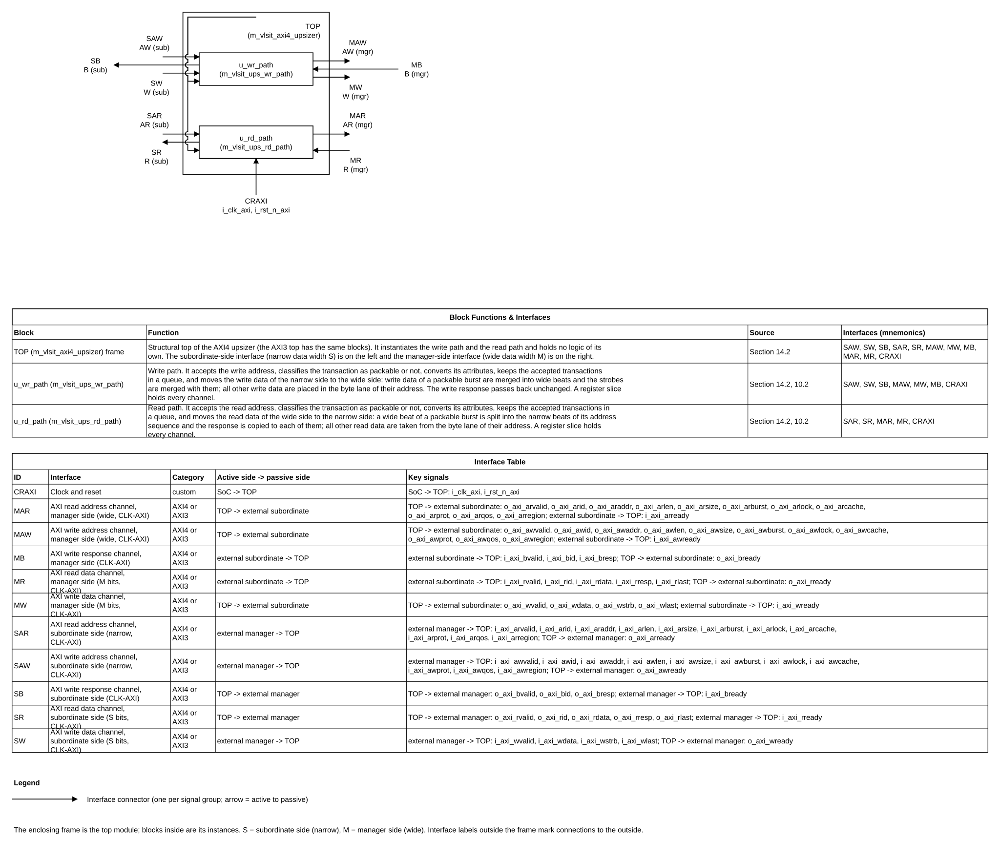

*Figure 5-1. Block diagram of the AXI4 upsizer: the top frame with the write path and the read path; the AXI3 top has the same blocks. Source: `figures/axi_upsizer_block_diagram.drawio` (draw.io, VLSIT library, drawn by `vlsit_spec_diagram.py` from `figures/axi_upsizer_diagram_spec.json`). The frame is the top module, the blocks are its instances, each connector is one interface with its mnemonic, and the two tables under the diagram in the source file describe the blocks and the interfaces.*

### 5.3 Transaction and dataflow

**Write transaction.** (1) The manager offers AW; the IP accepts it at the rising edge where AWVALID and AWREADY are 1. (2) The converted AW appears on the M side one cycle later. (3) From the next cycle the IP accepts W beats (REQ-FUNC-010). Each accepted beat is placed in its slot; an M beat is issued when the beat is the last of its M word or the last of the transaction. (4) After the last W beat the entry leaves the queue in the same cycle, so the first W beat of the next transaction can follow in the next cycle. (5) The downstream B passes through the B slice to the S side, which releases nothing: the queue entry was already freed at the last W beat.

**Read transaction.** (1) AR is accepted and converted as above. (2) The downstream returns M beats in order. The R unpacker takes an M beat into the word register when the register is empty or its last S beat is being transferred in the same cycle. (3) The S beats of the word are generated one per cycle through the R slice; the beat address sequence decides the slot and the end of the word. (4) With the last S beat of the transaction (all S beats counted, REQ-FUNC-013) the entry leaves the queue in the same cycle.

**Resource release.** A queue entry is released at the last W beat (write) or the last S beat (read) of its transaction. In the AXI3 top a write context is released at the last W beat of its transaction, and the accepted AW counts against the write outstanding depth until then.

### 5.4 Invariants

- INV-001: the number of M-side W beats of a transaction equals M-side AxLEN + 1, and the M-side WLAST is on the last of them.
- INV-002: the number of S-side R beats of a transaction equals S-side ARLEN + 1, and RLAST is on the last of them.
- INV-003: the write queue holds the AW transactions that have been accepted and have not received all their W beats; the read queue holds the AR transactions that have been accepted and have not delivered their last S beat. Neither queue overflows or underflows.
- INV-004: the accumulation register holds only slots of the M word of the S beats accepted since the last M beat issued; the slots not written hold zero data and zero strobes.
- INV-005: a VALID output is never asserted without a valid payload, and a VALID output stays asserted with stable payload until READY (REQ-IF-002).
- INV-006: no output depends combinationally on an input (REQ-IF-003).
- INV-007: no transaction generated by the IP crosses a 4KB boundary (REQ-FUNC-017).
- INV-008 (AXI3 top): the number of active write contexts never exceeds PARA_AXI_WR_INTERLEAVE_DEPTH, and each context holds the beats of one transaction only.
- INV-009 (AXI3 top): the bytes of an M-side W beat come only from the S beats of the context whose WID the M beat carries.

## 6. External interfaces and ports

### 6.1 Interface inventory

| Interface ID | Type and revision | Role | Direction at IP boundary | Clock domain | Required / optional | Configurations |
|---|---|---|---|---|---|---|
| IF-001 | AXI4 (IHI 0022H.c, AXI4 profile) | Subordinate (S side, data width S) | AW, W, AR in; B, R out; READY of AW, W, AR out | CLK-AXI | Required | AXI4 top |
| IF-002 | AXI4 (IHI 0022H.c, AXI4 profile) | Manager (M side, data width M) | AW, W, AR out; B, R in; READY of B and R out | CLK-AXI | Required | AXI4 top |
| IF-003 | AXI3 (IHI 0022H.c, AXI3 profile) | Subordinate (S side) and Manager (M side) | As IF-001 and IF-002, with WID | CLK-AXI | Required | AXI3 top |
| IF-004 | Clock and reset | Inputs | i_clk_axi, i_rst_n_axi | CLK-AXI | Required | All |

### 6.2 Complete port list

Both top modules have the ports below. The column Configurations names the side (S side: subordinate interface, M side: manager interface) and the top module that has the port. Width cells with two values give the value of the AXI4 top and of the AXI3 top. A parameter value does not create or remove a port. The widths use the parameters of section 8; PARA_AXI_S_DATA_W / 8 is the number of strobe bits.

| Port | Direction | Width | Meaning (function) | Clock domain | Signal type | Reset / idle value | Timing / sampling | Configurations |
|---|---|---|---|---|---|---|---|---|
| i_clk_axi | Input | 1 | Clock of both interfaces and of all logic of the IP | CLK-AXI | clock | Not applicable | Rising edge | AXI4 top, AXI3 top |
| i_rst_n_axi | Input | 1 | Active-low reset of all control state; asserted asynchronously, released synchronously to i_clk_axi outside the IP | CLK-AXI | reset | Not applicable (input) | Asynchronous assertion; release synchronous to i_clk_axi | AXI4 top, AXI3 top |
| i_axi_awid | Input | PARA_AXI_ID_W | Write transaction ID; passed unchanged between the sides | CLK-AXI | data (valid with AWVALID) | Driven by the connected component | Sampled at the rising edge of i_clk_axi when VALID and READY are 1 | S side, AXI4 top, AXI3 top |
| i_axi_awaddr | Input | PARA_AXI_ADDR_W | Start address of the burst (S side: as issued; M side: as converted, section 10.2 OP-001) | CLK-AXI | data (valid with AWVALID) | Driven by the connected component | As above | S side, AXI4 top, AXI3 top |
| i_axi_awlen | Input | 8 (AXI4), 4 (AXI3) | Burst length minus 1 (S side: as issued; M side: as converted) | CLK-AXI | data (valid with AWVALID) | Driven by the connected component | As above | S side, AXI4 top, AXI3 top |
| i_axi_awsize | Input | 3 | Size of each transfer, log2 of the bytes (S side: as issued; M side: as converted) | CLK-AXI | data (valid with AWVALID) | Driven by the connected component | As above | S side, AXI4 top, AXI3 top |
| i_axi_awburst | Input | 2 | Burst type: 00 FIXED, 01 INCR, 10 WRAP (S side: as issued; M side: as converted) | CLK-AXI | data (valid with AWVALID) | Driven by the connected component | As above | S side, AXI4 top, AXI3 top |
| i_axi_awlock | Input | 1 (AXI4), 2 (AXI3) | Lock type; a non-zero value makes the transaction not packable; passed unchanged | CLK-AXI | data (valid with AWVALID) | Driven by the connected component | As above | S side, AXI4 top, AXI3 top |
| i_axi_awcache | Input | 4 | Memory attributes; bit 1 (Modifiable in AXI4, Cacheable in AXI3) enables packing; passed unchanged | CLK-AXI | data (valid with AWVALID) | Driven by the connected component | As above | S side, AXI4 top, AXI3 top |
| i_axi_awprot | Input | 3 | Protection attributes; passed unchanged | CLK-AXI | data (valid with AWVALID) | Driven by the connected component | As above | S side, AXI4 top, AXI3 top |
| i_axi_awqos | Input | 4 | Quality of service value; passed unchanged | CLK-AXI | data (valid with AWVALID) | Driven by the connected component | As above | S side, AXI4 top only |
| i_axi_awregion | Input | 4 | Region identifier; passed unchanged | CLK-AXI | data (valid with AWVALID) | Driven by the connected component | As above | S side, AXI4 top only |
| i_axi_awvalid | Input | 1 | Write address valid: the address and control information are valid | CLK-AXI | level (held until READY) | Must be 0 during reset (driven by the connected component) | Sampled at the rising edge; no combinational path to any output | S side, AXI4 top, AXI3 top |
| o_axi_awready | Output | 1 | Write address ready: the IP (S side) or the connected subordinate (M side) accepts the address | CLK-AXI | level | 0 in reset and in the first cycle after the release | Registered state of the IP for the S side; sampled at the rising edge | S side, AXI4 top, AXI3 top |
| i_axi_wid | Input | PARA_AXI_ID_W | Write data ID (AXI3 only); on the M side the WID of the S-side beat that completes the M-side beat | CLK-AXI | data (valid with WVALID) | Driven by the connected component | Sampled at the rising edge when WVALID and WREADY are 1 | S side, AXI3 top only |
| i_axi_wdata | Input | PARA_AXI_S_DATA_W | Write data; S side: one S beat; M side: one M beat with the byte lanes of the S beats in their slots | CLK-AXI | data (valid with WVALID) | Driven by the connected component | As above | S side, AXI4 top, AXI3 top |
| i_axi_wstrb | Input | PARA_AXI_S_DATA_W / 8 | Write strobes, one bit per byte of WDATA; unwritten slots are 0 on the M side | CLK-AXI | data (valid with WVALID) | Driven by the connected component | As above | S side, AXI4 top, AXI3 top |
| i_axi_wlast | Input | 1 | Last beat of the write burst. Not used by the RTL: the last S beat is found from the beat counter and AxLEN (the input is kept for the AXI interface; a WLAST not on the last beat is an illegal input, ERR-003) | CLK-AXI | data (valid with WVALID) | Driven by the connected component | As above | S side, AXI4 top, AXI3 top |
| i_axi_wvalid | Input | 1 | Write data valid | CLK-AXI | level (held until READY) | Must be 0 during reset (driven by the connected component) | Sampled at the rising edge; no combinational path to any output | S side, AXI4 top, AXI3 top |
| o_axi_wready | Output | 1 | Write data ready; S side: 0 while no AW is pending (REQ-FUNC-010) | CLK-AXI | level | 0 in reset and in the first cycle after the release | Registered state of the IP for the S side; sampled at the rising edge | S side, AXI4 top, AXI3 top |
| o_axi_bid | Output | PARA_AXI_ID_W | Write response ID | CLK-AXI | data (valid with BVALID) | Output payload: no reset, don't care while VALID = 0 | Sampled at the rising edge when BVALID and BREADY are 1 | S side, AXI4 top, AXI3 top |
| o_axi_bresp | Output | 2 | Write response; passed unchanged from the M side to the S side | CLK-AXI | data (valid with BVALID) | Output payload: no reset, don't care while VALID = 0 | As above | S side, AXI4 top, AXI3 top |
| o_axi_bvalid | Output | 1 | Write response valid | CLK-AXI | level (held until READY) | 0 in reset | Sampled at the rising edge; no combinational path to any output | S side, AXI4 top, AXI3 top |
| i_axi_bready | Input | 1 | Write response ready | CLK-AXI | level | Driven by the connected component | Registered state of the IP for the M side; sampled at the rising edge | S side, AXI4 top, AXI3 top |
| i_axi_arid | Input | PARA_AXI_ID_W | Read transaction ID; passed unchanged between the sides | CLK-AXI | data (valid with ARVALID) | Driven by the connected component | Sampled at the rising edge of i_clk_axi when VALID and READY are 1 | S side, AXI4 top, AXI3 top |
| i_axi_araddr | Input | PARA_AXI_ADDR_W | Start address of the burst (S side: as issued; M side: as converted, section 10.2 OP-001) | CLK-AXI | data (valid with ARVALID) | Driven by the connected component | As above | S side, AXI4 top, AXI3 top |
| i_axi_arlen | Input | 8 (AXI4), 4 (AXI3) | Burst length minus 1 (S side: as issued; M side: as converted) | CLK-AXI | data (valid with ARVALID) | Driven by the connected component | As above | S side, AXI4 top, AXI3 top |
| i_axi_arsize | Input | 3 | Size of each transfer, log2 of the bytes (S side: as issued; M side: as converted) | CLK-AXI | data (valid with ARVALID) | Driven by the connected component | As above | S side, AXI4 top, AXI3 top |
| i_axi_arburst | Input | 2 | Burst type: 00 FIXED, 01 INCR, 10 WRAP (S side: as issued; M side: as converted) | CLK-AXI | data (valid with ARVALID) | Driven by the connected component | As above | S side, AXI4 top, AXI3 top |
| i_axi_arlock | Input | 1 (AXI4), 2 (AXI3) | Lock type; a non-zero value makes the transaction not packable; passed unchanged | CLK-AXI | data (valid with ARVALID) | Driven by the connected component | As above | S side, AXI4 top, AXI3 top |
| i_axi_arcache | Input | 4 | Memory attributes; bit 1 (Modifiable in AXI4, Cacheable in AXI3) enables packing; passed unchanged | CLK-AXI | data (valid with ARVALID) | Driven by the connected component | As above | S side, AXI4 top, AXI3 top |
| i_axi_arprot | Input | 3 | Protection attributes; passed unchanged | CLK-AXI | data (valid with ARVALID) | Driven by the connected component | As above | S side, AXI4 top, AXI3 top |
| i_axi_arqos | Input | 4 | Quality of service value; passed unchanged | CLK-AXI | data (valid with ARVALID) | Driven by the connected component | As above | S side, AXI4 top only |
| i_axi_arregion | Input | 4 | Region identifier; passed unchanged | CLK-AXI | data (valid with ARVALID) | Driven by the connected component | As above | S side, AXI4 top only |
| i_axi_arvalid | Input | 1 | Read address valid: the address and control information are valid | CLK-AXI | level (held until READY) | Must be 0 during reset (driven by the connected component) | Sampled at the rising edge; no combinational path to any output | S side, AXI4 top, AXI3 top |
| o_axi_arready | Output | 1 | Read address ready: the IP (S side) or the connected subordinate (M side) accepts the address | CLK-AXI | level | 0 in reset and in the first cycle after the release | Registered state of the IP for the S side; sampled at the rising edge | S side, AXI4 top, AXI3 top |
| o_axi_rid | Output | PARA_AXI_ID_W | Read data ID | CLK-AXI | data (valid with RVALID) | Output payload: no reset, don't care while VALID = 0 | Sampled at the rising edge when RVALID and RREADY are 1 | S side, AXI4 top, AXI3 top |
| o_axi_rdata | Output | PARA_AXI_S_DATA_W | Read data; S side: one S beat; M side: one M beat that holds the slots of one or more S beats | CLK-AXI | data (valid with RVALID) | Output payload: no reset, don't care while VALID = 0 | As above | S side, AXI4 top, AXI3 top |
| o_axi_rresp | Output | 2 | Read response; the M-side value is copied to each S beat generated from the M beat | CLK-AXI | data (valid with RVALID) | Output payload: no reset, don't care while VALID = 0 | As above | S side, AXI4 top, AXI3 top |
| o_axi_rlast | Output | 1 | Last beat of the read burst (S side: last S beat of the transaction) | CLK-AXI | data (valid with RVALID) | Output payload: no reset, don't care while VALID = 0 | As above | S side, AXI4 top, AXI3 top |
| o_axi_rvalid | Output | 1 | Read data valid | CLK-AXI | level (held until READY) | 0 in reset | Sampled at the rising edge; no combinational path to any output | S side, AXI4 top, AXI3 top |
| i_axi_rready | Input | 1 | Read data ready | CLK-AXI | level | Driven by the connected component | Registered state of the IP for the M side; sampled at the rising edge | S side, AXI4 top, AXI3 top |
| o_axi_awid | Output | PARA_AXI_ID_W | Write transaction ID; passed unchanged between the sides | CLK-AXI | data (valid with AWVALID) | Output payload: no reset, don't care while VALID = 0 | Sampled at the rising edge of i_clk_axi when VALID and READY are 1 | M side, AXI4 top, AXI3 top |
| o_axi_awaddr | Output | PARA_AXI_ADDR_W | Start address of the burst (S side: as issued; M side: as converted, section 10.2 OP-001) | CLK-AXI | data (valid with AWVALID) | Output payload: no reset, don't care while VALID = 0 | As above | M side, AXI4 top, AXI3 top |
| o_axi_awlen | Output | 8 (AXI4), 4 (AXI3) | Burst length minus 1 (S side: as issued; M side: as converted) | CLK-AXI | data (valid with AWVALID) | Output payload: no reset, don't care while VALID = 0 | As above | M side, AXI4 top, AXI3 top |
| o_axi_awsize | Output | 3 | Size of each transfer, log2 of the bytes (S side: as issued; M side: as converted) | CLK-AXI | data (valid with AWVALID) | Output payload: no reset, don't care while VALID = 0 | As above | M side, AXI4 top, AXI3 top |
| o_axi_awburst | Output | 2 | Burst type: 00 FIXED, 01 INCR, 10 WRAP (S side: as issued; M side: as converted) | CLK-AXI | data (valid with AWVALID) | Output payload: no reset, don't care while VALID = 0 | As above | M side, AXI4 top, AXI3 top |
| o_axi_awlock | Output | 1 (AXI4), 2 (AXI3) | Lock type; a non-zero value makes the transaction not packable; passed unchanged | CLK-AXI | data (valid with AWVALID) | Output payload: no reset, don't care while VALID = 0 | As above | M side, AXI4 top, AXI3 top |
| o_axi_awcache | Output | 4 | Memory attributes; bit 1 (Modifiable in AXI4, Cacheable in AXI3) enables packing; passed unchanged | CLK-AXI | data (valid with AWVALID) | Output payload: no reset, don't care while VALID = 0 | As above | M side, AXI4 top, AXI3 top |
| o_axi_awprot | Output | 3 | Protection attributes; passed unchanged | CLK-AXI | data (valid with AWVALID) | Output payload: no reset, don't care while VALID = 0 | As above | M side, AXI4 top, AXI3 top |
| o_axi_awqos | Output | 4 | Quality of service value; passed unchanged | CLK-AXI | data (valid with AWVALID) | Output payload: no reset, don't care while VALID = 0 | As above | M side, AXI4 top only |
| o_axi_awregion | Output | 4 | Region identifier; passed unchanged | CLK-AXI | data (valid with AWVALID) | Output payload: no reset, don't care while VALID = 0 | As above | M side, AXI4 top only |
| o_axi_awvalid | Output | 1 | Write address valid: the address and control information are valid | CLK-AXI | level (held until READY) | 0 in reset | Sampled at the rising edge; no combinational path to any output | M side, AXI4 top, AXI3 top |
| i_axi_awready | Input | 1 | Write address ready: the IP (S side) or the connected subordinate (M side) accepts the address | CLK-AXI | level | Driven by the connected component | Registered state of the IP for the S side; sampled at the rising edge | M side, AXI4 top, AXI3 top |
| o_axi_wid | Output | PARA_AXI_ID_W | Write data ID (AXI3 only); on the M side the WID of the S-side beat that completes the M-side beat | CLK-AXI | data (valid with WVALID) | Output payload: no reset, don't care while VALID = 0 | Sampled at the rising edge when WVALID and WREADY are 1 | M side, AXI3 top only |
| o_axi_wdata | Output | PARA_AXI_M_DATA_W | Write data; S side: one S beat; M side: one M beat with the byte lanes of the S beats in their slots | CLK-AXI | data (valid with WVALID) | Output payload: no reset, don't care while VALID = 0 | As above | M side, AXI4 top, AXI3 top |
| o_axi_wstrb | Output | PARA_AXI_M_DATA_W / 8 | Write strobes, one bit per byte of WDATA; unwritten slots are 0 on the M side | CLK-AXI | data (valid with WVALID) | Output payload: no reset, don't care while VALID = 0 | As above | M side, AXI4 top, AXI3 top |
| o_axi_wlast | Output | 1 | Last beat of the write burst (M side: last M beat) | CLK-AXI | data (valid with WVALID) | Output payload: no reset, don't care while VALID = 0 | As above | M side, AXI4 top, AXI3 top |
| o_axi_wvalid | Output | 1 | Write data valid | CLK-AXI | level (held until READY) | 0 in reset | Sampled at the rising edge; no combinational path to any output | M side, AXI4 top, AXI3 top |
| i_axi_wready | Input | 1 | Write data ready; S side: 0 while no AW is pending (REQ-FUNC-010) | CLK-AXI | level | Driven by the connected component | Registered state of the IP for the S side; sampled at the rising edge | M side, AXI4 top, AXI3 top |
| i_axi_bid | Input | PARA_AXI_ID_W | Write response ID | CLK-AXI | data (valid with BVALID) | Driven by the connected component | Sampled at the rising edge when BVALID and BREADY are 1 | M side, AXI4 top, AXI3 top |
| i_axi_bresp | Input | 2 | Write response; passed unchanged from the M side to the S side | CLK-AXI | data (valid with BVALID) | Driven by the connected component | As above | M side, AXI4 top, AXI3 top |
| i_axi_bvalid | Input | 1 | Write response valid | CLK-AXI | level (held until READY) | Must be 0 during reset (driven by the connected component) | Sampled at the rising edge; no combinational path to any output | M side, AXI4 top, AXI3 top |
| o_axi_bready | Output | 1 | Write response ready | CLK-AXI | level | 0 in reset and in the first cycle after the release | Registered state of the IP for the M side; sampled at the rising edge | M side, AXI4 top, AXI3 top |
| o_axi_arid | Output | PARA_AXI_ID_W | Read transaction ID; passed unchanged between the sides | CLK-AXI | data (valid with ARVALID) | Output payload: no reset, don't care while VALID = 0 | Sampled at the rising edge of i_clk_axi when VALID and READY are 1 | M side, AXI4 top, AXI3 top |
| o_axi_araddr | Output | PARA_AXI_ADDR_W | Start address of the burst (S side: as issued; M side: as converted, section 10.2 OP-001) | CLK-AXI | data (valid with ARVALID) | Output payload: no reset, don't care while VALID = 0 | As above | M side, AXI4 top, AXI3 top |
| o_axi_arlen | Output | 8 (AXI4), 4 (AXI3) | Burst length minus 1 (S side: as issued; M side: as converted) | CLK-AXI | data (valid with ARVALID) | Output payload: no reset, don't care while VALID = 0 | As above | M side, AXI4 top, AXI3 top |
| o_axi_arsize | Output | 3 | Size of each transfer, log2 of the bytes (S side: as issued; M side: as converted) | CLK-AXI | data (valid with ARVALID) | Output payload: no reset, don't care while VALID = 0 | As above | M side, AXI4 top, AXI3 top |
| o_axi_arburst | Output | 2 | Burst type: 00 FIXED, 01 INCR, 10 WRAP (S side: as issued; M side: as converted) | CLK-AXI | data (valid with ARVALID) | Output payload: no reset, don't care while VALID = 0 | As above | M side, AXI4 top, AXI3 top |
| o_axi_arlock | Output | 1 (AXI4), 2 (AXI3) | Lock type; a non-zero value makes the transaction not packable; passed unchanged | CLK-AXI | data (valid with ARVALID) | Output payload: no reset, don't care while VALID = 0 | As above | M side, AXI4 top, AXI3 top |
| o_axi_arcache | Output | 4 | Memory attributes; bit 1 (Modifiable in AXI4, Cacheable in AXI3) enables packing; passed unchanged | CLK-AXI | data (valid with ARVALID) | Output payload: no reset, don't care while VALID = 0 | As above | M side, AXI4 top, AXI3 top |
| o_axi_arprot | Output | 3 | Protection attributes; passed unchanged | CLK-AXI | data (valid with ARVALID) | Output payload: no reset, don't care while VALID = 0 | As above | M side, AXI4 top, AXI3 top |
| o_axi_arqos | Output | 4 | Quality of service value; passed unchanged | CLK-AXI | data (valid with ARVALID) | Output payload: no reset, don't care while VALID = 0 | As above | M side, AXI4 top only |
| o_axi_arregion | Output | 4 | Region identifier; passed unchanged | CLK-AXI | data (valid with ARVALID) | Output payload: no reset, don't care while VALID = 0 | As above | M side, AXI4 top only |
| o_axi_arvalid | Output | 1 | Read address valid: the address and control information are valid | CLK-AXI | level (held until READY) | 0 in reset | Sampled at the rising edge; no combinational path to any output | M side, AXI4 top, AXI3 top |
| i_axi_arready | Input | 1 | Read address ready: the IP (S side) or the connected subordinate (M side) accepts the address | CLK-AXI | level | Driven by the connected component | Registered state of the IP for the S side; sampled at the rising edge | M side, AXI4 top, AXI3 top |
| i_axi_rid | Input | PARA_AXI_ID_W | Read data ID | CLK-AXI | data (valid with RVALID) | Driven by the connected component | Sampled at the rising edge when RVALID and RREADY are 1 | M side, AXI4 top, AXI3 top |
| i_axi_rdata | Input | PARA_AXI_M_DATA_W | Read data; S side: one S beat; M side: one M beat that holds the slots of one or more S beats | CLK-AXI | data (valid with RVALID) | Driven by the connected component | As above | M side, AXI4 top, AXI3 top |
| i_axi_rresp | Input | 2 | Read response; the M-side value is copied to each S beat generated from the M beat | CLK-AXI | data (valid with RVALID) | Driven by the connected component | As above | M side, AXI4 top, AXI3 top |
| i_axi_rlast | Input | 1 | Last beat of the read burst. Not used by the RTL: the S-side RLAST is generated from the beat counter and AxLEN | CLK-AXI | data (valid with RVALID) | Driven by the connected component | As above | M side, AXI4 top, AXI3 top |
| i_axi_rvalid | Input | 1 | Read data valid | CLK-AXI | level (held until READY) | Must be 0 during reset (driven by the connected component) | Sampled at the rising edge; no combinational path to any output | M side, AXI4 top, AXI3 top |
| o_axi_rready | Output | 1 | Read data ready | CLK-AXI | level | 0 in reset and in the first cycle after the release | Registered state of the IP for the M side; sampled at the rising edge | M side, AXI4 top, AXI3 top |

### 6.3 Protocol behavior

Protocol: AMBA AXI IHI 0022H.c (REF-001), AXI4 and AXI3 profiles, S side subordinate and M side manager, no USER signals. The IP choices are below.

- **Acceptance and stability.** Every channel handshake is sampled at the rising edge of i_clk_axi. VALID and the payload of every output are held until READY (REQ-IF-002). The register slices make every output a register, so no output depends combinationally on an input (REQ-IF-003).
- **Outstanding capacity, IDs, ordering.** At most `PARA_AXI_WR_OUTSTANDING_DEPTH` AW and `PARA_AXI_RD_OUTSTANDING_DEPTH` AR transactions are held. The IP does not use the ID for scheduling: transactions of any ID are processed in the order of acceptance (REQ-FUNC-014). The downstream shall return read data in the AR order and without interleaving (ASM-002); the B responses are passed in the order received. In the AXI3 top the data of up to `PARA_AXI_WR_INTERLEAVE_DEPTH` write transactions with different WID may be interleaved (REQ-FUNC-018).
- **Address alignment, burst types, size, byte enables.** A packable transaction is converted as in OP-001; every other transaction keeps its attributes (REQ-FUNC-003). Each S beat is placed in the slot K of its address (REQ-FUNC-007); strobes follow the S-side strobes.
- **Protection, cacheability, QoS, region, user.** AxPROT, AxCACHE, AxQOS, AxREGION and AxID pass unchanged (REQ-FUNC-015). Only AxCACHE[1] is read, to decide packing (REF-001 A4.3.1 for AXI4, A4.2 for AXI3). There are no USER signals.
- **Errors, timeout, reset.** Responses pass through or are copied (REQ-ERR-001 to REQ-ERR-003). There is no timeout. A reset discards every transaction (REQ-RESET-002).

| Case | Legal behavior | Illegal / unsupported case | IP response | Requirement IDs |
|---|---|---|---|---|
| Modifiable INCR, full S width | Packed into M-wide beats | None | AxSIZE, AxLEN changed as in OP-001 | REQ-FUNC-004, REQ-FUNC-009 |
| Modifiable WRAP, container below M, or at least M with start aligned to M | Packed | None | As OP-001 | REQ-FUNC-005, REQ-FUNC-006 |
| WRAP with container at least M and start not aligned to M | Lane steering | None | Attributes unchanged | REQ-FUNC-002, REQ-FUNC-003 |
| Narrow size (AxSIZE below the S width) | Lane steering | None | Attributes unchanged | REQ-FUNC-002, REQ-FUNC-003 |
| FIXED, locked or exclusive, Non-modifiable | Lane steering | None | Attributes unchanged | REQ-FUNC-002, REQ-FUNC-003 |
| W data before AW | AXI4 top: W beats wait. AXI3 top: WREADY is low while no AW is pending and no context is active | None | WREADY low | REQ-FUNC-010, REQ-FUNC-018 |
| AXI3: W beats of up to the depth value of transactions with different WID interleaved | Each beat goes to the context of its WID; M beats in the order of completion | More streams than the depth value, or a W beat of an ID whose AW has not been accepted while other transactions are active | Not specified: the W channel can block (ERR-006) | REQ-FUNC-018, REQ-PARAM-005 |
| AxBURST = 11 (reserved) | Not applicable | Illegal input | Not specified, passes as lane steering | REQ-ERR-004 |
| Burst that crosses 4KB, WRAP length not 2, 4, 8 or 16, WLAST not on the last beat | Not applicable | Illegal input | Not specified | REQ-ERR-004 |
| Read data of another transaction before the current one is complete, or out of AR order | Not applicable | Unsupported downstream | Not specified (ASM-002) | REQ-FUNC-014 |

### 6.4 Interrupts and events

**Not required (confirmed by user, 2026-10-27):** the IP has no interrupt or event output.

## 7. Clock, reset, and power

### 7.1 Clock domains

| Domain | Clock port | Edge | Frequency range | Source | Relationship to other clocks | Gating policy |
|---|---|---|---|---|---|---|
| CLK-AXI | i_clk_axi | Rising | Not specified (TBD-001); no minimum is required by the logic | SoC clock controller | The only clock: both interfaces and all logic use it | No clock gating inside the IP |

### 7.2 CDC and RDC

**Not required (confirmed by user, 2026-10-27):** the IP has one clock domain and no crossing (DEC-005, REQ-CLK-001). A crossing between a manager and the S side, or between the M side and a subordinate in another clock, uses `003_AsyncAXI4Bridge` outside this IP.

### 7.3 Reset domains and sequencing

| Reset ID | Port | Polarity / assertion | Sync or async | Scope | Deassertion | Reset value |
|---|---|---|---|---|---|---|
| RST-AXI | i_rst_n_axi | Active-low | Async assertion; release synchronized to i_clk_axi outside the IP (ASM-001) | All control state of the IP | Synchronous to i_clk_axi | Write queue and read queue empty; accumulation register zero; word register empty; W stage empty and every write context free (AXI3 top); beat counters zero; slice flags: no data, skid empty, READY register 0; every VALID and READY output 0 |

- **Reset sources:** one hardware reset port; there is no software reset.
- **Release:** after the release the slices set their READY register at the first rising edge, so every READY output is 0 in the first cycle and 1 from the second cycle (REQ-IF-004). The IP accepts its first AW or AR in the second cycle.
- **In-flight work:** a reset discards every accepted transaction and every held beat (REQ-RESET-002). The connected manager and subordinate are reset together and shall drive every VALID low during the reset.
- **Resetless payload:** payload registers (slice entries, word register data) are not reset and are read only while the VALID or flag that guards them is 1 (REQ-RTL-003). The accumulation register is reset to zero so that unwritten slots read as zero.
- **Stopped clock, warm and partial reset, retention:** not supported.

### 7.4 Power intent (if applicable)

**Not required (confirmed by user, 2026-10-27):** the IP has no power domain, isolation or retention (DEC-017).

## 8. Parameters and elaboration configurations

The parameters below are declared as `parameter logic [31:0]` with a name that starts with `PARA_` and with the three comment lines of REF-003 PAR-02 above each; the derived constants are `localparam logic [31:0]` with a name that starts with `LPARA_`, placed in the parameter port list after the parameters. The two top modules have the same parameters, except PARA_AXI_WR_INTERLEAVE_DEPTH, which only the AXI3 top has. The default configuration is CFG-AXI4-DEF.

| Parameter | Purpose | Default | Legal values / range | Dependencies / invalid combinations | Effect |
|---|---|---|---|---|---|
| PARA_AXI_S_DATA_W | Data width of the S side | 32 | Power of 2 in 8 to 1024 (bit) | Shall be smaller than PARA_AXI_M_DATA_W | Width of S-side WDATA and RDATA, number of S-side strobe bits, slot width |
| PARA_AXI_M_DATA_W | Data width of the M side | 128 | Power of 2 in 8 to 1024 (bit) | Shall be larger than PARA_AXI_S_DATA_W; ratio 2 to 128 | Width of M-side WDATA and RDATA, number of slots LPARA_RATIO, accumulation and word register size |
| PARA_AXI_ADDR_W | Address width of both sides | 32 | 12 to 64 (bit) | At least 12, the 4KB page, as confirmed by the user (ASM-004); the logic itself needs only the low LPARA_ADDR_LOW_W bits | Width of AxADDR, the bits above the low LPARA_ADDR_LOW_W bits pass unchanged |
| PARA_AXI_ID_W | ID width of both sides, not converted | 4 | 1 to 32 (bit) | At most 32 because the tie module `m_vlsit_tie` is limited to 32 bits (AXI4 top ties the WID input of the write path) | Width of AxID, BID, RID, WID (AXI3) |
| PARA_AXI_WR_OUTSTANDING_DEPTH | Depth of the queue of accepted AW transactions | 4 | Power of 2, 2 or more (count) | None | Number of write transactions in flight; queue storage |
| PARA_AXI_RD_OUTSTANDING_DEPTH | Depth of the queue of accepted AR transactions | 4 | Power of 2, 2 or more (count) | None | Number of read transactions in flight; queue storage |
| PARA_AXI_WR_INTERLEAVE_DEPTH | AXI3 top only: number of write transactions whose data may be interleaved, that is the number of write contexts | 2 | 1 to PARA_AXI_WR_OUTSTANDING_DEPTH (count) | Not larger than PARA_AXI_WR_OUTSTANDING_DEPTH; shall be at least the number of transactions that the manager interleaves (ASM-003) | Number of write contexts, each with an accumulation register of M + M/8 bits; 1 means no interleave |

| Derived constant | Value | Meaning |
|---|---|---|
| LPARA_RATIO | PARA_AXI_M_DATA_W / PARA_AXI_S_DATA_W | Number of slots |
| LPARA_S_BYTES_LOG2 | log2(PARA_AXI_S_DATA_W / 8) | S-side full AxSIZE and slot address bits |
| LPARA_M_BYTES_LOG2 | log2(PARA_AXI_M_DATA_W / 8) | M-side full AxSIZE |
| LPARA_LEN_W | 8 (AXI4), 4 (AXI3) | Width of AxLEN |
| LPARA_ADDR_LOW_W | max(log2(PARA_AXI_M_DATA_W / 8), log2(PARA_AXI_S_DATA_W / 8) + 4) | Number of low address bits that the logic carries (at most 10) |
| LPARA_ENTRY_W | width of one queue entry (section 10.5) | Queue storage |

| Configuration | Parameter overrides | Features/interfaces | Expected hierarchy | Elaboration/lint/synthesis target |
|---|---|---|---|---|
| CFG-AXI4-DEF | Defaults | AXI4 | m_vlsit_axi4_upsizer with u_wr_path, u_rd_path | Elaborate, lint, synthesize |
| CFG-AXI3-DEF | Defaults | AXI3 | m_vlsit_axi3_upsizer with the same children | Elaborate, lint, synthesize |
| CFG-AXI3-IL4 | Write outstanding depth 8, interleave depth 4 | AXI3 | As CFG-AXI3-DEF | Elaborate, simulate |
| CFG-MIN-RATIO | S = 512, M = 1024 | AXI4 | As CFG-AXI4-DEF | Elaborate, simulate |
| CFG-MAX-RATIO | S = 8, M = 1024 | AXI4 | As CFG-AXI4-DEF | Elaborate, simulate |
| CFG-DEPTH-2 | Both depths 2 | AXI4 | As CFG-AXI4-DEF | Elaborate, simulate |
| CFG-ID-1 | S = 64, M = 256, ID width 1, address width 12 and 64 | AXI4 | As CFG-AXI4-DEF | Elaborate, simulate |

Behavior for an illegal configuration (REQ-PARAM-004): not specified and not checked. The wrapper port list is static: a parameter value changes widths only.

## 9. Data representation and arithmetic

Bit and byte numbering follow AXI: byte n of a data bus is bits [8n+7:8n]; WSTRB[n] qualifies byte n. The byte order is that of AXI byte invariance (REF-001 A3.4.4): the IP moves bytes and never swaps them, so endianness is not an issue.

**Slots.** The M-side data bus is viewed as `LPARA_RATIO` slots of S bits. Slot K holds M-side bits [K x S + S - 1 : K x S] and strobe bits [K x S/8 + S/8 - 1 : K x S/8]. The byte at position j of an S beat is at position K x (S/8) + j of the M bus, where K = floor((address of the beat mod (M/8)) / (S/8)). Slot 0 is the least significant slot.

**Words.** An M word is a naturally aligned block of M/8 bytes; the word index of an address is floor(address / (M/8)).

| Quantity | Width | Encoding / range | Extension / truncation | Overflow / invalid behavior |
|---|---|---|---|---|
| AxLEN (S side) | 8 (AXI4), 4 (AXI3) | Beats minus 1 | None | Illegal values are not detected |
| AxLEN (M side) | 8 (AXI4), 4 (AXI3) | M-side beats minus 1; never above the S-side value | None | Cannot overflow (REQ-FUNC-017) |
| AxSIZE | 3 | log2 of the bytes per transfer; 0 to log2(S/8) on the S side; log2(M/8) for a packed transaction on the M side | None | A size above log2(S/8) on the S side is not detected |
| AxBURST | 2 | 00 FIXED, 01 INCR, 10 WRAP, 11 reserved | None | 11 is not detected and is passed as lane steering |
| Beat address | LPARA_ADDR_LOW_W (low bits) | Computed as in REQ-FUNC-007; the logic carries only the low bits | The bits of AxADDR above the low bits are unchanged for every beat | A burst that crosses 4KB is illegal and is not detected |
| Slot index K | log2(M / S) bits | 0 to LPARA_RATIO - 1 | None | None |
| Strobes of the M beat | M / 8 | Slot nibbles of the S strobes; unwritten slots 0 | None | None |
| Number of M beats NM | Up to 8 bits | 1 to the S-side beat count | None | None |

## 10. Detailed functional behavior

### 10.1 Modes and state transitions

| Mode/state | Entry condition | Behavior | Exit condition | Outputs / side effects |
|---|---|---|---|---|
| WR-IDLE | Reset, or the last W beat of the previous transaction accepted and no entry in the write queue | The packer waits for a queue entry; S-side WREADY = 0 | The write queue is not empty | None |
| WR-ACC | The write queue is not empty | S beats are accepted and placed in slots; an M beat is issued at the end of each M word | The last S beat of the transaction is accepted | The queue entry is released at the same edge; the next entry, if any, is the head in the next cycle, so WR-ACC continues without a bubble |
| WR-IL | AXI3 top: a W beat is in the stage and its WID matches an active context, or a context is free and an unbound accepted AW has AWID = WID | The beat is placed in the slot of its context; the M beat of the context is issued at the end of an M word | The last S beat of the context is converted | The context is released; the M beat carries the WID of the context |
| RD-IDLE | Reset, or the word register is empty | RREADY of the M side = 1 when a queue entry exists for the incoming beat | An M-side R beat is accepted | The word register is loaded |
| RD-UNPACK | The word register holds an M beat | One S beat per cycle through the R slice; the slot comes from the beat address | The last S beat of the word is accepted by the R slice (reload in the same cycle when a new M beat is accepted) | The queue entry is released with the last S beat of the transaction |

### 10.2 Operations

| Operation ID | Inputs / preconditions | Processing semantics | Result / completion | Latency / ordering |
|---|---|---|---|---|
| OP-001 | An S-side AW or AR handshake; the queue is not full | Classification: packable when AxCACHE[1] = 1, AxLOCK = 0, AxSIZE = log2(S/8), and AxBURST = INCR, or WRAP with container C = (AxLEN + 1) x (S/8) bytes below M/8 or with A aligned to M/8. Not packable: attributes unchanged. Packable INCR: AxADDR = A, AxSIZE = log2(M/8), AxBURST = INCR, AxLEN = NM - 1 (REQ-FUNC-004). Packable WRAP with C at least M/8: AxADDR = A, AxSIZE = log2(M/8), AxLEN = C/(M/8) - 1, AxBURST = WRAP, or INCR with AxLEN 0 when C = M/8 (REQ-FUNC-005). Packable WRAP with C below M/8: AxADDR = floor(A / C) x C, AxSIZE = log2(M/8), AxLEN = 0, AxBURST = INCR (REQ-FUNC-006) | M-side AW or AR in the slice; S-side attributes and the pack flag in the queue | M-side VALID one cycle after the handshake; queue order = acceptance order |
| OP-002 | Head of the write queue is not packable; an S-side W beat is offered | The beat goes to slot K of its address; the M beat carries that slot, strobes of that slot, zero elsewhere (REQ-FUNC-008) | One M-side W beat per S beat; M WLAST generated on the last beat of the transaction (from the beat counter and AxLEN) | M-side VALID one cycle after the handshake; one beat per cycle |
| OP-003 | Head of the write queue is packable | S beats are accumulated in their slots; the M beat is issued when the beat is the last of its M word or of the transaction (REQ-FUNC-009) | One M-side W beat per M word touched | M-side VALID one cycle after the handshake of the completing S beat; S beats accepted at one per cycle |
| OP-004 | An M-side B handshake | BID and BRESP pass through the B slice (REQ-FUNC-011) | S-side B | S-side VALID one cycle after the handshake |
| OP-005 | Head of the read queue is not packable; an M-side R beat is accepted | The S beat takes the bytes of slot K of its address (REQ-FUNC-012) | One S-side R beat per M beat; RLAST generated on the last S beat of the transaction (from the beat counter and AxLEN) | First S-side VALID two cycles after the M-side handshake |
| OP-006 | Head of the read queue is packable; an M-side R beat is accepted | The S beats whose addresses are in that M word are generated in sequence order, RRESP and RID copied, RLAST on the last S beat of the transaction (REQ-FUNC-013) | One to LPARA_RATIO S-side R beats per M beat | First S-side VALID two cycles after the M-side handshake, then one per cycle |
| OP-007 | Any S beat of any transaction | Beat address: FIXED, INCR or WRAP of REF-001 A3.4.2 (REQ-FUNC-007); the word-last flag of a packable transaction is 1 when the beat is the last of the transaction or when the address of the next beat is in another M word; for a transaction that is not packable it is always 1 | Slot index and word-last flag | Combinational from the queue head and the beat counters |
| OP-008 | i_rst_n_axi low | All control state returns to the values of section 7.3; accepted transactions are discarded | Idle IP; VALID and READY outputs 0 | Asynchronous assertion; READY outputs 0 in the first cycle after the release |
| OP-009 | AXI3 top; a W beat is offered | The beat enters the one-beat stage when WREADY = 1; in the next cycle it is assigned to the context of its WID, or it binds to the oldest unbound accepted AW with AWID = WID when a context is free (REQ-FUNC-018); its slot is that of OP-007; the context issues an M beat at the end of an M word | One M-side W beat per M word of each context, with the WID of the context, in the order of completion | M-side VALID two cycles after the S-side handshake of the completing beat; one S beat per cycle while every beat finds its context |

**Implementation form (REQ-RTL-004, DEC-021).** R = M / S, LR = log2(R), BL = AxLEN + 1, s0 = AxADDR[log2(M/8)-1 : log2(S/8)] (the first slot), LA = LPARA_ADDR_LOW_W. The functions of OP-001 and OP-007 are equal to the forms below; the cycle model checks the equality (section 15.1, TEST-022). They use only shifts, masks, small adders and compares.

- Packable: AxCACHE[1] = 1, AxLOCK = 0, AxSIZE = log2(S/8), and AxBURST = INCR, or AxBURST = WRAP with (BL < R or AxADDR[log2(M/8)-1 : 0] = 0).
- Packable INCR: NM = (s0 + BL + R - 1) >> LR, and the M-side AxLEN = NM - 1.
- Packable WRAP with BL < R: the M-side AxADDR is AxADDR with the low (log2(BL) + log2(S/8)) bits cleared, AxLEN = 0, AxBURST = INCR.
- Packable WRAP with BL >= R: n = BL >> LR; the M-side AxLEN = n - 1; AxBURST = WRAP when n >= 2, INCR otherwise.
- Slot of beat k of a packed burst: wm = BL - 1 when AxBURST = WRAP and BL < R, otherwise R - 1; slot of beat k = (s0 and not wm) or ((s0 + k) and wm). The word-last flag of beat k is 1 when k = AxLEN, or when slot of beat k = R - 1 and not (AxBURST = WRAP and BL < R).
- Slot of beat k of a burst that is not packed: a register a of LA bits. First beat: a = AxADDR[LA-1:0]. Next beat: FIXED keeps a; otherwise t = (a with the low AxSIZE bits cleared) + 2^AxSIZE, INCR takes a = t, WRAP takes a = (a and not mask) or (t and mask) with mask = (BL << AxSIZE) - 1. The slot is a[log2(M/8)-1 : log2(S/8)]. The word-last flag is always 1.
- Slot use: the slot index is decoded into one write enable per slot (which also gates the strobe lanes); on the read side it selects one S-bit field of the word through a log2(R)-level AND-OR tree.

### 10.3 Cycle-level behavior

**Waveform plan (rule R-024).** The user confirmed the proposed list of 12 waveforms (option A) on 2026-10-27 and added WF-013 (AXI3 write data interleave) on 2026-10-28. The figures use S = 32 bit, M = 128 bit (ratio 4), the AXI4 profile (WF-013: AXI3 profile, interleave depth 2), depth 4 unless stated; the data labels show S beats as letters with an index and an M beat as four slot labels (slot 3 first, `--` for an unwritten slot). They are generated by `model/gen_waveforms.py` from the reference cycle model `model/ups_cycle_model.py`, which is written from this specification; the model is not RTL and the figures are not a simulation of RTL.

| Waveform ID | Function / operation | Scenario (success / error / corner) | Signals shown | Figure | Confirmed by user |
|---|---|---|---|---|---|
| WF-001 | OP-001, OP-003: Write INCR packed, S 32 bit to M 128 bit, 8 beats, aligned start | success | Both sides of the channels involved; clock, reset, VALID, READY, payload | figures/upsizer_wf001_write_incr_pack.svg | 2026-10-27 |
| WF-002 | OP-001, OP-003: Write INCR packed, start 0x1008, partial first and last M word | corner | Both sides of the channels involved; clock, reset, VALID, READY, payload | figures/upsizer_wf002_write_incr_unaligned.svg | 2026-10-27 |
| WF-003 | OP-001, OP-002: Write lane steering (Non-modifiable): one S beat gives one M beat | success | Both sides of the channels involved; clock, reset, VALID, READY, payload | figures/upsizer_wf003_write_lane_steering.svg | 2026-10-27 |
| WF-004 | OP-003, OP-005: Write with backpressure on AWREADY and WREADY of the M side and a gap in WVALID | corner | Both sides of the channels involved; clock, reset, VALID, READY, payload | figures/upsizer_wf004_write_backpressure.svg | 2026-10-27 |
| WF-005 | OP-003: W data offered before the AW | corner | Both sides of the channels involved; clock, reset, VALID, READY, payload | figures/upsizer_wf005_write_w_before_aw.svg | 2026-10-27 |
| WF-006 | OP-001, OP-003, OP-007: Write WRAP packed: container 32 bytes aligned to M, then container 8 bytes inside one M word | success | Both sides of the channels involved; clock, reset, VALID, READY, payload | figures/upsizer_wf006_write_wrap.svg | 2026-10-27 |
| WF-007 | OP-001, OP-006: Read INCR packed: each M beat split into 4 S beats | success | Both sides of the channels involved; clock, reset, VALID, READY, payload | figures/upsizer_wf007_read_incr_pack.svg | 2026-10-27 |
| WF-008 | OP-001, OP-005: Read lane steering (Non-modifiable) | success | Both sides of the channels involved; clock, reset, VALID, READY, payload | figures/upsizer_wf008_read_lane_steering.svg | 2026-10-27 |
| WF-009 | OP-001, OP-006, OP-007: Read WRAP packed: container 32 bytes, then container 8 bytes | success | Both sides of the channels involved; clock, reset, VALID, READY, payload | figures/upsizer_wf009_read_wrap.svg | 2026-10-27 |
| WF-010 | OP-004, OP-006: Error responses: BRESP SLVERR, RRESP SLVERR copied to the S beats of one M beat | error | Both sides of the channels involved; clock, reset, VALID, READY, payload | figures/upsizer_wf010_error_response.svg | 2026-10-27 |
| WF-011 | OP-001: Outstanding queue of depth 2 full: third AW and third AR wait | corner | Both sides of the channels involved; clock, reset, VALID, READY, payload | figures/upsizer_wf011_queue_full.svg | 2026-10-27 |
| WF-012 | OP-008: Reset during a write burst, then a new burst after the release | corner | Both sides of the channels involved; clock, reset, VALID, READY, payload | figures/upsizer_wf012_reset.svg | 2026-10-27 |
| WF-013 | OP-009: AXI3 write data interleave, depth 2: WID 1 and 2 alternate beat by beat, WID 3 waits for its AW | corner | Both sides of the channels involved; clock, reset, VALID, READY, payload | figures/upsizer_wf013_axi3_write_interleave.svg | 2026-10-28 |

**Figures.** Source files (WaveJSON) are beside the images.

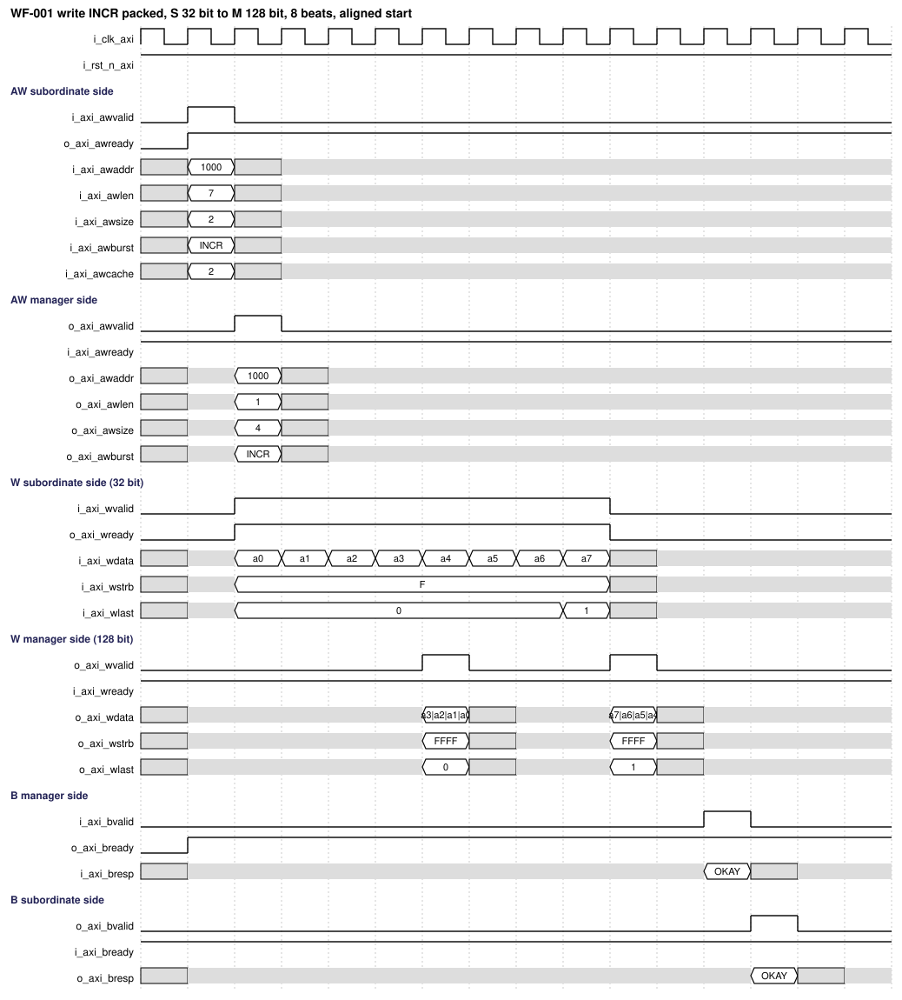

*Figure 10.3-1. WF-001: Write INCR packed, S 32 bit to M 128 bit, 8 beats, aligned start. Source: `figures/upsizer_wf001_write_incr_pack.json`.*

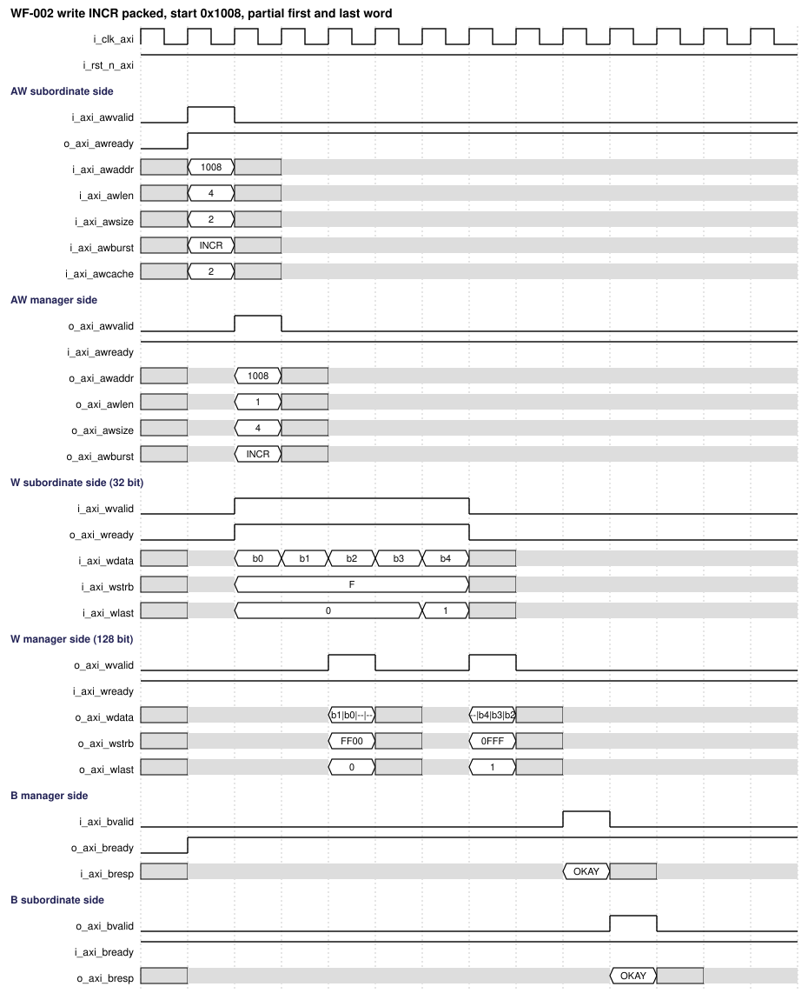

*Figure 10.3-2. WF-002: Write INCR packed, start 0x1008, partial first and last M word. Source: `figures/upsizer_wf002_write_incr_unaligned.json`.*

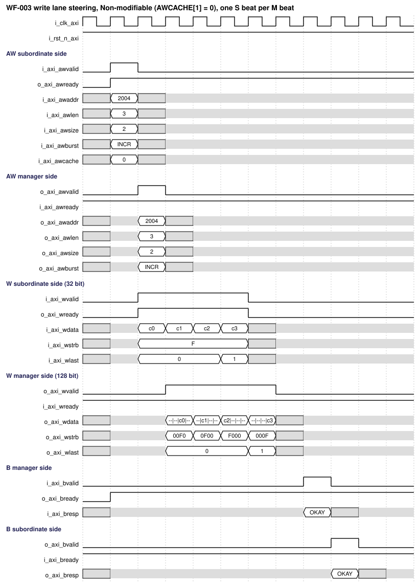

*Figure 10.3-3. WF-003: Write lane steering (Non-modifiable): one S beat gives one M beat. Source: `figures/upsizer_wf003_write_lane_steering.json`.*

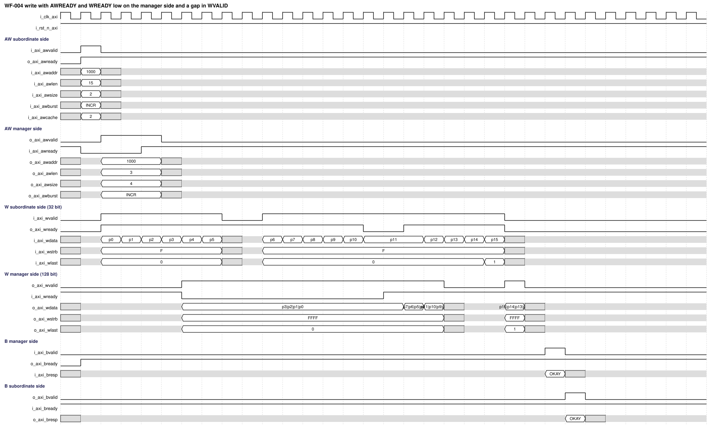

*Figure 10.3-4. WF-004: Write with backpressure on AWREADY and WREADY of the M side and a gap in WVALID. Source: `figures/upsizer_wf004_write_backpressure.json`.*

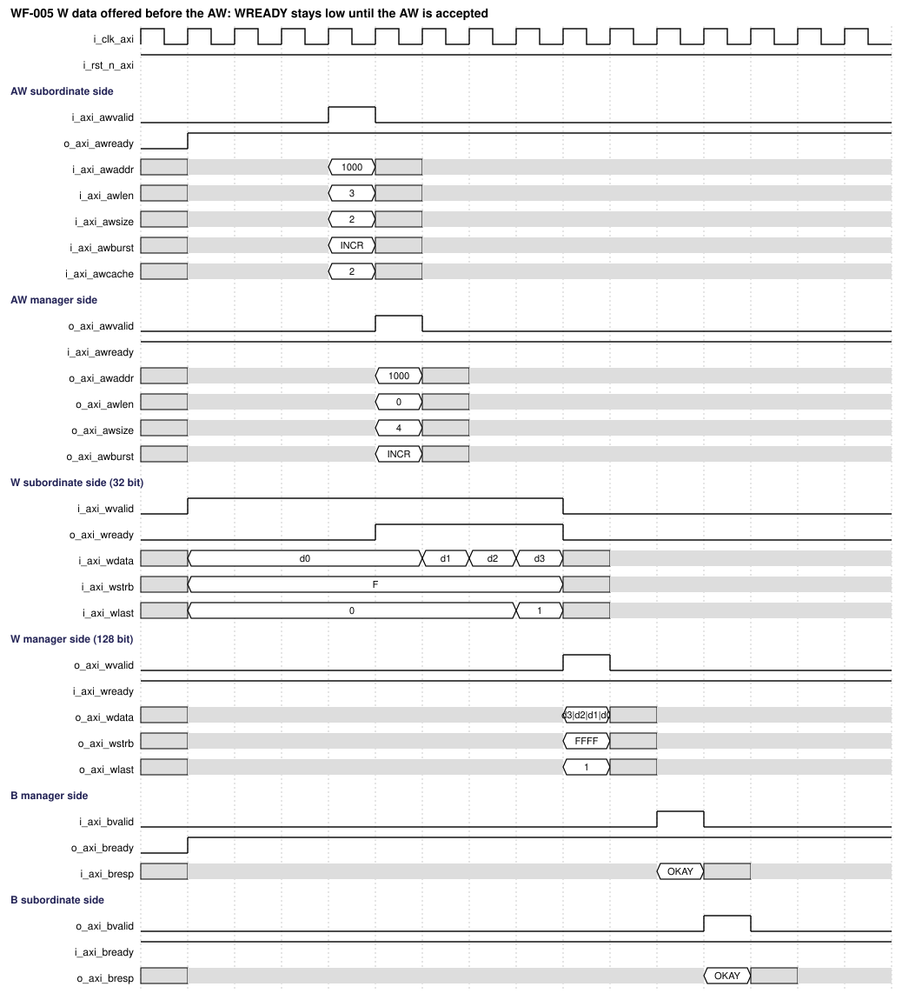

*Figure 10.3-5. WF-005: W data offered before the AW. Source: `figures/upsizer_wf005_write_w_before_aw.json`.*

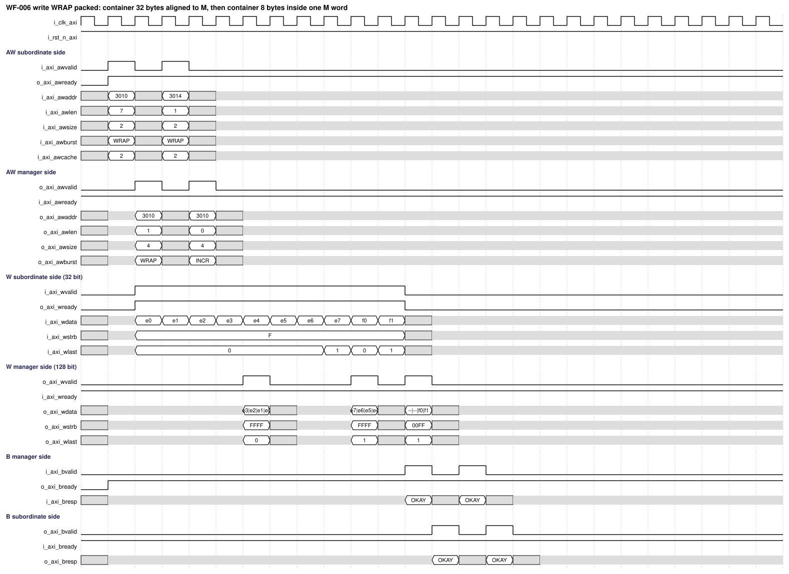

*Figure 10.3-6. WF-006: Write WRAP packed: container 32 bytes aligned to M, then container 8 bytes inside one M word. Source: `figures/upsizer_wf006_write_wrap.json`.*

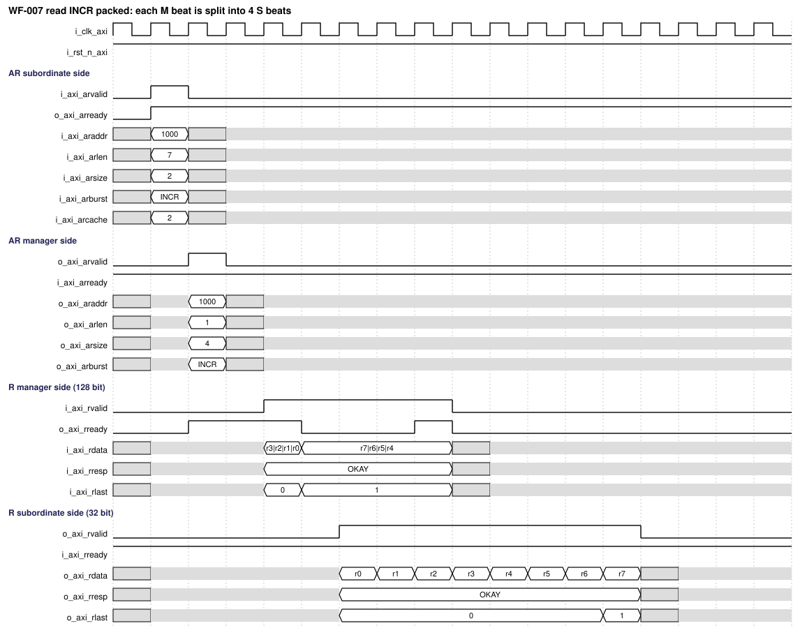

*Figure 10.3-7. WF-007: Read INCR packed: each M beat split into 4 S beats. Source: `figures/upsizer_wf007_read_incr_pack.json`.*

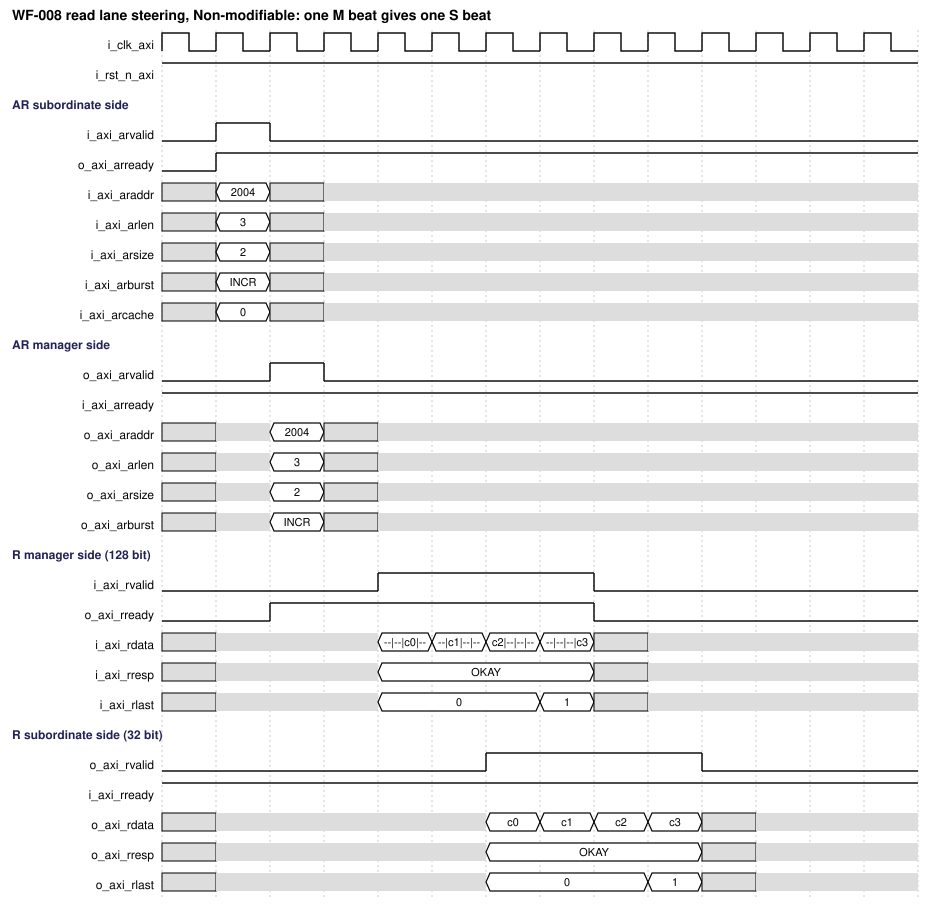

*Figure 10.3-8. WF-008: Read lane steering (Non-modifiable). Source: `figures/upsizer_wf008_read_lane_steering.json`.*

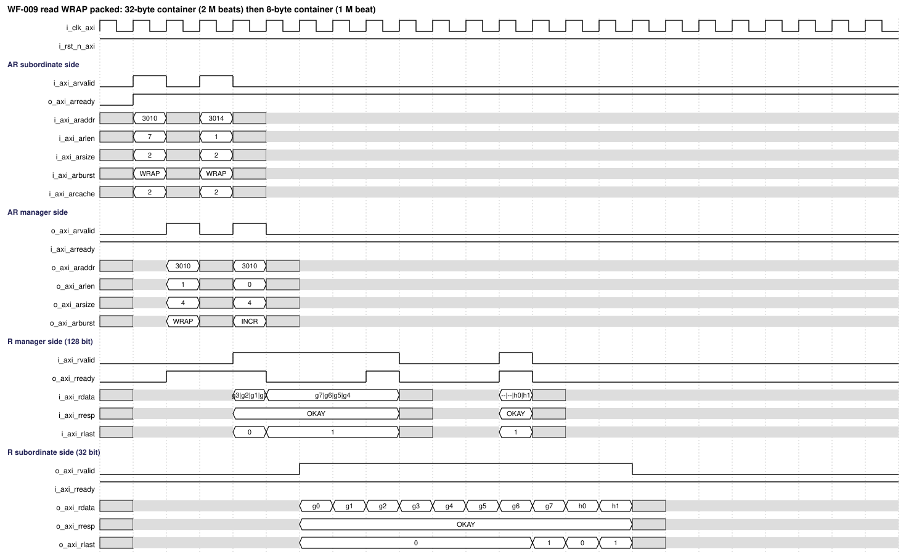

*Figure 10.3-9. WF-009: Read WRAP packed: container 32 bytes, then container 8 bytes. Source: `figures/upsizer_wf009_read_wrap.json`.*

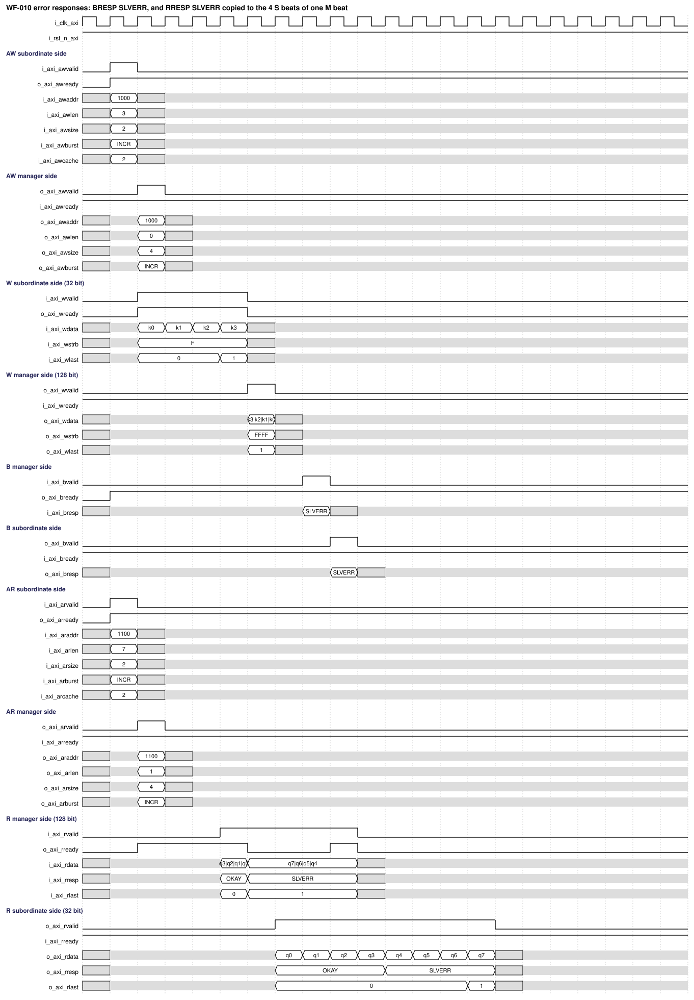

*Figure 10.3-10. WF-010: Error responses: BRESP SLVERR, RRESP SLVERR copied to the S beats of one M beat. Source: `figures/upsizer_wf010_error_response.json`.*

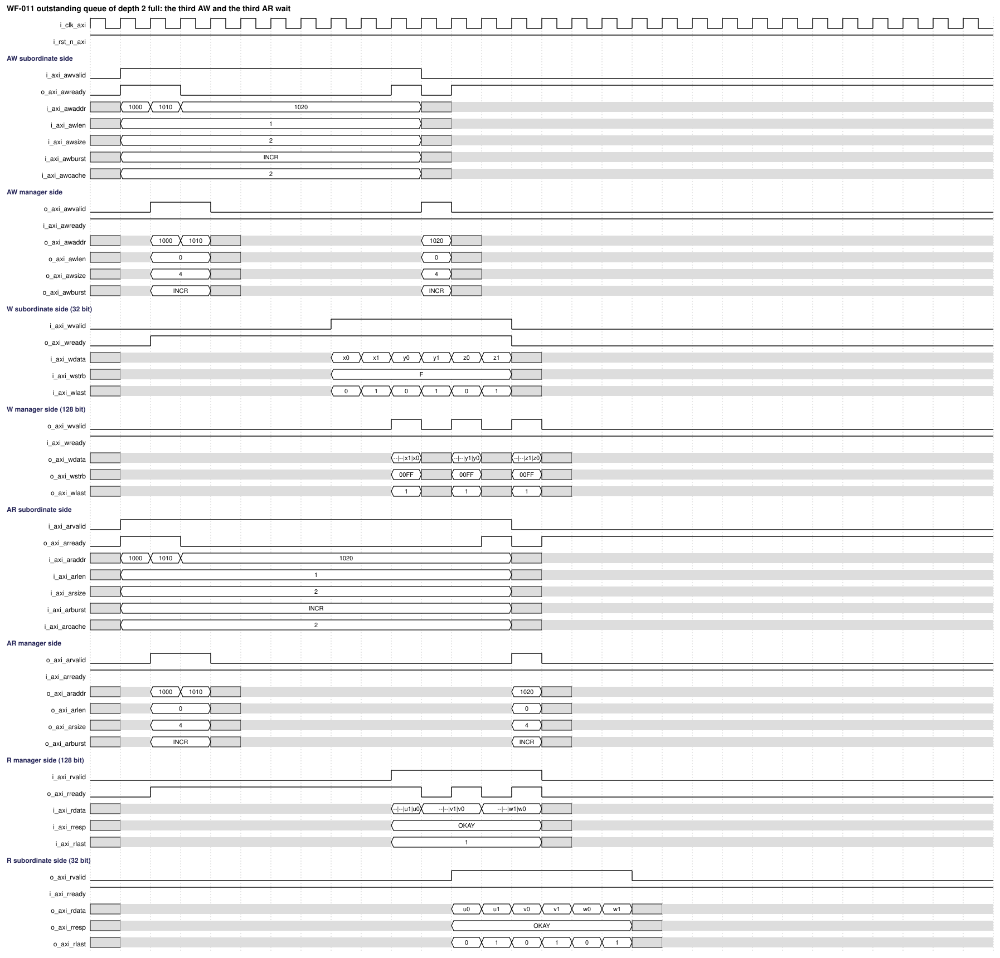

*Figure 10.3-11. WF-011: Outstanding queue of depth 2 full: third AW and third AR wait. Source: `figures/upsizer_wf011_queue_full.json`.*

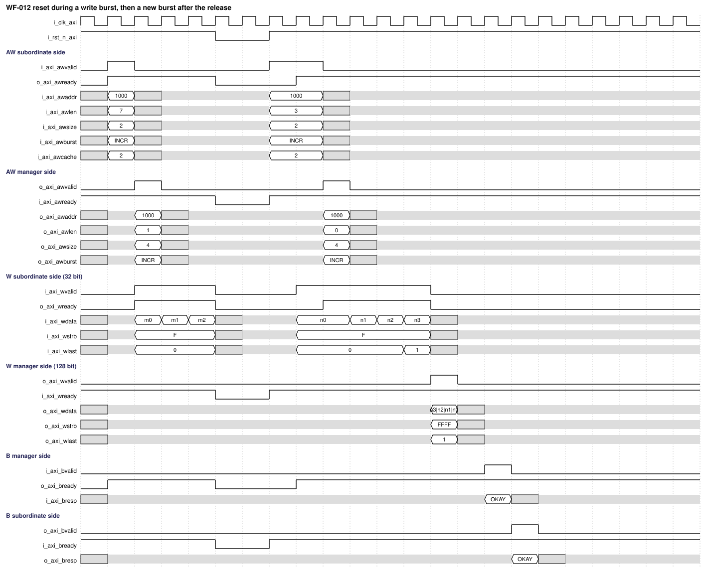

*Figure 10.3-12. WF-012: Reset during a write burst, then a new burst after the release. Source: `figures/upsizer_wf012_reset.json`.*

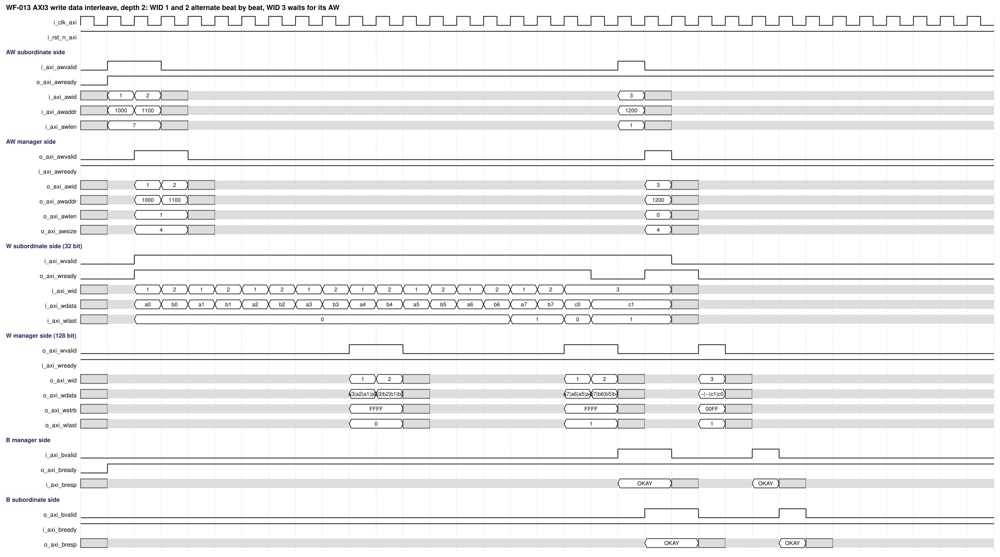

*Figure 10.3-13. WF-013: AXI3 write data interleave, depth 2: WID 1 and 2 alternate beat by beat, WID 3 waits for its AW. Source: `figures/upsizer_wf013_axi3_write_interleave.json`.*

**Timing of the figures (active edge: rising edge of i_clk_axi; values are those before the edge; a handshake is VALID and READY both 1).** Cycle table of WF-001 (S = 32, M = 128, depth 4, no backpressure):

| Cycle / event | Input condition | State/action | Output condition |
|---|---|---|---|
| 1 | S-side AW handshake: address 0x1000, AWLEN 7, AWSIZE 2, INCR, AWCACHE[1] = 1 | Classified packable; NM = 2; queue entry pushed; M-side AW into the AW slice | S-side AWREADY = 1 |
| 2 | S-side W beat a0 accepted (the queue is not empty) | Slot 0 written; the M-side AW is visible | M-side AWVALID = 1, AWADDR 0x1000, AWLEN 1, AWSIZE 4, INCR |
| 3 to 4 | W beats a1, a2 accepted | Slots 1 and 2 written | None |
| 5 | W beat a3 accepted, last of the first M word | M beat {a3, a2, a1, a0} with WSTRB FFFF pushed into the W slice | None |
| 6 | W beat a4 accepted; M-side WREADY = 1 | Slot 0 of the next word written | M-side WVALID = 1, WDATA {a3,a2,a1,a0}, WSTRB FFFF, WLAST 0 |
| 7 to 9 | W beats a5, a6, a7 accepted (a7 with WLAST) | At cycle 9 the beat completes the word and the transaction: M beat pushed; the queue entry is released | None |
| 10 | M-side WREADY = 1 | Handshake of the second M beat | M-side WVALID = 1, WDATA {a7,a6,a5,a4}, WLAST 1 |
| 12 | The M side returns BVALID with OKAY | B enters the B slice | M-side BREADY = 1 |
| 13 | S-side BREADY = 1 | Handshake | S-side BVALID = 1, BRESP OKAY |

### 10.4 Arbitration, buffering, and throughput

**Arbitration and fairness.** None: the write path and the read path are independent, and each processes one transaction at a time in the order of acceptance. There is no starvation.

**Queues.** The write queue and the read queue are synchronous queues of depth `PARA_AXI_WR_OUTSTANDING_DEPTH` and `PARA_AXI_RD_OUTSTANDING_DEPTH`. A push (AW or AR accepted) and a pop (last W beat or last S beat) may happen in the same cycle. An entry is pushed at the handshake and is the head from the next cycle. When the queue is full, AWREADY (ARREADY) = 0.

**Backpressure.** A slice holds one entry in its output register and one in its skid register; its READY is a register that goes to 0 when the skid register is occupied, so READY never depends on the READY of the next stage in the same cycle (REQ-IF-003). The W packer accepts a beat that does not complete an M word without looking at the W slice; a beat that completes an M word is accepted only when the W slice can take the M beat (WF-004). The R unpacker accepts a new M beat when the word register is empty or when its last S beat is transferred in the same cycle, and only when a queue entry exists for the incoming beat.

**AXI3 write contexts.** In the AXI3 top a one-beat stage takes a W beat when WREADY = 1: the stage is empty or its beat is converted in this cycle, and an AW is pending or a context is active. In the next cycle the beat is converted if it finds its context: the active context with the same ID or, when there is none and a context is free, a new context bound to the oldest unbound accepted AW with the same AWID. A beat that does not find its context stays in the stage and blocks the beats behind it. The manager shall therefore not interleave more transactions than PARA_AXI_WR_INTERLEAVE_DEPTH and shall have issued the AW of a transaction before its W beats when other transactions are active (ASM-003); the cycle model deadlocks when a manager interleaves three streams on two contexts (ERR-006). Contexts are served independently: an M beat is issued when its M word is complete, so the M beats of different contexts appear in the order of completion.

**Latency and throughput.** AW, AR, B: 1 cycle; W: 1 cycle in the AXI4 top and 2 cycles in the AXI3 top; first S beat of an R word: 2 cycles (REQ-PERF-002). W and R transfer one S beat per cycle (REQ-PERF-001), and the next transaction follows without a bubble because the queue head changes at the edge of the last beat. The M side carries one M beat per cycle at most; a packed burst uses one M beat per M word touched.

### 10.5 Memories and storage

| Storage ID | Kind | Depth x width | Ports | Read latency | Write mask | Reset/init | ECC/parity | Implementation |
|---|---|---|---|---|---|---|---|---|
| MEM-001 | Write queue (FIFO of registers) | PARA_AXI_WR_OUTSTANDING_DEPTH x (1 + LPARA_ADDR_LOW_W + 3 + LPARA_LEN_W + 2) bits: pack flag, low address bits, S-side AxSIZE, S-side AxLEN, S-side AxBURST | 1 push, 1 pop, head visible | 0 (head is a register, show-ahead) | None | Pointers, count, full and empty reset; entries not reset | None | Registers of `m_vlsit_sfifo_1clk` (AXI4 top); the AXI3 write path stores the entries in `m_vlsit_ups_pending` (MEM-006) |
| MEM-002 | Read queue (FIFO of registers) | PARA_AXI_RD_OUTSTANDING_DEPTH x the same entry | 1 push, 1 pop, head visible | 0 | None | Pointers, count, full and empty reset; entries not reset | None | Registers of `m_vlsit_sfifo_1clk` |
| MEM-003 | Accumulation register | 1 x (PARA_AXI_M_DATA_W + PARA_AXI_M_DATA_W / 8) bits | Write slot, read all | 0 | Per slot | Reset to zero (unwritten slots read as zero, section 7.3) | None | Inferred registers |
| MEM-004 | Word register (read) | 1 x (PARA_AXI_M_DATA_W + 2 + PARA_AXI_ID_W) bits and a valid flag | Load, read slot | 0 | None | Flag reset; data not reset | None | Inferred registers |
| MEM-005 | Slice entries | 2 per channel x channel payload | Per slice | 0 | None | Flags reset; data not reset | None | Inferred registers |
| MEM-006 | Pending store of accepted AW (AXI3 top) | PARA_AXI_WR_OUTSTANDING_DEPTH x (PARA_AXI_ID_W + 1 + LPARA_ADDR_LOW_W + 3 + 4 + 2) bits: AWID, pack flag, low address bits, size, length, burst | Push, search by AWID oldest first, remove the bound entry | 0 | None | Flags reset; entries not reset | None | Inferred registers |
| MEM-007 | Write contexts (AXI3 top) | PARA_AXI_WR_INTERLEAVE_DEPTH x (PARA_AXI_ID_W + 1 + LPARA_ADDR_LOW_W + 3 + 4 + 2 + 4 + PARA_AXI_M_DATA_W + PARA_AXI_M_DATA_W / 8) bits: ID, the attributes of MEM-006, beat counter, accumulation register | Per context: slot write, read all | 0 | Per slot | Valid flags reset; accumulation reset to zero | None | Inferred registers |
| MEM-008 | W stage (AXI3 top) | 1 x (PARA_AXI_ID_W + PARA_AXI_S_DATA_W + PARA_AXI_S_DATA_W / 8 + 1) bits and a valid flag | Load, read | 0 | None | Flag reset; data not reset | None | Inferred registers |

Only the low LPARA_ADDR_LOW_W address bits are stored: the logic needs no more (section 10.2, implementation form), and the M-side AxADDR is formed in the AW or AR path from the S-side address (the high bits unchanged; for a WRAP burst with a container below M the low bits are cleared by a mask), not from the queue. There is no collision case because every storage is read in the cycle after the write at the earliest and the head is a register.

## 11. Register and programming model

**Not required (confirmed by user, 2026-10-27):** the IP has no software-visible register; no CSR workbook is delivered (DEC-017).

### 11.1 CSR specification source

**Not required (confirmed by user, 2026-10-27):** no CSR workbook is delivered because the IP has no software-visible register (DEC-017).

### 11.2 Software sequences

**Not required (confirmed by user, 2026-10-27):** there are no registers, so there is no software sequence (DEC-017).

## 12. Error handling and recovery

| Error ID | Detection condition | Observable response/status | Interrupt | Clear/recovery | Reset behavior |
|---|---|---|---|---|---|
| ERR-001 | An M-side R beat has RRESP other than OKAY | RRESP copied to every S beat generated from that M beat (WF-010) | None | None: the transaction continues | Discarded by reset |
| ERR-002 | An M-side B response other than OKAY | BRESP passed unchanged to the S side (WF-010) | None | None | Discarded by reset |
| ERR-003 | Illegal S-side input: reserved AxBURST 11, burst crossing 4KB, WRAP length not 2, 4, 8 or 16, WLAST not on the last beat, AxSIZE above the S width, W beats of more or fewer than AWLEN + 1 | None: not detected; the behavior is not specified (REQ-ERR-004) | None | Reset | Discarded by reset |
| ERR-004 | Downstream read data out of the AR order, interleaved, or with a different count of beats than requested | None: not detected; the behavior is not specified (ASM-002) | None | Reset | Discarded by reset |
| ERR-005 | The downstream never responds | The IP waits; there is no timeout | None | Reset | Discarded by reset |
| ERR-006 | AXI3 top: the manager interleaves the data of more transactions than PARA_AXI_WR_INTERLEAVE_DEPTH, or offers a W beat whose AW has not been accepted while other transactions are active, or the WID of a beat matches no accepted AW | None: the beat stays in the stage and the W channel blocks; not detected; the behavior is not specified | None | Reset | Discarded by reset |

Malformed requests are not corrected (the IP never creates SLVERR or DECERR, REQ-ERR-003). There is no status register and no precedence between simultaneous errors. Resource exhaustion (a full queue) is not an error: READY is low until an entry is free.

## 13. Performance, power, and area

Hard requirements are the functional and cycle requirements of section 3. The frequency, area and power are not specified yet (TBD-001): no number below is a target.

| Metric ID | Metric | Target / limit | Conditions | Measurement method | Hard / goal |
|---|---|---|---|---|---|
| PPA-001 | Maximum frequency | TBD-001 (decision needed: target technology and clock frequency from the SoC owner) | Corner, voltage, configuration CFG-AXI4-DEF | STA with the constraints of section 17 | TBD |
| PPA-002 | Area | TBD-001 | Library, utilization | Cell area | TBD |
| PPA-003 | Dynamic and leakage power | TBD-001 | Activity and corner | Tool power analysis | TBD |
| PPA-004 | Combinational circuit | Implementation form of section 10.2: low LPARA_ADDR_LOW_W address bits only, no multiplier, divider or modulo, one write enable per slot | All configurations | Inspection of the RTL; levels of logic from the synthesis report after TBD-001 | Goal (no number before TBD-001) |
| PERF-001 | Throughput of W and R | One S beat per cycle with no backpressure, no bubble between transactions (REQ-PERF-001) | Any ratio, packed or not packed | Simulation (TEST-014) | Hard |
| PERF-002 | Latency | AW, AR, W, B: 1 cycle; R: 2 cycles to the first S beat (REQ-PERF-002) | No backpressure | Simulation (TEST-014) | Hard |
| PERF-003 | Efficiency of the M side | A packed burst uses one M beat per M word touched; an aligned INCR burst of N full S beats uses N / ratio M beats | Packable transactions | Simulation, scoreboard of beat counts | Hard (derived from REQ-FUNC-004) |
| PERF-004 | Storage estimate (informative) | Accumulation register M + M/8 bits; word register M + 2 + ID bits; two entries per slice; the two queues of section 10.5 | CFG-AXI4-DEF: accumulation 144 bit, word register 134 bit | Counting the registers of the RTL | Goal |

Do not claim timing closure from RTL synthesis alone; the SDC and the analysis flow are those of section 17.

## 14. RTL implementation contract

### 14.1 Required coding baseline

The VLSIT RTL Design Rules v2 in VLSIT_RTL_Design_Rule.md (same folder as this template) is the mandatory RTL coding authority. Specifications and RTL deliverables shall comply with it; do not add project-local RTL exceptions.

At minimum: use one synthesizable module per .sv file with matching module/filename; keep each top a structural wrapper containing the interface, parameters, interconnect declarations, and named submodule instances only; use ANSI ports with input wire and output logic; end every active-low non-reset signal name in _n; use unsigned four-state logic vectors; and keep SVA/testbench/UVM code outside synthesis RTL. Use always_comb or continuous assignments for combinational logic, with defaults and explicit case defaults, and always_ff for state with one clock per process and separate next-state logic.

Declare overridable parameters as parameter logic [31:0] with a name that starts with PARA_, with exactly the three PAR-02 comment lines immediately above each declaration. Declare derived localparams as localparam logic [31:0] with a name that starts with LPARA_ in the parameter port list immediately after parameters. Use dedicated reset-synchronizer and CDC modules; asynchronous reset assertion may be asynchronous but release shall be synchronous per receiving domain. Test reset override/mux logic belongs in a wrapper/reset controller, not a functional leaf. CDC source values are registered with no combinational logic before the first synchronizer stage or between stages.

Use statically bounded, zero-based generate loops and declare genvar in the generate-for header. Use named port and parameter connections. Prefer clock enables; any ICG must use an approved dedicated module with a scan test-enable. Do not use signed/two-state hardware types, packages/imports, interfaces, RTL macros, initial blocks, simulation delays, casex, plain always, latches, multiple drivers, positional/wildcard connections, or unsupported constructs. Each RTL file header shall contain Project, Author: the name of the user followed by (user), AI Flow, AI Flow Page, Date, and Description. Indent with spaces only, do not use the default_nettype directive (lint/elaboration checking finds undeclared identifiers), comment each logic section, and keep RTL comment lines at or below 100 characters. REF-003 is the detailed authority.

### 14.2 RTL hierarchy

The two top modules have the same children; the children are profile-neutral (the width of AxLEN, the lock width and the optional fields are parameters or generic pass-through vectors of the child modules). The AXI4 top ties nothing to a WID and the AXI3 top ties nothing to AxQOS and AxREGION: the optional fields travel as pass-through vectors that the top builds from its own ports. The write path has an internal parameter that selects, by a generate, the in-order queue and the W packer (AXI4 top) or the pending store and the interleave module (AXI3 top).

| Module | Responsibility | Parent / instance | Clock/reset domains | Interface |
|---|---|---|---|---|
| m_vlsit_axi4_upsizer | Structural top of the AXI4 profile: ports, parameters, interconnect, instances of the two paths | Top | CLK-AXI / RST-AXI | IF-001, IF-002, IF-004 |
| m_vlsit_axi3_upsizer | Structural top of the AXI3 profile: ports, parameters, interconnect, instances of the two paths | Top | CLK-AXI / RST-AXI | IF-003, IF-004 |
| m_vlsit_ups_wr_path | Write path: AW acceptance and the write queue, W packing, B pass-through, slices of AW, W and B | m_vlsit_axi4_upsizer / u_wr_path (and in the AXI3 top) | CLK-AXI / RST-AXI | S-side AW, W, B; M-side AW, W, B |
| m_vlsit_ups_rd_path | Read path: AR acceptance and the read queue, R unpacking, slices of AR and R | m_vlsit_axi4_upsizer / u_rd_path (and in the AXI3 top) | CLK-AXI / RST-AXI | S-side AR, R; M-side AR, R |
| m_vlsit_ups_attribute | Classification and attribute conversion (OP-001, implementation form of section 10.2) | m_vlsit_ups_wr_path / u_aw_attribute, m_vlsit_ups_rd_path / u_ar_attribute | CLK-AXI | Attributes in, converted attributes and the pack flag out |
| m_vlsit_ups_beat_addr | Beat address, slot index and word-last flag (OP-007, implementation form of section 10.2) | m_vlsit_ups_wr_pack / u_beat_addr, m_vlsit_ups_rd_unpack / u_beat_addr | CLK-AXI | Queue head and counters in, slot and flags out |
| m_vlsit_ups_wr_pack | Accumulation register and M beat generation (OP-002, OP-003) | m_vlsit_ups_wr_path / u_wr_pack | CLK-AXI / RST-AXI | S-side W, queue head, M beat to the W slice |
| m_vlsit_ups_rd_unpack | Word register and S beat generation (OP-005, OP-006) | m_vlsit_ups_rd_path / u_rd_unpack | CLK-AXI / RST-AXI | M-side R, queue head, S beat to the R slice |
| m_vlsit_sfifo_1clk | Library single-clock FIFO of registers, the queue of accepted transactions (MEM-001, MEM-002); parameters PARA_SFIFO_DEPTH = outstanding depth and PARA_SFIFO_DATA_W = LPARA_ENTRY_W; AXI4 write path and both read paths | m_vlsit_ups_wr_path / u_wr_queue (AXI4 branch), m_vlsit_ups_rd_path / u_rd_queue | CLK-AXI / RST-AXI | Push, pop, head, full, empty, count |
| m_vlsit_ups_pending | AXI3 only: store of the accepted AW not yet bound, searched by ID (MEM-006) | m_vlsit_ups_wr_path / u_wr_pending (generate, AXI3 top) | CLK-AXI / RST-AXI | Push, bind by ID, count |
| m_vlsit_ups_wr_interleave | AXI3 only: W stage, write contexts, binding by WID, M beat generation (OP-009) | m_vlsit_ups_wr_path / u_wr_interleave (generate, AXI3 top) | CLK-AXI / RST-AXI | S-side W, pending store, M beat to the W slice |
| m_vlsit_ups_slice | Register slice of one channel (output register, skid register, registered READY) | m_vlsit_ups_wr_path / u_aw_slice, u_w_slice, u_b_slice; m_vlsit_ups_rd_path / u_ar_slice, u_r_slice | CLK-AXI / RST-AXI | VALID, READY, payload in and out |
| m_vlsit_tie | Library module (`000_Common/rtl_lib`): tie-off of the inputs that a profile does not have (WID in the AXI4 top, AxQOS and AxREGION in the AXI3 top), one tie cell per bit with `VLSIT_SYNTHESIS` (R-032) | m_vlsit_axi4_upsizer / u_tie_wid; m_vlsit_axi3_upsizer / u_tie_aw_qos_region, u_tie_ar_qos_region | None | Tied output |

The structural tops hold no logic. The state is owned by the two paths and their children; the decode (OP-001) and the address arithmetic (OP-007) are in separate combinational modules. The queue is the library module `m_vlsit_sfifo_1clk` (DEP-003, DEC-023). The paths are not purely structural: each holds the glue logic that forms the slice payloads, the queue entry and, in the AXI3 branch, the outstanding counter of the write path (the AXI3 write path has no queue, so a counter `reg_out_cnt` of the accepted AW that are not fully converted limits the AW acceptance to PARA_AXI_WR_OUTSTANDING_DEPTH, REQ-PARAM-003); the rule checker reports HIE-02 (warning) for them and for the packer, the unpacker and the write contexts, which hold a counter or a register and an instance of the beat address generator. The RTL is in `rtl/common`, `rtl/axi4` and `rtl/axi3`; each profile has its `filelist.f`.

### 14.3 Synthesis assumptions

| Item | Value / source |
|---|---|
| Top / source file list | m_vlsit_axi4_upsizer and m_vlsit_axi3_upsizer; the file list is created with the RTL (one filelist.f per profile folder under rtl) |
| Frontend version and options | Not specified yet; the lint tools of the RTL generator skill (slang, Verilator) are used for the first check |
| Parameters/configuration | Section 8; CFG-AXI4-DEF for the first synthesis |
| Libraries/corners | Not specified (TBD-001) |
| Memory flow | No memory macro: all storage is registers |
| Lint rule configuration | The project lint set, which reports undeclared identifiers (implicit nets); the RTL has no default_nettype directive |

## 15. Verification specification

### 15.1 Scope and strategy

Levels: block simulation of each top module with a randomized AXI manager and subordinate model and a byte-level scoreboard (REQ-VER-001); protocol checkers on both interfaces; directed tests for each waveform of section 10.3; configuration sweep (REQ-VER-002); formal or structural analysis of the combinational paths (TEST-016); lint and synthesis checks. CDC and RDC are not applicable (one clock). Emulation and post-silicon are outside this specification.

Reproducibility: every random run records its seed; a failing seed reproduces the run. The environment (manager model, subordinate model, scoreboard, checkers, tests) is verification code, outside the synthesis file set.

**Reference cycle model.** `model/ups_cycle_model.py` is a Python cycle model of the behavior of this specification (attribute conversion, queues, packing and unpacking, register slices with registered READY). It is not RTL. `model/check_model.py` drives it with random AXI traffic (all burst types, sizes, byte strobes, Modifiable and Non-modifiable, locked, random VALID and READY gaps, a downstream with a byte memory) and compares the memory after the writes and every byte of the read data with a direct S-side access, and checks the strobes against the valid lanes, WLAST, RLAST and the beat counts. Status on 2026-10-27: no error for S/M = 32/128 (300 transactions, 150 transactions), 8/1024, 512/1024, 32/64, 64/256 and 16/128 (200 transactions, seeds 1 to 3); the model fails as expected when the WRAP condition of REQ-FUNC-005 is removed (negative control). The ratios 16, 32 and 64 were not run. `model/check_equivalence.py` compares the implementation form of section 10.2 with the reference functions for every start offset of a 4KB page, size, burst type and length: S/M = 32/128 (1366407 cases, 22143312 beats), 8/1024, 512/1024, 32/64, 64/256 and 16/128, no difference. `model/check_interleave.py` checks the AXI3 write interleave in the same way (S/M = 32/128 with interleave depth 1, 2, 3 and 4, 200 transactions each; 8/1024 with depth 3 and 512/1024 with depth 2, 100 transactions each; one 4KB page per transaction because AXI does not define the order of overlapping bytes of different IDs): no error; a manager that interleaves three streams on two contexts deadlocks (negative control of ERR-006). The model checks the algorithm of this specification only; the RTL still has to be verified by TEST-001 to TEST-019.

**Delivered testbench.** `verification/` holds the Verilator testbench `tb_ups.sv` (AXI manager and subordinate models, byte-level golden memory, reference functions of REQ-FUNC-002 to REQ-FUNC-007, directed tests TEST-002 to TEST-011 and TEST-021, random batches for TEST-001, TEST-012, TEST-013, TEST-019 and TEST-020), the 33 protocol assertions `ups_axi_chk.sv` on both interfaces, the runner `vlsit_run_sim.py` for the eight configurations of section 4, and `vlsit_mutants.py` (injected bugs). The testbench interprets two points of this specification as follows: the READY outputs of the IP are low in the first cycle after the release (REQ-IF-004); in the AXI3 top at most one W beat may enter the one-beat stage before the AW of its transaction is accepted, because a context stays active until its last beat is converted (REQ-FUNC-018), and the number of read transactions seen as outstanding on the S side may exceed PARA_AXI_RD_OUTSTANDING_DEPTH by the beats held in the R slice (REQ-PARAM-003).

### 15.2 Requirement-based test plan

| Test ID | Requirements | Scenario / stimulus | Expected result | Test type | Configuration |
|---|---|---|---|---|---|
| TEST-001 | REQ-FUNC-001, REQ-FUNC-002, REQ-FUNC-014, REQ-FUNC-015, REQ-FUNC-017, REQ-VER-001 | Random AXI4 traffic (all burst types, sizes 0 to the full S size, aligned and unaligned starts, random strobes, Modifiable and Non-modifiable, locked, random ready and valid gaps) on CFG-AXI4-DEF | Final memory and every read result equal those of a direct S-side access; no protocol checker failure | Random, scoreboard | CFG-AXI4-DEF |
| TEST-002 | REQ-FUNC-004, REQ-FUNC-007, REQ-FUNC-009 | Packed INCR write with aligned start, 8 beats (WF-001) | M-side AW and W beats as in WF-001 | Directed | CFG-AXI4-DEF |
| TEST-003 | REQ-FUNC-004, REQ-FUNC-009 | Packed INCR write with start 0x1008 and a partial last word (WF-002) | M-side AWLEN = 1, WSTRB FF00 and 0FFF | Directed | CFG-AXI4-DEF |
| TEST-004 | REQ-FUNC-002, REQ-FUNC-003, REQ-FUNC-007, REQ-FUNC-008, REQ-FUNC-015 | Write that is not packable: Non-modifiable, narrow size, FIXED, reserved cases (WF-003) | M-side attributes equal to the S side; one M beat per S beat in the right slot | Directed | CFG-AXI4-DEF |
| TEST-005 | REQ-IF-002, REQ-PERF-001 | Write with AWREADY and WREADY low on the M side and gaps in WVALID (WF-004) | Payload stable while VALID and not READY; S-side WREADY drops only when the slice is full; no data lost | Directed | CFG-AXI4-DEF |
| TEST-006 | REQ-FUNC-010 | W data offered before the AW (WF-005) | WREADY = 0 until the AW is accepted | Directed | CFG-AXI4-DEF |
| TEST-007 | REQ-FUNC-002, REQ-FUNC-003, REQ-FUNC-005, REQ-FUNC-006, REQ-FUNC-007, REQ-FUNC-009 | WRAP write and read: container larger than M with aligned and unaligned start, container smaller than M (WF-006, WF-009) | Packed or not packed as defined; address sequence and slots correct | Directed | CFG-AXI4-DEF |
| TEST-008 | REQ-FUNC-007, REQ-FUNC-012, REQ-FUNC-013 | Reads: INCR packed, lane steering, WRAP packed (WF-007, WF-008, WF-009) | S-side beats, RLAST and slots as in the figures | Directed | CFG-AXI4-DEF |
| TEST-009 | REQ-FUNC-011, REQ-FUNC-013, REQ-ERR-001, REQ-ERR-002, REQ-ERR-003 | SLVERR and DECERR on B and on R beats of packed and not packed reads (WF-010) | BRESP unchanged; RRESP copied to every S beat of the M beat; no response created by the IP | Directed | CFG-AXI4-DEF |
| TEST-010 | REQ-FUNC-014, REQ-PARAM-003 | Fill the AW and AR queues with the downstream stalled (WF-011) | AWREADY and ARREADY low while the queue is full; order kept; no overflow | Directed | CFG-DEPTH-2 |
| TEST-011 | REQ-IF-004, REQ-RESET-001, REQ-RESET-002, REQ-RTL-003 | Reset during a write burst and during a read burst, then new traffic (WF-012) | VALID and READY low in reset, READY low in the first cycle after release, no residual state | Directed | CFG-AXI4-DEF |
| TEST-012 | REQ-FUNC-001, REQ-PARAM-001, REQ-VER-002 | Random traffic on the extreme ratios | As TEST-001 | Random, scoreboard | CFG-MIN-RATIO, CFG-MAX-RATIO |
| TEST-013 | REQ-FUNC-016, REQ-VER-002 | Random AXI3 traffic with WID, 2-bit lock, 16-beat bursts, data of the transactions in order (no interleave) | As TEST-001; WID of the M beats as defined | Random, scoreboard | CFG-AXI3-DEF |
| TEST-014 | REQ-PERF-001, REQ-PERF-002 | Throughput and latency measurement on back-to-back packed and not packed transactions | One S beat per cycle without bubble; latencies of REQ-PERF-002 | Directed, measurement | CFG-AXI4-DEF |
| TEST-015 | REQ-CLK-001, REQ-PARAM-004, REQ-ERR-004, REQ-RTL-001, REQ-RTL-002, REQ-RTL-003, REQ-PD-001 | Rule check, lint, hierarchy and reset inspection, CDC lint, constraint inspection | No finding | Inspection | All |
| TEST-016 | REQ-IF-003 | Combinational-path analysis from every input to every output | No path | Formal / structural | CFG-AXI4-DEF, CFG-AXI3-DEF |
| TEST-017 | REQ-FUNC-016, REQ-IF-001, REQ-IF-002, REQ-VER-001 | Protocol checker of the profile on both interfaces during TEST-001 and TEST-013 | No violation | Checker | CFG-AXI4-DEF, CFG-AXI3-DEF |
| TEST-018 | REQ-FUNC-002, REQ-FUNC-003, REQ-FUNC-008 | Exclusive (AXI4) and locked (AXI3) transactions, FIXED bursts | Not packable: attributes unchanged, one M beat per S beat | Directed | CFG-AXI4-DEF, CFG-AXI3-DEF |
| TEST-020 | REQ-FUNC-018, REQ-PARAM-005, REQ-VER-002 | Random AXI3 traffic where the manager interleaves the data of up to the depth value of transactions with different WID, depth 1, 2, 3 and 4, one 4KB page per transaction | Final memory equal to a direct S-side access; M-side beats with the right WID; no deadlock; at least the depth value of contexts used | Random, scoreboard | CFG-AXI3-DEF, CFG-AXI3-IL4 |
| TEST-021 | REQ-FUNC-018 | WID 1 and 2 alternating beat by beat, then WID 3 whose AW is accepted late (WF-013); a W beat offered while nothing is pending | M-side beats in the order of completion with the WID of their context; WREADY low until the AW is accepted | Directed | CFG-AXI3-DEF |
| TEST-022 | REQ-RTL-004, REQ-FUNC-004, REQ-FUNC-005, REQ-FUNC-006, REQ-FUNC-007 | Compare the attribute converter and the slot and word-last generators with the reference functions: exhaustively on a small configuration (every start offset of a 4KB page, size, burst type and length) and on the extreme ratios; the cycle model of the specification does this for the implementation form before the RTL exists | No difference | Directed, exhaustive | CFG-AXI4-DEF, CFG-MIN-RATIO, CFG-MAX-RATIO |
| TEST-019 | REQ-PARAM-002 | Address width 12 and 64, ID width 1 and 16 | As TEST-001 | Random, scoreboard | CFG-ID-1 |

The tests cover reset and release (TEST-011), minimum and maximum parameters (TEST-012, TEST-019), backpressure (TEST-005, TEST-010), ordering (TEST-001, TEST-010), errors (TEST-009), boundaries (WF-002 and TEST-007) and illegal inputs as non-goals (REQ-ERR-004). Low-power transitions are not applicable.

### 15.3 Assertions and coverage

Keep SVA and verification-only logic outside synthesis RTL. Each property is checked after the reset is released (disabled while i_rst_n_axi is low, except SVA-002) and on the rising edge of i_clk_axi. The protocol checker of each profile is the third-party or in-house AXI checker of REQ-VER-001. X policy: no X on the payload of a VALID output; the payload while VALID is 0 may be X. Resetless payload is validity-guarded by its VALID or flag (REQ-RTL-003, SVA-002).

| Property / coverage ID | Intent | Requirements | Checker / source set | Acceptance criterion |
|---|---|---|---|---|
| SVA-001 / COV-004 | Payload of every VALID output stable until READY; no VALID output dependent on READY; W and B ordering kept; slices exercise the skid register | REQ-IF-002, REQ-FUNC-010, REQ-FUNC-011 | Verification (checker bound to the ports) | No failure; COV-004: the skid register of each slice was used |
| SVA-002 | All VALID and READY outputs are 0 in reset; READY is 0 in the first cycle after the release; payload of a VALID output is never X | REQ-IF-004, REQ-RTL-003 | Verification | No failure |
| SVA-003 | The queues never overflow and never underflow; AWREADY (ARREADY) is 0 when the queue is full | REQ-PARAM-003 | Verification | No failure |
| SVA-004 | M-side AxADDR, AxSIZE, AxLEN, AxBURST and the pass-through fields equal the values of a reference function of the S-side attributes (OP-001); no transaction crosses 4KB, has more beats than the S side, or exceeds the burst limits | REQ-FUNC-002 to REQ-FUNC-006, REQ-FUNC-015, REQ-FUNC-017 | Verification (reference function in the checker) | No failure |
| SVA-005 | The number of M-side W beats of a transaction equals M-side AWLEN + 1 and WLAST is on the last; for a not packable transaction one M beat per S beat | REQ-FUNC-008, REQ-FUNC-009 | Verification | No failure |
| SVA-006 | The number of S-side R beats of a transaction equals S-side ARLEN + 1 and RLAST is on the last; RRESP of every S beat equals RRESP of its M beat | REQ-FUNC-012, REQ-FUNC-013, REQ-ERR-001 | Verification | No failure |
| SVA-007 | WSTRB of an M beat has bits only in the slots written by S beats, and only for the byte lanes of the S-side strobes; unwritten slots are zero | REQ-FUNC-007, REQ-FUNC-009 | Verification | No failure |
| SVA-008 | The RID of the M-side R beat equals the ID of the head of the read queue (monitor of ASM-002) | REQ-FUNC-014 | Verification (assumption monitor) | No failure |
| SVA-009 | In the AXI3 top, the bytes of an M beat come only from S beats whose WID equals the WID of the M beat; the number of active contexts never exceeds PARA_AXI_WR_INTERLEAVE_DEPTH; a context is bound to the oldest unbound AW with the same AWID | REQ-FUNC-018, REQ-PARAM-005 | Verification | No failure |
| COV-001 | Every class of OP-001: packable INCR, packable WRAP with container at least M, packable WRAP with container below M, and each reason of not packable (Non-modifiable, narrow, FIXED, locked, WRAP not aligned) | REQ-FUNC-002 | Verification | All hit on both profiles |
| COV-002 | Ratios 2, 4, 8, 16, 32, 64, 128; first and last M word partial; start address at every slot | REQ-PARAM-001, REQ-FUNC-004 | Verification | All hit |
| COV-003 | Both queues full with a pending AW or AR; W before AW; read data back-to-back | REQ-PARAM-003, REQ-FUNC-010, REQ-PERF-001 | Verification | All hit |
| COV-005 | RRESP SLVERR and DECERR on packed and not packed reads; BRESP SLVERR and DECERR | REQ-ERR-001, REQ-ERR-002 | Verification | All hit |
| COV-006 | AXI3: 1, 2, 3 and 4 contexts active at the same time; a WID with no pending AW waits; beats that switch context in every cycle | REQ-FUNC-018, REQ-PARAM-005 | Verification | All hit |

### 15.4 Formal, CDC, and RDC

| Analysis | Scope | Assumptions / constraints | Evaluation method |
|---|---|---|---|
| Formal | No combinational path from input to output (REQ-IF-003); queues never overflow (SVA-003); payload stability (SVA-001) | The downstream and the upstream follow REF-001 (assumed as constraints); parameters of CFG-DEPTH-2 and small widths for the proof | Formal tool run on the small configuration; results recorded with the tool version |
| CDC / RDC | Not applicable: one clock domain and one reset (REQ-CLK-001) | None | CDC lint confirms no crossing |

## 16. DFT and testability

| Topic | Requirement / decision |
|---|---|
| Scan architecture and scan eligibility | **Not required (confirmed by user, 2026-10-27):** no detailed DFT specification in this version. The RTL shall contain no latch, no combinational loop, no tri-state, no clock gating and no derived clock, so that scan insertion is possible |
| Scan/test clocks, controls, reset behavior | **Not required (confirmed by user, 2026-10-27):** the IP has no DFT port; a test reset override belongs to the wrapper or reset controller of the SoC (REF-003 RST-04) |
| Test-mode entry/exit and safe state | **Not required (confirmed by user, 2026-10-27):** handled by the SoC |
| MBIST, memory repair, LBIST | **Not required (confirmed by user, 2026-10-27):** the IP has no memory macro |
| Test access, wrappers, test points | **Not required (confirmed by user, 2026-10-27):** none |
| Clock-gating test enable | **Not required (confirmed by user, 2026-10-27):** no clock gating |
| ATPG constraints and exclusions | **Not required (confirmed by user, 2026-10-27):** none beyond the rules above |
| DFT insertion architecture and generated test artifacts | **Not required (confirmed by user, 2026-10-27):** defined by the SoC DFT flow |

The IP has no test port. The RTL is fully synchronous with one clock, so a standard scan flow applies.

## 17. Physical design and timing integration

### 17.1 Timing constraints and budgets

The IP owns the clock definition of its port as a placeholder (the clock is defined by the SoC) and no exception. The interface delays are owned by the SoC. The text below states the required content, not executable constraints; the file `constraints/m_vlsit_axi_upsizer.sdc` holds the SoC-independent part (the clock, the variable T_CLK_AXI that the SoC sets, and the explicit statement that no exception exists); its Tcl syntax was run with stub commands, it was not run in a sign-off tool.

#### 17.1.1 Clock and analysis scenarios

| Clock ID | Port / source object | Primary/generated and master | Period, waveform, phase / ratio | Latency / uncertainty / transition | Clock group / mode | Constraint source |
|---|---|---|---|---|---|---|
| CLK-AXI | i_clk_axi | Primary | Set by the SoC (TBD-001); 50% duty cycle assumed | Set by the SoC | Single clock, no clock group; one functional mode | SoC SDC; `constraints/m_vlsit_axi_upsizer.sdc` for the clock name |

#### 17.1.2 Interface timing budgets

| Interface / port group | Direction | Reference clock | External min / max delay | Input transition / output load | IP timing budget | Mode / condition | Constraint source |
|---|---|---|---|---|---|---|---|
| S-side AW, W, AR payload and VALID; B and R READY | Input | CLK-AXI | Set by the SoC | Set by the SoC | Input to a register through the attribute conversion (AW, AR) or the slot placement (W); no input reaches an output combinationally | All | SoC SDC |
| S-side READY of AW, W, AR; VALID and payload of B, R | Output | CLK-AXI | Set by the SoC | Set by the SoC | Register output through at most the queue-full and slice-ready logic | All | SoC SDC |
| M-side READY of AW, W, AR; B and R payload and VALID | Input | CLK-AXI | Set by the SoC | Set by the SoC | Input to a register (slice flags, word register) | All | SoC SDC |
| M-side AW, W, AR payload and VALID; READY of B and R | Output | CLK-AXI | Set by the SoC | Set by the SoC | Register output of a slice (no logic) or the READY register | All | SoC SDC |
| Reset | Input | CLK-AXI | Release already synchronous | Not applicable | Asynchronous assertion of flops | All | SoC SDC |

Required max transition, max capacitance, max fanout and driving-cell assumptions: set by the SoC flow; the slice outputs may need a buffer when the data width is 1024.

#### 17.1.3 Timing exception inventory

| Exception ID | Type / SDC command | From | Through | To | Value and setup/hold/min/max meaning | Mode / condition | Technical rationale |
|---|---|---|---|---|---|---|---|
| EXC-000 | None | Not applicable | Not applicable | Not applicable | The IP owns no false path, multicycle path, minimum or maximum delay, clock group, case analysis or disabled arc | All | One clock, fully synchronous, single-cycle paths (REQ-PD-001) |

The SoC shall not apply a false path or a multicycle path to a path of the IP.

### 17.2 Physical assumptions

| Topic | Requirement / assumption |
|---|---|
| Hard/memory macros and views | None |
| Floorplan, placement region, pin placement | Not specified; the pins of one channel should be grouped, and the slots of the wide data buses of the M side should be placed near the accumulation register |
| Utilization/congestion target | Not specified; the widest configuration (M = 1024) has about 1100 wires per data channel on the M side |
| Power intent, clock/reset trees | One clock tree and one reset net |
| High-fanout controls, physical-only cells | The pack flag and the word-last flag drive every slot of the accumulation or word register; buffering by the flow |
| ECO/spare cells | Decided by the integrator |
| Extraction and timing-analysis corners | Decided by the integrator |
| Delivery form: RTL/netlist/hardened layout | Soft RTL |

## 18. Security, safety, and reliability

| Topic | Requirement / rationale | Verification method / expected behavior |
|---|---|---|
| Security boundary and threat assumptions | **Not required (confirmed by user, 2026-10-27):** no security function; the protection attributes pass through unchanged | Not applicable |
| Access control / privilege | **Not required (confirmed by user, 2026-10-27):** the IP makes no access decision | Not applicable |
| Secure clearing / zeroization | **Not required (confirmed by user, 2026-10-27):** the storage is not erased | Not applicable |
| Information leakage / side channels | **Not required (confirmed by user, 2026-10-27):** no secret-dependent behavior | Not applicable |
| ECC/parity and fault detection | **Not required (confirmed by user, 2026-10-27):** no data protection in this version | Not applicable |
| Safety goal / integrity level | **Not required (confirmed by user, 2026-10-27):** no safety goal is assigned | Not applicable |
| Diagnostics, fail-safe state, recovery | **Not required (confirmed by user, 2026-10-27):** the IP has no diagnostics (REQ-ERR-003, REQ-ERR-004) | Not applicable |

## 19. Requirement-to-verification traceability

| Requirement ID | RTL module/location | Test/property | Verification method / analysis | Configuration |
|---|---|---|---|---|
| REQ-FUNC-001 | m_vlsit_axi4_upsizer, m_vlsit_axi3_upsizer | TEST-001, TEST-012 | Simulation (scoreboard at byte level) | All configurations |
| REQ-FUNC-002 | m_vlsit_ups_attribute | TEST-001, TEST-004, TEST-007, TEST-018; SVA-004, COV-001 | Simulation, assertion SVA-004 | All configurations |
| REQ-FUNC-003 | m_vlsit_ups_attribute | TEST-004, TEST-007, TEST-018 | Simulation, assertion SVA-004 | All configurations |
| REQ-FUNC-004 | m_vlsit_ups_attribute | TEST-002, TEST-003; COV-002 | Simulation, assertion SVA-004 | All configurations |
| REQ-FUNC-005 | m_vlsit_ups_attribute | TEST-007 | Simulation, assertion SVA-004 | All configurations |
| REQ-FUNC-006 | m_vlsit_ups_attribute | TEST-007; SVA-004 | Simulation, assertion SVA-004 | All configurations |
| REQ-FUNC-007 | m_vlsit_ups_beat_addr | TEST-002, TEST-004, TEST-007, TEST-008; SVA-007 | Simulation, assertion SVA-007 | All configurations |
| REQ-FUNC-008 | m_vlsit_ups_wr_pack | TEST-004, TEST-018; SVA-005 | Simulation, assertion SVA-005 | All configurations |
| REQ-FUNC-009 | m_vlsit_ups_wr_pack | TEST-002, TEST-003, TEST-007; SVA-005, SVA-007 | Simulation, assertions SVA-005 and SVA-007 | All configurations |
| REQ-FUNC-010 | m_vlsit_ups_wr_path, m_vlsit_sfifo_1clk | TEST-006; SVA-001 / COV-004, COV-003 | Simulation, assertion SVA-001 | AXI4 top |
| REQ-FUNC-011 | m_vlsit_ups_wr_path | TEST-009; SVA-001 / COV-004 | Simulation, assertion SVA-001 | All configurations |
| REQ-FUNC-012 | m_vlsit_ups_rd_unpack | TEST-008; SVA-006 | Simulation, assertion SVA-006 | All configurations |
| REQ-FUNC-013 | m_vlsit_ups_rd_unpack | TEST-008, TEST-009; SVA-006 | Simulation, assertion SVA-006 | All configurations |
| REQ-FUNC-014 | m_vlsit_sfifo_1clk, m_vlsit_ups_rd_unpack | TEST-001, TEST-010; SVA-008 | Simulation, assertion SVA-008 | All configurations |
| REQ-FUNC-015 | m_vlsit_ups_attribute | TEST-001, TEST-004; SVA-004 | Simulation, assertion SVA-004 | All configurations |
| REQ-FUNC-016 | m_vlsit_axi3_upsizer, m_vlsit_axi4_upsizer | TEST-013, TEST-017 | Simulation, protocol checker, lint of the ports | AXI3 top, AXI4 top |
| REQ-FUNC-017 | m_vlsit_ups_attribute | TEST-001; SVA-004 | Simulation, assertion SVA-004 | All configurations |
| REQ-FUNC-018 | m_vlsit_ups_wr_interleave, m_vlsit_ups_pending | TEST-020, TEST-021; SVA-009, COV-006 | Simulation, assertions SVA-005 and SVA-009 | AXI3 top |
| REQ-IF-001 | m_vlsit_axi4_upsizer, m_vlsit_axi3_upsizer | TEST-017 | Protocol checker, lint of the ports | All configurations |
| REQ-IF-002 | m_vlsit_ups_slice | TEST-005, TEST-017; SVA-001 / COV-004 | Assertions SVA-001, protocol checker | All configurations |
| REQ-IF-003 | All modules | TEST-016 | Structural analysis, formal | All configurations |
| REQ-IF-004 | m_vlsit_ups_slice | TEST-011; SVA-002 | Reset test, assertion SVA-002 | All configurations |
| REQ-CLK-001 | All modules | TEST-015 | Inspection, CDC lint | All configurations |
| REQ-RESET-001 | All modules | TEST-011 | Reset test | All configurations |
| REQ-RESET-002 | All modules | TEST-011 | Reset test | All configurations |
| REQ-PARAM-001 | All modules | TEST-012; COV-002 | Simulation of the extreme ratios, elaboration check | All configurations |
| REQ-PARAM-002 | All modules | TEST-019 | Simulation, elaboration check | All configurations |
| REQ-PARAM-003 | m_vlsit_sfifo_1clk, m_vlsit_ups_wr_path | TEST-010; SVA-003, COV-003 | Simulation, assertion SVA-003 | All configurations |
| REQ-PARAM-004 | All modules | TEST-015 | Inspection | All configurations |
| REQ-PARAM-005 | m_vlsit_axi3_upsizer, m_vlsit_ups_wr_interleave | TEST-020; SVA-009, COV-006 | Simulation, elaboration check | AXI3 top |
| REQ-ERR-001 | m_vlsit_ups_rd_unpack | TEST-009; SVA-006, COV-005 | Simulation, assertion SVA-006 | All configurations |
| REQ-ERR-002 | m_vlsit_ups_wr_path | TEST-009; COV-005 | Simulation | All configurations |
| REQ-ERR-003 | All modules | TEST-009 | Simulation | All configurations |
| REQ-ERR-004 | All modules | TEST-015 | Inspection | All configurations |
| REQ-PERF-001 | m_vlsit_ups_wr_pack, m_vlsit_ups_rd_unpack | TEST-014; COV-003 | Simulation (throughput measurement) | All configurations |
| REQ-PERF-002 | All modules | TEST-014 | Simulation | All configurations |
| REQ-RTL-001 | m_vlsit_axi4_upsizer, m_vlsit_axi3_upsizer | TEST-015 | Inspection, lint | All configurations |
| REQ-RTL-002 | m_vlsit_ups_slice, m_vlsit_ups_wr_path, m_vlsit_ups_rd_path | TEST-015 | Rule checker, lint, inspection | All configurations |
| REQ-RTL-003 | All modules | TEST-011, TEST-015; SVA-002 | Inspection, assertion SVA-002 | All configurations |
| REQ-RTL-004 | m_vlsit_ups_attribute, m_vlsit_ups_beat_addr, m_vlsit_ups_wr_pack, m_vlsit_ups_rd_unpack | TEST-022 | Inspection, equivalence check against the reference functions (TEST-022) | All configurations |
| REQ-VER-001 | Verification | TEST-001, TEST-017 | Simulation | All configurations |
| REQ-VER-002 | Verification | TEST-012, TEST-013 | Simulation | All configurations |
| REQ-PD-001 | All modules | TEST-015 | Constraint inspection, STA by the integrator | All configurations |

## 20. Assumptions, dependencies, and decisions

Technical assumptions, external dependencies, decisions and the unresolved item. Every DEC was confirmed by the user in the question and answer rounds of 2026-10-27 and 2026-10-28 (`qa_log.md`).

| ID | Type | Assumption / dependency / unresolved decision | Technical impact / version / configuration | Resolution / status |
|---|---|---|---|---|
| ASM-001 | Assumption | The reset is released synchronously to i_clk_axi outside the IP, and the connected manager and subordinate are reset together with the IP | REQ-RESET-001, REQ-RESET-002: no reset synchronizer inside the IP | Confirmed by the user, 2026-10-28 |
| ASM-002 | Assumption | The downstream on the M side returns read data in the order of the AR requests and without interleaving (Read_Interleaving_Disabled, REF-001 E1.12), for example a single-ID or in-order subordinate | REQ-FUNC-014: the read queue is in AR order; a downstream that reorders breaks the data association; SVA-008 monitors it | Confirmed by the user, 2026-10-28 (with DEC-008) |
| ASM-003 | Assumption | In the AXI3 top the manager follows the write data interleaving rules of REF-006 8.4 and 8.5 for an interface of write data interleaving depth PARA_AXI_WR_INTERLEAVE_DEPTH: it supplies data only for the first depth pending (accepted) addresses, so it issues the AW of a transaction before its first W beat when other transactions are active; it never interleaves two transactions with the same AWID; the first data items of the transactions come in the order of the addresses. The downstream accepts M-side write data interleaved to the same depth | REQ-FUNC-018, REQ-PARAM-005, ERR-006: a manager that interleaves more streams than contexts blocks the W channel | Replaces the earlier assumption of no interleave (DEC-019); confirmed by the user, 2026-10-28 |
| ASM-004 | Assumption | PARA_AXI_ADDR_W is at least 12 (the 4KB page); the logic needs only the low LPARA_ADDR_LOW_W bits (at most 10), so the limit is kept as the user confirmed it | REQ-PARAM-002; `003_AsyncAXI4Bridge` allows 1 to 64 | Confirmed by the user, 2026-10-28 (12 to 64) |
| ASM-005 | Assumption | Reserved AxBURST = 11 and the other illegal inputs of section 12 are not detected | REQ-ERR-004 | Confirmed by the user, 2026-10-28 |
| ASM-006 | Assumption | An AxCACHE[1] value of 1 means Modifiable in AXI4 and Cacheable in AXI3, and both permit merging writes and fetching more data (REF-001 A4.2, A4.3.1) | REQ-FUNC-002 applies the same rule to both profiles | Taken from REF-001; confirmed by the user, 2026-10-28 |
| ASM-007 | Assumption | No bound on the number of cycles that the downstream takes to respond | ERR-005: no timeout | Confirmed by the user, 2026-10-28 |
| ASM-008 | Assumption | The rules of AXI3 write data interleaving are not in the local copy REF-001 (issue H.c), which only states that AXI3 permitted the interleaving (A5.2.2). They were read in REF-006 (Arm AXI Protocol Specification v1.0, IHI 0022B, 8.4 and 8.5), found on the Arm documentation site on 2026-10-28: the slave interface declares a static write data interleaving depth (default 1); the data of transactions with the same AWID is not interleaved; the depth is the number of pending addresses for which data can be supplied (the oldest ones); the first data item of each transaction arrives in the address order; a slave with depth above 1 must accept interleaved data continuously and never stall in order to change the order; the order of writes with different AWID to overlapping addresses is not defined. REQ-FUNC-018 and ASM-003 follow them. REF-006 is converted into md_doc (`vlsit_axi_amba_axi_ihi0022b_v1_0.md`, 2026-10-28; the converter check lists two pages with word differences, pages 25 and 88, outside chapter 8) and the later issue F was not read | REQ-FUNC-018, ASM-003, ERR-006; TEST-020 uses one 4KB page per transaction because of the undefined order of overlapping writes | Checked against REF-006 in md_doc (rule R-006 met); issue F not read, the user confirmed on 2026-10-28 that v1.0 is enough |
| DEP-001 | Dependency | REF-001 converted copy in the specification skill, IHI 0022H.c, licence Arm proprietary, redistribution forbidden (not kept in version control) | Protocol facts of section 6 and REQ-FUNC-002 to REQ-FUNC-013 | Available |
| DEP-002 | Dependency | Connected manager and subordinate that follow REF-001 | Section 6.3 | Integration |
| DEP-003 | Dependency | Common library: `002_SyncFIFO/rtl/m_vlsit_sfifo_1clk.sv` (new single-clock variant written for this IP, reusable) for the queues, and `000_Common/rtl_lib/m_vlsit_tie.sv` with the tie cells of `000_Common/rtl_cells` for the tie-offs | Section 14.2, MEM-001, MEM-002 | Decided at RTL generation, DEC-023 |
| DEP-004 | Dependency | Behind the AXI3 top, a downstream (AXI3 subordinate or interconnect) that accepts write data interleaved to the depth PARA_AXI_WR_INTERLEAVE_DEPTH and accepts it continuously (REF-006 8.5) | REQ-PARAM-005: the M-side beats of different transactions interleave in the order of completion | Confirmed by the user, 2026-10-28 |
| DEC-001 | Decision | Naming rule: the default rule of vlsit-rtl-generator (VLSIT_RTL_Design_Rule.md v2) | All names | Confirmed by the user, 2026-10-27 |
| DEC-002 | Decision | The specification is in `common_rtl\010_AXI4_Upsizer` | Folder | Confirmed by the user, 2026-10-27 |
| DEC-003 | Decision | Protocols: AXI4 and AXI3 | REQ-FUNC-016 | Confirmed by the user, 2026-10-27 |
| DEC-004 | Decision | The ratio is set by two parameters, PARA_AXI_S_DATA_W and PARA_AXI_M_DATA_W | Section 8 | Confirmed by the user, 2026-10-27 |
| DEC-005 | Decision | One clock and one reset; no CDC | REQ-CLK-001 | Confirmed by the user, 2026-10-27 |
| DEC-006 | Decision | Pack when the transaction is Modifiable (AxCACHE[1] = 1); lane steering otherwise | REQ-FUNC-002 | Confirmed by the user, 2026-10-27 |
| DEC-007 | Decision | Both INCR and WRAP bursts are packed, under the conditions of DEC-015 | REQ-FUNC-004 to REQ-FUNC-006 | Confirmed by the user, 2026-10-27 |
| DEC-008 | Decision | In-order processing, no read data interleaving, outstanding transactions with a depth parameter | REQ-FUNC-014, ASM-002 | Confirmed by the user, 2026-10-27 |
| DEC-009 | Decision | M larger than S, each width a power of 2 in 8 to 1024; other combinations are not specified and not checked | REQ-PARAM-001, REQ-PARAM-004 | Confirmed by the user, 2026-10-27 |
| DEC-010 | Decision | Two separate top modules, AXI4 and AXI3 | Section 14.2 | Confirmed by the user, 2026-10-27 |
| DEC-011 | Decision | Exclusive, locked and FIXED transactions use lane steering | REQ-FUNC-002 | Confirmed by the user, 2026-10-27 |
| DEC-012 | Decision | A register slice on every channel, always present (+1 cycle, no combinational input to output path) | REQ-RTL-002, REQ-IF-003, REQ-PERF-002 | Confirmed by the user, 2026-10-27 |
| DEC-013 | Decision | W beats are accepted only after the AW of their transaction (no W buffer) | REQ-FUNC-010 | Confirmed by the user, 2026-10-27 |
| DEC-014 | Decision | Address, ID and outstanding limits as in `003_AsyncAXI4Bridge`, plus the outstanding depth parameters (see ASM-004 for the address width minimum) | REQ-PARAM-002, REQ-PARAM-003 | Confirmed by the user, 2026-10-27 |
| DEC-015 | Decision | WRAP is packed when the container is below M, or at least M with the start aligned to M; otherwise lane steering (WRAP start address shall be aligned to the transfer size, REF-001 A3.4.1) | REQ-FUNC-005, REQ-FUNC-006 | Confirmed by the user, 2026-10-27 |
| DEC-016 | Decision | Narrow transactions (AxSIZE below the S width) are not packed | REQ-FUNC-002 | Confirmed by the user, 2026-10-27 |
| DEC-017 | Decision | Out of scope for this IP: CSR workbook, interrupts, power intent, CDC and RDC, detailed DFT, security and safety, timing exceptions | Sections 6.4, 7.2, 7.4, 11, 16, 17.1.3, 18 | Confirmed by the user, 2026-10-27 |
| DEC-018 | Decision | Waveform plan: the 12 waveforms WF-001 to WF-012 (option A) | Section 10.3, REQ-VER-001, REQ-VER-002 | Confirmed by the user, 2026-10-27 |
| DEC-019 | Decision | The AXI3 top supports write data interleaving by WID: one write context per interleaved transaction, parameter PARA_AXI_WR_INTERLEAVE_DEPTH (1 to the write outstanding depth, default 2); the downstream shall accept interleaved M-side write data; only the AXI3 top changes (the AXI4 top, which has no write interleave, and the read path are unchanged) | REQ-FUNC-018, REQ-PARAM-005, ASM-003, DEP-004 | Confirmed by the user, 2026-10-28; replaces the earlier choice of no interleave |
| DEC-020 | Decision | WF-013 (AXI3 write data interleave) is added to the waveform plan | Section 10.3 | Confirmed by the user, 2026-10-28 |
| DEC-021 | Decision | The combinational circuit shall be optimized: the implementation form of section 10.2 (closed form of the attribute conversion, slot counter and wrap mask, incremental low-bit address for the beats that are not packed, one write enable per slot), only the low address bits stored | REQ-RTL-004, PPA-004, TEST-022, MEM-001, MEM-002, MEM-006, MEM-007 | Requested by the user, 2026-10-28 |
| DEC-022 | Decision | The open points (TBD-001) are left as TBD and are not reviewed now | Section 20, TBD-001 | Requested by the user, 2026-10-28 |
| DEC-023 | Decision | The write queue (AXI4) and the read queue are the new library module `m_vlsit_sfifo_1clk` (single clock, show-ahead, registered full and empty), written in `002_SyncFIFO/rtl` as a reusable common module; the module `m_vlsit_ups_queue` of the first version of this specification is not created. Requested by the user at RTL generation, 2026-10-28 | DEP-003, MEM-001, MEM-002, section 14.2 | Confirmed by the user, 2026-10-28 |
| DEC-024 | Decision | The AXI3 write path limits the outstanding AW with a counter: +1 when an AW is accepted, -1 when the data of a transaction has been fully converted (`o_txn_done` of the write contexts); the AW is accepted only when the counter is below PARA_AXI_WR_OUTSTANDING_DEPTH and the AW slice is ready. The AXI4 write path uses the full flag of the queue (the entry is released with the last W beat), so the two profiles count the same event | REQ-PARAM-003, section 14.2 | Confirmed by the user, 2026-10-28 |
| DEC-025 | Decision | PARA_AXI_ID_W is limited to 1 to 32 because the AXI4 top ties the WID input of the shared write path through `m_vlsit_tie` (width up to 32). A wider ID needs another tie module | Section 8, ASM list | Confirmed by the user, 2026-10-28 |
| DEC-026 | Decision | The inputs i_axi_wlast and i_axi_rlast are not used: the last beat comes from the beat counter and AxLEN, and the M-side WLAST and the S-side RLAST are generated. This is equal to the pass-through for a legal input; for an illegal input (ERR-003) the behavior stays unspecified | Section 6.2, OP-002, OP-005, ERR-003 | Confirmed by the user, 2026-10-28: the inputs are used by the testbench assertions only (illegal input check, ERR-003), not by the RTL |
| TBD-001 | Unresolved decision | Target technology, clock frequency, area and power | PPA-001 to PPA-003 and the choice of slice and queue structure for timing; no hard target is set | Decision needed from the SoC owner before synthesis; the user confirmed on 2026-10-28 that it stays open until a technology is chosen |

## 21. Glossary

| Term / acronym | Definition |
|---|---|
| S side, M side | S side: the subordinate interface of the IP, data width S, connected to the narrow manager. M side: the manager interface, data width M, connected to the wide subordinate |
| Packing | Merging the S beats of one M word of a Modifiable burst into one M beat, with a larger AxSIZE and a smaller AxLEN |
| Lane steering | Converting each S beat into one M beat that keeps the AxSIZE and AxLEN of the transaction, with the S bytes in the byte lanes of their address |
| Slot | One of the M / S sub-words of the M bus, each as wide as the S bus |
| M word | A naturally aligned block of M / 8 bytes |
| Modifiable | AxCACHE[1] = 1 in AXI4 (Cacheable in AXI3): the transaction may be merged, split or widened (REF-001 A4.3.1) |
| Container | For a WRAP burst, the aligned block of (beats) x (bytes per beat) bytes in which the address wraps |
| Register slice, skid register | A pipeline stage of a valid-ready channel with an output register and a second register that catches one beat when the next stage is not ready, so READY is registered and no throughput is lost |
| Beat address | The address of an S beat, from the burst address rules of REF-001 A3.4.2 |
| Write context | AXI3 top: the state of one interleaved write transaction (its ID, attributes, beat counter and accumulation register) |
| WID | AXI3 write data ID: identifies the transaction of a W beat when the write data of several transactions are interleaved |
| AXI, AW, W, B, AR, R | AMBA AXI and its write address, write data, write response, read address and read data channels |

## 22. References used to shape this template

These sources informed the organization of this specification and the design of the upsizer. The Arm manual is the normative protocol source (REF-001); the others are background only and no text or code of them is copied (rule R-012).

1. Arm, *AMBA AXI Protocol Specification*, IHI 0022 Issue H.c: protocol behavior used in sections 6, 9 and 10 (Arm proprietary documentation licence, no redistribution).
2. Arm, *Introducing the Arm architecture*: distinguishes architecture specifications, product Technical Reference Manuals and Configuration/Integration Manuals; `https://developer.arm.com/-/media/Arm%20Developer%20Community/PDF/Learn%20the%20Architecture/Introducing%20the%20Arm%20architecture.pdf`
3. Arm, *CoreLink SIE-200 System IP for Embedded Technical Reference Manual*, DDI 0571: functional-description example with function, port list, bus properties and timing; `https://developer.arm.com/documentation/ddi0571/latest/functional-description/ahb5-to-internal-sram-interface-module`
4. Synopsys, *DesignWare DW_axi IP Directory*: Databook, Installation Guide, Release Notes and User Guide as distinct documents; `https://www.synopsys.com/dw/ipdir.php?c=DW_axi`
5. Synopsys, *What Is Static Timing Analysis?*: overview of static timing analysis, false-path and multicycle-path concepts; `https://www.synopsys.com/glossary/what-is-static-timing-analysis.html`
6. Arm, *AMBA AXI Protocol Specification* v1.0, IHI 0022B, sections 8.4 and 8.5 (write ordering and write data interleaving, REF-006); `https://documentation-service.arm.com/static/5f915920f86e16515cdc3342`. Arm proprietary documentation, no redistribution; only the rules are paraphrased in this specification; the converted Markdown is `reference/md_doc/vlsit_axi_amba_axi_ihi0022b_v1_0.md` of the specification skill, ignored by git.
7. Reference IP studied for the design choices of a data width converter (ideas only, licence Solderpad Hardware License v0.51, repository `pulp-platform/axi`, module `axi_dw_upsizer`), and the AXI width adapter of `alexforencich/verilog-axi` (MIT licence). The research log is `research/reference_ip_log.md`.
