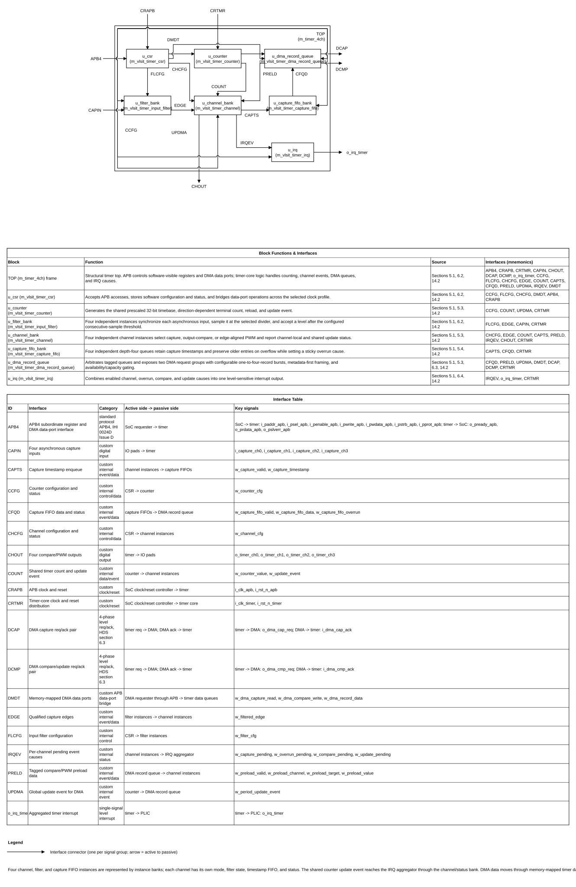
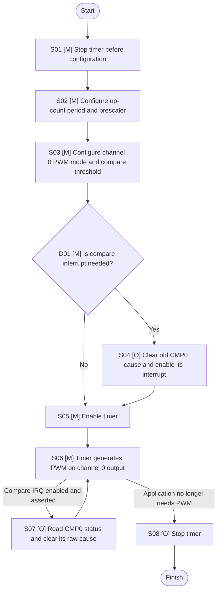

# Configurable Multi-Channel Timer Design Specification

Normative design contract for the timer architecture. Requirement words shall, should, and may are normative. TBD items have an impact and decision recorded in Section 20.

## Version history

| Version | Date | Updates |
|---|---|---|
| 0.3 | 2026-11-01 | Established the four-channel shared-counter baseline and incorporated the selected timing shadow commit, output polarity/idle/force controls, paired PWM-input measurement, per-channel capture timeout, and independent one-pulse mode. |
| 0.4 | 2026-11-01 | Finalized PWM-input polarity per pair and the preserve-old/drop-new result policy with sticky overrun; defined zero as timeout-disabled and suppressed repeated timeout events until the next qualified edge; added CSR-selectable automatic/software one-pulse re-arm with re-arm command and busy/armed status (`tmr_opm_sts` at 0x0088); set force output as highest priority, including while a channel is disabled, while the timing sequence continues; updated requirements, verification traceability, and sync/async CSR workbooks to 34 registers. |
| 0.5 | 2026-11-01 | Added an application-and-benefit mapping for every feature, with concrete MCU product classes, representative quantitative examples, failure consequences, requirement links, and commercial timer references. The examples are explanatory benchmarks and do not change the normative requirements. |
| 0.6 | 2026-11-01 | Added three user-approved WaveDrom figures for PWM-input result retention/overrun, capture timeout expiry/restart, and software-controlled one-pulse re-arm; completed the waveform plan for all eight operations. |
| 0.7 | 2026-11-01 | Consolidated the CSR definition to `m_timer_4ch_CSR_async.xlsx` as the sole workbook; specified a CSR-generator parameter to select synchronous or asynchronous clock integration; removed the duplicate synchronous CSR workbook. |
| 0.8 | 2026-11-01 | Added static `PARA_CHANNEL_COUNT` selection from one to four active channels; defined inactive-channel, fixed maximum-port, CSR-map, and paired PWM-input behavior; extended configuration and verification requirements. |
| 0.9 | 2026-11-02 | Expanded `PARA_CHANNEL_COUNT` to a maximum of eight with default four; added 32/64-bit timing-width selection with a fixed 16-bit prescaler, a coherent low-then-high APB counter snapshot, width-dependent DMA beat framing, and candidate elaboration parameters for product variants. |
| 0.10 | 2026-11-02 | Added a basic channel 0 PWM programming/use flowchart and a matching M/O step table under section 11.2, including the optional compare-interrupt path. |
| 0.11 | 2026-11-02 | Reconciled the HDS with the expanded 93-register CSR map and APB DMA stream ports at 0x0200/0x0204; fixed eight-input one-pulse trigger selection; defined DMA tag encoding, round-robin capture arbitration, independent burst/ack/flush behavior, APB stream errors, reset/quiesce behavior, coherent 64-bit counter-read events, PWM endpoints, and static synchronous/asynchronous CSR selection. |
| 0.12 | 2026-11-02 | Closed the Timer CSR-generator integration: APB-CSR-Generator v2.2 emits separate sync, async, and selectable wrapper files; added optional compact RTL aliases while preserving CSR names, static `PARA_ASYNC`, and read-event/address outputs. Cross-checked the full 8-channel IRQ map against the 93-register workbook and removed stale 4-channel descriptions and unresolved DMA framing text. |
| 0.13 | 2026-11-02 | Defined asynchronous APB DMA-stream access as one bundled-data request/acknowledge toggle per APB beat, with queue operations in the timer domain; added REQ-IF-003, CDC behavior and reset constraints, TEST-018, approved waveform WF-011, and DEC-033. Updated the CSR integration map with exact generated port names and APB address dispatch. |
| 0.14 | 2026-11-03 | Cross-checked HDS addresses and interrupt causes against the canonical ASYNC_CSR workbook; corrected the shared counter low/high word addresses to 0x0078/0x007C, specified all 40 IRQ cause positions, and clarified the implementation-plan review gate. |
| 0.15 | 2026-11-03 | Added successful CSR read/write event sidebands for coherent 64-bit timing-word tracking; defined per-field activation of timeout and one-pulse timing values, DMA-only access ownership for stream windows, and set-dominant interrupt W1C collisions; added verification and waveform-plan entries. |
| 0.16 | 2026-11-03 | Clarified that a completed timeout-threshold write is sampled only at the next timeout-monitor interval start, while one-pulse width is sampled at the next accepted trigger; active intervals and pulses retain their latched timing values. Added DEC-037. |
| 0.17 | 2026-11-03 | Recorded approval of WF-012 and WF-013 and added rendered diagrams; repaired the versioned CSR workbook copy for generator compatibility by removing trailing empty table rows and correcting overlapping configuration/level-field ranges. Began CSR generation from the corrected v0.14 workbook. |
| 0.18 | 2026-11-04 | Corrected the DMA-330 flush handshake to match DDI 0424D: DMA requests flush on `davalid/datype`, and Timer acknowledges on `drvalid/drtype`; defined Timer queue/state clearing and APB-beat quiescence; updated DMA flush waveforms, cited the approved local reference excerpts, and synchronized the active CSR workbook reference. Module names use the project prefix `m_vlsit_timer` (top `m_vlsit_timer`, sub-modules with the `m_vlsit_timer_` prefix followed by a function name, CSR `m_vlsit_csr_timer`), like the other `m_vlsit_*` IPs of `common_rtl`; the RTL files carry the same names (2026-11-04). |
| 0.19 | 2026-11-04 | Replaced the DMA-330 peripheral request interface by two 4-phase level req/ack pairs (`o_dma_cap_req`/`i_dma_cap_ack`, `o_dma_cmp_req`/`i_dma_cmp_ack`); removed the DMA-330 type, last, ready and flush signals; added the self-clearing `tmr_dma_cfg.cap_clr`/`cmp_clr` bits and the `cap_clr_busy`/`cmp_clr_busy` status bits for recovery; a valid ack is the burst-complete ack; an early or spurious ack raises the `dperr` cause and holds the group in an error state until cleared. CSR workbook v0.19 enables the `Register Event Sideband` generator key (APB-CSR-Generator v3.0). Added DEC-040 and a directed req/ack test. |
| 0.20 | 2026-11-05 | Replaced the eight fixed capture-input and output pins by the buses `i_capture_ch` (width `PARA_CAPTURE_COUNT`) and `o_timer_ch` (width `PARA_OUTPUT_COUNT`), two independent parameters of 1 to 8 (default 4). The channel units, CSR banks and IRQ causes are unchanged; the number of units is `LPARA_CHANNEL_COUNT`, the larger of the two parameters. Added DEC-041. Raising the limit to 16 is not done (needs CSR, tag, IRQ and selector changes). |
| 0.21 | 2026-11-05 | Recorded the APB-CSR-Generator v3.3 refresh in `rtl_v2/`, including the generated synchronizer adapter and verified workbook manifest. Removed pseudo-placeholder angle brackets from module naming descriptions so the specification checker passes. The earlier `rtl/` set is retained. The 93-register map and Timer behavior are unchanged. |

## Document map

1. Purpose, scope, and product context
2. Normative references and precedence
3. Requirements and traceability
4. Features and configurations
5. Architecture
6. External interfaces and ports
7. Clock, reset, and power
8. Parameters and elaboration configurations
9. Data representation and arithmetic
10. Detailed functional behavior
11. Register and programming model
12. Error handling and recovery
13. Performance, power, and area
14. RTL implementation contract
15. Verification specification
16. DFT and testability
17. Physical design and timing integration
18. Security, safety, and reliability
19. Requirement-to-verification traceability
20. Assumptions, dependencies, and decisions
21. Glossary
22. References used to shape this template

## 1. Purpose, scope, and product context

### 1.1 Purpose and scope

Eight-channel maximum timer for an ASIC MCU. Static parameters `PARA_CAPTURE_COUNT` and `PARA_OUTPUT_COUNT` (each one to eight, default four) set the number of capture input pins and compare/PWM output pins; the channel units, `LPARA_CHANNEL_COUNT` = the larger of the two, share one unsigned counter. `PARA_COUNTER_WIDTH` selects a 32-bit or 64-bit counter, defaulting to 32 bits. Each active channel selects input capture, output compare, edge-aligned PWM, or one-pulse operation. Capture has selectable edges, input synchronization, programmable digital filtering, and four timestamp entries per active channel. Available paired-channel PWM-input functions measure period and configurable active-high/active-low pulse width, preserving unread results and dropping newer measurements with an overrun flag. Compare supports set, clear, or toggle. PERIOD and compare/PWM values use shadow storage and commit together at an update boundary. The APB interface remains 32-bit; in the 64-bit profile, software reads the counter through a coherent low/high snapshot. Outputs support per-channel polarity, idle level, and forced level, with force taking priority. Capture can detect a programmable no-edge timeout. One-pulse channels support automatic or software-controlled re-arm. The DMA interface is two 4-phase level req/ack pairs, one for capture and one for compare/update.

Included: shared 32/64-bit counter, one to eight elaborated channels, up/down count direction, period reload/update event, capture/compare/PWM, PWM-input measurement on available fixed channel pairs, capture timeout, one-pulse operation, synchronized timing-register update, configurable output state, APB4 with a 32-bit data path and 16-bit local byte address, one aggregated IRQ, two tagged DMA groups.

Excluded: watchdog (separate IP), external event counter, encoder/quadrature, complementary PWM, dead-time, break input, retriggerable one-pulse, and safety certification. PWM-input uses fixed channel pairs 0/1, 2/3, 4/5, and 6/7 when the selected channel count makes each pair available. A channel cannot select capture mode and drive its output simultaneously; one-pulse mode may use a selected implemented capture input as its trigger. Timeout threshold zero disables timeout detection; a nonzero timeout produces one event until the next qualified edge.

### 1.2 Deployment assumptions

| Item | Specification |
|---|---|
| Product | General-purpose ASIC MCU timer IP |
| Technology | Portable synthesizable standard-cell RTL; no target-specific library cells or memory macros are selected in the baseline. |
| Workload | Timestamp capture, periodic output compare, edge-aligned PWM |
| External dependencies | APB4 requester, DMA controller with a req/ack peripheral interface, timer pads, CRM/reset, PLIC |
| Security | APB protection checks disabled; `i_protect_en` tied low |

### 1.3 Feature summary

| ID | Feature | Status | Requirements |
|---|---|---|---|
| FEAT-001 | Static selection of 1–8 channels sharing one 32/64-bit counter | Required | REQ-FUNC-001, REQ-PARAM-001..002 |
| FEAT-002 | Edge capture, filter, four-entry per-channel FIFO | Required | REQ-CAP-001..005 |
| FEAT-003 | Compare set/clear/toggle | Required | REQ-OC-001..002 |
| FEAT-004 | Edge-aligned PWM with preload/shadow | Required | REQ-PWM-001..002 |
| FEAT-005 | Up/down count and PERIOD reload | Required | REQ-CNT-001..003 |
| FEAT-006 | APB4 32-bit, two DMA groups, one IRQ | Required | REQ-IF, REQ-DMA, REQ-INT |
| FEAT-007 | Synchronous shadow commit for PERIOD, prescaler, and compare/PWM values | Required | REQ-CNT-005, REQ-PWM-003 |
| FEAT-008 | Per-channel output polarity, idle level, and force control | Required | REQ-OUT-001..003 |
| FEAT-009 | Paired-channel PWM-input period and selectable active-level pulse-width measurement with stable unread results | Required | REQ-CAP-006..008, REQ-CAP-011..012 |
| FEAT-010 | Per-channel input no-edge timeout, including zero-disable and single-expiration behavior | Required | REQ-CAP-009..010 |
| FEAT-011 | Non-retriggerable one-pulse output with selectable automatic/software re-arm | Required | REQ-OPM-001..005 |

### 1.4 Real-world applications and benefits

The examples below describe common MCU timer use-cases. Values quoted from vendor examples, or calculated from those examples, are illustrative sizing references; they do not impose a new frequency, latency, or workload requirement on this timer.

| Feature ID | Real-world application | What the application needs from the feature | Typical values / example | Consequence if missing or wrong | Requirements | Source | Function and benefit |
|---|---|---|---|---|---|---|---|
| FEAT-001 | Four-channel brushed-DC fan controller board in a ventilation appliance, with an MCU driving four external motor-driver inputs. | Run four channel functions against one timebase so independent speed commands and timed edges remain aligned without starting four separate timers. | 4 channels and one 32-bit shared counter; a commercial FTM example generates 10 kHz PWM from a 48 MHz system clock (REF-008, §3.2). | Too few channels require another timer or software scheduling; unrelated timebases can drift and complicate synchronized control. | REQ-FUNC-001..002, REQ-PWM-001 | A shared counter gives all four channels the same tick and period boundary, reducing duplicated timer state while permitting four concurrent channel operations. The timer output is a logic-level control for an external driver, not a motor-power output. |
| FEAT-002 | Fan-controller board measuring a pulse-output tachometer, or a sensor-interface board measuring a periodic digital sensor signal. | Timestamp selected rising/falling edges, reject short glitches, and retain several timestamps while firmware or DMA is servicing earlier events. | Reference capture examples use a 1 kHz input with an 8 MHz timer clock (REF-007, pp. 28–30) and a 100 µs period / 50 µs pulse (REF-008, §3.6); this design provides 4 timestamps per channel and filter settings of /1 to /32 with 1 to 16 stable samples. | Noise can create false speed or sensor readings; a single unread capture slot can overwrite an edge before software or DMA can process it. | REQ-CAP-001..005 | Synchronization limits metastability propagation into the timer core; the programmable filter qualifies a stable input level; edge selection chooses which transition to timestamp; and the four-entry FIFO absorbs short service delays. Sticky overrun exposes data loss instead of hiding it. |
| FEAT-003 | MCU-based appliance status panel or controller board that toggles LEDs and schedules diagnostic strobes at defined intervals. | Produce a timed output transition or periodic match event without relying on a software delay loop or ISR entry time. | An NXP MCU timer example schedules an output-compare interrupt every 131 ms and toggles an LED (REF-009, §§6.1–6.3). | Software-generated edges vary with interrupt latency and workload; an unserviced compare event can delay a visible indication or diagnostic action. | REQ-OC-001..002, REQ-INT-001..002 | The hardware compares the shared count with a programmed value, then sets, clears, or toggles the channel output and reports the match. This gives repeatable edge placement while the CPU handles other work. |
| FEAT-004 | Low-voltage brushed-DC fan or pump controller using an external driver IC or MOSFET stage. | Set motor drive level by duty cycle while keeping a stable repeated switching waveform; the timer must generate the waveform continuously in hardware. | A commercial FTM example uses 10 kHz PWM at 48 MHz with 50% duty (REF-008, §3.2); 10 kHz corresponds to a 100 µs period. | Incorrect duty changes the commanded average drive and therefore speed/torque; CPU bit-banging consumes execution time and makes edges sensitive to software jitter. | REQ-PWM-001..002 | The channel compares the shared counter with its duty threshold and produces edge-aligned PWM without a per-edge software action. Firmware can use the duty setting as the motor-speed command while the hardware maintains the waveform. This baseline does not provide complementary gate drive, dead-time, or break shutdown. |
| FEAT-005 | MCU control board that needs periodic ADC sampling or a repeating control-loop timebase alongside PWM outputs. | Derive counter ticks from the peripheral clock, select count direction, and reload at a chosen period so sample/actuation timing is deterministic and the count range is sufficient. | In a vendor timer example, a 1 MHz counter tick and 50 µs period produce 20 kHz PWM (REF-007, pp. 70–71); this design selects a 32-bit or 64-bit count and reloads at PERIOD in either direction. | An unsuitable tick or range produces coarse timestamps, premature wrap, or an incorrect update interval; software polling can add phase jitter to ADC triggers or control tasks. | REQ-CNT-001..004, REQ-PARAM-002 | The 16-bit prescaler sets the tick interval, the selected-width count represents elapsed time, and PERIOD defines the repeating boundary. Up/down selection supports the required channel timing convention; the reload event also provides a common point for updates and periodic work. |
| FEAT-006 | Embedded motor/sensor control board that configures the timer, records recurring sensor edges to RAM, and schedules output changes from RAM-fed values. | Configure and inspect the timer over a 32-bit APB interface, move batches of timestamp/command records through DMA, and identify interrupt causes through one IRQ output. | APB data width is 32 bits; the timer permits 1–4 records per DMA request. Each record occupies two 32-bit beats at counter width 32 or three beats at width 64, giving 2/4/6/8 or 3/6/9/12 beats per request. At an illustrative 10 kHz on each of four inputs, the 32-bit profile transfers 40,000 records/s or 320 kB/s; the 64-bit profile transfers the same record rate in 480 kB/s of payload. These are arithmetic examples, not throughput guarantees. REF-007, pp. 28–30, and REF-010, §§3.1–3.2, demonstrate capture-to-RAM and PWM-update DMA patterns. | Without DMA, software must service each event and copy data itself, increasing interrupt load and overrun risk; without cause status/masks, software cannot distinguish which enabled event asserted the aggregated IRQ. | REQ-IF-001..002, REQ-DMA-001..007, REQ-INT-001..002 | APB4 provides the control/status path; the capture DMA group transfers tagged timestamps and the compare/update group accepts tagged values; the single IRQ reduces top-level interrupt wiring while per-cause status and enables preserve software visibility. DMA offloads repeated transfers when the DMA program uses matching request and burst settings. |
| FEAT-007 | Variable-speed fan controller changing frequency or speed while its PWM output is active. | Stage PERIOD, prescaler, and channel compare values, then apply them together at a waveform boundary so a command update does not truncate the current pulse or mix old and new period settings. | At 10 kHz, one PWM period is 100 µs; a boundary-committed update becomes active at the next reload, with latency of at most one period after the values are pending. Timer preload at update boundaries is documented in REF-007, §1.4.2, pp. 15–17. | Immediate mid-period writes can create a short, long, or otherwise unintended pulse and briefly apply a duty threshold against the wrong period. | REQ-CNT-005, REQ-PWM-002..003 | Shadow storage lets software or DMA stage values without changing the active waveform. Atomic transfer at reload keeps the period and duty settings coherent across channels and prevents mid-cycle waveform disturbance. |
| FEAT-008 | Controller board whose output pins drive a mix of active-low indicator LEDs and active-high or active-low external driver-enable inputs. | Match each output's electrical polarity, hold a defined level when disabled, and allow firmware to force a known logic level for startup, service, or shutdown sequencing. | 4 output channels; each output has two physical logic levels (0 and 1); reset and configured idle behavior are specified independently from polarity. | Wrong polarity can leave an indicator or driver input asserted; an undefined disabled level can produce an unintended transition when the channel is enabled or stopped. | REQ-OUT-001..003 | Polarity maps the internal waveform to the board's active level; idle control defines the pin when output generation is disabled; force control overrides the generated value immediately. Force is a software-controlled output selection, not a hardware fault-protection or safety-rated shutdown path. |
| FEAT-009 | Embedded controller measuring PWM feedback from an actuator driver or a digital sensor module. | Measure period and selected active-level pulse width from one input, keep the two results from the same measurement coherent, and allow software to consume them before replacing them. | Up to 4 fixed channel pairs (0/1 through 6/7) can select among up to 8 filtered inputs; each pair stores two counter-width results. A vendor capture example measures a 100 µs period and 50 µs active pulse (REF-008, §3.6). | Measuring edges separately in software can pair values from different cycles; resetting a shared counter can disturb unrelated timer channels; overwriting unread results can produce inconsistent feedback. | REQ-CAP-006..008, REQ-CAP-011..012 | Paired capture logic derives period and pulse width from qualified edges without resetting the shared counter. It supports active-high or active-low pulse measurement and updates both result registers together; result-valid and overrun state preserve unread results and make dropped measurements visible. |
| FEAT-010 | Ventilation fan controller monitoring a tachometer or sensor that is expected to produce periodic pulses. | Detect that no qualified edge arrived within the chosen monitoring interval, whether monitoring starts at channel enable or after the first valid edge. | Example reference signal period: 100 µs at 10 kHz (REF-008, §3.6). For that signal, a 3-period no-edge threshold would be 300 µs; this is an illustrative calculated setting, not a fixed timer default. | A disconnected or stalled sensor can leave software using an old measurement as if it were current; repeated timeout events can also flood interrupt handling. | REQ-CAP-009..010 | Per-channel timeout reports a missing-edge condition without stopping the shared counter or overwriting capture data. The selectable start point supports both startup supervision and loss-of-signal detection; one event per interval avoids repeated reports until a new edge arrives. Firmware must decide the system response. |
| FEAT-011 | MCU-based sensor-acquisition board issuing a delayed trigger or a bounded strobe to an external ADC or measurement device. | On one qualified input trigger, generate one output transition after a programmed delay, hold it for a programmed width, then return to idle without a software-timed clear. | A 1 MHz timer tick gives 1 µs timing steps; REF-007, §3.1, pp. 35–36, describes one-pulse delay and width as programmable timer counts. This design reuses the shared prescaler tick and has independent one-pulse state per channel. | Software wait loops add scheduling jitter; a missed clear can leave a strobe asserted; a trigger received while busy is deliberately ignored and must be accounted for by the application. | REQ-OPM-001..005 | The channel's trigger, delay, width, completion, and re-arm state are handled in hardware. Automatic re-arm supports repeated trigger sequences; software re-arm lets firmware explicitly permit the next pulse. Busy and armed status show whether a new trigger can be accepted. |

## 2. Normative references and precedence

### 2.1 Normative references

| Ref | Document | Applicable scope |
|---|---|---|
| REF-001 | Arm AMBA APB Protocol Specification, IHI 0024 Issue D | APB4 protocol; §2.1, §3.1–3.4 |
| REF-002 | Arm CoreLink DMA-330 TRM, DDI 0424D r1p2 | Informational only since v0.19: the req/ack pairs of this IP are not the DMA-330 peripheral request interface; an SoC adapter may map them to it (section 6.3). Local excerpts: [handshake and flush behavior](reference/md_doc/arm_dma330_req_handshake_excerpt.md) and [signal definitions](reference/md_doc/arm_dma330_signals_excerpt.md); redistribution forbidden. |
| REF-003 | VLSIT RTL Design Rules v2 | Naming, coding, reset, hierarchy, CDC |
| REF-004 | IEEE 1800-2017 SystemVerilog | Synthesizable subset |
| REF-005 | Timer CSR workbook `m_timer_CSR_async_v0.19.xlsx` | Sole source for CSRs; `ASYNC_CSR` is canonical and `CSR` is the matching synchronous generator view |
| REF-006 | ST, NXP, and Microchip timer manuals | Silicon-proven feature patterns only |
| REF-007 | [ST AN4776 Rev. 4, How to use general-purpose timer peripheral on STM32 MCUs](https://www.st.com/resource/en/application_note/dm00236305-generalpurpose-timer-cookbook-for-stm32-microcontrollers-stmicroelectronics.pdf) | Input-filter timing example (§1.4.1); preload/shadow update (§1.4.2); input-capture DMA frequency meter (pp. 28–30); one-pulse timing (§3.1, pp. 35–36); timer examples (pp. 70–71). Behavioral/application reference only. |
| REF-008 | [NXP AN14617 Rev. 1, Features and Operation Modes of FlexTimer Module on MCX E24x](https://www.nxp.com/docs/en/application-note/AN14617.pdf) | 10 kHz PWM example at 48 MHz (§3.2); 100 µs period and pulse-width capture examples (§§3.5–3.6). Behavioral/application reference only. |
| REF-009 | [NXP Getting Started with S08RN60 Rev. 0, Lab 2: FlexTimer Module](https://www.nxp.com/docs/en/application-note/AN4875.pdf) | Output compare timed events and a 131 ms LED-toggle example (§§6.1–6.3). Behavioral/application reference only. |
| REF-010 | [NXP AN4598 Rev. 0, Using DMA Transfers with Enhanced Flexible PWM on MC56F84xxx](https://www.nxp.com/docs/en/application-note/AN4598.pdf) | DMA writes PWM values at reload and reads capture registers into memory (§§3.1–3.2); examples use 16 kHz and 10 kHz PWM. Behavioral/application reference only. |
| REF-011 | [Microchip SAM L10/L11 Timer/Counter Developer Help](https://developerhelp.microchip.com/xwiki/bin/view/products/mcu-mpu/32bit-mcu/sam/l10-l11/peripherals/timer-counter/) | Commercial timer capture/compare, buffered values, DMA requests, waveform generation, and event/interrupt overview. Behavioral/application reference only. |

The DMA-330 excerpts are copyright Arm, redistribution status unknown, and excluded from version control by the project .gitignore. Conversion verification passed for the cited pages.

### 2.2 Source-of-truth and conflict handling

REF-001 governs the APB protocol; the DMA req/ack handshake is defined in section 6.3. Approved choices and this document govern timer behavior. REF-003 is mandatory. REF-005 alone defines register names, offsets, fields, access types, and reset values; this document shall not duplicate them. REF-006 informs design comparisons only. Unresolved decisions remain in Section 20.

Naming rule: default vlsit-rtl-generator naming v2, VLSIT_RTL_Design_Rule.md v2, section 2.

### 2.3 Compliance declaration

| Standard | Profile and role | Options | Deviations |
|---|---|---|---|
| AMBA APB, IHI 0024 Issue D | APB4 Completer, 32-bit data and 16-bit local address | PSTRB partial write rejected, PPROT ignored, PSLVERR enabled for malformed accesses | User decision |
| DMA req/ack (this IP) | Peripheral endpoint | Two 4-phase level req/ack pairs: capture and compare/update; tagged records over the APB stream ports | Not the DMA-330 pins; an SoC adapter may convert |

## 3. Requirements and traceability

| ID | Requirement using shall/should/may | Source | Applies to | Verification method |
|---|---|---|---|---|
| REQ-FUNC-001 | The IP shall implement `LPARA_CHANNEL_COUNT` active timer channels sharing one unsigned counter whose width is selected by `PARA_COUNTER_WIDTH`. | User decision | All | Structural inspection and simulation |
| REQ-FUNC-002 | Each implemented channel shall select at most one of capture, compare, PWM, or one-pulse mode; PWM-input mode reserves an available fixed pair of channels. | User decision | Implemented channels | Mode tests and assertions |
| REQ-PARAM-001 | `PARA_CAPTURE_COUNT` and `PARA_OUTPUT_COUNT` shall be independent static elaboration parameters with legal values 1 through 8 and default value 4; `LPARA_CHANNEL_COUNT` is the larger of the two. Channels 0 through `LPARA_CHANNEL_COUNT-1` are implemented. Eight maximum channel ports and the eight-channel CSR map remain present in all configurations. For channel indices at or above `LPARA_CHANNEL_COUNT`, capture inputs are ignored, timer outputs are held low, channel control writes have no timer effect, and hardware status, FIFO-level, and interrupt-cause inputs read as zero. PWM-input pairs are fixed as channels 0/1, 2/3, 4/5, and 6/7; pair k is available when `LPARA_CHANNEL_COUNT >= 2*(k+1)`. A pair may select only an implemented capture input; selection of an unimplemented input produces no measurement. | User request and design contract | Elaboration | Elaborate and verify all eight parameter values |
| REQ-PARAM-002 | `PARA_COUNTER_WIDTH` shall be a static elaboration parameter with legal values 32 or 64 and default value 32. PERIOD, compare, capture timestamp, timeout, one-pulse, and PWM-input result values shall use the selected width; the prescaler shall remain 16-bit. In the 64-bit configuration, reading the low counter word shall atomically latch the full counter; the following high-word read shall return the matching upper half and release the snapshot. Software shall read low then high without interleaving another counter read. The snapshot behavior is specified in Section 11.4. | User request | Elaboration | Elaborate both widths; verify rollover, arithmetic, and coherent low/high reads |
| REQ-CNT-001 | Counter direction shall be selectable up or down. | User decision | Timer core | Directed simulation |
| REQ-CNT-002 | Up mode shall count 0 through PERIOD, reload 0, and emit update on reload. | User decision | Up mode | Boundary test |
| REQ-CNT-003 | Down mode shall count PERIOD through 0, reload PERIOD, and emit update on reload. | User decision | Down mode | Boundary test |
| REQ-CNT-004 | The prescaler shall generate a counter tick every (PSC+1) timer-core clock cycles; PSC=0 shall give one tick per timer clock. | User decision | Timer core | Directed prescaler test |
| REQ-CNT-005 | PERIOD and prescaler writes shall update shadow values. While the timer is enabled, pending PERIOD, prescaler, and compare/PWM shadow values shall commit atomically at the next update boundary. While disabled, writes shall be loaded before counting starts. | User decision | Timer core | Multi-register update-boundary test |
| REQ-TIME-001 | In the 64-bit profile, every writable 64-bit timing quantity shall become eligible only after successful writes to both its low and high 32-bit CSR words since the last commit. The CSR write-event/address sideband shall identify successful writes, including writes that repeat the current data value. In the 32-bit profile, the low word is the complete value and high-word accesses have no effect. | User decision | PERIOD, compare, timeout, one-pulse width | Low/high word pairing test |
| REQ-TIME-002 | While enabled, pending PERIOD, prescaler, and compare/PWM values shall take effect at the next update boundary; a complete timeout-threshold value shall be sampled at the next timeout-monitor interval start; and a complete one-pulse-width value shall be latched at the next accepted one-pulse trigger. Writing a new value shall not restart or alter an active timeout interval or pulse; each retains the timing value latched at its start. | User decision, DEC-037 | Timer core, timeout, one-pulse | Value activation-boundary test |
| REQ-CAP-001 | Each asynchronous capture input shall be synchronized to timer-core clock before filtering. | User decision | Capture mode | CDC analysis |
| REQ-CAP-002 | Each channel shall support rising, falling, or both-edge capture selection. | User decision | Capture mode | Directed edge test |
| REQ-CAP-003 | Each channel shall select divider /1,/2,/4,/8,/16,/32 and N=1..16 consecutive equal samples. The CSR stores `sample_n=N-1`; encodings 0 through 15 therefore select one through sixteen samples, and divider encodings 6 and 7 are reserved. | User decision | Capture mode | Filter tests |
| REQ-CAP-004 | Each implemented capture channel shall queue four counter-width timestamps in order. | User decision | Capture mode | FIFO tests for both counter widths |
| REQ-CAP-005 | When the FIFO is full, the timer shall retain four old entries, discard the new timestamp, and set sticky overrun. | User decision | Capture mode | Overflow test |
| REQ-CAP-006 | The timer shall provide a PWM-input measurement function that uses a pair of capture channels associated with one selected input signal to measure period and active pulse width. | User decision | PWM-input mode | Period and pulse-width test |
| REQ-CAP-007 | PWM-input measurement shall use the existing input synchronizer and filter before edge qualification. | User decision | PWM-input mode | Filtered PWM-input test |
| REQ-CAP-008 | PWM-input pairs shall be fixed as channels 0/1, 2/3, 4/5, and 6/7, subject to REQ-PARAM-001 pair availability. Each available pair shall select one implemented synchronized/filtered capture input and expose period and active pulse width through two counter-width result registers. Each pair shall select active-high or active-low width measurement independently. The shared counter shall not be reset. | User decision | PWM-input mode | Pair routing, polarity, result update, and shared-counter tests |
| REQ-CAP-011 | PWM-input results shall update together only when the pair result-valid bit is clear. Software shall read both values and then acknowledge the pair by writing one to its result-valid W1C bit. | User decision | PWM-input mode | Result-valid/acknowledge test |
| REQ-CAP-012 | If a complete PWM measurement arrives while its pair result-valid bit is set, the timer shall preserve both unread result values, discard the new measurement, and set the pair's sticky overrun bit. Software clears overrun by writing one. | User decision | PWM-input mode | Preserve-old/drop-new overrun test |
| REQ-CAP-009 | Each capture channel shall support an independently programmable no-edge timeout threshold in timer ticks. A configuration bit shall select whether timeout tracking starts when the channel is enabled or after its first qualified edge. Every qualified edge shall restart the interval. | User decision | Capture mode | Per-channel timeout start/restart test |
| REQ-CAP-010 | A zero timeout threshold shall disable timeout detection. For a nonzero threshold, the first expiration shall set one timeout event; further expirations shall not create repeated events until a qualified edge restarts the timeout tracker. | User decision | Capture mode | Zero-threshold and single-expiration test |
| REQ-OC-001 | Each compare channel shall detect its programmed match and report an event. | User decision | Compare mode | Match test |
| REQ-OC-002 | Compare output action shall support set, clear, and toggle. | User decision | Compare mode | Output-action test |
| REQ-OUT-001 | Each output channel shall provide programmable output polarity; reset polarity shall be non-inverting. | User decision | Output channels | Polarity test |
| REQ-OUT-002 | Each output channel shall provide a programmable physical idle level used when the output function is disabled; reset idle level shall be low. | User decision | Output channels | Disable/idle test |
| REQ-OUT-003 | Each output channel shall provide force enable and force level controls. When force is enabled, the selected physical output level shall override compare/PWM/one-pulse waveform generation and the disabled-channel idle level, even when the channel mode is disabled. The timer function continues underneath force control. Reset force enable shall be zero. | User decision | Output channels | Force priority test |
| REQ-PWM-001 | Each PWM channel shall generate edge-aligned PWM from the shared count and compare value. | User decision | PWM mode | PWM test |
| REQ-PWM-002 | Compare/PWM values shall use preload/shadow storage and transfer at the reload/update boundary. | User decision | Compare/PWM | Boundary test |
| REQ-PWM-003 | Compare/PWM shadow values and pending PERIOD/prescaler values shall participate in the same atomic update boundary defined by REQ-CNT-005. | User decision | Compare/PWM | Simultaneous commit test |
| REQ-OPM-001 | Each output channel shall support an independent non-retriggerable one-pulse operation initiated by a qualified edge from a selectable capture input. | User decision | One-pulse mode | Concurrent per-channel pulse test |
| REQ-OPM-002 | Each channel shall program one-pulse delay through its compare value and pulse width through its one-pulse width register; timing shall use the shared prescaler tick without resetting the shared counter. | User decision | One-pulse mode | Delay/width/shared-counter test |
| REQ-OPM-003 | A trigger received while that channel's one-pulse sequence is busy, including its programmed delay and output pulse, shall be ignored and shall not restart or extend the sequence. | User decision | One-pulse mode | Busy-trigger test |
| REQ-OPM-004 | Each channel shall select automatic re-arm or software-controlled re-arm through its CSR. In software-controlled mode, a software re-arm command is accepted only when the channel is not busy; the channel then accepts one qualified trigger. | User decision | One-pulse mode | Automatic/manual re-arm test |
| REQ-OPM-005 | The timer shall expose per-channel one-pulse busy and armed status so software can determine when a manual re-arm command is valid and whether a trigger can be accepted. | Design requirement | One-pulse mode | Busy/armed status test |
| REQ-IF-001 | The software interface shall use APB4 with 32-bit data and 16-bit byte-addressed local PADDR; the SoC interconnect shall decode the full system address. | User decision | All | APB checker |
| REQ-IF-002 | The generated CSR shall reject partial-strobe writes and unaligned addresses with PSLVERR; aligned unmapped reads shall return zero and writes shall be ignored; APB protection checking shall be disabled. | User decision and CSR generator behavior | APB4 | APB checker |
| REQ-IF-003 | When `PARA_ASYNC=1`, every APB access to DMA stream offset 0x0200 or 0x0204 shall cross to the timer-core domain through one bundled-data request/acknowledge toggle handshake per APB beat. The APB-side request tuple `{PADDR, PWRITE, PWDATA, PSTRB}` shall remain stable until its matching timer-domain acknowledgement; the timer domain shall perform exactly one stream beat and hold `{PRDATA, PSLVERR}` stable until the acknowledgement is observed in APB. APB shall assert PREADY only after that acknowledgement. The multibit payload shall not be independently synchronized bit-by-bit. When `PARA_ASYNC=0`, APB and timer core share a physical clock and the stream operation shall use the same timer-domain queue logic directly. | User decision, DEC-033 | APB stream ports | Async CDC and APB protocol check |
| REQ-IF-004 | The Timer shall expose generated-CSR `o_reg_wr_en` and `o_reg_wr_addr` in the selected CSR register clock domain. A write event shall pulse only for a successful, aligned, full-strobe APB write to a mapped register with at least one software-writable field. The Timer shall use this event to track low/high timing-word writes, including writes that repeat the current value. | User decision, DEC-034 | CSR integration | CSR sideband simulation |
| REQ-IF-005 | APB stream offsets 0x0200 and 0x0204 shall be DMA-only. The SoC interconnect shall route or restrict these offsets so ordinary software CPU accesses cannot consume capture records, stage compare/update records, or interfere with a DMA burst transaction. | User decision, DEC-035 | DMA stream integration | SoC access-control review |
| REQ-CLK-001 | APB and timer-core clocks shall be separate ports; DMA shall use timer-core clock. | User decision | All | Structural/CDC review |
| REQ-CLK-002 | A static parameter shall select synchronous or asynchronous APB/core operation. | User decision | Elaboration profile | Elaboration and CDC checks |
| REQ-DMA-001 | The IP shall expose two DMA req/ack pairs, one for capture (`o_dma_cap_req`, `i_dma_cap_ack`) and one for compare/update (`o_dma_cmp_req`, `i_dma_cmp_ack`), and no other DMA control signal. | User decision, DEC-040 | DMA enabled | DMA checker |
| REQ-DMA-002 | DMA groups shall use tagged queues/data ports to preserve channel/event identity. | User decision | DMA enabled | Interleave test |
| REQ-DMA-003 | Each logical DMA record shall be a 32-bit metadata/tag word followed by one counter-width timestamp/value, transferred as one 32-bit data beat when `PARA_COUNTER_WIDTH=32` or two consecutive 32-bit data beats when `PARA_COUNTER_WIDTH=64`. | User update | DMA enabled | Record-framing test for both widths |
| REQ-DMA-004 | Each pair shall use the 4-phase level handshake of section 6.3: the Timer raises req and holds it until ack is high; the Timer then drops req; the DMA drops ack after req is low; a new req is not raised while ack is high. ack shall be synchronous to `i_clk_timer`. | User decision, DEC-040 | DMA enabled | Assertions/checker |
| REQ-DMA-005 | Each DMA burst shall carry 1–4 complete records. Total 32-bit beats shall equal record count multiplied by `1 + PARA_COUNTER_WIDTH/32`: 2, 4, 6, or 8 beats in 32-bit mode; 3, 6, 9, or 12 beats in 64-bit mode. A per-group record-count setting shall gate requests; the DMA channel program shall use a matching burst length (number of APB stream beats). Support for all resulting lengths shall be checked against the integrated DMA controller. | User update and DMA integration constraint | DMA enabled | Burst-count/framing test |
| REQ-DMA-006 | The compare/update command queue shall hold four complete records; when full, it shall preserve older records, reject the new record, and set sticky overflow status. | User decision | DMA enabled | Queue-full test and assertion |
| REQ-DMA-007 | Capture requests shall assert only when the configured number of complete tagged records is available. Compare/update requests shall assert only when at least that many command-queue slots are free; prefetched records shall be applied at the selected timer boundary. | User decision | DMA enabled | Burst-threshold, prefetch, and boundary test |
| REQ-DMA-008 | A valid ack is the burst-complete acknowledgement: for capture, all beats of the reserved records have been read; for compare/update, all configured records have been written and are valid. A valid ack releases the capture reservation or commits the staged records. An ack before completion, an ack with an invalid record, or an ack with no request shall raise one `dperr` event, shall not pop or commit, and shall hold the group in an error state with req low until cleared. Recovery shall use the self-clearing CSR bits `tmr_dma_cfg.cap_clr` and `cmp_clr`: the Timer drops req, discards its reservation or staging state (capture also clears the capture FIFOs and queue and waits for their reset-busy completion), refuses APB stream beats while any clear is busy, reports `cap_clr_busy`/`cmp_clr_busy` in `tmr_dma_sts`, and then loads 0 into the bit. | User decision, DEC-040 | Error and recovery | Early-ack, spurious-ack, clear-sequence, and stream-refusal checks |
| REQ-INT-001 | One aggregated IRQ shall report enabled pending causes. | User decision | All | IRQ test |
| REQ-INT-002 | Per-channel and update causes shall have identifiable status/enable state. | User decision | All | Cause/mask test |
| REQ-INT-003 | Interrupt raw status shall be set-dominant: if a hardware event and software W1C clear target the same cause on one timer clock edge, the new event shall remain pending. | User decision, DEC-036 | Interrupt raw status | W1C/event collision test |
| REQ-RESET-001 | Each active-low APB and timer reset shall assert asynchronously and deassert synchronously within its own clock domain. Reset shall clear local APB-stream CDC request/acknowledge state; the SoC shall quiesce DMA and avoid a pending APB stream access before asserting either reset. | User decision | All | Reset and RDC checks |
| REQ-RESET-002 | Reset shall disable the timer and channels, select up-counting, set each capture filter to divider /1 and one confirming sample, empty queues, clear interrupt raw/enable state, and drive timer outputs low. | User decision | Reset | Reset-value inspection and simulation |

## 4. Features and configurations

| Config | Enabled | Excluded | Interfaces | Verification |
|---|---|---|---|---|
| CFG-BASE | `PARA_CAPTURE_COUNT=1..8` and `PARA_OUTPUT_COUNT=1..8` (default 4); `PARA_COUNTER_WIDTH=32 or 64` (default 32); shared up/down counter; capture/compare/edge-aligned PWM; eligible paired PWM-input measurement; per-channel timeout; independent one-pulse; synchronized timing-value commit; filter; four-entry capture FIFOs per implemented channel; configurable output polarity/idle/force; APB4; two DMA groups; one IRQ | WDT, external event counter, encoder, complementary PWM, dead-time, break, retrigger while active | APB4 32-bit; eight maximum input pins and eight maximum output pins (only indices below `LPARA_CHANNEL_COUNT` are active); two DMA groups | All requirements |

Channel count and counter width are selected statically at elaboration; capture FIFO depth remains four. Runtime channel-count or counter-width changes and mode changes while a channel is enabled are prohibited. The maximum eight input/output port positions and full eight-channel CSR map remain fixed for interface compatibility. Channels above the selected count are inactive as defined by REQ-PARAM-001. Clock crossing structures vary by static `PARA_ASYNC`; its default is 0 and requires the APB and timer clocks to be the same physical net.

### 4.1 Reference IP evidence

The source search did not identify an open RTL timer core that meets the required evidence threshold of demonstrated silicon or FPGA operation plus reviewable verification evidence. No third-party RTL is reused. The following production MCU documentation is used only as a behavior reference; it does not imply that this timer has identical registers or implementation.

| Reference | Evidence used | Disposition |
|---|---|---|
| ST STM32F103 timer, RM0008 | Input synchronizer/filter concept, selectable edge capture, compare/PWM behavior | Silicon MCU manual; behavioral reference only; proprietary RTL excluded |
| NXP S32K1xx FlexTimer, Reference Manual | Timer channel compare/capture and PWM behavior | Silicon MCU manual; feature reference only; no RTL reuse |
| Microchip SAME70 Timer Counter, datasheet | Capture/compare channel model and event behavior | Silicon MCU documentation; feature reference only; no RTL reuse |
| Microchip SAM L10/L11 Timer/Counter | Capture, compare, and buffered update concepts | Silicon MCU documentation; feature reference only; no RTL reuse |
| Open-source RTL candidates from GitHub/Gitee search | No candidate met the combined proof-of-operation and verification evidence filter for this feature set | Excluded from reuse; search/evaluation criteria recorded in the project research notes |

## 5. Architecture

### 5.1 Overview and block responsibilities

| Block | Responsibility | Clock | State/storage |
|---|---|---|---|
| APB4 CSR | Software control/status | APB | Generated CSR state |
| APB DMA stream bridge | Routes APB stream accesses to timer-core DMA queues; one bundled-data request/acknowledge toggle per beat when clocks are asynchronous | APB/timer CDC profile | One outstanding transfer |
| Counter/timebase | Prescaler, shared counter, PERIOD reload/update and atomic timing-shadow commit | Timer core | `PARA_COUNTER_WIDTH`-bit count and active/shadow period, 16-bit prescaler, pending-write state |
| Up to `LPARA_CHANNEL_COUNT` channel units | Capture/compare/PWM/one-pulse selection, output-state controls, and re-arm state | Timer core | Per-implemented-channel state |
| Capture front end | Synchronizer, sample divider, N-sample filter, edge detector, timeout tracker with one-shot expiry latch | Timer core | Filter and per-channel timeout state |
| Capture FIFOs | Store timestamp and overrun per implemented channel | Timer core | `LPARA_CHANNEL_COUNT` x depth-4 queues |
| PWM-input measurement | Fixed channel pairs 0/1, 2/3, 4/5, and 6/7 when available, selectable implemented input source, period/pulse-width result registers | Timer core | State/results for available pairs |
| Compare/PWM stage | Match action, edge-aligned PWM, preload/shadow, polarity, idle and priority force controls | Timer core | Compare and output state |
| One-pulse stage | Per-channel trigger, delay, pulse-width timing, and return to idle | Timer core | Per-channel trigger/active state and elapsed timing state |
| DMA capture queue | Channel/event metadata and timestamp data port | Timer core | Shared queue; four records, each 32-bit metadata plus `PARA_COUNTER_WIDTH` data bits |
| DMA compare/update queue | Channel/target metadata and value data port | Timer core | Shared queue; four records |
| IRQ aggregator | Combine enabled pending events | Timer core | Pending/mask state |

APB and timer core have separate clocks. Timer, DMA handshake/data logic, and event queues use timer-core clock. Static parameters select channel count, counter width, and synchronous/asynchronous APB/core operation. Async mode requires explicit CDC for CSR control/status and coherent counter snapshots.

### 5.2 Block diagram

*Figure 5-1. Four-channel default timer microarchitecture (`LPARA_CHANNEL_COUNT=4`); the diagram predates extension of the maximum to eight. Eight-channel elaboration adds channel units and channel pairs 4/5 and 6/7, while retaining the same shared-counter architecture and maximum port/CSR plan. Source: `figures/m_timer_4ch_block_diagram.drawio` (draw.io, VLSIT library, drawn by `vlsit_spec_diagram.py`). The frame is the top module, the blocks are its instances, each connector is one interface with its mnemonic, and the two tables under the diagram in the source file describe the blocks and the interfaces.*

### 5.3 Transaction and dataflow

1. Software configures direction, PERIOD, prescaler, and channel mode. Writes while enabled update timing shadows for atomic commit at the next update boundary.
2. Counter counts 0..PERIOD then reloads 0 in up mode, or PERIOD..0 then reloads PERIOD in down mode. Reload emits update.
3. Qualified capture edge snapshots count into that channel FIFO.
4. When the configured number of capture records is available, capture DMA reads tagged records. Each record transfers one metadata beat and one or two 32-bit timestamp beats, depending on `PARA_COUNTER_WIDTH`.
5. Compare/update DMA requests a refill when the queue has free slots for the configured record count; it writes one to four metadata/value records. Burst beats per record are `1 + PARA_COUNTER_WIDTH/32`.
6. Pending PERIOD, prescaler, and compare/PWM shadow values commit together at the update boundary. A valid `i_dma_cmp_ack` accepts the staged compare/update records into the pending update set; timing values become active together at the next update boundary.
7. A qualified capture edge restarts its enabled no-edge timeout tracker. A zero timeout threshold disables detection; a nonzero threshold reports only the first expiration until a qualified edge restarts the tracker. PWM-input pairs derive period and selected active-high/active-low pulse width without resetting the shared counter.
8. A qualified one-pulse trigger starts the programmed delay/width sequence only when that channel is armed; a trigger while busy is ignored. CSR configuration selects automatic re-arm or software command-controlled re-arm, and status reports busy/armed state.
9. Compare match drives set/clear/toggle or PWM behavior through output polarity, force, and idle controls. Force overrides the physical output immediately, including while the channel is disabled, while the internal timer sequence continues. One IRQ summarizes enabled causes.

### 5.4 Invariants

- `LPARA_CHANNEL_COUNT` active channels share exactly one `PARA_COUNTER_WIDTH`-bit counter; channel count is 1 through 8 and width is 32 or 64.
- Channel port positions and CSR addresses remain fixed at the eight-channel maximum; absent upper channels are inactive as defined by REQ-PARAM-001.
- Exactly one mode is active per channel.
- PERIOD, prescaler, and compare/PWM timing updates become active atomically at an update boundary while running.
- PWM-input measurement and timeout monitoring do not reset or pause the shared counter.
- Force-output control overrides compare/PWM waveform generation; disabled outputs use their configured idle level.
- A full capture FIFO retains four old values and drops the new one.
- DMA capture and compare/update use separate interfaces.
- Each DMA record is metadata first, value second; partial records are not committed.
- DMA request type does not encode event or channel identity.
- Async capture pins are synchronized before edge detection.

## 6. External interfaces and ports

### 6.1 Interface inventory

| Interface | Type/role | Direction | Clock | Status |
|---|---|---|---|---|
| IF-APB | APB4 Completer, IHI 0024 Issue D | Bidirectional | APB clock | Required |
| IF-CAP | Capture input bus `i_capture_ch`, one bit per capture input (width `PARA_CAPTURE_COUNT`, 1 to 8) | Input | Async to timer | Required |
| IF-OUT | Compare/PWM output bus `o_timer_ch`, one bit per output (width `PARA_OUTPUT_COUNT`, 1 to 8) | Output | Timer core | Required |
| IF-DMA-CAP | DMA req/ack peripheral source | One req/ack pair; DMA reads data over the APB stream port | Timer core | Required |
| IF-DMA-CMP | DMA req/ack peripheral destination | One req/ack pair; DMA writes data over the APB stream port | Timer core | Required |
| IF-IRQ | SoC interrupt source | Output | Timer core | One aggregated IRQ |

### 6.2 Complete port list

Names follow VLSIT RTL naming v2. APB behavior is defined in Section 6.3; reset-domain behavior is defined in Section 7.3.

| Port | Direction | Width | Meaning | Clock domain | Signal type | Reset / idle value | Timing / sampling | Configurations |
|---|---|---:|---|---|---|---|---|---|
| i_clk_apb | Input | 1 | APB clock | APB | Clock | Clock | Rising edge | CFG-BASE |
| i_clk_timer | Input | 1 | Counter, capture, DMA, and IRQ clock | Timer core | Clock | Clock | Rising edge | CFG-BASE |
| i_rst_n_apb | Input | 1 | APB-domain reset | APB | Reset, active low | Asserted low | Release synchronized locally | CFG-BASE |
| i_rst_n_timer | Input | 1 | Timer-core reset | Timer core | Reset, active low | Asserted low | Release synchronized locally | CFG-BASE |
| i_paddr_apb | Input | 16 | APB local byte address; the SoC interconnect performs global address decode | APB | data: address | Not applicable: address has no reset value | Stable through transfer | CFG-BASE |
| i_psel_apb | Input | 1 | APB select | APB | level: APB control | Low | APB protocol | CFG-BASE |
| i_penable_apb | Input | 1 | APB access phase | APB | level: APB control | Low | APB protocol | CFG-BASE |
| i_pwrite_apb | Input | 1 | APB direction | APB | level: APB control | Low | APB protocol | CFG-BASE |
| i_pwdata_apb | Input | 32 | APB write data | APB | data: payload | Not applicable: payload has no reset value | APB protocol | CFG-BASE |
| i_pstrb_apb | Input | 4 | APB byte strobes | APB | data: byte enables | Zero | Full-word writes accepted; partial writes return PSLVERR | CFG-BASE |
| i_pprot_apb | Input | 3 | APB protection attributes, ignored because protection checking is disabled | APB | data: protection attributes | Zero | Sampled with APB transfer | CFG-BASE |
| o_pready_apb | Output | 1 | APB transfer ready | APB | level: handshake | Low | APB protocol | CFG-BASE |
| o_prdata_apb | Output | 32 | APB read data | APB | data: payload | Zero | Valid on read completion | CFG-BASE |
| o_pslverr_apb | Output | 1 | APB transfer error | APB | level: response | Low | Valid on completion; generated CSR asserts for partial-strobe or unaligned accesses | Both CSR profiles; stream ports also assert on empty/full/malformed/misordered accesses |
| i_capture_ch | Input | PARA_CAPTURE_COUNT | Capture input bus; bit N is capture input channel N (N = 0 to PARA_CAPTURE_COUNT-1) | Async to timer | level: digital signal | Not applicable: asynchronous pin level is not reset state | Each bit is synchronized before its filter | CFG-BASE |
| o_timer_ch | Output | PARA_OUTPUT_COUNT | Compare/PWM output bus; bit N is output channel N (N = 0 to PARA_OUTPUT_COUNT-1) | Timer core | level: digital signal | Low | Synchronous; reset and idle level approved low | CFG-BASE |
| o_dma_cap_req | Output | 1 | Capture burst request | Timer core | level: handshake req | Low | Raised when the configured number of records is available; held until i_dma_cap_ack is high; dropped on valid ack, error, or clear | CFG-BASE |
| i_dma_cap_ack | Input | 1 | Capture burst-complete acknowledge from the DMA | Timer core | level: handshake ack | Low | Raised by the DMA after its APB stream burst; held until o_dma_cap_req is low; synchronous to i_clk_timer | CFG-BASE |
| o_dma_cmp_req | Output | 1 | Compare/update burst request | Timer core | level: handshake req | Low | Raised when the configured number of queue slots is free; held until i_dma_cmp_ack is high; dropped on valid ack, error, or clear | CFG-BASE |
| i_dma_cmp_ack | Input | 1 | Compare/update burst-complete acknowledge from the DMA | Timer core | level: handshake ack | Low | Raised by the DMA after its APB stream burst; held until o_dma_cmp_req is low; synchronous to i_clk_timer | CFG-BASE |
| o_irq_timer | Output | 1 | Aggregated timer interrupt | Timer core | level: interrupt | Low | Asserted while any enabled sticky cause is pending | CFG-BASE |

DMA data records are accessed through memory-mapped APB4 stream ports, not carried on the req/ack wires. The DMA master reaches them through the SoC interconnect and APB bridge. The req/ack wires only signal demand and burst completion. Capture reads use offset 0x0200; compare/update writes use offset 0x0204. A record is metadata, value-low, and (in 64-bit mode) value-high. Data remains reserved/staged until the valid ack.

### 6.3 Protocol behavior

APB4 uses rising-edge PCLK sampling and byte-addressed PADDR. The timer exposes 16 local address bits and 32-bit data; the SoC interconnect decodes the global base address. Generated CSR writes require all four PSTRB bits; partial strobes and unaligned local addresses return PSLVERR with no register change. Aligned unmapped reads return zero and writes are ignored. The sync profile takes one wait state for normal accesses; the async profile waits for the request/acknowledge clock crossing. PPROT is ignored because `i_protect_en=0`; `i_slverr_en=1` enables the malformed-access checks. Capture and compare/update stream access at 0x0200/0x0204 returns PSLVERR with no side effect when empty, full, malformed, or out of record order (REF-001 §2.1, §3.1–3.4).

Each DMA group has one req/ack pair, a 4-phase level handshake. (1) The Timer raises req when its condition holds: capture when the configured count of complete tagged records is available; compare/update when at least that many queue slots are free and no accepted batch is waiting for the update boundary. At the same time it reserves the records (capture) or opens the staging area (compare/update). (2) The DMA moves exactly `record_count * (1 + PARA_COUNTER_WIDTH/32)` 32-bit beats through the APB stream port (2/4/6/8 at width 32; 3/6/9/12 at width 64), then raises ack. (3) On a valid ack the Timer drops req, releases the capture reservation or accepts the staged compare/update records into the pending update set; accepted timing values become active together at the next update boundary. (4) The DMA drops ack after it sees req low; only then may the Timer raise req again. A new req is never raised while ack is high. ack is evaluated only while req is high or the group is idle; it shall be synchronous to `i_clk_timer`, and the SoC shall add a synchronizer if the DMA is in another clock domain. ack is valid only if the burst is complete when it is first seen: capture requires that every beat of every reserved record has been read; compare/update requires that all configured records have been written, every record is valid, and no record is partially written. Otherwise (early ack, ack with an invalid record, or ack with no request) the Timer raises one `dperr` event, does not pop or commit, drops req, and holds the group in an error state until software sets the matching clear bit. The clear bits `tmr_dma_cfg.cap_clr` and `cmp_clr` start the recovery of one group from any state: req is dropped; the reservation, or the staging area and any accepted batch, is discarded; the capture clear also flushes the capture FIFOs and the shared capture queue and waits for their reset-busy completion; APB stream beats are refused with PSLVERR while any clear is busy; `tmr_dma_sts.cap_clr_busy`/`cmp_clr_busy` show the sequence; at the end the Timer loads 0 into the clear bit. A new request is allowed only after the clear is done and ack is low. A clear is destructive resynchronization, not a burst completion. The DMA program shall stop its transfer before software sets a clear bit.

Optional adapter: a DMA-330 peripheral request interface is obtained outside this IP. Convert `o_dma_*_req` into `drvalid` with `drtype=BURST` and `drlast=0` (hold `drvalid` until `drready`), and convert the DMA-330 burst-complete acknowledgement (`davalid` with `datype=BURST`) into `i_dma_*_ack` held until req is low. DMA-330 flush is not used; recovery is the CSR clear. The adapter is an SoC integration choice and is not part of this IP.

For `PARA_ASYNC=1`, each APB stream access is one CDC transaction, not a DMA-record transaction. During an APB access to 0x0200 or 0x0204, the APB side captures `{PADDR, PWRITE, PWDATA, PSTRB}` in `reg_stream_payload_apb`, toggles `reg_stream_req_toggle_apb`, and holds the tuple unchanged until completion. The request toggle passes through the reused `m_vlsit_afifo_cell_sync` into `w_stream_req_toggle_timer_sync`. After detecting a new toggle value, the timer side samples the stable payload and performs exactly one read or write beat. It stores `{PRDATA, PSLVERR}` in `reg_stream_rsp_timer` and toggles `reg_stream_ack_toggle_timer`; that response remains stable until the next request is accepted. The acknowledgement toggle passes back through the synchronizer into `w_stream_ack_toggle_apb_sync`. APB returns the saved response and asserts PREADY only after that matching acknowledgement is observed. Only one APB stream beat may be outstanding. Capture-record reservation and compare/update burst staging remain in the timer domain, and their lifetime still ends only at the specified DMA burst acknowledgement. A stream access remains stalled if the timer clock is stopped; the SoC shall keep the timer clock running until the access completes. In `PARA_ASYNC=0`, both sides share a physical clock and use the direct path. The CDC control toggles reset to the same value in both domains.

The top-level APB dispatcher shall route local offsets 0x0200 and 0x0204 exclusively to `m_vlsit_timer_apb_stream`; all other offsets shall go to the generated `m_vlsit_csr_timer` wrapper. A response mux shall return only the selected target's PREADY, PRDATA, and PSLVERR. The generated CSR's aligned-unmapped behavior shall not consume either stream offset. For example, a read of 0x0200 takes the capture stream path and waits for the timer-domain response; it does not return the generated CSR's default zero value.

| Case | Behavior |
|---|---|
| Generated CSR aligned access | Sync profile completes in one wait state; async profile waits for the CSR request/acknowledge crossing |
| Generated CSR partial-strobe write | PSLVERR; no register change (`i_slverr_en=1`) |
| Generated CSR unaligned local address | PSLVERR; no register change (`i_slverr_en=1`) |
| Generated CSR aligned unmapped local address | Read returns 0; write ignored; no error |
| PPROT | Ignored (`i_protect_en=0`); SoC owns access control |
| Capture stream 0x0200 | Read metadata, value-low, then optional value-high beats for reserved records; no record release before a valid ack |
| Compare/update stream 0x0204 | Write metadata, value-low, then optional value-high; no commit before a valid ack |
| Invalid DMA ack (early, invalid record, or no request) | Keep reserved/staged batch; one `dperr` event; no pop/commit; req low; group held in the error state until cleared |
| DMA clear (`cap_clr`, `cmp_clr`) | Drop req, discard reservation/staging, flush capture FIFOs and queue (capture), refuse stream beats while busy, then load 0 into the clear bit |
| DMA backpressure | req stays high until ack; preserve queued events and reservation |
| DMA record | One burst contains 1–4 records; a valid ack releases/commits the batch |
| Compare/update queue | Request when configured record-count free slots exist; preserve records under DMA backpressure |
| ack while idle, early ack, or an invalid staged record | Raise `dperr`; retain reserved/staged records without pop/commit; stop new requests; recovery is the CSR clear |

### 6.4 Interrupts and events

| Cause / `tmr_irq_raw` field | Assert | Clear/deassert | Mask | Reset |
|---|---|---|---|---|
| Capture events channels 0–7: `cap0`–`cap7` | Qualified edge enqueues a timestamp | Sticky; software writes one to the corresponding raw field; clearing does not pop the FIFO | Per cause via `tmr_irq_en0` | Clear |
| Capture overrun channels 0–7: `ovf0`–`ovf7` | Qualified edge arrives while that channel FIFO is full | Sticky; software writes one to the raw field | Per cause via `tmr_irq_en0` | Clear |
| Compare events channels 0–7: `cmp0`–`cmp7` | Shared counter matches the channel compare value | Sticky; software writes one to the raw field | Per cause via `tmr_irq_en0` | Clear |
| No-edge timeout channels 0–7: `tout0`–`tout7` | First expiration for a nonzero threshold after enable/first-edge start; no repeated event until the next qualified edge | Sticky; software writes one to the raw field; timeout tracker remains expired until a qualified edge | Per cause via `tmr_irq_en0` | Clear |
| PWM-input result pairs 0–3: `pwm0`–`pwm3` | A complete period and active pulse-width measurement finishes, whether accepted or dropped because an earlier result is still unacknowledged | Sticky; software writes one to the raw field; pair valid/overrun state reports data disposition | Per cause via `tmr_irq_en1` | Clear |
| Period reload: `upd` | Counter reaches PERIOD boundary and reloads | Sticky; software writes one to the raw field | Per cause via `tmr_irq_en1` | Clear |
| Capture tagged queue overflow: `cqovf` | Shared capture queue cannot accept a complete record | Sticky; software writes one to the raw field | Per cause via `tmr_irq_en1` | Clear |
| Compare/update queue overflow: `mqovf` | Full command queue rejects a complete record | Sticky; software writes one to the raw field | Per cause via `tmr_irq_en1` | Clear |
| DMA protocol error: `dperr` | Unsupported request or record-framing sequence is detected | Sticky; software writes one to the raw field | Per cause via `tmr_irq_en1` | Clear |
| `o_irq_timer` | Any enabled bit in `tmr_irq_sts0` or `tmr_irq_sts1` is one | Deasserts when no enabled raw causes remain pending | One aggregate output | Low |

## 7. Clock, reset, and power

### 7.1 Clock domains

| Domain | Clock | Edge | Frequency | Relationship |
|---|---|---|---|---|
| CLK-APB | i_clk_apb | Rising | Period supplied by the consuming SoC SDC; APB behavior is specified in transfers, not absolute time | Same physical net as timer core when PARA_ASYNC=0; otherwise unrelated |
| CLK-TIMER | i_clk_timer | Rising | Period supplied by the consuming SoC SDC; timer behavior is specified in timer-clock cycles | Timer, CSR register domain, DMA, queues, IRQ |

The Timer top exposes static `PARA_ASYNC`, default 0, and passes that value to the generated CSR's `PARA_ASYNCHRONOUS` parameter. When `PARA_ASYNC=0`, APB, CSR-register, and timer-core logic use the same physical clock net and the direct synchronous CSR implementation is selected. When `PARA_ASYNC=1`, APB and timer-core/register clocks may be unrelated and the asynchronous CSR handshake/CDC implementation is selected. Both branches use the same register definitions from `m_timer_CSR_async_v0.19.xlsx`; the `ASYNC_CSR` sheet is canonical and `CSR` is its synchronous generator companion. DMA handshake/data logic remains in the timer-core clock domain.

### 7.2 CDC and RDC

| Crossing | Structure | Verification |
|---|---|---|
| Capture pins to timer core | Two-flop synchronizer per pin, then filter | CDC and async input constraints |
| APB to timer core | No CDC when synchronous; explicit control/status bridge when async | CDC/RDC |
| APB DMA data stream to timer-core queues | Direct path on the shared clock when synchronous; one bundled-data request/acknowledge toggle per APB beat when asynchronous; payload is stable until acknowledgement | CDC/RDC and APB wait-state checks |
| DMA | In timer-core clock domain | Protocol assertions |

### 7.3 Reset domains and sequencing

Separate active-low APB and timer resets use one `m_vlsit_rst_sync` per domain for asynchronous assertion and synchronous local release. Reset clears counter, valid/occupancy, interrupt pending, DMA request state, and snapshot-valid state; FIFO payload need not reset. Timer outputs are low at reset/idle. The SoC must quiesce DMA before asserting reset; an in-flight burst may abort and queued data may be lost.

### 7.4 Power intent

No retention or isolation is specified. SoC owns clock gating. Do not stop timer sampling while required capture operation or an outstanding DMA request is active unless quiesce behavior is defined.

## 8. Parameters and elaboration configurations

| Parameter | Default | Range | Effect |
|---|---|---|---|
| PARA_CAPTURE_COUNT | 4 | 1 through 8 | Number of capture input pins (width of `i_capture_ch`). Capture inputs at index `PARA_CAPTURE_COUNT` and above do not exist: the internal input is 0, capture mode and timeout on such a channel are outside the programming contract, and one-pulse trigger and PWM-input pair selections of such an index are treated as unavailable |
| PARA_OUTPUT_COUNT | 4 | 1 through 8 | Number of compare/PWM output pins (width of `o_timer_ch`). Channels at index `PARA_OUTPUT_COUNT` and above have no output pin; their compare/PWM function is internal only, and compare/update DMA tags that address them are invalid |
| LPARA_CHANNEL_COUNT | derived | 1 through 8 | The larger of `PARA_CAPTURE_COUNT` and `PARA_OUTPUT_COUNT`: number of elaborated channel units; active indices are 0 through count minus one; the CSR map keeps its eight channel banks |
| PARA_COUNTER_WIDTH | 32 | 32 or 64 | Width of the shared counter and all counter-derived timing values; counter read is split across 32-bit APB words with a coherent snapshot. Prescaler width is fixed at 16 bits. |
| PARA_CAPTURE_FIFO_DEPTH | 4 | Fixed 4 in this baseline | Capture tolerance per implemented channel; optional future parameterization is listed in Section 8.1 |
| PARA_ASYNC | 0 | 0 synchronous, 1 asynchronous | Static parameter of `m_vlsit_timer`; 0 requires APB and timer-core clocks on the same physical net and passes `PARA_ASYNCHRONOUS=0` to `m_vlsit_csr_timer`; 1 permits unrelated clocks and passes `PARA_ASYNCHRONOUS=1` |

The VLSIT three-comment parameter format and explicit-width declarations apply. `LPARA_CHANNEL_COUNT` and `PARA_COUNTER_WIDTH` are elaboration-time parameters and cannot change at runtime. The channel-count parameter defaults to four; the counter width defaults to 32 bits. `PARA_ASYNC` defaults to 0 and requires the APB and timer-core clocks to be the same physical net.

| Configuration | Overrides | Function |
|---|---|---|
| CFG-BASE-SYNC | PARA_ASYNC=0; PARA_CAPTURE_COUNT=1..8; PARA_OUTPUT_COUNT=1..8; PARA_COUNTER_WIDTH=32 or 64 | APB and timer-core clocks are the same physical net; only the selected lowest-index channels are implemented |
| CFG-BASE-ASYNC | PARA_ASYNC=1; PARA_CAPTURE_COUNT=1..8; PARA_OUTPUT_COUNT=1..8; PARA_COUNTER_WIDTH=32 or 64 | APB and timer-core clocks are treated as unrelated; CSR CDC enabled; only the selected lowest-index channels are implemented |

### 8.1 Additional parameters proposed for product flexibility

These are candidates for designer review, not approved requirements. Keep runtime-operating choices such as channel mode, edge polarity, filter divider/sample count, prescaler value, timeout threshold, and output polarity in CSR so firmware can change them without rebuilding the IP.

| Candidate parameter | Suggested options/default | Benefit | Recommendation |
|---|---|---|---|
| `PARA_CAPTURE_FIFO_DEPTH` | 2, 4, or 8 entries/channel; default 4 | Trades SRAM/register area against tolerance to CPU/DMA service latency and bursty edges | Parameterize if multiple area/performance SKUs are expected; depth must be a power of two if the implementation uses pointer wrap by truncation |
| `PARA_DMA_QUEUE_DEPTH` | 2, 4, or 8 records/group; default 4 | Independently scales buffering between timer events and DMA service | Parameterize with a clearly specified relation to the maximum DMA burst record count |
| `PARA_ENABLE_DMA` | 0 or 1; default 1 | Removes request endpoints and tagged queues in low-cost variants | Useful only if the SoC needs a DMA-free SKU; retain a fixed CSR map and tie off DMA ports when disabled |
| `PARA_ENABLE_PWM_INPUT` | 0 or 1; default 1 | Removes pair measurement logic/results in variants that only generate PWM | Good optional block; pair availability still derives from `LPARA_CHANNEL_COUNT` |
| Prescaler width | Fixed 16 bits (user-selected) | Keeps divider range and CSR/control path bounded | Do not parameterize |
| `PARA_FILTER_MAX_SAMPLES` | 1, 4, 8, or 16; default 16 | Reduces input-filter counter/CSR width for low-noise/simple GPIO applications | Lower priority; preserve the current 1..16 CSR encoding in the default profile |
| `PARA_DMA_MAX_RECORDS_PER_REQUEST` | 1, 2, or 4; default 4 | Reduces DMA queue depth and burst/framing logic for applications with modest event rates; the selected value bounds the CSR burst-count setting | Useful with `PARA_DMA_QUEUE_DEPTH`; DMA channel programs must match the elaborated maximum |
| `PARA_ENABLE_CAPTURE_TIMEOUT` | 0 or 1; default 1 | Removes timeout comparators and status when the application only needs edge timestamps | Optional area optimization; preserve the CSR map and tie disabled causes low |
| `PARA_ENABLE_ONE_PULSE` | 0 or 1; default 1 | Removes per-channel trigger/delay/width state in PWM-only or capture-only timer SKUs | Optional area optimization; preserve the CSR map and hold affected outputs at configured idle |

Avoid separate `PARA_PWM_PAIR_COUNT`: the number of available fixed pairs should be derived as `floor(LPARA_CHANNEL_COUNT/2)`. Avoid compile-time parameters for frequently changed mode/timing controls; they belong in CSR.

## 9. Data representation and arithmetic

- The shared counter and all counter-derived timing values are unsigned and have width `PARA_COUNTER_WIDTH` (32 or 64 bits): counter, PERIOD, compare, capture timestamps, timeout thresholds, one-pulse timing, and PWM-input results. The prescaler is fixed at 16 bits. The 64-bit counter is exposed through a coherent low/high APB read snapshot as specified in Section 11.4.
- Up mode counts 0..PERIOD, reloads 0, and emits update. Down mode counts PERIOD..0, reloads PERIOD, and emits update.
- Capture record is a 32-bit metadata/tag word followed by the full counter-width timestamp.
- Compare/update record is a 32-bit metadata/tag word followed by a counter-width new value.
- Filter divider is /1,/2,/4,/8,/16,/32; N is 1..16 consecutive samples.
- The prescaler register is fixed at 16 bits and generates a tick every (PSC+1) timer-core cycles; PSC=0 gives a divide-by-one tick and the maximum divide value is 65,536. No lossy timestamp packing or signed arithmetic is allowed.
## 10. Detailed functional behavior

### 10.1 Modes and state transitions

Each implemented channel has disabled, capture, compare, PWM, or one-pulse mode. Configure while disabled, then enable. Simultaneous modes on one channel are unsupported. PWM-input pairs are channels 0/1, 2/3, 4/5, and 6/7; pair k is available when `LPARA_CHANNEL_COUNT >= 2*(k+1)`. Enabling an available pair reserves both channels. A pair can select only an implemented capture input. The fixed CSR map retains all eight channel register banks; writes to an unimplemented channel have no timer effect, and associated hardware status, FIFO level, and IRQ cause inputs are zero. Counter direction is selectable. Reset disables implemented channels.

### 10.2 Operations

| Operation ID | Function | Behavior summary | Requirements |
|---|---|---|---|
| OP-001 | Input capture | Synchronize, filter, detect selected edge, snapshot counter, enqueue timestamp | REQ-CAP-001..005 |
| OP-002 | Output compare | Match shared count and set, clear, or toggle channel output | REQ-OC-001..002 |
| OP-003 | PWM generation | Generate edge-aligned PWM and stage preload/shadow values | REQ-PWM-001..002 |
| OP-004 | DMA record transfer | Read capture or write compare/update metadata then counter-width data payload | REQ-DMA-001..005 |
| OP-005 | APB programming | Read/write timer controls and status through APB4 | REQ-IF-001..002 |
| OP-006 | PWM-input measurement | Capture qualified edges for one input and report period plus selected active-level pulse width, preserving unread results | REQ-CAP-006..008, REQ-CAP-011..012 |
| OP-007 | Capture timeout | Measure elapsed timer ticks since the selected start point and report once per no-edge interval | REQ-CAP-009..010 |
| OP-008 | One-pulse output | Start a non-retriggerable delayed pulse from an armed channel trigger and return to idle; re-arm automatically or by CSR command | REQ-OPM-001..005 |

Input capture samples the synchronized input at the selected divider and accepts a transition after N consecutive equal samples. The timestamp is the counter value when the filtered edge is accepted, including synchronizer/filter latency. Each implemented channel has four capture entries, each sized to the counter width. On full, retain the old four, drop the new event, and set sticky overrun.

Compare detects the selected channel match and applies set, clear, or toggle. PWM is edge-aligned using the shared counter and per-channel compare value. Software writes PERIOD, prescaler, and compare/PWM shadows; while running, pending values transfer atomically at the next update/reload boundary. Output polarity is applied to the generated waveform. Force control is the highest-priority physical output selector: it drives the requested level even in disabled mode and overrides compare/PWM/one-pulse output; the internal sequence continues. When force is removed, the channel returns to its current generated output, or to the configured idle level if no output mode is active. Software shall configure a channel's operating mode only while `timer_en=0`; changing channel mode while the timer is enabled is outside the programming contract. Compare/update DMA records enter the pending update set only on a valid ack and become active together at the next update boundary.

Each PWM-input pair selects one of the implemented synchronized/filtered capture inputs and independently selects active-high or active-low pulse measurement. Active-high mode measures the interval between rising edges as period and rising-to-falling as pulse width; active-low mode measures falling-to-falling period and falling-to-rising pulse width. The timer derives values from qualified edges without resetting the shared counter, then commits the two counter-width result values together only when the pair's result-valid bit is clear. Software reads both values and acknowledges them by writing one to the W1C valid bit. If a new measurement completes while valid is set, the timer preserves both unread result values, discards the new measurement, and sets sticky overrun. The measurement-complete IRQ is raised for accepted and dropped measurements; status bits identify the outcome. PWM-input results do not enter the DMA queue in this baseline.

A timeout threshold is programmed independently for each capture channel. In the 64-bit profile, the threshold is accepted as a new complete value only after both halves have been successfully written. A per-channel configuration bit selects start at channel enable or start after the first qualified edge; every later qualified edge restarts the interval and clears the expired latch. A complete threshold update while running takes effect when the next timeout interval begins; it does not change the threshold of an interval already in progress. Threshold zero disables detection even when timeout enable is set. For a nonzero threshold, the first expiration sets the channel timeout cause and an internal expired latch; no repeated event is generated until the next qualified edge. Software may clear the sticky IRQ raw bit while the tracker remains expired. Timeout does not pause the counter or alter the capture FIFO. The no-edge monitor runs only while capture mode is active.

One-pulse mode is independent per implemented channel. Each channel selects one of the implemented synchronized/filtered capture inputs as its trigger source and uses its compare value as delay plus a dedicated width register for pulse duration. In the 64-bit profile, the pulse-width setting is accepted only after both words have been successfully written and is latched when the next trigger is accepted; an active pulse retains its original width. The engine uses the shared prescaler tick and does not reset the common counter. Busy covers both the trigger-to-output delay and the active output pulse; triggers during either interval are ignored. When a channel enters one-pulse mode, `opm_sw_rearm_en=0` arms it automatically; it automatically arms again after each pulse completes. With `opm_sw_rearm_en=1`, the channel starts unarmed. A low-to-high write transition on `opm_rearm_cmd` arms the channel only while it is not busy; software clears the command bit before issuing it again. After a pulse completes in software mode, the channel remains unarmed until software issues another command. `tmr_opm_sts.busy` and `.armed` report each implemented channel's state.

The counter counts 0..PERIOD and reloads 0 in up mode; it counts PERIOD..0 and reloads PERIOD in down mode. Reload emits update. PERIOD, compare, capture timestamp, timeout, one-pulse width, and PWM-input results use `PARA_COUNTER_WIDTH`; the prescaler is 16 bits. DMA records contain a 32-bit metadata word followed by one 32-bit value beat in 32-bit mode or two value beats in 64-bit mode, for two or three total beats per record. Each request carries one to four complete records; capture records release and compare/update records become accepted into the pending update set only on a valid ack.

### 10.3 Cycle-level behavior

- Capture pins are synchronized before filtering and edge detection.
- A qualified transition snapshots count on a timer-core clock edge.
- Compare and reload conditions are evaluated in the timer-core domain.
- DMA request fields remain stable under backpressure.
- Metadata/value records are not committed or popped until the agreed full-record boundary.
- APB/core CDC latency depends on PARA_ASYNC.

**Waveform plan (rule R-024).** The user approved the initial seven waveforms and three supplemental waveforms on 2026-11-01, then approved WF-011 for asynchronous APB stream access on 2026-11-02. WaveJSON sources and rendered SVGs are stored together under `figures/`; the WF-011 clock ratio and latency are illustrative only.

| Waveform ID | Function / operation | Scenario (success / error / corner) | Signals shown | Figure | Confirmed by user |
|---|---|---|---|---|---|
| WF-001 | Reset and clock profiles | Reset assertion/release, safe outputs, synchronous and asynchronous APB/core profiles | APB/core clocks, resets, PREADY, IRQ, timer outputs, DMA req | [SVG](figures/WF-001_reset_clock.svg) ([WaveJSON](figures/WF-001_reset_clock.json)) | Approved 2026-11-01 |
| WF-002 | OP-005 APB programming | Normal read/write with wait states; partial-strobe, unaligned, and invalid-address error paths | APB4 select/enable/address/write/strobe/ready/data/error | [SVG](figures/WF-002_apb_access.svg) ([WaveJSON](figures/WF-002_apb_access.json)) | Approved 2026-11-01 |
| WF-003 | OP-001 capture/filter/FIFO | Rising/falling/both-edge selection, rejected glitch, back-to-back edges, four-entry FIFO full and drop-new overrun | Pad, synchronizer, sample divider, filter count, counter, FIFO occupancy/data, overrun | [SVG](figures/WF-003_capture_filter_fifo.svg) ([WaveJSON](figures/WF-003_capture_filter_fifo.json)) | Approved 2026-11-01 |
| WF-004 | OP-002 output compare | Up/down count match, set/clear/toggle actions, non-match, sticky cause behavior | Counter, direction, compare value, match event, output, IRQ status | [SVG](figures/WF-004_compare_actions.svg) ([WaveJSON](figures/WF-004_compare_actions.json)) | Approved 2026-11-01 |
| WF-005 | OP-003 PWM preload | Edge-aligned PWM in up/down count; preload transfer at reload/update and boundary behavior | Counter, PERIOD, compare shadow/active, update event, PWM output | [SVG](figures/WF-005_pwm_preload.svg) ([WaveJSON](figures/WF-005_pwm_preload.json)) | Approved 2026-11-01 |
| WF-006 | OP-004 DMA capture records | 4-phase req/ack for a configured 1–4 record burst (32-bit profile drawn: one metadata beat plus one timestamp beat; 64-bit adds a second timestamp beat); valid ack releases the reservation; early ack raises `dperr` and holds ERR; CSR `cap_clr` recovery with FIFO flush, `cap_clr_busy`, and the self-clearing bit | o_dma_cap_req, i_dma_cap_ack, APB data-port access, queue state, dperr, cap_clr, flush clear/busy, cap_clr_busy, clear done | [SVG](figures/WF-006_dma_capture_burst.svg) ([WaveJSON](figures/WF-006_dma_capture_burst.json)) | Approved 2026-11-01; redrawn for req/ack and CSR clear 2026-11-04, re-approval pending |
| WF-007 | OP-004 DMA compare/update records | 4-phase req/ack when the configured record-count free slots exist; one-record prefetch in the 32-bit profile (two beats; 64-bit uses three); valid ack accepts the batch, applied at the next update boundary; early ack raises `dperr` and holds ERR; CSR `cmp_clr` recovery | o_dma_cmp_req, i_dma_cmp_ack, APB data access, batch valid, update, CCR, dperr, cmp_clr, cmp_clr_busy, clear done | [SVG](figures/WF-007_dma_compare_prefetch.svg) ([WaveJSON](figures/WF-007_dma_compare_prefetch.json)) | Approved 2026-11-01; redrawn for req/ack and CSR clear 2026-11-04, re-approval pending |
| WF-008 | OP-006 PWM-input measurement | Accept one complete period/pulse-width result, keep it stable while unread, then drop a later result and set overrun | Capture input, qualified rising/falling edges, measurement completion, result commit, result-valid, period, pulse width, overrun | [SVG](figures/WF-008_pwm_input_overrun.svg) ([WaveJSON](figures/WF-008_pwm_input_overrun.json)) | Approved 2026-11-01 |
| WF-009 | OP-007 Capture timeout | Start after first qualified edge, expire once after the threshold, suppress repeats, then restart on a new edge | Capture input, qualified edge, timeout mode/threshold/elapsed count, timeout event, expired latch | [SVG](figures/WF-009_capture_timeout.svg) ([WaveJSON](figures/WF-009_capture_timeout.json)) | Approved 2026-11-01 |
| WF-010 | OP-008 One-pulse output | Software-controlled re-arm, trigger acceptance, delay and pulse width, ignored trigger while busy, and re-arm for a later pulse | Re-arm command, armed/busy status, trigger, accepted/ignored event, delay/width, output pulse, completion | [SVG](figures/WF-010_one_pulse_rearm.svg) ([WaveJSON](figures/WF-010_one_pulse_rearm.json)) | Approved 2026-11-01 |
| WF-011 | REQ-IF-003 Async APB DMA stream | One capture-stream read beat and one compare/update write beat; bundled request/response payloads remain stable across toggle handshakes; PREADY waits for the matching acknowledgement; queue side effects stay in timer domain | `i_clk_apb`, `i_clk_timer`, `i_psel_apb`, `i_penable_apb`, `i_paddr_apb`, `i_pwrite_apb`, `i_pwdata_apb`, `reg_stream_payload_apb`, `reg_stream_req_toggle_apb`, `w_stream_req_toggle_timer_sync`, `w_stream_operation_timer`, `reg_stream_rsp_timer`, `reg_stream_ack_toggle_timer`, `w_stream_ack_toggle_apb_sync`, `reg_cap_dma_record_state_timer`, `reg_cmp_dma_record_state_timer`, `o_prdata_apb`, `o_pslverr_apb`, `o_pready_apb` | [SVG](figures/WF-011_async_apb_stream_cdc.svg) ([WaveJSON](figures/WF-011_async_apb_stream_cdc.json)) ([HTML](figures/WF-011_async_apb_stream_cdc.html)) | Approved 2026-11-02; clock ratio and latency illustrative only |
| WF-012 | REQ-TIME-001/002 CSR timing-word staging | Write low/high halves in either order; show write-event/address pulses, same-value writes, pair-complete state, and activation at the selected timeout/update/trigger boundary | APB SETUP/ACCESS, `o_reg_wr_en`, `o_reg_wr_addr`, staged low/high words, pair-valid, update event, timeout interval start, one-pulse trigger, active value | Approved and rendered: `figures/WF-012_timing_word_staging.svg` |
| WF-013 | REQ-INT-003 IRQ W1C collision | Coincident hardware event and software W1C clear on one cause; pending state remains set; clear without a new event clears it; reset clears state | Hardware event, APB W1C write/address/data, raw IRQ cause before/after edge, aggregated IRQ, reset | Approved and rendered: `figures/WF-013_irq_w1c_set_dominant.svg` |

### 10.4 Arbitration, buffering, and throughput

Each implemented channel has a four-entry capture FIFO. A round-robin arbiter selects among non-empty FIFOs and transfers complete tagged records into a shared four-record capture queue. Tag bits [2:0] identify channel 0–7; bits [4:3] encode rising edge (00) or falling edge (01); encodings 10 and 11 are reserved. If the shared queue is full, the arbiter does not pop a source FIFO. If a channel FIFO itself is full, it retains the four older timestamps, drops the new edge, and sets that channel's sticky overrun. Each record has a 32-bit metadata word plus a `PARA_COUNTER_WIDTH` timestamp. The compare/update staging queue also holds four complete records. Its tag bits [2:0] identify the channel; bits [4:3] select channel compare/PWM (00), global PERIOD (01), global prescaler (10), or one-pulse width (11). Global tags require channel ID zero; prescaler upper value bits must be zero; invalid tags or out-of-range values set sticky protocol error and do not commit.

Each request is an independent programmed burst of one to four records; completion is signaled by a valid ack on the group's req/ack pair. Capture records remain reserved until the valid ack; compare/update records become accepted into the pending update set only at the valid ack and are applied at the next update boundary. For recovery, software sets `tmr_dma_cfg.cap_clr` or `cmp_clr`; the Timer drops req, discards the reservation or staging state, waits for capture FIFO reset-busy completion where applicable, refuses stream beats while busy, and loads 0 into the bit; see WF-006/007. The APB capture stream at 0x0200 and compare/update stream at 0x0204 reject empty/full/malformed/misordered accesses with PSLVERR and no side effect. In async mode each access waits for a bundled-data request/acknowledge toggle transaction to complete in the timer domain; the APB payload and response remain stable across the handshake.

### 10.5 Memories and storage

| ID | Storage | Width/depth | Purpose | Reset |
|---|---|---|---|---|
| MEM-CAP0..(N-1) | `LPARA_CHANNEL_COUNT` FIFOs | `PARA_COUNTER_WIDTH` x 4 each | Per-implemented-channel capture timestamp | Occupancy empty |
| MEM-DMACAP | Tagged queue | `(32 + PARA_COUNTER_WIDTH)`-bit record x 4 | Capture channel/event data | Empty |
| MEM-DMACMP | Tagged queue | `(32 + PARA_COUNTER_WIDTH)`-bit record x 4 | Compare/update command metadata and value | Empty |

FIFO payload need not reset if valid/occupancy state resets. FIFO wrappers use the approved `m_vlsit_sfifo_top`; simultaneous enqueue/dequeue must preserve atomic metadata/value records. Shared capture arbitration is round-robin.

## 11. Register and programming model

### 11.1 CSR specification source

`m_timer_CSR_async_v0.19.xlsx` is the CSR source. `ASYNC_CSR` is canonical; `CSR` mirrors the same 93-register map for the synchronous generator branch. The CSR map ends at 0x0174. APB DMA streams are separately decoded at 0x0200 (capture read) and 0x0204 (compare/update write). Each record is one metadata beat plus one value beat at counter width 32, or two value beats at width 64.

| Item | Specification |
|---|---|
| CSR workbook | `m_timer_CSR_async_v0.19.xlsx` (`ASYNC_CSR` canonical; `CSR` synchronous companion) |
| Sheet and revision | `ASYNC_CSR` canonical and `CSR` sync companion; 93 CSRs through 0x0174, eight channel banks, four PWM pairs, 32/64-bit timing words, 16-bit prescaler; stream ports at 0x0200/0x0204 |
| CSR generator/version | APB-CSR-Generator v3.3 local source tree based on commit `6a39186` (with uncommitted v3.3 updates); refreshed generated RTL is in `rtl_v2/csr/RTL/`. The module uses static `PARA_ASYNCHRONOUS` selection and exports read/write event/address sidebands. |
| CSR module name | `m_vlsit_csr_timer` |
| Generated files | `rtl_v2/csr/RTL/m_vlsit_csr_timer.sv`; one module supports both clock profiles through `PARA_ASYNCHRONOUS` |
| Generator options | `--project "Timer IP" --author "Nguyen Quan (user)"` |
| Async CSR synchronizer | `rtl_v2/csr/m_vlsit_csr_sync.sv` wraps `m_vlsit_afifo_cell_sync` from `common_rtl/000_Common/rtl_lib/`; the original `rtl/` adapter remains in its baseline set |
| Register prefix | `tmr` |
| Clock-profile selection | Generated CSR wrapper parameter `PARA_ASYNC`, default 0: 0 selects same-clock operation; 1 selects unrelated APB/timer clocks with CSR CDC |
| APB and timer clocks | APB uses `i_clk_apb`; CSR-register and timer core use `i_clk_timer`; tie the physical nets together for `PARA_ASYNC=0`; use the CDC branch for unrelated clocks when `PARA_ASYNC=1` |
| Reset mapping | Async CSR `i_rst_n_reg` maps to timer reset; APB reset maps to APB reset; each domain uses a local reset synchronizer |
| Protection/error enables | `i_protect_en=0` and `i_slverr_en=1`, tied to constants |

The workbook defines software controls/status for period, prescaler, direction, channel mode/filter/edge, output polarity/idle/force, timeout, PWM-input pair routing/results/status, one-pulse width/trigger, DMA record count, compare/PWM preload, live counter/FIFO levels, interrupt causes/masks, and DMA state. In the 64-bit profile, the Timer tracks successful CSR word writes from the generated write-event/address sideband and makes each timing value eligible only after its low and high halves have both been written. PERIOD, prescaler, and compare/PWM writes update shadows while counting and commit together at an update boundary. A complete timeout threshold becomes active at the next timeout-monitor interval start, and a complete one-pulse width is latched at the next accepted trigger. DMA stream ports at 0x0200 and 0x0204 are custom APB data paths outside the CSR generator: capture reads stream a complete tagged record and compare/update writes stage a complete tagged record. They are DMA-only windows at SoC integration. Capture records are released and compare/update records committed only by a valid ack.

### 11.2 Software sequences

The flow below is the default 32-bit, channel 0 PWM use case. It uses fields present in `m_timer_CSR_async_v0.19.xlsx`. The CSR map contains all eight channel banks and the high-word registers needed by the 64-bit configuration; at `PARA_COUNTER_WIDTH=32`, high-word registers are reserved/read as zero and writes are ignored.

| No. | Step | Option (M/O) | Interface | CSR | Description |
|---|---|---|---|---|---|
| S01 | Stop the shared timer before changing timing or channel configuration | M | APB4 CSR write; use an aligned full-word transfer and wait for PREADY | `tmr_ctrl.timer_en = 0x0` | Prevents the counter and channel from operating while their initial settings are changed. |
| S02 | Select up-counting and set the desired period and tick divider | M | APB4 CSR writes through the ASYNC_CSR register interface | `tmr_ctrl.dir_down = 0x0`; `tmr_period.period = P` (`0x0`–`0xFFFFFFFF`); `tmr_prescale.psc = PSC` | Establishes the repeating timebase. `psc` is a 16-bit field in the CSR map and hardware; the divider is `psc + 1`. |
| S03 | Configure channel 0 for edge-aligned PWM and set its compare threshold | M | APB4 CSR writes through the ASYNC_CSR register interface | `tmr_ch0_cfg.mode = 0x3`; `tmr_ch0_cfg.output_polarity = 0x0`; `tmr_ch0_cfg.idle_level = 0x0`; `tmr_ch0_cfg.force_en = 0x0`; `tmr_ch0_cmp.value = C` (unsigned counter-width value) | Selects PWM, normal polarity, low idle, no forced output, and the application's compare threshold. In up-count mode, PWM is active while `CNT < C`; in down-count mode it is active while `CNT <= C`. Values above PERIOD follow the comparator naturally, and output polarity maps the internal result to the physical pin. |
| D01 | Choose whether firmware needs a compare-match interrupt | M | Firmware policy decision; no bus transaction | N/A: this decision selects whether the optional interrupt path is used | Keeps interrupt wiring and CPU service optional when the application only needs the PWM output. |
| S04 | Clear any old compare cause and unmask channel 0 compare events | O | APB4 CSR writes; this step is taken only when D01 selects interrupt service | `tmr_irq_raw.cmp0 = 0x1` (W1C); `tmr_irq_en.cmp0 = 0x1` | Removes a stale pending event before enabling the cause so the aggregated IRQ reports a new compare event. |
| S05 | Start the timer | M | APB4 CSR write through the ASYNC_CSR register interface | `tmr_ctrl.timer_en = 0x1` | Starts the shared counter and the configured PWM channel. |
| S06 | Use the generated PWM waveform | M | Timer output interface `o_timer_ch[0]` | N/A: the waveform is generated by hardware; no per-period CSR access | Drives the configured output continuously without CPU bit-banging. |
| S07 | Service an enabled channel 0 compare interrupt | O | Aggregated interrupt output `o_irq_timer`, followed by APB4 CSR read/write | Read `tmr_irq_sts.cmp0`; clear with `tmr_irq_raw.cmp0 = 0x1` (W1C) | Identifies and clears the compare cause, then returns to monitoring the PWM output. |
| S08 | Stop the waveform when the application is finished | O | APB4 CSR write through the ASYNC_CSR register interface | `tmr_ctrl.timer_en = 0x0` | Stops the timebase; channel 0 returns to its configured idle output level. |

For input capture, DMA, PWM-input, timeout, and one-pulse operation, follow the ordering below using the register names and offsets in `m_timer_CSR_async_v0.19.xlsx`:

- **Input capture:** while stopped, select capture mode, edge, filter, and any nonzero timeout threshold; then enable the timer. Service or drain queued timestamps through the finalized APB data port or a configured capture DMA channel. Handle overrun and clear the corresponding sticky cause.
- **PWM-input:** configure an available channel pair and selected input/polarity, then enable measurement. Wait for a complete result, read both period and active-width values before acknowledging valid, and handle overrun before starting another software read cycle.
- **One-pulse:** configure trigger, delay, pulse width, and automatic or software re-arm. In software-rearm mode, re-arm only while the channel is idle; accept that triggers while busy are ignored.
- **DMA:** configure the DMA channel program and matching record count/burst length before enabling the event source. Keep capture and compare/update on their separate req/ack pairs. A request is one independent programmed burst; a valid ack releases reserved capture records or commits staged compare/update records. After a protocol error (`dperr`), stop the DMA, set `tmr_dma_cfg.cap_clr` or `cmp_clr`, and wait until the bit and the matching `tmr_dma_sts` busy bit read 0 before restarting the DMA program. Before reset, stop and quiesce DMA; reset clears timer request/queue state and may abort an in-flight burst.
- **Live timing updates:** while running, complete the required 64-bit low/high write pair before making a value eligible. PERIOD, prescaler, and compare/PWM take effect together at the next update boundary; timeout thresholds take effect at the next timeout interval start; one-pulse width takes effect on the next accepted trigger.

The APB stream ports are `0x0200` (capture read) and `0x0204` (compare/update write). Capture records remain reserved until a valid ack; compare/update records commit only after a valid ack. Empty, full, malformed, or out-of-order stream accesses return PSLVERR with no side effect. Software shall not interleave CPU access with DMA capture-stream ownership.

### 11.3 CSR connection to the design

| Workbook fields and generated CSR signals | Direction at CSR boundary | Design connection | Clock |
|---|---|---|---|
| `tmr_ctrl.timer_en`, `tmr_ctrl.dir_down` | `o_tmr_ctrl_timer_en`, `o_tmr_ctrl_dir_down` | Enable the timebase and select up/down direction | Register clock; timer core in async profile |
| `tmr_period` low/high words, `tmr_prescale.psc[15:0]` | Generated period-word outputs and `o_tmr_prescale_psc[15:0]` | Drive the shared counter-width PERIOD and fixed 16-bit prescaler; PERIOD writes stage both halves before shadow commit | Register clock; timer core in async profile |
| `tmr_dma_cfg.cap_rec_cnt`, `tmr_dma_cfg.cmp_rec_cnt` | `o_tmr_dma_cfg_cap_rec_cnt`, `o_tmr_dma_cfg_cmp_rec_cnt` | Set capture and compare/update DMA record thresholds (encoding is value + 1) | Register clock; timer core in async profile |
| `tmr_ch0_cfg` through `tmr_ch7_cfg`: `mode`, `edge_sel`, `sample_div`, `sample_n`, `cmp_action`, `output_polarity`, `idle_level`, `force_en`, `force_value`, `timeout_en`, `timeout_start_mode`, 3-bit `opm_trigger_sel[2:0]`, `opm_sw_rearm_en`, `opm_rearm_cmd` | Generated `o_tmr_chN_cfg_*` outputs for each field | Configure mode, capture edge/filter, compare action, output state, timeout, one-pulse re-arm policy and command | Register clock; timer core in async profile |
| `tmr_ch0_cmp` through `tmr_ch7_cmp` low/high words | Generated compare words | Provide counter-width per-channel compare/PWM preload values; stage both halves before shadow commit | Register clock; timer core in async profile |
| `tmr_ch0_timeout` through `tmr_ch7_timeout` low/high words | Generated threshold words | Set independent counter-width no-edge timeout in timer ticks | Register clock; timer core in async profile |
| `tmr_pwmic_cfg` pair input `[2:0]`, active polarity, and enable fields | Generated `o_tmr_pwmic_cfg_*` outputs | Route each of up to four fixed channel pairs to one of eight capture inputs (implemented inputs are limited by `LPARA_CHANNEL_COUNT`) and select active pulse polarity | Register clock; timer core in async profile |
| PWM-input pair result registers for pair0 through pair3 | Timer measurement data inputs to CSR; values are split into 32-bit words when wider than APB | Expose latest complete period and active pulse width for each available pair | CSR register clock |
| PWM-input status for pair0 through pair3 | Timer event inputs and software W1C outputs | Report stable unread results and discarded-new-result overrun state | CSR register clock |
| `tmr_ch0_opm_width` through `tmr_ch7_opm_width` low/high words | Generated width words | Set each counter-width one-pulse duration; channel compare supplies delay | Register clock; timer core in async profile |
| `tmr_opm_sts.busy`, `tmr_opm_sts.armed` | Timer status inputs to CSR | Report channel busy state through delay and pulse, and readiness for one trigger | CSR register clock |
| `tmr_cnt.value` (low word at 0x0078), `tmr_cnt_hi.value` (high word at 0x007C), `tmr_cap_lvl` for channels0..7, `tmr_dma_lvl.cap_lvl`, `tmr_dma_lvl.cmp_lvl` | Counter snapshot and occupancy inputs to CSR | Report coherent counter snapshot and capture/DMA queue occupancy. Generated CSR emits `o_reg_rd_en` and `o_reg_rd_addr`; a low-word read event captures the complete timer value and a high-word read event releases the snapshot | CSR-register/timer-core clock; same domain in the sync profile |
| IRQ bank 0 at 0x008C–0x0098 | `tmr_irq_raw0`, `tmr_irq_en0`, `tmr_irq_inj0`, `tmr_irq_sts0` | Bits `[7:0]` are `cap0..cap7`; `[15:8]` are `ovf0..ovf7`; `[23:16]` are `cmp0..cmp7`; `[31:24]` are `tout0..tout7`. Raw state is W1C; enable, injection, and masked status are mapped in the matching registers. | CSR register clock |
| IRQ bank 1 at 0x009C–0x00A8 | `tmr_irq_raw1`, `tmr_irq_en1`, `tmr_irq_inj1`, `tmr_irq_sts1` | Bits `[0]` update, `[1]` capture-queue overflow, `[2]` compare/update queue overflow, `[3]` DMA protocol error, and `[7:4]` PWM-input pair 0–3 event causes; `[31:8]` are reserved. Across both banks, 40 causes are implemented. | CSR register clock |
| `m_vlsit_timer_irq` CSR/event interface | 40 hardware event inputs; 64-bit raw/enable/injection/status field groups corresponding to the two CSR banks | Keep 40 defined causes in the timer domain, apply W1C and enable fields, return raw/masked status to CSR, and assert the one top-level IRQ when any enabled cause is pending. Reserved bank-1 bits are zero. | Timer/core register clock |
| Top-level APB ports to generated `m_vlsit_csr_timer` | Input/output bridge | Top clocks, resets, and APB signals map to the generated CSR ports. `PARA_ASYNCHRONOUS` statically selects `i_clk_apb` or `i_clk_reg`; the async profile uses `i_clk_timer` as the register clock. Generated APB responses feed the CSR side of the top response mux; `i_protect_en=0` and `i_slverr_en=1` are static ties. | APB clock and selected register clock |
| Generated CSR read-event sideband | `o_reg_rd_en`, `o_reg_rd_addr[15:0]` | Read event pulses for each accepted aligned read; address is valid during the pulse. Connect to timer-core snapshot logic; low-counter read captures the full timer value, high-counter read returns and releases the snapshot. | Selected CSR register clock |
| Generated CSR write-event sideband | `o_reg_wr_en`, `o_reg_wr_addr[15:0]` | Write event pulses only for an accepted full-word write to a mapped writable register; address is valid during the pulse. In the 64-bit profile, use it to set low/high write-seen bits for PERIOD, compare, timeout, and one-pulse-width values. | Selected CSR register clock |
| Top-level APB dispatcher | `m_vlsit_timer_apb_stream` and generated `m_vlsit_csr_timer` | Route only offsets 0x0200 and 0x0204 to the stream block; route all other local offsets to generated CSR. The SoC shall make the stream offsets DMA-only. Mux selected PREADY/PRDATA/PSLVERR back to APB. | APB/timer domains; direct in sync mode, one bundled-data request/ack toggle per stream beat in async mode |
| `0x0200` capture stream and `0x0204` compare/update stream | Custom APB stream logic outside generated CSR | Stream metadata/value-low/optional-value-high beats; reserve capture records and stage compare commands until a valid ack; PSLVERR without side effect for empty/full/malformed/misordered access. CPU accesses are prohibited by SoC routing/authorization. | APB/timer domains; direct in sync mode, one bundled-data req/ack toggle per beat in async mode |

### 11.4 APB access behavior

| Case | Behavior |
|---|---|
| Normal synchronous CSR access | APB4, 32-bit data and 16-bit local address; same physical APB/register/timer clock; one wait state for register and aligned unmapped accesses |
| Normal asynchronous CSR access | Wait until PREADY; wait-state count depends on clock ratio and CDC handshake |
| 32-bit counter profile | `tmr_cnt` returns the current 32-bit counter; `tmr_cnt_hi` reads as zero and writes are ignored |
| 64-bit counter profile | A read of `tmr_cnt` low at 0x0078 atomically captures the full 64-bit counter in the timer-core domain and returns bits[31:0]. The snapshot remains stable until `tmr_cnt_hi` at 0x007C is read; that read returns bits[63:32] and releases the snapshot. A new low-word read replaces any previous snapshot. The CSR emits a one-cycle read-event/address sideband in the CSR register domain; the timer latches both counter halves on the `tmr_cnt` low-word event. Software shall always read low then high, with no other `tmr_cnt` read interleaved between the pair. A high-word read without a valid low-word snapshot returns zero and does not initiate a snapshot. The design has one shared snapshot, so simultaneous software agents and DMA capture ownership must be serialized; CPU shall not interleave access with the capture DMA stream. In the asynchronous profile, APB waits for a request/acknowledge CDC transfer of the complete snapshot; do not synchronize the two halves independently. |
| 32-bit timing-value writes in 64-bit profile | Low and high words are staged separately. The Timer tracks successful writes using `o_reg_wr_en` and `o_reg_wr_addr`, not data changes, so writing the same word value still counts. A timing value becomes eligible only after both halves have been written since the last commit. PERIOD, prescaler, and compare/PWM use the next shared update boundary; timeout thresholds take effect at the next timeout-monitor interval start; one-pulse width is latched on the next accepted trigger. An active timeout interval or one-pulse sequence retains its current value. In 32-bit mode, the low word is complete and the high word is ignored. |
| Partial write | PSLVERR and no side effect (`i_slverr_en=1`) |
| Unaligned local address | PSLVERR and no side effect (`i_slverr_en=1`) |
| Aligned unmapped local address | Read returns 0; write ignored; no error |
| PPROT | Ignored (`i_protect_en=0`) |
| Reserved bits | Workbook/generator-defined |
| Reset | Active-low reset is synchronized per domain with asynchronous assertion and synchronous local release. Reset clears local queue/request state and counter snapshot-valid. SoC must quiesce DMA before asserting reset; an in-flight burst may abort and queued data may be lost |

## 12. Error handling and recovery

| Error | Detection | Response | Recovery |
|---|---|---|---|
| Capture overrun | New edge while FIFO full | Drop newest; retain four older timestamps; sticky status | Drain and clear |
| Shared capture DMA queue full | No shared record slot | Do not pop the round-robin-selected source FIFO; preserve channel tags and queued timestamp; channel FIFO independently keeps its four old values and drops only a new edge on channel FIFO overflow | Drain DMA queue; inspect queue level/overrun status |
| Compare/update queue or APB stream full | No complete record slot | Preserve older records, reject new record, set sticky overflow; APB stream write returns PSLVERR and has no side effect | Drain queue and retry |
| Invalid mode/filter | Unsupported configuration | Safe output and optional status | Correct while disabled |
| APB error | Invalid address/strobe/protection | APB response per final profile | Correct software access |
| DMA protocol / clear | ack before the burst is complete, ack with an invalid record, ack with no request, or a clear request | The first three raise `dperr`, do not pop or commit, drop req, and hold the group in an error state; software sets `cap_clr`/`cmp_clr`, the Timer discards local queue/transaction state, waits for FIFO reset-busy completion, and loads 0 into the bit | Stop the DMA, clear, then reinitialize the DMA program |
| Interrupt event and W1C clear on same cycle | A hardware event and software clear target the same raw cause | Set-dominant: the new event remains pending after the clear | Service the cause and clear it again after the event is handled |
| Reset coincident with an event or write | A local active-low reset is asserted | Reset dominates and clears the local sticky state; the SoC must quiesce DMA and APB stream accesses before reset | Release reset synchronously and reinitialize |

For a sticky interrupt bit `q`, software W1C clear `c`, and event `e`, the next state is `(q & ~c) | e`; hardware event therefore dominates a same-cycle clear. Reset is asynchronous and clears the bit regardless of `e` or `c`. DMA metadata/value records remain atomic and reset behavior follows REQ-RESET-001.

## 13. Performance, power, and area

Frequency, minimum pulse width, DMA service latency, area, and power goals are not supplied.

| Metric | Target | Method |
|---|---|---|
| Timer-core frequency | TBD | STA |
| Minimum capture pulse width | Based on synchronizer, divider, and N | Timing/simulation |
| Capture service tolerance | Four queued events per channel | Backpressure stress |
| DMA throughput | TBD after bus clocks, service latency, and target event rate are provided | DMA simulation |
| Area and power | TBD | Synthesis and power analysis |

No PPA sign-off claim is made. Clock gating shall not suppress required capture sampling or strand an outstanding DMA request.

## 14. RTL implementation contract

### 14.1 Required coding baseline

Follow VLSIT RTL Design Rules v2 and IEEE 1800-2017 synthesizable subset. Naming v2 is selected: module names use `m_vlsit_timer` for the top and the `m_vlsit_timer_` prefix followed by a function name for sub-modules, ports use i_ or o_, clocks use the i_clk_ prefix, active-low resets use i_rst_n_, sequential state uses reg_, combinational temporaries use w_, parameters use PARA_, and derived local parameters use LPARA_. Check abbreviation and identifier length rules. No latches or implicit CDC.

### 14.2 RTL hierarchy

| Module | Responsibility |
|---|---|
| `m_vlsit_timer` | Structural top; APB4, shared counter, channel array, stream ports, DMA handshakes, IRQ |
| `m_vlsit_timer_counter` | Shared up/down counter, 16-bit prescaler, PERIOD reload and update event |
| `m_vlsit_timer_channel` | One channel's capture/compare/PWM/one-pulse state and output selection |
| `m_vlsit_timer_input_filter` | Per-input synchronization wrapper and configurable divider/N-sample filter |
| `m_vlsit_timer_capture_fifo` | Four-entry per-channel capture queue and overrun tracking |
| `m_vlsit_timer_pwm_input` | Fixed pair measurement, period/pulse-width results and overrun state |
| `m_vlsit_timer_dma_record_queue` | Shared tagged capture and compare/update record queues and round-robin arbitration |
| `m_vlsit_timer_apb_stream` | Transactional APB access to capture and compare/update stream ports |
| `m_vlsit_timer_irq` | Raw/masked interrupt cause aggregation |
| `m_vlsit_csr_timer` | Single generated CSR module; `PARA_ASYNCHRONOUS` statically selects the direct same-clock or asynchronous CSR path and exports read/write event/address sidebands |
| `m_vlsit_csr_sync` | Refreshed APB-CSR-Generator adapter to the common synchronizer wrapper; include its source and dependency in `rtl_v2/filelist.f` |
| `m_vlsit_sfifo_top` | Reused synchronous FIFO primitive behind Timer wrappers |
| `m_vlsit_afifo_cell_sync` | Reused two-stage synchronizer for each asynchronous capture input and each APB/timer request or acknowledgement toggle crossing |
| `m_vlsit_rst_sync` | Reused asynchronous-assert/synchronous-release reset synchronizer per clock domain |

The structural decomposition and module/port plan were approved by the designer on 2026-11-03; implementation follows this hierarchy. The refreshed source set is `rtl_v2/filelist.f`: it has 0 rule-check errors/149 warnings and 0 Verilator lint errors/43 warnings. The earlier `rtl/` set remains available and has 12 rule-check errors. No full Timer functional simulation was run as part of this CSR refresh.

### 14.3 Synthesis assumptions

| Item | Value |
|---|---|
| Top | m_vlsit_timer |
| Technology integration | Portable synthesizable SystemVerilog; no process-specific cells or memory macros are selected. The consuming SoC supplies its frontend, standard-cell library, and PVT corners for implementation and STA. |
| Configuration | `PARA_CAPTURE_COUNT=1..8; PARA_OUTPUT_COUNT=1..8`, `PARA_COUNTER_WIDTH=32 or 64`, 16-bit prescaler, FIFO depth four, both PARA_ASYNC profiles |
| FIFO implementation | Inferred flops unless approved macro selected |
| Lint | VLSIT RTL Design Rule v2; checker `vlsit_rtl_check.py` from the `vlsit-rtl-generator` skill (the script has no independent semantic-version field). |
## 15. Verification specification

### 15.1 Scope and strategy

Verify APB4, synchronous/asynchronous APB-core profiles, all `LPARA_CHANNEL_COUNT` values, up/down 32/64-bit counter/reload, channel mode isolation, capture CDC/filter/FIFO, compare actions, PWM preload/update, IRQ causes, DMA req/ack handshake, width-dependent tagged records, burst/backpressure/clear recovery, coherent low-then-high snapshot reads, and reset. This document defines the plan, not RTL/testbench artifacts.

### 15.2 Requirement-based test plan

| Test | Requirements | Scenario and expected result | Method |
|---|---|---|---|
| TEST-001 | FUNC-001, CNT | Exercise every implemented channel for `PARA_CAPTURE_COUNT=1..8; PARA_OUTPUT_COUNT=1..8` and both counter widths in both directions; count/reload correct | Directed simulation |
| TEST-002 | CAP-001..003 | Async edges, glitches, divider/N sweep; only qualified edges pass | Simulation and CDC |
| TEST-003 | CAP-004..005 | Five captures without drain; four oldest remain, overrun sets | Directed |
| TEST-004 | OC-001..002 | Compare match in set/clear/toggle | Directed |
| TEST-005 | PWM-001..002 | Preload around reload; no unintended partial pulse | Directed |
| TEST-006 | DMA-001..005 | Interleave tagged records with backpressure; pairing/order preserved | Stress |
| TEST-007 | DMA-004..005, DMA-008 | Burst record counts 1–4; matching DMA program; 4-phase req/ack order (req held until ack, no req while ack high); early ack, ack with an invalid record, and spurious ack raise one `dperr` and do not pop or commit; CSR clear sequence including capture FIFO reset-busy completion, stream-beat refusal while busy, and self-clearing bit; backpressure. Directed test: `verification/tb_timer_dma_reqack.sv` (32-bit counter; 64-bit width is not yet covered) | Directed simulation and protocol checker |
| TEST-008 | IF-001..002 | APB read/write, strobe, errors | APB checker |
| TEST-009 | INT-001..002 | Simultaneous causes and masks | Directed |
| TEST-010 | CLK, RESET | Async clock profile; reset with pending request | CDC/RDC plus simulation |
| TEST-011 | CNT-005, PWM-003 | Change PERIOD, prescaler and compare/PWM shadows together; all commit atomically at reload | Directed simulation |
| TEST-012 | CAP-006..008, CAP-011..012 | Measure active-high and active-low PWM; accepted result remains stable until W1C acknowledge; newer result is dropped and overrun sets | Directed simulation |
| TEST-013 | CAP-009..010 | Check both timeout start modes, zero disables detection, one event per timeout interval, and next qualified edge restarts detection | Directed simulation |
| TEST-014 | OUT-001..003 | Check polarity, idle, force while disabled, force immediate override, and underlying waveform continues | Directed simulation |
| TEST-015 | OPM-001..005 | Check delay/width, ignored busy triggers, automatic re-arm, software command re-arm, and busy/armed status | Directed simulation |
| TEST-016 | PARAM-001, CAP-008 | Elaborate channel counts 1 through 8; confirm only channels below the parameter are active, absent outputs stay low, absent channel status/IRQ inputs stay zero, and all four PWM-input pair thresholds are correct | Elaboration and directed simulation |
| TEST-017 | PARAM-002, IF-001, DMA-003/005 | Exercise 32-bit and 64-bit timing profiles; verify low-read snapshot then high-read value across counter rollover, 64-bit timing-value staging, 16-bit prescaler behavior, and DMA beats per record | Directed simulation and DMA protocol checker |
| TEST-018 | IF-003, RESET-001 | With unrelated APB/timer clocks, execute a capture-stream read and compare/update write; confirm the request tuple is stable, each APB beat executes once in the timer domain, PREADY waits for the matching ack, response data/error are stable, and timer reset/clock-stop behavior does not duplicate a beat | CDC and APB protocol simulation |
| TEST-019 | IF-004, TIME-001 | In sync and async CSR profiles, write low/high timing words in either order, including a same-value half; verify event/address pulses are one cycle in the register domain and a timing value is ineligible until both halves have been written | CSR/timer simulation |
| TEST-020 | INT-003 | Coincide a new hardware event and W1C clear for the same cause; confirm raw pending remains set, then confirm a clear without an event clears it and reset clears the cause | Directed interrupt simulation |
| TEST-021 | TIME-002, CNT-005, OPM-002, CAP-009 | Change complete timing values while running; verify PERIOD/compare/prescaler commit on update, timeout threshold applies at the next interval start, and one-pulse width is sampled on the next accepted trigger without changing an active sequence | Directed simulation |

### 15.3 Assertions and coverage

| Property | Intent | Acceptance |
|---|---|---|
| SVA-001 | Counter direction/terminal reload follows PERIOD | No failures |
| SVA-002 | FIFO occupancy ≤4 and old entries retain order | No failures |
| SVA-003 | DMA valid/type/last stable until ready | No protocol failures |
| SVA-004 | Metadata/value record commits atomically | No partial commit |
| SVA-005 | A channel cannot select more than one operating mode | No simultaneous modes |
| SVA-006 | A full compare/update queue retains existing records and never commits the rejected new record | No failures |
| SVA-007 | Compare/update request asserts only when free slots meet configured record count; capture request asserts only when available records meet that count | No failures |
| SVA-008 | A same-cycle W1C clear cannot erase a hardware event targeting the same sticky cause | No failures |
| COV-001 | Edge x filter divider x N x overflow | All approved bins |
| COV-002 | Direction x compare action x update boundary | All approved bins |
| COV-003 | DMA group x configured record count (1–4) x backpressure x queue boundary | All approved bins |

### 15.4 Formal, CDC, and RDC

| Analysis | Scope | Assumptions / method |
|---|---|---|
| Formal | Counter, FIFO bounds, mode exclusivity, record atomicity, handshake stability | Prove invariants; liveness assumes DMA service |
| CDC/RDC | Async inputs and PARA_ASYNC=1 profile | Unrelated clocks; local reset release constraints |

## 16. DFT and testability

| Topic | Requirement |
|---|---|
| Scan | Follow SoC scan methodology |
| Test clocks/resets | SoC-owned |
| Safe state | Timer outputs enter approved idle value |
| MBIST/LBIST | Baseline uses inferred small FIFOs; if a macro is selected, define MBIST/LBIST support |
| Clock gating | Use SoC-approved cell/method and test enable |
| Synchronizer scan | Apply SoC DFT policy |
| DFT artifacts | TBD by SoC flow |

## 17. Physical design and timing integration

### 17.1 Timing constraints and budgets

No period, IO delay, load, or PVT target is supplied. Final delivery shall include SDC after SoC constraints are available.

#### 17.1.1 Clock and analysis scenarios

| Clock | Port | Relationship | Period/latency | Constraint source |
|---|---|---|---|---|
| CLK-APB | i_clk_apb | Sync/async to core by PARA_ASYNC | Period supplied by the consuming SoC SDC | SoC SDC |
| CLK-TIMER | i_clk_timer | DMA and timer core | Period supplied by the consuming SoC SDC | SoC SDC |

#### 17.1.2 Interface timing budgets

| Interface | Direction | Reference | External delay/load | IP budget |
|---|---|---|---|---|
| APB4 | In/out | CLK-APB | TBD | TBD |
| Capture pins | Input async | Virtual clock | TBD | Synchronizer/filter |
| Timer outputs | Output | CLK-TIMER | TBD | TBD |
| DMA control | In/out | CLK-TIMER | TBD | TBD |

#### 17.1.3 Timing exception inventory

No false-path or multicycle exception is approved. Add only with exact endpoints, clock relationship, and architectural rationale.

### 17.2 Physical assumptions

| Topic | Assumption |
|---|---|
| Macros | None selected; small FIFOs may infer |
| Floorplan/pins/utilization | SoC-owned or TBD |
| Clock/reset trees and power intent | SoC-owned |
| Timing corners | Defined by the consuming SoC implementation flow |
| Delivery | Soft RTL; no hardened layout |

## 18. Security, safety, and reliability

| Topic | Requirement / rationale | Verification |
|---|---|---|
| Security boundary | Memory-mapped peripheral; SoC owns address firewall | Integration review |
| PPROT | Ignored because `i_protect_en=0`; the SoC owns access control | APB access tests |
| Secret clearing | No secrets; reset clears valid/control state | Reset test |
| Timing leakage | Timer exposes timestamps to authorized software; no security claim | SoC review |
| ECC/parity | None in baseline small FIFOs; sticky overrun/error required | Error tests |
| Safety target | None supplied; no certification claim | Product review |
| Fail-safe | Outputs safe on reset/invalid mode; queue faults sticky | Directed tests |

## 19. Requirement-to-verification traceability

| Requirement ID | RTL area | Test/property | Verification method | Configuration |
|---|---|---|---|---|
| REQ-FUNC-001 | m_vlsit_timer_counter | TEST-001 | Simulation/inspection | CFG-BASE |
| REQ-FUNC-002 | m_vlsit_timer_channel | TEST-001, SVA-005 | Simulation/formal | CFG-BASE |
| REQ-PARAM-001 | m_vlsit_timer elaboration/channel generate logic | TEST-016 | Elaboration and directed simulation | PARA_CAPTURE_COUNT=1..8; PARA_OUTPUT_COUNT=1..8 |
| REQ-PARAM-002 | Counter and APB snapshot logic | TEST-017 | Simulation/CDC | PARA_COUNTER_WIDTH=32/64 |
| REQ-CNT-001 | m_vlsit_timer_counter | TEST-001 | Simulation | CFG-BASE |
| REQ-CNT-002 | m_vlsit_timer_counter | SVA-001 | Simulation/formal | CFG-BASE |
| REQ-CNT-003 | m_vlsit_timer_counter | SVA-001 | Simulation/formal | CFG-BASE |
| REQ-CNT-004 | m_vlsit_timer_counter | TEST-001 | Directed prescaler test | CFG-BASE |
| REQ-CNT-005 | m_vlsit_timer_counter | TEST-011 | Multi-register update-boundary test | CFG-BASE |
| REQ-CAP-001 | m_vlsit_timer_input_filter | TEST-002 | CDC analysis | CFG-BASE |
| REQ-CAP-002 | m_vlsit_timer_input_filter | TEST-002 | Simulation | CFG-BASE |
| REQ-CAP-003 | m_vlsit_timer_input_filter | TEST-002 | Simulation | CFG-BASE |
| REQ-CAP-004 | m_vlsit_timer_capture_fifo | TEST-003, SVA-002 | Simulation/assertion | CFG-BASE |
| REQ-CAP-005 | m_vlsit_timer_capture_fifo | TEST-003, SVA-002 | Simulation/assertion | CFG-BASE |
| REQ-CAP-006, REQ-CAP-007, REQ-CAP-008 | m_vlsit_timer_pwm_input | TEST-012 | Period, active-level pulse-width, and shared-counter tests | CFG-BASE |
| REQ-CAP-009, REQ-CAP-010 | m_vlsit_timer_capture_timeout | TEST-013 | Zero-disable, per-channel start/restart, and single-expiration tests | CFG-BASE |
| REQ-CAP-011, REQ-CAP-012 | m_vlsit_timer_pwm_input | TEST-012 | Stable result, drop-new, acknowledge, and overrun tests | CFG-BASE |
| REQ-OC-001 | m_vlsit_timer_channel | TEST-004 | Simulation | CFG-BASE |
| REQ-OC-002 | m_vlsit_timer_channel | TEST-004 | Simulation | CFG-BASE |
| REQ-OUT-001, REQ-OUT-002, REQ-OUT-003 | m_vlsit_timer_output | TEST-014 | Polarity, idle, disabled-state force, and priority tests | CFG-BASE |
| REQ-PWM-001 | m_vlsit_timer_channel | TEST-005 | Simulation | CFG-BASE |
| REQ-PWM-002 | m_vlsit_timer_channel | TEST-005 | Simulation | CFG-BASE |
| REQ-PWM-003 | m_vlsit_timer_counter/m_vlsit_timer_channel | TEST-011 | Atomic shadow commit test | CFG-BASE |
| REQ-OPM-001, REQ-OPM-002, REQ-OPM-003, REQ-OPM-004, REQ-OPM-005 | m_vlsit_timer_one_pulse | TEST-015 | Trigger, delay, width, busy-trigger, re-arm and status tests | CFG-BASE |
| REQ-IF-001 | m_vlsit_timer_csr | TEST-008 | APB checker | CFG-BASE |
| REQ-IF-002 | m_vlsit_timer_csr | TEST-008 | APB checker | CFG-BASE |
| REQ-IF-003 | m_vlsit_timer_apb_stream | TEST-018 | CDC/APB simulation | CFG-BASE-ASYNC |
| REQ-IF-004 | Generated CSR event/address sideband and 64-bit staging | TEST-019 | Sync/async CSR simulation | CFG-BASE |
| REQ-IF-005 | SoC APB stream routing/access policy | Integration review | Access-control review | SoC integration |
| REQ-CLK-001 | Top-level clock ports | CDC review | Structural inspection | Both profiles |
| REQ-CLK-002 | APB/core CDC bridge | TEST-010 | Elaboration/CDC | Both profiles |
| REQ-DMA-001 | m_vlsit_timer_dma_record_queue | TEST-006 | DMA checker | CFG-BASE |
| REQ-DMA-002 | m_vlsit_timer_dma_record_queue | TEST-006 | Stress simulation | CFG-BASE |
| REQ-DMA-003 | m_vlsit_timer_dma_record_queue | SVA-004 | Assertion | CFG-BASE |
| REQ-DMA-004 | DMA request endpoints | TEST-007, SVA-003 | Protocol checker | CFG-BASE |
| REQ-DMA-005 | m_vlsit_timer_dma_record_queue | TEST-006, TEST-007, SVA-004 | Burst-count and record-framing test | CFG-BASE |
| REQ-DMA-006 | m_vlsit_timer_dma_record_queue | TEST-006, SVA-006 | Queue-full simulation/assertion | CFG-BASE |
| REQ-DMA-007 | m_vlsit_timer_dma_record_queue | TEST-006, TEST-007, SVA-007 | Request threshold and prefetch test | CFG-BASE |
| REQ-DMA-008 | m_vlsit_timer_dma | TEST-007, SVA-003 | req hold, early/spurious-ack error, clear sequence, and stream-refusal check | CFG-BASE |
| REQ-INT-001 | m_vlsit_timer_irq | TEST-009 | Simulation | CFG-BASE |
| REQ-INT-002 | m_vlsit_timer_irq/CSR | TEST-009 | Simulation | CFG-BASE |
| REQ-INT-003 | m_vlsit_timer_irq | TEST-020, SVA-008 | Directed simulation/assertion | CFG-BASE |
| REQ-TIME-001, REQ-TIME-002 | Timing-value staging and activation logic | TEST-019, TEST-021 | Sync/async simulation | PARA_COUNTER_WIDTH=32/64 |
| REQ-RESET-001 | Top-level reset paths | TEST-010 | CDC/RDC and simulation | Both profiles |
| REQ-RESET-002 | Timer/channel defaults and output safety | TEST-010 | Reset-value inspection and simulation | Both profiles |

## 20. Assumptions, dependencies, and decisions

| ID | Type | Decision/dependency | Status |
|---|---|---|---|
| DEC-001 | Decision | VLSIT RTL naming v2 | User selected |
| DEC-002 | Decision | One to eight elaborated channels share one counter; `LPARA_CHANNEL_COUNT` defaults to four and `PARA_COUNTER_WIDTH` defaults to 32 (selectable 32/64) | User request; updated v0.9 |
| DEC-003 | Decision | Up: 0..PERIOD then reload 0; down: PERIOD..0 then reload PERIOD; reload emits update | User selected |
| DEC-004 | Decision | Capture rising/falling/both, synchronized and filtered | User selected |
| DEC-005 | Decision | Per-channel divider /1,/2,/4,/8,/16,/32 and N=1..16 | User selected |
| DEC-006 | Decision | Four capture timestamps per channel; full retains old four, drops new, sets overrun | User selected |
| DEC-007 | Decision | Each channel compare or PWM; compare set/clear/toggle; edge-aligned PWM; preload/shadow transfer at reload/update | User selected |
| DEC-008 | Decision | APB4 32-bit; APB and timer clocks may be separate; DMA shares timer-core clock | User selected |
| DEC-009 | Decision | `PARA_ASYNC=0` by default; 0 requires the same physical APB and timer clock net; 1 selects unrelated APB/timer clocks and async CSR CDC | User selected 2026-11-02 |
| DEC-010 | Decision | One aggregated IRQ with per-cause raw sticky W1C, enable, test-injection, and masked-status fields | User selected |
| DEC-011 | Decision | Two DMA interfaces, capture and compare/update, with tagged queues | User selected |
| DEC-012 | Decision | Logical DMA record: 32-bit metadata/tag word followed by one counter-width timestamp/value; it occupies two 32-bit data beats at 32-bit counter width or three beats at 64-bit width | User selected; width behavior updated v0.9 |
| DEC-013 | Decision | Counter direction selects up or down; PWM remains edge-aligned; center-aligned mode is excluded from this baseline | User selected |
| DEC-014 | Decision | Compare/update queue holds four records; full retains old records, rejects the new record, and sets sticky overflow; full/malformed/out-of-order APB stream write returns PSLVERR without side effect | User selected |
| DEC-015 | Decision | Configure 1–4 records per DMA burst; total 32-bit beats equal record count multiplied by `1 + PARA_COUNTER_WIDTH/32` (2/4/6/8 at 32-bit width; 3/6/9/12 at 64-bit width), matched by the DMA channel program | User selected; width behavior updated v0.9 |
| DEC-016 | Decision | Capture request asserts when configured record count is available; compare/update request asserts while configured queue capacity is free for prefetch; staged values apply at the next update boundary | User selected |
| DEC-017 | Decision | Configuration/control fields reset to zero; timer/channels start disabled; direction is up; filter encodings select /1 and one sample; queues and interrupt raw/enable fields clear; outputs idle low | User accepted baseline |
| DEC-018 | Decision | Atomic update-boundary commit for PERIOD/prescaler/compare-PWM; per-channel polarity/idle/force; paired PWM-input; per-channel timeout; independent per-channel one-pulse | User selected 2026-11-01 |
| DEC-019 | Decision | PWM-input uses fixed pairs 0/1, 2/3, 4/5, and 6/7 when implemented; each pair selects an implemented capture input and active-high/active-low measurement; period and width results use `PARA_COUNTER_WIDTH` | User selected 2026-11-01; extended v0.9 |
| DEC-020 | Decision | One-pulse is independent per channel, uses a selected filtered input, compare value as delay, dedicated width register; busy triggers are ignored; CSR selects automatic or software re-arm | User selected 2026-11-01 |
| DEC-021 | Decision | Timeout is independent per capture channel; CSR selects start at enable or after first qualified edge; qualified edge restarts; zero disables; one expiration event per interval | User selected 2026-11-01 |
| DEC-022 | Decision | PWM result-valid is W1C; if valid is already set, preserve old period/width, discard new measurement, and set sticky overrun; result-complete IRQ covers accepted or dropped measurements | User selected 2026-11-01 |
| DEC-023 | Decision | Force output has highest pin-level priority, overrides disabled idle and generated waveforms, and does not stop the underlying timer sequence | User selected 2026-11-01 |
| DEC-024 | Decision | `LPARA_CHANNEL_COUNT` selects 1..8 active channels, default 4; retain eight maximum port positions and all eight CSR banks; upper unimplemented channels are inactive; fixed PWM-input pair k is available when `LPARA_CHANNEL_COUNT >= 2*(k+1)` | User request; expanded v0.9 |
| DEC-025 | Decision | `PARA_COUNTER_WIDTH` selects 32 or 64 bits (default 32); all counter-derived timing values follow that width except the fixed 16-bit prescaler. In 64-bit mode software must read the low counter word first to latch the full value, then read the high word to obtain the matching snapshot and release it | User selected 2026-11-02 |
| DEC-026 | Recommendation | Optional elaboration parameters for capture FIFO depth, DMA queue depth, DMA enable, PWM-input enable, and maximum filter sample count are design-flexibility candidates only; current baseline values remain requirements until explicitly changed | Proposed for later review; not approved |
| DEC-027 | Decision | PWM threshold semantics: up-count output active while `CNT < compare`; down-count output active while `CNT <= compare`; values above PERIOD follow the comparator naturally; polarity controls physical pin inversion | User selected 2026-11-02 |
| DEC-028 | Decision | DMA capture records use round-robin arbitration among non-empty channel FIFOs; metadata tag `[2:0]` is channel, `[4:3]` is edge type; leave source FIFO head in place if shared queue is full | User selected 2026-11-02 |
| DEC-029 | Decision | Compare/update tags identify channel compare/PWM, PERIOD, prescaler, or one-pulse width; global target tags require channel ID zero; invalid tags/values set protocol error and have no commit | User selected 2026-11-02 |
| DEC-030 | Decision | APB stream ports at 0x0200/0x0204 use two transactional queues; records remain reserved/staged until matching independent burst-complete ack; recovery is a CSR clear (DEC-040); request count is one to four records | User selected 2026-11-02; flush replaced by CSR clear 2026-11-04 (DEC-040) |
| DEC-031 | Decision | 64-bit counter read event is exposed with its CSR address; low-word read snapshots both halves and high-word read returns/releases the snapshot; software must serialize low/high reads | User selected 2026-11-02 |
| DEC-032 | Decision | Capture, compare/update, and DMA reset state clears on local reset; SoC quiesces DMA before reset because an active burst may abort and queued records can be lost | User selected 2026-11-02 |
| DEC-033 | Decision | Question: how should APB stream beats cross unrelated clocks? Option A: one bundled-data request/acknowledge toggle per beat; Option B: asynchronous FIFOs with record reservation/replay rules; Option C: allow stream access only when APB and timer clocks are synchronous. Answer: A. The user selected A because queue ownership and burst reservation stay in the timer domain, accepting APB wait states. The APB domain holds `{PADDR, PWRITE, PWDATA, PSTRB}` stable, the timer performs one beat and holds `{PRDATA, PSLVERR}` stable, and APB asserts PREADY only after the matching acknowledgement. Example: an APB read at 0x0200 remains pending until the timer domain returns that beat's response; this APB acknowledgement does not pop a capture DMA record, which remains reserved until the DMA burst-complete acknowledgement. WF-011 shows the ordering; its clock ratio and latency are not normative. | Confirmed by user 2026-11-02; REQ-IF-003 |
| DEC-034 | Decision | Question: how can the Timer detect writes to both halves of a 64-bit value, including same-value writes? Option A: compare data changes, which misses identical-value writes; Option B: add `o_reg_wr_en` and `o_reg_wr_addr` sidebands, pulsed in the selected register clock domain only for a successful mapped writable-register write. Answer: B. The event/address pair lets Timer CSR logic set the corresponding low/high write-seen bit even when written data equals the stored value. | Confirmed by user 2026-11-03; REQ-IF-004 |
| DEC-035 | Decision | Question: may CPU software access the transactional DMA stream windows? Option A: allow concurrent CPU/DMA stream access and define requester arbitration; Option B: make 0x0200 and 0x0204 DMA-only and have the SoC route/restrict them. Answer: B. A normal APB access could otherwise consume or stage data outside the DMA burst acknowledgement contract; the SoC shall prevent that access. | Confirmed by user 2026-11-03; REQ-IF-005 |
| DEC-036 | Decision | Question: when a hardware event and software W1C clear target the same raw interrupt bit on one timer edge, which wins? Option A: set-dominant, retaining the new event; Option B: clear-dominant, possibly losing the event. Answer: A. Example: if `cap0` is pending, software clears it, and a new capture arrives on that edge, `cap0` remains pending. | Confirmed by user 2026-11-03; REQ-INT-003 |
| DEC-037 | Decision | Question: when does a fully written 64-bit timeout threshold or one-pulse width take effect while the timer is running? Option A: sample the timeout threshold at the next timeout-monitor interval start and latch one-pulse width at the next accepted trigger; Option B: stage both at the shared timer update boundary. Answer: A. The current timeout interval and active pulse keep the timing value latched when each started. | Confirmed by user 2026-11-03; REQ-TIME-002 |
| DEC-038 | Superseded | DMA-330 flush direction (DMA request on `davalid/datype=FLUSH`, Timer acknowledgement on `drvalid/drtype=FLUSH`). Superseded by DEC-040 in v0.19; the flush is removed. | REF-002; recorded 2026-11-04 |
| DEC-039 | Decision | Question: which module naming applies to the Timer design modules? Answer: the top name `m_vlsit_timer` and sub-module names with the `m_vlsit_timer_` prefix followed by a function name (NAM-07: at most 30 characters; HIE-01: file name equals module name); the generated CSR module keeps `m_vlsit_csr_timer`. Instance names are unchanged. | VLSIT RTL naming v2 (DEC-001); sibling IPs | Closed 2026-11-04 (user decision) |
| DEC-040 | Decision | Question: which DMA interface does the Timer expose? Option A: DMA-330 peripheral request interface (drvalid/drtype/drlast/drready, davalid/datype/daready, flush); Option B: only req and ack. Answer: B, one 4-phase level pair per group (capture, compare/update). Handshake options considered: 4-phase level (chosen; held req, simple conversion to DMA-330 and to most DMA request inputs), level req with pulse ack, and 2-phase toggle. Recovery from DMA state errors is a self-clearing CSR bit per group in `tmr_dma_cfg` instead of the DMA-330 flush; `tmr_dma_sts` flush bits become clear-busy bits; CSR workbook v0.19 and generator key `Register Event Sideband`. Example: capture burst of two records: req rises, the DMA reads 4 beats from 0x0200, raises ack; the Timer drops req; the DMA drops ack. | User selected 2026-11-04 |
| DEC-041 | Decision | Question: how are the capture input count and the output count parameterized? Option A: one `PARA_CHANNEL_COUNT` for both; Option B: separate `PARA_CAPTURE_COUNT` and `PARA_OUTPUT_COUNT`. Answer: B (user 2026-11-05), each 1 to 8, default 4, as bus widths of `i_capture_ch` and `o_timer_ch`. The channel units are `LPARA_CHANNEL_COUNT` = the larger of the two, so the CSR map and the tag format do not change. Example: `PARA_CAPTURE_COUNT=8`, `PARA_OUTPUT_COUNT=2`: eight capture inputs, two output pins; channels 2 to 7 can capture but have no output pin. | User selected 2026-11-05 |
| ASM-APP-001 | Assumption | Section 1.4 uses representative application examples and numeric settings from commercial MCU manuals, plus arithmetic explicitly identified as calculated. These examples explain purpose and benefit only; they are not new workload limits, timing guarantees, or target-product requirements. Timeout examples use three times the cited reference period solely to show how a system may choose a threshold. | Recorded 2026-11-01 |
| TBD-DMA-1 | Resolved | Each accepted request is one independent burst on a 4-phase level req/ack pair; a valid ack releases/commits exactly the reserved record count; an invalid or spurious ack raises `dperr`, has no pop/commit side effect and holds the group until the CSR clear; the clear drops req, discards endpoint queue/reservation/staging state, waits for FIFO reset-busy completion and loads 0 into the clear bit | DEC-030, DEC-040, REQ-DMA-008 |
| TBD-DMA-4 | Resolved | Round-robin capture arbitration; capture tag `[2:0]` channel and `[4:3]` edge (`00` rise, `01` fall); compare tag `[2:0]` channel and `[4:3]` target (`00` channel compare/PWM, `01` PERIOD, `10` prescaler, `11` one-pulse width); global channel ID is zero; invalid tags/values do not commit | DMA records |
| TBD-CSR | Resolved | Prefix `tmr`; generated CSR module `m_vlsit_csr_timer`; workbook `m_timer_CSR_async_v0.19.xlsx`, with `ASYNC_CSR` canonical and `CSR` synchronous companion; map spans 0x0000–0x0174 and stream data ports are at 0x0200/0x0204 | Register definitions are common across clock profiles |
| TBD-APB | Resolved | CSR writes require full-word strobes; partial strobes and unaligned addresses return PSLVERR; aligned unmapped access reads zero/writes ignored; PPROT ignored. Capture stream 0x0200 and compare/update stream 0x0204 return PSLVERR without side effect for empty/full/malformed/misordered accesses | APB access contract |
| TBD-RESET | Resolved | Reuse one `m_vlsit_rst_sync` per APB/timer reset domain; active-low asynchronous assertion and synchronous local release. Hardware reset clears local request/queue state; SoC quiesces DMA first; in-flight burst may abort and queued data may be lost | User selected |
| TBD-OUTPUT | Resolved | Reset/idle output low; force overrides disabled idle and compare/PWM/one-pulse waveform immediately; internal timing continues | DEC-023 |
| TBD-FEAT-DETAIL | Resolved | PWM-input polarity/result handling, timeout zero/expiry behavior, and automatic/software one-pulse re-arm are defined | DEC-019..023 |
| TBD-PERF | Dependency | Clock range, min pulse width, process/library, area/power | Product sign-off |
| TBD-DFT | Dependency | SoC scan/test profile | DFT integration |
| TBD-WAVE | Resolved | WF-001 through WF-013 are approved and rendered; WF-006/007 show the 4-phase req/ack handshake and the CSR clear recovery (v0.19, redrawn from the approved flush waveforms; re-approval pending). WF-012 and WF-013 were approved on 2026-11-03. | Section 10.3 |
| TBD-CSR-WB | Resolved | Versioned workbook `m_timer_CSR_async_v0.19.xlsx` contains 93 CSRs through 0x0174, eight channel banks, four PWM-input pair banks, split 64-bit timing values, fixed 16-bit prescaler, IRQ banks and DMA status. APB stream ports are separately mapped at 0x0200 and 0x0204. PWM-input and one-pulse selectors are three bits for capture inputs 0–7 | Workbook cross-check |
| TBD-PWM-BND | Resolved | Up-count output is active while `CNT < compare`; down-count output is active while `CNT <= compare`; zero, PERIOD, and greater-than-PERIOD thresholds follow the comparator naturally; polarity inverts the physical output | DEC-027 |
| TBD-CSR-GEN | Resolved for the v3.3 source snapshot | APB-CSR-Generator v3.3 generates the canonical `ASYNC_CSR` sheet into `rtl_v2/csr/RTL/`; the workbook key `Register Event Sideband = 1` adds `o_reg_rd_en/o_reg_rd_addr` and `o_reg_wr_en/o_reg_wr_addr`. The manifest verifies 93 registers and 521 ports. Generator regression passes 23/23 checks; Timer `rtl_v2/` rule check and lint results are recorded in Section 14 and the folder README. The generator source changes are local and uncommitted on base commit `6a39186`. | Workbook manifest and generator regression |
| TBD-DMA-WIDTH | Dependency | Confirm the integrated DMA controller and channel programs support the 2/4/6/8-beat bursts required at 32-bit counter width and 3/6/9/12-beat bursts required at 64-bit counter width | Required before claiming 64-bit DMA-record support in integration |
| TBD-STREAM-CDC | Resolved | One bundled-data req/ack toggle per APB stream beat; payload and response remain stable across the handshake; APB PREADY waits for the timer-domain acknowledgement; DMA queue ownership remains in timer core | DEC-033, REQ-IF-003 |

## 21. Glossary

| Term | Definition |
|---|---|
| APB4 | Arm Advanced Peripheral Bus APB4 profile |
| Capture | Latch counter on a selected qualified input transition |
| Compare | Detect counter match with a channel compare value |
| DMA-330 | Arm CoreLink DMA controller; informational, its peripheral request interface can be built from the req/ack pairs by an SoC adapter |
| Edge-aligned PWM | PWM aligned to one edge of the timer counter period |
| Overcapture | New capture event arrives while that channel FIFO is full |
| Preload/shadow | Staged value committed at defined update boundary |
| Tagged record | 32-bit metadata/channel word followed by a `PARA_COUNTER_WIDTH`-bit value |
| Update event | Counter reload at PERIOD boundary |

## 22. References used to shape this template

1. Arm AMBA APB Protocol Specification, IHI 0024 Issue D, local VLSIT microspec md_doc copy.
2. Arm CoreLink DMA-330 TRM, DDI 0424D r1p2: https://documentation-service.arm.com/static/5e8e25befd977155116a5ad9.
3. ST RM0008, STM32F103 Reference Manual, timer input filter: https://www.st.com/resource/en/reference_manual/rm0008-stm32f103xx-advanced-armbased-32-bit-mcus-stmicroelectronics.pdf.
4. ST STM32C5 timer overview: https://www.st.com/content/st_com/en/technical-documents/stm32c551cc_asset/chunk-005-topic-stm32c5-db-ds-functional-overview-tim.html.
5. ST AN5593, GPDMA timer requests: https://www.st.com/content/st_com/en/technical-documents/an5593-how-to-use-the-gpdma-for-stm32-mcus-stmicroelectronics_asset/chunk-005-topic-an5593-gpdma-config-timers.html.
6. NXP S32K1xx Reference Manual, FTM chapter: https://community.nxp.com/pwmxy87654/attachments/pwmxy87654/S32K/13899/1/S32K-RM%20%28Rev.%2013%2C%2004%202020%29.pdf.
7. Microchip SAME70/S70/V70/V71 datasheet, Timer Counter: https://ww1.microchip.com/downloads/en/DeviceDoc/SAM-E70S70V70V71-Family-Data-Sheet-DS60001527F.pdf.
8. Microchip SAM L10/L11 Timer/Counter: https://developerhelp.microchip.com/xwiki/bin/view/products/mcu-mpu/32bit-mcu/sam/l10-l11/peripherals/timer-counter/.
9. VLSIT ASIC IP microspecification template and VLSIT RTL Design Rules v2, local skill package.
