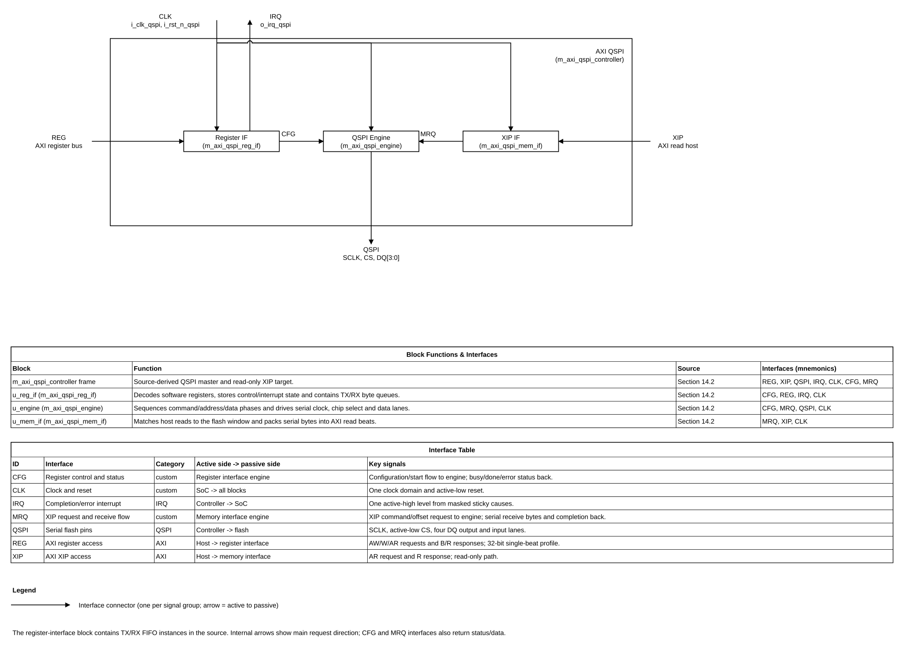

# QSPI Controller and Target IP Design Specification

> **Purpose:** Normative design contract for architecture, RTL, verification, DFT, and physical integration of this IP.
>
> Replace every angle-bracket placeholder. Mark inapplicable sections **N/A** with a reason. Do not silently omit a required decision. Use **TBD** only with its technical impact and the decision needed recorded in [Assumptions, dependencies, and decisions](#20-assumptions-dependencies-and-decisions).
>
> Requirement terms: **shall** = mandatory and testable; **should** = recommended; **may** = optional. Give every mandatory requirement a stable REQ-<AREA>-<NNN> identifier and a verification method.

## Document map

1. [Purpose, scope, and product context](#1-purpose-scope-and-product-context)
2. [Normative references and precedence](#2-normative-references-and-precedence)
3. [Requirements and traceability](#3-requirements-and-traceability)
4. [Features and configurations](#4-features-and-configurations)
5. [Architecture](#5-architecture)
6. [External interfaces and ports](#6-external-interfaces-and-ports)
7. [Clock, reset, and power](#7-clock-reset-and-power)
8. [Parameters and elaboration configurations](#8-parameters-and-elaboration-configurations)
9. [Data representation and arithmetic](#9-data-representation-and-arithmetic)
10. [Detailed functional behavior](#10-detailed-functional-behavior)
11. [Register and programming model (CSR from workbook)](#11-register-and-programming-model)
12. [Error handling and recovery](#12-error-handling-and-recovery)
13. [Performance, power, and area](#13-performance-power-and-area)
14. [RTL implementation contract](#14-rtl-implementation-contract)
15. [Verification specification](#15-verification-specification)
16. [DFT and testability](#16-dft-and-testability)
17. [Physical design and timing integration](#17-physical-design-and-timing-integration)
18. [Security, safety, and reliability](#18-security-safety-and-reliability)
19. [Requirement-to-verification traceability](#19-requirement-to-verification-traceability)
20. [Assumptions, dependencies, and decisions](#20-assumptions-dependencies-and-decisions)
21. [Glossary](#21-glossary)
22. [References used to shape this template](#22-references-used-to-shape-this-template)

## 1. Purpose, scope, and product context

### 1.1 Purpose and scope

This IP provides a reconfigurable serial interface for an SoC to exchange data with external peripherals and flash devices. It shall support Standard SPI in both controller and target roles, and Dual-SPI and Quad-SPI in controller role only. Controller transaction formats shall include 1-1-2, 1-2-2, 1-1-4, 1-4-4 and QPI 4-4-4, selected by configuration registers. Separate controller and Standard SPI target timing engines shall share the external serial IO pad interface. The engines are mutually exclusive: only one role may be active at a time. The controller engine uses `i_clk_serial`; the target engine is clocked directly by external `i_clk_spi_tgt`, avoiding a clock mux on the target sampling path. Role changes require the controller engine to be idle and target CS to be inactive. The SoC shall configure the IP through APB4 CSR and access the flash XIP window through an AXI4 subordinate (slave) interface. In XIP operation, the QSPI IP is the SPI controller toward the external flash.

The SoC-side interfaces are APB4 for control/status and indirect flash operations, plus AXI4 subordinate for memory-mapped XIP reads. XIP is read-only; flash program/erase uses the APB/FIFO path. The IP is flash-agnostic: indirect commands describe a serial command/data phase, and `done` means that phase has completed. Firmware owns write-enable setup, busy/status polling, retry policy, and device-specific QPI entry/exit. The XIP read profile and a few bus/FIFO details remain open in Section 20.

**Included:** Standard SPI controller and target roles; Dual-SPI and Quad-SPI controller operation, including the selected 1-1-2, 1-2-2, 1-1-4, 1-4-4 and QPI 4-4-4 formats; APB4 CSR and indirect flash program/erase through FIFO; read-only AXI4 subordinate XIP path; separate role-specific timing engines sharing one external pad interface, with mutually exclusive roles.

**Excluded:** Dual-SPI or Quad-SPI target operation; simultaneous controller and target transactions; DMA master interface; AXI writes to the XIP window; automatic flash write-enable, busy polling, retry, and vendor-specific recovery sequences. DDR/DTR behavior remains unselected. XIP is read-only. Firmware controls QPI entry/exit through indirect commands; the IP does not assume vendor-specific opcodes or flash status semantics.

### 1.2 Deployment assumptions

| Item | Specification |
|---|---|
| Target SoC / product class | ASIC-integrated SPI controller/target peripheral with APB4 CSR and AXI4 subordinate XIP connection; exact SoC TBD |
| Technology / library assumptions | Standard-cell implementation; process, library, voltage and corners TBD |
| Operating modes and workload | Separate controller and target engines; Standard SPI controller or target; Dual/Quad controller only; transaction type and target workload TBD |
| Security / privilege context | No security or privilege policy specified; register access policy TBD with the system bus choice |
| External dependencies | External SPI target device(s), system bus/CSR interface, clock/reset source, and SoC pad cells; exact device profile TBD |

### 1.3 Feature summary

| Feature ID | Feature | Required / optional | Configuration condition | Requirements |
|---|---|---|---|---|
| FEAT-001 | Standard SPI controller role | Required | Selected when the controller engine is idle; CPOL/CPHA modes 0–3; 4–32-bit words; MSB/LSB order | REQ-MODE-001, REQ-MODE-006, REQ-MODE-007 |
| FEAT-002 | Standard SPI target role | Required | Selected when the target engine is idle and target CS is inactive; direct `i_clk_spi_tgt` clocking; CPOL/CPHA modes 0–3; 4–32-bit words; MSB/LSB order | REQ-MODE-002, REQ-MODE-006, REQ-MODE-007 |
| FEAT-003 | Dual-SPI controller role | Required | Selected when the controller engine is idle | REQ-MODE-003 |
| FEAT-004 | Quad-SPI controller role, including QPI 4-4-4 | Required | Selected by configuration registers when the controller engine is idle | REQ-MODE-004, REQ-MODE-005 |
| FEAT-005 | Separate role timing engines and shared pad interface | Required | Controller and target roles are mutually exclusive; target engine is directly clocked from external SCLK | REQ-ARCH-001, REQ-ARCH-002 |
| FEAT-006 | APB4 control/status register interface | Required | SoC software configures and monitors the IP | REQ-IF-001 |
| FEAT-007 | AXI4 subordinate memory-mapped XIP interface | Required | Parameterized bus widths; default 32-bit address/data, ID width 1, INCR reads up to 16 beats; writes return SLVERR without flash activity | REQ-IF-002 |
| FEAT-008 | Indirect flash program/erase path with FIFO | Required | Software configures/starts operations through APB4; FIFO data uses a custom APB window | REQ-IF-003 |

### 1.4 Real-world application and numeric need

The SoC starts from its internal Boot ROM. After boot, ROM or firmware configures the optional QSPI IP for the attached NOR flash; QSPI is therefore not a prerequisite for first-stage boot. The application is to support flash access and optional XIP across multiple NOR-device command profiles without requiring a different SoC image for each flash family. Six formats are confirmed: Standard `1-1-1`, Dual `1-1-2` and `1-2-2`, Quad `1-1-4` and `1-4-4`, and QPI `4-4-4`. Firmware-controlled indirect commands handle device-specific mode entry/exit, while configuration registers select controller framing. No maximum SCLK, bandwidth, flash capacity, or XIP latency target has been supplied; these remain open in DEC-005.

| Feature ID | Application | Need | Typical values / numeric target | Consequence if absent | Requirements | Source |
|---|---|---|---|---|---|---|
| FEAT-001 | Embedded SoC firmware controls a one-lane sensor, companion MCU, or serial NOR after ROM boot. | A standard controller mode is needed for widely compatible low-speed command/status traffic. | 1 lane; CPOL/CPHA modes 0–3; word lengths 4–32 bits; MSB/LSB. | Firmware cannot communicate with standard SPI peripherals through this IP. | REQ-MODE-001, REQ-MODE-006, REQ-MODE-007 | User-confirmed scope; REF-001 implementation profile. |
| FEAT-002 | A companion processor or test host controls the SoC as a one-lane SPI target. | The SoC must accept standard external-controller transactions using a dedicated target timing engine clocked directly by external SCLK. | 1 lane; CPOL/CPHA modes 0–3; word lengths 4–32 bits. | The SoC cannot act as an SPI target through this IP. | REQ-MODE-002, REQ-MODE-006, REQ-MODE-007 | User-confirmed scope; REF-007 qualified target reference. |
| FEAT-003 | An embedded SoC accesses NOR flash supporting dual-I/O read/program commands, for example the device class illustrated by REF-011. | Two data lanes can reduce transfer clocks for payload phases while retaining serial command/address phases. | Formats 1-1-2 and 1-2-2; 2 data lanes. | Dual-I/O NOR features cannot be used; transfers must use another supported mode. | REQ-MODE-003, REQ-MODE-005 | User-confirmed format set; REF-001 and REF-011. |
| FEAT-004 | An embedded SoC accesses Quad-I/O NOR flash for image storage and optional post-ROM XIP. | Four data lanes support common Quad read/program profiles while preserving one-lane command phases. | Formats 1-1-4 and 1-4-4; 4 data lanes. | Quad-I/O flash profiles cannot be used, limiting image-read options. | REQ-MODE-004, REQ-MODE-005 | User-confirmed format set; REF-001 and REF-011. |
| FEAT-005 | A resource-constrained SoC shares one serial pin group between controller and target use cases. | Shared pads support controller and target use cases; separate timing engines avoid a target clock mux. Role handoff is allowed only when idle. | 2 role-specific timing engines and 1 shared pad interface; at most 1 role active. | A design without sharing would need more area/pads, or could corrupt traffic if ownership overlaps. | REQ-ARCH-001, REQ-ARCH-002 | User-confirmed pad sharing and mutual exclusion; separate timing engines approved under DEC-014. |
| FEAT-006 | Boot ROM and runtime firmware configure the controller for the attached flash and monitor program/erase completion. | APB4 provides a compact software control/status path. | APB4; one APB transaction at a time per APB protocol. | Firmware cannot select the flash profile or observe software-visible operation state. | REQ-IF-001 | User-confirmed SoC interface; REF-009. |
| FEAT-007 | After ROM boot, the CPU may read a memory-mapped external NOR image through the SoC fabric. | XIP allows optional direct CPU reads without copying the entire image into SRAM first. | AXI4 full subordinate; XIP reads only; numeric bandwidth/latency target TBD (DEC-005). | CPU cannot access flash through a memory-mapped path; software must use indirect transfers/copying. | REQ-IF-002, REQ-FUNC-001 | User-confirmed XIP role; REF-010. |
| FEAT-008 | Firmware updates or erases external NOR after ROM has configured the device. | APB-controlled, flash-agnostic indirect serial command/data phases and FIFO data move payload without making XIP writable. Firmware performs write-enable, busy polling, retry and device-specific state management. | Program/erase command and data phases through APB4/FIFO; 32-bit FIFO entries and parameterized depth (default 16). | The SoC has no software-controlled flash update/erase path through this IP. | REQ-IF-003, REQ-FUNC-002 | User-confirmed operation and flash-agnostic firmware responsibility. |

## 2. Normative references and precedence

### 2.1 Normative references

Record exact title, revision, document ID, controlled location/URL, and applicable clauses. Do not cite an unspecified “latest” revision. SPI is a de-facto interface rather than a single formal protocol standard; the supplied Synopsys databook is an implementation reference, not a vendor-neutral standard.

| Ref ID | Document and revision | Applicable clauses | Authority / notes |
|---|---|---|---|
| REF-001 | Synopsys IP DW_apb_ssi Databook, Version 4.05a, February 2025; user-provided document, converted copy at [`dw_apb_ssi_databook_v4_05a.md`](../legacy_qspi_dual_quad_ip_spec/reference/md_doc/dw_apb_ssi_databook_v4_05a.md) | §§2.8.4–2.8.5, 3.5, 4.2, 5.1.1, 5.1.27, Appendix B.2 | Proprietary implementation reference only; not a formal SPI standard; redistribution forbidden |
| REF-002 | User design request and confirmed scope, 2026-11-02 | Standard SPI controller + target with CPOL/CPHA modes 0–3, 4–32-bit configurable words, selectable MSB/LSB order; Dual/Quad controller-only; separate controller/target timing engines share pads and operate mutually exclusively; APB4 CSR/FIFO indirect program/erase; read-only CPU XIP through AXI4 subordinate; QPI 4-4-4 and 1-1-2, 1-2-2, 1-1-4, 1-4-4 selected; QSPI spelling confirmed | Product behavior; remaining interface/transfer details require user decisions |
| REF-006 | lowRISC OpenTitan `spi_host`, commit `41049e9deb40e0602cd5272c40398be380ae2637` | [`HWIP specification`](https://opentitan.org/book/hw/ip/spi_host/index.html), [`DV document`](https://opentitan.org/book/hw/ip/spi_host/dv/index.html), pinned source `hw/ip/spi_host/` | Qualified controller-side architecture/verification reference; Apache-2.0; upstream reports Earl Grey 1.0.0 tapeout |
| REF-007 | lowRISC OpenTitan `spi_device`, commit `41049e9deb40e0602cd5272c40398be380ae2637` | [`HWIP specification`](https://opentitan.org/book/hw/ip/spi_device/index.html), [`DV document`](https://opentitan.org/book/hw/ip/spi_device/dv/index.html), pinned source `hw/ip/spi_device/` | Qualified Standard target reference only; not full Dual/Quad-I/O target; Apache-2.0; upstream reports Earl Grey 1.0.0 tapeout |
| REF-008 | [`Reference-IP research log`](../legacy_qspi_dual_quad_ip_spec/research/vlsit_reference_ip_log.md) | Candidate evidence, exclusions, Chinese-language source review | Research record; not a protocol authority |
| REF-009 | AMBA APB Protocol Specification APB4 (Issue C, v2.0), included in Arm IHI 0024 Issue D, ID041221; converted source `reference/md_doc/vlsit_apb_amba_apb_ihi0024d.md` | §§2.1, 3.1–3.5, Appendix B.1 | Protocol authority for the selected APB4 CSR interface; APB5-only signals are excluded |
| REF-010 | AMBA AXI and ACE Protocol Specification, Arm IHI 0022 Issue H.c (ID012621); private local Markdown source `C:\HQuan\102_MyGithub\VLSIT_RTL_Generator_AI_Model\common_rtl\009_HyperRAM_Controller\reference\md_doc\vlsit_amba_axi_ihi0022hc.md` | Part A, Chapters A1–A6; Appendix G7 for revisions | Protocol authority for the selected full AXI4 subordinate interface. Local source license marks redistribution unconfirmed; source is referenced in place and is not copied into this package. |
| REF-011 | Macronix MX25U51245G/54 Serial NOR Flash datasheet, Rev. 1.2 (July 2020), public manufacturer document | §§7-2, 8, 10-15, 10-18 | Non-normative device example for distinction between 1-1-4 and QPI 4-4-4 and vendor-specific QPI entry/exit; not the selected target flash. [Manufacturer PDF](https://www.macronix.com/Lists/Datasheet/Attachments/8736/MX25U51245G%2054%2C%201.8V%2C%20512Mb%2C%20v1.2.pdf) |
| REF-003 | VLSIT RTL Design Rules v2, VLSIT_RTL_Design_Rule.md (same folder as this template) | All applicable rules | Mandatory RTL coding, hierarchy, reset, CDC, and naming baseline |
| REF-004 | IEEE 1800-2017 SystemVerilog | Synthesizable subset | Subject to REF-003 and selected frontend support |
| REF-005 | VLSIT CSR Specification Template workbook, VLSIT_CSR_Specification_Template.xlsx (same folder as this template) | Configuration and register definition sheets for this IP | Sole authority for the register interface, register map, fields, access types, and reset values (Section 11) |

### 2.2 Source-of-truth and conflict handling

1. The selected external protocol revision defines protocol behavior for the declared interface profile.
2. Approved product requirements and decisions define product-specific behavior.
3. This specification defines the IP contract and shall remain consistent with the selected protocol and the VLSIT RTL Design Rules v2.
4. REF-003 is the mandatory RTL coding, hierarchy, reset, CDC, and naming baseline. If a proposed requirement conflicts with it, revise the specification requirement or choose a compliant implementation; do not create a local RTL exception.
5. REF-005 is the only place where CSRs are specified. Do not declare registers, fields, offsets, access types, or reset values in this specification.
6. Record the exact protocol revision, role, and optional-signal configuration. Do not include protocol signals absent from the selected revision/profile.
7. Resolve conflicts through an explicit product decision; do not guess or weaken a requirement.
8. Reference IPs inform architecture and verification choices only; their feature sets do not silently expand or reduce the requirements in REF-002.

**Naming rule:** VLSIT default naming rule from `VLSIT_RTL_Design_Rule.md`, section 2, path `C:\Users\PC\.codex\skills\vlsit-asic-ip-microspec\reference\templates\VLSIT_RTL_Design_Rule.md`, version 2 (user confirmed 2026-11-01; rule R-026). Planned top module name: `m_qspi`.

### 2.3 Compliance declaration

| Standard | Revision / profile | Role implemented | Options | Deviations |
|---|---|---|---|---|
| Standard SPI | No single formal SPI revision; REF-001 is an implementation reference and the endpoint profile is product-defined | Controller and target | CPOL/CPHA modes 0–3; 4–32-bit words; selectable MSB/LSB order; separate controller and target engines share the external IO pads; target frame groups complete configured words | Peripheral-specific timing remains device-defined; target partial-word and TX-underflow behavior is specified in Sections 10.1 and 10.2 |
| Dual-SPI | Enhanced SPI in REF-001 | Controller only | 1-1-2 and 1-2-2 transaction formats; software selects mode through configuration registers | Opcode/phase support depends on selected flash profile |
| Quad-SPI | Enhanced SPI in REF-001 | Controller only | 1-1-4 and 1-4-4 transaction formats; software selects mode through configuration registers | Opcode/phase support depends on selected flash profile |
| QPI | Device-specific Quad Peripheral Interface defined by the selected flash datasheet; REF-001 is only an implementation reference for configurable multi-I/O instruction/address/data phases | Controller only | 4-4-4 command/address/data format; firmware issues device-specific entry/exit/reset commands through flash-agnostic indirect phases; software-visible configuration selects controller framing only | IP does not infer flash state or status; firmware selects commands from the target datasheet (DEC-008) |
| AMBA APB | APB4 Issue C, v2.0 within REF-009 | Subordinate (Completer) | Generated CSR bank is 32-bit data/16-bit byte address with four strobes; PPROT is ignored; partial-strobe and misaligned accesses return PSLVERR | APB5-only signals not used |
| AMBA AXI | AXI4 full, Arm IHI 0022 Issue H.c (REF-010) | Subordinate | XIP subordinate; parameterized address/data/ID widths; default 32-bit address/data, ID width 1; INCR read bursts 1–16 beats; one outstanding burst; writes return SLVERR | Not AXI4-Lite; FIXED/WRAP/unsupported-size reads return SLVERR; reads while disabled or in target mode return SLVERR; round-robin XIP/indirect arbitration; XIP writes never issue flash commands |

## 3. Requirements and traceability

| ID | Requirement using shall/should/may | Source | Applies to | Verification method |
|---|---|---|---|---|
| REQ-MODE-001 | The IP shall provide one-lane Standard SPI operation in controller role. | REF-002 §scope | CFG-STD-CTRL | Directed simulation with SPI target BFM; protocol assertions |
| REQ-MODE-002 | The IP shall provide one-lane Standard SPI operation in target role. | REF-002 §scope | CFG-STD-TGT | Directed simulation with SPI controller BFM; protocol assertions |
| REQ-MODE-003 | The IP shall provide two-lane Dual-SPI controller operation in 1-1-2 and 1-2-2 formats, using the selected MSB/LSB lane mapping in Section 6.3. | REF-002 §scope; user-confirmed lane mapping | CFG-DUAL-CTRL | Directed simulation with Dual-SPI target BFM; lane and phase checks |
| REQ-MODE-004 | The IP shall provide four-lane Quad-SPI controller operation in 1-1-4 and 1-4-4 formats, using the selected MSB/LSB lane mapping in Section 6.3. | REF-002 §scope; user-confirmed lane mapping | CFG-QUAD-CTRL | Directed simulation with Quad-SPI target BFM; lane and phase checks |
| REQ-MODE-005 | The IP shall provide configurable controller transactions in 1-1-2, 1-2-2, 1-1-4, 1-4-4 and QPI 4-4-4 formats, with software-visible format selection and the selected MSB/LSB lane mapping. | REF-002 §mode selection; user-confirmed lane mapping | CFG-DUAL-CTRL, CFG-QUAD-CTRL | Directed BFM tests for each phase/lane configuration and bit order; CSR mode-selection tests |
| REQ-MODE-006 | Standard SPI controller and target operation shall support all four CPOL/CPHA combinations, modes 0 through 3, selected by software-visible configuration fields. | REF-002 §SPI profile | CFG-STD-CTRL, CFG-STD-TGT | Controller/target BFM tests across all mode combinations and clock-edge assertions |
| REQ-MODE-007 | Standard SPI controller and target operation shall support software-configurable word lengths from 4 through 32 bits and selectable MSB-first or LSB-first bit order. | REF-002 §SPI profile | CFG-STD-CTRL, CFG-STD-TGT | Directed tests at minimum, maximum and representative word lengths in both bit orders |
| REQ-MODE-008 | The active command shall use a configuration snapshot captured at acceptance; CSR writes while busy affect only later commands. A `start` request while busy shall be ignored, cleared in the CSR, and set sticky `fl_err`. | User-confirmed decision 2026-11-02 | Controller/target commands | TEST-013, WF-015 verify stable active settings and rejected busy start |
| REQ-MODE-009 | In SPI target mode, if the RX FIFO is full when a complete word arrives, the IP shall drop that newest word, set sticky `rx_err`, and continue sampling until target CS deasserts. | User-confirmed decision 2026-11-02 | CFG-STD-TGT | TEST-014, WF-016 verify no FIFO write for lost word and continued sampling |
| REQ-MODE-010 | The target shall provide an APB-written one-word TX head holding register so the first MISO word is available before the first external SCLK edge; the bundled payload remains stable until the target acknowledges consumption. Firmware shall preload this head while CS is inactive; remaining words use the target TX FIFO. | User-confirmed decision 2026-11-02 | APB TX_HEAD window / CFG-STD-TGT | Verify CPHA 0 first bit before first SCLK edge, CPHA 1 first shift, head full/empty and target acknowledgement |
| REQ-IF-005 | AXI XIP requests shall be naturally aligned to their transfer size; a misaligned read shall return SLVERR without issuing a flash command. | User-confirmed decision 2026-11-02 | XIP configuration | TEST-015, WF-017 verify error response and idle serial pins |
| REQ-ARCH-001 | The IP shall provide separate controller timing and Standard SPI target timing engines that share the external serial IO pad interface and are mutually exclusive. The target timing engine shall be clocked directly by `i_clk_spi_tgt`. | User-approved DEC-014 | All configurations | RTL hierarchy review; target-edge capture checks in all CPOL/CPHA modes |
| REQ-ARCH-002 | Controller/target roles shall be mutually exclusive; a role change shall be accepted only when the controller engine is idle and target CS is inactive. | User-approved architecture | All configurations | Directed role-switch tests while idle, while controller busy, and while target CS is active |
| REQ-ARCH-003 | XIP and indirect flash operations shall use the controller timing engine; requests while target role is selected shall not start controller traffic. | REF-002 §shared-engine architecture | Controller/target mode transitions | XIP read returns SLVERR; indirect start sets sticky `fl_err`; neither emits controller traffic |
| REQ-IF-001 | The IP shall expose an APB4 subordinate interface for software-visible control and status registers. | REF-002 §SoC interface | All configurations | APB protocol assertions; CSR read/write tests |
| REQ-IF-002 | The IP shall expose a parameterized AXI4 subordinate XIP interface with default 32-bit address/data, ID width 1, INCR reads of 1–16 beats and one outstanding burst. It shall accept byte, halfword and word transfers only at naturally aligned addresses, reject FIXED/WRAP and bursts crossing 4 KiB, return SLVERR for unsupported, disabled, misaligned or out-of-window reads, and return flash data through AXI R. | User selections 2026-11-02 | XIP configuration | AXI protocol assertions; alignment, burst-limit, 4 KiB boundary and error tests |
| REQ-IF-003 | The IP shall provide a software-controlled indirect flash program/erase path through APB4 and a FIFO data path. | REF-002 §flash operations | Controller configurations | Directed program/erase tests against a flash model; FIFO boundary and error checks |
| REQ-IF-004 | AXI4 write transactions targeting the read-only XIP window shall complete with BRESP=SLVERR and shall cause no flash-side effect. | REF-002 §XIP read-only decision | XIP configuration | AXI write-channel assertions and flash-pin monitor prove SLVERR response and no serial program/erase command |
| REQ-FUNC-001 | The IP shall translate accepted AXI4 XIP reads into serial-flash read operations and return the corresponding bytes through AXI R responses. | REF-002 §XIP behavior | Controller/XIP configurations | Flash-model comparison of returned bytes; AXI protocol assertions |
| REQ-FUNC-002 | The IP shall execute software-started flash program and erase operations through the APB4/FIFO indirect path. | REF-002 §indirect operations | Controller configurations | Flash-model program/erase checks; operation completion and error checks |

## 4. Features and configurations

| Configuration ID | Enabled features | Disabled features | Interfaces / widths | Intended use | Verification target |
|---|---|---|---|---|---|
| CFG-STD-CTRL | Standard SPI; controller role; 1-1-1; modes 0–3; 4–32-bit words; MSB/LSB | Target role, Dual/Quad/QPI | APB4 CSR/FIFO and AXI4 XIP; widths TBD | Connect the SoC to a one-lane peripheral or flash | SPI modes/transactions and selected device profile |
| CFG-STD-TGT | Standard SPI; target role; 1-1-1; modes 0–3; 4–32-bit words; MSB/LSB | Controller role, Dual/Quad/QPI and XIP | APB4 CSR; AXI4 XIP disabled while target role is selected | Accept one-lane transactions from an external controller | External-clock sampling, CS framing, TX/RX response |
| CFG-DUAL-CTRL | Dual-SPI controller; 1-1-2 and 1-2-2 | Target role, Quad/QPI | APB4 CSR/FIFO and AXI4 XIP; widths TBD | Two-lane flash/peripheral transfers | Instruction/address/data phases, lane direction and timing |
| CFG-QUAD-CTRL | Quad-SPI controller; 1-1-4 and 1-4-4 | Target role, Dual/QPI | APB4 CSR/FIFO and AXI4 XIP; widths TBD | Four-lane flash/peripheral transfers with serial command | Instruction/address/data phases, lane direction and timing |
| CFG-QPI-CTRL | QPI controller; 4-4-4 | Target role, Standard/Dual/other Quad phase formats | APB4 CSR/FIFO and AXI4 XIP; firmware enters/exits flash QPI with indirect commands | Four-lane command, address and data transfers | Firmware command entry/exit, device-specific reset recovery, phase alignment and XIP reads |

## 5. Architecture

### 5.1 Overview and block responsibilities

| Block | Responsibility | Inputs / outputs | Clock/reset domain | State or storage |
|---|---|---|---|---|
| APB decode and custom FIFO window | Decodes generated CSRs, role-routed TX/RX FIFO windows and the target TX head window. | APB4 pins; FIFO/head requests and responses; role/target-active status | `i_clk_apb`; reset release synchronized to APB | Address decode and APB response state |
| Generated APB4 CSR and control | Holds role, CPOL/CPHA, frame, format, XIP profile, indirect command, status and interrupt state; workbook is authoritative. | APB4 CSR requests; control/status to both engines and adapters | `i_clk_apb`; control/status cross through CDC | Generated CSR state |
| AXI4 XIP subordinate | Accepts memory-mapped reads, validates the XIP profile and converts reads to flash work; writes return SLVERR without flash activity. | Five AXI4 channels; request/completion to controller path | `i_clk_axi`; asynchronous to APB and `i_clk_serial` | Address, ID, beat-count and response state |
| Indirect command controller | Executes software-programmed flash read/program/erase command phases using the controller TX/RX queues. | APB CSR/FIFO requests; controller-engine request/completion | APB control in `i_clk_apb`; engine in `i_clk_serial` | Command/address/length and operation state |
| Controller request arbiter | Round-robin grants the controller engine to one XIP burst or indirect command; no controller grant while target role is active. | XIP and indirect requests, role status; controller-engine grant | `i_clk_serial`; request/response CDC to AXI and APB | Owner/grant state |
| Controller timing engine | Generates controller SCLK/CS and serializes Standard, Dual, Quad and QPI controller transactions. | Granted work, controller TX/RX FIFO, shared IO pads | `i_clk_serial` / `i_rst_n_serial` | Controller shift, phase, divider and frame state |
| Target timing engine | Captures Standard SPI target frames directly from external SCLK; drives the first word from an APB-preloaded TX head, then from the target TX queue. | External target clock/CS, TX head, target TX/RX FIFO and shared IO pads | Positive/negative input capture banks; shift state and TX FIFO pointer use the CPOL/CPHA-selected SCLK edge clock. Reset release is synchronized to APB so stopped SCLK does not lose initial edges. | Target shift, phase, word and frame state |
| Role-specific TX/RX FIFOs | Isolates APB data for controller and target roles; APB FIFO windows select the active role pair. Each queue is 32 bits, depth `PARA_FIFO_DEPTH` (default 16, power of two, minimum 2). A separate APB-held target TX head supplies the first target word. | APB FIFO/head windows and the corresponding engine | Four dual-clock queues: APB↔controller and APB↔target | FIFO pointers, head payload and storage |
| Serial pin mux | Selects controller or target IO drive/enable; samples common IO inputs. Controller SCLK/CS outputs and target SCLK/CS inputs remain separate top-level signals for SoC pad mapping. | Role select, both engine IO drives/enables and external IO input | Role is APB-controlled; engine data is clock-domain local | Output-enable and lane-direction state |
| Reset/CDC support | Synchronizes reset release and transfers commands, status and events across asynchronous domains; AFIFO carries payload data. | APB, AXI, controller, target clocks and reset | Each destination clock domain | Synchronizers, mailboxes and async FIFO pointers |

### 5.2 Block diagram

The SoC connects APB4 to an address decoder that selects generated CSRs or role-routed TX/RX FIFO-data windows, including a one-word target TX head window. AXI4 XIP reads and APB indirect commands use the controller timing engine; AXI4 XIP writes return SLVERR without flash-pin activity. The AXI XIP interface (`i_clk_axi`), controller engine (`i_clk_serial`) and target engine (`i_clk_spi_tgt`) are separate asynchronous clock domains. Target RX capture banks use both external SCLK edges. Target TX FIFO read timing selects SCLK or inverted SCLK for the configured shift edge; selection is static during a frame and changes only with CS inactive and FIFO read disabled. The APB-preloaded TX head drives the first MISO word before the first target SCLK edge; remaining words use the asynchronous target TX FIFO. Target reset release is synchronized to APB because external SCLK may stop while idle; the SoC must keep CS inactive until this release is complete. The two engines share the serial IO pad interface and are mutually exclusive. Controller CS count is parameterized; target mode has one external active-low CS input.

### 5.3 Transaction and dataflow

**XIP read:** The AXI4 subordinate accepts one outstanding INCR read burst, checks the configured profile and range, and translates each in-window beat to flash byte address `ARADDR - PARA_XIP_BASE_ADDR`. Default bus settings are 32-bit address/data, ID width 1 and at most 16 beats; widths and the burst limit are parameters. Byte, halfword and word reads are supported on a 32-bit data bus. FIXED/WRAP, unsupported size/profile, disabled XIP and out-of-window beats return RRESP=SLVERR for each rejected beat without issuing that beat's flash command. For accepted beats, the engine sends configured opcode, address, optional mode bits and dummy cycles, then samples data in the selected lane format. R data, ID, RRESP and RLAST obey AXI backpressure. Firmware configures the device-specific read profile; flash busy/status remains firmware-managed.

**Indirect command/data phase:** Firmware configures opcode, address length/value, lane format, dummy cycles, direction and transfer count through APB4 CSRs; it writes TX payload through the TX FIFO-data window and reads RX payload through the RX FIFO-data window. Proposed byte offsets are `0x1000` (TX push) and `0x1004` (RX pop). The serial engine executes only the requested command/data phase. `done` indicates completion of that phase, not completion of the flash's internal program/erase cycle. Firmware must separately issue write-enable, poll flash status/busy, perform retries and manage device-specific QPI entry/exit. The IP does not interpret vendor status bits or claim that a flash program/erase operation succeeded.

**Standard SPI target:** `m_qspi_target_engine` uses separate positive-edge and negative-edge capture banks for external `i_clk_spi_tgt`. The APB-written target TX head is preloaded before CS assertion and supplies the first MISO word without waiting for a target clock; subsequent words come from the target TX FIFO, whose read pointer is clocked on the configured shift edge. Firmware must not write the head while target CS is active. Target reset is released through the APB clock domain before CS assertion. Configured words are grouped from sampled bits; an incomplete final RX word is discarded with sticky `rx_err`, and TX underflow transmits ones with sticky `tx_err`. A full RX FIFO drops the newest completed word, sets sticky `rx_err`, and continues sampling until CS deasserts. XIP and indirect controller operations are blocked while target role is selected or target CS is active.

### 5.4 Invariants

1. The controller and target engines have independent state and clocks but share a pin mux; only one role can own the external IO pads at a time.
2. Controller/target role changes are accepted only when the controller engine is idle and `i_spi_cs_tgt_n` is inactive (REQ-ARCH-002).
3. Target RX capture uses direct positive- and negative-edge banks clocked by `i_clk_spi_tgt`; the derived, mode-selected TX FIFO clock changes only while CS is inactive and TX FIFO read enable is low.
4. XIP and indirect operations use only the controller engine. Requests while target role is selected or target CS is active are rejected without controller pin activity.
5. XIP supports one outstanding burst; accepted bursts are atomic under round-robin arbitration with indirect work.
6. Each role has separate TX/RX queues. The APB FIFO data window accesses only the queue pair selected by `qspi_ctrl_role`.

## 6. External interfaces and ports

### 6.1 Interface inventory

| Interface ID | Type and revision | Role | Direction at IP boundary | Clock domain | Required / optional | Configurations |
|---|---|---|---|---|---|---|
| IF-001 | AMBA APB4 (APB Issue C, v2.0; Arm IHI 0024D) | Subordinate (slave/Completer) | Receives CSR and custom FIFO-window accesses; returns read data/response | `i_clk_apb`; asynchronous to AXI and controller engine | Required | All |
| IF-002 | AMBA AXI4 full memory-mapped XIP (Arm IHI 0022H.c) | Subordinate (slave) | Accepts XIP reads and responds SLVERR to writes; default 32-bit address/data, ID width 1, INCR bursts up to 16 beats | `i_clk_axi`; separate asynchronous domain from controller engine | Required | XIP configurations |
| IF-003 | Standard/Dual/Quad SPI serial pin interface; de-facto profile | Controller or target, selected by mode | Shared bidirectional IO[3:0]; controller SCLK output or target external SCLK input; parameterized controller CS count and one target CS input | Controller engine clock `i_clk_serial`; target SCLK is an external asynchronous clock domain | Required | All, with Dual/Quad controller-only |

### 6.2 Complete port list

| Port | Direction | Width | Meaning (function) | Clock domain | Signal type | Reset / idle value | Timing / sampling | Configurations |
|---|---|---:|---|---|---|---|---|---|
| `i_clk_apb` | Input | 1 | APB4 and generated CSR clock | CLK-APB | clock | Stopped/unspecified during reset | Rising-edge APB sampling | All |
| `i_rst_n_apb` | Input | 1 | Active-low reset for APB decode, CSR and APB-side FIFO interface | CLK-APB reset domain | reset | Asserted LOW | Asynchronous assertion; synchronous release to `i_clk_apb` | All |
| `i_clk_axi` | Input | 1 | AXI4 XIP interface clock, separate from controller-engine clock | CLK-AXI | clock | Stopped/unspecified during reset | Rising-edge AXI sampling | XIP |
| `i_rst_n_axi` | Input | 1 | Active-low reset for AXI XIP adapter | CLK-AXI reset domain | reset | Asserted LOW | Asynchronous assertion; synchronous release to `i_clk_axi` | XIP |
| `i_clk_serial` | Input | 1 | Controller serial-engine reference clock | CLK-SERIAL | clock | Stopped/unspecified during reset | Rising-edge internal engine sampling | Controller modes |
| `i_rst_n_serial` | Input | 1 | Active-low controller reset source | CLK-SERIAL reset domain; source for APB-synchronized target reset copies | reset | Asserted LOW | Controller release synchronized to `i_clk_serial`; target reset copies release synchronized to `i_clk_apb` before CS assertion | All serial modes |
| `i_apb_psel` | Input | 1 | APB4 select | CLK-APB | level | 0 | Sample with PENABLE/PREADY at rising edge | All |
| `i_apb_penable` | Input | 1 | APB4 access phase | CLK-APB | level | 0 | Rising-edge APB handshake | All |
| `i_apb_paddr` | Input | `PARA_APB_ADDR_W` (16 default) | Byte address for CSR and FIFO windows | CLK-APB | data | 0 | Stable through ACCESS completion | All |
| `i_apb_pwrite` | Input | 1 | APB4 write direction | CLK-APB | level | 0 | Stable through ACCESS completion | All |
| `i_apb_pwdata` | Input | 32 | APB4 write data | CLK-APB | data | 0 | Sample on completed write | All |
| `i_apb_pstrb` | Input | 4 | APB4 byte write strobes | CLK-APB | data | 0 | CSR partial-strobe writes and FIFO writes without all four strobes return PSLVERR | All |
| `i_apb_pprot` | Input | 3 | APB4 protection attributes; not used for access control | CLK-APB | data | 0 | Ignored; CSR generator protection check is disabled (`i_protect_en=0`) | All |
| `o_apb_pready` | Output | 1 | APB4 transfer completion / wait-state control | CLK-APB | level | 0 | Asserted during ACCESS when selected target completes | All |
| `o_apb_prdata` | Output | 32 | APB4 read data for CSR or FIFO window | CLK-APB | data | 0 | Valid when PREADY completes a read | All |
| `o_apb_pslverr` | Output | 1 | APB4 error response | CLK-APB | level | 0 | Meaningful with PREADY in ACCESS | All |
| `i_axi_awaddr` | Input | `PARA_AXI_ADDR_W` (32 default) | AXI write address; writes to XIP are rejected | CLK-AXI | data | 0 | AXI AW handshake | XIP |
| `i_axi_awid` | Input | `PARA_AXI_ID_W` (1 default) | AXI write transaction ID | CLK-AXI | data | 0 | Captured on AW handshake | XIP |
| `i_axi_awlen` | Input | 8 | AXI write burst length, beats minus one | CLK-AXI | data | 0 | AXI4 fixed-width sideband | XIP |
| `i_axi_awsize` | Input | 3 | AXI write beat size | CLK-AXI | data | 0 | Captured on AW handshake | XIP |
| `i_axi_awburst` | Input | 2 | AXI write burst type | CLK-AXI | data | 0 | Captured on AW handshake | XIP |
| `i_axi_awlock` | Input | 1 | AXI write lock attribute | CLK-AXI | level | 0 | Captured on AW handshake | XIP |
| `i_axi_awcache` | Input | 4 | AXI write cache attributes | CLK-AXI | data | 0 | Captured on AW handshake | XIP |
| `i_axi_awprot` | Input | 3 | AXI write protection attributes | CLK-AXI | data | 0 | Captured on AW handshake | XIP |
| `i_axi_awqos` | Input | 4 | AXI write QoS attribute | CLK-AXI | data | 0 | Captured on AW handshake | XIP |
| `i_axi_awregion` | Input | 4 | AXI write region attribute | CLK-AXI | data | 0 | Captured on AW handshake | XIP |
| `i_axi_awvalid` | Input | 1 | AXI write-address valid | CLK-AXI | level | 0 | Held until AWREADY | XIP |
| `o_axi_awready` | Output | 1 | AXI write-address ready | CLK-AXI | level | 0 | Handshake when AWVALID and AWREADY are HIGH | XIP |
| `i_axi_wdata` | Input | `PARA_AXI_DATA_W` (32 default) | AXI write data; no flash side effect | CLK-AXI | data | 0 | Captured on W handshake | XIP |
| `i_axi_wstrb` | Input | `PARA_AXI_DATA_W/8` | AXI write byte strobes | CLK-AXI | data | 0 | Captured on W handshake | XIP |
| `i_axi_wlast` | Input | 1 | AXI final write-data beat marker | CLK-AXI | level | 0 | Captured on W handshake | XIP |
| `i_axi_wvalid` | Input | 1 | AXI write-data valid | CLK-AXI | level | 0 | Held until WREADY | XIP |
| `o_axi_wready` | Output | 1 | AXI write-data ready | CLK-AXI | level | 0 | Handshake when WVALID and WREADY are HIGH | XIP |
| `o_axi_bid` | Output | `PARA_AXI_ID_W` (1 default) | AXI write response ID | CLK-AXI | data | 0 | Stable while BVALID and not BREADY | XIP |
| `o_axi_bresp` | Output | 2 | AXI write response; SLVERR for any write to read-only XIP | CLK-AXI | data | 0 | Stable while BVALID and not BREADY | XIP |
| `o_axi_bvalid` | Output | 1 | AXI write response valid | CLK-AXI | level | 0 | Held until BREADY | XIP |
| `i_axi_bready` | Input | 1 | AXI write response ready | CLK-AXI | level | 0 | Sampled on rising edge | XIP |
| `i_axi_araddr` | Input | `PARA_AXI_ADDR_W` (32 default) | AXI read address into XIP window | CLK-AXI | data | 0 | AXI AR handshake | XIP |
| `i_axi_arid` | Input | `PARA_AXI_ID_W` (1 default) | AXI read transaction ID | CLK-AXI | data | 0 | Captured on AR handshake | XIP |
| `i_axi_arlen` | Input | 8 | AXI read burst length, beats minus one; default acceptance max is 16 beats | CLK-AXI | data | 0 | Captured on AR handshake | XIP |
| `i_axi_arsize` | Input | 3 | AXI read beat size | CLK-AXI | data | 0 | Captured on AR handshake | XIP |
| `i_axi_arburst` | Input | 2 | AXI read burst type; INCR supported by default profile | CLK-AXI | data | 0 | Captured on AR handshake | XIP |
| `i_axi_arlock` | Input | 1 | AXI read lock attribute | CLK-AXI | level | 0 | Captured on AR handshake | XIP |
| `i_axi_arcache` | Input | 4 | AXI read cache attributes | CLK-AXI | data | 0 | Captured on AR handshake | XIP |
| `i_axi_arprot` | Input | 3 | AXI read protection attributes | CLK-AXI | data | 0 | Captured on AR handshake | XIP |
| `i_axi_arqos` | Input | 4 | AXI read QoS attribute | CLK-AXI | data | 0 | Captured on AR handshake | XIP |
| `i_axi_arregion` | Input | 4 | AXI read region attribute | CLK-AXI | data | 0 | Captured on AR handshake | XIP |
| `i_axi_arvalid` | Input | 1 | AXI read-address valid | CLK-AXI | level | 0 | Held until ARREADY | XIP |
| `o_axi_arready` | Output | 1 | AXI read-address ready | CLK-AXI | level | 0 | Handshake when ARVALID and ARREADY are HIGH | XIP |
| `o_axi_rid` | Output | `PARA_AXI_ID_W` (1 default) | AXI read response ID | CLK-AXI | data | 0 | Stable while RVALID and not RREADY | XIP |
| `o_axi_rdata` | Output | `PARA_AXI_DATA_W` (32 default) | AXI XIP read data | CLK-AXI | data | 0 | Stable while RVALID and not RREADY | XIP |
| `o_axi_rresp` | Output | 2 | AXI read response; SLVERR for unsupported read profile or unavailable XIP | CLK-AXI | data | 0 | Stable with RVALID | XIP |
| `o_axi_rlast` | Output | 1 | AXI final read-beat marker | CLK-AXI | level | 0 | Asserted on final beat of accepted burst | XIP |
| `o_axi_rvalid` | Output | 1 | AXI read response valid | CLK-AXI | level | 0 | Held with payload until RREADY | XIP |
| `i_axi_rready` | Input | 1 | AXI read response ready | CLK-AXI | level | 0 | Sampled on rising edge | XIP |
| `o_clk_spi_ctrl` | Output | 1 | Controller-generated serial clock | Divider from CLK-SERIAL; `f_sclk = f_ref / (2 x (divisor + 1))` | clock | CPOL-selected idle level; CPOL reset is 0 and divisor reset is `0xFFFF` | Divider-defined active edges | Controller modes |
| `i_clk_spi_tgt` | Input | 1 | External SCLK for Standard SPI target capture | CLK-TARGET | clock | External idle level follows CPOL | Positive/negative capture banks sample input; target TX read pointer uses the CPOL/CPHA-selected SCLK/inverted-SCLK clock; reset release is APB-synchronized before CS assertion | Standard target |
| `i_spi_cs_tgt_n` | Input | 1 | Active-low external target select | Target SCLK domain | level | Inactive HIGH | Frame boundary; sampled in target SCLK domain | Standard target |
| `i_spi_io_i` | Input | 4 | Samples external IO0–IO3 | Selected controller/target sampling domain | data | 0 | Lane/edge selected by transfer phase | All serial modes |
| `o_spi_io_o` | Output | 4 | Drives external IO0–IO3 | Selected controller/target domain | data | 0 | Valid with matching output enable | All serial modes |
| `o_spi_io_oe` | Output | 4 | Per-lane output enable; deassert to release flash-driven lanes | Selected controller/target domain | level | 0 (all lanes released) | Changes at defined phase/turnaround boundary | All serial modes |
| `o_spi_cs_ctrl_n` | Output | `PARA_NUM_CS` (default 1) | Active-low controller chip-select outputs | CLK-SERIAL | level | All HIGH | Setup/hold/high timing from programmed settings; exact minimums DEC-003 | Controller modes |
| `o_int_qspi` | Output | 1 | Combined QSPI interrupt output for enabled pending CSR event causes | `i_clk_apb` domain | level | 0 | Level asserted while any enabled sticky event is pending; sources and W1C clear behavior follow `qspi_irq_raw`, `qspi_irq_en`, and `qspi_irq_sts` in the CSR workbook | All |

### 6.3 Protocol behavior

**APB4 CSR and indirect path — REF-009, APB4 Issue C v2.0:** APB signals are sampled on rising edges of `i_clk_apb`; a transfer completes when PSEL, PENABLE and PREADY are HIGH. The generated CSR uses 32-bit data, 16-bit byte addresses and four PSTRB bits. The decoder selects the CSR aperture `0x0000–0x0FFF`, TX push at `0x1000`, RX pop at `0x1004`, or target TX head at `0x1008`. The head window accepts writes only in target role, while CS is inactive, and while the one-word slot is empty; a read returns its full/valid status in bit 0. `PPROT` is ignored (`i_protect_en=0`) and `i_slverr_en=1`. Misaligned accesses, partial writes, TX-full writes, RX-empty reads, head-full writes, and writes to the head while CS is active return PSLVERR without changing queue/head state. Aligned unmapped offsets inside the CSR aperture read zero and ignore writes. FIFO data is little-endian: TX sends `[7:0]`, `[15:8]`, `[23:16]`, `[31:24]`; RX stores the first received byte in `[7:0]`. CSR state is APB-clocked; command/status crossings use explicit CDC.

**AXI4 XIP subordinate — REF-010, Part A, Chapters A1–A6:** The interface uses independent AW, W, B, AR and R channels clocked by `i_clk_axi`. A transfer occurs when VALID and READY are HIGH at a rising edge; sources hold VALID and payload stable until handshake. Defaults are 32-bit address/data, ID width 1 and maximum 16-beat INCR reads; widths and maximum beats are overridable parameters. Only one XIP burst may be outstanding. The profile accepts byte, halfword and word transfers only at naturally aligned addresses. FIXED/WRAP bursts, bursts crossing a 4 KiB boundary, sizes greater than 4 bytes, misaligned addresses, disabled XIP, target-role selection, and addresses outside the configured XIP window return SLVERR for each rejected beat without issuing a flash command. Flash address is `ARADDR - PARA_XIP_BASE_ADDR`. XIP and indirect requests use round-robin arbitration when the controller engine becomes idle; a granted burst is atomic. Every XIP write completes with BRESP=SLVERR and causes no flash-side effect. REF-010 requires response VALID signals LOW during reset and prohibits combinational paths between interface inputs and outputs.

**SPI-family serial interface — REF-001 plus the selected endpoint datasheet:** Standard SPI supports CPOL/CPHA modes 0–3 and 4–32-bit words with selectable bit order. Controller formats are 1-1-1, 1-1-2, 1-2-2, 1-1-4, 1-4-4 and QPI 4-4-4. In each simultaneous multi-lane group, MSB-first maps the next highest-order bit to the highest active IO lane and then descends (IO1→IO0 for two lanes; IO3→IO0 for four); LSB-first maps the next lowest-order bit to IO0 and then ascends. This rule also applies within each byte. The CSR command fields select opcode, address-byte count, lane format, dummy cycles, direction and payload byte count. An accepted command snapshots configuration; CSR writes while busy stage values for later commands. A busy `start` is ignored and hardware-cleared so it cannot launch later, and sets sticky `fl_err`. Controller TX underflow or RX overflow finishes the current byte, applies CS hold, deasserts CS and sets the matching sticky error without setting `done`. In target mode, a full RX FIFO drops the newest completed word, sets sticky `rx_err`, and continues sampling until `i_spi_cs_tgt_n` deasserts. The IP executes only configured phases; it does not perform implicit WREN, busy polling, retry or flash-status interpretation. Firmware controls QPI state through explicit indirect commands. Device electrical timing remains subject to the selected endpoint datasheet.

| Case | Legal behavior | Illegal / unsupported case | IP response | Requirement IDs |
|---|---|---|---|---|
| APB4 CSR access | APB4 SETUP/ACCESS handshake; complete when PREADY is HIGH in ACCESS | Misaligned address, partial-strobe write, or address outside implemented windows | PSLVERR; `PPROT` ignored; aligned unmapped CSR offsets inside `0x0000–0x0FFF` read zero/write ignored | REQ-IF-001 |
| APB4 indirect flash data | Software configures operations and uses TX/RX FIFO windows at byte offsets `0x1000`/`0x1004` | TX FIFO full on write, RX FIFO empty on read, partial write strobe | PSLVERR with no pointer movement; successful TX writes enqueue one 32-bit word and RX reads pop one word | REQ-IF-003 |
| APB4 target TX head | Software preloads the first target word at byte offset `0x1008` before CS assertion | Head slot full, wrong role, active CS or partial write | PSLVERR; successful write holds one 32-bit word until target acknowledges its consumption; read returns full/valid at bit 0 | REQ-MODE-010 |
| AXI4 XIP read | INCR burst (default maximum 16 beats); byte/halfword/word at naturally aligned address; R backpressure supported | FIXED/WRAP, >4-byte size, misaligned address, 4 KiB crossing, disabled/out-of-window XIP, or target role selected | RRESP=SLVERR for each rejected beat; no flash command for rejected work | REQ-IF-002, REQ-IF-005, REQ-ARCH-003 |
| AXI4 write to XIP | No flash program/erase through AXI XIP path | Any write request to the XIP region | Complete the AXI write response with BRESP=SLVERR and no flash-side effect | REQ-IF-004 |
| Standard SPI transaction | Controller or target role, CPOL/CPHA mode 0–3, 4–32-bit word, selectable bit order | Controller/target overlap or reserved/invalid mode encoding | Snapshot configuration at acceptance; CSR writes while busy stage for later commands; busy `start` is ignored and cleared and sets sticky `fl_err` | REQ-MODE-001, REQ-MODE-002, REQ-MODE-006, REQ-MODE-007, REQ-MODE-008 |
| Dual/Quad/QPI controller transaction | Mode register selects 1-1-2, 1-2-2, 1-1-4, 1-4-4 or 4-4-4; firmware enters/exits QPI through indirect commands | Dual/Quad/QPI target operation or reserved mode/format | Reject invalid format before CS/SCLK and set sticky `fl_err`; external flash QPI state is firmware-owned; lane ordering follows Section 6.3 | REQ-MODE-003, REQ-MODE-004, REQ-MODE-005 |

### 6.4 Internal block-level connections

The following names define the logical wires used by the architecture diagram and planned RTL hierarchy. They are interface bundles only; CSR register and field details remain exclusively in the CSR workbook.

| Diagram interface | Source → destination | Signal names | Clock domain / CDC |
|---|---|---|---|
| APBC | APB decoder → generated CSR | `w_csr_psel`, `w_csr_penable`, `w_csr_paddr`, `w_csr_pwrite`, `w_csr_pwdata`, `w_csr_pstrb`, `w_csr_pprot`, `w_csr_pready`, `w_csr_prdata`, `w_csr_pslverr` | `i_clk_apb` |
| APBF | APB decoder → TX FIFO | `w_tx_fifo_push`, `w_tx_fifo_data`, `w_tx_fifo_strb`, `w_tx_fifo_full` | `i_clk_apb` to selected serial domain by dual-clock FIFO |
| APBR | RX FIFO → APB decoder | `w_rx_fifo_pop`, `w_rx_fifo_data`, `w_rx_fifo_empty` | Selected serial domain to `i_clk_apb` by dual-clock FIFO |
| CFG | Generated CSR → command/XIP control | `w_ctrl_cfg`, `w_xip_cfg`, `w_indirect_cfg`, `w_status`, `w_irq_pending` | APB to AXI/serial by CDC |
| XIPQ | AXI XIP adapter → CDC/arbiter | `w_xip_req_valid`, `w_xip_req_addr`, `w_xip_req_id`, `w_xip_req_len`, `w_xip_req_ready`, `w_xip_rsp_valid`, `w_xip_rsp_ready`, `w_xip_rsp_data`, `w_xip_rsp_id`, `w_xip_rsp_last`, `w_xip_rsp_resp` | `i_clk_axi` ↔ `i_clk_serial` |
| INDQ | Indirect command controller → CDC/arbiter | `w_ind_req_valid`, `w_ind_req_cmd`, `w_ind_req_addr`, `w_ind_req_len`, `w_ind_req_ready`, `w_ind_rsp_valid`, `w_ind_rsp_done`, `w_ind_rsp_error` | APB ↔ `i_clk_serial` |
| ARBR | CDC/request queue → arbiter | `w_ctrl_req_valid`, `w_ctrl_req_owner`, `w_ctrl_req_ready` | `i_clk_serial`; source requests cross CDC |
| GRNT | Arbiter → serial engine | `w_eng_start`, `w_eng_owner`, `w_eng_mode`, `w_eng_busy`, `w_eng_done`, `w_eng_error` | `i_clk_serial` |
| TX | TX FIFO → serial engine | `w_tx_data`, `w_tx_valid`, `w_tx_ready` | Dual-clock FIFO between APB and selected engine domain |
| RX | Serial engine → RX FIFO | `w_rx_data`, `w_rx_valid`, `w_rx_ready` | Dual-clock FIFO between selected engine domain and APB |
| CLKS | Independent engine clocks | `i_clk_serial`, `i_clk_spi_tgt` | Controller engine uses `i_clk_serial`; target engine uses external `i_clk_spi_tgt` directly |
| PINS | Serial engine ↔ pin mux | `w_sclk_ctrl`, `w_spi_cs_n_ctrl`, `w_spi_io_i`, `w_spi_io_o`, `w_spi_io_oe` | Selected serial timing domain |
| IRQEV | CDC → CSR interrupt/status state | `w_irq_done`, `w_irq_tx_err`, `w_irq_rx_err`, `w_irq_flash_err` | Engine/target domain to `i_clk_apb` |

### 6.5 Interrupts and events

| Signal/event | Polarity | Assert condition | Clear/deassert condition | Mask/priority | Crossing | Reset state |
|---|---|---|---|---|---|---|
| `o_int_qspi` combined level | Active HIGH | `(|(qspi_irq_raw & qspi_irq_en))`; raw causes are sticky and W1C, and `qspi_irq_sts` reports enabled pending causes | Software writes one to the matching `qspi_irq_raw` bit to clear it | One combined level; no priority encoding; CSR provides `done`, `tx_err`, `rx_err` and `fl_err`. `fl_err` reports IP-detected configuration/transfer errors, not flash status | Event/status synchronizers into APB domain; output is APB-domain level | LOW after reset |

## 7. Clock, reset, and power

### 7.1 Clock domains

| Domain | Clock port | Edge | Frequency range | Source | Relationship to other clocks | Gating policy |
|---|---|---|---|---|---|---|
| CLK-APB | `i_clk_apb` | Rising | Supplied by SoC; no IP-specific numeric frequency target selected | SoC APB clock source | Asynchronous to `i_clk_axi` | Do not gate during APB access; SoC controls idle clock policy |
| CLK-AXI | `i_clk_axi` | Rising | Supplied by SoC; no IP-specific numeric frequency target selected | SoC AXI clock source | Asynchronous to APB, controller engine and target SCLK | Do not gate during accepted AXI transaction |
| CLK-SERIAL | `i_clk_serial` | Rising | Supplied by SoC; no IP-specific numeric frequency target selected | SoC serial-engine clock source | Asynchronous to APB and AXI; controller engine timing reference | Do not gate during controller transfer |
| CLK-TARGET | `i_clk_spi_tgt` | External target-provided clock | External controller supplies clock; no IP-specific numeric frequency limit is selected | External endpoint and SoC pad timing constrain the maximum | Asynchronous clock group; directly clocks target engine | SoC SDC plus target timing constraints |
| CLK-SCLK-OUT | `o_clk_spi_ctrl` | CPOL/CPHA-selected edges | `f_ref / (2 x (divisor + 1))`; SoC clock and flash limit determine legal range | Internal divider | Controller engine clock output; target engine uses `i_clk_spi_tgt` directly | No divider/CS change during active transfer |

### 7.2 CDC and RDC

| Crossing ID | From → to | Signals | Structure | Reset handling | Constraints / verification |
|---|---|---|---|---|---|
| CDC-001 | APB to controller engine | Commands, configuration snapshots and completion/status | Request/acknowledge mailbox for atomic command/status bundles; dual-clock FIFOs for payload data | Reuse `m_vlsit_rst_sync` in each clock domain | CDC/RDC analysis and asynchronous-clock simulations |
| CDC-002 | Target SCLK/shift-edge clock to APB | Target RX/TX FIFO payloads, frame events and TX-head acknowledge | Reuse `m_vlsit_afifo_top` for target RX/TX tails; RX writes occur in the target shift-edge clock domain; TX reads use a mode-selected SCLK/inverted-SCLK generated clock; synchronize TX-head acknowledge to APB | Target reset asserts asynchronously and releases synchronized to APB before CS assertion; keep TX read enable low while clock selection changes; target TX-head payload remains stable until acknowledged | CDC/RDC analysis, generated-clock STA constraints, bundled-data stability check and target frequency-ratio checks |
| CDC-003 | AXI XIP to serial engine | XIP request/address, response/data and ownership | Request/response mailbox plus dual-clock request/response queues based on `m_vlsit_afifo_top`; one outstanding burst | Reuse `m_vlsit_rst_sync` in AXI and serial domains | CDC/RDC analysis and AXI ordering/backpressure assertions |
| CDC-004 | APB control/FIFO to serial engine | Configuration snapshots, indirect commands, completion/status and TX/RX FIFO data | Request/acknowledge mailbox plus `m_vlsit_afifo_top` dual-clock FIFOs; source dependencies listed in `filelist.f` | Reuse `m_vlsit_rst_sync` in APB and serial domains | CDC/RDC analysis, FIFO pointer checks and command ordering tests |

### 7.3 Reset domains and sequencing

| Reset ID | Port | Polarity / assertion | Sync or async | Scope | Deassertion | Reset value |
|---|---|---|---|---|---|---|
| RST-APB | `i_rst_n_apb` | Active-low | Asynchronous assertion; synchronous release to APB domain | APB decoder, generated CSR and APB-side FIFO logic | Synchronized to `i_clk_apb` | APB response inactive; CSR resets per workbook |
| RST-AXI | `i_rst_n_axi` | Active-low | Asynchronous assertion; synchronous release to AXI domain | AXI adapter and AXI-side request/response queues | Synchronized to `i_clk_axi` | AXI VALID outputs inactive; pending state follows the in-flight reset policy |
| RST-SERIAL/TARGET | `i_rst_n_serial` | Active-low | Asynchronous assertion; synchronous release separately to `i_clk_serial` and `i_clk_spi_tgt`; assertion works even when target SCLK stops | Controller engine and controller-side queues; target engine and target-side queues | Synchronized to each local clock | Controller idle; CS inactive; IO output enables disabled; target outputs released; FIFO contents invalid |

### 7.4 Power intent (if applicable)

No internal power-domain sequencing, retention, isolation, or power-state control is selected for this IP. SoC-level power intent is owned by the integrator. If the block or its pads can be powered down independently, isolation and reset sequencing must be specified in DEC-007 before RTL freeze.
## 8. Parameters and elaboration configurations

| Parameter | Purpose | Default | Legal values / range | Dependencies / invalid combinations | Effect |
|---|---|---|---|---|---|
| `PARA_APB_ADDR_W` | APB4 byte-address width | 16 (fixed by selected CSR generator) | 16 | Must cover CSR offsets and custom FIFO windows | APB4 address decode and ports |
| `PARA_AXI_ADDR_W` | AXI4 byte-address width | 32 (user-selected default) | 32–64 proposed; exact supported range validated at RTL elaboration | Must cover configured XIP window and selected flash address range | AXI AW/AR address ports and XIP translation |
| `PARA_AXI_DATA_W` | AXI4 data width | 32 (user-selected default) | 32, 64 or 128 proposed | Byte-aligned power-of-two width; beat size cannot exceed data width | AXI W/R data and strobes |
| `PARA_AXI_ID_W` | AXI4 transaction ID width | 1 (user-selected default) | 1–16 proposed | IDs are preserved; outstanding depth is implementation-bounded | AXI AW/AR and B/R ID ports |
| `PARA_AXI_MAX_BURST` | Maximum accepted XIP INCR read beats | 16 (user-selected default) | 1–16 | `ARLEN + 1` must not exceed this value; AXI LEN stays 8 bits | XIP buffering and serial burst segmentation |
| `PARA_XIP_BASE_ADDR` | Base address of the AXI XIP window | `0x00000000` | 32-bit byte address | Window must not wrap the supported 32-bit address space | AXI-to-flash address translation |
| `PARA_XIP_SIZE_BYTES` | Size of the AXI XIP window in bytes | `0x00000000` (disabled until overridden) | 0–`0xFFFFFFFF`; zero disables the window | `base + size` must be within the 32-bit XIP aperture; upper AXI address bits must be zero when `PARA_AXI_ADDR_W > 32` | Range checking and flash address translation |
| `PARA_NUM_CS` | Controller chip-select output count | 1 proposed | 1–16 proposed; CSR draft selection field is 4 bits | Target role has exactly one external target CS input; SoC pads constrain count | Width of `o_spi_cs_ctrl_n` |
| `PARA_FIFO_DEPTH` | Entries in each TX/RX/XIP asynchronous queue | 16 | Power of two, minimum 2; overridable parameter; practical maximum set by implementation memory budget | CDC and latency/burst tolerance (DEC-004/005/010) | Storage, backpressure and area |

| Configuration | Parameter overrides | Features/interfaces | Expected hierarchy | Elaboration/lint/synthesis target |
|---|---|---|---|---|
| CFG-BASE | Defaults from rows above; AXI widths/max burst and controller CS count may be overridden | APB4, AXI4 XIP, separate controller/target engines sharing serial pads, TX/RX buffering | `m_qspi` and submodules in Section 14.2 | Elaborate Standard controller/target, Dual, Quad and QPI; validate each parameter set for address, data, FIFO and CDC constraints |

## 9. Data representation and arithmetic

| Quantity | Width | Encoding / range | Extension / truncation | Overflow / invalid behavior |
|---|---:|---|---|---|
| Standard SPI transfer word | 4–32 bits, selected by software | Unsigned serial bit vector; MSB-first or LSB-first selected by software | No arithmetic extension; word framing follows `qspi_frame.word_len_m1` | Encodings for 4–32 bits are legal; reserved encodings are rejected before a transfer and reported through command status |
| Dual-SPI data beat | 2 serial data lanes | Two bits transferred per SDR sampling edge when selected | MSB-first: next highest-order bit on IO1, next on IO0; LSB-first: next lowest-order bit on IO0, next on IO1 | Transfers are byte-counted; unused tail bits are not sent beyond `qspi_len.byte_count` |
| Quad-SPI/QPI data beat | 4 serial data lanes | Four bits transferred per SDR sampling edge when selected | MSB-first: next highest-order bit on IO3, then IO2, IO1, IO0; LSB-first: next lowest-order bit on IO0, then IO1, IO2, IO3 | Transfers are byte-counted; unused tail bits are not sent beyond `qspi_len.byte_count` |
| AXI XIP address/data | `PARA_AXI_ADDR_W` / `PARA_AXI_DATA_W`; defaults 32/32 | Byte-addressed XIP; flash address is `ARADDR - PARA_XIP_BASE_ADDR`; supported read sizes are byte, halfword and word on a 32-bit bus | `qspi_xip_cfg.addr_bytes` selects 3- or 4-byte flash addresses; each beat is checked against `PARA_XIP_BASE_ADDR` and `PARA_XIP_SIZE_BYTES`; out-of-window beats return SLVERR | FIXED/WRAP, sizes wider than the bus, or disabled/out-of-range accesses return SLVERR per DEC-002 |

## 10. Detailed functional behavior

### 10.1 Modes and state transitions

| Mode/state | Entry condition | Behavior | Exit condition | Outputs / side effects |
|---|---|---|---|---|
| RESET | Reset assertion in each domain | Clear local state and FIFO pointers; discard in-flight IP work; drive controller CS inactive, SCLK to reset CPOL level, IO output enables low, and AXI response VALID low | Reset deassertion synchronized locally by `m_vlsit_rst_sync`; SoC resets requesters with the IP so no accepted request waits for a response across reset | External flash state is not reset by the IP; firmware performs device-specific recovery if required |
| STD_CTRL | Software selects controller role while idle | Generate SCLK/CS and transfer one-lane words with modes 0–3, 4–32-bit word length and selected bit order; divider is `f_ref / (2 x (divisor + 1))` | Transfer complete or abort/error condition | `qspi_cs_cfg` selects CS and setup/hold/inactive delays; active-transfer FIFO error behavior remains to be confirmed |
| STD_TARGET | Software selects target role while idle | Group external CS frames into configured 4–32-bit words; each complete RX word enters a right-justified 32-bit entry; discard a partial tail and set sticky RX error; TX underflow transmits ones and sets sticky TX error because external SCLK cannot be stalled | External CS deassertion ends the frame | CPOL/CPHA modes 0–3 and selected bit order apply; target-SCLK domain crosses through asynchronous FIFOs |
| DUAL_CTRL | Software selects Dual-SPI controller format while idle | Execute 1-1-2 or 1-2-2 command/address/data phases | Serial command/data phase completion | Opcode, address length, dummy cycles and direction are software-configured |
| QUAD_CTRL | Software selects Quad-SPI controller format while idle | Execute 1-1-4 or 1-4-4 command/address/data phases | Serial command/data phase completion | Opcode, address length, dummy cycles and direction are software-configured |
| QPI_CTRL | Software selects QPI 4-4-4 while idle after firmware has placed the flash in QPI state using an indirect command | Send command, address and data over four lanes | Serial command/data phase completion | Firmware controls entry/exit; the IP does not infer or verify external flash QPI state |
| XIP_READ | AXI4 INCR read accepted while XIP is enabled and controller role is selected | CDC request to serial engine; serialize configured opcode/address/mode/dummy/data phases in the selected 1-1-1/dual/quad/QPI format; flash address is `ARADDR - PARA_XIP_BASE_ADDR`; one outstanding burst, default maximum 16 beats | AXI R response accepted; each unsupported or out-of-window beat returns SLVERR without issuing its flash command | Read sizes are byte/halfword/word on the default 32-bit bus; flash internal status is firmware-managed |
| INDIRECT_CMD | Software programs command/address/length/direction and starts through APB4/FIFO path | Execute exactly the configured serial phases, consume TX FIFO or produce RX FIFO bytes as selected; firmware sequences WREN/status/retry commands separately | `done` marks completion of this serial command/data phase | No device-specific busy polling; XIP and indirect arbitration is round-robin, burst is atomic after grant |

### 10.2 Operations

| Operation ID | Inputs / preconditions | Processing semantics | Result / completion | Latency / ordering |
|---|---|---|---|---|
| OP-001 | AXI4 XIP INCR read request while XIP is enabled and controller role is selected | Accept one burst up to `PARA_AXI_MAX_BURST` beats; translate each byte address by subtracting `PARA_XIP_BASE_ADDR`; cross request to `i_clk_serial`; issue configured read phases in the selected serial format and assemble bus-width beats | AXI R beats with matching ID and RLAST; stable under R backpressure; invalid profile or out-of-window beat responds SLVERR without a flash command | Latency depends on SoC clock, divider, opcode, dummy cycles and target flash; no numeric target selected |
| OP-002 | APB4 indirect command whose firmware-selected opcode writes data; TX data supplied through FIFO | Send configured opcode/address and consume the requested number of TX payload bytes; do not issue implicit WREN or poll status | `done` indicates serial data phase ended; this does not imply flash program completion | Firmware issues separate WREN/status/retry commands according to device datasheet |
| OP-003 | APB4 indirect command whose opcode performs an erase; address and opcode programmed in CSR | Send only configured opcode/address phases; do not wait for flash internal erase completion | `done` indicates command phase ended; firmware polls device status with a separate indirect read | Erase granularity, timeout and retry are firmware/device policy |
| OP-004 | Standard SPI controller transaction configured while engine idle | Snapshot role/format/timing/command settings at acceptance; shift the configured byte count over one data lane using selected CPOL/CPHA and bit order; TX/RX use 32-bit little-endian FIFO entries; `qspi_cs_cfg` controls CS select/setup/hold/inactive delays. CSR writes while busy stage values for later commands; `start` while busy is ignored and sets `fl_err`. | RX data and `done` at normal serial command/data phase completion; on TX underflow or RX overflow, finish the current byte, deassert CS after configured hold time, set the matching sticky error, and do not set `done` | First TX byte is `[7:0]`; first RX byte is placed in `[7:0]`; each byte uses the configured serial MSB/LSB order |
| OP-005 | Standard SPI target selected while engine idle; external CS/SCLK received | Use the APB-preloaded TX head for the first target word and the target TX FIFO for subsequent words. Group sampled bits into configured words; write each complete RX word to a right-justified 32-bit FIFO entry. If RX FIFO is full, drop the newest word, set sticky `rx_err`, and continue until CS deasserts. Discard an incomplete final word with sticky `rx_err`; on TX underflow, transmit ones and set sticky `tx_err`. | RX data / target frame completion | Target SCLK is asynchronous and cannot be stalled. Example T1: configured 8-bit word, RX FIFO full, external data `0xA5`; no write occurs for that word, `rx_err` sets, and later frame bits continue until CS rises. The first MISO bit is driven from the held TX-head register before the first SCLK edge. |
| OP-006 | Dual/Quad/QPI controller transaction selected while engine idle | Send configured command/address/dummy/data phases in 1-1-2, 1-2-2, 1-1-4, 1-4-4 or QPI 4-4-4 format; multi-lane order follows the MSB/LSB mapping in Section 6.3 | RX data / command-phase completion | Firmware configures device-specific opcodes and QPI state; the flash must already be in QPI when 4-4-4 is selected |

### 10.3 Cycle-level behavior

**User-approved waveform plan (2026-11-02).** The 17-case set covers XIP, indirect command phases, Standard SPI controller/target, multi-lane formats, FIFO errors, arbitration, APB/AXI errors, reset and the three later-confirmed corner cases. Links point to the reviewed figures; where the original illustration conflicts with a confirmed rule, the waveform will be revised in the RTL deliverable copy before implementation.

| Waveform ID | Function / operation | Scenario (success / error / corner) | Signals shown | Figure | Confirmed behavior |
|---|---|---|---|---|---|
| WF-001 | OP-001: AXI XIP read | Successful INCR burst with R-channel backpressure | AR/R channels, CDC request/response, serial flash phases | [SVG](../../figures/waveforms/qspi_wf_001.svg) / [WaveJSON](../../figures/waveforms/qspi_wf_001.json) | One outstanding burst; R payload stable under backpressure |
| WF-002 | OP-001: AXI XIP read | Unsupported profile, size, burst, address or XIP-disabled request | AR/R channels, error response, serial pins | [SVG](../../figures/waveforms/qspi_wf_002.svg) / [WaveJSON](../../figures/waveforms/qspi_wf_002.json) | SLVERR; no flash command for rejected request |
| WF-003 | OP-002: Indirect program-data phase | APB command setup and TX FIFO payload | APB, TX FIFO, command engine, serial pins, `done` | [SVG](../../figures/waveforms/qspi_wf_003.svg) / [WaveJSON](../../figures/waveforms/qspi_wf_003.json) | `done` ends serial phase; firmware owns flash status polling |
| WF-004 | OP-003: Indirect erase/status sequence | Erase command phase, then a distinct firmware-issued status-read command | APB, serial command phases, `done`, firmware status poll | [SVG](../../figures/waveforms/qspi_wf_004.svg) / [WaveJSON](../../figures/waveforms/qspi_wf_004.json) | No internal WIP polling or implicit flash wait |
| WF-005 | OP-004: Standard SPI controller | CPOL=0/CPHA=0, 8-bit MSB-first transfer | `o_clk_spi_ctrl`, CS, IO0, TX/RX word | [SVG](../../figures/waveforms/qspi_wf_005.svg) / [WaveJSON](../../figures/waveforms/qspi_wf_005.json) | Example only; all four modes are required |
| WF-006 | OP-004: Configuration while active | CSR config writes and `start` while transfer is busy | APB, busy, active/shadow config, CS/SCLK, `fl_err` | [SVG](../../figures/waveforms/qspi_wf_006.svg) / [WaveJSON](../../figures/waveforms/qspi_wf_006.json) | Active snapshot unchanged; busy start is cleared and sets `fl_err` |
| WF-007 | OP-005: Standard SPI target | External controller frame and asynchronous target clock | `i_clk_spi_tgt`, target CS, IO0/IO1, RX/TX FIFO | [SVG](../../figures/waveforms/qspi_wf_007.svg) / [WaveJSON](../../figures/waveforms/qspi_wf_007.json) | Partial RX word discarded; target TX underflow transmits ones |
| WF-008 | OP-006: Dual/Quad controller | 1-1-2, 1-2-2, 1-1-4, 1-4-4 phase transitions | SCLK, CS, IO[3:0], output enables | [SVG](../../figures/waveforms/qspi_wf_008.svg) / [WaveJSON](../../figures/waveforms/qspi_wf_008.json) | Lane groups use the confirmed MSB/LSB lane mapping in Section 6.3 |
| WF-009 | OP-006: QPI entry | Firmware indirect entry command before selecting 4-4-4 | APB command, serial lanes, mode selection | [SVG](../../figures/waveforms/qspi_wf_009.svg) / [WaveJSON](../../figures/waveforms/qspi_wf_009.json) | Firmware supplies device-specific opcode/state change |
| WF-010 | OP-006: QPI exit | Firmware indirect exit/reset command before another format | APB command, serial lanes, mode selection | [SVG](../../figures/waveforms/qspi_wf_010.svg) / [WaveJSON](../../figures/waveforms/qspi_wf_010.json) | IP does not track flash QPI state |
| WF-011 | APB CSR/FIFO access | Successful access and FIFO full/empty/partial-strobe errors | APB4, FIFO full/empty, push/pop, PSLVERR | [SVG](../../figures/waveforms/qspi_wf_011.svg) / [WaveJSON](../../figures/waveforms/qspi_wf_011.json) | Full-word FIFO strobes; errors do not move pointers |
| WF-012 | AXI write to XIP | BRESP=SLVERR with no flash-side activity | AW/W/B channels, serial pins | [SVG](../../figures/waveforms/qspi_wf_012.svg) / [WaveJSON](../../figures/waveforms/qspi_wf_012.json) | Read-only XIP |
| WF-013 | XIP/indirect arbitration | Both requesters pending; round-robin grant and atomic XIP burst | AXI AR/R, APB command, grant/owner, engine | [SVG](../../figures/waveforms/qspi_wf_013.svg) / [WaveJSON](../../figures/waveforms/qspi_wf_013.json) | Round robin between bursts/commands |
| WF-014 | Reset during transfer | Reset clears local state and discards in-flight work | reset domains, APB/AXI valid-ready, busy, CS/SCLK, IO enable | [SVG](../../figures/waveforms/qspi_wf_014.svg) / [WaveJSON](../../figures/waveforms/qspi_wf_014.json) | SoC resets related requesters; serial pins safe during reset |
| WF-015 | Configuration snapshot | CSR writes and busy `start` during active command | APB, busy, active/shadow config, CS/SCLK, `fl_err` | [SVG](../../figures/waveforms/qspi_wf_015.svg) / [WaveJSON](../../figures/waveforms/qspi_wf_015.json) | Confirmed 2026-11-02 |
| WF-016 | Target RX overflow | Drop newest complete word; continue sampling the frame | target SCLK/CS, IO0, FIFO full/write/drop, `rx_err` | [SVG](../../figures/waveforms/qspi_wf_016.svg) / [WaveJSON](../../figures/waveforms/qspi_wf_016.json) | Confirmed 2026-11-02 |
| WF-017 | XIP alignment error | Misaligned halfword read returns SLVERR without flash request | ARVALID/READY, ARADDR/ARSIZE, RRESP/RLAST, engine request | [SVG](../../figures/waveforms/qspi_wf_017.svg) / [WaveJSON](../../figures/waveforms/qspi_wf_017.json) | Confirmed 2026-11-02 |

The waveform files provide edge-by-edge visual timing for these scenarios. The verification plan below defines pass criteria; they remain planned checks until RTL and a testbench exist.

### 10.4 Arbitration, buffering, and throughput

The controller engine performs one controller transfer at a time; the target engine captures external frames in its own clock domain. Role control and the pin mux ensure only one engine owns pads at a time. AXI XIP requests cross from `i_clk_axi` to the controller timing domain; APB indirect commands cross from `i_clk_apb`; the controller arbiter grants XIP and indirect requests round-robin when idle, with one XIP burst outstanding and served atomically once granted. Firmware must avoid issuing XIP reads when the attached flash is internally busy or otherwise unavailable; the IP does not poll flash status or gate XIP based on vendor-specific busy state. Target role excludes controller operations while selected or while target CS is active. Controller and target TX/RX FIFOs are separate dual-clock queues; depth and APB byte-strobe behavior follow DEC-010: FIFO-window writes require all four strobes; TX-full writes and RX-empty reads return PSLVERR without pointer movement. No numeric throughput or latency target was supplied (DEC-005).

### 10.5 Memories and storage

| Storage ID | Kind | Depth × width | Ports | Read latency | Write mask | Reset/init | ECC/parity | Implementation |
|---|---|---|---|---|---|---|---|---|
| MEM-001 | Controller TX FIFO | `PARA_FIFO_DEPTH` × 32 bits; default depth 16, power-of-two and minimum 2 | APB write / controller engine read; asynchronous clocks | Asynchronous FIFO latency per `m_vlsit_afifo_top` | No byte mask; APB FIFO window requires full-word writes | Reset pointers only; payload contents invalid after reset | No ECC/parity requirement selected | Reuse `m_vlsit_afifo_top` |
| MEM-002 | Controller RX FIFO | `PARA_FIFO_DEPTH` × 32 bits; default depth 16, power-of-two and minimum 2 | Controller engine write / APB read; asynchronous clocks | Asynchronous FIFO latency per `m_vlsit_afifo_top` | None | Reset pointers only; payload contents invalid after reset | No ECC/parity requirement selected | Reuse `m_vlsit_afifo_top` |
| MEM-003 | Target TX FIFO | `PARA_FIFO_DEPTH` × 32 bits; default depth 16, power-of-two and minimum 2 | APB write / target engine read; APB and selected shift-edge clocks | Asynchronous FIFO latency per `m_vlsit_afifo_top`; first word bypasses through APB-held head | No byte mask; APB FIFO window requires full-word writes | Reset pointers only; payload contents invalid after reset | No ECC/parity requirement selected | Reuse `m_vlsit_afifo_top` for tail words; `m_qspi_target_tx_head` for first word |
| MEM-004 | Target RX FIFO | `PARA_FIFO_DEPTH` × 32 bits; default depth 16, power-of-two and minimum 2 | Target engine write / APB read; selected shift-edge and APB clocks | Asynchronous FIFO latency per `m_vlsit_afifo_top` | None | Reset pointers only; payload contents invalid after reset | No ECC/parity requirement selected | Reuse `m_vlsit_afifo_top` |
| MEM-005 | AXI XIP request/response queues | Parameterized width/depth; one outstanding burst, up to `PARA_AXI_MAX_BURST` beats | AXI XIP adapter to/from controller engine across `i_clk_axi` and `i_clk_serial` | Async FIFO/mailbox latency; AXI backpressure holds response | No write mask; read-only response data | Reset clears queue pointers and discards in-flight work; requester reset coordination required | No ECC/parity requirement selected | Reuse `m_vlsit_afifo_top` for queue crossings |

The FIFO wrappers use `m_vlsit_afifo_top`; full/empty, overflow/underflow, pointer reset and CDC behavior follow that implementation. FIFO payload is not reset; reset clears validity/pointers and discards in-flight transfers. AXI XIP response ordering follows the single outstanding burst and AXI R-channel backpressure rules in DEC-002.

## 11. Register and programming model

### 11.1 CSR specification source

| Item | Specification |
|---|---|
| CSR workbook file | [`qspi_CSR_Specification_RTL.xlsx`](../../qspi_CSR_Specification_RTL.xlsx) beside this specification |
| Sheet used for this IP | `CSR` |
| Workbook revision / date | RTL working copy; `fl_err` description aligned to the user-confirmed flash-agnostic behavior |
| CSR generator | APB-CSR-Generator v1.2; repository: [APB-CSR-Generator](https://github.com/nguyenquanicd/APB-CSR-Generator) |
| CSR module name | `m_vlsit_csr_qspi` (planned generated CSR module) |
| Register prefix | `qspi`, selected by user |
| Asynchronous | `0`: generated CSR bank is synchronous to APB; bus-to-engine CDC is outside the generated CSR logic |
| APB clock and register clock | `i_clk_apb` clocks both APB4 and the generated CSR bank; the serial engine is a separate `i_clk_serial` domain |
| Source of `i_protect_en` and `i_slverr_en` | Constant tie-offs: `i_protect_en=0`, `i_slverr_en=1` |

Workbook requirements:

- Register names use the selected `qspi_` prefix and stay within the CSR-generator name limit. The workbook is authoritative for register/field definitions, reset values and access behavior.
- Generated CSRs are separate from custom FIFO data accesses because the generator does not implement FIFO enqueue/dequeue side effects.
- Custom APB byte offsets are TX FIFO push `0x1000`, RX FIFO pop `0x1004`, and target TX head `0x1008`; writes require all four PSTRB bits. The head write is allowed only in target role, with CS inactive and an empty head slot.
- FIFO byte order is little-endian: TX sends `[7:0]` first and RX stores the first byte in `[7:0]`; each byte's serial bit order follows the selected Standard SPI MSB/LSB setting.

### 11.2 Software sequences

Software uses the names from the CSR workbook. Startup loads the chosen flash profile before enabling XIP; indirect program/erase uses the FIFO windows and command controls; role changes are requested only when the controller engine is idle and target CS is inactive. Firmware enters/exits QPI through indirect commands before selecting 4-4-4 framing. Detailed command sequences depend on the selected flash part.

### 11.3 CSR connection to the design

| Workbook register.field group | Direction at the CSR | Design signal | Clock domain of the signal | Behavior notes |
|---|---|---|---|---|
| Controller/target configuration | CSR to engine | Role, CPOL/CPHA, word frame, lane format, divider and selected CS | APB to controller/target engines by role-selected CDC | Snapshot at operation acceptance; CSR writes while busy apply only to later operations; target/controller clock selection changes only while idle |
| XIP profile configuration | CSR to XIP adapter/engine | Enable, opcode, address-byte count, format, dummy cycles and optional mode value | APB to AXI/controller domains by CDC | Firmware configures before enabling XIP; field definitions are authoritative in workbook |
| Indirect command configuration | CSR to indirect sequencer | Opcode, format, address-byte count, dummy cycles, direction, start, address and byte count | APB to controller/target engines by role-selected CDC | Command executes only when controller role owns the engine |
| Status and interrupt state | Engine to CSR / CSR to interrupt output | Busy, FIFO state, completion/error causes, enable and W1C clear state | Engine/target to APB by CDC | `fl_err` means an IP-detected invalid command configuration or unsupported phase profile; it does not report flash-internal status |
| FIFO data window | APB to TX FIFO; RX FIFO to APB | TX push `0x1000`; RX pop `0x1004`; target TX head `0x1008` | APB/serial crossings use dual-clock FIFO; target head payload is held stable until acknowledged | Custom APB logic, not generated CSR; 32-bit little-endian words |

### 11.4 APB access behavior of the CSR

| Case | Behavior |
|---|---|
| Normal CSR read or write | Generated CSR baseline, synchronous to `i_clk_apb`; PREADY/PSLVERR behavior follows the generated workbook configuration |
| Write with PSTRB not all ones | Return PSLVERR; do not update CSR or enqueue FIFO data |
| Address not word aligned | Return PSLVERR |
| Aligned unmapped CSR offset in `0x0000–0x0FFF` | Read returns zero; write is ignored |
| Address outside CSR `0x0000–0x0FFF` and data/head windows `0x1000`/`0x1004`/`0x1008` | Return PSLVERR |
| `PPROT` attributes | Ignored; `i_protect_en=0` |
| FIFO TX push / RX pop | TX write enqueues one 32-bit word if not full; RX read dequeues one word if not empty; full/empty returns PSLVERR and does not move pointers |
| Reset | CSR reset values follow the workbook; local state/FIFO pointers clear and in-flight work is discarded; SoC resets requesters with the IP |

## 12. Error handling and recovery

| Error ID | Detection condition | Observable response/status | Interrupt | Clear/recovery | Reset behavior |
|---|---|---|---|---|---|
| ERR-001 | Unsupported or malformed APB CSR access | APB PSLVERR follows selected generated-CSR settings; confirm in DEC-009 | Candidate APB error cause; DEC-006 | Software corrects address/access and clears sticky cause | CSR state resets per workbook; FIFO contents invalid |
| ERR-002 | AXI write access to the read-only XIP region | Complete with BRESP=SLVERR and no flash-side effect | Candidate error cause; DEC-006 | No flash operation is launched | AXI-side pending state follows reset protocol and DEC-004 |
| ERR-003 | FIXED/WRAP burst, burst crossing 4 KiB, size greater than 4 bytes, misaligned ARADDR, disabled XIP, target role selected, or beat address outside `[PARA_XIP_BASE_ADDR, PARA_XIP_BASE_ADDR + PARA_XIP_SIZE_BYTES)` | Return RRESP=SLVERR for each rejected beat; do not issue a flash command for rejected work | No dedicated interrupt cause; `fl_err` is reserved for locally detected command/configuration errors | Software/interconnect corrects the address/profile; the IP does not retry | Reset clears pending AXI state and discards in-flight work |
| ERR-004 | TX FIFO underflow or RX FIFO overflow during a controller operation; target RX FIFO full at a completed word; target TX underflow or partial RX word; invalid FIFO-window access | Controller finishes current byte, applies CS hold, deasserts CS and aborts without `done`; sticky `tx_err`/`rx_err` reports loss. Target drops newest complete word when full, sets sticky `rx_err`, and continues until CS deassertion; target TX underflow transmits ones; partial final RX word is discarded with sticky `rx_err`. APB full/empty accesses return PSLVERR without pointer movement. | Sticky TX/RX error events; level interrupt follows `qspi_irq_en` | Software checks status, refills/drains FIFO, clears raw event with W1C, then restarts or handles target-frame loss | Reset clears FIFO pointers and sticky causes; contents are invalid |
| ERR-005 | External flash reports busy, rejects an opcode, or fails a program/erase operation | Not detected or interpreted by this flash-agnostic IP; indirect `done` only reports completion of the serial command/data phase | No IP interrupt is generated for flash-internal status | Firmware reads the device status with an indirect command and applies device-specific timeout/retry/recovery policy | Flash state and recovery are firmware/device responsibilities |
| ERR-006 | `start` written while busy, or invalid/reserved mode/format at command acceptance | Busy operation continues using its latched configuration. CSR writes stage values for later commands. Busy `start` is ignored and hardware-cleared; invalid operation is rejected before CS/SCLK. Both set sticky `fl_err`; APB write completes without PSLVERR. | `fl_err` contributes to `o_int_qspi` when enabled | Software waits for idle, selects a legal configuration, then starts again; clear `fl_err` by W1C | Reset clears local busy/config snapshot state; external flash mode is unchanged. Example B1: accept mode 0/8-bit, write mode 3/16-bit and `start` while busy; active frame remains mode 0/8-bit, rejected start is cleared and `fl_err=1`; next command uses mode 3/16-bit. |

## 13. Performance, power, and area

| Metric ID | Metric | Target / limit | Conditions | Measurement method | Hard / goal |
|---|---|---|---|---|---|
| PPA-001 | Maximum AXI/APB/core frequency and maximum generated SCLK | TBD; application and external flash profile required (DEC-005) | Process, voltage, temperature and configuration TBD | STA with named SDC constraints | TBD |
| PPA-002 | Standard-cell area | TBD; target library and FIFO sizes required (DEC-005, DEC-010) | Library, utilization and configuration TBD | Synthesis/placed cell area | TBD |
| PPA-003 | Dynamic and leakage power | TBD; activity, voltage and corner required (DEC-005) | Activity and corner TBD | Power analysis with documented vector/estimation method | TBD |
| PERF-001 | XIP first-beat latency, sustained read bandwidth, program/erase service and target-mode rate | TBD; application values required in Section 1.4/DEC-005 | AXI/flash traffic, SCLK and dummy cycles TBD | Simulation with flash model plus analytical lane-rate bound | TBD |

## 14. RTL implementation contract

### 14.1 Required coding baseline

The VLSIT RTL Design Rules v2 in VLSIT_RTL_Design_Rule.md (same folder as this template) is the mandatory RTL coding authority. Specifications and RTL deliverables shall comply with it; do not add project-local RTL exceptions.

At minimum: use one synthesizable module per .sv file with matching module/filename; keep each top a structural wrapper containing the interface, parameters, interconnect declarations, and named submodule instances only; use ANSI ports with input wire and output logic; end every active-low non-reset signal name in _n; use unsigned four-state logic vectors; and keep SVA/testbench/UVM code outside synthesis RTL. Use always_comb or continuous assignments for combinational logic, with defaults and explicit case defaults, and always_ff for state with one clock per process and separate next-state logic.

Declare overridable parameters as `parameter logic [31:0] PARA_PARAMETER_NAME` and derived values as `localparam logic [31:0] LPARA_DERIVED_NAME` after the overridable parameters, following REF-003. Use dedicated reset-synchronizer and CDC modules; reset release is synchronous to each receiving domain. Test reset override/mux logic belongs in a wrapper/reset controller, not a functional leaf. CDC source values are registered with no combinational logic before the first synchronizer stage or between stages.

Use statically bounded, zero-based generate loops and declare genvar in the generate-for header. Use named port and parameter connections. Prefer clock enables; any ICG must use an approved dedicated module with a scan test-enable. Do not use signed/two-state hardware types, packages/imports, interfaces, RTL macros, initial blocks, simulation delays, casex, plain always, inferred latches, multiple drivers, positional/wildcard connections, or unsupported constructs. The target FIFO clock selector may instantiate the approved `VLSIT_CELL_LAT_L` technology-cell model to hold the CPOL/CPHA selection while CS is inactive; no functional RTL latch is inferred. Each RTL file header shall identify the project, human RTL owner, AI flow, design page, date, and description. Indent with spaces only, do not use the default_nettype directive (lint/elaboration checking finds undeclared identifiers), comment each logic section, and keep RTL comment lines at or below 100 characters. REF-003 is the detailed authority.
### 14.2 RTL hierarchy

| Module | Responsibility | Parent / instance | Clock/reset domains | Interface |
|---|---|---|---|---|
| `m_qspi` | Structural top and protocol integration | Top | APB, AXI, controller, target and reset domains | APB4, AXI4, SPI pins, clocks/resets and IRQ |
| `m_qspi_apb_decode` | APB address decode, response mux and role-routed FIFO data windows | `m_qspi/u_apb_decode` | `i_clk_apb` / `i_rst_n_apb` | APB4, CSR/FIFO requests |
| `m_vlsit_csr_qspi` | Generated control/status CSR register set | `m_qspi/u_csr` | `i_clk_apb` / `i_rst_n_apb` | APB4 and generated field ports |
| `m_qspi_axi_xip` | AXI4 XIP subordinate, burst tracking and read-response assembly | `m_qspi/u_axi_xip` | `i_clk_axi` / `i_rst_n_axi` | AXI4 subordinate, async request/response CDC |
| `m_qspi_indirect` | APB-configured flash read/program/erase phase sequencer | `m_qspi/u_indirect` | APB control plus controller engine | CSR/FIFO commands, controller request/response |
| `m_qspi_arbiter` | Round-robin arbitration between XIP and indirect controller requests | `m_qspi/u_arbiter` | `i_clk_serial` / `i_rst_n_serial` | XIP/indirect requests; controller-role grant |
| `m_qspi_controller_engine` | Standard/Dual/Quad/QPI controller timing, shifting and framing | `m_qspi/u_controller_engine` | `i_clk_serial` / `i_rst_n_serial` | Controller work, controller FIFOs, shared IO pads |
| `m_qspi_target_engine` | Standard SPI target timing, sampling and response shifting | `m_qspi/u_target_engine` | `i_clk_tgt_tx_fifo`; reset release synchronized to APB | External SCLK/CS, target TX head/tail and RX FIFO, shared IO pads |
| `m_qspi_pin_mux` | Mutually-exclusive controller/target IO drive and sampling | `m_qspi/u_pin_mux` | Controller/target data signals; role controlled in APB domain | Shared IO[3:0], output enables |
| `m_qspi_tx_fifo_ctrl` / `m_qspi_rx_fifo_ctrl` | Controller-role APB/engine async TX/RX queues | `m_qspi/u_tx_fifo_ctrl`, `m_qspi/u_rx_fifo_ctrl` | APB and controller domains | FIFO data/valid/full/empty |
| `m_qspi_tx_fifo_tgt` / `m_qspi_rx_fifo_tgt` | Target-role APB/engine async TX/RX queues | `m_qspi/u_tx_fifo_tgt`, `m_qspi/u_rx_fifo_tgt` | APB and external target-SCLK domain | FIFO data/valid/full/empty |
| `m_qspi_cdc` | Control/status mailboxes and event synchronization | `m_qspi/u_cdc` | APB, AXI, controller and target domains | Request/response and status crossings |
| `m_qspi_reset_sync` | Reset-release synchronization in each receiving domain | `m_qspi/u_reset_sync` | APB, AXI and controller; target copies release through APB | Local reset outputs |

Identify structural top, state owners, and placement of protocol adapters, decode, arithmetic, and register logic. Keep functional logic in child modules.

### 14.3 Synthesis assumptions

| Item | Value / source |
|---|---|
| Top / source file list | Top module `m_qspi`; RTL source list not applicable to this design specification and will be defined for RTL generation |
| Frontend version and options | SystemVerilog IEEE 1800-2017; local Slang and Verilator used for syntax/lint evidence; SoC signoff frontend may differ |
| Parameters/configuration | AXI address/data/ID widths and maximum XIP burst are parameters with user-selected defaults; controller CS count is parameterized; legal values are checked at elaboration |
| Libraries/corners | No library-specific RTL constructs; target PDK/library/PVT/RC constraints are supplied by SoC integration |
| Memory flow | TX/RX FIFO uses `m_vlsit_afifo_top`; inferred versus macro storage is selected by its parameter and target synthesis flow |
| Lint rule configuration | VLSIT RTL Design Rules v2 (REF-003), `vlsit_rtl_check.py`; tool/version recorded with generated reports |

## 15. Verification specification

### 15.1 Scope and strategy

Verification shall use protocol-aware block simulation with APB4, AXI4, Standard SPI, Dual-SPI, Quad-SPI and NOR-flash BFMs. Directed tests cover each requirement and configuration; constrained-random traffic stresses channel independence, backpressure, command overlap and error recovery. Assertions check bus stability/handshakes and shared-engine exclusivity. Formal checks are planned for local handshake/state invariants. CDC/RDC, lint, elaboration and synthesis checks are required before integration; emulation and silicon validation depend on the SoC project. Seed/reproducibility policy and exact tool versions are TBD under DEC-007.

### 15.2 Requirement-based test plan

| Test ID | Requirements | Scenario / stimulus | Expected result | Test type | Configuration |
|---|---|---|---|---|---|
| TEST-001 | REQ-IF-002, REQ-FUNC-001 | Read XIP image through AXI4, including RREADY stalls | Correct flash bytes, stable R payload while stalled, ordered response and correct RLAST | Directed + protocol assertions | XIP configurations |
| TEST-002 | REQ-IF-002, REQ-FUNC-001 | Unsupported XIP burst/size/address and target-role access | Selected AXI error response; no spurious flash transaction | Directed + assertions | XIP configurations |
| TEST-003 | REQ-IF-003, REQ-FUNC-002 | Program flash through APB command and TX data path | Selected flash model stores requested payload and completion/error status is correct | Directed | Controller configurations |
| TEST-004 | REQ-IF-003, REQ-FUNC-002 | Erase selected flash sector/block through APB path | Flash model reflects erase and busy/completion handling matches selected profile | Directed | Controller configurations |
| TEST-005 | REQ-MODE-001, REQ-MODE-006, REQ-MODE-007 | Standard SPI controller across modes 0–3, 4–32-bit limits and both bit orders | Serial edges, word framing and captured/transmitted bit order match configuration | Directed + constrained random | CFG-STD-CTRL |
| TEST-006 | REQ-MODE-002, REQ-MODE-006, REQ-MODE-007 | Standard SPI target with external controller BFM | Correct target sampling/driving for modes 0–3, word sizes and both bit orders | Directed + constrained random | CFG-STD-TGT |
| TEST-007 | REQ-MODE-003, REQ-MODE-004, REQ-MODE-005 | Exercise 1-1-2, 1-2-2, 1-1-4, 1-4-4 and QPI 4-4-4 | Lane count, phase changes and output enables match selected format | Directed with flash BFM | CFG-DUAL-CTRL, CFG-QUAD-CTRL, CFG-QPI-CTRL |
| TEST-008 | REQ-ARCH-001, REQ-ARCH-002, REQ-MODE-005 | Role change while idle and busy; attempt controller/target overlap | Separate clock-domain engines share pads; mutual exclusion and no illegal role change | Directed + structural review | All configurations |
| TEST-009 | REQ-IF-001 | APB4 CSR normal, malformed, partial-strobe and unmapped transactions | PREADY/PSLVERR and state updates match selected generator profile | Directed + APB assertions | All configurations |
| TEST-010 | REQ-IF-003 | TX/RX FIFO boundary, empty/full, simultaneous transfer and reset | No data duplication/loss; flags and errors follow approved FIFO policy | Directed + constrained random | Controller/target configurations |
| TEST-011 | REQ-ARCH-003 | Concurrent AXI XIP and APB indirect requests; target role selected | Requests serialize per approved policy; no controller transfer occurs in target role | Directed + constrained random | All configurations |
| TEST-012 | REQ-IF-004 | AXI write to read-only XIP window | Completed BRESP=SLVERR; flash pins show no program/erase side effect | Directed + AXI assertions | XIP configurations |
| TEST-013 | REQ-MODE-008 | Accept mode 0/8-bit; write mode 3/16-bit and another start while busy (WF-015) | Active operation remains mode 0/8-bit; busy start is cleared and sets sticky `fl_err`; next operation uses mode 3/16-bit | Directed | Controller/target |
| TEST-014 | REQ-MODE-009 | Fill target RX FIFO; receive 8-bit `0xA5` and more frame data before CS rises (WF-016) | `0xA5` is dropped, no FIFO write occurs, `rx_err` sets, and sampling continues until CS rises | Directed | CFG-STD-TGT |
| TEST-015 | REQ-IF-002, REQ-IF-005 | Issue 2-byte AXI XIP read at `ARADDR=0x6000_0101`, `ARSIZE=1` (WF-017) | RRESP=SLVERR, RLAST=1, no flash request and controller CS remains inactive | Directed + AXI assertions | XIP configurations |

### 15.3 Assertions and coverage

| Property / coverage ID | Intent | Requirements | Checker / source set | Acceptance criterion |
|---|---|---|---|---|
| SVA-001 | AXI VALID and payload remain stable until READY; no response without an accepted request | REQ-IF-002 | AXI protocol checker and local SVA | No assertion failures across directed/random AXI tests |
| SVA-002 | Controller and target timing engines never drive shared IO pads simultaneously | REQ-ARCH-001, REQ-ARCH-002 | Serial pad-ownership assertions | Mutual-exclusion assertion holds in all configurations |
| SVA-003 | SPI output lane enables match the selected phase width; unused lanes are not driven | REQ-MODE-003, REQ-MODE-004, REQ-MODE-005 | Serial pin-mux assertions | All legal phase/mode crosses covered; no illegal drive |
| COV-001 | Cross role, lane format, CPOL/CPHA, word length and bit order | REQ-MODE-001 through REQ-MODE-007 | Functional coverage model | Every legal configured cross covered or excluded with rationale |
| COV-002 | AXI backpressure, APB errors, FIFO full/empty and overlapping requests | REQ-IF-001 through REQ-IF-003, REQ-ARCH-003 | Functional coverage model | Success/error and stall bins hit for each enabled interface |

### 15.4 Formal, CDC, and RDC

| Analysis | Scope | Assumptions / constraints | Evaluation method |
|---|---|---|---|
| Formal | AXI/APB handshakes, response ordering, engine ownership and FIFO pointer safety | Protocol-compliant requesters; implementation assumptions tied to selected bus profile | Property proof with bounded/unbounded methods selected by the SoC verification flow |
| CDC / RDC | Every APB/AXI/serial/target clock crossing and every reset release path | Clock/reset relationships from DEC-004; no unmodeled asynchronous crossing | CDC/RDC tool reports reviewed and waived only with documented structural evidence |

## 16. DFT and testability

DFT insertion, scan clocks, test controls and test-mode priority are owned by the SoC DFT flow; the IP exposes no dedicated test port in this baseline. Any test-enable or scan-control port requirement is TBD under DEC-007 before RTL freeze.

| Topic | Requirement / decision |
|---|---|
| Scan architecture and scan eligibility | TBD; SoC DFT owner selects scan methodology and eligible registers (DEC-007) |
| Scan/test clocks, controls, reset behavior | TBD; align with SoC test-clock and reset strategy (DEC-007) |
| Test-mode entry/exit and safe state | TBD; serial outputs must enter safe inactive state during test mode |
| MBIST, memory repair, LBIST | No memory macro, repair, or LBIST block is selected for the current RTL baseline; reassess if macros or a safety requirement is selected |
| Test access, wrappers, test points | TBD; SoC DFT flow owns wrapper and access mechanism |
| Clock-gating test enable | TBD; use approved SoC ICG cell only if clock gating is introduced |
| ATPG constraints and exclusions | TBD in the SoC DFT constraints package (DEC-007) |
| DFT insertion architecture and generated test artifacts | Owned by the SoC DFT flow; version and deliverables TBD (DEC-007) |

## 17. Physical design and timing integration

### 17.1 Timing constraints and budgets

#### 17.1.1 Clock and analysis scenarios

| Clock ID | Port / source object | Primary/generated and master | Period, waveform, phase / ratio | Latency / uncertainty / transition | Clock group / mode | Constraint source |
|---|---|---|---|---|---|---|
| CLK-APB | `i_clk_apb` | Primary; external SoC source | Period/duty cycle TBD (DEC-005) | Source latency, uncertainty and transition supplied by SoC | Asynchronous group to AXI/serial/target clocks | SoC SDC plus IP integration constraints |
| CLK-AXI | `i_clk_axi` | Primary; external SoC source | Period/duty cycle TBD (DEC-005) | Source latency, uncertainty and transition supplied by SoC | Separate asynchronous clock group from serial engine | SoC SDC plus CDC constraints |
| CLK-SERIAL | `i_clk_serial` | Primary; external SoC source | Period/duty cycle TBD (DEC-005) | Source latency, uncertainty and transition supplied by SoC | Controller-engine clock; asynchronous to APB, AXI and target SCLK | SoC SDC plus CDC constraints |
| CLK-TARGET | `i_clk_spi_tgt` | Active CPOL/CPHA edges | External controller supplies clock; no IP-specific numeric frequency limit is selected | External endpoint and SoC pad timing constrain the maximum | Direct target RX edge-bank clock; asynchronous to APB, AXI and controller engine | Target clock may stop between frames; reset assertion cannot depend on this clock |
| CLK-SCLK | `o_clk_spi_ctrl`, generated by serial divider | Generated from `i_clk_serial` | Divider ratio, duty cycle and maximum rate TBD (DEC-003/005) | Output transition/load and flash timing from selected device | Inactive in target role; target role uses external SCLK | IP SDC and selected flash datasheet timing |
| CLK-TARGET-TX | SCLK or inverted SCLK, selected by latched CPOL/CPHA shift edge | Generated from `i_clk_spi_tgt` while target role is selected | Same frequency as external SCLK; phase is the selected shift edge | Generated-clock waveform and mux select timing constrained by SoC/STA | Selection changes only while CS is inactive and FIFO read enable is low | Define a generated clock and asynchronous groups for the target TX FIFO read domain |

#### 17.1.2 Interface timing budgets

| Interface / port group | Direction | Reference clock | External min / max delay | Input transition / output load | IP timing budget | Mode / condition | Constraint source |
|---|---|---|---|---|---|---|---|
| APB4 pins | Input/output | `i_clk_apb` | SoC supplies min/max delay and input transition/output load | Budget partition TBD (DEC-007) | All APB transactions | SoC SDC |
| AXI4 XIP pins | Input/output | `i_clk_axi` | SoC supplies min/max delay and input transition/output load | Budget partition TBD (DEC-007) | XIP configuration | SoC SDC |
| Serial-engine control/CDC | Input/output | `i_clk_serial` and CDC source domains | CDC constraints and synchronizer MTBF targets supplied by integration | CDC paths reviewed per crossing inventory | Request/response crossings | SoC CDC/SDC package |
| SPI controller pins | Output/input | Generated SCLK plus selected sampling edge | External flash setup/hold and output load from selected flash datasheet | Budget derived from target device and package | Controller configurations | IP SDC plus flash datasheet |
| SPI target pins | Input/output | External SCLK/CS and selected CPOL/CPHA | External controller timing and input transition/output load TBD (DEC-003/007) | Target-mode capture budget TBD | CFG-STD-TGT | SoC integration SDC |

#### 17.1.3 Timing exception inventory

| Exception ID | Type / SDC command | From | Through | To | Value and setup/hold/min/max meaning | Mode / condition | Technical rationale |
|---|---|---|---|---|---|---|---|
| EXC-001 | No exception approved at architecture-spec stage | No endpoints selected | N/A: no through-point selected | No endpoints selected | TBD after clock/CDC topology and STA flow are known | Applicable mode TBD | Do not add broad exceptions; each exception needs CDC or cycle-level rationale and review (DEC-004/007) |

No executable SDC is issued by this architecture specification. SDC objects and numeric delays depend on final port names, clocks, the flash datasheet and SoC timing budgets; create them during implementation integration and review all exceptions against CDC/RDC analysis.

### 17.2 Physical assumptions

| Topic | Requirement / assumption |
|---|---|
| Hard/memory macros and views | FIFO macro versus standard-cell implementation TBD (DEC-007/010); no other hard macro is specified |
| Floorplan, placement region, pin placement | SoC integration owns floorplan and pad placement (DEC-007) |
| Utilization/congestion target | SoC implementation target TBD (DEC-007) |
| Power intent, clock/reset trees | SoC owns UPF/CPF and CTS; IP reset/clock contract follows DEC-004/007 |
| High-fanout controls, physical-only cells | Implementer handles buffering and physical-only cells per SoC flow |
| ECO/spare cells | SoC implementation flow decision TBD (DEC-007) |
| Extraction and timing-analysis corners | Target PVT/RC corners TBD (DEC-007) |
| Delivery form: RTL/netlist/hardened layout | Synthesizable RTL IP; netlist/layout delivery is outside this IP specification scope |

## 18. Security, safety, and reliability

| Topic | Requirement / rationale | Verification method / expected behavior |
|---|---|---|
| Security boundary and threat assumptions | TBD with SoC security owner (DEC-007); flash contents may include boot/runtime images | Threat-model review before RTL freeze |
| Access control / privilege | TBD; APB PPROT/security policy and XIP protection are not selected (DEC-009) | APB protection tests and XIP access-control tests after policy selection |
| Secure clearing / zeroization | No cryptographic key storage is specified; buffer clearing requirement TBD with product security | Verify no key material is retained; add clearing test if product requires it |
| Information leakage / side channels | Timing/traffic leakage requirements TBD with product security | Review command/address/data visibility and access timing against threat model |
| ECC/parity and fault detection | No ECC/parity requirement selected for FIFO storage; decision depends on macro and safety policy (DEC-007/010) | Fault-injection or memory-protection tests if required |
| Safety goal / integrity level | No safety integrity target supplied (DEC-007) | Safety analysis is not applicable until a target is assigned |
| Diagnostics, fail-safe state, recovery | Error/status and interrupt set TBD (DEC-006); reset should force serial pins inactive | Fault injection verifies safe pin state and selected status/recovery behavior |

## 19. Requirement-to-verification traceability

| Requirement ID | RTL module/location | Test/property | Verification method / analysis | Configuration |
|---|---|---|---|---|
| REQ-MODE-001 | m_qspi_controller_engine | TEST-005, WF-005 | SPI controller BFM; all CPOL/CPHA modes and representative word lengths | CFG-STD-CTRL |
| REQ-MODE-002 | m_qspi_target_engine | TEST-006, WF-007 | Standard SPI controller BFM drives external SCLK/CS; verify target sampling and response | CFG-STD-TGT |
| REQ-MODE-003 | m_qspi_controller_engine | TEST-007, WF-008 | Two-lane flash BFM checks 1-1-2 and 1-2-2 phase and lane ordering | CFG-DUAL-CTRL |
| REQ-MODE-004 | m_qspi_controller_engine | TEST-007, WF-008 | Four-lane flash BFM checks 1-1-4 and 1-4-4 phase and lane ordering | CFG-QUAD-CTRL |
| REQ-MODE-005 | m_qspi_controller_engine, m_vlsit_csr_qspi | TEST-007, TEST-008, WF-008, WF-009 | Mode field write/readback plus flash-BFM checks for all five selected formats | CFG-DUAL-CTRL, CFG-QUAD-CTRL, CFG-QPI-CTRL |
| REQ-MODE-006 | m_qspi_controller_engine, m_qspi_target_engine, m_vlsit_csr_qspi | TEST-005, TEST-006 | BFM phase/edge checks for all four CPOL/CPHA combinations | CFG-STD-CTRL, CFG-STD-TGT |
| REQ-MODE-007 | m_qspi_controller_engine, m_qspi_target_engine, m_vlsit_csr_qspi | TEST-005, TEST-006 | Directed minimum/maximum and representative word lengths in MSB/LSB order | CFG-STD-CTRL, CFG-STD-TGT |
| REQ-ARCH-001 | The IP shall provide separate controller timing and Standard SPI target timing engines that share the external serial IO pad interface and are mutually exclusive. The target timing engine shall be clocked directly by `i_clk_spi_tgt`. | User-approved DEC-014 | All configurations | RTL hierarchy review; target-edge capture checks in all CPOL/CPHA modes |
| REQ-ARCH-002 | Controller/target roles shall be mutually exclusive; a role change shall be accepted only when the controller engine is idle and target CS is inactive. | User-approved architecture | All configurations | TEST-008, SVA-002: directed role-switch tests while idle, while controller busy, and while target CS is active |
| REQ-ARCH-003 | m_qspi, m_qspi_axi_xip, m_qspi_indirect | TEST-011, WF-013 | Concurrent request tests verify serialization and no controller operation while target role owns engine | All configurations |
| REQ-IF-001 | APB4 interface wrapper, m_vlsit_csr_qspi | TEST-009, WF-011 | APB4 protocol assertions and CSR access tests | All configurations |
| REQ-IF-002 | m_qspi_axi_xip, m_qspi_cdc | TEST-001, TEST-002, WF-001, WF-002 | AXI4 protocol/CDC assertions; flash-model comparison; R backpressure and INCR burst-limit/unsupported type tests | XIP configurations |
| REQ-IF-003 | m_qspi_indirect, FIFO blocks | TEST-003, TEST-004, TEST-010, WF-003, WF-004, WF-011 | Flash-model program/erase checks; FIFO boundary and error tests | Controller configurations |
| REQ-IF-004 | m_qspi_axi_xip | TEST-012, WF-012 | AXI write-channel assertions and flash-pin monitor; BRESP is SLVERR with no serial write/program/erase command | XIP configurations |
| REQ-FUNC-001 | m_qspi_axi_xip, m_qspi_cdc, m_qspi_controller_engine | TEST-001, TEST-002 | Flash-model data comparison, CDC ordering, AXI response ordering and protocol assertions | XIP configurations |
| REQ-FUNC-002 | m_qspi_indirect, m_qspi_controller_engine | TEST-003, TEST-004 | Flash-model program/erase checks and completion/error-status checks | Controller configurations |
| REQ-MODE-008 | m_qspi_indirect, m_qspi_controller_engine | TEST-013, WF-015 | Active snapshot remains stable; busy start is cleared and sets `fl_err` | Controller/target |
| REQ-MODE-009 | m_qspi_target_engine, m_qspi_rx_fifo_tgt | TEST-014, WF-016 | Full target RX FIFO drops newest word and continues until CS deassertion | CFG-STD-TGT |
| REQ-IF-005 | m_qspi_axi_xip | TEST-015, WF-017 | Misaligned AXI read returns SLVERR without a serial command | XIP configurations |

## 20. Assumptions, dependencies, and decisions

All unresolved values marked `TBD` in other sections are tracked by DEC-002 through DEC-010 or DEP-001; do not treat proposed defaults as approved until resolved.

| ID | Type | Assumption / dependency / unresolved decision | Technical impact / version / configuration | Resolution / status |
|---|---|---|---|---|
| ASM-001 | Confirmed terminology | The request term “Qual-SPI” means Quad-SPI (four data lanes); QPI is the separate 4-4-4 mode. | Distinguishes Quad I/O command formats from QPI operation. | Confirmed by user on 2026-11-02 when selecting 1-1-2, 1-2-2, 1-1-4, 1-4-4 and QPI 4-4-4. |
| DEC-001 | Resolved decision | SoC control and XIP interfaces. | APB4 CSR/FIFO subordinate plus full AXI4 subordinate XIP; AXI interface and serial engine use separate clocks. | User confirmed CPU XIP reads through AXI4 subordinate; APB controls operation; `i_clk_axi` and `i_clk_serial` are separate asynchronous domains. AXI widths/burst default are defined in DEC-002. |
| DEC-002 | Partially resolved | Define XIP opcode/dummy-cycle profile and accepted-read response handling. | Defines flash sequencing, serialization, bus response and multi-NOR compatibility. | User selected parameterized AXI defaults: 32-bit address/data, ID width 1, INCR bursts up to 16 beats, one outstanding burst. `PARA_XIP_BASE_ADDR` and `PARA_XIP_SIZE_BYTES` define the window; flash address is `ARADDR - BASE`; byte/halfword/word reads must be naturally aligned to ARSIZE; misaligned, out-of-window and unsupported reads return SLVERR without the rejected flash command. FIXED/WRAP and 4 KiB-crossing bursts are rejected. XIP and indirect requests use round-robin arbitration; a granted burst is atomic. AXI writes return BRESP=SLVERR with no flash side effect. Firmware configures the device-specific read profile. |
| DEC-003 | Partially resolved | Define Standard SPI electrical timing and controller CS delays. | Affects controller/target timing, transfer framing and endpoint constraints. | User selected CPOL/CPHA modes 0–3 and 4–32-bit words with MSB/LSB order; multi-lane mapping is confirmed in Section 6.3. Target frames group bits into words; partial RX tail is discarded with sticky `rx_err`; target TX underflow sends ones; when target RX FIFO is full, drop the newest complete word, set sticky `rx_err` and continue until CS deasserts. Controller CS timing uses `qspi_cs_cfg`. Controller TX underflow/RX overflow finishes current byte, applies CS hold, deasserts CS, sets sticky error and does not set `done`. Active config snapshots at acceptance; busy CSR writes stage future values; busy `start` is ignored, cleared and sets `fl_err`. Firmware submits explicit phases; IP performs no WREN, busy polling, retry or status interpretation. |
| DEC-004 | Partially resolved | Define clock frequency constraints and target-mode CDC. | APB, AXI, controller serial, external target SCLK and selected target shift-edge clock are asynchronous domains. | User selected separate XIP and controller serial clocks and `m_vlsit_rst_sync` for reset-release synchronization. Target RX capture uses direct SCLK edge banks. Target TX/RX FIFO state uses the CPOL/CPHA-selected SCLK/inverted-SCLK edge clock. Target reset copies release synchronized to APB so stopped SCLK cannot consume initial edges. Reset clears FIFO pointers and discards in-flight work; SoC resets requesters with the IP. Numeric limits remain SoC/endpoint constraints. |
| DEC-005 | Unresolved decision | Set maximum SCLK, minimum core clock, throughput/latency, area and power targets. | Required for FIFO sizing, divider width, timing closure and PPA acceptance. | Open; no numeric targets supplied. |
| DEC-006 | Unresolved decision | Select DMA request/acknowledge, interrupts, error reporting and recovery behavior. | Changes ports, CSR fields, dataflow, backpressure and verification cases. | Open; not specified. |
| DEC-007 | Unresolved decision | Identify target SoC, process/library/corners, security/privilege policy and DFT/physical-design ownership. | Required for integration, protected register access, test ports, timing constraints and PPA limits. | Open; platform details not supplied. |
| DEC-008 | Resolved | Firmware controls flash QPI entry, exit, and reset using indirect commands. The QSPI mode register selects the controller's 4-4-4 framing only; it does not automatically change flash state. The IP is flash-agnostic: `done` marks the end of the serial command/data phase; firmware handles WREN, busy/status polling, retry, and device-specific recovery. | Flash command codes, status bits and reset state are device-specific; a controller/flash state mismatch can prevent XIP and command decoding. | User confirmed 2026-11-02: do not embed vendor-specific flash policy. Firmware owns write-enable setup, status polling, retries and QPI entry/exit. |
| DEC-009 | Resolved | APB4 CSR geometry and protection/error policy. | Generated CSR APB data width 32 bits, byte-address width 16 bits, four write strobes, word-aligned offsets; synchronous CSR (`async=0`). CSR aperture is `0x0000–0x0FFF`; TX/RX FIFO and target TX head windows are at `0x1000`/`0x1004`/`0x1008`. | User selected VLSIT CSR generator; `i_protect_en=0` ignores PPROT and `i_slverr_en=1`; partial and misaligned accesses return PSLVERR; aligned unmapped offsets inside the CSR aperture read as zero and ignore writes; addresses outside implemented windows return PSLVERR. |
| DEC-010 | Resolved | Separate generated CSR registers from FIFO data push/pop behavior and define queue sizing. | Generator produces CSR state only; custom APB windows handle TX enqueue, RX dequeue and target TX head at `0x1000`/`0x1004`/`0x1008`. | User approved `m_vlsit_afifo_top` for dual-clock TX/RX/XIP queues. TX/RX entries are 32-bit; `PARA_FIFO_DEPTH` is overridable, default 16, power of two and at least 2. TX-full writes, RX-empty reads, and head-full/active-CS head writes return PSLVERR without changing queue/head state; FIFO/head writes require all four PSTRB bits. Bytes are little-endian; first TX byte is `[7:0]`, first RX byte is stored in `[7:0]`. |
| DEC-011 | Confirmed by designer | XIP read alignment. | AXI `ARSIZE` selects 1-, 2- or 4-byte transfer; `ARADDR` must be naturally aligned to that size. | User confirmed 2026-11-02: accept aligned reads; misaligned reads return SLVERR without a flash command. |
| DEC-012 | Confirmed by designer | Configuration snapshot and `start` while busy. | Preserves active operation settings across APB writes. | User confirmed 2026-11-02: snapshot configuration when a command is accepted; writes while busy stage later values; busy `start` is ignored, cleared in the CSR and sets sticky `fl_err`. |
| DEC-013 | Confirmed by designer | SPI target RX FIFO overflow. | External SCLK cannot be stalled; defines behavior when a complete word arrives to a full FIFO. | User confirmed 2026-11-02: drop newest word, set sticky `rx_err`, and continue sampling until target CS deasserts. |
| DEC-014 | Resolved by designer | Avoid a shared clock mux on target RX capture. | A mux on the RX capture path may defer selecting external SCLK while it is high (CPOL=1), suppressing a valid first active edge. | User approved separate controller and target timing/state engines. `m_qspi_controller_engine` uses `i_clk_serial`; RX capture uses direct positive- and negative-edge banks on `i_clk_spi_tgt`. A separate `m_qspi_tgt_fifo_clock` selects SCLK/inverted-SCLK for target shift/FIFO timing only. The engines share pads and are mutually exclusive. Role activation and reset release precede CS assertion. |
| DEC-015 | Resolved by designer | Implement CPOL/CPHA target sampling without a clock mux on RX capture. | Target supports all four SPI modes with external SCLK and must preserve the first edge. | User selected separate positive-edge and negative-edge FF banks for RX capture; clock selection does not gate or mux the capture path. Both edge polarities require library characterization and separate timing constraints. |
| DEC-016 | Resolved by designer | Align target TX/RX FIFO timing to the configured SPI shift edge. | The common Gray FIFO advances each pointer on the positive edge of its local clock, while target shift timing can use either external SCLK edge. | User selected SCLK or inverted SCLK as the target FIFO clock, selected while CS is inactive from CPOL/CPHA. Keep TX read enable low during selection change; constrain the generated clock. Target reset release is synchronized to APB so stopped SCLK cannot consume initial edges. |
| DEC-017 | Resolved by designer | Make the first target MISO word available before the first SCLK edge despite synchronous AFIFO read latency. | CPHA=0 samples the first bit on the first external edge, before the target TX FIFO read clock necessarily has a prior edge. | User selected an APB-preloaded one-word holding register. Hold its payload stable until target acknowledgement; use the target TX AFIFO for later words. Preload while CS is inactive. |
| DEP-001 | Dependency | External SPI peripheral/flash and its datasheet; system clock/reset controller; SoC pad cells. | Exact command set, SCLK/CS timing, pin muxing and voltage/timing limits depend on the selected platform/device. | Endpoint and SoC not yet selected. |

## 21. Glossary

| Term / acronym | Definition |
|---|---|
| Controller | The SPI-side agent that supplies SCLK and chip select and initiates serial transactions. |
| Target | The SPI-side agent that receives SCLK and chip select from an external controller and responds to its transaction. |
| CPOL | Clock polarity; selects the idle level of SCLK for Standard SPI modes 0–3. |
| CPHA | Clock phase; selects which SCLK edge samples and changes data for Standard SPI modes 0–3. |
| XIP | Execute in place; CPU reads an external flash through a memory-mapped AXI4 subordinate interface. |
| 1-1-2 / 1-2-2 / 1-1-4 / 1-4-4 | Command/address/data phase lane counts, in that order. |
| QPI 4-4-4 | Device-specific Quad Peripheral Interface operation using four serial data lanes for command, address and data phases. |
| AXI4 subordinate | AXI endpoint that receives requests from a Manager and returns read/write responses; traditional term: AXI slave. |
| APB4 Completer | APB endpoint that accepts transfers from a Requester and provides response/data; traditional term: APB slave. |

## 22. References used to shape this template

These sources informed document organization and requirement traceability. Protocol sources and product behavior are listed in Section 2.1 and Section 20; this template does not replace the protocol specifications.

| Reference | Use in this specification |
|---|---|
| VLSIT ASIC IP Design Specification Template and VLSIT RTL Design Rule v2 | Section structure, requirement IDs, naming, signal typing, and RTL contract |
| VLSIT APB-CSR-Generator workbook and generator notes | APB CSR workbook structure and generated register behavior; FIFO side effects are not generated |
| AMBA APB4 and AMBA AXI4 protocol specifications (REF-009, REF-010) | Bus interface behavior and handshake/response requirements |
| Synopsys DW_apb_ssi databook (REF-001) | Non-normative enhanced SPI implementation patterns and test ideas; not copied into the specification |
| Macronix MX25U51245G/54 datasheet (REF-011) | Illustrates QPI 4-4-4 and vendor-specific QPI state transition; not selected as the target device |
| lowRISC OpenTitan SPI host and SPI device documentation (REF-006, REF-007) | Qualified controller/target architecture and verification references |

1. Arm, *Introducing the Arm architecture*: distinguishes architecture specifications, product-specific Technical Reference Manuals (TRMs), and Configuration/Integration Manuals (CIMs), with CIMs aimed at SoC integration.  
   [Source link](https://developer.arm.com/-/media/Arm%20Developer%20Community/PDF/Learn%20the%20Architecture/Introducing%20the%20Arm%20architecture.pdf)
2. Arm, *CoreLink SIE-200 System IP for Embedded Technical Reference Manual*, DDI 0571: functional-description example includes function, port list, bus properties, and read/write timing.  
   [Source link](https://developer.arm.com/documentation/ddi0571/latest/functional-description/ahb5-to-internal-sram-interface-module)
 3. Synopsys, *DesignWare DW_axi IP Directory*: background only; the QSPI design does not depend on a DesignWare AXI implementation. [Product directory](https://www.synopsys.com/dw/ipdir.php?c=DW_axi)
4. Synopsys, *Using DW_ahb_dmac in an AXI Subsystem*: references Databook functional-description and integration-considerations chapters; discusses configuration, interface propagation, subsystem connections, clock assumptions, performance/area trade-offs, and integration.  
   [Source link](https://www.synopsys.com/dw/dwtb/ahb_dmac/ahb_dmac.html)
5. Synopsys, *What Is Static Timing Analysis?*: overview of static timing analysis and definitions of false-path and multicycle-path concepts.  
   [Source link](https://www.synopsys.com/glossary/what-is-static-timing-analysis.html)

