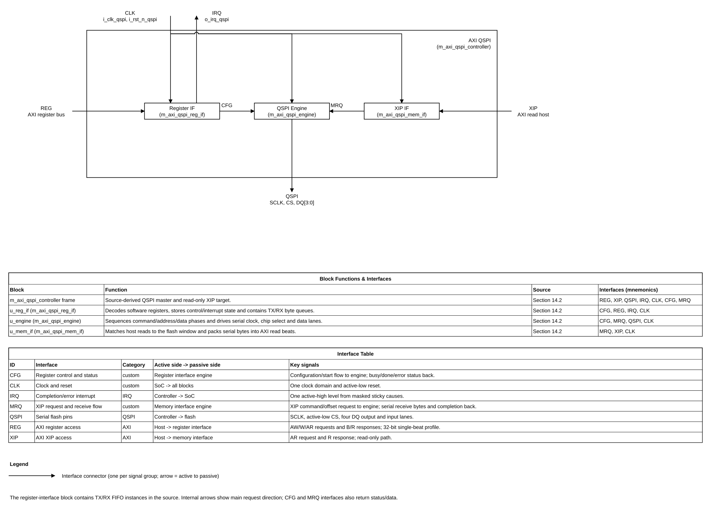

# AXI QSPI Controller Design Specification

> Reverse-engineered source-derived specification for OpenCoreLabsX/axi-qspi-controller at commit 35a2ae97eb1752c5fe173e9341d43f1c3b2654c6. This records observed behavior and limitations; it does not claim protocol compliance, verified operation, or tapeout readiness. The specification uses VLSIT-normalized names while retaining the behavior of the pinned RTL.

Requirement terms: shall = mandatory and testable; should = recommended; may = optional. TBD items and characterization notes are not new guarantees.

## Document map

1. Purpose, scope, and product context
2. Normative references and precedence
3. Requirements and traceability
4. Features and configurations
5. Architecture
6. External interfaces and ports
7. Clock, reset, and power
8. Parameters and elaboration configurations
9. Data representation and arithmetic
10. Detailed functional behavior
11. Register and programming model
12. Error handling and recovery
13. Performance, power, and area
14. RTL implementation contract
15. Verification specification
16. DFT and testability
17. Physical design and timing integration
18. Security, safety, and reliability
19. Requirement-to-verification traceability
20. Assumptions, dependencies, and decisions
21. Glossary
22. References

## 1. Purpose, scope, and product context

### 1.1 Purpose and scope

This IP provides software-controlled serial-flash commands and a read-only memory-mapped XIP path. The included functionality is a 32-bit AXI register path, read-only AXI XIP path, one shared SPI/Dual/Quad master engine, TX/RX byte FIFOs, and sticky completion/error interrupts.

Excluded: SPI slave mode, multiple chip selects, configurable CPOL/CPHA, four-byte addresses, automatic flash WIP polling, controller timeout, XIP writes, APB register access, and measured ASIC PPA.

### 1.2 Deployment assumptions

| Item | Specification |
|---|---|
| Target system | Generic SoC with AXI host and external serial flash |
| Technology | No process, library, or pad cell selected |
| Workload | Manual read/program/erase plus read-only XIP |
| Security context | No privilege/protection sideband on register AXI |
| Dependencies | AXI interconnect, one flash, QSPI pads, clock/reset source, firmware |

### 1.3 Feature summary

| ID | Feature | Presence | Condition / requirement |
|---|---|---|---|
| FEAT-001 | SPI master | Present | Lane mode 0; REQ-FUNC-001 |
| FEAT-002 | Dual SPI master | Present | Lane mode 1; REQ-FUNC-001 |
| FEAT-003 | Quad SPI master | Present | Lane mode 2; REQ-FUNC-001 |
| FEAT-004 | Manual read/program/erase commands | Present | Software setup; REQ-FUNC-002 |
| FEAT-005 | Read-only XIP window | Present | Address match and enable; REQ-FUNC-003 |
| FEAT-006 | TX/RX byte FIFOs | Present | Depth 16 bytes by default; REQ-FUNC-004 |
| FEAT-007 | Sticky completion/error IRQ | Present | Enabled causes; REQ-IRQ-001 |
| FEAT-008 | Flash slave mode | Absent | Not implemented; REQ-FUNC-005 |

## 2. Normative references and precedence

### 2.1 References

| ID | Document | Applicability |
|---|---|---|
| REF-001 | Arm IHI 0022B v1.0, AXI Protocol Specification v1.0, bundled converted copy | AXI handshake/burst terminology only; AXI3-era, not exact AXI4 compliance basis |
| REF-002 | OpenCoreLabsX/axi-qspi-controller, commit 35a2ae97eb1752c5fe173e9341d43f1c3b2654c6 | Source of observed behavior |
| REF-003 | VLSIT RTL Design Rules v2, section 2 | Naming rule applied to this document |
| REF-004 | IEEE 1800-2017 SystemVerilog | Source language |
| REF-005 | OpenTitan SPI_HOST HWIP Technical Specification v3.0.0 | Qualified comparison only; not a behavior source |

The pinned RTL is authoritative for this as-is description. The source calls the second AXI interface M_AXI, but its request inputs and read-response outputs make the IP a host-facing read subordinate/target. Integrators shall bind it by signal direction. Exact AXI4 revision and flash datasheet are not selected; protocol statements below are source-observed, not compliance claims.

**Naming rule:** VLSIT default naming rule, VLSIT_RTL_Design_Rule.md v2 section 2, at C:\Users\PC\.codex\skills\vlsit-asic-ip-microspec\reference\templates\VLSIT_RTL_Design_Rule.md. Canonical top: m_axi_qspi_controller. Interface names in this specification are normalized aliases.

### 2.2 Compliance declaration

| Interface | Revision/profile | Role | Limits / deviations |
|---|---|---|---|
| Register bus | AXI4 claim; exact revision TBD | Register subordinate | 32-bit single-beat accesses |
| XIP bus | AXI4 claim; exact revision TBD | Read-only memory subordinate | AR/R only; ARSIZE/ARBURST not qualified |
| Serial flash | Flash profile TBD | SPI-family master | One CS, fixed idle-low SCLK, no CPOL/CPHA control |

## 3. Requirements and traceability

These requirements record observed implementation properties. Source inspection is primary; tests in this table are planned, not run.

| ID | Requirement using shall/should/may | Source | Applies to | Verification method |
|---|---|---|---|---|
| REQ-FUNC-001 | The controller shall select one, two, or four serial data lanes for SPI, Dual SPI, or Quad SPI. | REF-002 engine | CFG-ASIS | TEST-006 to TEST-008 lane transactions; planned, not run |
| REQ-FUNC-002 | The manual path shall expose read, program, and erase operation encodings. | REF-002 register/engine | CFG-ASIS | TEST-020 command-level flash model; planned, not run |
| REQ-FUNC-003 | The XIP path shall return serial-flash data over a read-only AXI R channel. | REF-002 memory interface | CFG-ASIS | TEST-011 to TEST-013 XIP scenarios; planned, not run |
| REQ-FUNC-004 | TX and RX queues shall be byte-wide and use a default depth of 16 bytes. | REF-002 register interface | CFG-ASIS | TEST-009 and TEST-010 FIFO boundary tests; planned, not run |
| REQ-FUNC-005 | The implementation shall have one active-low CS and shall not implement slave mode. | REF-002 wrapper | CFG-ASIS | TEST-001 interface/port review; planned, not run |
| REQ-IF-001 | The register interface shall accept supported single-beat 32-bit reads/writes and return SLVERR for unsupported requests. | REF-002 register interface | IF-AXI-REG | TEST-002 and TEST-004; planned, not run |
| REQ-IF-002 | An unsupported register read shall return zero data and SLVERR; an unsupported write burst shall be drained before SLVERR. | REF-002 register interface | IF-AXI-REG | TEST-003 and TEST-005; planned, not run |
| REQ-IF-003 | The XIP path shall allow one active request and hold R-channel data during host backpressure. | REF-002 memory interface | IF-AXI-XIP | TEST-011 and TEST-012; planned, not run |
| REQ-IF-004 | The XIP implementation shall be treated as supporting only aligned 32-bit sequential reads until transfer size/type handling is corrected or constrained. | REF-002 memory interface | IF-AXI-XIP | TEST-013 size/burst characterization; planned, not run |
| REQ-CLK-001 | All internal state shall use one controller clock and an active-low asynchronous reset input. | REF-002 wrapper | CLK-QSPI | TEST-001 clock/reset review; planned, not run |
| REQ-RESET-001 | Reset shall clear control/valid state, return the serial engine to idle, deassert IRQ, and leave CS inactive. | REF-002 source | CFG-ASIS | TEST-001 and TEST-015; planned, not run |
| REQ-IRQ-001 | IRQ shall be the OR of enabled sticky completion and error causes. | REF-002 register interface | IF-IRQ | TEST-014 IRQ/W1C overlap; planned, not run |
| REQ-PERF-001 | Nominal SCLK shall follow fSCLK = fCLK / (2 × (divider + 1)). | REF-002 engine | CFG-ASIS | TEST-006 divider measurement; planned, not run |

## 4. Features and configurations

| Config | Enabled features | Disabled features | Interfaces | Intended use |
|---|---|---|---|---|
| CFG-ASIS | SPI/Dual/Quad master, manual commands, XIP reads, FIFOs, IRQ | Slave mode, CPOL/CPHA, multi-CS, WIP polling, timeout, XIP write | AXI register, AXI XIP, QSPI | External-flash control and mapped reads |

Lane encoding 3 is reserved. No elaboration option enables the disabled features.

## 5. Architecture

### 5.1 Block responsibilities

| Block | Responsibility | State/storage |
|---|---|---|
| m_axi_qspi_controller | Structural integration | Interconnect |
| m_axi_qspi_reg_if | AXI register decode, control/status and IRQ | Registers; contains TX/RX FIFO instances |
| m_axi_qspi_mem_if | XIP window decode, serial read request and AXI R response | Request state, counters, response data |
| m_axi_qspi_engine | Command/address/data sequencing, SCLK/CS/DQ | FSM, shifts, divider |

The TX and RX queues are instantiated inside m_axi_qspi_reg_if as two m_axi_qspi_fifo instances (u_fifo_0 and u_fifo_1), 16 bytes deep by default. They are internal submodules, not separate top-level blocks in the diagram. Register and XIP operations share one engine; XIP takes priority while active. Manual requests are not queued while busy.

### 5.2 Block diagram

*Figure 5-1. Figure 5-1. Source-derived top-level structure and interfaces; FIFO instances are nested in the register interface.. Source: `figures/qspi_controller_block_diagram.drawio` (draw.io, VLSIT library, drawn by `vlsit_spec_diagram.py`). The frame is the top module, the blocks are its instances, each connector is one interface with its mnemonic, and the two tables under the diagram in the source file describe the blocks and the interfaces.*

### 5.3 Transaction flow

Manual command: software sets mode, opcode, address, length and dummy cycles; it preloads TX data for programming; it starts the command; the engine asserts CS, shifts opcode and a fixed three-byte address phase, transfers data, then reports done/error. RX bytes enter the FIFO. Software polls or handles IRQ and clears the sticky cause.

XIP: a host read is accepted while the memory interface is idle and the engine is not busy. A masked address hit starts a flash read; received bytes are packed four per AXI R beat. The R beat remains valid under RREADY backpressure. One flash command serves one AXI burst.

### 5.4 Invariants

- One shared serial engine; manual and XIP transfers are not concurrent.
- CS is active-low and idle high; only one CS exists.
- XIP is read-only.
- First received XIP byte is placed in bits 31:24; software endianness compatibility is unverified.
- The wrapper emits only three flash address bytes.
- FIFO full and engine error share one sticky error cause.
- AXI IDs and optional protection/cache/QoS/user sidebands are absent.

## 6. External interfaces and ports

### 6.1 Interface inventory

| ID | Type / revision | Role | Boundary direction | Clock | Required |
|---|---|---|---|---|---|
| IF-AXI-REG | AXI4 claim; exact revision TBD | Register subordinate | Host requests in; responses out | CLK-QSPI | Yes |
| IF-AXI-XIP | AXI4 claim; exact revision TBD | Read-only memory subordinate/target | Host AR in; R out | CLK-QSPI | Yes |
| IF-QSPI | SPI-family; flash profile TBD | Flash master | Controller drives SCLK/CS/DQ output; flash drives DQ input | CLK-QSPI / generated SCLK | Yes |
| IF-IRQ | Custom level interrupt | Source | IP to SoC | CLK-QSPI | Yes |

### 6.2 Complete port list

Names are canonical VLSIT aliases. The source behavior remains pinned to the upstream commit.

| Port | Direction | Width | Meaning (function) | Clock domain | Signal type | Reset / idle value | Timing / sampling | Configurations |
|---|---|---:|---|---|---|---|---|---|
| i_clk_qspi | Input | 1 | Controller clock | CLK-QSPI | Clock | Not applicable: clock input | Rising edge | CFG-ASIS |
| i_rst_n_qspi | Input | 1 | Active-low reset | CLK-QSPI | Reset | Low asserts | Async assertion; release unsynchronized in source | CFG-ASIS |
| i_axi_reg_awaddr | Input | 8 | Register write address | CLK-QSPI | Data (valid with i_axi_reg_awvalid) | Don't care when invalid | Hold until ready | CFG-ASIS |
| i_axi_reg_awlen | Input | 8 | Write burst length | CLK-QSPI | Data (valid with i_axi_reg_awvalid) | Don't care when invalid | Hold until ready | CFG-ASIS |
| i_axi_reg_awsize | Input | 3 | Write beat size | CLK-QSPI | Data (valid with i_axi_reg_awvalid) | Don't care when invalid | Hold until ready | CFG-ASIS |
| i_axi_reg_awburst | Input | 2 | Write burst type | CLK-QSPI | Data (valid with i_axi_reg_awvalid) | Don't care when invalid | Hold until ready | CFG-ASIS |
| i_axi_reg_awvalid | Input | 1 | Write address valid | CLK-QSPI | Level | 0 | Hold until handshake | CFG-ASIS |
| o_axi_reg_awready | Output | 1 | Write address ready | CLK-QSPI | Level | 0 during reset | Handshake with AWVALID | CFG-ASIS |
| i_axi_reg_wdata | Input | 32 | Write data | CLK-QSPI | Data (valid with i_axi_reg_wvalid) | Don't care when invalid | Hold until ready | CFG-ASIS |
| i_axi_reg_wstrb | Input | 4 | Byte strobes | CLK-QSPI | Data (valid with i_axi_reg_wvalid) | Don't care when invalid | Hold until ready | CFG-ASIS |
| i_axi_reg_wlast | Input | 1 | Final write beat | CLK-QSPI | Data (valid with i_axi_reg_wvalid) | Don't care when invalid | Hold until ready | CFG-ASIS |
| i_axi_reg_wvalid | Input | 1 | Write data valid | CLK-QSPI | Level | 0 | Hold until handshake | CFG-ASIS |
| o_axi_reg_wready | Output | 1 | Write data ready | CLK-QSPI | Level | 0 during reset | AW and W accepted independently | CFG-ASIS |
| o_axi_reg_bresp | Output | 2 | Write response code | CLK-QSPI | Data (valid with o_axi_reg_bvalid) | OKAY | Hold until accepted | CFG-ASIS |
| o_axi_reg_bvalid | Output | 1 | Write response valid | CLK-QSPI | Level | 0 | Hold until BREADY | CFG-ASIS |
| i_axi_reg_bready | Input | 1 | Write response ready | CLK-QSPI | Level | 0 | Handshake with BVALID | CFG-ASIS |
| i_axi_reg_araddr | Input | 8 | Register read address | CLK-QSPI | Data (valid with i_axi_reg_arvalid) | Don't care when invalid | Hold until ready | CFG-ASIS |
| i_axi_reg_arlen | Input | 8 | Read burst length | CLK-QSPI | Data (valid with i_axi_reg_arvalid) | Don't care when invalid | Hold until ready | CFG-ASIS |
| i_axi_reg_arsize | Input | 3 | Read beat size | CLK-QSPI | Data (valid with i_axi_reg_arvalid) | Don't care when invalid | Hold until ready | CFG-ASIS |
| i_axi_reg_arburst | Input | 2 | Read burst type | CLK-QSPI | Data (valid with i_axi_reg_arvalid) | Don't care when invalid | Hold until ready | CFG-ASIS |
| i_axi_reg_arvalid | Input | 1 | Register read valid | CLK-QSPI | Level | 0 | Hold until handshake | CFG-ASIS |
| o_axi_reg_arready | Output | 1 | Register read ready | CLK-QSPI | Level | 0 during reset | One active read response at a time | CFG-ASIS |
| o_axi_reg_rdata | Output | 32 | Register read data | CLK-QSPI | Data (valid with o_axi_reg_rvalid) | 0 | Hold until accepted | CFG-ASIS |
| o_axi_reg_rresp | Output | 2 | Register read response | CLK-QSPI | Data (valid with o_axi_reg_rvalid) | OKAY | Unsupported read uses SLVERR | CFG-ASIS |
| o_axi_reg_rlast | Output | 1 | Final register read beat | CLK-QSPI | Data (valid with o_axi_reg_rvalid) | 0 | High on final beat | CFG-ASIS |
| o_axi_reg_rvalid | Output | 1 | Register read response valid | CLK-QSPI | Level | 0 | Hold until RREADY | CFG-ASIS |
| i_axi_reg_rready | Input | 1 | Register read response ready | CLK-QSPI | Level | 0 | Handshake with RVALID | CFG-ASIS |
| i_axi_xip_araddr | Input | 32 | XIP host read address | CLK-QSPI | Data (valid with i_axi_xip_arvalid) | Don't care when invalid | Hold until ready | CFG-ASIS |
| i_axi_xip_arlen | Input | 8 | XIP burst length | CLK-QSPI | Data (valid with i_axi_xip_arvalid) | Don't care when invalid | Hold until ready | CFG-ASIS |
| i_axi_xip_arsize | Input | 3 | XIP read beat size | CLK-QSPI | Data (valid with i_axi_xip_arvalid) | Don't care when invalid | Source does not qualify it | CFG-ASIS |
| i_axi_xip_arburst | Input | 2 | XIP burst type | CLK-QSPI | Data (valid with i_axi_xip_arvalid) | Don't care when invalid | Source does not qualify it | CFG-ASIS |
| i_axi_xip_arvalid | Input | 1 | XIP read request valid | CLK-QSPI | Level | 0 | Hold until handshake | CFG-ASIS |
| o_axi_xip_arready | Output | 1 | XIP request ready | CLK-QSPI | Level | 0 during reset | One active request | CFG-ASIS |
| o_axi_xip_rdata | Output | 32 | XIP read data | CLK-QSPI | Data (valid with o_axi_xip_rvalid) | 0 | First byte maps to bits 31:24 | CFG-ASIS |
| o_axi_xip_rresp | Output | 2 | XIP response code | CLK-QSPI | Data (valid with o_axi_xip_rvalid) | OKAY | DECERR on window miss; SLVERR on engine error | CFG-ASIS |
| o_axi_xip_rlast | Output | 1 | Final XIP read beat | CLK-QSPI | Data (valid with o_axi_xip_rvalid) | 0 | Held with response | CFG-ASIS |
| o_axi_xip_rvalid | Output | 1 | XIP response valid | CLK-QSPI | Level | 0 | Held until RREADY | CFG-ASIS |
| i_axi_xip_rready | Input | 1 | Host accepts XIP response | CLK-QSPI | Level | 0 | Backpressure pauses byte consumption | CFG-ASIS |
| o_qspi_sclk | Output | 1 | Generated serial clock | CLK-QSPI | Clock | 0 | Fixed idle-low; divider toggles it | CFG-ASIS |
| o_qspi_cs_n | Output | 1 | Active-low flash select | CLK-QSPI | Level | 1 | Low during command | CFG-ASIS |
| i_qspi_dq_i | Input | 4 | Flash data input lanes | External serial timing | Data (sampled by engine) | Unspecified | No synchronizer; constrain flash/pad timing | CFG-ASIS |
| o_qspi_dq_o | Output | 4 | Serial data output lanes | CLK-QSPI | Data (valid when matching OE bit is high) | 0 | Mode selects active lanes | CFG-ASIS |
| o_qspi_dq_oe | Output | 4 | Per-lane output enable | CLK-QSPI | Level | 0 | High drives corresponding lane | CFG-ASIS |
| o_irq_qspi | Output | 1 | Enabled sticky interrupt causes | CLK-QSPI | Level | 0 | High when any enabled cause is set | CFG-ASIS |

### 6.3 Protocol behavior

**Register AXI:** AW and W are captured independently. Only single-beat 32-bit accesses are supported. WSTRB is applied to register storage. Unsupported single writes return SLVERR; unsupported write bursts are drained before SLVERR. Unsupported reads return zero data and SLVERR for ARLEN+1 beats. IDs and optional protection/cache/QoS/user sidebands are absent. Exact AXI4 revision is TBD.

**XIP AXI:** AR and R only. The interface accepts while idle and the engine is not busy. A base/mask hit starts a serial read. A miss returns zero with DECERR. The source uses ARLEN as four bytes per beat and does not qualify ARSIZE or ARBURST; 4 KiB boundary crossing is not checked. RDATA/RLAST remain valid under RREADY backpressure.

**QSPI:** One CS; SPI, Dual, Quad lane modes; no slave mode or CPOL/CPHA control; SCLK idles low; fixed three-byte address phase. No flash-ready handshake exists. Command legality, mode, timing, address width, WIP and reset recovery depend on a flash datasheet not selected here.

| Case | Supported behavior | Unsupported / risk | Response |
|---|---|---|---|
| Register access | Aligned mapped single beat, 32-bit | Bursts, unsupported size, invalid address | SLVERR; write burst drained |
| XIP read | Matching window, 32-bit sequential profile assumed | ARSIZE/ARBURST ignored; boundary not guarded | Data may be incorrect for unsupported profiles |
| Serial command | SPI/Dual/Quad master, one CS | Slave, extra CS, flash profile not fixed | TX underflow raises error; other flash failures not detected |

### 6.4 Interrupts and events

| Event | Polarity / condition | Clear | Mask/crossing/reset |
|---|---|---|---|
| o_irq_qspi | Active-high when an enabled sticky cause is set | W1C cause or mask | OR of two causes; CLK-QSPI; reset low |
| Completion | Engine done event sets sticky bit | Software W1C | Done enable; reset clear |
| Error | Engine error or either FIFO full sets sticky bit | Software W1C | Error enable; reset clear |

Set and W1C code execute in the same sequential block; assignment ordering may clear a same-cycle new event. Verify before relying on event preservation.

## 7. Clock, reset, and power

### 7.1 Clock domains

| Domain | Clock | Edge | Frequency | Source / relation | Gating |
|---|---|---|---|---|---|
| CLK-QSPI | i_clk_qspi | Rising | TBD | SoC clock source; single internal domain | No gating observed |

SCLK is a divided output; it is not an internal clock.

### 7.2 CDC and RDC

No synchronizer or asynchronous FIFO was found. AXI, engine and FIFOs share CLK-QSPI. QSPI DQ input is sampled directly by the engine and needs external flash/pad timing constraints. Reset deassertion is not shown passing through a dedicated synchronizer.

### 7.3 Reset domains and sequencing

| Reset | Port | Polarity | Assertion | Scope | Deassertion | Reset behavior |
|---|---|---|---|---|---|---|
| RST-QSPI | i_rst_n_qspi | Active-low | Asynchronous in sequential blocks | Registers, memory, engine, FIFOs | No separate synchronizer observed | Engine idle, CS high, SCLK low, IRQ low |

Reset aborts active work. Validate CS during reset, flash recovery and reset release against the SoC reset controller and selected flash.

### 7.4 Power intent

No power domain, isolation, retention or low-power handshake appears in the source. SoC integration owns power intent and pin isolation.

## 8. Parameters and elaboration configurations

The source datapath is fixed around 32-bit words. Only default widths are considered supported.

| Parameter | Parameter Description | Parameter values | Parameter unit | Accepted value / effect |
|---|---|---|---|---|
| PARA_S_AXI_DATA_WIDTH | Register AXI data width | 32; default 32 | bit | 32 only |
| PARA_S_AXI_ADDR_WIDTH | Register AXI address width | 8; default 8 | bit | Default reviewed; other widths unverified |
| PARA_M_AXI_DATA_WIDTH | XIP AXI data width | 32; default 32 | bit | 32 only |
| PARA_M_AXI_ADDR_WIDTH | XIP AXI address width | 32; default 32 | bit | 32 only |

Required parameter comment sequence for any RTL porting is:
Parameter Description: concise purpose.
Parameter values: legal range and default.
Parameter unit: bit.

The internal FIFO depth is 16 bytes by default and is not exposed by the wrapper. Pointer wrap assumes a power-of-two depth.

## 9. Data representation and arithmetic

- AXI and register words are 32 bits; FIFO elements are 8 bits.
- XIP packs four serial bytes per beat, first byte in bits 31:24.
- The register holding a flash address is 32 bits, but only three bytes are shifted.
- Lane encodings: 0 SPI, 1 Dual, 2 Quad, 3 reserved.
- SCLK formula: fSCLK = fCLK / (2 × (divider + 1)).
- No signed arithmetic, ECC or checksum datapath is present.

## 10. Detailed functional behavior

### 10.1 Engine behavior

The engine sequences command, fixed three-byte address, optional dummy/mode phases and data, then deasserts CS and reports completion. SCLK idles low. XIP and manual transfers share the engine; XIP is selected while active. TX starvation immediately errors and stops rather than waiting for software. No automatic WIP polling or timeout is implemented.

### 10.2 Operations

| Operation | Trigger | Completion | Error / boundary behavior |
|---|---|---|---|
| Register read | AXI AR handshake | R response accepted | Unsupported request returns SLVERR |
| Register write | AXI AW and W accepted | B response accepted | Unsupported burst drains then returns SLVERR |
| Manual read | Software start | Engine done; bytes enter RX FIFO | Flash-specific command meaning is not verified |
| Manual program | Software start plus TX data | Done or engine error | TX starvation aborts; no WIP polling |
| Manual erase | Software start | Engine done | No flash status polling or region validation |
| XIP burst read | Matching host AR handshake | Final R beat accepted | Backpressure supported; transfer size/type not qualified |
| W1C interrupt clear | Register write | B response | Simultaneous new event may be cleared |

### 10.3 Waveform plan

Approved by the user on 2026-11-01. Figures characterize RTL; an undefined/missing behavior is not a new guarantee.

| Waveform ID | Function / operation | Scenario (success / error / corner) | Signals shown | Figure | Confirmed by user |
|---|---|---|---|---|---|
| WF-001 | Reset | Assert/deassert and idle | clk, reset, CS, SCLK, IRQ | figures/wf_001.svg | 2026-11-01 |
| WF-002 | Register write | Success with AW/W skew | AW/W/B handshake | figures/wf_002.svg | 2026-11-01 |
| WF-003 | Register write | Unsupported burst, SLVERR | AW/W drain/B | figures/wf_003.svg | 2026-11-01 |
| WF-004 | Register read | Mapped success | AR/R/RLAST | figures/wf_004.svg | 2026-11-01 |
| WF-005 | Register read | Unsupported request, SLVERR | AR/R/RRESP | figures/wf_005.svg | 2026-11-01 |
| WF-006 | Manual serial | SPI success | CS, SCLK, DQ0, OE | figures/wf_006.svg | 2026-11-01 |
| WF-007 | Manual serial | Dual success | CS, SCLK, DQ[1:0], OE | figures/wf_007.svg | 2026-11-01 |
| WF-008 | Manual serial | Quad success | CS, SCLK, DQ[3:0], OE | figures/wf_008.svg | 2026-11-01 |
| WF-009 | Program | TX underflow | TX valid/ready, error, IRQ | figures/wf_009.svg | 2026-11-01 |
| WF-010 | TX FIFO | Full condition | TX write/full/error | figures/wf_010.svg | 2026-11-01 |
| WF-011 | XIP | Burst success and next request | AR/R, CS/SCLK, data | figures/wf_011.svg | 2026-11-01 |
| WF-012 | XIP | RREADY backpressure | RVALID/RREADY, data | figures/wf_012.svg | 2026-11-01 |
| WF-013 | XIP | Window miss and unsupported profile/boundary | AR, match, RRESP | figures/wf_013.svg | 2026-11-01 |
| WF-014 | IRQ | Event overlaps W1C | event, W1C, status, IRQ | figures/wf_014.svg | 2026-11-01 |
| WF-015 | Reset recovery | Reset during transfer | reset, CS/SCLK, busy | figures/wf_015.svg | 2026-11-01 |
| WF-016 | Flash input | Constant-high DQ; timeout is absent | DQ, SCLK, XIP R data | figures/wf_016.svg | 2026-11-01 |

### 10.4 Throughput and latency

An XIP beat needs four serial bytes, or eight SCLK data cycles in Quad mode, plus command/address/dummy overhead. Only one XIP command is active. AXI R backpressure stalls byte consumption. See section 13 for theoretical rate only.

## 11. Register and programming model

### 11.1 Workbook

The descriptive inventory is [AXI_QSPI_Register_Inventory.xlsx](AXI_QSPI_Register_Inventory.xlsx), sheet CSR, generated from [qspi_registers.json](qspi_registers.json). The workbook template fixes protocol metadata to APB. It documents fields only and is not an APB RTL-generation input; the source register bus remains AXI.

### 11.2 Software sequences

**Initialization:** release reset per SoC policy; read version; set divider, lane mode and command settings; clear both FIFOs by writing FIFO clear high then low; clear sticky causes; enable wanted IRQs; configure base/mask/command before XIP enable.

**Manual read:** ensure engine idle; set command/address/length/mode/dummy cycles; start; poll or handle IRQ; drain RXDATA while RX_VALID; clear done/error.

**Manual program:** ensure idle; configure command/address; prefill TX FIFO; start only with enough bytes to avoid starvation; monitor error/done; handle flash WIP in software.

**XIP:** configure aligned base and contiguous mask; set flash command profile; enable; issue aligned 32-bit sequential reads until AXI profile is confirmed; disable XIP before manual commands when shared-engine conflicts are possible.

### 11.3 Field connections

qspi_ctrl fields drive manual launch, operation selection and FIFO clear. qspi_clkdiv, qspi_mode, qspi_cmd, qspi_flash_addr, qspi_len and qspi_dummy feed engine configuration. qspi_txdata writes TX FIFO; qspi_rxdata reads and pops RX FIFO. qspi_sts reports busy/done/error/FIFO/XIP state. qspi_irq_en masks causes; qspi_irq_sts latches and clears them; IRQ is their enabled OR. qspi_xip_ctrl, qspi_xip_base, qspi_xip_mask, qspi_xip_cmd and qspi_xip_mode configure XIP. qspi_version reports the constant version.

### 11.4 APB CSR behavior

Not applicable because the source has no APB interface. The APB-only generator cannot represent the AXI bus or write-only TXDATA exactly. The user's decision is to retain AXI and use the workbook as a descriptive inventory; see DEC-002.

## 12. Error handling and recovery

| Condition | Detection / response | Recovery / limitation |
|---|---|---|
| Unsupported register write | SLVERR; burst data drained | Software issues supported access |
| Unsupported register read | Zero data and SLVERR | Software corrects request |
| XIP address miss | Zero data and DECERR | Map address or disable XIP |
| XIP engine error | SLVERR, final beat | Sticky generic error; no subcause |
| TX underflow | Engine error and stop | Preload/refill; no stall/retry |
| FIFO full | Sticky generic error; TX byte may be dropped | No separate full status |
| Simultaneous event/W1C | Assignment ordering may clear new event | Verify and correct if required |
| Flash has no response | No ready/ack input to detect it | No controller timeout or distinct error |

## 13. Performance, power, and area

### 13.1 Throughput estimate

Nominal fSCLK = fCLK / (2 × (divider + 1)). Ideal payload is fSCLK × active lane count / 8 bytes/s. At an illustrative 100 MHz controller clock and divider zero, the ideal Quad ceiling is 25 MB/s before command/address/dummy phases, FIFO gaps, flash timing and AXI stalls. This is a calculation, not measured performance.

One 32-bit XIP beat requires eight Quad SCLK data cycles plus initial command/address/mode/dummy phases. Maximum SCLK, latency, Fmax, area, power and post-route timing are TBD; there is no PPA report.

| Metric | Target / result | Conditions |
|---|---|---|
| Controller clock | TBD; not measured | Process/library/constraints |
| Flash SCLK maximum | TBD | Target flash and pad timing |
| XIP first-beat latency | TBD | Flash profile and divider |
| Sustained throughput | Formula only | RREADY, FIFO and flash timing |
| Area/power | No result | Requires synthesis and activity |

## 14. RTL implementation contract

### 14.1 Naming and source contract

This document applies VLSIT RTL Design Rule v2 names to its canonical interface. The source identifiers use a different style and are not changed by this task. Static inspection covered the wrapper, register interface, XIP interface, serial engine, FIFO and package. No tests or synthesis were run.

### 14.2 Module hierarchy

| Canonical module | Instance | Responsibility | Source file |
|---|---|---|---|
| m_axi_qspi_controller | Top | Structural integration | rtl/axi_qspi_wrapper.sv |
| m_axi_qspi_reg_if | u_reg_if | Register decode, IRQ and FIFO control | rtl/axi_qspi_axi4_interface.sv |
| m_axi_qspi_mem_if | u_mem_if | XIP decode and R response | rtl/axi_qspi_mem_interface.sv |
| m_axi_qspi_engine | u_engine | Serial command/data/SCLK/CS | rtl/axi_qspi_core.sv |

The register interface instantiates m_axi_qspi_fifo as u_fifo_0 and u_fifo_1 for the TX and RX byte queues (rtl/axi_qspi_fifo.sv). These are nested under u_reg_if and are summarized inside that block in section 5.2.

### 14.3 Synthesis assumptions

No vendor primitive was found in reviewed RTL. No lint, synthesis, CDC/RDC, STA, DFT insertion or physical implementation was performed. Non-default widths are not proven. A future ASIC port must review reset release, SCLK/DQ timing, parameter constraints and all high-severity findings in the companion analysis.

## 15. Verification specification

The repository has UVM sources for register reset/read/write, XIP configuration, FIFO/IRQ smoke behavior, unsupported accesses and AW/W skew. Its UVM README says a command-level flash model should be added. These tests were not run here.

| Layer | Required coverage |
|---|---|
| RTL unit | Divider, serial phases, lanes, CS/SCLK, FIFO empty/full/clear |
| Register AXI | AW/W skew, mapped access, bad size/length/burst/address, response stalls |
| XIP | Hit/miss, burst length, ARSIZE/ARBURST deviations, 4 KiB/window boundary, RREADY stall, engine error |
| Flash model | Selected command set, lane modes, address limit, dummy/mode byte, read/program/erase |
| Interrupt | Masking, sticky cause, W1C, simultaneous event/clear, FIFO full |
| Reset | Reset idle and mid-transfer; CS behavior/recovery |
| Signoff | Lint, formal, CDC/RDC, synthesis, STA, PPA, pad timing |

### Planned directed tests

These test IDs are verification plans only; no testbench was executed for this review.

| Test ID | Purpose | Related figure / coverage |
|---|---|---|
| TEST-001 | Reset, clock-domain assumptions, top-level ports and master-only pin configuration | WF-001 |
| TEST-002 | Supported register write and independent AW/W arrival | WF-002 |
| TEST-003 | Unsupported write burst drain and SLVERR response | WF-003 |
| TEST-004 | Supported register read response | WF-004 |
| TEST-005 | Unsupported register read response | WF-005 |
| TEST-006 | SPI lane mode and divider behavior | WF-006 |
| TEST-007 | Dual lane mode | WF-007 |
| TEST-008 | Quad lane mode | WF-008 |
| TEST-009 | TX underflow and error reporting | WF-009 |
| TEST-010 | FIFO full behavior and dropped-write characterization | WF-010 |
| TEST-011 | XIP burst response and command completion | WF-011 |
| TEST-012 | XIP R-channel backpressure | WF-012 |
| TEST-013 | XIP window miss, ARSIZE/ARBURST handling and boundary characterization | WF-013 |
| TEST-014 | Sticky IRQ masking, W1C and simultaneous event overlap | WF-014 |
| TEST-015 | Reset during an active serial transfer | WF-015 |
| TEST-020 | Manual read, program and erase with a selected flash model | Flash-model coverage in section 15 |

The figures in section 10.3 are static source-behavior characterizations. They do not replace simulation.

## 16. DFT and testability

No scan, test-mode, MBIST or boundary-scan port is exposed. The SoC owns DFT architecture, reset controllability and QSPI pin isolation during test. Flash-in-loop test policy is TBD.

## 17. Physical design and timing integration

The SoC must constrain the controller clock, generated SCLK, DQ input/output delay, CS setup/hold, package/board delay and pad drive strength. No SDC, IO timing budget, false path, multicycle path or physical constraint is present. Signoff requires target flash timing and corners.

## 18. Security, safety, and reliability

| Topic | Status and rationale |
|---|---|
| Privilege/access control | TBD; AXI protection sideband is absent and destructive command authorization is unspecified |
| Secure clearing | TBD; FIFO clearing exists, but key/secret handling is not a stated function |
| Safety goal | TBD; no integrity level or safety mechanism is supplied |
| Fault detection | Limited to generic engine/FIFO error cause |
| Recovery | Firmware/system policy must handle reset, flash WIP and possible interrupted commands |

## 19. Requirement-to-verification traceability

| Requirement ID | RTL module/location | Test/property | Verification method / analysis | Configuration |
|---|---|---|---|---|
| REQ-FUNC-001 | m_axi_qspi_engine | TEST-006, TEST-007, TEST-008 | SPI, Dual and Quad lane transactions; planned, not run | CFG-ASIS |
| REQ-FUNC-002 | Register interface / engine | TEST-020 | Manual read/program/erase with flash model; planned, not run | CFG-ASIS |
| REQ-FUNC-003 | m_axi_qspi_mem_if | TEST-011, TEST-012, TEST-013 | XIP success, backpressure and profile characterization; planned, not run | CFG-ASIS |
| REQ-FUNC-004 | Register interface / FIFO | TEST-009, TEST-010 | FIFO depth, full and underflow cases; planned, not run | CFG-ASIS |
| REQ-FUNC-005 | Top wrapper | TEST-001 | Port/configuration inspection; planned, not run | CFG-ASIS |
| REQ-IF-001 | Register interface | TEST-002, TEST-004 | Supported AXI register transfers; planned, not run | IF-AXI-REG |
| REQ-IF-002 | Register interface | TEST-003, TEST-005 | Unsupported read/write and burst drain; planned, not run | IF-AXI-REG |
| REQ-IF-003 | XIP interface | TEST-011, TEST-012 | Single active request and R-channel stall; planned, not run | IF-AXI-XIP |
| REQ-IF-004 | XIP interface | TEST-013 | ARSIZE/ARBURST and boundary characterization; planned, not run | IF-AXI-XIP |
| REQ-CLK-001 | Top wrapper | TEST-001 | Clock/reset source inspection and reset test; planned, not run | CLK-QSPI |
| REQ-RESET-001 | Engine and wrapper | TEST-001, TEST-015 | Idle and mid-transfer reset; planned, not run | CFG-ASIS |
| REQ-IRQ-001 | Register interface | TEST-014 | Mask, sticky cause, W1C and event overlap; planned, not run | IF-IRQ |
| REQ-PERF-001 | Engine divider | TEST-006 | Measure SCLK against divider equation; planned, not run | CFG-ASIS |

## 20. Assumptions, dependencies, and decisions

| ID | Type | Item | Impact / resolution | Status |
|---|---|---|---|---|
| DEC-001 | User decision | Document source RTL as-is; use VLSIT default v2 naming | Names normalized; behavior remains pinned to source commit | Confirmed 2026-11-01 |
| DEC-002 | User decision | CSR workbook is descriptive only; retain AXI | APB template metadata is not an APB RTL-generation claim | Confirmed 2026-11-01 |
| DEC-003 | User decision | Theoretical performance only; flash/PPA limits TBD | No max clock/PPA claim | Confirmed 2026-11-01 |
| DEC-004 | User decision | Approve waveform set WF-001 through WF-016 | Missing behavior marked as characterization | Confirmed 2026-11-01 |
| OPEN-001 | Protocol | Exact AXI4 revision/profile is TBD | Needed for formal conformance and protocol assertions | Open |
| OPEN-002 | Device | Target flash part and datasheet are TBD | Needed for opcodes, clock mode, timing, WIP and recovery | Open |
| OPEN-003 | Interface | Second AXI interface is called M_AXI in source but acts as read target | Bind by direction; clarify upstream naming in future integration | Open |
| OPEN-004 | CSR | APB generator cannot represent AXI and write-only TXDATA | Workbook remains an inventory; APB redesign is separate | Open |
| OPEN-005 | Reset | No dedicated reset-release synchronizer is observed | Confirm reset-controller policy | Open |
| OPEN-006 | PPA | No target library, SDC, IO budget or PPA reports | Required for implementation signoff | Open |
| OPEN-007 | Verification | Flash model, run logs, synthesis and silicon evidence absent | Functional/tapeout readiness unproven | Open |

## 21. Glossary

| Term | Definition |
|---|---|
| AXI | Advanced eXtensible Interface |
| DQ | Bidirectional serial-flash data lanes |
| FIFO | First-in, first-out byte queue |
| QSPI | Serial peripheral interface with up to four data lanes |
| XIP | Execute-in-place reads from mapped flash |
| WIP | Flash write-in-progress status |
| STR | Single-transfer-rate data sampled on one clock edge per cycle |

## 22. References used to shape this template

1. OpenCoreLabsX/axi-qspi-controller, pinned source commit and included README/UVM README.
2. Arm IHI 0022B v1.0 converted reference bundled with the VLSIT skill; used for general AXI terminology only, not as AXI4 compliance evidence.
3. OpenTitan SPI_HOST HWIP Technical Specification v3.0.0: https://opentitan.org/book/hw/ip/spi_host/ . The official specification says it was taped out in Earl Grey 1.0.0 and lists SPI/Dual/Quad, CPOL/CPHA, configurable chip-selects and FIFOs; it is a qualified comparison, not copied design content.
4. OpenTitan project history: https://opentitan.org/book/doc/project_governance/history.html . The official timeline records Earl Grey tapeout and validated-silicon milestones.
5. VLSIT ASIC IP micro-specification template, rule.md and VLSIT RTL Design Rule v2.

