# SHA2 SHA3 Hash Design Specification

> **Purpose:** Normative design contract for architecture, RTL, verification, DFT, and physical integration of this IP.
>
> Mark inapplicable sections **N/A (clock, reset or static input has no idle value)** with a reason. **TBD** appears only with its technical impact and the decision needed, recorded in [Assumptions, dependencies, and decisions](#20-assumptions-dependencies-and-decisions).
>
> Requirement terms: **shall** = mandatory and testable; **should** = recommended; **may** = optional. Every mandatory requirement has a stable REQ-<AREA>-<NNN> identifier and a verification method.

## Document map

1. [Purpose, scope, and product context](#1-purpose-scope-and-product-context)
2. [Normative references and precedence](#2-normative-references-and-precedence)
3. [Requirements and traceability](#3-requirements-and-traceability)
4. [Features and configurations](#4-features-and-configurations)
5. [Architecture](#5-architecture)
6. [External interfaces and ports](#6-external-interfaces-and-ports)
7. [Clock, reset, and power](#7-clock-reset-and-power)
8. [Parameters and elaboration configurations](#8-parameters-and-elaboration-configurations)
9. [Data representation and arithmetic](#9-data-representation-and-arithmetic)
10. [Detailed functional behavior](#10-detailed-functional-behavior)
11. [Register and programming model (CSR from workbook)](#11-register-and-programming-model)
12. [Error handling and recovery](#12-error-handling-and-recovery)
13. [Performance, power, and area](#13-performance-power-and-area)
14. [RTL implementation contract](#14-rtl-implementation-contract)
15. [Verification specification](#15-verification-specification)
16. [DFT and testability](#16-dft-and-testability)
17. [Physical design and timing integration](#17-physical-design-and-timing-integration)
18. [Security, safety, and reliability](#18-security-safety-and-reliability)
19. [Requirement-to-verification traceability](#19-requirement-to-verification-traceability)
20. [Assumptions, dependencies, and decisions](#20-assumptions-dependencies-and-decisions)
21. [Glossary](#21-glossary)
22. [References used to shape this template](#22-references-used-to-shape-this-template)

## 1. Purpose, scope, and product context

### 1.1 Purpose and scope

The IP computes cryptographic hash digests of byte streams with the SHA-2 family (FIPS 180-4) and the SHA-3 family with the extendable-output functions (FIPS 202). Which algorithms exist in the silicon, how many rounds each core computes per clock cycle, how many messages are in progress at the same time, and which security options are present are chosen by elaboration parameters (section 8), so that each product gets the smallest design that meets its need. Software or an external DMA controller streams the message into an AXI4 window, gives a final command, and reads the digest from a second AXI4 window; a register block on APB4 controls the IP.

**Included:** SHA-224, SHA-256, SHA-384, SHA-512, SHA-512/224, SHA-512/256, SHA3-224, SHA3-256, SHA3-384, SHA3-512, SHAKE128 and SHAKE256 as twelve independent elaboration choices; message padding by the IP; up to 16 interleaved messages with stored state; AXI4 subordinate message and digest windows (32, 64 or 128 bit); APB4 register block built by APB-CSR-Generator; optional external DMA handshake; optional first-order masking of the Keccak core; optional fault detection (duplicate core, parity, recompute); state clearing; interrupts and an alarm output; optional asynchronous clock between the APB register interface and the core.

**Excluded:** keyed constructions built on the hash (HMAC, KMAC, cSHAKE, TupleHash, ParallelHash of NIST SP 800-185, key derivation); public-key signature verification (the IP supplies the digest only); bit-granular messages (the IP accepts whole bytes); SHA-512/t for t other than 224 and 256; SHA-1 and MD5; true random number generation (the masked core takes entropy or a seed from outside); a DMA controller; protection against physical attacks other than the first-order masking of section 18; the key and digest storage of the system.

### 1.2 Deployment assumptions

| Item | Specification |
|---|---|
| Target SoC / product class | Security-sensitive embedded SoC (secure boot ROM, storage controller); see 1.4. ASM-001 |
| Technology / library assumptions | Standard-cell ASIC; technology and library are not chosen. Contexts may use flip-flops or an SRAM macro (`PARA_CTX_MEM`). ASM-002 |
| Operating modes and workload | Streams of bytes up to 2^61 - 1 bytes per message; one to sixteen messages in progress; core clock assumed at 500 MHz for sizing only (ASM-003) |
| Security / privilege context | The AXI4 windows carry no privilege attribute; the APB register block can reject non-secure accesses with `i_protect_en` (11.4). The system decides who may reach each window |
| External dependencies | AXI4 manager or DMA controller, APB4 manager, optional external DMA handshake (4-phase), optional entropy source, clock and reset controller |

### 1.3 Feature summary

| Feature ID | Feature | Required / optional | Configuration condition | Requirements |
|---|---|---|---|---|
| FEAT-001 | SHA-2 family: SHA-224, SHA-256 (64-round, 512-bit block core) and SHA-384, SHA-512, SHA-512/224, SHA-512/256 (80-round, 1024-bit block core) | Optional per algorithm | `PARA_EN_SHA224` ... `PARA_EN_SHA512_256` | REQ-FUNC-001, REQ-FUNC-003 |
| FEAT-002 | SHA-3 family and SHAKE128 / SHAKE256 (Keccak-f[1600], 24 rounds) | Optional per algorithm | `PARA_EN_SHA3_224` ... `PARA_EN_SHAKE256` | REQ-FUNC-001, REQ-FUNC-003, REQ-FUNC-007 |
| FEAT-003 | Algorithm selection at elaboration, with removal of unused logic | Required | At least one `PARA_EN_*` is 1 | REQ-FUNC-002, REQ-PARAM-001 |
| FEAT-004 | Round unrolling and pipeline registers per core | Optional | `PARA_S256_UNR`, `PARA_S512_UNR`, `PARA_KEC_UNR`, `PARA_*_PIPE` | REQ-PERF-001, REQ-PERF-002, REQ-PERF-003 |
| FEAT-005 | Interleaved messages with stored state (contexts) | Required (1 to 16) | `PARA_CTX_N`, `PARA_CTX_MEM` | REQ-FUNC-006 |
| FEAT-006 | AXI4 subordinate message window and digest window | Required | `PARA_AXI_DW` 32 / 64 / 128 | REQ-IF-001, REQ-IF-002 |
| FEAT-007 | IP-side padding of the last block | Required | Always present | REQ-FUNC-004, REQ-FUNC-005 |
| FEAT-008 | External DMA 4-phase handshake | Optional | `PARA_DMA` | REQ-IF-004 |
| FEAT-009 | First-order masking of the Keccak core (2 shares) | Optional | `PARA_MASK`, `PARA_SEED_SRC` | REQ-SEC-003 |
| FEAT-010 | Fault detection: duplicate core, parity, recompute, with responses | Optional per mechanism | `PARA_FAULT_DUP`, `PARA_FAULT_PAR`, `PARA_FAULT_REDO` | REQ-SEC-002 |
| FEAT-011 | Clearing of state, FIFOs and idle core registers | Optional | `PARA_ZERO` | REQ-SEC-001 |
| FEAT-012 | APB4 register block, interrupts, alarm output, asynchronous register clock | Required | `PARA_CSR_ASYNC` | REQ-REG-001, REQ-INT-001, REQ-CLK-001 |

### 1.4 Real-world applications of the features

The two applications below were named by the user on 2026-11-09 (the classes, "secure boot and firmware signature check" and "integrity of banking storage data"). The named systems, example products and the figures marked ASM are proposals of the author, not user statements, and are recorded in section 20 for confirmation.

| Feature ID | Real-world application (named system, example product) | What the application needs from the feature | Typical values | Consequence if missing or wrong | Requirements | Source |
|---|---|---|---|---|---|---|
| FEAT-001 | Secure-boot ROM of a bank payment terminal SoC that hashes the 4 MiB firmware image with SHA-256 or SHA-384 before it verifies the signature (ECDSA P-256 / P-384) | Standard digest that a signature verifier can consume, computed in a fixed boot time | 4 MiB image, 5 ms limit | A wrong digest rejects good firmware or accepts altered firmware; a digest that is too slow breaks the boot-time budget | REQ-FUNC-003, REQ-PERF-001 | User answer 2026-11-09 (class); ASM-004 (product) |
| FEAT-002 | Integrity tag of ledger blocks in the storage controller of a core-banking data store (SHA3-256 of each 4 KiB block, SHAKE256 for a variable-length checksum) | Newer hash family with no length-extension weakness, and variable output length | 4 KiB blocks, 32 B digest, SHAKE256 output 32 to 64 B | A weaker hash allows a forged block to match its tag; a fixed length output cannot serve the variable tag | REQ-FUNC-003, REQ-FUNC-007 | User answer 2026-11-09 (class); ASM-004 |
| FEAT-003 | One IP serves a boot ROM (SHA-256 and SHA-384 only) and a storage controller (SHA-3 only) from the same source | A product removes the algorithms it never uses to save area | 1 of 12 to 12 of 12 algorithms | A fixed full IP wastes area in every product; an unused core left in a certified boot ROM enlarges the attack surface | REQ-FUNC-002, REQ-PARAM-001 | User answer 2026-11-09 |
| FEAT-004 | Boot ROM that must hash 4 MiB in 5 ms, storage controller that hashes at 8 Gbit/s | Rounds per cycle and pipeline depth chosen from the throughput and the clock | At least 6.71 Gbit/s (boot); at least 8 Gbit/s (storage) | Too few rounds per cycle misses 5 ms; too many waste area | REQ-PERF-001, REQ-PERF-002 | User answer 2026-11-09 (requirement numbers) |
| FEAT-005 | Storage controller that hashes several host streams at once without waiting for each to finish | Interleaved messages whose state is stored while another message runs | 4 to 16 messages | Without stored contexts one slow stream blocks all other streams | REQ-FUNC-006 | User answer 2026-11-09 (contexts by parameter) |
| FEAT-006 | CPU, DMA controller or crypto-engine manager of an AXI4 interconnect writes the message and reads the digest | Standard memory-mapped windows with bursts | 64-bit data, bursts up to 256 beats | A bus the manager cannot use needs an extra adapter that costs area and latency | REQ-IF-001, REQ-IF-002 | User answer 2026-11-09 |
| FEAT-007 | Software that streams a firmware image without knowing the padding rules | The IP adds the 0x80 byte, zeros and the length field | Message length 0 to 2^61 - 1 bytes | Software padding errors give a wrong digest that looks valid | REQ-FUNC-004, REQ-FUNC-005 | User answer 2026-11-09 (padding) |
| FEAT-008 | Boot ROM DMA that copies the image from flash to the IP and the digest to RAM without the CPU | Request and acknowledge handshake with burst size | Bursts of 16 words | Without it the CPU polls the FIFO and cannot meet 5 ms | REQ-IF-004 | User answer 2026-11-09 (DMA) |
| FEAT-009 | SHA-3 based integrity tags over key-dependent data in a payment terminal that sits in a customer-accessible place | Resistance of the Keccak state to first-order power analysis | 2 shares, 1600 fresh bits per round | A key-dependent intermediate state leaks through the power trace | REQ-SEC-003 | User answer 2026-11-09 (masking); ASM-004 |
| FEAT-010 | Payment terminal whose digest check must not be bypassed by a fault injection (voltage glitch) | Detect a corrupted round and refuse the digest | One detected fault leads to gate, lock, clear and alarm within 2 clock cycles of the registered mismatch (OP-011) | A glitch yields a wrong digest that passes the check | REQ-SEC-002 | User answer 2026-11-09 (fault detection) |
| FEAT-011 | Boot ROM that must not leave message words in idle registers when control passes to firmware | Zero state, FIFOs and idle core registers | State cleared within 3 cycles after the read of the last digest word (ASM-005, DEC-021) | Message-dependent data stays in the registers after boot | REQ-SEC-001 | User answer 2026-11-09 (zeroing); ASM-005 |
| FEAT-012 | Boot firmware that programs the IP and waits for completion | Registers, one interrupt, an alarm pin to the security monitor | One `o_irq` and one `o_alarm` output; 9 event types; 19 registers | Without interrupts firmware polls and wastes boot time | REQ-REG-001, REQ-INT-001 | User answer 2026-11-09 (interrupts) |

## 2. Normative references and precedence

### 2.1 Normative references

| Ref ID | Document and revision | Applicable clauses | Authority / notes |
|---|---|---|---|
| REF-001 | NIST FIPS PUB 180-4, Secure Hash Standard (SHS), August 2015 (converted copy `vlsit_sha_nist_fips180_4_secure_hash_standard.md` in the skill `md_doc`) | 1, 2.2, 3.2, 4.1.2 to 4.1.3, 4.2.2 to 4.2.3, 5.1.1 to 5.1.2, 5.3.2 to 5.3.6, 6.2, 6.4, 6.5, 6.6, 6.7 | Algorithm authority of SHA-224, SHA-256, SHA-384, SHA-512, SHA-512/224, SHA-512/256 |
| REF-002 | NIST FIPS PUB 202, SHA-3 Standard: Permutation-Based Hash and Extendable-Output Functions, August 2015 (converted copy `vlsit_sha_nist_fips202_sha3_shake.md`) | 3.2 to 3.4, 4, 5.1, 6.1, 6.2, 6.3, Appendix B.2 | Algorithm authority of SHA-3 and SHAKE. The Appendix A table of FIPS 202 was lost in conversion; the security strengths are read from the PDF (ASM-006) |
| REF-003 | VLSIT RTL Design Rules v2, VLSIT_RTL_Design_Rule.md (`reference/templates` of the skill `vlsit-asic-ip-microspec`) | All applicable rules | Mandatory RTL coding, hierarchy, reset, CDC, and naming baseline |
| REF-004 | IEEE 1800-2017 SystemVerilog | Synthesizable subset | Subject to REF-003 and the selected frontend support |
| REF-005 | VLSIT_SHA2_SHA3_HASH_CSR.xlsx in `csr/` of this folder (made with `vlsit_csr_tool.py` from `csr/sha_regs.json`) | Sheet `ASYNC_CSR` | Sole authority for the register interface, register map, fields, access types, and reset values (Section 11) |
| REF-006 | Arm IHI 0022 Issue H.c, AMBA AXI Protocol Specification (converted copy `vlsit_amba_axi_ihi0022hc.md`) | AXI4 subordinate: channels, burst types, response codes | Protocol authority for the message and digest windows |
| REF-007 | Arm IHI 0024 AMBA APB Protocol Specification, APB4 revision (converted copy in the skill `md_doc`) | APB4 completer | Protocol authority for the register interface |
| REF-008 | APB-CSR-Generator, version 3.4, commit c40f319 (`https://github.com/nguyenquanicd/APB-CSR-Generator`) | Register RTL generation | Builds the register block from REF-005 |
| REF-009 | OpenTitan HMAC and KMAC IP documentation (Apache-2.0) | Message FIFO, context save and restore, DOM masking | Design-idea reference only; no code copied (R-012). Evidence of silicon in section 20 (RES-001) |

### 2.2 Source-of-truth and conflict handling

1. REF-001 and REF-002 define the digests. A conflict between this document and them is resolved in favor of REF-001 and REF-002.
2. REF-006 and REF-007 define the AXI4 and APB4 behavior for the profiles of 6.3.
3. This specification defines the IP contract and remains consistent with REF-003.
4. REF-003 is the mandatory RTL coding, hierarchy, reset, CDC, and naming baseline; no local RTL exception.
5. REF-005 is the only place where CSRs are specified. This document names registers and fields but does not restate offsets, widths, types or reset values.
6. The protocol revision, role and optional-signal configuration are fixed in 6.3.
7. Conflicts are resolved through an explicit decision in section 20.

**Naming rule:** the default naming rule of vlsit-rtl-generator (VLSIT_RTL_Design_Rule.md v2, section 2), path `C:\Users\PC\.claude\skills\vlsit-asic-ip-microspec\reference\templates\VLSIT_RTL_Design_Rule.md`, version v2 (rule R-026). The user did not name another rule (ASM-007).

### 2.3 Compliance declaration

| Standard | Revision / profile | Role implemented | Options | Deviations |
|---|---|---|---|---|
| FIPS 180-4 | August 2015 | Hash function SHA-224/256/384/512/512-224/512-256 on whole bytes | Per-algorithm elaboration | Messages are limited to 2^61 - 1 bytes for all SHA-2 (the SHA-384/512 limit of 2^125 - 1 bytes is not used) (DEC-009) |
| FIPS 202 | August 2015 | SHA3-224/256/384/512, SHAKE128/256 on whole bytes | Per-algorithm elaboration; output length is open for SHAKE | The message suffix bits of FIPS 202 6.1 and 6.2 are added by the IP; bit-granular messages are not supported |
| AMBA AXI4 | IHI 0022 H.c, AXI4 (not AXI3, no AXI5) | Subordinate | INCR and FIXED bursts; AxLOCK, AxCACHE, AxPROT, AxQOS, AxREGION and user signals not implemented | WRAP bursts, narrow transfers and write strobes that are not all ones return SLVERR |
| AMBA APB | IHI 0024 APB4 | Completer (CSR block) | PSTRB, PPROT | Behavior of the generator (11.4) |

## 3. Requirements and traceability

| ID | Requirement using shall/should/may | Source | Applies to | Verification method |
|---|---|---|---|---|
| REQ-FUNC-001 | The IP shall compute SHA-224, SHA-256, SHA-384, SHA-512, SHA-512/224, SHA-512/256, SHA3-224, SHA3-256, SHA3-384, SHA3-512, SHAKE128 and SHAKE256 for every algorithm whose `PARA_EN_*` parameter is 1 | REF-001, REF-002 | All configurations | Simulation against NIST vectors |
| REQ-FUNC-002 | A parameter `PARA_EN_*` equal to 0 shall remove the logic that only that algorithm needs; a core is built only when at least one of its algorithms is enabled | User decision 2026-11-09 | All configurations | Synthesis area check; inspection of hierarchy |
| REQ-FUNC-003 | For every enabled algorithm and for the message lengths 0, 1, rate-1, rate, rate+1 and 2 x rate bytes the digest shall equal the value of REF-001 or REF-002 | REF-001, REF-002 | All configurations | Simulation with an independent model |
| REQ-FUNC-004 | The IP shall add the padding of REF-001 5.1 or REF-002 5.1 and the domain suffix of REF-002 6.1 or 6.2; software shall not write padding bytes | User decision 2026-11-09 | All configurations | Simulation |
| REQ-FUNC-005 | A message of zero bytes (init then final with no word written) shall give the digest of the empty message | REF-001, REF-002 | All configurations | Simulation |
| REQ-FUNC-006 | The IP shall keep `PARA_CTX_N` messages in progress at the same time; words of different messages written in any order shall give the same digests as if each message ran alone | User decision 2026-11-09 | `PARA_CTX_N` > 1 | Simulation with random interleaving |
| REQ-FUNC-007 | For SHAKE128 and SHAKE256 the IP shall return as many output bytes as software reads from the digest window of the context, without a preset length, and the stream shall equal the XOF output of REF-002 | REF-002 6.2 | SHAKE enabled | Simulation |
| REQ-FUNC-008 | The abort command and the soft reset command shall return the selected context, or all contexts, to the free state with no stale words in the FIFOs | Design | All configurations | Simulation |
| REQ-FUNC-009 | A message longer than 2^61 - 1 bytes shall set the length-limit event and the digest shall be discarded | REF-001 5.1.1 | All configurations | Simulation with a shortened limit |
| REQ-IF-001 | The IP shall present an AXI4 subordinate of 32, 64 or 128-bit data with the profile of 6.3 | REF-006 | All configurations | Protocol checker |
| REQ-IF-002 | Each context shall have a message window (write) and a digest window (read) at the addresses of 6.3 | Design | All configurations | Simulation |
| REQ-IF-003 | The IP shall present an APB4 completer for the register block generated from REF-005 | REF-007, REF-008 | All configurations | Protocol checker |
| REQ-IF-004 | When `PARA_DMA` = 1 the IP shall raise `o_dma_in_req` and `o_dma_out_req` with the 4-phase handshake of 6.3 and burst size of `sha_dmac.burst` | Design | `PARA_DMA` = 1 | Simulation |
| REQ-IF-005 | When `PARA_MASK` = 1 and `PARA_SEED_SRC` = 0 the IP shall take mask entropy from `i_ent_data` with `i_ent_valid` and `o_ent_req` | Design | Masked, entropy port | Simulation |
| REQ-CLK-001 | The IP shall run the AXI4 interface, the cores and the register clock on `i_clk_core` and the APB interface on `i_clk_apb`; the two clocks shall be treated as asynchronous when `PARA_CSR_ASYNC` = 1 | Design | All configurations | CDC check, simulation with ratio sweep |
| REQ-RESET-001 | Each reset shall assert asynchronously and release synchronously to its clock; the soft reset command shall not clear the registers of control, security and DMA | REF-003 | All configurations | Reset test, assertions |
| REQ-REG-001 | Every software-visible register shall be defined in REF-005 and its RTL generated by REF-008 | REF-005 | All configurations | Generator test, inspection |
| REQ-PARAM-001 | An illegal combination of parameters (section 8) shall stop elaboration with an error and shall never build a partial design | Design | All configurations | Elaboration test of every illegal case |
| REQ-ERR-001 | Every error of section 12 shall set its event and error record and shall leave the data of other contexts unchanged | Design | All configurations | Simulation error injection |
| REQ-INT-001 | `o_irq` shall be the OR of the masked events of `sha_irq_sts` and shall deassert when the software clears the raw events | Design | All configurations | Simulation |
| REQ-PERF-001 | With `CFG-BOOT` the IP shall hash 4 MiB (4194304 bytes) of SHA-256 or SHA-384 message in at most 5 ms, which is at least 6.71 Gbit/s sustained | User numbers 2026-11-09 | `CFG-BOOT` | Analysis (13) and simulation |
| REQ-PERF-002 | With `CFG-STOR` the IP shall hash at a sustained throughput of at least 8 Gbit/s on one SHA-256 stream or on SHA3-256 | User numbers 2026-11-09 | `CFG-STOR` | Analysis (13) and simulation |
| REQ-PERF-003 | The cycles per block of a core shall follow section 13 within the stated tolerance | Design | All configurations | Simulation cycle count |
| REQ-SEC-001 | When `sha_sec.zero` = 1 the IP shall clear the context state and the core registers after the last digest word of a context is read or after abort, and hold the core registers at zero while idle; the FIFO pointers are reset so stored words are unreachable, the FIFO memory contents are not overwritten (DEC-021) | User decision 2026-11-09 | `PARA_ZERO` = 1 | Simulation |
| REQ-SEC-002 | When fault detection is enabled and a mismatch is found the IP shall raise the fault event and apply the responses of `sha_sec.resp` | User decision 2026-11-09 | Fault parameters | Fault injection simulation |
| REQ-SEC-003 | With `PARA_MASK` = 1 and `sha_ctrl.mask` = 1 the Keccak state shall be held as two shares and no single register shall hold an unmasked intermediate value | User decision 2026-11-09 | `PARA_MASK` = 1 | Inspection, simulation of share recombination |
| REQ-RTL-001 | The RTL shall comply with REF-003 | REF-003 | All configurations | Rule check, lint |
| REQ-VER-001 | Every requirement shall have a test in section 15 | Design | All configurations | Review |
| REQ-DFT-001 | The design shall be scan-insertable with no clock gating cell in the functional path | REF-003 | All configurations | DFT flow |
| REQ-PD-001 | Constraints shall follow section 17 | Design | All configurations | STA |

## 4. Features and configurations

| Configuration ID | Enabled features | Disabled features | Interfaces / widths | Intended use | Verification target |
|---|---|---|---|---|---|
| CFG-BASE | SHA-256, one context, unroll 1 | All other algorithms, DMA, masking, fault detection | AXI 64-bit, APB, `PARA_ZERO` = 1 | Smallest delivered default; reset values of the capability registers | REQ-FUNC-001..005 |
| CFG-BOOT | SHA-224, SHA-256, SHA-384, SHA-512, unroll 2 on both SHA-2 cores, one context, DMA, `PARA_ZERO` = 1 | SHA-3, masking, fault detection | AXI 64-bit | Secure boot ROM (FEAT-001, FEAT-004) | REQ-PERF-001 |
| CFG-STOR | SHA-256, SHA3-256, SHAKE256, SHA-256 unroll 4, Keccak unroll 2, four contexts, DMA, parity and recompute detection (stage 2), `PARA_ZERO` = 1 | SHA-384/512, masking | AXI 64-bit (DEC-019) | Storage controller (FEAT-002, FEAT-005) | REQ-PERF-002 |
| CFG-FULL | All twelve algorithms, 16 contexts, DMA, masked Keccak (unroll 1), all three fault detections, entropy port, asynchronous CSR (stage 2 for masking and fault) | None | AXI 64-bit (DEC-019) | Corner coverage of every option | All requirements |

Each optional feature is **absent** (logic and ports' internal logic removed; the ports stay and are tied off or unused) when its parameter is 0. The port list is static (6.2). Software reads the capability registers (`sha_cap0`, `sha_cap1`) to know what is present; writing a disabled option sets the configuration error event, never a partial action. Illegal combinations are in section 8.

## 5. Architecture

### 5.1 Overview and block responsibilities

The write path is: AXI4 subordinate window, per-context input FIFO, context sequencer (block assembly and padding), core selected by the algorithm, context memory, per-context output FIFO, AXI4 digest window. The sequencer owns the state machine of every context, picks the next context that has a full block, loads its state from the context memory into the idle core, and stores the state back when the block ends. The register block sets the algorithm, selects the context and gives commands.

| Block | Responsibility | Inputs / outputs | Clock/reset domain | State or storage |
|---|---|---|---|---|
| `m_vlsit_sha_top` | Structural wrapper, instances, reset synchronizers | All ports | CLK-CORE, CLK-APB | None |
| `m_vlsit_csr_sha` | Generated APB register block (REF-008) | APB, field ports | CLK-APB and CLK-CORE | CSR flip-flops |
| `m_vlsit_sha_axi_sub` | AXI4 subordinate: decode the window, check burst and strobe, push words, pop digest words, report errors | AXI4, FIFO ports | CLK-CORE | Channel registers |
| `m_vlsit_sha_in_fifo` | Per-context input FIFO of `PARA_IN_DEPTH` words (reuses 002_SyncFIFO) | Window words | CLK-CORE | FIFO memory |
| `m_vlsit_sha_seq` | Context state machines, block assembly, padding, core scheduling, counters, error record | FIFOs, CSR commands, cores | CLK-CORE | Context table, byte and block counters |
| `m_vlsit_sha_pad` | Final-block padding and length field of SHA-2 and Keccak | Message bytes, tail, total length | CLK-CORE | None (combinational) |
| `m_vlsit_sha_core256` | SHA-224 / SHA-256 compression, `PARA_S256_UNR` rounds per cycle | Block, state in | CLK-CORE | Working variables, 64-word schedule |
| `m_vlsit_sha_core512` | SHA-384 / 512 / 512-t compression, `PARA_S512_UNR` rounds per cycle | Block, state in | CLK-CORE | Working variables, 80-word schedule |
| `m_vlsit_sha_keccak` | Keccak-f[1600], `PARA_KEC_UNR` rounds per cycle | Block, state in | CLK-CORE | 1600-bit state |
| `m_vlsit_sha_keccak_dom` | Masked Keccak-f[1600], 2 shares | Block, state shares, random bits | CLK-CORE | 2 x 1600-bit state |
| `m_vlsit_sha_prng` | Random bit source for masking, seeded from the entropy port or the seed words | Seed, entropy | CLK-CORE | PRNG state |
| `m_vlsit_sha_ctxmem` | State of the idle contexts, flip-flops or SRAM macro | Core state | CLK-CORE | `PARA_CTX_N` x state width |
| `m_vlsit_sha_out_fifo` | Per-context output FIFO of `PARA_OUT_DEPTH` words | Digest words | CLK-CORE | FIFO memory |
| `m_vlsit_sha_dma` | External DMA request and acknowledge handshake, burst timer | FIFO levels, `o_dma_*` | CLK-CORE | Handshake state, timer |
| `m_vlsit_sha_fault` | Duplicate-core compare, parity check, recompute compare, responses | Core outputs | CLK-CORE | Fault flags |
| `m_vlsit_sha_irq` | Event capture, `o_irq`, `o_alarm` | Events, CSR | CLK-CORE | None (registers are in the CSR) |
| `m_vlsit_rst_sync` | Reset release synchronizer (library) | `i_rst_n_*` | Per domain | 2 flip-flops |

### 5.2 Block diagram

The block diagram below was drawn with draw.io from the hierarchy of 14.2 (source `figures/vlsit_sha_block_diagram.drawio`, spec `figures/sha_diagram_spec.json`). It shows the data path chain and the interfaces; the bus links between the sequencer and the SHA-512 and Keccak cores follow the SHA-256 core bus (sequencer to core: start, block and state; core to sequencer: done and result).

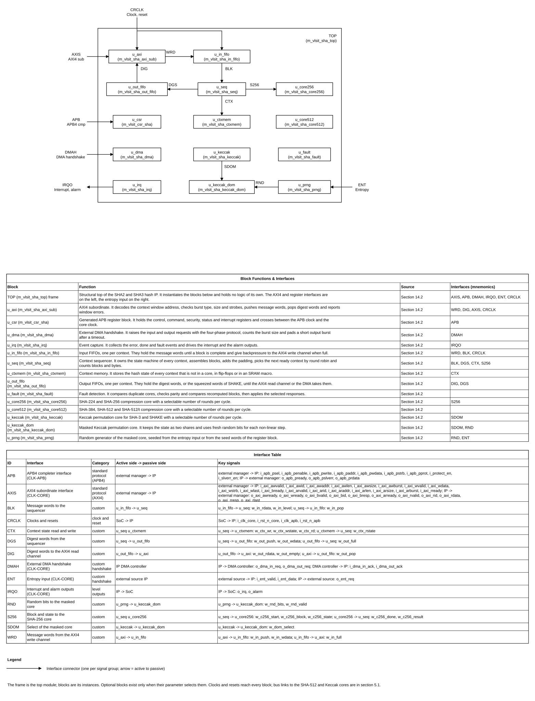

### 5.3 Transaction and dataflow

1. Software writes `sha_ctrl.algo`, `sha_ctrl.ctxsel` and gives `sha_cmd.init`: the sequencer marks the context absorbing and loads the initial hash value (SHA-2) or clears the Keccak state (SHA-3).
2. Software or the DMA writes message words into the message window of the context. Each accepted word enters the input FIFO of that context.
3. When a context has a complete block (64 bytes for SHA-224/256; 128 bytes for SHA-384/512; the rate for SHA-3) and the core of its algorithm is free, the sequencer loads the context state into the core and feeds the block. The core computes the block, and the new state is stored back.
4. Software writes the length register (`sha_len.tail`) and gives `sha_cmd.final`. The sequencer takes the words still in the FIFO, pads them (REQ-FUNC-004) and processes one or two final blocks.
5. The digest, or for SHAKE the first output block, enters the output FIFO and `sha_irq_raw.cdone` sets the bit of the context. Software or the DMA reads the digest window. For SHAKE each further output block is produced when the FIFO has room.
6. With `sha_sec.zero` = 1 the state, FIFOs and idle registers of the context are cleared after the last digest word is read.

### 5.4 Invariants

- At most one block per core is in progress; a context in a core is exclusively owned by it until the state is stored.
- A context is in exactly one state of 10.1; it accepts message words only in the absorbing state.
- Words of one message leave the input FIFO in the order they entered.
- The digest of a message depends only on that message, never on other contexts.
- `o_irq` equals the OR of `sha_irq_sts`; `o_alarm` is 1 only while a fault response with the alarm bit is active.
- `o_axi_*valid` and data are stable until the ready of the AXI4 handshake.

## 6. External interfaces and ports

### 6.1 Interface inventory

| Interface ID | Type and revision | Role | Direction at IP boundary | Clock domain | Required / optional | Configurations |
|---|---|---|---|---|---|---|
| IF-001 | AMBA AXI4 (IHI 0022 H.c) | Subordinate: message window, digest window | Request in, response out | CLK-CORE | Required | All |
| IF-002 | AMBA APB4 (IHI 0024) | Completer of the CSR block | Request in, response out | CLK-APB | Required | All |
| IF-003 | External DMA, 4-phase request and acknowledge, custom | Request out, acknowledge in, two channels (input, output) | Out and in | CLK-CORE | Optional (`PARA_DMA`) | CFG-BOOT, CFG-STOR, CFG-FULL |
| IF-004 | Entropy input, valid-ready style, custom | Sink of random words | In and out | CLK-CORE | Optional (`PARA_MASK` = 1 and `PARA_SEED_SRC` = 0) | CFG-FULL |
| IF-005 | Interrupt and alarm outputs | Level outputs | Out | CLK-CORE | Required | All |

### 6.2 Complete port list

`PARA_AXI_DW` is 32, 64 or 128; `PARA_AXI_IDW` is the AXI ID width; `PARA_AXI_AW` is the AXI address width (16 or more; the low 16 bits are decoded). The port list is the same for every configuration; the width of an AXI signal follows the parameter. Ports of an absent option are tied off inside and are listed as "unused when" in the last column.

| Port | Direction | Width | Meaning (function) | Clock domain | Signal type | Reset / idle value | Timing / sampling | Configurations |
|---|---|---:|---|---|---|---|---|---|
| i_clk_core | Input | 1 | Clock of the AXI4 interface, cores and register clock | CLK-CORE | clock | N/A (clock, reset or static input has no idle value) | Rising edge | All |
| i_rst_n_core | Input | 1 | Reset of the core domain, active low | async, released synchronously | reset | N/A (clock, reset or static input has no idle value) | Assert async, release sync to i_clk_core | All |
| i_clk_apb | Input | 1 | APB clock | CLK-APB | clock | N/A (clock, reset or static input has no idle value) | Rising edge | All |
| i_rst_n_apb | Input | 1 | Reset of the APB domain, active low | async, released synchronously | reset | N/A (clock, reset or static input has no idle value) | Assert async, release sync to i_clk_apb | All |
| i_apb_psel | Input | 1 | APB select | CLK-APB | level | 0 | Sampled with PENABLE | All |
| i_apb_penable | Input | 1 | APB enable | CLK-APB | level | 0 | APB4 protocol | All |
| i_apb_pwrite | Input | 1 | APB write | CLK-APB | level | 0 | Valid while psel | All |
| i_apb_paddr | Input | 16 | APB address | CLK-APB | data (valid with psel) | 0 | Valid while psel | All |
| i_apb_pwdata | Input | 32 | APB write data | CLK-APB | data (valid with psel and pwrite) | 0 | Valid while psel | All |
| i_apb_pstrb | Input | 4 | APB write strobes | CLK-APB | data (valid with psel and pwrite) | 0 | Valid while psel | All |
| i_apb_pprot | Input | 3 | APB protection | CLK-APB | data (valid with psel) | 0 | Bit 1 used | All |
| o_apb_pready | Output | 1 | APB ready | CLK-APB | level | 0 | APB4 protocol | All |
| o_apb_pslverr | Output | 1 | APB error | CLK-APB | level | 0 | Valid with pready | All |
| o_apb_prdata | Output | 32 | APB read data | CLK-APB | data (valid with pready and read) | 0 | Valid with pready | All |
| i_protect_en | Input | 1 | 1 = non-secure APB access gets PSLVERR | CLK-APB | static | N/A (clock, reset or static input has no idle value) | Constant after reset | All |
| i_slverr_en | Input | 1 | 1 = APB error checks on | CLK-APB | static | N/A (clock, reset or static input has no idle value) | Constant after reset | All |
| i_axi_awvalid | Input | 1 | Write address valid | CLK-CORE | level | 0 | AXI4 handshake | All |
| o_axi_awready | Output | 1 | Write address ready | CLK-CORE | level | 0 | AXI4 handshake | All |
| i_axi_awid | Input | `PARA_AXI_IDW` | Write ID | CLK-CORE | data (valid with awvalid) | 0 | With awvalid | All |
| i_axi_awaddr | Input | `PARA_AXI_AW` | Write address | CLK-CORE | data (valid with awvalid) | 0 | With awvalid | All |
| i_axi_awlen | Input | 8 | Burst length minus 1 | CLK-CORE | data (valid with awvalid) | 0 | With awvalid | All |
| i_axi_awsize | Input | 3 | Beat size code | CLK-CORE | data (valid with awvalid) | 0 | With awvalid | All |
| i_axi_awburst | Input | 2 | Burst type | CLK-CORE | data (valid with awvalid) | 0 | With awvalid | All |
| i_axi_wvalid | Input | 1 | Write data valid | CLK-CORE | level | 0 | AXI4 handshake | All |
| o_axi_wready | Output | 1 | Write data ready | CLK-CORE | level | 0 | AXI4 handshake | All |
| i_axi_wdata | Input | `PARA_AXI_DW` | Write data | CLK-CORE | data (valid with wvalid) | 0 | With wvalid | All |
| i_axi_wstrb | Input | `PARA_AXI_DW`/8 | Write strobes | CLK-CORE | data (valid with wvalid) | 0 | With wvalid | All |
| i_axi_wlast | Input | 1 | Last write beat | CLK-CORE | data (valid with wvalid) | 0 | With wvalid | All |
| o_axi_bvalid | Output | 1 | Write response valid | CLK-CORE | level | 0 | AXI4 handshake | All |
| i_axi_bready | Input | 1 | Write response ready | CLK-CORE | level | 0 | AXI4 handshake | All |
| o_axi_bid | Output | `PARA_AXI_IDW` | Write response ID | CLK-CORE | data (valid with bvalid) | 0 | With bvalid | All |
| o_axi_bresp | Output | 2 | Write response | CLK-CORE | data (valid with bvalid) | 0 | With bvalid | All |
| i_axi_arvalid | Input | 1 | Read address valid | CLK-CORE | level | 0 | AXI4 handshake | All |
| o_axi_arready | Output | 1 | Read address ready | CLK-CORE | level | 0 | AXI4 handshake | All |
| i_axi_arid | Input | `PARA_AXI_IDW` | Read ID | CLK-CORE | data (valid with arvalid) | 0 | With arvalid | All |
| i_axi_araddr | Input | `PARA_AXI_AW` | Read address | CLK-CORE | data (valid with arvalid) | 0 | With arvalid | All |
| i_axi_arlen | Input | 8 | Burst length minus 1 | CLK-CORE | data (valid with arvalid) | 0 | With arvalid | All |
| i_axi_arsize | Input | 3 | Beat size code | CLK-CORE | data (valid with arvalid) | 0 | With arvalid | All |
| i_axi_arburst | Input | 2 | Burst type | CLK-CORE | data (valid with arvalid) | 0 | With arvalid | All |
| o_axi_rvalid | Output | 1 | Read data valid | CLK-CORE | level | 0 | AXI4 handshake | All |
| i_axi_rready | Input | 1 | Read data ready | CLK-CORE | level | 0 | AXI4 handshake | All |
| o_axi_rid | Output | `PARA_AXI_IDW` | Read ID | CLK-CORE | data (valid with rvalid) | 0 | With rvalid | All |
| o_axi_rdata | Output | `PARA_AXI_DW` | Read data | CLK-CORE | data (valid with rvalid) | 0 | With rvalid | All |
| o_axi_rresp | Output | 2 | Read response | CLK-CORE | data (valid with rvalid) | 0 | With rvalid | All |
| o_axi_rlast | Output | 1 | Last read beat | CLK-CORE | data (valid with rvalid) | 0 | With rvalid | All |
| o_dma_in_req | Output | 1 | Request to move a burst of message words into the IP | CLK-CORE | level (held until acknowledge) | 0 | 4-phase | `PARA_DMA` = 1; 0 otherwise |
| i_dma_in_ack | Input | 1 | Acknowledge of the input burst | CLK-CORE | level (held until request falls) | 0 | 4-phase; sampled by 2-flop synchronizer if the DMA is asynchronous (integration, ASM-008) | `PARA_DMA` = 1; unused otherwise |
| o_dma_out_req | Output | 1 | Request to read a burst of digest words | CLK-CORE | level (held until acknowledge) | 0 | 4-phase | `PARA_DMA` = 1; 0 otherwise |
| i_dma_out_ack | Input | 1 | Acknowledge of the output burst | CLK-CORE | level (held until request falls) | 0 | 4-phase | `PARA_DMA` = 1; unused otherwise |
| i_ent_valid | Input | 1 | Entropy word valid | CLK-CORE | level | 0 | Sampled with o_ent_req | `PARA_MASK` = 1 and `PARA_SEED_SRC` = 0; unused otherwise |
| i_ent_data | Input | 32 | Entropy word | CLK-CORE | data (valid with i_ent_valid) | 0 | With i_ent_valid | same |
| o_ent_req | Output | 1 | Request for an entropy word | CLK-CORE | level | 0 | Held until valid | same; 0 otherwise |
| o_irq | Output | 1 | Interrupt, OR of the masked events | CLK-CORE | level | 0 | Stays high until cleared | All |
| o_alarm | Output | 1 | Fault alarm, active while a fault response with the alarm bit is active | CLK-CORE | level | 0 | Cleared by soft reset | `PARA_ALARM` = 1; 0 otherwise |

The ports of the register block `m_vlsit_csr_sha` (the field ports `o_sha_*`, `i_sha_*`, `i_hw_*`) are internal to the IP and are connected as in 11.3. Test ports: none (section 16).

### 6.3 Protocol behavior

**AXI4 subordinate profile (REF-006).** Address map of the AXI window (`PARA_AXI_AW` >= 16; only bits [15:0] are decoded and bits above are ignored by the IP):

| Address bits | Meaning |
|---|---|
| [15:12] | Context number, 0 to `PARA_CTX_N` - 1 |
| [11] | 0 = message window (write only), 1 = digest window (read only) |
| [10:0] | Offset inside the window; any value is accepted, FIXED bursts keep it, INCR bursts advance it; the offset does not choose a word (the window is a FIFO port) |

| Case | Legal behavior | Illegal / unsupported case | IP response | Requirement IDs |
|---|---|---|---|---|
| Write burst to the message window | INCR or FIXED, size equal to the bus width, `wstrb` all ones on every beat, `awlen` up to 255 | WRAP burst, size narrower than the bus, `wstrb` not all ones, context number >= `PARA_CTX_N`, write to a digest window | The beats are accepted and dropped, `bresp` = SLVERR, error kind 4 (or 3 for the wrong direction) is recorded | REQ-IF-001, REQ-IF-002, REQ-ERR-001 |
| Write to a full input FIFO | The IP holds `wready` low until there is room (backpressure) | `wready` held low longer than the timeout is not detected by the IP | No data is dropped; software should read `sha_lvl.inlvl` | REQ-IF-001 |
| Write to a context that is not absorbing | Not allowed | The beats are accepted and dropped, `bresp` = SLVERR, error kind 1 | Overflow event | REQ-ERR-001 |
| Read burst from the digest window | INCR or FIXED, size equal to the bus width, `arlen` up to 255 | WRAP burst, narrow size, read of a message window | `rresp` = SLVERR, data 0, error kind 3 or 4 | REQ-IF-001 |
| Read of an empty output FIFO | Not allowed | Read before the digest is ready | `rdata` = 0, `rresp` = OKAY, error kind 2, underflow event | REQ-ERR-001 |
| Outstanding transactions | One write and one read burst at a time; the IP deasserts `awready` and `arready` while a burst is in progress | More outstanding bursts are not accepted | Handshake backpressure | REQ-IF-001 |
| IDs and ordering | `bid` and `rid` return the ID of the burst; no reordering | None | Equal to the request | REQ-IF-001 |
| Reset of in-flight bursts | The burst is abandoned; no response | N/A (clock, reset or static input has no idle value) | Registers return to reset values | REQ-RESET-001 |

**External DMA handshake (IF-003).** Input channel: when `sha_ctrl.dmaen` = 1 and the context in use can take `sha_dmac.burst` words, `o_dma_in_req` rises and stays high until `i_dma_in_ack` rises; then `o_dma_in_req` falls, and the controller lowers `i_dma_in_ack`. The DMA controller then writes the burst to the message window as ordinary AXI4 writes. Output channel: the same with `o_dma_out_req` when the output FIFO holds `sha_dmac.burst` words or when the burst timer `sha_dmac.tmo` expires; a short burst is padded with zero words and `sha_dvld.words` gives the valid count.

**Entropy input (IF-004).** `o_ent_req` rises when the PRNG needs a 32-bit word and falls after `i_ent_valid` has been seen for one cycle with `i_ent_data`; the PRNG takes eight words.

### 6.4 Interrupts and events

All events are bits of `sha_irq_raw` (sticky, write 1 to clear); `o_irq` = OR of `sha_irq_sts` (raw AND enable).

| Signal/event | Polarity | Assert condition | Clear/deassert condition | Mask/priority | Crossing | Reset state |
|---|---|---|---|---|---|---|
| `sha_irq_raw.cdone` bit n | High | Message of context n finished, digest ready | Software write 1 to the bit | `sha_irq_en.cdone`; no priority | None (core domain) | 0 |
| `sha_irq_raw.ovf` | High | Write to a full or non-absorbing window dropped | Software write 1 | `sha_irq_en.ovf` | None | 0 |
| `sha_irq_raw.udf` | High | Read of an empty output FIFO | Software write 1 | `sha_irq_en.udf` | None | 0 |
| `sha_irq_raw.axi` | High | AXI4 transaction rejected with SLVERR | Software write 1 | `sha_irq_en.axi` | None | 0 |
| `sha_irq_raw.cfg` | High | Rejected command or illegal value | Software write 1 | `sha_irq_en.cfg` | None | 0 |
| `sha_irq_raw.flt` | High | Fault detection mismatch | Software write 1 (the lock stays until soft reset) | `sha_irq_en.flt` | None | 0 |
| `sha_irq_raw.ent` | High | Masked core needed random bits with no valid seed | Software write 1 | `sha_irq_en.ent` | None | 0 |
| `sha_irq_raw.tmo` | High | DMA burst timeout padded a burst | Software write 1 | `sha_irq_en.tmo` | None | 0 |
| `sha_irq_raw.len` | High | Message longer than 2^61 - 1 bytes | Software write 1 | `sha_irq_en.len` | None | 0 |
| `o_irq` | High | OR of `sha_irq_sts` | Deasserts when all pending enabled events are cleared | Mask by `sha_irq_en` | To the interrupt controller (integrator synchronizes) | 0 |
| `o_alarm` | High | Fault with response bit 3 of `sha_sec.resp` | Soft reset command | `sha_sec.resp` | Integrator | 0 |


## 7. Clock, reset, and power

### 7.1 Clock domains

| Domain | Clock port | Edge | Frequency range | Source | Relationship to other clocks | Gating policy |
|---|---|---|---|---|---|---|
| CLK-CORE | i_clk_core | Rising | Sizing assumption 500 MHz maximum (ASM-003); no minimum stated | SoC clock controller | Asynchronous to CLK-APB when `PARA_CSR_ASYNC` = 1 | No clock gating cell in the IP; clock enables only (REQ-DFT-001) |
| CLK-APB | i_clk_apb | Rising | Any frequency; the generated register block works for any ratio when `PARA_CSR_ASYNC` = 1 | SoC clock controller | Same source as CLK-CORE when `PARA_CSR_ASYNC` = 0 (the integrator ties the two ports) | None |

The register clock port `i_clk_reg` of the generated block is connected to `i_clk_core`.

### 7.2 CDC and RDC

| Crossing ID | From → to | Signals | Structure | Reset handling | Constraints / verification |
|---|---|---|---|---|---|
| CDC-001 | CLK-APB ↔ CLK-CORE | APB request and response, register values | The generated `m_vlsit_csr_sha` with `PARA_ASYNCHRONOUS` = `PARA_CSR_ASYNC`, using the library synchronizer adapter `m_vlsit_csr_sync` (R-041) | Each side held in reset by its own reset; both released synchronously | `set_clock_groups -asynchronous` between the two clocks; CDC tool; simulation with clock ratios 1:1, 1:3 and 7:2 |
| CDC-002 | Outside → CLK-CORE | `i_dma_in_ack`, `i_dma_out_ack`, `i_ent_valid`, `i_ent_data`, `i_axi_*` | None inside the IP: the signals shall be synchronous to `i_clk_core` (ASM-008) | N/A (no such value for this item) | Integration check |
| CDC-003 | Reset release | `i_rst_n_core`, `i_rst_n_apb` | `m_vlsit_rst_sync` per domain, built from the library cells | Asynchronous assertion, synchronous release | Reset test |
| CDC-004 | CLK-CORE → outside | `o_irq`, `o_alarm`, `o_dma_*_req`, `o_ent_req` | None inside; the integrator synchronizes into the receiver clock | N/A (no such value for this item) | Integration check |

### 7.3 Reset domains and sequencing

| Reset ID | Port | Polarity / assertion | Sync or async | Scope | Deassertion | Reset value |
|---|---|---|---|---|---|---|
| RST-CORE | i_rst_n_core | Active-low | Async assertion / synchronized release | All logic of CLK-CORE: AXI4 interface, FIFOs, cores, sequencer, context memory control, CSR register side | Synchronous to i_clk_core through `m_vlsit_rst_sync` | All contexts free, FIFOs empty, registers at the workbook reset values |
| RST-APB | i_rst_n_apb | Active-low | Async assertion / synchronized release | APB side of `m_vlsit_csr_sha` | Synchronous to i_clk_apb | APB idle |
| RST-SOFT | `sha_cmd.srst` | Command, one operation | Synchronous | All contexts, FIFOs, cores, event flags, error record, lock; not the control, security and DMA registers | Ends when the command bit clears | Contexts free |

During reset the AXI4 and APB outputs are 0, no request is raised and `o_irq` and `o_alarm` are 0. A reset applied while a burst is in progress abandons the burst without a response. The context memory and the FIFO memories are not reset (resetless storage): their words are never read before a write because the context state, the FIFO level and the digest-ready state are reset (validity guard). With `PARA_ZERO` = 1 the clearing of 5.3 step 6 additionally removes message-dependent data. No warm, partial or retention reset is supported.

### 7.4 Power intent (if applicable)

N/A (no such value for this item). The IP has one power domain with no isolation, retention or power-down state; power intent is owned by the SoC.

## 8. Parameters and elaboration configurations

Parameters follow R-045 and the PAR-02 comment format of REF-003 in the RTL; this table gives the contract. All values are `logic [31:0]`.

| Parameter | Purpose | Default | Legal values / range | Dependencies / invalid combinations | Effect |
|---|---|---|---|---|---|
| PARA_EN_SHA224 | Build SHA-224 | 0 | 0, 1 | Needs core256 (built when SHA-224 or SHA-256 is on) | Capability bit 0 of `sha_cap0.alg` |
| PARA_EN_SHA256 | Build SHA-256 | 1 | 0, 1 | same | Bit 1 |
| PARA_EN_SHA384 | Build SHA-384 | 0 | 0, 1 | Needs core512 | Bit 2 |
| PARA_EN_SHA512 | Build SHA-512 | 0 | 0, 1 | same | Bit 3 |
| PARA_EN_SHA512_224 | Build SHA-512/224 | 0 | 0, 1 | same | Bit 4 |
| PARA_EN_SHA512_256 | Build SHA-512/256 | 0 | 0, 1 | same | Bit 5 |
| PARA_EN_SHA3_224 | Build SHA3-224 | 0 | 0, 1 | Needs the Keccak core | Bit 6 |
| PARA_EN_SHA3_256 | Build SHA3-256 | 0 | 0, 1 | same | Bit 7 |
| PARA_EN_SHA3_384 | Build SHA3-384 | 0 | 0, 1 | same | Bit 8 |
| PARA_EN_SHA3_512 | Build SHA3-512 | 0 | 0, 1 | same | Bit 9 |
| PARA_EN_SHAKE128 | Build SHAKE128 | 0 | 0, 1 | same | Bit 10 |
| PARA_EN_SHAKE256 | Build SHAKE256 | 0 | 0, 1 | same | Bit 11 |
| PARA_S256_UNR | SHA-256 rounds per cycle | 1 | Divisors of 64: 1, 2, 4, 8, 16, 32, 64 | Used only if a SHA-224 or SHA-256 is on | `sha_cap1.s256unr`; cycles per block (13) |
| PARA_S512_UNR | SHA-512 rounds per cycle | 1 | Divisors of 80: 1, 2, 4, 5, 8, 10, 16, 20, 40, 80 | Used only if a SHA-384 or SHA-512 type is on | `sha_cap1.s512unr` |
| PARA_KEC_UNR | Keccak rounds per cycle | 1 | Divisors of 24: 1, 2, 3, 4, 6, 8, 12, 24 | Shall be 1 when `PARA_MASK` = 1 (ASM-009) | `sha_cap1.kecunr` |
| PARA_S256_PIPE | Register stages in the SHA-256 round loop | 1 | 1 only in this revision (DEC-019); 2 to 4 reserved | Contexts hide the latency when `PARA_CTX_N` >= this value (13) | Cycles per block, maximum clock |
| PARA_S512_PIPE | Register stages in the SHA-512 round loop | 1 | 1 only in this revision (DEC-019) | same | same |
| PARA_KEC_PIPE | Register stages in the Keccak round loop | 1 | 1 only in this revision (DEC-019); 2 or more is needed by masking (stage 2) | Shall be at least 2 when `PARA_MASK` = 1 | same |
| PARA_CTX_N | Messages in progress | 1 | 1 to 16 | Context bits of the window address are [15:12] | `sha_cap0.ctxn`; size of FIFOs and context memory |
| PARA_CTX_MEM | Context memory kind | 0 | 0 = flip-flops; 1 = SRAM macro, reserved and illegal in this revision (DEC-016) | The macro flow is not defined (TBD-006) | Area and read latency of a context swap |
| PARA_AXI_DW | AXI data width | 64 | 32, 64, 128 | 128 only when every enabled block and rate is a multiple of 16 bytes: SHA-224, SHA-256, SHA-384, SHA-512, SHA-512/t and SHA3-224, no SHAKE (DEC-019) | `sha_cap0.axiw`, port widths |
| PARA_AXI_IDW | AXI ID width | 4 | 1 to 16 | None | Port widths |
| PARA_AXI_AW | AXI address width | 16 | 16 to 32 | Bits above 15 are ignored | Port width |
| PARA_IN_DEPTH | Input FIFO depth per context, in words | 64 | Power of 2, 4 to 1024 | (`PARA_IN_DEPTH` x `PARA_AXI_DW`/8) shall be at least the largest block of an enabled algorithm plus two words (DEC-019) | `sha_lvl.inlvl` range |
| PARA_OUT_DEPTH | Output FIFO depth per context, in words | 32 | Power of 2, 4 to 1024 | `PARA_OUT_DEPTH` x `PARA_AXI_DW`/8 shall be at least 64 B | `sha_lvl.outlvl` range |
| PARA_DMA | Build the external DMA handshake | 0 | 0, 1 | None | `sha_cap1.dma` |
| PARA_CSR_ASYNC | APB clock differs from core clock | 0 | 0, 1 | When 0 the integrator ties the clocks | `PARA_ASYNCHRONOUS` of the CSR block |
| PARA_ZERO | Build state clearing | 1 | 0, 1 | None | `sha_cap1.zero` |
| PARA_FAULT_DUP | Build duplicate-core detection | 0 | 0, 1 | Doubles the core area | `sha_cap1.fdup` |
| PARA_FAULT_PAR | Build parity detection | 0 | 0, 1 | One parity bit per 32 bits of state and of context memory | `sha_cap1.fpar` |
| PARA_FAULT_REDO | Build recompute detection | 0 | 0, 1 | Halves the throughput when selected | `sha_cap1.fredo` |
| PARA_MASK | Build the masked Keccak core | 0 | 0, 1 | Needs a Keccak algorithm on; `PARA_KEC_UNR` = 1; doubles the Keccak state and context memory | `sha_cap1.mask` |
| PARA_SEED_SRC | Seed source of the mask PRNG | 0 | 0 = entropy port, 1 = seed registers | Shall be 0 when `PARA_MASK` = 0 | `sha_cap1.sdsrc` |
| PARA_ALARM | Drive the alarm output | 0 | 0, 1 | Needs at least one fault parameter | `o_alarm` |

**Illegal combinations (REQ-PARAM-001).** All `PARA_EN_*` equal to 0; a `PARA_*_UNR` that does not divide the round count; a `PARA_*_PIPE` outside 1 to 4; `PARA_CTX_N` outside 1 to 16; `PARA_AXI_DW` not 32, 64 or 128; `PARA_AXI_AW` below 16; a FIFO depth that breaks its size rule; `PARA_MASK` = 1 with no Keccak algorithm, with `PARA_KEC_UNR` other than 1 or with `PARA_KEC_PIPE` below 2; `PARA_SEED_SRC` = 1 with `PARA_MASK` = 0; `PARA_ALARM` = 1 with no fault parameter; `PARA_CTX_MEM` = 1 (DEC-016); a `PARA_*_PIPE` other than 1 or `PARA_AXI_DW` = 128 with a block that is not a multiple of 16 bytes (DEC-019); and, until the second stage of the RTL is delivered, `PARA_MASK` = 1, `PARA_FAULT_DUP` = 1, `PARA_FAULT_PAR` = 1, `PARA_FAULT_REDO` = 1 and `PARA_SEED_SRC` = 1 (DEC-018). Each one stops elaboration with an error naming the cause (DEC-017): a `generate if` on the illegal condition instantiates a module whose name states it, `m_vlsit_sha_ERR_` followed by the cause, which does not exist, so elaboration fails with that name. **Example 1:** `PARA_CTX_N` = 17 makes elaboration stop with the unknown module `m_vlsit_sha_ERR_ctx_n_out_of_range`; `PARA_CTX_N` = 16 elaborates. **Example 2:** `PARA_CTX_MEM` = 1 stops with `m_vlsit_sha_ERR_ctx_mem_unsupported`.

| Configuration | Parameter overrides | Features/interfaces | Expected hierarchy | Elaboration/lint/synthesis target |
|---|---|---|---|---|
| CFG-BASE | Defaults (only `PARA_EN_SHA256` = 1) | SHA-256, one context | top, csr, axi_sub, in_fifo, out_fifo, seq, pad, core256, ctxmem | Elaborate, lint, synthesize |
| CFG-BOOT | `PARA_EN_SHA224`, `_SHA256`, `_SHA384`, `_SHA512` = 1; `PARA_S256_UNR` = 2; `PARA_S512_UNR` = 2; `PARA_DMA` = 1 | Secure boot | CFG-BASE plus core512, dma | same |
| CFG-STOR | `PARA_EN_SHA256`, `_SHA3_256`, `_SHAKE256` = 1; `PARA_S256_UNR` = 4; `PARA_KEC_UNR` = 2; `PARA_CTX_N` = 4; `PARA_AXI_DW` = 128; `PARA_DMA` = 1; `PARA_FAULT_PAR` = 1; `PARA_FAULT_REDO` = 1 | Storage controller | core256, keccak, fault, dma | same |
| CFG-FULL | All `PARA_EN_*` = 1; `PARA_CTX_N` = 16; `PARA_AXI_DW` = 128; `PARA_DMA`, `PARA_MASK`, `PARA_FAULT_DUP`, `PARA_FAULT_PAR`, `PARA_FAULT_REDO`, `PARA_ALARM`, `PARA_CSR_ASYNC` = 1; `PARA_KEC_PIPE` = 2 | Corner coverage | All blocks including keccak_dom, prng | same |

## 9. Data representation and arithmetic

**Message bytes.** Message byte i of a stream (i counted from 0) travels in word i / W of the window (W = `PARA_AXI_DW`/8 bytes) in lane i mod W, bits [8 x lane + 7 : 8 x lane] of the data bus (DEC-011). Software writes full words; the last word of a message carries the remaining bytes in its low lanes and `sha_len.tail` gives their count (0 means all W lanes).

**Digest bytes.** The digest and the SHAKE output are read from the digest window in the byte order of the standard: the first digest byte in lane 0 of the first word. SHA-2 words are big-endian inside the algorithm (REF-001 3.1); the IP does the byte order, so the digest bytes equal the standard's hexadecimal digest read left to right. Keccak lanes are little-endian (REF-002 B.1, the same order as the message).

| Quantity | Width | Encoding / range | Extension / truncation | Overflow / invalid behavior |
|---|---:|---|---|---|
| SHA-224 / 256 block, state, digest | 512 / 256 / 224 or 256 bits | 64-byte block, 8 x 32-bit words, digest bytes 28 or 32 | SHA-224 truncates the state to 224 bits (REF-001 6.3) | N/A (no such value for this item) |
| SHA-384 / 512 / 512-t block, state, digest | 1024 / 512 / 384, 512, 224 or 256 bits | 128-byte block, 8 x 64-bit words, digest bytes 48, 64, 28, 32 | SHA-512/t takes the leftmost t bits (REF-001 6.7); the initial values of 512/224 and 512/256 are those of REF-001 5.3.6 | N/A (no such value for this item) |
| SHA3 / SHAKE block (rate) | 1152, 1088, 832, 576 bits for SHA3-224, 256, 384, 512; 1344 and 1088 for SHAKE128 and SHAKE256 | Rate in bytes 144, 136, 104, 72, 168, 136 | Digest is the first 28, 32, 48, 64 bytes of the squeezed state (REF-002 6.1); SHAKE is unlimited | N/A (no such value for this item) |
| Padding | 1 to 2 blocks added | SHA-2: byte 0x80, zeros, 64-bit (SHA-224/256) or 128-bit (SHA-384/512) big-endian message length in bits; SHA-3: suffix 01 then pad10*1; SHAKE: suffix 1111 then pad10*1 | N/A (no such value for this item) | N/A (no such value for this item) |
| Message length | 61 bits of bytes | 0 to 2^61 - 1 bytes (DEC-009) | The 64-bit counter holds bytes; the bit length is bytes x 8 | A longer message sets the length-limit event and is discarded |
| Counters | 32 bits visible | `sha_blk.cnt`, `sha_byte.cnt`; internal byte counter 64 bits | Visible counters are the low 32 bits | Wrap at the maximum |
| Context number | 4 bits | 0 to `PARA_CTX_N` - 1 | N/A (no such value for this item) | A larger value sets the configuration error event |

Reserved and invalid values: reserved algorithm codes and unbuilt algorithms are rejected with the configuration error event and no state change. Reserved register bits read as 0. Don't-cares are not used on the external interfaces.

## 10. Detailed functional behavior

### 10.1 Modes and state transitions

State of one context (read in `sha_sts.cstate` for the selected context).

| Mode/state | Entry condition | Behavior | Exit condition | Outputs / side effects |
|---|---|---|---|---|
| FREE | Reset, soft reset, abort, last digest word read with `PARA_ZERO`, digest read without it | Context unused; its window rejects writes | `sha_cmd.init` accepted | None |
| ABSORBING | `init` accepted | Message window accepts words; full blocks go to the core | `final` accepted, abort, fault lock | `sha_blk.cnt`, `sha_byte.cnt` count |
| FINALIZING | `final` accepted | Remaining bytes padded and processed (one or two blocks) | Last block stored | Window closed to writes |
| DIGEST_READY | Last block done (SHA-2, SHA-3) or first block done (SHAKE) | Digest in the output FIFO | Last digest word read, abort | `sha_irq_raw.cdone`, `sha_sts.ready` |
| SQUEEZING | SHAKE only: digest window read past the first block | Next output block produced when the FIFO has room | Abort, soft reset | None |
| LOCKED | Fault with the lock response | All contexts refuse commands and windows | Soft reset command | `sha_sts.locked` |

### 10.2 Operations

| Operation ID | Inputs / preconditions | Processing semantics | Result / completion | Latency / ordering |
|---|---|---|---|---|
| OP-001 | `sha_ctrl.algo`, `sha_ctrl.ctxsel`; context FREE; algorithm built | `sha_cmd.init`: load the initial hash value or clear the Keccak state; clear counters and FIFOs of the context | Context ABSORBING; `sha_cmd.init` bit clears | 2 core cycles; ordered before the first word |
| OP-002 | Context ABSORBING; AXI4 burst to the message window | Push words in order; assemble blocks | Words in the FIFO; `bresp` OKAY | 1 cycle per accepted beat; backpressure when full |
| OP-003 | All words written; `sha_len.tail` | `sha_cmd.final`: pad the last block (REQ-FUNC-004) and process | Context DIGEST_READY | Block time of 13 for each padded block |
| OP-004 | Context DIGEST_READY; AXI4 read of the digest window | Pop digest words in order | `rdata` words; context FREE after the last word | 1 cycle per beat when the FIFO has data |
| OP-005 | SHAKE context; reads continue | Squeeze: run Keccak-f again and refill the FIFO | More output words | One block time per rate bytes |
| OP-006 | Any state | `sha_cmd.abort`: clear the context, FIFOs and state | Context FREE | 2 cycles |
| OP-007 | Any state | `sha_cmd.srst`: clear all contexts, cores, flags, error record, lock | All FREE | 4 cycles |
| OP-008 | Any state | `sha_cmd.clear`: zero the state memory and FIFOs of the selected context, keep the algorithm field | Context FREE | 2 cycles plus memory size |
| OP-009 | `PARA_MASK` = 1, `PARA_SEED_SRC` = 1; eight `sha_seed` words written | `sha_cmd.seed`: load the PRNG | `sha_sts.seeded` = 1 | 9 cycles |
| OP-010 | `sha_ctrl.dmaen` = 1 | Request, acknowledge, burst moves words | Words in or out without the CPU | 4-phase handshake |
| OP-011 | Fault enabled and mismatch | Apply `sha_sec.resp`: gate, lock, clear, alarm | `sha_irq_raw.flt`; `o_alarm` as selected | The response is active in the cycle after the mismatch is registered |

### 10.3 Cycle-level behavior

**Waveform plan (rule R-024).** Proposed and confirmed by the user on 2026-11-09 (option C: the proposed list plus corner cases WF-017 to WF-019). The waveforms show design intent derived from sections 6.3 and 10.2; they are not simulation output. Each figure has its WaveJSON source beside it in the folder `figures`; notes follow the table.

| Waveform ID | Function / operation | Scenario (success / error / corner) | Signals shown | Figure | Confirmed by user |
|---|---|---|---|---|---|
| WF-001 | OP-001, OP-002 write burst of the message window | Success | `i_axi_aw*`, `i_axi_w*`, `o_axi_b*`, `sha_lvl.inlvl` | 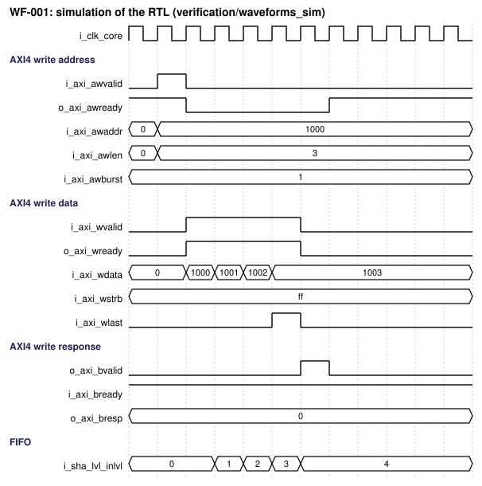 (source `figures/wf_001_axi_write_burst.json`) | 2026-11-09 |
| WF-002 | OP-002 | Error: partial `wstrb` or WRAP burst, SLVERR | `i_axi_w*`, `o_axi_bresp`, `o_irq` | 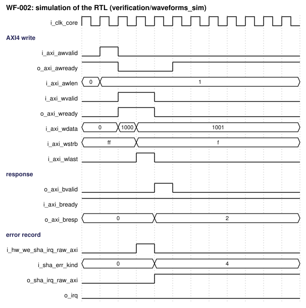 (source `figures/wf_002_axi_write_error.json`) | 2026-11-09 |
| WF-003 | OP-002 | Corner: input FIFO full, `o_axi_wready` low | `o_axi_wready`, FIFO level | 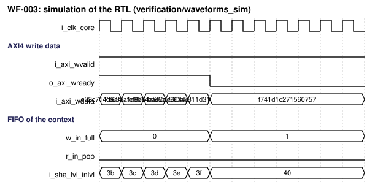 (source `figures/wf_003_fifo_full_backpressure.json`) | 2026-11-09 |
| WF-004 | OP-003 | Success: final, padding, digest ready, `cdone` | `sha_cmd.final`, core busy, `o_irq` | 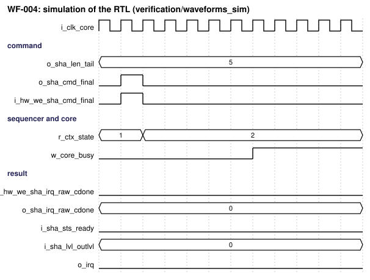 (source `figures/wf_004_final_digest_ready.json`) | 2026-11-09 |
| WF-005 | OP-004 | Success: read digest burst | `i_axi_ar*`, `o_axi_r*` | 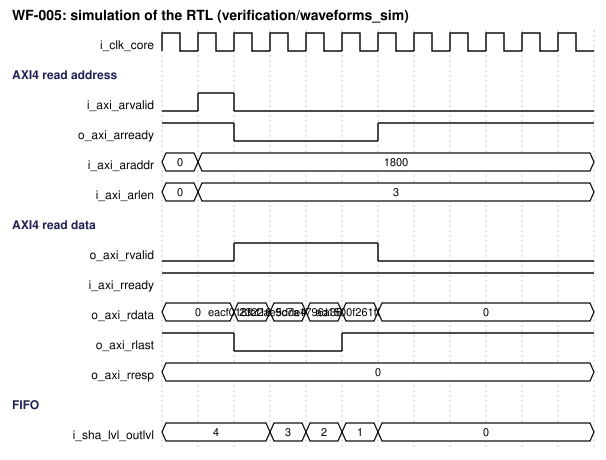 (source `figures/wf_005_digest_read_burst.json`) | 2026-11-09 |
| WF-006 | OP-004 | Error: read of an empty digest FIFO | `o_axi_rdata`, `udf` event | 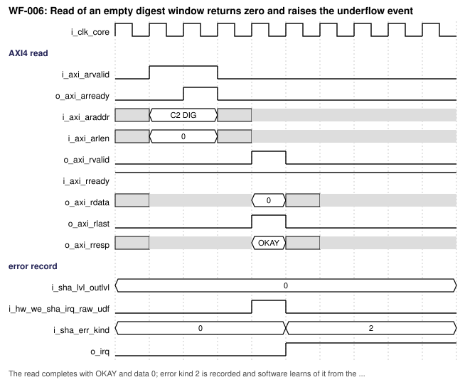 (source `figures/wf_006_read_empty_underflow.json`) | 2026-11-09 |
| WF-007 | OP-001 | Success and error: APB init, non-secure access PSLVERR | `i_apb_*`, `o_apb_*` | 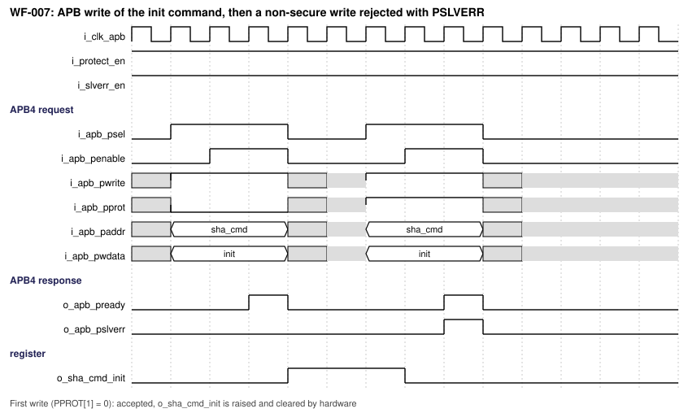 (source `figures/wf_007_apb_init_and_nonsecure.json`) | 2026-11-09 |
| WF-008 | OP-002, OP-003 | Corner: two contexts interleaved, state save and restore | Context number, core load and store | 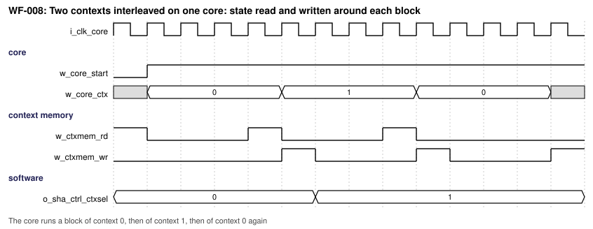 (source `figures/wf_008_two_contexts_interleaved.json`) | 2026-11-09 |
| WF-009 | OP-005 | Corner: SHAKE squeeze of more than one block | Output FIFO level, core | 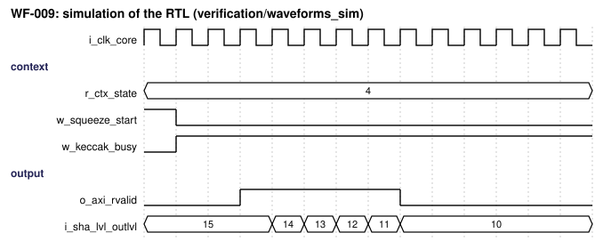 (source `figures/wf_009_shake_squeeze.json`) | 2026-11-09 |
| WF-010 | OP-010 | Success: DMA input 4-phase handshake | `o_dma_in_req`, `i_dma_in_ack` | 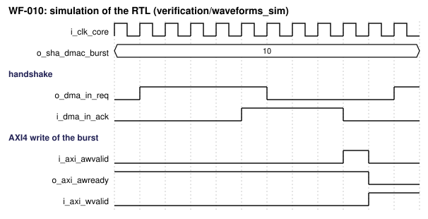 (source `figures/wf_010_dma_input_handshake.json`) | 2026-11-09 |
| WF-011 | OP-010 | Corner: DMA output timeout, padded burst | `o_dma_out_req`, `sha_dvld.words` | 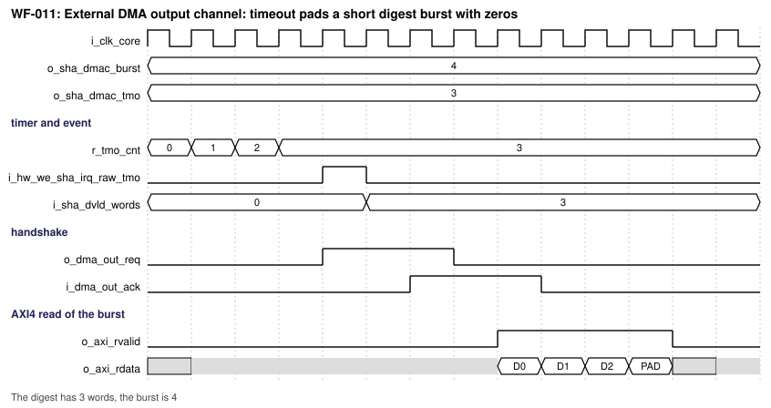 (source `figures/wf_011_dma_output_timeout.json`) | 2026-11-09 |
| WF-012 | OP-011 | Error: fault detected, gate, lock, alarm | `o_alarm`, `sha_sts.locked` | 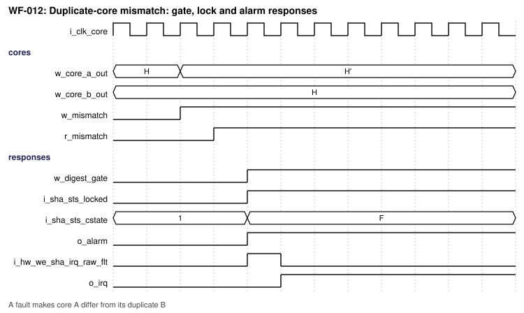 (source `figures/wf_012_fault_response.json`) | 2026-11-09 |
| WF-013 | OP-009 | Corner: masked core entropy request | `o_ent_req`, `i_ent_valid` | 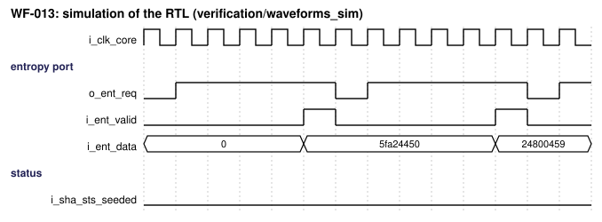 (source `figures/wf_013_entropy_request.json`) | 2026-11-09 |
| WF-014 | OP-006, OP-007, OP-008 | Corner: abort, soft reset, state clearing | Context state, FIFO levels | 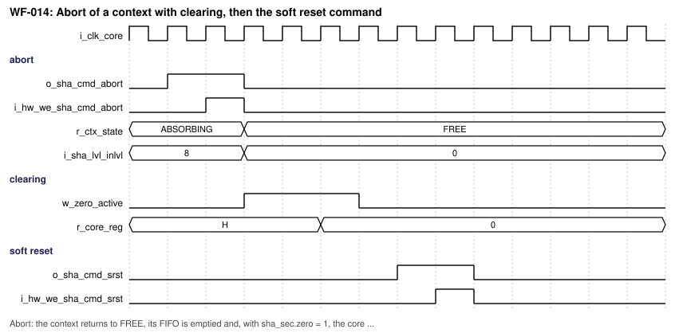 (source `figures/wf_014_abort_zero_reset.json`) | 2026-11-09 |
| WF-015 | Reset | Reset assertion and release in both domains | `i_rst_n_*`, outputs | 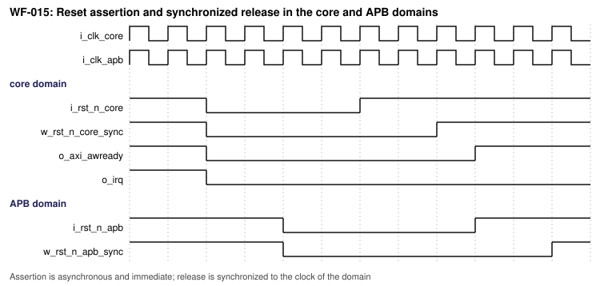 (source `figures/wf_015_reset_release.json`) | 2026-11-09 |
| WF-016 | CDC-001 | Corner: APB write with asynchronous clocks, PREADY wait | `i_apb_*`, `o_apb_pready` | 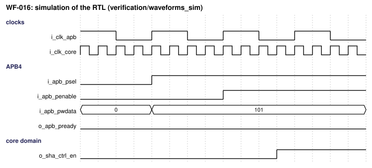 (source `figures/wf_016_apb_async_write.json`) | 2026-11-09 |
| WF-017 | OP-003 | Corner: final command while the core is busy and the input FIFO holds words | Command, core busy, FIFO level | 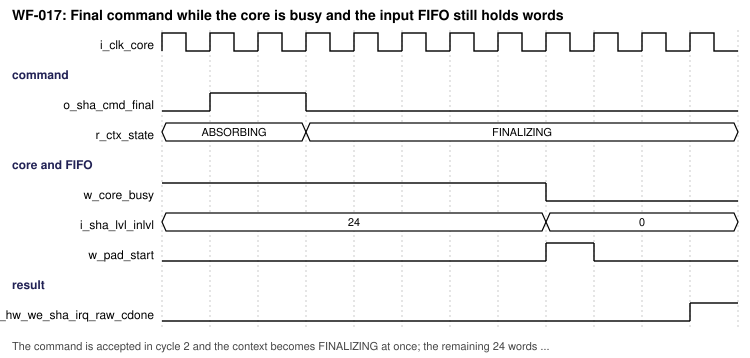 (source `figures/wf_017_final_with_busy_core.json`) | 2026-11-09 |
| WF-018 | OP-003 | Corner: message that needs two padded final blocks | Block kind, core start, event | 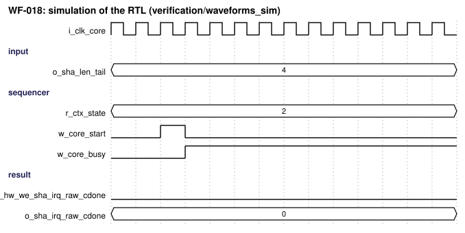 (source `figures/wf_018_two_block_padding.json`) | 2026-11-09 |
| WF-019 | OP-001, OP-003 | Corner: context select changed while the core is busy | `sha_ctrl.ctxsel`, level and state read-back | 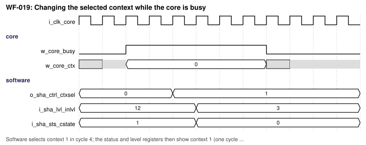 (source `figures/wf_019_ctxsel_while_busy.json`) | 2026-11-09 |

**Waveform notes.**

- **WF-001** (Write burst of 4 words to the message window of context 1 (64-bit bus)): Cycle 2: AW handshake. Cycles 3 to 6: four W beats, wstrb all ones, wlast on the fourth. Level counts the words in the input FIFO of context 1.
- **WF-002** (Write burst with a partial write strobe is rejected with SLVERR): Beat 2 has wstrb 0F: both beats are accepted and dropped, bresp is SLVERR, error kind 4 is recorded and the AXI error event is raised.
- **WF-003** (Input FIFO full: o_axi_wready low until the sequencer pops a word): Example FIFO of 3 words. The FIFO is full in cycles 5 to 7 so wready is low and W3 is held; the pop in cycle 7 frees a place and W3 is accepted in cycle 8. No word is dropped.
- **WF-004** (Final command, padding and digest ready of a short SHA-256 message): Cycles 4 to 8 stand for the 66 cycles of one SHA-256 block at UNR 1 (not to scale). The short message fits in one padded block.
- **WF-005** (Read burst of the 4-word digest from the digest window of context 1): The read data are the 4 digest words in standard byte order; the output FIFO level falls with each beat and the context becomes FREE after the last word.
- **WF-006** (Read of an empty digest window returns zero and raises the underflow event): The read completes with OKAY and data 0; error kind 2 is recorded and software learns of it from the underflow event.
- **WF-007** (APB write of the init command, then a non-secure write rejected with PSLVERR): First write (PPROT[1] = 0): accepted, o_sha_cmd_init is raised and cleared by hardware. Second write (PPROT[1] = 1) with i_protect_en and i_slverr_en = 1: PSLVERR, no change. Delays follow the clock ratio (11.4).
- **WF-008** (Two contexts interleaved on one core: state read and written around each block): The core runs a block of context 0, then of context 1, then of context 0 again. The context memory is read before and written after each block. ctxsel changes while the core is busy without disturbing it.
- **WF-009** (SHAKE128 output of more than one block: the next block is squeezed when the FIFO has room): Example numbers: FIFO of 32 words, a block of 21 words. Reads (each pulse stands for a burst of 5 words, not to scale) lower the level; at level 11 the next squeeze starts and the level returns to 32.
- **WF-010** (External DMA input channel: 4-phase request and acknowledge, then the burst is written): req rises, ack rises, req falls, ack falls. The DMA controller then writes the burst of sha_dmac.burst words to the message window as ordinary AXI4 writes.
- **WF-011** (External DMA output channel: timeout pads a short digest burst with zeros): The digest has 3 words, the burst is 4. The timer reaches sha_dmac.tmo = 3, the request is raised, the 4th word is zero padding and sha_dvld.words reports 3.
- **WF-012** (Duplicate-core mismatch: gate, lock and alarm responses): A fault makes core A differ from its duplicate B. The mismatch is registered in cycle 3; the responses (gate, lock, alarm) are active in cycle 4 and the lock stays until the soft reset command.
- **WF-013** (Masked core takes seed words from the entropy port): o_ent_req is held until i_ent_valid; words 3 to 8 are not shown. After the eighth word the PRNG is seeded and the status bit is set.
- **WF-014** (Abort of a context with clearing, then the soft reset command): Abort: the context returns to FREE, its FIFO is emptied and, with sha_sec.zero = 1, the core registers are zeroed within 3 cycles. The soft reset command then clears all contexts.
- **WF-015** (Reset assertion and synchronized release in the core and APB domains): Assertion is asynchronous and immediate; release is synchronized to the clock of the domain. During reset the outputs are 0.
- **WF-016** (APB write with asynchronous clocks (ratio 1:4): PREADY waits for the core domain): i_clk_apb is drawn with a period of 4 cells and i_clk_core with 1 cell. The request crosses to the core domain, the register changes there and PREADY returns after the response crosses back; software waits for PREADY.
- **WF-017** (Final command while the core is busy and the input FIFO still holds words): The command is accepted in cycle 2 and the context becomes FINALIZING at once; the remaining 24 words wait until the core is free in cycle 8, then the padded block starts.
- **WF-018** (Message whose last block leaves no room for the length: two final blocks): sha_len.tail leaves 60 bytes of 64 used. The first final block holds the data and the 0x80 byte; the second holds zeros and the 64-bit length (REQ-FUNC-004).
- **WF-019** (Changing the selected context while the core is busy): Software selects context 1 in cycle 4; the status and level registers then show context 1 (one cycle later) while the core goes on with the block of context 0.

Cycle table of one SHA-256 block with `PARA_S256_UNR` = 1 and `PARA_S256_PIPE` = 1 (formula of 13; to be confirmed in simulation, TBD-001):

| Cycle / event | Input condition | State/action | Output condition |
|---|---|---|---|
| t0 | Context has a full block, core free | Sequencer selects the context, starts the load | Core busy |
| t1 | State available from the context memory | Working variables and the first message words loaded | Core busy |
| t2 to t65 | None | One round per cycle, rounds 0 to 63 | Core busy |
| t66 | Round 63 done | Intermediate hash added to the state, state written back | Core free in t67 |

### 10.4 Arbitration, buffering, and throughput

- **Arbitration.** The sequencer chooses the next context for a free core by round robin among the contexts that have a complete block (or a final block); a context is never taken from a core in the middle of a block. A context that waits is served within `PARA_CTX_N` block times (starvation bound).
- **Buffering.** Input FIFO of `PARA_IN_DEPTH` words per context and output FIFO of `PARA_OUT_DEPTH` words per context; simultaneous push and pop are allowed; full means `wready` low; empty means a read returns zero with the underflow event.
- **Cores.** One SHA-256 core, one SHA-512 core and one Keccak core at most, each shared by all contexts. In this revision only one block is in a core at any time, and the sequencer assembles the next block in a prefetch slot while the core runs (DEC-019).
- **Latency hiding.** Loop pipeline stages (`PIPE` > 1) that hide latency with several contexts are not built in this revision (DEC-019); a block takes `R / UNR + 2` cycles and the next block is assembled during it.
- **Ordering.** Words and digests of one context keep their order; no order is promised between contexts.

### 10.5 Memories and storage

| Storage ID | Kind | Depth × width | Ports | Read latency | Write mask | Reset/init | ECC/parity | Implementation |
|---|---|---|---|---|---|---|---|---|
| MEM-001 | Input FIFO (per context) | `PARA_IN_DEPTH` x `PARA_AXI_DW` | 1 write, 1 read | 1 cycle (first-word fall-through) | None | Not reset; level reset | Parity when `PARA_FAULT_PAR` | Reuses the library synchronous FIFO (002_SyncFIFO), inferred |
| MEM-002 | Output FIFO (per context) | `PARA_OUT_DEPTH` x `PARA_AXI_DW` | 1 write, 1 read | 1 cycle | None | Not reset; level reset | Parity when `PARA_FAULT_PAR` | same |
| MEM-003 | Context memory | `PARA_CTX_N` x 256, 512 or 1600 bits plus 80 bits of control (width of the largest core built; twice the Keccak part when `PARA_MASK`) | 1 read, 1 write | 1 cycle (flip-flops) or macro latency | None | Not reset; context state reset | Parity when `PARA_FAULT_PAR` | Flip-flops or SRAM macro by `PARA_CTX_MEM` |

The context memory is read when a block starts and written when it ends; both ports are used by the sequencer only, so a collision is not possible. A context in the FREE state is never read. With `PARA_CTX_MEM` = 1 the macro, wrapper and memory-compiler flow are chosen by the integrator (TBD-006).

## 11. Register and programming model

### 11.1 CSR specification source

The CSR specification of this IP is defined only in the workbook REF-005. This document names registers and fields as written there and does not restate offsets, widths, types or reset values.

| Item | Specification |
|---|---|
| CSR workbook file | `csr/VLSIT_SHA2_SHA3_HASH_CSR.xlsx` in the folder of this specification, built from `csr/sha_regs.json` by `csr/gen_sha_csr_json.py` and `vlsit_csr_tool.py fill --auto-reserved` |
| Sheet used for this IP | `ASYNC_CSR` |
| Workbook revision / date | Revision 1 (`sha_cap0.rev` = 1), 2026-11-09 |
| CSR generator | APB-CSR-Generator, version 3.4, commit c40f319 (`https://github.com/nguyenquanicd/APB-CSR-Generator`) |
| CSR module name | `m_vlsit_csr_sha` |
| Register prefix | `sha` |
| Asynchronous | 1 in the workbook; the module parameter `PARA_ASYNCHRONOUS` is set from `PARA_CSR_ASYNC` |
| APB clock and register clock | `i_clk_apb` is the APB clock (CLK-APB); `i_clk_reg` is connected to `i_clk_core` (CLK-CORE) |
| Source of `i_protect_en` and `i_slverr_en` | IP input ports of the same names, constant after reset |

Registers: capability (`sha_cap0`, `sha_cap1`), control (`sha_ctrl`), command (`sha_cmd`, type `rwi`), length (`sha_len`), DMA (`sha_dmac`), security (`sha_sec`), seed (`sha_seed`, eight write-only words, `PARAMETERIZED` repeat), status (`sha_sts`, `sha_lvl`, `sha_blk`, `sha_byte`, `sha_dvld`), error record (`sha_err`, `sha_erra`), interrupts (`sha_irq_raw`, `sha_irq_en`, `sha_irq_inj`, `sha_irq_sts`). The registers are global; the field `sha_ctrl.ctxsel` selects the context to which the commands, `sha_len` and the read-back registers refer (DEC-012). Software that serves several contexts from several threads shall serialize its accesses to `sha_ctrl.ctxsel` (ASM-010).

### 11.2 Software sequences

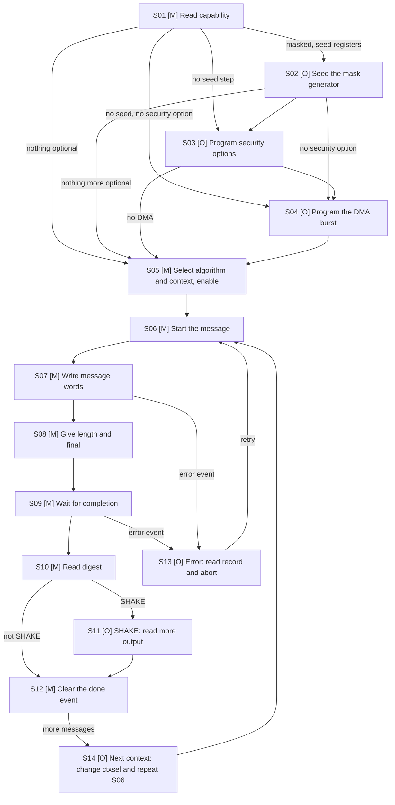

| No. | Step | Option (M/O) | Interface | CSR | Description |
|---|---|---|---|---|---|
| S01 | Read capability | M | APB4 read | Read `sha_cap0.alg`, `sha_cap0.ctxn`, `sha_cap0.axiw`, `sha_cap1.*` | Learn which algorithms, contexts, unrolling and options this instance has before programming |
| S02 | Seed the mask generator | O (when `sha_cap1.mask` = 1 and `sha_cap1.sdsrc` = 1) | APB4 write and read | Write eight words to `sha_seed[0]` to `sha_seed[7]`.`wd`; write `sha_cmd.seed` = 1; poll `sha_sts.seeded` until 1 | Give the random generator its seed; with the entropy port this step is not needed |
| S03 | Program security options | O (when a security option is wanted) | APB4 write | Write `sha_sec.zero`, `sha_sec.fault`, `sha_sec.fdup`, `sha_sec.fpar`, `sha_sec.fredo`, `sha_sec.resp` while `sha_sts.idle` = 1 | Select clearing, fault detection and fault responses; only options built in `sha_cap1` may be set |
| S04 | Program the DMA burst | O (when an external DMA moves the data) | APB4 write | Write `sha_dmac.burst`, `sha_dmac.tmo`; write `sha_ctrl.dmaen` = 1 | Match the burst of the IP to the DMA controller |
| S05 | Select algorithm and context, enable | M | APB4 write | Write `sha_ctrl.algo`, `sha_ctrl.ctxsel`, `sha_ctrl.mask` (if wanted), `sha_ctrl.en` = 1 | Choose the algorithm for the next message and the context it runs in |
| S06 | Start the message | M | APB4 write and read | Write `sha_cmd.init` = 1; poll until the bit reads 0 | Load the initial value and clear the counters and the FIFOs of the context |
| S07 | Write message words | M | AXI4 write bursts to the message window of the context, or external DMA | Optional read of `sha_lvl.inlvl` before writing; `sha_byte.cnt` to check progress | Stream the message in whole words; the IP does not need padding bytes |
| S08 | Give length and final | M | APB4 write | Write `sha_len.tail`; write `sha_cmd.final` = 1 | Tell the IP the number of valid bytes of the last word and that the message is complete |
| S09 | Wait for completion | M | APB4 read or interrupt | Wait for `o_irq` with `sha_irq_en.cdone` bit set, or poll `sha_sts.ready` = 1 | Digest becomes ready; interrupt avoids polling |
| S10 | Read digest | M | AXI4 read burst from the digest window of the context, or external DMA | Optional read of `sha_lvl.outlvl` and `sha_dvld.words` | Read the digest bytes in the standard order |
| S11 | SHAKE: read more output | O (SHAKE) | AXI4 read | None | Keep reading the window; the IP squeezes the next block when the FIFO has room |
| S12 | Clear the done event | M | APB4 write | Write 1 to `sha_irq_raw.cdone` bit of the context | Release `o_irq` and prepare the next message |
| S13 | Error: read record and abort | O (on an error event) | APB4 read and write | Read `sha_err.kind`, `sha_err.ctx`, `sha_erra.addr`; write 1 to the raised bit of `sha_irq_raw`; write `sha_cmd.abort` = 1 | Find the cause and bring the context back to FREE |
| S14 | Next context | O (more than one message) | APB4 write | Change `sha_ctrl.ctxsel` and `sha_ctrl.algo`; repeat from S06 | Start another interleaved message while earlier ones are processed |

### 11.3 CSR connection to the design

A software write to an `rwi` field wins over a hardware load of the same field in the same cycle; the command bits of `sha_cmd` are loaded to 0 by hardware when the command is accepted, so the sequencer repeats the load of 0 in the next cycle if a software write coincided. A hardware load to a `w1c` field wins over a software clear, so a new event is kept.

| Workbook register.field | Direction at the CSR | Design signal | Clock domain of the signal | Behavior notes |
|---|---|---|---|---|
| `sha_cap0.alg` | status in | LPARA_ALG_MAP derived from the `PARA_EN_*` parameters | CLK-CORE (register clock) | Constant after elaboration |
| `sha_cap0.ctxn` | status in | `PARA_CTX_N` | CLK-CORE (register clock) | Constant after elaboration |
| `sha_cap0.axiw` | status in | code of `PARA_AXI_DW` | CLK-CORE (register clock) | Constant after elaboration |
| `sha_cap0.rev` | status in | constant 1 | CLK-CORE (register clock) | Constant after elaboration |
| `sha_cap1.s256unr` | status in | `PARA_S256_UNR` (0 when no SHA-224 or SHA-256) | CLK-CORE (register clock) | Constant after elaboration |
| `sha_cap1.s512unr` | status in | `PARA_S512_UNR` (0 when no SHA-512 type) | CLK-CORE (register clock) | Constant after elaboration |
| `sha_cap1.kecunr` | status in | `PARA_KEC_UNR` (0 when no SHA-3 type) | CLK-CORE (register clock) | Constant after elaboration |
| `sha_cap1.fdup` | status in | `PARA_FAULT_DUP` | CLK-CORE (register clock) | Constant after elaboration |
| `sha_cap1.fpar` | status in | `PARA_FAULT_PAR` | CLK-CORE (register clock) | Constant after elaboration |
| `sha_cap1.fredo` | status in | `PARA_FAULT_REDO` | CLK-CORE (register clock) | Constant after elaboration |
| `sha_cap1.mask` | status in | `PARA_MASK` | CLK-CORE (register clock) | Constant after elaboration |
| `sha_cap1.zero` | status in | `PARA_ZERO` | CLK-CORE (register clock) | Constant after elaboration |
| `sha_cap1.dma` | status in | `PARA_DMA` | CLK-CORE (register clock) | Constant after elaboration |
| `sha_cap1.sdsrc` | status in | `PARA_SEED_SRC` | CLK-CORE (register clock) | Constant after elaboration |
| `sha_ctrl.en` | control out | Enable of `m_vlsit_sha_seq` | CLK-CORE (register clock) | Static while software does not write it |
| `sha_ctrl.algo` | control out | Algorithm code to `m_vlsit_sha_seq` | CLK-CORE (register clock) | Static while software does not write it |
| `sha_ctrl.ctxsel` | control out | Selected context of `m_vlsit_sha_seq` | CLK-CORE (register clock) | Static while software does not write it |
| `sha_ctrl.mask` | control out | Mask enable to `m_vlsit_sha_keccak_dom` select | CLK-CORE (register clock) | Static while software does not write it |
| `sha_ctrl.dmaen` | control out | Enable of `m_vlsit_sha_dma` | CLK-CORE (register clock) | Static while software does not write it |
| `sha_cmd.init` | hardware load (command) | Command `init` to `m_vlsit_sha_seq` | CLK-CORE (register clock) | one command; hardware loads 0 when the action is accepted or done |
| `sha_cmd.final` | hardware load (command) | Command `final` to `m_vlsit_sha_seq` | CLK-CORE (register clock) | one command; hardware loads 0 when the action is accepted or done |
| `sha_cmd.abort` | hardware load (command) | Command `abort` to `m_vlsit_sha_seq` | CLK-CORE (register clock) | one command; hardware loads 0 when the action is accepted or done |
| `sha_cmd.srst` | hardware load (command) | Command `srst` to `m_vlsit_sha_seq` | CLK-CORE (register clock) | one command; hardware loads 0 when the action is accepted or done |
| `sha_cmd.clear` | hardware load (command) | Command `clear` to `m_vlsit_sha_seq` | CLK-CORE (register clock) | one command; hardware loads 0 when the action is accepted or done |
| `sha_cmd.seed` | hardware load (command) | Command `seed` to `m_vlsit_sha_seq` | CLK-CORE (register clock) | one command; hardware loads 0 when the action is accepted or done |
| `sha_len.tail` | control out | Valid bytes of the last word to `m_vlsit_sha_pad` | CLK-CORE (register clock) | Static while software does not write it |
| `sha_dmac.burst` | control out | Burst size of `m_vlsit_sha_dma` | CLK-CORE (register clock) | Static while software does not write it |
| `sha_dmac.tmo` | control out | Burst timer limit of `m_vlsit_sha_dma` | CLK-CORE (register clock) | Static while software does not write it |
| `sha_sec.zero` | control out | Automatic clearing enable of `m_vlsit_sha_seq` | CLK-CORE (register clock) | Static while software does not write it |
| `sha_sec.fault` | control out | Enable of `m_vlsit_sha_fault` | CLK-CORE (register clock) | Static while software does not write it |
| `sha_sec.fdup` | control out | Select of the duplicate compare | CLK-CORE (register clock) | Static while software does not write it |
| `sha_sec.fpar` | control out | Select of the parity check | CLK-CORE (register clock) | Static while software does not write it |
| `sha_sec.fredo` | control out | Select of the recompute compare | CLK-CORE (register clock) | Static while software does not write it |
| `sha_sec.resp` | control out | Response mask of `m_vlsit_sha_fault` | CLK-CORE (register clock) | Static while software does not write it |
| `sha_seed.wd` | control out (write-only, hardware clear) | Seed word n to `m_vlsit_sha_prng` | CLK-CORE (register clock) | Held one clock; the IP clears it after use |
| `sha_sts.busy` | status in | Busy flag of `m_vlsit_sha_seq` | CLK-CORE (register clock) | Level of the core domain; value of the context chosen by `sha_ctrl.ctxsel` where it is per context |
| `sha_sts.idle` | status in | Idle flag of `m_vlsit_sha_seq` | CLK-CORE (register clock) | Level of the core domain; value of the context chosen by `sha_ctrl.ctxsel` where it is per context |
| `sha_sts.ready` | status in | Digest-ready flag of the selected context | CLK-CORE (register clock) | Level of the core domain; value of the context chosen by `sha_ctrl.ctxsel` where it is per context |
| `sha_sts.locked` | status in | Lock flag of `m_vlsit_sha_fault` | CLK-CORE (register clock) | Level of the core domain; value of the context chosen by `sha_ctrl.ctxsel` where it is per context |
| `sha_sts.dmaact` | status in | Activity flag of `m_vlsit_sha_dma` | CLK-CORE (register clock) | Level of the core domain; value of the context chosen by `sha_ctrl.ctxsel` where it is per context |
| `sha_sts.seeded` | status in | Seeded flag of `m_vlsit_sha_prng` | CLK-CORE (register clock) | Level of the core domain; value of the context chosen by `sha_ctrl.ctxsel` where it is per context |
| `sha_sts.cstate` | status in | State of the selected context | CLK-CORE (register clock) | Level of the core domain; value of the context chosen by `sha_ctrl.ctxsel` where it is per context |
| `sha_lvl.inlvl` | status in | Level of the input FIFO of the selected context | CLK-CORE (register clock) | Level of the core domain; value of the context chosen by `sha_ctrl.ctxsel` where it is per context |
| `sha_lvl.outlvl` | status in | Level of the output FIFO of the selected context | CLK-CORE (register clock) | Level of the core domain; value of the context chosen by `sha_ctrl.ctxsel` where it is per context |
| `sha_blk.cnt` | status in | Block counter of the selected context | CLK-CORE (register clock) | Level of the core domain; value of the context chosen by `sha_ctrl.ctxsel` where it is per context |
| `sha_byte.cnt` | status in | Byte counter (low 32 bits) of the selected context | CLK-CORE (register clock) | Level of the core domain; value of the context chosen by `sha_ctrl.ctxsel` where it is per context |
| `sha_dvld.words` | status in | Valid-word count of `m_vlsit_sha_dma` | CLK-CORE (register clock) | Level of the core domain; value of the context chosen by `sha_ctrl.ctxsel` where it is per context |
| `sha_err.ctx` | status in | Context of the latest window error | CLK-CORE (register clock) | Level of the core domain; value of the context chosen by `sha_ctrl.ctxsel` where it is per context |
| `sha_err.kind` | status in | Kind of the latest window error | CLK-CORE (register clock) | Level of the core domain; value of the context chosen by `sha_ctrl.ctxsel` where it is per context |
| `sha_err.ovf` | status in | Overflow count | CLK-CORE (register clock) | Level of the core domain; value of the context chosen by `sha_ctrl.ctxsel` where it is per context |
| `sha_err.udf` | status in | Underflow count | CLK-CORE (register clock) | Level of the core domain; value of the context chosen by `sha_ctrl.ctxsel` where it is per context |
| `sha_erra.addr` | status in | AXI address of the latest window error | CLK-CORE (register clock) | Level of the core domain; value of the context chosen by `sha_ctrl.ctxsel` where it is per context |
| `sha_irq_raw.cdone` | hardware set (event) | Event set: context done (one bit per context), from `m_vlsit_sha_irq` | CLK-CORE (register clock) | Set by hardware, cleared by software write 1; a new event wins over a clear |
| `sha_irq_raw.ovf` | hardware set (event) | Event set: window overflow, from `m_vlsit_sha_irq` | CLK-CORE (register clock) | Set by hardware, cleared by software write 1; a new event wins over a clear |
| `sha_irq_raw.udf` | hardware set (event) | Event set: window underflow, from `m_vlsit_sha_irq` | CLK-CORE (register clock) | Set by hardware, cleared by software write 1; a new event wins over a clear |
| `sha_irq_raw.axi` | hardware set (event) | Event set: AXI error, from `m_vlsit_sha_irq` | CLK-CORE (register clock) | Set by hardware, cleared by software write 1; a new event wins over a clear |
| `sha_irq_raw.cfg` | hardware set (event) | Event set: configuration error, from `m_vlsit_sha_irq` | CLK-CORE (register clock) | Set by hardware, cleared by software write 1; a new event wins over a clear |
| `sha_irq_raw.flt` | hardware set (event) | Event set: fault detected, from `m_vlsit_sha_irq` | CLK-CORE (register clock) | Set by hardware, cleared by software write 1; a new event wins over a clear |
| `sha_irq_raw.ent` | hardware set (event) | Event set: entropy starved, from `m_vlsit_sha_irq` | CLK-CORE (register clock) | Set by hardware, cleared by software write 1; a new event wins over a clear |
| `sha_irq_raw.tmo` | hardware set (event) | Event set: DMA timeout, from `m_vlsit_sha_irq` | CLK-CORE (register clock) | Set by hardware, cleared by software write 1; a new event wins over a clear |
| `sha_irq_raw.len` | hardware set (event) | Event set: length limit, from `m_vlsit_sha_irq` | CLK-CORE (register clock) | Set by hardware, cleared by software write 1; a new event wins over a clear |
| `sha_irq_en.cdone` | control out | Enable of context done (one bit per context) | CLK-CORE (register clock) | Software level |
| `sha_irq_en.ovf` | control out | Enable of window overflow | CLK-CORE (register clock) | Software level |
| `sha_irq_en.udf` | control out | Enable of window underflow | CLK-CORE (register clock) | Software level |
| `sha_irq_en.axi` | control out | Enable of AXI error | CLK-CORE (register clock) | Software level |
| `sha_irq_en.cfg` | control out | Enable of configuration error | CLK-CORE (register clock) | Software level |
| `sha_irq_en.flt` | control out | Enable of fault detected | CLK-CORE (register clock) | Software level |
| `sha_irq_en.ent` | control out | Enable of entropy starved | CLK-CORE (register clock) | Software level |
| `sha_irq_en.tmo` | control out | Enable of DMA timeout | CLK-CORE (register clock) | Software level |
| `sha_irq_en.len` | control out | Enable of length limit | CLK-CORE (register clock) | Software level |
| `sha_irq_inj.cdone` | control out | Injection of context done (one bit per context) into the raw register | CLK-CORE (register clock) | A rising edge sets the raw bit once |
| `sha_irq_inj.ovf` | control out | Injection of window overflow into the raw register | CLK-CORE (register clock) | A rising edge sets the raw bit once |
| `sha_irq_inj.udf` | control out | Injection of window underflow into the raw register | CLK-CORE (register clock) | A rising edge sets the raw bit once |
| `sha_irq_inj.axi` | control out | Injection of AXI error into the raw register | CLK-CORE (register clock) | A rising edge sets the raw bit once |
| `sha_irq_inj.cfg` | control out | Injection of configuration error into the raw register | CLK-CORE (register clock) | A rising edge sets the raw bit once |
| `sha_irq_inj.flt` | control out | Injection of fault detected into the raw register | CLK-CORE (register clock) | A rising edge sets the raw bit once |
| `sha_irq_inj.ent` | control out | Injection of entropy starved into the raw register | CLK-CORE (register clock) | A rising edge sets the raw bit once |
| `sha_irq_inj.tmo` | control out | Injection of DMA timeout into the raw register | CLK-CORE (register clock) | A rising edge sets the raw bit once |
| `sha_irq_inj.len` | control out | Injection of length limit into the raw register | CLK-CORE (register clock) | A rising edge sets the raw bit once |
| `sha_irq_sts.cdone` | status in | Pending and enabled context done (one bit per context) to `o_irq` | CLK-CORE (register clock) | raw AND enable |
| `sha_irq_sts.ovf` | status in | Pending and enabled window overflow to `o_irq` | CLK-CORE (register clock) | raw AND enable |
| `sha_irq_sts.udf` | status in | Pending and enabled window underflow to `o_irq` | CLK-CORE (register clock) | raw AND enable |
| `sha_irq_sts.axi` | status in | Pending and enabled AXI error to `o_irq` | CLK-CORE (register clock) | raw AND enable |
| `sha_irq_sts.cfg` | status in | Pending and enabled configuration error to `o_irq` | CLK-CORE (register clock) | raw AND enable |
| `sha_irq_sts.flt` | status in | Pending and enabled fault detected to `o_irq` | CLK-CORE (register clock) | raw AND enable |
| `sha_irq_sts.ent` | status in | Pending and enabled entropy starved to `o_irq` | CLK-CORE (register clock) | raw AND enable |
| `sha_irq_sts.tmo` | status in | Pending and enabled DMA timeout to `o_irq` | CLK-CORE (register clock) | raw AND enable |
| `sha_irq_sts.len` | status in | Pending and enabled length limit to `o_irq` | CLK-CORE (register clock) | raw AND enable |


### 11.4 APB access behavior of the CSR

Behavior of the generated module (APB-CSR-Generator 3.4, workbook with Asynchronous = 1). The behavior was read from the generator specification and was not simulated for this workbook (TBD-004).

| Case | Behavior |
|---|---|
| Normal read or write | PREADY comes after wait states that depend on the clock ratio of `i_clk_apb` and `i_clk_core`; software waits for PREADY |
| Write with PSTRB not all ones | PSLVERR and no change when `i_slverr_en` = 1; whole-word write when 0 |
| Address not word aligned | PSLVERR when `i_slverr_en` = 1 |
| Aligned address that is not a register | OKAY; read returns 0; write is ignored |
| Non-secure access (PPROT[1] = 1) | PSLVERR when `i_protect_en` = 1 and `i_slverr_en` = 1 |
| Write-only registers (`sha_seed`) | Reads return 0 without an error; the written words are held until the seed command copies them and are then cleared by the IP |
| Reserved bits | Read as 0; write ignored |
| Reset | Registers take the workbook reset value; asynchronous assertion, release synchronous to the register clock |

## 12. Error handling and recovery

| Error ID | Detection condition | Observable response/status | Interrupt | Clear/recovery | Reset behavior |
|---|---|---|---|---|---|
| ERR-001 | Write to a full or non-absorbing message window | Words dropped, `bresp` SLVERR; `sha_err.kind` = 1; `sha_err.ovf` counts | `sha_irq_raw.ovf` | Write 1 to the raw bit; abort the context if needed | Event and record cleared by reset and soft reset |
| ERR-002 | Read of an empty output FIFO | `rdata` 0; `sha_err.kind` = 2; `sha_err.udf` counts | `sha_irq_raw.udf` | Write 1 | Cleared by reset |
| ERR-003 | Wrong window direction, bad context number, WRAP burst, narrow size, partial `wstrb` | SLVERR; `sha_err.kind` = 3 or 4; `sha_erra.addr` gives the address | `sha_irq_raw.axi` | Write 1 | Cleared by reset |
| ERR-004 | Command or value rejected: algorithm not built, context busy or out of range, `sha_len.tail` too large, `sha_dmac.burst` illegal, `final` while not absorbing, `seed` with entropy-port source | No state change | `sha_irq_raw.cfg` | Write 1 | Cleared by reset |
| ERR-005 | Fault detection mismatch (duplicate, parity, recompute) | Responses of `sha_sec.resp`; `sha_sts.locked` when locked; context state 0xF | `sha_irq_raw.flt` | Soft reset command | Lock cleared by soft reset |
| ERR-006 | Masked core needs random bits and the PRNG is not seeded or has no entropy | The core waits; no masked block runs | `sha_irq_raw.ent` | Seed or supply entropy; write 1 | Cleared by reset |
| ERR-007 | DMA burst timer expired with a short digest | Burst padded with zeros; `sha_dvld.words` valid count | `sha_irq_raw.tmo` | Read `sha_dvld.words`; write 1 | Cleared by reset |
| ERR-008 | Message longer than 2^61 - 1 bytes | Digest discarded; `sha_err.kind` = 5; context returns to FREE | `sha_irq_raw.len` | Write 1 | Cleared by reset |
| ERR-009 | APB errors (not aligned, partial strobe, non-secure) | PSLVERR by the generated block (11.4) | None | None | None |

Precedence of simultaneous errors: ERR-005 over all others (the lock removes the other work); the others set their own bits at the same time and `sha_err.kind` keeps the lowest number. Retry policy: dropped words are not retried by the IP (software resends the whole message after abort); a rejected command is not queued.

## 13. Performance, power, and area

Time of one block of a core (DEC-006, to be confirmed by simulation, TBD-001), with `R` rounds (64, 80 or 24), `UNR` rounds per cycle and `PIPE` loop stages:

$$ T_{blk} = \frac{R}{UNR} \cdot PIPE + 2 \text{ cycles (one context)} \qquad T_{blk} = \frac{R}{UNR} + 2 \text{ cycles (at least } PIPE \text{ contexts ready)} $$

The throughput of a core is the block size divided by $T_{blk}$. At 500 MHz (sizing assumption ASM-003, PIPE = 1):

| Case | Block bits | Cycles per block | Bits per cycle | Throughput at 500 MHz |
|---|---:|---:|---:|---:|
| SHA-256, UNR 1 | 512 | 66 | 7.76 | 3.88 Gbit/s |
| SHA-256, UNR 2 (CFG-BOOT) | 512 | 34 | 15.06 | 7.53 Gbit/s |
| SHA-256, UNR 4 (CFG-STOR) | 512 | 18 | 28.44 | 14.2 Gbit/s |
| SHA-512, UNR 1 | 1024 | 82 | 12.49 | 6.24 Gbit/s |
| SHA-512, UNR 2 (CFG-BOOT) | 1024 | 42 | 24.38 | 12.2 Gbit/s |
| SHA3-256, UNR 1 | 1088 | 26 | 41.85 | 20.9 Gbit/s |
| SHA3-256, UNR 2 (CFG-STOR) | 1088 | 14 | 77.71 | 38.9 Gbit/s |
| SHA3-512, UNR 1 | 576 | 26 | 22.15 | 11.1 Gbit/s |
| SHA3-256 masked, UNR 1, PIPE 2 | 1088 | 50 | 21.76 | 10.9 Gbit/s |

Checks of the user's numbers: 4 MiB of SHA-256 is 65536 blocks plus one padding block, 65537 x 34 = 2,228,258 cycles = 4.46 ms at 500 MHz, below 5 ms (REQ-PERF-001, margin 11 %); with SHA-384, 32769 x 42 = 1,376,298 cycles = 2.75 ms. SHA-256 UNR 2 reaches 7.53 Gbit/s, which is below 8 Gbit/s, so the storage target needs UNR 4 (14.2 Gbit/s) or SHA3-256 (REQ-PERF-002). The AXI4 window at 64-bit and 500 MHz carries 32 Gbit/s, so the bus does not limit these cases. Selecting recompute detection halves the throughput; selecting duplicate or parity detection does not change the cycle count. These figures are estimates from the formula and the sizing clock; the hard requirements are the 5 ms and 8 Gbit/s limits at the frequency the integrator achieves (maximum frequency needed: 4 MiB in 5 ms with 65537 x 34 cycles requires at least 446 MHz).

| Metric ID | Metric | Target / limit | Conditions | Measurement method | Hard / goal |
|---|---|---|---|---|---|
| PPA-001 | Maximum frequency | At least 446 MHz for CFG-BOOT (derived above); other configurations not stated | Library, corner and voltage not chosen (TBD-005) | STA with the SDC of section 17 | Goal until the library is chosen |
| PPA-002 | Area | Not stated | Library not chosen | Cell area from synthesis | TBD-005 |
| PPA-003 | Dynamic and leakage power | Not stated | Activity and corner not chosen | Tool power report | TBD-005 |
| PERF-001 | 4 MiB SHA-256 or SHA-384 hash time | At most 5 ms | CFG-BOOT, 500 MHz sizing | Cycle count in simulation, analysis above | Hard (user) |
| PERF-002 | Sustained throughput | At least 8 Gbit/s | CFG-STOR, one SHA-256 or SHA3-256 stream | Cycle count in simulation | Hard (user) |
| PERF-003 | Cycles per block | Formula above, tolerance 2 cycles | Every configuration | Simulation | Hard |

Timing closure is not claimed from RTL synthesis alone; nothing was synthesized for this draft.


## 14. RTL implementation contract

### 14.1 Required coding baseline

The VLSIT RTL Design Rules v2 (REF-003) is the mandatory RTL coding authority. The RTL deliverables shall comply with it and shall have no project-local exceptions (REQ-RTL-001). In short: one synthesizable module per `.sv` file with the module name equal to the file name; the top is a structural wrapper with ANSI ports (`input wire`, `output logic`), parameters, interconnect declarations and named instances only; active-low names end in `_n`; unsigned four-state logic vectors; `always_comb` with defaults and `always_ff` with one clock per process; `PARA_` parameters with the three PAR-02 comments, `LPARA_` derived localparams in the parameter port list; library reset synchronizers and CDC modules; bounded zero-based generate loops with the genvar in the header; named connections; no signed types, packages, interfaces, macros, initial blocks, delays, `casex`, latches or positional connections; the file header with Project, Author, AI Flow, AI Flow Page, Date and Description. Algorithm options are removed with `generate if` on the `PARA_EN_*` parameters, so that the removed logic does not reach synthesis. The register RTL comes from the generator and is never edited (R-039, R-040).

### 14.2 RTL hierarchy

| Module | Responsibility | Parent / instance | Clock/reset domains | Interface |
|---|---|---|---|---|
| `m_vlsit_sha_top` | Structural top: ports, reset synchronizers, instances | Integrator | CLK-CORE, CLK-APB | All ports of 6.2 |
| `m_vlsit_csr_sha` | Generated register block | top / `u_csr` | CLK-APB, CLK-CORE | APB4, field ports |
| `m_vlsit_sha_axi_sub` | AXI4 subordinate and window decode | top / `u_axi` | CLK-CORE | AXI4, FIFO push and pop |
| `m_vlsit_sha_in_fifo` | Input FIFOs (one per context, generate loop) | top / `u_in_fifo` | CLK-CORE | Push, pop, level |
| `m_vlsit_sha_out_fifo` | Output FIFOs | top / `u_out_fifo` | CLK-CORE | Push, pop, level |
| `m_vlsit_sha_seq` | Context state machines, block feed, counters, error record | top / `u_seq` | CLK-CORE | CSR fields, FIFOs, cores |
| `m_vlsit_sha_pad` | Padding logic | seq / `u_pad` | CLK-CORE | Bytes in, padded block out |
| `m_vlsit_sha_core256` | SHA-224/256 compression | top / `u_core256` (generate) | CLK-CORE | Block, state |
| `m_vlsit_sha_core512` | SHA-384/512/512-t compression | top / `u_core512` (generate) | CLK-CORE | Block, state |
| `m_vlsit_sha_keccak` | Keccak-f[1600] | top / `u_keccak` (generate) | CLK-CORE | Block, state |
| `m_vlsit_sha_keccak_dom` | Masked Keccak-f[1600] | top / `u_keccak_dom` (generate) | CLK-CORE | Block, shares, random |
| `m_vlsit_sha_prng` | Mask random generator | top / `u_prng` (generate) | CLK-CORE | Seed, entropy |
| `m_vlsit_sha_ctxmem` | Context memory | top / `u_ctxmem` | CLK-CORE | Read, write |
| `m_vlsit_sha_dma` | DMA handshake and burst timer | top / `u_dma` (generate) | CLK-CORE | Request, ack, levels |
| `m_vlsit_sha_fault` | Fault detection and responses | top / `u_fault` (generate) | CLK-CORE | Core outputs, responses |
| `m_vlsit_sha_irq` | Events and outputs | top / `u_irq` | CLK-CORE | Events, `o_irq`, `o_alarm` |
| `m_vlsit_rst_sync` (library) | Reset release | top / `u_rst_core`, `u_rst_apb` | Per domain | Reset |

Each context FIFO is an instance of `m_vlsit_sfifo_top` of `002_SyncFIFO` inside `m_vlsit_sha_in_fifo` and `m_vlsit_sha_out_fifo` (DEC-015); the synchronizers reuse the cells of `000_Common` (DEP-001, DEP-002). The top holds no functional logic; state is owned by `m_vlsit_sha_seq`, the cores, the context memory and the FIFOs.

### 14.3 Synthesis assumptions

| Item | Value / source |
|---|---|
| Top / source file list | `m_vlsit_sha_top`; `filelist.f` written by the RTL step |
| Frontend version and options | Not chosen; the project flow (Yosys / Verilator, from the OSS CAD Suite) is used for lint and equivalence checks only |
| Parameters/configuration | CFG-BASE, CFG-BOOT, CFG-STOR, CFG-FULL of section 8 |
| Libraries/corners | None chosen (TBD-005) |
| Memory flow | Flip-flops by default; SRAM macro by `PARA_CTX_MEM` = 1 (TBD-006) |
| Lint rule configuration | The rule check and lint of the skill `vlsit-rtl-generator` |

## 15. Verification specification

### 15.1 Scope and strategy

Block-level simulation of the top with a testbench built from this specification and the two NIST standards (never from the RTL, R-023); protocol checkers for AXI4 and APB4; an independent reference model (a software SHA-2 and SHA-3 implementation, plus the NIST example values) for digests; formal checks of the sequencer invariants; CDC check of the register crossing; lint and elaboration checks of the four configurations and of every illegal combination; fault injection by force in simulation. Seeds of random tests are recorded in the logs and are reproducible. Emulation and post-silicon tests are outside this specification.

### 15.2 Requirement-based test plan

| Test ID | Requirements | Scenario / stimulus | Expected result | Test type | Configuration |
|---|---|---|---|---|---|
| TEST-001 | REQ-FUNC-001, REQ-FUNC-003 | Every enabled algorithm, messages of 0, 1, rate-1, rate, rate+1, 2 x rate bytes and the NIST example messages | Digest equals the model and the standard | Directed and random | CFG-BASE, CFG-BOOT, CFG-STOR, CFG-FULL |
| TEST-002 | REQ-FUNC-002 | Elaborate with each `PARA_EN_*` alone; list instances and synthesize | Only the cores and logic of that algorithm exist | Elaboration and synthesis | One-algorithm configurations |
| TEST-003 | REQ-FUNC-004 | Last word with every `sha_len.tail` value, lengths that need a second padding block | Correct padding | Directed | All |
| TEST-004 | REQ-FUNC-005 | Init and final with no word | Digest of the empty message | Directed | All |
| TEST-005 | REQ-FUNC-006 | 2 to 16 messages with random word order and random lengths | Each digest equals the single-message digest | Random | CFG-STOR, CFG-FULL |
| TEST-006 | REQ-FUNC-007 | SHAKE128 and SHAKE256, read 1 to 1000 bytes | Output equals the model prefix | Directed and random | CFG-FULL |
| TEST-007 | REQ-FUNC-008 | Abort and soft reset in each state | Context FREE, FIFOs empty | Directed | All |
| TEST-008 | REQ-FUNC-009 | Shorten the limit in the test build and exceed it | Length-limit event, digest discarded | Directed | CFG-BASE |
| TEST-009 | REQ-IF-001, REQ-IF-002 | Legal and illegal bursts, backpressure, IDs, 32/64/128-bit widths | At least 20 assertions on AXI4 hold and fire; SLVERR cases as 6.3 | Protocol checker | All widths |
| TEST-010 | REQ-IF-003, REQ-REG-001 | Register access of every case of 11.4; generator test | PSLVERR cases as stated; ports equal the workbook | Protocol checker, generator test | All |
| TEST-011 | REQ-IF-004 | 4-phase handshake, burst size, timeout | Handshake legal; short burst padded | Directed | CFG-BOOT, CFG-STOR |
| TEST-012 | REQ-IF-005, REQ-SEC-003 | Entropy request and seeding | Request and valid per 6.3 | Directed | CFG-FULL |
| TEST-013 | REQ-CLK-001 | APB and core clock ratios 1:1, 1:3, 7:2 | Registers correct; PREADY waits | Directed, CDC | CFG-FULL |
| TEST-014 | REQ-RESET-001 | Reset in each domain, mid-burst reset, soft reset | Values as 7.3 | Directed | All |
| TEST-015 | REQ-PARAM-001 | Each illegal combination of section 8 | Elaboration error naming the parameter | Elaboration | None built |
| TEST-016 | REQ-ERR-001 | Every ERR of section 12 | Event, record and recovery as stated; other contexts unchanged | Directed | CFG-FULL |
| TEST-017 | REQ-INT-001 | Events, enable, injection, clear | `o_irq` equals the OR | Directed | All |
| TEST-018 | REQ-PERF-001, REQ-PERF-002, REQ-PERF-003 | Count cycles of 4 MiB SHA-256 and SHA-384 on CFG-BOOT and of a long SHA-256 and SHA3-256 stream on CFG-STOR | Cycles within the formula tolerance and under the limits at the stated clock | Simulation | CFG-BOOT, CFG-STOR |
| TEST-019 | REQ-SEC-001 | Read the last digest word, then probe state, FIFOs and core registers | Zero within 3 cycles | Directed | CFG-BASE with `PARA_ZERO` |
| TEST-020 | REQ-SEC-002 | Force a bit flip in a core, in the state and in a recompute | Fault event and each response of `sha_sec.resp` | Fault injection | CFG-STOR, CFG-FULL |
| TEST-021 | REQ-SEC-003 | Compare shares; check the unmasked and masked digests are equal | Equal digest; no register holds the plain intermediate value | Directed, inspection | CFG-FULL |
| TEST-022 | REQ-RTL-001 | `vlsit_rtl_check.py`, lint, `vlsit_csr_generate.py verify` | No error | Static | All |
| TEST-023 | REQ-DFT-001 | Scan insertion trial and check for clock gates | No gating cell | Static | All |
| TEST-024 | REQ-PD-001 | Load the SDC of section 17 | Constraints complete | Static | All |

### 15.3 Assertions and coverage

| Property / coverage ID | Intent | Requirements | Checker / source set | Acceptance criterion |
|---|---|---|---|---|
| SVA-001 / COV-001 | AXI4 valid and payload stable until ready (at least 20 properties on AXI4, 20 on APB4) | REQ-IF-001, REQ-IF-003 | Verification protocol checkers | Pass, every property fires at least once |
| SVA-002 / COV-002 | A context is in exactly one state; a core holds at most one block | REQ-FUNC-006 | Verification | Never violated |
| SVA-003 / COV-003 | `o_irq` equals the OR of the masked events | REQ-INT-001 | Verification | Never violated |
| SVA-004 / COV-004 | Each channel of the DMA handshake follows the 4-phase order | REQ-IF-004 | Verification | Never violated |
| SVA-005 / COV-005 | After the last digest word with zeroing, state and FIFOs are zero in 3 cycles | REQ-SEC-001 | Verification | Never violated |
| COV-006 | Cross of algorithm x length class x context count x window width | REQ-FUNC-001 | Functional coverage | Every bin hit |

X policy: no X on any output after reset; resetless memories are read only after a write (7.3), checked by a reset-X test. Line coverage target: a baseline is measured first and the target is asked of the designer (R-047).

### 15.4 Formal, CDC, and RDC

| Analysis | Scope | Assumptions / constraints | Evaluation method |
|---|---|---|---|
| Formal | Sequencer: state exclusivity, FIFO bounds, command acceptance, lock | Inputs legal per 6.3 | SymbiYosys bounded and unbounded proof |
| CDC / RDC | CDC-001 to CDC-004, reset release | The clocks are asynchronous when `PARA_CSR_ASYNC` = 1 | CDC tool or the structural checks of the skill; simulation with ratio sweep |

## 16. DFT and testability

| Topic | Requirement / decision |
|---|---|
| Scan architecture and scan eligibility | All flip-flops scannable; the SRAM macro (when `PARA_CTX_MEM` = 1) is wrapped by the integrator |
| Scan/test clocks, controls, reset behavior | None in the IP: scan clock, scan enable and test reset are inserted by the SoC DFT flow (the port list has no test port, N/A (not applicable to this item)) |
| Test-mode entry/exit and safe state | Owned by the SoC DFT flow |
| MBIST, memory repair, LBIST | MBIST of the context-memory macro by the integrator when used; the FIFOs are flip-flop or inferred memory; LBIST not supported |
| Test access, wrappers, test points | None |
| Clock-gating test enable | N/A: the IP has no clock gating cell (REQ-DFT-001) |
| ATPG constraints and exclusions | The static ports `i_protect_en` and `i_slverr_en` are tied during scan; the fault-detection mismatch flops are scannable |
| DFT insertion architecture and generated test artifacts | SoC level |

## 17. Physical design and timing integration

### 17.1 Timing constraints and budgets

The SDC of the IP is written with the RTL step; the contract below is what it contains. The IP owns the clock definitions of its two ports and the exceptions of 17.1.3; the integrator supplies the periods and the I/O delays.

#### 17.1.1 Clock and analysis scenarios

| Clock ID | Port / source object | Primary/generated and master | Period, waveform, phase / ratio | Latency / uncertainty / transition | Clock group / mode | Constraint source |
|---|---|---|---|---|---|---|
| CLK_CORE | `i_clk_core` | Primary | Integrator; sizing 2 ns (ASM-003) | Integrator | Asynchronous to CLK_APB when `PARA_CSR_ASYNC` = 1 | SDC of the IP (`sha_top.sdc`) |
| CLK_APB | `i_clk_apb` | Primary | Integrator | Integrator | same | same |

Corners, views and modes are chosen by the integrator (TBD-005).

#### 17.1.2 Interface timing budgets

| Interface / port group | Direction | Reference clock | External min / max delay | Input transition / output load | IP timing budget | Mode / condition | Constraint source |
|---|---|---|---|---|---|---|---|
| AXI4 inputs, DMA ack, entropy | Input | CLK_CORE | Planning value: max 60 % of the period, min 0 (ASM-011) | Integrator | 40 % of the period | All | `sha_top.sdc` |
| AXI4 outputs, requests, `o_irq`, `o_alarm` | Output | CLK_CORE | Planning value: max 60 % of the period, min 0 (ASM-011) | Integrator | 40 % of the period | All | same |
| APB inputs | Input | CLK_APB | Planning value as above | Integrator | 40 % | All | same |
| APB outputs | Output | CLK_APB | Planning value as above | Integrator | 40 % | All | same |
| `i_protect_en`, `i_slverr_en` | Input | None | Static after reset | N/A (not applicable to this item) | N/A (not applicable to this item) | All | EXC-002 |

Max transition, max capacitance, max fanout and driving cell are given by the library flow (TBD-005).

#### 17.1.3 Timing exception inventory

| Exception ID | Type / SDC command | From | Through | To | Value and setup/hold/min/max meaning | Mode / condition | Technical rationale |
|---|---|---|---|---|---|---|---|
| EXC-001 | `set_clock_groups -asynchronous` | `CLK_CORE` | None | `CLK_APB` | Both directions | `PARA_CSR_ASYNC` = 1 | The register crossing is built with the library synchronizer; proved by CDC-001 |
| EXC-002 | `set_false_path` | `i_protect_en`, `i_slverr_en` | None | Registers of the CSR block | Removes the path from timing | All | The ports are constant after reset (6.2) |

No multicycle, max-delay or min-delay exception is used by the IP. The bundled-data crossing of the generated register block uses the constraints of the generator documentation (TBD-004).

```tcl
create_clock -name CLK_CORE -period <period> [get_ports i_clk_core]
create_clock -name CLK_APB  -period <period> [get_ports i_clk_apb]
set_clock_groups -asynchronous -group [get_clocks CLK_CORE] -group [get_clocks CLK_APB]
set_false_path -from [get_ports {i_protect_en i_slverr_en}]
```

### 17.2 Physical assumptions

| Topic | Requirement / assumption |
|---|---|
| Hard/memory macros and views | Optional SRAM macro for the context memory |
| Floorplan, placement region, pin placement | Not stated |
| Utilization/congestion target | Not stated |
| Power intent, clock/reset trees | One power domain; two clock trees |
| High-fanout controls, physical-only cells | The context select and the core enables fan out to many registers; buffering by the flow |
| ECO/spare cells | Not stated |
| Extraction and timing-analysis corners | Integrator |
| Delivery form: RTL/netlist/hardened layout | Soft RTL; the SoC requirements are those of 17.1, implementation guidance is the rest |

## 18. Security, safety, and reliability

| Topic | Requirement / rationale | Verification method / expected behavior |
|---|---|---|
| Security boundary and threat assumptions | Required. The IP protects the digest computation against fault injection (glitch) and, optionally, against first-order power analysis of the Keccak state. SHA-2 is not masked: its secrecy rests on the message not being secret (the typical use is a public image or block). The message content of SHA-3 and SHAKE is protected only when `PARA_MASK` = 1 and `sha_ctrl.mask` = 1 (ASM-012) | Inspection, TEST-020, TEST-021 |
| Access control / privilege | Required for registers: `i_protect_en` rejects non-secure APB accesses. The AXI4 windows have no privilege check; the integrator restricts them in the interconnect | TEST-010 |
| Secure clearing / zeroization | Required when `PARA_ZERO` = 1: state, FIFOs and idle core registers are zero 3 cycles after the last digest word is read or after abort; `sha_cmd.clear` clears one context on demand. Clearing is not a side-channel countermeasure | TEST-019 |
| Information leakage / side channels | Optional masking: two shares, fresh random bits for every non-linear step of a Keccak round, an extra register stage; the PRNG is seeded from the entropy port or from software. Security order: first. No claim about the second order, glitch-extended probing models other than that of the domain-oriented masking, timing or cache channels | Inspection, TEST-012, TEST-021 |
| ECC/parity and fault detection | Optional by three parameters: duplicate core with comparison, parity on state and context memory, recompute and compare each block. Responses selected in `sha_sec.resp`: gate the digest, lock until soft reset, clear all state, drive `o_alarm` | TEST-020 |
| Safety goal / integrity level | N/A: no functional-safety integrity level is claimed | N/A (not applicable to this item) |
| Diagnostics, fail-safe state, recovery | After a fault with lock, all work stops until the soft reset command; `sha_sts.locked`, `sha_irq_raw.flt` and `o_alarm` report it; the digest of a faulty block is never returned when the gate response is on | TEST-020 |

## 19. Requirement-to-verification traceability

| Requirement ID | RTL module/location | Test/property | Verification method / analysis | Configuration |
|---|---|---|---|---|
| REQ-FUNC-001 | `m_vlsit_sha_core256`, `_core512`, `_keccak`, `m_vlsit_sha_seq` | TEST-001 | Simulation with model | All |
| REQ-FUNC-002 | `m_vlsit_sha_top` generate blocks | TEST-002 | Synthesis | One-algorithm configurations |
| REQ-FUNC-003 | Cores, `m_vlsit_sha_pad` | TEST-001 | Simulation | All |
| REQ-FUNC-004 | `m_vlsit_sha_pad` | TEST-003 | Simulation | All |
| REQ-FUNC-005 | `m_vlsit_sha_seq`, `m_vlsit_sha_pad` | TEST-004 | Simulation | All |
| REQ-FUNC-006 | `m_vlsit_sha_seq`, `m_vlsit_sha_ctxmem` | TEST-005, SVA-002 | Simulation, formal | CFG-STOR, CFG-FULL |
| REQ-FUNC-007 | `m_vlsit_sha_seq`, `m_vlsit_sha_keccak` | TEST-006 | Simulation | CFG-FULL |
| REQ-FUNC-008 | `m_vlsit_sha_seq` | TEST-007 | Simulation | All |
| REQ-FUNC-009 | `m_vlsit_sha_seq` | TEST-008 | Simulation | CFG-BASE |
| REQ-IF-001 | `m_vlsit_sha_axi_sub` | TEST-009, SVA-001 | Protocol checker | All |
| REQ-IF-002 | `m_vlsit_sha_axi_sub` | TEST-009 | Simulation | All |
| REQ-IF-003 | `m_vlsit_csr_sha` | TEST-010 | Protocol checker | All |
| REQ-IF-004 | `m_vlsit_sha_dma` | TEST-011, SVA-004 | Simulation | CFG-BOOT, CFG-STOR |
| REQ-IF-005 | `m_vlsit_sha_prng` | TEST-012 | Simulation | CFG-FULL |
| REQ-CLK-001 | `m_vlsit_sha_top`, `m_vlsit_csr_sha` | TEST-013 | CDC, simulation | CFG-FULL |
| REQ-RESET-001 | `m_vlsit_sha_top` | TEST-014 | Reset test | All |
| REQ-REG-001 | `m_vlsit_csr_sha` | TEST-010, TEST-022 | Generator test, inspection | All |
| REQ-PARAM-001 | `m_vlsit_sha_top` | TEST-015 | Elaboration | None built |
| REQ-ERR-001 | `m_vlsit_sha_seq`, `m_vlsit_sha_axi_sub` | TEST-016 | Simulation | CFG-FULL |
| REQ-INT-001 | `m_vlsit_sha_irq` | TEST-017, SVA-003 | Simulation | All |
| REQ-PERF-001 | Cores, `m_vlsit_sha_seq` | TEST-018 | Analysis, simulation | CFG-BOOT |
| REQ-PERF-002 | Cores, `m_vlsit_sha_seq` | TEST-018 | Analysis, simulation | CFG-STOR |
| REQ-PERF-003 | Cores | TEST-018 | Simulation | All |
| REQ-SEC-001 | `m_vlsit_sha_seq`, `m_vlsit_sha_ctxmem` | TEST-019, SVA-005 | Simulation | `PARA_ZERO` = 1 |
| REQ-SEC-002 | `m_vlsit_sha_fault` | TEST-020 | Fault injection | CFG-STOR, CFG-FULL |
| REQ-SEC-003 | `m_vlsit_sha_keccak_dom`, `m_vlsit_sha_prng` | TEST-021 | Inspection, simulation | CFG-FULL |
| REQ-RTL-001 | All | TEST-022 | Rule check, lint | All |
| REQ-VER-001 | N/A (document) | Section 15 | Review | All |
| REQ-DFT-001 | All | TEST-023 | Static | All |
| REQ-PD-001 | SDC | TEST-024 | Static | All |

## 20. Assumptions, dependencies, and decisions

Decisions DEC-001 to DEC-008, DEC-010 and DEC-013 were answered by the user on 2026-11-09 (the question and the option are summarized). The other items are the author's choices and wait for confirmation.

| ID | Type | Assumption / dependency / unresolved decision | Technical impact / version / configuration | Resolution / status |
|---|---|---|---|---|
| DEC-001 | Decision | Twelve algorithms, each with its own `PARA_EN_*`, RTL is generated only for the enabled ones and optimized for the configuration | Sections 4, 8; REQ-FUNC-002 | Decided by user |
| DEC-002 | Decision | A parameter chooses which of the algorithms exist; one or more may coexist; the algorithm of a message is chosen at run time by `sha_ctrl.algo` | `sha_cap0.alg` | Decided by user |
| DEC-003 | Decision | Data interface is AXI4 windows (not AXI4-Stream), subordinate role, FIFO window for the message and a window for the digest | 6.3 | Decided by user |
| DEC-004 | Decision | The IP adds the padding; software gives the byte length of the last word | REQ-FUNC-004 | Decided by user |
| DEC-005 | Decision | Interleaved contexts by `PARA_CTX_N`; context memory flip-flops or SRAM by `PARA_CTX_MEM` | 10.5 | Decided by user |
| DEC-006 | Decision | Per-core `PARA_*_UNR` and `PARA_*_PIPE`; block time formula of section 13 | Section 13; TBD-001 | Decided by user (parameters); formula is the author's |
| DEC-007 | Decision | AXI data width 32, 64 or 128 bit by `PARA_AXI_DW` | Ports, capability | Decided by user |
| DEC-008 | Decision | Zeroing, three fault mechanisms and masking are all optional by parameter, each with a run-time select | Sections 8, 18 | Decided by user |
| DEC-009 | Decision | Message limit of 2^61 - 1 bytes for every algorithm | REQ-FUNC-009; more than the SHA-256 length field allows is never needed | Author choice; confirm |
| DEC-010 | Decision | Mask randomness from the entropy port or from software seed words, chosen by `PARA_SEED_SRC` | IF-004, `sha_seed` | Decided by user |
| DEC-011 | Decision | Message byte i is in lane i mod W (lane 0 first); digest bytes in standard order, lane 0 first | Section 9 | Author choice; confirm |
| DEC-012 | Decision | Registers are global; `sha_ctrl.ctxsel` selects the context for commands and read-back; the window address carries the context number | 11.1 | Author choice; confirm |
| DEC-013 | Decision | The end of a message is the `final` command with `sha_len.tail` | 5.3 | Decided by user (end-of-message option B) |
| DEC-015 | Decision | The input and output FIFOs of each context instantiate the library `m_vlsit_sfifo_top` (both clocks tied to `i_clk_core`), the reset release uses `m_vlsit_rst_sync` and the constants `i_protect_en` and `i_slverr_en` use `m_vlsit_tie` where they are not ports. Asked 2026-11-09, options: A reuse (chosen), B own FIFO. Reason: checked modules, uniform structure | 14.2; REQ-RTL-001 | Confirmed by the designer 2026-11-09 |
| DEC-016 | Decision | `PARA_CTX_MEM` = 0 (flip-flops) only; 1 is an illegal combination until the macro flow is defined. Asked 2026-11-09, options: A flip-flop only (chosen), B library SRAM wrapper. Reason: no macro flow, no guess | 8, 10.5; TBD-006; REQ-PARAM-001, REQ-FUNC-006 | Confirmed by the designer 2026-11-09 |
| DEC-017 | Decision | An illegal parameter combination stops elaboration by a `generate if` that instantiates a non-existent module `m_vlsit_sha_ERR_` followed by the cause. Asked 2026-11-09, options: A missing module (chosen), B `$fatal`. Reason: no simulation-only statement in design RTL | 8; TBD-007; REQ-PARAM-001 | Confirmed by the designer 2026-11-09 |
| DEC-018 | Decision | The RTL is delivered in two stages. Stage 1: SHA-2, unmasked SHA-3 and SHAKE, windows, CSR, DMA, zeroing, interrupts. Stage 2: masking (DOM and PRNG) and fault detection. Until stage 2 the parameters `PARA_MASK`, `PARA_FAULT_DUP`, `PARA_FAULT_PAR`, `PARA_FAULT_REDO` and `PARA_SEED_SRC` equal to 1 are illegal. Asked 2026-11-09, options: A two stages (chosen), B all at once. Reason: each stage is checked before the next | 8, 14.2; REQ-SEC-002, REQ-SEC-003 | Confirmed by the designer 2026-11-09 |
| DEC-019 | Decision | Stage 1 structure chosen by the author: one block in flight; a prefetch slot assembles the next block during the run; `PARA_*_PIPE` = 1 only; `PARA_AXI_DW` = 128 only with block sizes that are multiples of 16 bytes (SHA-2 and SHA3-224); CFG-STOR and CFG-FULL use 64-bit AXI; input FIFO holds at least a block plus two words. Reason: no carry of partial words between blocks, and the 4 MiB in 5 ms target is met without latency hiding | 8, 10.4, 4; REQ-PERF-001, REQ-FUNC-006 | Author choice; confirm |
| DEC-020 | Decision | A digest shorter than a whole number of words is zero-padded in its last word; SHAKE output is read in whole words (a rate is a whole number of words) | 9, 10.2; REQ-FUNC-007 | Author choice; confirm |
| DEC-021 | Decision | Clearing of a FIFO resets its pointers only (the library FIFO does not overwrite its memory); the context state and core registers are overwritten with zero | 18; REQ-SEC-001 | Author choice; confirm |
| DEC-022 | Decision | A read of an empty digest window while the DMA output channel is busy returns zero without an underflow event (padding of a short burst) | 6.3, 6.4; REQ-IF-004 | Author choice; confirm |
| DEC-014 | Decision | One interrupt output `o_irq` with the events of 6.4, external DMA handshake optional | 6.4 | Decided by user |
| ASM-001 | Assumption | Target is an embedded security SoC | Section 1.2 | Confirm |
| ASM-002 | Assumption | No technology and library chosen | Section 13, 17 | Open until the flow is chosen |
| ASM-003 | Assumption | Core clock of 500 MHz is a sizing value, not a requirement | Section 13 | Confirm or give the target clock |
| ASM-004 | Assumption | The named systems and example products of 1.4 are proposals | Section 1.4 | Confirm or replace |
| ASM-005 | Assumption | State clearing completes within 3 clock cycles | REQ-SEC-001 | Confirm |
| ASM-006 | Assumption | Security strengths of FIPS 202 are read from the PDF because the table was lost in conversion; the IP does not depend on them | REF-002 | Open |
| ASM-007 | Assumption | Default naming rule A, the user named none | Section 2.2 | Confirm |
| ASM-008 | Assumption | DMA acknowledge, entropy and AXI inputs are synchronous to `i_clk_core` | CDC-002 | Confirm |
| ASM-009 | Assumption | Masked Keccak uses `PARA_KEC_UNR` = 1 and `PARA_KEC_PIPE` >= 2, because each unrolled round needs 1600 fresh random bits | Section 8 | Confirm; unrolled masking is a later extension |
| ASM-010 | Assumption | Software serializes accesses to `sha_ctrl.ctxsel` | 11.1 | Confirm |
| ASM-011 | Assumption | Interface budget planning value of 60 % of the period | 17.1.2 | Integrator replaces |
| ASM-012 | Assumption | SHA-2 is not masked; the security statement of section 18 applies to SHA-3 and SHAKE only | Section 18 | Confirm |
| TBD-001 | Open | The block-time formula and the throughput table are not yet checked by simulation | Section 13 | Check in simulation (TEST-018) |
| TBD-002 | Closed | Waveform plan confirmed 2026-11-09 (option C, 19 waveforms); block diagram inserted | Sections 5.2, 10.3 | Resolved |
| TBD-003 | Open | `PIPE` of each core is not readable in `sha_cap1`; software computes the block time without it | Section 13 | Decide whether to add a field |
| TBD-004 | Open | The behavior of the generated register block was read from the generator specification, not simulated for this workbook, and the constraints of its crossing are not yet taken over | 11.4, 17.1.3 | Run the generator test at the RTL step |
| TBD-005 | Open | Library, corner, area, power and frequency are not available | Section 13, 17 | Library required |
| TBD-006 | Open | The SRAM macro flow for `PARA_CTX_MEM` = 1 is not defined; the value is illegal (DEC-016) | 10.5 | Integrator, then revise DEC-016 |
| TBD-007 | Closed | The elaboration error mechanism is chosen: DEC-017 | Section 8 | Resolved 2026-11-09 |
| DEP-001 | Dependency | `common_rtl/002_SyncFIFO` for the FIFOs | 14.2 | Available (spec and RTL) |
| DEP-002 | Dependency | Library cells `VLSIT_CELL_SYNC_*`, `m_vlsit_rst_sync`, `m_vlsit_tie` of `000_Common` | 14.2 | Available |
| DEP-003 | Dependency | APB-CSR-Generator 3.4 (c40f319) | 11.1 | Available as submodule |
| DEP-004 | Dependency | External entropy source or software seed for masking | IF-004 | Integrator |
| RES-001 | Research log | Reference IP: OpenCores `sha_core` (LGPL, no silicon evidence) and `sha3` (FPGA only) excluded; GitHub search found no qualified candidate; OpenTitan HMAC (SHA-256/384/512, context save and restore, 32 x 32-bit message FIFO) and KMAC (SHA-3 and SHAKE, domain-oriented masking, 64-bit x 10 FIFO) are Apache-2.0 and taped out in Earl Grey 1.0.0, used as design ideas only | R-010 to R-012 | Recorded |

## 21. Glossary

| Term / acronym | Definition |
|---|---|
| SHA | Secure Hash Algorithm |
| SHAKE | Extendable-output function of the SHA-3 family; the output length is chosen by the reader |
| XOF | Extendable-output function |
| Keccak-f[1600] | The 1600-bit permutation of 24 rounds used by SHA-3 (steps theta, rho, pi, chi, iota) |
| Rate | Number of message bytes absorbed by one Keccak block |
| Sponge | Construction that absorbs the message into the Keccak state and squeezes the output from it |
| Context | One message in progress with its state, counters and FIFOs |
| Unroll (UNR) | Number of rounds that a core computes in one clock cycle |
| PIPE | Number of register stages in the round loop of a core |
| DOM | Domain-oriented masking, a first-order masking of the non-linear step with two shares and fresh random bits |
| Share | One of the two random parts whose XOR is the secret value |
| Window | Address range of the AXI4 interface used as a FIFO port |
| 4-phase handshake | Request rises, acknowledge rises, request falls, acknowledge falls |
| CSR | Control and status register |
| DMA | Direct memory access controller |
| CDC | Clock domain crossing |

## 22. References used to shape this template

These sources informed the document organization. Add exact licensed/project manuals to [Normative references](#21-normative-references); this template does not replace them.

1. Arm, *Introducing the Arm architecture*: distinguishes architecture specifications, product-specific Technical Reference Manuals (TRMs), and Configuration/Integration Manuals (CIMs), with CIMs aimed at SoC integration.  
   https://developer.arm.com/-/media/Arm%20Developer%20Community/PDF/Learn%20the%20Architecture/Introducing%20the%20Arm%20architecture.pdf
2. Arm, *CoreLink SIE-200 System IP for Embedded Technical Reference Manual*, DDI 0571: functional-description example includes function, port list, bus properties, and read/write timing.  
   https://developer.arm.com/documentation/ddi0571/latest/functional-description/ahb5-to-internal-sram-interface-module
3. Synopsys, *DesignWare DW_axi IP Directory*: lists Databook, Installation Guide, Release Notes, and User Guide as distinct documents.  
   https://www.synopsys.com/dw/ipdir.php?c=DW_axi
4. Synopsys, *Using DW_ahb_dmac in an AXI Subsystem*: references Databook functional-description and integration-considerations chapters; discusses configuration, interface propagation, subsystem connections, clock assumptions, performance/area trade-offs, and integration.  
   https://www.synopsys.com/dw/dwtb/ahb_dmac/ahb_dmac.html
5. Synopsys, *What Is Static Timing Analysis?*: overview of static timing analysis and definitions of false-path and multicycle-path concepts.  
   https://www.synopsys.com/glossary/what-is-static-timing-analysis.html
