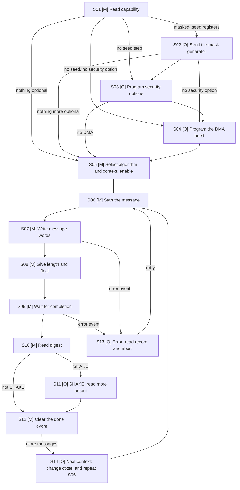

## 7. Clock, reset, and power

### 7.1 Clock domains

| Domain | Clock port | Edge | Frequency range | Source | Relationship to other clocks | Gating policy |
|---|---|---|---|---|---|---|
| CLK-CORE | i_clk_core | Rising | Sizing assumption 500 MHz maximum (ASM-003); no minimum stated | SoC clock controller | Asynchronous to CLK-APB when `PARA_CSR_ASYNC` = 1 | No clock gating cell in the IP; clock enables only (REQ-DFT-001) |
| CLK-APB | i_clk_apb | Rising | Any frequency; the generated register block works for any ratio when `PARA_CSR_ASYNC` = 1 | SoC clock controller | Same source as CLK-CORE when `PARA_CSR_ASYNC` = 0 (the integrator ties the two ports) | None |

The register clock port `i_clk_reg` of the generated block is connected to `i_clk_core`.

### 7.2 CDC and RDC

| Crossing ID | From → to | Signals | Structure | Reset handling | Constraints / verification |
|---|---|---|---|---|---|
| CDC-001 | CLK-APB ↔ CLK-CORE | APB request and response, register values | The generated `m_vlsit_csr_sha` with `PARA_ASYNCHRONOUS` = `PARA_CSR_ASYNC`, using the library synchronizer adapter `m_vlsit_csr_sync` (R-041) | Each side held in reset by its own reset; both released synchronously | `set_clock_groups -asynchronous` between the two clocks; CDC tool; simulation with clock ratios 1:1, 1:3 and 7:2 |
| CDC-002 | Outside → CLK-CORE | `i_dma_in_ack`, `i_dma_out_ack`, `i_ent_valid`, `i_ent_data`, `i_axi_*` | None inside the IP: the signals shall be synchronous to `i_clk_core` (ASM-008) | N/A (no such value for this item) | Integration check |
| CDC-003 | Reset release | `i_rst_n_core`, `i_rst_n_apb` | `m_vlsit_rst_sync` per domain, built from the library cells | Asynchronous assertion, synchronous release | Reset test |
| CDC-004 | CLK-CORE → outside | `o_irq`, `o_alarm`, `o_dma_*_req`, `o_ent_req` | None inside; the integrator synchronizes into the receiver clock | N/A (no such value for this item) | Integration check |

### 7.3 Reset domains and sequencing

| Reset ID | Port | Polarity / assertion | Sync or async | Scope | Deassertion | Reset value |
|---|---|---|---|---|---|---|
| RST-CORE | i_rst_n_core | Active-low | Async assertion / synchronized release | All logic of CLK-CORE: AXI4 interface, FIFOs, cores, sequencer, context memory control, CSR register side | Synchronous to i_clk_core through `m_vlsit_rst_sync` | All contexts free, FIFOs empty, registers at the workbook reset values |
| RST-APB | i_rst_n_apb | Active-low | Async assertion / synchronized release | APB side of `m_vlsit_csr_sha` | Synchronous to i_clk_apb | APB idle |
| RST-SOFT | `sha_cmd.srst` | Command, one operation | Synchronous | All contexts, FIFOs, cores, event flags, error record, lock; not the control, security and DMA registers | Ends when the command bit clears | Contexts free |

During reset the AXI4 and APB outputs are 0, no request is raised and `o_irq` and `o_alarm` are 0. A reset applied while a burst is in progress abandons the burst without a response. The context memory and the FIFO memories are not reset (resetless storage): their words are never read before a write because the context state, the FIFO level and the digest-ready state are reset (validity guard). With `PARA_ZERO` = 1 the clearing of 5.3 step 6 additionally removes message-dependent data. No warm, partial or retention reset is supported.

### 7.4 Power intent (if applicable)

N/A (no such value for this item). The IP has one power domain with no isolation, retention or power-down state; power intent is owned by the SoC.

## 8. Parameters and elaboration configurations

Parameters follow R-045 and the PAR-02 comment format of REF-003 in the RTL; this table gives the contract. All values are `logic [31:0]`.

| Parameter | Purpose | Default | Legal values / range | Dependencies / invalid combinations | Effect |
|---|---|---|---|---|---|
| PARA_EN_SHA224 | Build SHA-224 | 0 | 0, 1 | Needs core256 (built when SHA-224 or SHA-256 is on) | Capability bit 0 of `sha_cap0.alg` |
| PARA_EN_SHA256 | Build SHA-256 | 1 | 0, 1 | same | Bit 1 |
| PARA_EN_SHA384 | Build SHA-384 | 0 | 0, 1 | Needs core512 | Bit 2 |
| PARA_EN_SHA512 | Build SHA-512 | 0 | 0, 1 | same | Bit 3 |
| PARA_EN_SHA512_224 | Build SHA-512/224 | 0 | 0, 1 | same | Bit 4 |
| PARA_EN_SHA512_256 | Build SHA-512/256 | 0 | 0, 1 | same | Bit 5 |
| PARA_EN_SHA3_224 | Build SHA3-224 | 0 | 0, 1 | Needs the Keccak core | Bit 6 |
| PARA_EN_SHA3_256 | Build SHA3-256 | 0 | 0, 1 | same | Bit 7 |
| PARA_EN_SHA3_384 | Build SHA3-384 | 0 | 0, 1 | same | Bit 8 |
| PARA_EN_SHA3_512 | Build SHA3-512 | 0 | 0, 1 | same | Bit 9 |
| PARA_EN_SHAKE128 | Build SHAKE128 | 0 | 0, 1 | same | Bit 10 |
| PARA_EN_SHAKE256 | Build SHAKE256 | 0 | 0, 1 | same | Bit 11 |
| PARA_S256_UNR | SHA-256 rounds per cycle | 1 | Divisors of 64: 1, 2, 4, 8, 16, 32, 64 | Used only if a SHA-224 or SHA-256 is on | `sha_cap1.s256unr`; cycles per block (13) |
| PARA_S512_UNR | SHA-512 rounds per cycle | 1 | Divisors of 80: 1, 2, 4, 5, 8, 10, 16, 20, 40, 80 | Used only if a SHA-384 or SHA-512 type is on | `sha_cap1.s512unr` |
| PARA_KEC_UNR | Keccak rounds per cycle | 1 | Divisors of 24: 1, 2, 3, 4, 6, 8, 12, 24 | Shall be 1 when `PARA_MASK` = 1 (ASM-009) | `sha_cap1.kecunr` |
| PARA_S256_PIPE | Register stages in the SHA-256 round loop | 1 | 1 only in this revision (DEC-019); 2 to 4 reserved | Contexts hide the latency when `PARA_CTX_N` >= this value (13) | Cycles per block, maximum clock |
| PARA_S512_PIPE | Register stages in the SHA-512 round loop | 1 | 1 only in this revision (DEC-019) | same | same |
| PARA_KEC_PIPE | Register stages in the Keccak round loop | 1 | 1 only in this revision (DEC-019); 2 or more is needed by masking (stage 2) | Shall be at least 2 when `PARA_MASK` = 1 | same |
| PARA_CTX_N | Messages in progress | 1 | 1 to 16 | Context bits of the window address are [15:12] | `sha_cap0.ctxn`; size of FIFOs and context memory |
| PARA_CTX_MEM | Context memory kind | 0 | 0 = flip-flops; 1 = SRAM macro, reserved and illegal in this revision (DEC-016) | The macro flow is not defined (TBD-006) | Area and read latency of a context swap |
| PARA_AXI_DW | AXI data width | 64 | 32, 64, 128 | 128 only when every enabled block and rate is a multiple of 16 bytes: SHA-224, SHA-256, SHA-384, SHA-512, SHA-512/t and SHA3-224, no SHAKE (DEC-019) | `sha_cap0.axiw`, port widths |
| PARA_AXI_IDW | AXI ID width | 4 | 1 to 16 | None | Port widths |
| PARA_AXI_AW | AXI address width | 16 | 16 to 32 | Bits above 15 are ignored | Port width |
| PARA_IN_DEPTH | Input FIFO depth per context, in words | 64 | Power of 2, 4 to 1024 | (`PARA_IN_DEPTH` x `PARA_AXI_DW`/8) shall be at least the largest block of an enabled algorithm plus two words (DEC-019) | `sha_lvl.inlvl` range |
| PARA_OUT_DEPTH | Output FIFO depth per context, in words | 32 | Power of 2, 4 to 1024 | `PARA_OUT_DEPTH` x `PARA_AXI_DW`/8 shall be at least 64 B | `sha_lvl.outlvl` range |
| PARA_DMA | Build the external DMA handshake | 0 | 0, 1 | None | `sha_cap1.dma` |
| PARA_CSR_ASYNC | APB clock differs from core clock | 0 | 0, 1 | When 0 the integrator ties the clocks | `PARA_ASYNCHRONOUS` of the CSR block |
| PARA_ZERO | Build state clearing | 1 | 0, 1 | None | `sha_cap1.zero` |
| PARA_FAULT_DUP | Build duplicate-core detection | 0 | 0, 1 | Doubles the core area | `sha_cap1.fdup` |
| PARA_FAULT_PAR | Build parity detection | 0 | 0, 1 | One parity bit per 32 bits of state and of context memory | `sha_cap1.fpar` |
| PARA_FAULT_REDO | Build recompute detection | 0 | 0, 1 | Halves the throughput when selected | `sha_cap1.fredo` |
| PARA_MASK | Build the masked Keccak core | 0 | 0, 1 | Needs a Keccak algorithm on; `PARA_KEC_UNR` = 1; doubles the Keccak state and context memory | `sha_cap1.mask` |
| PARA_SEED_SRC | Seed source of the mask PRNG | 0 | 0 = entropy port, 1 = seed registers | Shall be 0 when `PARA_MASK` = 0 | `sha_cap1.sdsrc` |
| PARA_ALARM | Drive the alarm output | 0 | 0, 1 | Needs at least one fault parameter | `o_alarm` |

**Illegal combinations (REQ-PARAM-001).** All `PARA_EN_*` equal to 0; a `PARA_*_UNR` that does not divide the round count; a `PARA_*_PIPE` outside 1 to 4; `PARA_CTX_N` outside 1 to 16; `PARA_AXI_DW` not 32, 64 or 128; `PARA_AXI_AW` below 16; a FIFO depth that breaks its size rule; `PARA_MASK` = 1 with no Keccak algorithm, with `PARA_KEC_UNR` other than 1 or with `PARA_KEC_PIPE` below 2; `PARA_SEED_SRC` = 1 with `PARA_MASK` = 0; `PARA_ALARM` = 1 with no fault parameter; `PARA_CTX_MEM` = 1 (DEC-016); a `PARA_*_PIPE` other than 1 or `PARA_AXI_DW` = 128 with a block that is not a multiple of 16 bytes (DEC-019); and, until the second stage of the RTL is delivered, `PARA_MASK` = 1, `PARA_FAULT_DUP` = 1, `PARA_FAULT_PAR` = 1, `PARA_FAULT_REDO` = 1 and `PARA_SEED_SRC` = 1 (DEC-018). Each one stops elaboration with an error naming the cause (DEC-017): a `generate if` on the illegal condition instantiates a module whose name states it, `m_vlsit_sha_ERR_` followed by the cause, which does not exist, so elaboration fails with that name. **Example 1:** `PARA_CTX_N` = 17 makes elaboration stop with the unknown module `m_vlsit_sha_ERR_ctx_n_out_of_range`; `PARA_CTX_N` = 16 elaborates. **Example 2:** `PARA_CTX_MEM` = 1 stops with `m_vlsit_sha_ERR_ctx_mem_unsupported`.

| Configuration | Parameter overrides | Features/interfaces | Expected hierarchy | Elaboration/lint/synthesis target |
|---|---|---|---|---|
| CFG-BASE | Defaults (only `PARA_EN_SHA256` = 1) | SHA-256, one context | top, csr, axi_sub, in_fifo, out_fifo, seq, pad, core256, ctxmem | Elaborate, lint, synthesize |
| CFG-BOOT | `PARA_EN_SHA224`, `_SHA256`, `_SHA384`, `_SHA512` = 1; `PARA_S256_UNR` = 2; `PARA_S512_UNR` = 2; `PARA_DMA` = 1 | Secure boot | CFG-BASE plus core512, dma | same |
| CFG-STOR | `PARA_EN_SHA256`, `_SHA3_256`, `_SHAKE256` = 1; `PARA_S256_UNR` = 4; `PARA_KEC_UNR` = 2; `PARA_CTX_N` = 4; `PARA_AXI_DW` = 128; `PARA_DMA` = 1; `PARA_FAULT_PAR` = 1; `PARA_FAULT_REDO` = 1 | Storage controller | core256, keccak, fault, dma | same |
| CFG-FULL | All `PARA_EN_*` = 1; `PARA_CTX_N` = 16; `PARA_AXI_DW` = 128; `PARA_DMA`, `PARA_MASK`, `PARA_FAULT_DUP`, `PARA_FAULT_PAR`, `PARA_FAULT_REDO`, `PARA_ALARM`, `PARA_CSR_ASYNC` = 1; `PARA_KEC_PIPE` = 2 | Corner coverage | All blocks including keccak_dom, prng | same |

## 9. Data representation and arithmetic

**Message bytes.** Message byte i of a stream (i counted from 0) travels in word i / W of the window (W = `PARA_AXI_DW`/8 bytes) in lane i mod W, bits [8 x lane + 7 : 8 x lane] of the data bus (DEC-011). Software writes full words; the last word of a message carries the remaining bytes in its low lanes and `sha_len.tail` gives their count (0 means all W lanes).

**Digest bytes.** The digest and the SHAKE output are read from the digest window in the byte order of the standard: the first digest byte in lane 0 of the first word. SHA-2 words are big-endian inside the algorithm (REF-001 3.1); the IP does the byte order, so the digest bytes equal the standard's hexadecimal digest read left to right. Keccak lanes are little-endian (REF-002 B.1, the same order as the message).

| Quantity | Width | Encoding / range | Extension / truncation | Overflow / invalid behavior |
|---|---:|---|---|---|
| SHA-224 / 256 block, state, digest | 512 / 256 / 224 or 256 bits | 64-byte block, 8 x 32-bit words, digest bytes 28 or 32 | SHA-224 truncates the state to 224 bits (REF-001 6.3) | N/A (no such value for this item) |
| SHA-384 / 512 / 512-t block, state, digest | 1024 / 512 / 384, 512, 224 or 256 bits | 128-byte block, 8 x 64-bit words, digest bytes 48, 64, 28, 32 | SHA-512/t takes the leftmost t bits (REF-001 6.7); the initial values of 512/224 and 512/256 are those of REF-001 5.3.6 | N/A (no such value for this item) |
| SHA3 / SHAKE block (rate) | 1152, 1088, 832, 576 bits for SHA3-224, 256, 384, 512; 1344 and 1088 for SHAKE128 and SHAKE256 | Rate in bytes 144, 136, 104, 72, 168, 136 | Digest is the first 28, 32, 48, 64 bytes of the squeezed state (REF-002 6.1); SHAKE is unlimited | N/A (no such value for this item) |
| Padding | 1 to 2 blocks added | SHA-2: byte 0x80, zeros, 64-bit (SHA-224/256) or 128-bit (SHA-384/512) big-endian message length in bits; SHA-3: suffix 01 then pad10*1; SHAKE: suffix 1111 then pad10*1 | N/A (no such value for this item) | N/A (no such value for this item) |
| Message length | 61 bits of bytes | 0 to 2^61 - 1 bytes (DEC-009) | The 64-bit counter holds bytes; the bit length is bytes x 8 | A longer message sets the length-limit event and is discarded |
| Counters | 32 bits visible | `sha_blk.cnt`, `sha_byte.cnt`; internal byte counter 64 bits | Visible counters are the low 32 bits | Wrap at the maximum |
| Context number | 4 bits | 0 to `PARA_CTX_N` - 1 | N/A (no such value for this item) | A larger value sets the configuration error event |

Reserved and invalid values: reserved algorithm codes and unbuilt algorithms are rejected with the configuration error event and no state change. Reserved register bits read as 0. Don't-cares are not used on the external interfaces.

## 10. Detailed functional behavior

### 10.1 Modes and state transitions

State of one context (read in `sha_sts.cstate` for the selected context).

| Mode/state | Entry condition | Behavior | Exit condition | Outputs / side effects |
|---|---|---|---|---|
| FREE | Reset, soft reset, abort, last digest word read with `PARA_ZERO`, digest read without it | Context unused; its window rejects writes | `sha_cmd.init` accepted | None |
| ABSORBING | `init` accepted | Message window accepts words; full blocks go to the core | `final` accepted, abort, fault lock | `sha_blk.cnt`, `sha_byte.cnt` count |
| FINALIZING | `final` accepted | Remaining bytes padded and processed (one or two blocks) | Last block stored | Window closed to writes |
| DIGEST_READY | Last block done (SHA-2, SHA-3) or first block done (SHAKE) | Digest in the output FIFO | Last digest word read, abort | `sha_irq_raw.cdone`, `sha_sts.ready` |
| SQUEEZING | SHAKE only: digest window read past the first block | Next output block produced when the FIFO has room | Abort, soft reset | None |
| LOCKED | Fault with the lock response | All contexts refuse commands and windows | Soft reset command | `sha_sts.locked` |

### 10.2 Operations

| Operation ID | Inputs / preconditions | Processing semantics | Result / completion | Latency / ordering |
|---|---|---|---|---|
| OP-001 | `sha_ctrl.algo`, `sha_ctrl.ctxsel`; context FREE; algorithm built | `sha_cmd.init`: load the initial hash value or clear the Keccak state; clear counters and FIFOs of the context | Context ABSORBING; `sha_cmd.init` bit clears | 2 core cycles; ordered before the first word |
| OP-002 | Context ABSORBING; AXI4 burst to the message window | Push words in order; assemble blocks | Words in the FIFO; `bresp` OKAY | 1 cycle per accepted beat; backpressure when full |
| OP-003 | All words written; `sha_len.tail` | `sha_cmd.final`: pad the last block (REQ-FUNC-004) and process | Context DIGEST_READY | Block time of 13 for each padded block |
| OP-004 | Context DIGEST_READY; AXI4 read of the digest window | Pop digest words in order | `rdata` words; context FREE after the last word | 1 cycle per beat when the FIFO has data |
| OP-005 | SHAKE context; reads continue | Squeeze: run Keccak-f again and refill the FIFO | More output words | One block time per rate bytes |
| OP-006 | Any state | `sha_cmd.abort`: clear the context, FIFOs and state | Context FREE | 2 cycles |
| OP-007 | Any state | `sha_cmd.srst`: clear all contexts, cores, flags, error record, lock | All FREE | 4 cycles |
| OP-008 | Any state | `sha_cmd.clear`: zero the state memory and FIFOs of the selected context, keep the algorithm field | Context FREE | 2 cycles plus memory size |
| OP-009 | `PARA_MASK` = 1, `PARA_SEED_SRC` = 1; eight `sha_seed` words written | `sha_cmd.seed`: load the PRNG | `sha_sts.seeded` = 1 | 9 cycles |
| OP-010 | `sha_ctrl.dmaen` = 1 | Request, acknowledge, burst moves words | Words in or out without the CPU | 4-phase handshake |
| OP-011 | Fault enabled and mismatch | Apply `sha_sec.resp`: gate, lock, clear, alarm | `sha_irq_raw.flt`; `o_alarm` as selected | The response is active in the cycle after the mismatch is registered |

### 10.3 Cycle-level behavior

**Waveform plan (rule R-024).** Proposed and confirmed by the user on 2026-11-09 (option C: the proposed list plus corner cases WF-017 to WF-019). The waveforms show design intent derived from sections 6.3 and 10.2; they are not simulation output. Each figure has its WaveJSON source beside it in the folder `figures`; notes follow the table.

| Waveform ID | Function / operation | Scenario (success / error / corner) | Signals shown | Figure | Confirmed by user |
|---|---|---|---|---|---|
| WF-001 | OP-001, OP-002 write burst of the message window | Success | `i_axi_aw*`, `i_axi_w*`, `o_axi_b*`, `sha_lvl.inlvl` | Not drawn | Pending |
| WF-002 | OP-002 | Error: partial `wstrb` or WRAP burst, SLVERR | `i_axi_w*`, `o_axi_bresp`, `o_irq` | Not drawn | Pending |
| WF-003 | OP-002 | Corner: input FIFO full, `o_axi_wready` low | `o_axi_wready`, FIFO level | Not drawn | Pending |
| WF-004 | OP-003 | Success: final, padding, digest ready, `cdone` | `sha_cmd.final`, core busy, `o_irq` | Not drawn | Pending |
| WF-005 | OP-004 | Success: read digest burst | `i_axi_ar*`, `o_axi_r*` | Not drawn | Pending |
| WF-006 | OP-004 | Error: read of an empty digest FIFO | `o_axi_rdata`, `udf` event | Not drawn | Pending |
| WF-007 | OP-001 | Success and error: APB init, non-secure access PSLVERR | `i_apb_*`, `o_apb_*` | Not drawn | Pending |
| WF-008 | OP-002, OP-003 | Corner: two contexts interleaved, state save and restore | Context number, core load and store | Not drawn | Pending |
| WF-009 | OP-005 | Corner: SHAKE squeeze of more than one block | Output FIFO level, core | Not drawn | Pending |
| WF-010 | OP-010 | Success: DMA input 4-phase handshake | `o_dma_in_req`, `i_dma_in_ack` | Not drawn | Pending |
| WF-011 | OP-010 | Corner: DMA output timeout, padded burst | `o_dma_out_req`, `sha_dvld.words` | Not drawn | Pending |
| WF-012 | OP-011 | Error: fault detected, gate, lock, alarm | `o_alarm`, `sha_sts.locked` | Not drawn | Pending |
| WF-013 | OP-009 | Corner: masked core entropy request | `o_ent_req`, `i_ent_valid` | Not drawn | Pending |
| WF-014 | OP-006, OP-007, OP-008 | Corner: abort, soft reset, state clearing | Context state, FIFO levels | Not drawn | Pending |
| WF-015 | Reset | Reset assertion and release in both domains | `i_rst_n_*`, outputs | Not drawn | Pending |
| WF-016 | CDC-001 | Corner: APB write with asynchronous clocks, PREADY wait | `i_apb_*`, `o_apb_pready` | Not drawn | Pending |
| WF-017 | OP-003 | Corner: final command while the core is busy and the input FIFO holds words | Command, core busy, FIFO level | Not drawn | Pending |
| WF-018 | OP-003 | Corner: message that needs two padded final blocks | Block kind, core start, event | Not drawn | Pending |
| WF-019 | OP-001, OP-003 | Corner: context select changed while the core is busy | `sha_ctrl.ctxsel`, level and state read-back | Not drawn | Pending |

@@WF_NOTES@@

Cycle table of one SHA-256 block with `PARA_S256_UNR` = 1 and `PARA_S256_PIPE` = 1 (formula of 13; to be confirmed in simulation, TBD-001):

| Cycle / event | Input condition | State/action | Output condition |
|---|---|---|---|
| t0 | Context has a full block, core free | Sequencer selects the context, starts the load | Core busy |
| t1 | State available from the context memory | Working variables and the first message words loaded | Core busy |
| t2 to t65 | None | One round per cycle, rounds 0 to 63 | Core busy |
| t66 | Round 63 done | Intermediate hash added to the state, state written back | Core free in t67 |

### 10.4 Arbitration, buffering, and throughput

- **Arbitration.** The sequencer chooses the next context for a free core by round robin among the contexts that have a complete block (or a final block); a context is never taken from a core in the middle of a block. A context that waits is served within `PARA_CTX_N` block times (starvation bound).
- **Buffering.** Input FIFO of `PARA_IN_DEPTH` words per context and output FIFO of `PARA_OUT_DEPTH` words per context; simultaneous push and pop are allowed; full means `wready` low; empty means a read returns zero with the underflow event.
- **Cores.** One SHA-256 core, one SHA-512 core and one Keccak core at most, each shared by all contexts. In this revision only one block is in a core at any time, and the sequencer assembles the next block in a prefetch slot while the core runs (DEC-019).
- **Latency hiding.** Loop pipeline stages (`PIPE` > 1) that hide latency with several contexts are not built in this revision (DEC-019); a block takes `R / UNR + 2` cycles and the next block is assembled during it.
- **Ordering.** Words and digests of one context keep their order; no order is promised between contexts.

### 10.5 Memories and storage

| Storage ID | Kind | Depth × width | Ports | Read latency | Write mask | Reset/init | ECC/parity | Implementation |
|---|---|---|---|---|---|---|---|---|
| MEM-001 | Input FIFO (per context) | `PARA_IN_DEPTH` x `PARA_AXI_DW` | 1 write, 1 read | 1 cycle (first-word fall-through) | None | Not reset; level reset | Parity when `PARA_FAULT_PAR` | Reuses the library synchronous FIFO (002_SyncFIFO), inferred |
| MEM-002 | Output FIFO (per context) | `PARA_OUT_DEPTH` x `PARA_AXI_DW` | 1 write, 1 read | 1 cycle | None | Not reset; level reset | Parity when `PARA_FAULT_PAR` | same |
| MEM-003 | Context memory | `PARA_CTX_N` x 256, 512 or 1600 bits plus 80 bits of control (width of the largest core built; twice the Keccak part when `PARA_MASK`) | 1 read, 1 write | 1 cycle (flip-flops) or macro latency | None | Not reset; context state reset | Parity when `PARA_FAULT_PAR` | Flip-flops or SRAM macro by `PARA_CTX_MEM` |

The context memory is read when a block starts and written when it ends; both ports are used by the sequencer only, so a collision is not possible. A context in the FREE state is never read. With `PARA_CTX_MEM` = 1 the macro, wrapper and memory-compiler flow are chosen by the integrator (TBD-006).

## 11. Register and programming model

### 11.1 CSR specification source

The CSR specification of this IP is defined only in the workbook REF-005. This document names registers and fields as written there and does not restate offsets, widths, types or reset values.

| Item | Specification |
|---|---|
| CSR workbook file | `csr/VLSIT_SHA2_SHA3_HASH_CSR.xlsx` in the folder of this specification, built from `csr/sha_regs.json` by `csr/gen_sha_csr_json.py` and `vlsit_csr_tool.py fill --auto-reserved` |
| Sheet used for this IP | `ASYNC_CSR` |
| Workbook revision / date | Revision 1 (`sha_cap0.rev` = 1), 2026-11-09 |
| CSR generator | APB-CSR-Generator, version 3.4, commit c40f319 (`https://github.com/nguyenquanicd/APB-CSR-Generator`) |
| CSR module name | `m_vlsit_csr_sha` |
| Register prefix | `sha` |
| Asynchronous | 1 in the workbook; the module parameter `PARA_ASYNCHRONOUS` is set from `PARA_CSR_ASYNC` |
| APB clock and register clock | `i_clk_apb` is the APB clock (CLK-APB); `i_clk_reg` is connected to `i_clk_core` (CLK-CORE) |
| Source of `i_protect_en` and `i_slverr_en` | IP input ports of the same names, constant after reset |

Registers: capability (`sha_cap0`, `sha_cap1`), control (`sha_ctrl`), command (`sha_cmd`, type `rwi`), length (`sha_len`), DMA (`sha_dmac`), security (`sha_sec`), seed (`sha_seed`, eight write-only words, `PARAMETERIZED` repeat), status (`sha_sts`, `sha_lvl`, `sha_blk`, `sha_byte`, `sha_dvld`), error record (`sha_err`, `sha_erra`), interrupts (`sha_irq_raw`, `sha_irq_en`, `sha_irq_inj`, `sha_irq_sts`). The registers are global; the field `sha_ctrl.ctxsel` selects the context to which the commands, `sha_len` and the read-back registers refer (DEC-012). Software that serves several contexts from several threads shall serialize its accesses to `sha_ctrl.ctxsel` (ASM-010).

### 11.2 Software sequences

| No. | Step | Option (M/O) | Interface | CSR | Description |
|---|---|---|---|---|---|
| S01 | Read capability | M | APB4 read | Read `sha_cap0.alg`, `sha_cap0.ctxn`, `sha_cap0.axiw`, `sha_cap1.*` | Learn which algorithms, contexts, unrolling and options this instance has before programming |
| S02 | Seed the mask generator | O (when `sha_cap1.mask` = 1 and `sha_cap1.sdsrc` = 1) | APB4 write and read | Write eight words to `sha_seed[0]` to `sha_seed[7]`.`wd`; write `sha_cmd.seed` = 1; poll `sha_sts.seeded` until 1 | Give the random generator its seed; with the entropy port this step is not needed |
| S03 | Program security options | O (when a security option is wanted) | APB4 write | Write `sha_sec.zero`, `sha_sec.fault`, `sha_sec.fdup`, `sha_sec.fpar`, `sha_sec.fredo`, `sha_sec.resp` while `sha_sts.idle` = 1 | Select clearing, fault detection and fault responses; only options built in `sha_cap1` may be set |
| S04 | Program the DMA burst | O (when an external DMA moves the data) | APB4 write | Write `sha_dmac.burst`, `sha_dmac.tmo`; write `sha_ctrl.dmaen` = 1 | Match the burst of the IP to the DMA controller |
| S05 | Select algorithm and context, enable | M | APB4 write | Write `sha_ctrl.algo`, `sha_ctrl.ctxsel`, `sha_ctrl.mask` (if wanted), `sha_ctrl.en` = 1 | Choose the algorithm for the next message and the context it runs in |
| S06 | Start the message | M | APB4 write and read | Write `sha_cmd.init` = 1; poll until the bit reads 0 | Load the initial value and clear the counters and the FIFOs of the context |
| S07 | Write message words | M | AXI4 write bursts to the message window of the context, or external DMA | Optional read of `sha_lvl.inlvl` before writing; `sha_byte.cnt` to check progress | Stream the message in whole words; the IP does not need padding bytes |
| S08 | Give length and final | M | APB4 write | Write `sha_len.tail`; write `sha_cmd.final` = 1 | Tell the IP the number of valid bytes of the last word and that the message is complete |
| S09 | Wait for completion | M | APB4 read or interrupt | Wait for `o_irq` with `sha_irq_en.cdone` bit set, or poll `sha_sts.ready` = 1 | Digest becomes ready; interrupt avoids polling |
| S10 | Read digest | M | AXI4 read burst from the digest window of the context, or external DMA | Optional read of `sha_lvl.outlvl` and `sha_dvld.words` | Read the digest bytes in the standard order |
| S11 | SHAKE: read more output | O (SHAKE) | AXI4 read | None | Keep reading the window; the IP squeezes the next block when the FIFO has room |
| S12 | Clear the done event | M | APB4 write | Write 1 to `sha_irq_raw.cdone` bit of the context | Release `o_irq` and prepare the next message |
| S13 | Error: read record and abort | O (on an error event) | APB4 read and write | Read `sha_err.kind`, `sha_err.ctx`, `sha_erra.addr`; write 1 to the raised bit of `sha_irq_raw`; write `sha_cmd.abort` = 1 | Find the cause and bring the context back to FREE |
| S14 | Next context | O (more than one message) | APB4 write | Change `sha_ctrl.ctxsel` and `sha_ctrl.algo`; repeat from S06 | Start another interleaved message while earlier ones are processed |

### 11.3 CSR connection to the design

A software write to an `rwi` field wins over a hardware load of the same field in the same cycle; the command bits of `sha_cmd` are loaded to 0 by hardware when the command is accepted, so the sequencer repeats the load of 0 in the next cycle if a software write coincided. A hardware load to a `w1c` field wins over a software clear, so a new event is kept.

@@CSR_TABLE@@

### 11.4 APB access behavior of the CSR

Behavior of the generated module (APB-CSR-Generator 3.4, workbook with Asynchronous = 1). The behavior was read from the generator specification and was not simulated for this workbook (TBD-004).

| Case | Behavior |
|---|---|
| Normal read or write | PREADY comes after wait states that depend on the clock ratio of `i_clk_apb` and `i_clk_core`; software waits for PREADY |
| Write with PSTRB not all ones | PSLVERR and no change when `i_slverr_en` = 1; whole-word write when 0 |
| Address not word aligned | PSLVERR when `i_slverr_en` = 1 |
| Aligned address that is not a register | OKAY; read returns 0; write is ignored |
| Non-secure access (PPROT[1] = 1) | PSLVERR when `i_protect_en` = 1 and `i_slverr_en` = 1 |
| Write-only registers (`sha_seed`) | Reads return 0 without an error; the written words are held until the seed command copies them and are then cleared by the IP |
| Reserved bits | Read as 0; write ignored |
| Reset | Registers take the workbook reset value; asynchronous assertion, release synchronous to the register clock |

## 12. Error handling and recovery

| Error ID | Detection condition | Observable response/status | Interrupt | Clear/recovery | Reset behavior |
|---|---|---|---|---|---|
| ERR-001 | Write to a full or non-absorbing message window | Words dropped, `bresp` SLVERR; `sha_err.kind` = 1; `sha_err.ovf` counts | `sha_irq_raw.ovf` | Write 1 to the raw bit; abort the context if needed | Event and record cleared by reset and soft reset |
| ERR-002 | Read of an empty output FIFO | `rdata` 0; `sha_err.kind` = 2; `sha_err.udf` counts | `sha_irq_raw.udf` | Write 1 | Cleared by reset |
| ERR-003 | Wrong window direction, bad context number, WRAP burst, narrow size, partial `wstrb` | SLVERR; `sha_err.kind` = 3 or 4; `sha_erra.addr` gives the address | `sha_irq_raw.axi` | Write 1 | Cleared by reset |
| ERR-004 | Command or value rejected: algorithm not built, context busy or out of range, `sha_len.tail` too large, `sha_dmac.burst` illegal, `final` while not absorbing, `seed` with entropy-port source | No state change | `sha_irq_raw.cfg` | Write 1 | Cleared by reset |
| ERR-005 | Fault detection mismatch (duplicate, parity, recompute) | Responses of `sha_sec.resp`; `sha_sts.locked` when locked; context state 0xF | `sha_irq_raw.flt` | Soft reset command | Lock cleared by soft reset |
| ERR-006 | Masked core needs random bits and the PRNG is not seeded or has no entropy | The core waits; no masked block runs | `sha_irq_raw.ent` | Seed or supply entropy; write 1 | Cleared by reset |
| ERR-007 | DMA burst timer expired with a short digest | Burst padded with zeros; `sha_dvld.words` valid count | `sha_irq_raw.tmo` | Read `sha_dvld.words`; write 1 | Cleared by reset |
| ERR-008 | Message longer than 2^61 - 1 bytes | Digest discarded; `sha_err.kind` = 5; context returns to FREE | `sha_irq_raw.len` | Write 1 | Cleared by reset |
| ERR-009 | APB errors (not aligned, partial strobe, non-secure) | PSLVERR by the generated block (11.4) | None | None | None |

Precedence of simultaneous errors: ERR-005 over all others (the lock removes the other work); the others set their own bits at the same time and `sha_err.kind` keeps the lowest number. Retry policy: dropped words are not retried by the IP (software resends the whole message after abort); a rejected command is not queued.

## 13. Performance, power, and area

Time of one block of a core (DEC-006, to be confirmed by simulation, TBD-001), with `R` rounds (64, 80 or 24), `UNR` rounds per cycle and `PIPE` loop stages:

$$ T_{blk} = \frac{R}{UNR} \cdot PIPE + 2 \text{ cycles (one context)} \qquad T_{blk} = \frac{R}{UNR} + 2 \text{ cycles (at least } PIPE \text{ contexts ready)} $$

The throughput of a core is the block size divided by $T_{blk}$. At 500 MHz (sizing assumption ASM-003, PIPE = 1):

| Case | Block bits | Cycles per block | Bits per cycle | Throughput at 500 MHz |
|---|---:|---:|---:|---:|
| SHA-256, UNR 1 | 512 | 66 | 7.76 | 3.88 Gbit/s |
| SHA-256, UNR 2 (CFG-BOOT) | 512 | 34 | 15.06 | 7.53 Gbit/s |
| SHA-256, UNR 4 (CFG-STOR) | 512 | 18 | 28.44 | 14.2 Gbit/s |
| SHA-512, UNR 1 | 1024 | 82 | 12.49 | 6.24 Gbit/s |
| SHA-512, UNR 2 (CFG-BOOT) | 1024 | 42 | 24.38 | 12.2 Gbit/s |
| SHA3-256, UNR 1 | 1088 | 26 | 41.85 | 20.9 Gbit/s |
| SHA3-256, UNR 2 (CFG-STOR) | 1088 | 14 | 77.71 | 38.9 Gbit/s |
| SHA3-512, UNR 1 | 576 | 26 | 22.15 | 11.1 Gbit/s |
| SHA3-256 masked, UNR 1, PIPE 2 | 1088 | 50 | 21.76 | 10.9 Gbit/s |

Checks of the user's numbers: 4 MiB of SHA-256 is 65536 blocks plus one padding block, 65537 x 34 = 2,228,258 cycles = 4.46 ms at 500 MHz, below 5 ms (REQ-PERF-001, margin 11 %); with SHA-384, 32769 x 42 = 1,376,298 cycles = 2.75 ms. SHA-256 UNR 2 reaches 7.53 Gbit/s, which is below 8 Gbit/s, so the storage target needs UNR 4 (14.2 Gbit/s) or SHA3-256 (REQ-PERF-002). The AXI4 window at 64-bit and 500 MHz carries 32 Gbit/s, so the bus does not limit these cases. Selecting recompute detection halves the throughput; selecting duplicate or parity detection does not change the cycle count. These figures are estimates from the formula and the sizing clock; the hard requirements are the 5 ms and 8 Gbit/s limits at the frequency the integrator achieves (maximum frequency needed: 4 MiB in 5 ms with 65537 x 34 cycles requires at least 446 MHz).

| Metric ID | Metric | Target / limit | Conditions | Measurement method | Hard / goal |
|---|---|---|---|---|---|
| PPA-001 | Maximum frequency | At least 446 MHz for CFG-BOOT (derived above); other configurations not stated | Library, corner and voltage not chosen (TBD-005) | STA with the SDC of section 17 | Goal until the library is chosen |
| PPA-002 | Area | Not stated | Library not chosen | Cell area from synthesis | TBD-005 |
| PPA-003 | Dynamic and leakage power | Not stated | Activity and corner not chosen | Tool power report | TBD-005 |
| PERF-001 | 4 MiB SHA-256 or SHA-384 hash time | At most 5 ms | CFG-BOOT, 500 MHz sizing | Cycle count in simulation, analysis above | Hard (user) |
| PERF-002 | Sustained throughput | At least 8 Gbit/s | CFG-STOR, one SHA-256 or SHA3-256 stream | Cycle count in simulation | Hard (user) |
| PERF-003 | Cycles per block | Formula above, tolerance 2 cycles | Every configuration | Simulation | Hard |

Timing closure is not claimed from RTL synthesis alone; nothing was synthesized for this draft.

